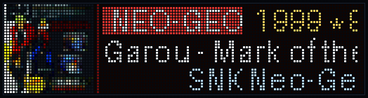
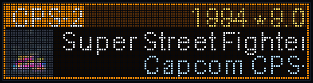
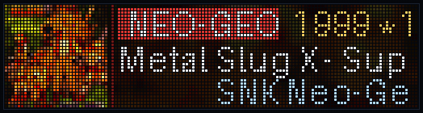
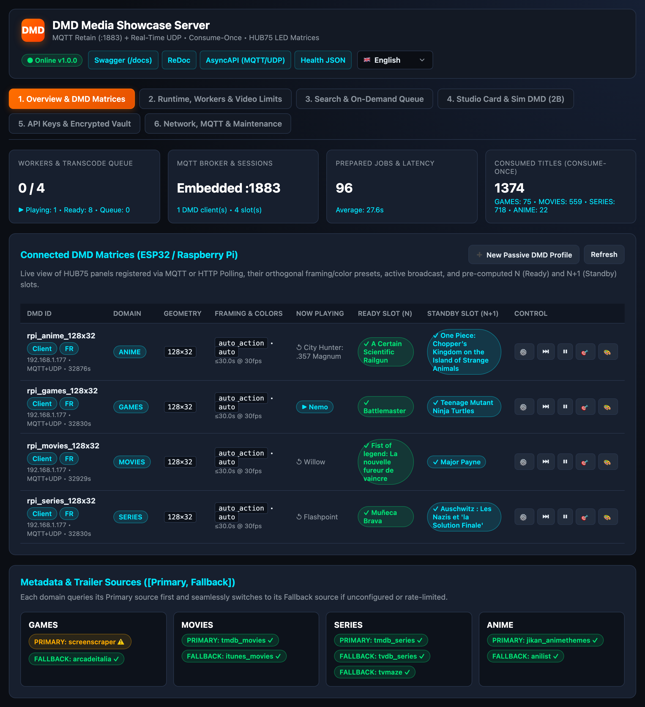
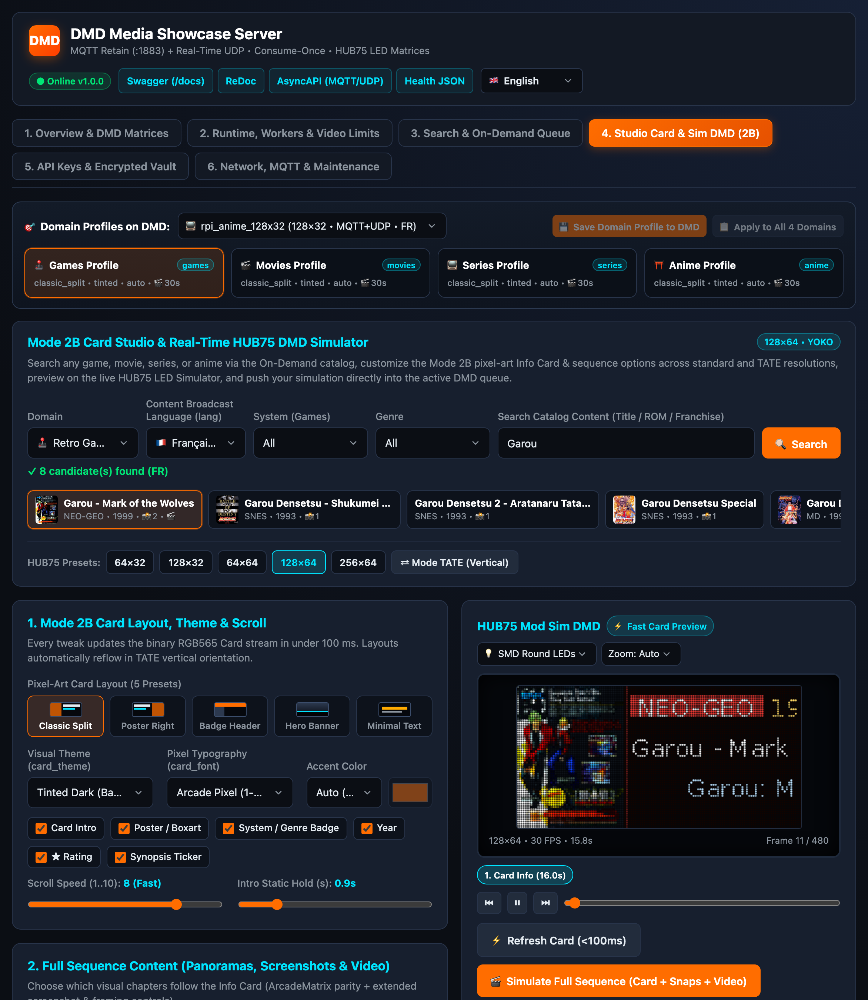
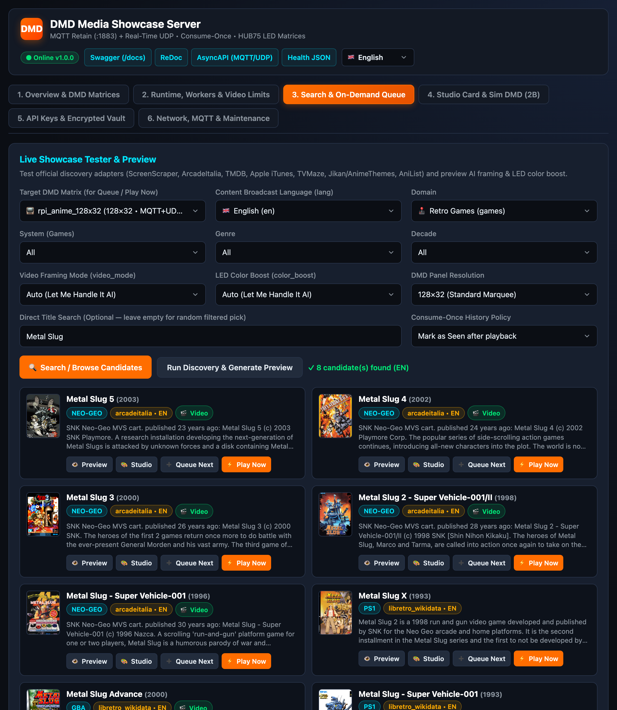
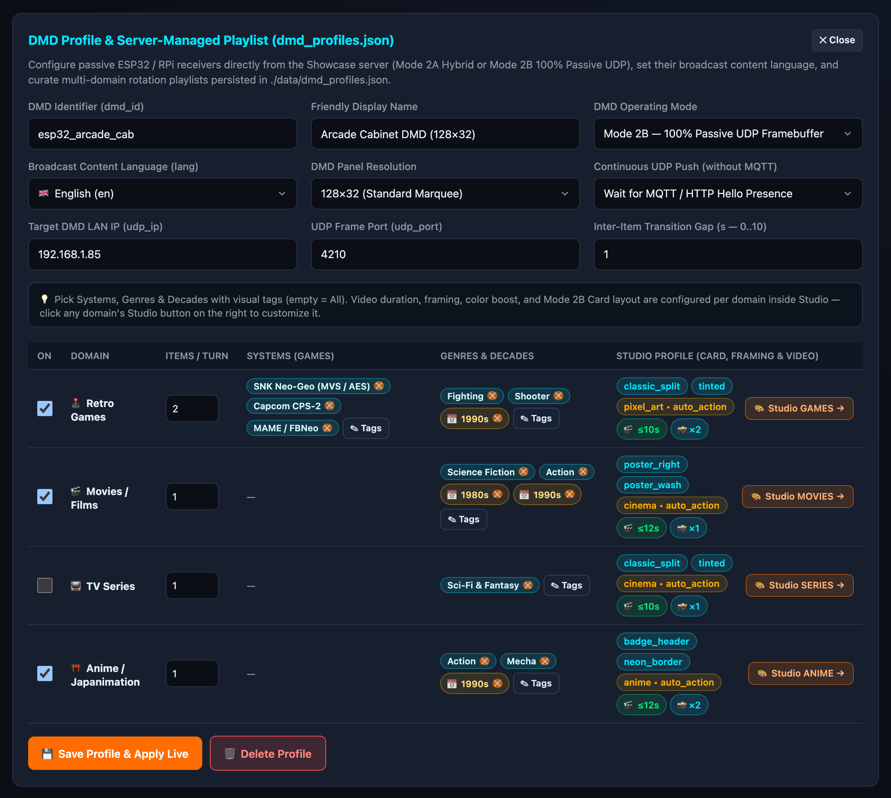
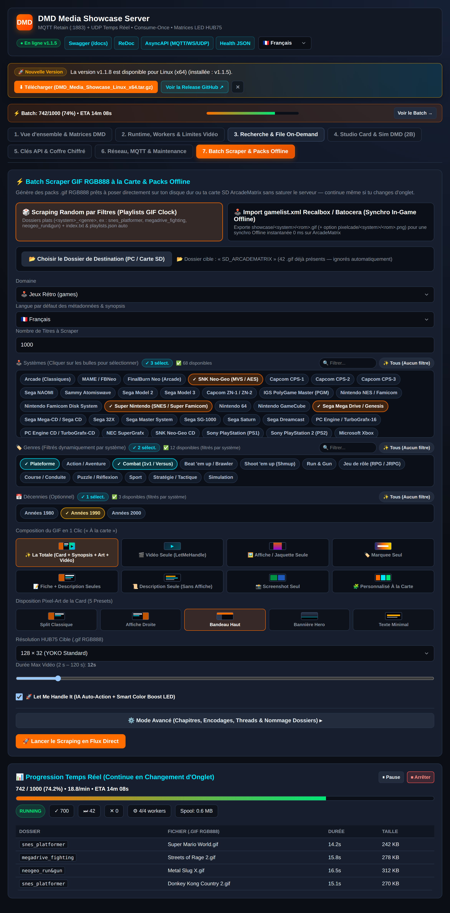
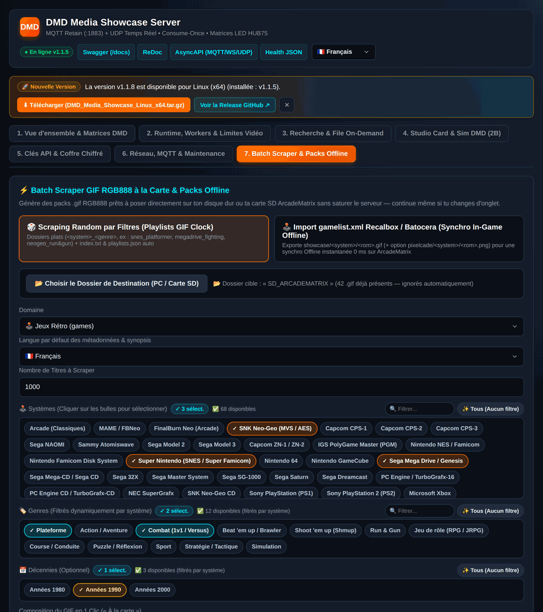

# DMD Media Showcase Server

🇬🇧 English | 🇫🇷 [Français](README_FR.md) | 🇪🇸 [Español](README_ES.md)

[](https://t.me/+DrSdAO8UMUViNmE0)
[](https://ko-fi.com/red1l)

💬 **Telegram Community:** [https://t.me/+DrSdAO8UMUViNmE0](https://t.me/+DrSdAO8UMUViNmE0)  
☕ **Support the Project on Ko-fi:** [https://ko-fi.com/red1l](https://ko-fi.com/red1l)

**No more hunting for video sources or managing thousands of static GIFs on an SD card.**  
**DMD Media Showcase** is the turnkey companion application for **[ArcadeMatrix (ESP32 / ESP32-S3)](https://github.com/red77290/ArcadeMatrix)** and **[ArcadeMatrix_RPi](https://github.com/red77290/ArcadeMatrix_RPI)** HUB75 LED displays: it automatically discovers and streams **Retro Games, Movies, TV Series, and Anime** **with zero repetition** in **lossless 16-bit RGB565** (`MQTT + HTTP DMDZ v2 / DMDS` and passive UDP `DMDF`), and enriches live game launches on **Recalbox / Batocera / RetroPie**.

> [!TIP]
> ### ⚡ Zero Configuration: Launch the `.exe` or `.dmg` and It Runs Out of the Box!
> 1. **Download and run** 👉 **[Latest GitHub Release](https://github.com/red77290/dmd_media_showcase/releases/latest)**: double-click **`dmd-media-showcase.exe`** (Windows `.zip`), open **`DMD Media Showcase.app`** (macOS `.dmg`), run `./start_showcase.sh` (Linux `.tar.gz`), or start the **Docker** container.
> 2. **0 config, 0 accounts required**: Python, FFmpeg, the embedded MQTT broker, and **all encrypted API keys are already bundled inside**. It automatically advertises itself on your local network (`dmdmediashowcase.local:8890`) — just flip the Showcase toggle ON in your DMD Web UI and it starts streaming immediately.
> 3. **Built-in Web App when you want to go further**: open `http://localhost:8890/` (or `http://dmdmediashowcase.local:8890/`) anytime you want to explore **customization** (Card Studio with live LED simulator, system/genre/decade filters, instant title search & on-demand queue, source priority) or **real-time monitoring** of connected matrices and active streams.

---

## 🎬 Live HUB75 DMD Output & Web Control Center

### 🕹️ Real 128×32 HUB75 LED Matrix Sequences (Generated Live via the Showcase API)

Every title automatically assembles a complete multi-chapter RGB565 broadcast tailored to your panel geometry (`128×32` classic `4:1` DMD shown below):
**`1. Animated Info Card`** (boxart, system badge, auto-scrolling year/rating & smooth ticker) $\to$ **`2. Zoom-to-Cover Boxart & Marquee Panoramas`** $\to$ **`3. In-Game Screenshot Scan`** $\to$ **`4. AI-Framed Gameplay / Trailer Video`**.

| **Garou: Mark of the Wolves (`Neo Geo` • `128×32`)** | **Super Street Fighter II X / Turbo (`CPS2` • `128×32`)** | **Metal Slug X (`Neo Geo` • `128×32`)** |
| :---: | :---: | :---: |
|  |  |  |
| `Classic Split` • `Tinted` • `auto_action` + `pixel_art` | `Badge Header` • `Neon Border` • `auto_action` + `pixel_art` | `Classic Split` • `Poster Wash` • `auto_action` + `pixel_art` |

### 🖥️ Multilingual Web Control Center (`EN` / `FR` / `ES`)

| **1. Live Overview & Connected HUB75 Matrices** | **2. Card Studio & Real-Time HUB75 LED Simulator** |
| :---: | :---: |
| [](demo/ui_overview_live.png) | [](demo/ui_card_studio.png) |
| Live MQTT (`:1883`) + transport telemetry (`MQTT+TCP` default, `HTTP`, `UDP-PASSIVE`, optional `MQTT+UDP`), pre-warmed `Ready (N)` & `Standby (N+1)` slots with live source badges (`🔗 igdb+screenscraper`), Consume-Once history, and hot-editable multi-source scraper chains. | Per-domain profiles (`Games`, `Movies`, `Series`, `Anime`), 5 pixel-art layouts (YOKO & TATE), live SMD LED simulator, and `0 ms` injection into any connected DMD queue. |
| **3. Multi-Catalog Search & On-Demand Priority Queue** | **4. Passive DMD Profiles & Visual Multi-Tag Rotation** |
| [](demo/ui_ondemand_search.png) | [](demo/ui_passive_rotation.png) |
| Search Games (including player shorthands like `sf2x`, `3s`, `kof98`), Movies, TV Series, and Anime in your preferred language and push titles via `Queue Next` (`FIFO`) or immediate `Play Now` preemption. | Configure Mode 2A/2B server-driven playlists with interactive System, Genre & Decade tag pickers and direct links to each domain's Studio profile. |
| **5. À-la-Carte `RGB888` GIF Batch Scraper & Offline Packs (PC / Docker)** | **6. Mobile Responsive UI (iPhone / Android) & Live Demo** |
| [](demo/ui_batch_scraper.png) | [](demo/ui_batch_scraper_mobile.png) |
| Random filter scraping (`snes_platformer`, `neogeo_run&gun` + `playlists.json`) or Recalbox/Batocera `gamelist.xml` import (`showcase/<sys>/<rom>.gif`), à-la-carte chapters (`2s–120s`), direct-to-folder/SD streaming that continues in background tabs. | Touch-first mobile layout ([view full Smartphone capture](demo/ui_batch_scraper_mobile.png)) with automatic Screen Wake Lock, non-blocking server build, and 1-tap `.zip` download straight to **Files / Downloads**. |

---

## 🧭 Online Mode vs Offline Mode vs Hybrid Mode — Which One Should I Choose?

Zero technical knowledge needed — **DMD Media Showcase** lets you pick between **live Wi-Fi streaming** and **100% standalone MicroSD packs** (or combine both automatically):

| Your situation | Recommended mode | What to do |
| :--- | :--- | :--- |
| 🌐 **"I have Wi-Fi and a PC / Mac / NAS: I want zero SD card file copying"** | **100% ONLINE Mode** *(Live Stream)* | Start Showcase and enable **Showcase Server** on your DMD (`🟢 Communication OK`). Everything streams live with zero repeats. |
| 🕰️ **"I want 500 or 1,000 GIFs sorted by console/genre for my Clock with my PC turned off"** | **OFFLINE Mode — Clock Playlists** | Open **Tab `7. Batch Scraper`**, pick your filters + à-la-carte preset, and drop the generated folders (`snes_platformer`, `neogeo_run&gun`... + `playlists.json`) into `/gifs/` on your SD card. |
| 🕹️ **"I have a Recalbox / Batocera cabinet with no PC server or Internet"** | **OFFLINE Mode — In-Game Sync** | Import your `gamelist.xml` file(s) in **Tab `7. Batch Scraper`**, then copy `showcase/` and `pixelcade/` to the root of your SD card: Info Card + Gameplay Video launch in **`0 ms`** every time you start a game! |
| ⚡ **"I want instant `0 ms` SD packs for my favorites AND endless live discovery when my PC is on"** | **HYBRID Mode** *(Automatic)* | Keep `showcase/` on your SD card **and** leave **Showcase Server** enabled: your DMD always plays local SD GIFs first (`0` network traffic) and queries the server only for games missing from the SD card. |

👉 **[📖 Read the Complete Step-by-Step Beginner Tutorial (PC, Docker/NAS & Smartphone): `docs/TUTORIAL_ONLINE_OFFLINE_SCRAPING.md`](docs/TUTORIAL_ONLINE_OFFLINE_SCRAPING.md)**

---

## ✨ Key Features

- **4 Showcase Domains & Configurable Multi-Source Chains (`games`, `movies`, `series`, `anime`)**:
  - **Retro & Arcade Games (`55+` / `66` Canonical Systems)**: Arcade boards (`MAME`, `CPS-1/2/3`, `Neo-Geo`, `NAOMI`, `Atomiswave`, `Model 2/3`), Consoles, Handhelds, and Classic Computers powered by **4 independent selectable sources**:
    1. **`igdb`** (`IGDB API v4` via free Twitch OAuth2 — 200+ platforms, instant acronym/alias search via `alternative_names`, random offset discovery, covers/artworks & trailers).
    2. **`screenscraper`** (`ScreenScraper` — clean détouré wheels/marquees, pixel-art snaps, short `.mp4` video snaps, with automatic HTTP-200 plaintext quota/overload detection & cooldown circuit-breaker).
    3. **`arcadeitalia`** (keyless authoritative MAME/CPS/Neo-Geo/NAOMI HTTPS scraper with built-in shorthand aliases resolving `sf2x`, `3s`, `kof98`, `garou` in a single request).
    4. **`libretro_wikidata`** (first-class keyless console/handheld/computer source combining Wikidata SPARQL, verified `libretro-thumbnails`, localized Wikipedia synopses, and Archive.org video snaps).
  - **Movies**: Classic & Blockbuster Cinema (`tmdb_movies` $\to$ `itunes_movies` keyless).
  - **TV Series**: Cult & Modern TV Shows (`tmdb_series` $\to$ `tvdb_series` $\to$ `tvmaze` keyless).
  - **Anime / Manga**: Creditless Openings (`OP`), Endings (`ED`), and Trailers (`jikan` + `AnimeThemes` $\to$ `anilist` keyless).
- **Hot-Configurable Source Priority & Cross-Source Aggregation (`source_policies`)**:
  - Reorder priority (`#1 Primary -> #2 Secondary -> #3 Tertiary -> ...`) and toggle individual sources per domain live in the Web Admin Dashboard (**Overview** and **API Keys & Scrapers**), persisted in `./data/server_config.json`. Whenever a source returns `0` results, times out, enters rate-limit cooldown, or doesn't support a target system, discovery deterministically falls through to the next enabled source.
  - Choose per domain between **`enrich_missing` (Multi-Source Aggregation, default)** — where Primary resolves canonical identity & aliases (e.g., `IGDB` resolving `"sf2x"` on `cps2` $\to$ `"Super Street Fighter II Turbo"` / `ssf2t`) and `CandidateAggregator` runs a bounded (`<= 3.0s`) secondary pass to pull missing DMD marquees/wheels, pixel-art snaps, direct `.mp4`/`.webm`/`.m4v` streams, and localized synopses with transparent composite attribution (`source_used="igdb+screenscraper"`, `"igdb+arcadeitalia"`, `"tmdb_movies+itunes_movies"`) — and **`fallback_only` (Strict Fallback)**.
- **Dynamic Consolidated Referentials**: Exposes localized (`fr`, `en`, `es`, `de`, `it`), source-agnostic category referentials (`GET /api/v1/{domain}/filters?lang=fr` & MQTT `dmd_showcase/catalog/{domain}/referential`) with relational `System -> Supported Genres & Decades` mapping so DMD WebUIs never hardcode scraper categories.
- **Primary `MQTT + TCP` (Lossless HTTP `DMDZ` v2 / `DMDS` `:8890`) + Passive UDP `DMDF` (`:4210`) Support**:
  - **MQTT (`:1883`) Control Plane + Unified Lossless `:8890` Data Plane (`MQTT+TCP` Default, `codec=dmdz2`)**: Model 1 (`ArcadeMatrix` ESP32 / ESP32-S3 / `ArcadeMatrix_RPi`) and Model 2A (`supports_local_card: true`) pair the zero-config embedded MQTT 3.1.1 broker (`config`, `ready`, `start_card`, `stop_stream` with `retain=True` + `LWT` and automatic same-turn HTTP `/config + /next` fallback) with plain-HTTP `1.1` `Content-Length` streaming (`GET /api/v1/{domain}/stream/{item_id}.rgb565.stream?purge={true|false}&codec=dmdz2`, plus idempotent `DELETE` cleanup) — **`esp32dev`** (`0` PSRAM: stages lossless `.dmdz2.stream` onto its `25 MHz` SD card `/cache/showcase_live.dmdz` opened with `O_TRUNC` during the Phase 1 Info Card, closes the TCP socket for `0` Wi-Fi traffic during playback, decodes locally via an `8,448–9,216 B` SPSC ring with consumer top-up signaling into the Zero-Copy `SRAM1` Canvas, holds the final frame in `StreamEndHold`, and deterministically deletes `/cache/showcase_live.dmdz` via `sd.remove` on exit/abort), **`ESP32-S3`** (`8 MB` PSRAM, strictly `0` SD card I/O even without an SD card inserted: preloads lossless `.dmdz2.stream` `<= 4 MB` into PSRAM during the Info Card for `0` Wi-Fi traffic during playback, or streams larger `256x64` HD clips through a `1 MB` PSRAM SPSC ring), and **`ArcadeMatrix_RPi`** (preloads lossless `.dmdz2.stream` directly into RAM).
  - **Why Lossless `DMDZ` v2 + `MQTT + TCP` is Default & Recommended**: Preserves 100% lossless `16-bit` True-RGB565 HUB75 LED colorimetry (`dmd_gif_converter` `>= 8.0.13`) across every hardware tier with zero lossy palette quantization or temporal blur; eliminates Wi-Fi / `lwIP` contention during playback via Card-parallel SD queueing (`esp32dev`) and PSRAM preloading (`ESP32-S3`); avoids Docker Desktop / Rancher Desktop VM UDP NAT packet loss; and uses compact collision-free `item_id`s (`pkg_<domain>_<12hex>`, `<= 24` chars). Live transport badges (`MQTT+TCP`, `HTTP`, `UDP-PASSIVE`, optional legacy `MQTT+UDP`) and per-slot source telemetry (`playing_source`, `ready_source`, `standby_source`, `preparing_source`) are surfaced in the Admin UI.
- **Strict Consume-Once & `N+1` Background Pipelining**:
  - Tracks every presented title in `./data/seen_history.json` (zero repetition until catalog exhaustion).
  - Pre-builds item `N+1` in the background as soon as item `N` starts displaying its Info Card (`start_card`), and purges item `N` from disk immediately when the HTTP `DMDZ`/`DMDS` stream completes (`?purge=true`), via `DELETE /api/v1/{domain}/stream/{item_id}.rgb565.stream`, or on `stop_stream` / `stream_eof`.
- **Server-Managed Passive ESP32 Profiles (`dmd_profiles.json`) & Live On-Demand Queue**:
  - Supports full multi-engine DMDs (`ArcadeMatrix`, Model 1) and hybrid server-managed receivers (Model 2A, `MQTT+TCP`) **plus** optional ultra-minimal ~180-line zero-UI/zero-PSRAM `ESP32_STD` passive UDP `:4210` `DMDF` receivers (**Model 2B**, `supports_local_card: false`, `UDP-PASSIVE`, where even Phase 1 Info Cards are composited into the RGB565 stream) configured centrally in `./data/dmd_profiles.json`.
  - Localized catalog search (`GET /api/v1/{domain}/search`), asynchronous per-DMD priority queue (`POST /api/v1/clients/{dmd_id}/queue/async`, `enqueue_next` / `play_now` with optional `fallback_query`), live `Skip` / `Pause` / `Resume` / `Stop` controls, and **`FrontendSync`** (`{dmd_id}_sync` slot isolation, `mark_seen: false`, and instant `DELETE /api/v1/clients/{dmd_id}/queue` `1..N` worker process-tree termination on game exit for Recalbox / Batocera / RetroPie / RetroBat / LaunchBox / Playnite).
- **Persistent On-Demand Conversion Cache & 1-Click Eviction**:
  - Optional persistent disk cache (`Admin Dashboard -> 2. Runtime, Workers & Video Limits -> Persistent On-Demand Conversion Cache`) indexed by **`(System + Game + Panel Resolution + Card/Video Style)`** with configurable disk quota (MB) for `0 ms` instant replays (`POST /api/v1/cache/on-demand/evict` to clear in one click).
- **Powered by `dmd_gif_converter` (`>= 8.0.13`)**: Orthogonal video framing (`auto_action` Let Me Handle It AI motion saliency, `panorama` scan, `center_crop`), HUB75 LED colorimetry (`auto` Smart Color Boost AI, `pixel_art`, `anime`, `cinema`), Lanczos + unsharp downscaling, and **deterministic uniform zoom-to-cover panoramas** with zero black bars — **YOKO** (`128x32`, `128x64`, `256x64`) scrolling smoothly **top-to-bottom**, and **TATE** (`64x128`, `32x128`) scrolling smoothly **left-to-right**.
- **3-Tier Credential Vault & Automatic HTTP Log Redaction**: Resolves credentials across `1. WebUI server_config.json` $\to$ `2. .env / docker-compose` $\to$ `3. CI/CD compiled native C vault (_prod_vault)`, while `SecretRedactingLogFilter` (`httpx`/`httpcore` clamped to `WARNING`) guarantees API keys, OAuth secrets, and query-string passwords never leak into container stdout logs.
- **OS-Aware Release Update Notification**: Built-in non-intrusive release checker (`GET /api/v1/system/update-check`) that notifies you in the Web UI whenever a newer version is published on GitHub for your runtime platform (`macOS .dmg`, `Windows .zip`, `Linux .tar.gz`, or `Docker`).
- **Streaming `RGB888` GIF Batch Scraper & Offline ArcadeMatrix Packs (Tab #7)**:
  - **Random Filter Clock Playlists (`random_filter`)**: Scrape `1..10,000` unique titles across `games`, `movies`, `series`, and `anime` using **1-click selectable filter bubbles** (Systems, dynamically filtered Genres & Decades) and **Studio visual DMD wireframe rendering icons** for both **à-la-carte** compositions (`Full Showcase`, `Video Only`, `Poster Only`, `Marquee Only`, `Card + Description`, `Description Only`, `Screenshot Only`, `Custom`) and the 5 pixel-art Card Layouts, configurable video duration (`2s` up to **`120s` max**), and `LetMeHandle` AI framing + LED color boost. Automatically sorts 24-bit `RGB888` `.gif` files into flat folders (`<system>_<genre>`, e.g., `snes_platformer`, `megadrive_fighting`, `neogeo_run&gun`) with ready-to-use `index.txt` and `playlists.json`.
  - **Recalbox / Batocera Offline In-Game Sync (`recalbox_gamelist`)**: Drop one or multiple `gamelist.xml` files to export `showcase/<system>/<rom>.gif` (`showcase_tate/<system>/<rom>.gif` in TATE) plus optional non-interlaced `pixelcade/<system>/<rom>.png` marquees for `0 ms` zero-server Offline In-Game Showcase synchronization on `ArcadeMatrix` (ESP32/S3) and `ArcadeMatrix_RPi`.
  - **Direct-to-Folder Background Streaming (`0` Server Storage / `0` Docker `tmpfs` Saturation)**: Streams completed `.gif` files directly into your selected PC / SD card folder via a dedicated background `Web Worker` + `SSE` + sub-audible `AudioContext` keep-alive (continues uninterrupted when switching browser tabs, with automatic `O(1)`-RAM `ZIP_STORED` `stream.zip` fallback) and immediately `unlink()`s staged files on `ACK`.

---

## 🔌 Media Sources, Built-in Encrypted Keys & Multi-Source Merging

> [!TIP]
> **100% Zero-Configuration Out-of-the-Box:** Official builds (`Docker`, `macOS`, `Windows`, `Linux`) ship with **functional encrypted default developer/API keys** (`_prod_vault`) plus **6 completely keyless sources**. **Everything works immediately without touching a single setting** — adding personal keys or reordering sources in the Web UI is purely optional customization.

| Domain & Default Order | Source (`source_id`) | Built-in Default & User Obligation | Optional WebUI Override & Upstream Constraint |
| :--- | :--- | :--- | :--- |
| **🕹️ Games `#1`** *(Primary)* | **IGDB API v4** (`igdb`) | 🔐 **Encrypted app keys built-in** (`0` config needed) | `igdb_client_id`, `igdb_client_secret` • ~`4 req/s`, auto `60s` cooldown on `429`. |
| **🕹️ Games `#2`** *(Secondary)* | **ScreenScraper v2** (`screenscraper`) | 🔐 **Encrypted `devid` built-in** (`0` dev account needed)<br>👤 **Player `SSID`**: optional (*Guest*), **recommended** *(free)* | **Player:** `screenscraper_user` / `pass` *(+ optional `dev_id`)* • **Guest access closes when server CPU > ~60%** (evenings/weekends); a free account on `screenscraper.fr` unlocks ~`20k req/day` on Member slots. Auto `60s` cooldown. |
| **🕹️ Games `#3`** *(Fallback)* | **ArcadeItalia ADB** (`arcadeitalia`) | 🔓 **100% Keyless** (`0` account, `0` key) | *None* • Authoritative MAME / `CPS-1/2/3` / `Neo-Geo` / `NAOMI` flyers, marquees & snaps. |
| **🕹️ Games `#4`** *(Fallback)* | **Libretro + Wikidata** (`libretro_wikidata`) | 🔓 **100% Keyless** (`0` account, `0` key) | *None* • Consoles/Handhelds/Computers verified PNG boxarts, Wikipedia synopses & Archive.org clips. |
| **🎬 Movies `#1`** *(Primary)* | **TMDB Movies** (`tmdb_movies`) | 🔐 **Encrypted API key built-in** (`0` config needed) | `tmdb_api_key` • Localized posters, `16:9` backdrops, synopses & official HD trailers. |
| **🎬 Movies `#2`** *(Secondary)* | **Apple iTunes** (`itunes_movies`) | 🔓 **100% Keyless** (`0` account, `0` key) | *None* • `1000×1000` posters & **direct CDN `.m4v`/`.mp4` trailer streams** (~`20 req/min`). |
| **📺 Series `#1`** *(Primary)* | **TMDB Series** (`tmdb_series`) | 🔐 **Encrypted API key built-in** (`0` config needed) | `tmdb_api_key` • Localized TV posters, backdrops, synopses & trailers/openings. |
| **📺 Series `#2`** *(Secondary)* | **TheTVDB v4** (`tvdb_series`) | 🔐 **Encrypted API key built-in** (`0` config needed) | `tvdb_api_key` • Community multilingual TV translations, series banners & trailers (`23h` JWT cache). |
| **📺 Series `#3`** *(Fallback)* | **TVMaze** (`tvmaze`) | 🔓 **100% Keyless** (`0` account, `0` key) | *None* • ~`70,000` scripted TV series, HD posters, banners & stills (~`20 req/10s`). |
| **⛩️ Anime `#1`** *(Primary)* | **Jikan v4 + AnimeThemes** (`jikan`) | 🔓 **100% Keyless** (`0` account, `0` key) | *None* • MyAnimeList catalog + **direct creditless `.webm` `OP`/`ED` streams** (`3 req/s`). |
| **⛩️ Anime `#2`** *(Secondary)* | **AniList + AnimeThemes** (`anilist`) | 🔓 **100% Keyless** (`0` account, `0` key) | *None* • AniList GraphQL covers, wide `bannerImage` marquees & `.webm` `OP`/`ED`s (~`90 req/min`). |

- **Live Role Inversion & Custom Visuals/Videos (`#1 <-> #2 <-> ...`)**: Reorder or toggle sources live in **`1. Overview`** or **`5. API Keys & Encrypted Vault`** (`0 ms`, no restart) whenever you want different catalog picks, artwork, or video types — e.g. promote **`screenscraper` to `#1`** for short direct `.mp4` gameplay clips & détouré arcade marquees instead of YouTube trailers, **`arcadeitalia` to `#1`** for original MAME cabinet flyers, or **`itunes_movies` to `#1`** for instant direct `.m4v` movie trailers.
- **Cross-Source Merge (`enrich_missing`, default) & Automatic Fallback**: `#1 Primary` keeps its core title, poster, and video while `CandidateAggregator` (`<= 3.0s`) queries `#2`/`#3` to **fill in only missing DMD assets** (transparent marquees/wheels, pixel-art snaps, direct videos, or human-localized synopses, badged live as `🔗 igdb+screenscraper`) after strict ROM/sequel/year verification. You can also switch to **`fallback_only`**, where `#2`/`#3` are called strictly when `#1` returns `0` matches or enters cooldown.
- 👉 **[Read the Detailed Sources, Encrypted Vault, ScreenScraper Quotas & Merge Guide (`docs/SOURCES_AND_AGGREGATION.md`)](docs/SOURCES_AND_AGGREGATION.md)**

---

## 🚀 Quick Installation & Short Example

### Option 1: Turnkey Desktop Apps — Windows (`.exe`), macOS (`.dmg`) & Linux (`.tar.gz`) *(Recommended — 0 install, 0 config)*

Download the package for your OS from **[GitHub Releases](https://github.com/red77290/dmd_media_showcase/releases/latest)** (`0` host Python, FFmpeg, or MQTT setup required — encrypted API keys are already built in):
- **Windows (`x64`)**: Extract **`DMD_Media_Showcase_Windows_x64.zip`** and run **`dmd-media-showcase.exe`** directly (or `Start_Showcase_Windows.bat`).
- **macOS (Apple Silicon `arm64`)**: Open **`DMD_Media_Showcase_macOS_arm64.dmg`**, drag **`DMD Media Showcase.app`** to **`Applications`**, and launch it (`▣ DMD` appears in the macOS Menu Bar and automatically opens the Web App at `http://localhost:8890/`). *(First launch without Apple Developer notarization: Right-click `DMD Media Showcase.app` → **Open**, or run `xattr -cr "/Applications/DMD Media Showcase.app"` once).*
- **Linux (`x64`)**: Extract **`DMD_Media_Showcase_Linux_x64.tar.gz`** and run `./start_showcase.sh`.
- **It runs immediately (0 server setup)!** There is nothing to configure inside Showcase: the Web UI at `http://localhost:8890/` is strictly for **live monitoring** (your DMD registers and appears there automatically — no need to add it manually) and optional customization (Card Studio, batch scraping). On your DMD (`ArcadeMatrix`), open **`System -> 🔄 MQTT & API -> 🎬 DMD Media Showcase`** *(tucked inside `MQTT & API` because Showcase is an optional companion feature)*: set **Enable DMD Media Showcase** to **Enabled**, click **🔄 Test** (if `http://dmdmediashowcase.local:8890` shows `🔴 Unreachable` across 2.4/5 GHz Wi-Fi routers, enter your PC's LAN IP `http://192.168.1.XX:8890`), verify **`🟢 Communication OK`**, and click **Save Showcase Settings** at the bottom. Then go to **`Display`**, click **➕ Add to Loop** on the Showcase engines (**Retro Games Showcase**, **Movie Showcase**, **Series Showcase**, **Anime Showcase** — use **⚙️ Configure -> 🔄 Sync** if you want to refresh filter lists), and click **Save Rotation Playlist**.

### Option 2: Official Multi-Arch Docker Image (`amd64` / `arm64` — NAS / Raspberry Pi / Home Assistant / Home-Lab)

#### A. Docker Compose (zero `git clone` or local build needed)

Download the ready-to-use [`docker-compose.yml`](docker-compose.yml) and start the stack:

```bash
curl -fsSLO https://raw.githubusercontent.com/red77290/dmd_media_showcase/main/docker-compose.yml
docker compose up -d
```

> **Local Source Build (`git clone`):** Inside a cloned repository, [`docker-compose.override.yml`](docker-compose.override.yml) is loaded automatically so `docker compose up -d --build` builds your local source tree and latest `dmd_gif_converter` instead of pulling the remote image.

<details>
<summary>📄 View standalone <code>docker-compose.yml</code></summary>

```yaml
services:
  dmd-media-showcase:
    image: ghcr.io/red77290/dmd_media_showcase:latest
    pull_policy: always
    container_name: dmd-media-showcase
    restart: unless-stopped
    ports:
      - "8890:8890"
      - "1883:1883"
      - "5353:5353/udp"
    volumes:
      - ${DMD_DATA_PATH:-./data}:/app/data
    tmpfs:
      - /tmp/dmd_media_showcase_cache:size=256m,mode=1777
```
</details>

#### B. Direct `docker run` Command (Host Bind Mount or Portainer Named Volume)

```bash
# Option B1: Host directory bind mount (./data — immune to `docker compose down -v`)
docker run -d \
  --name dmd-media-showcase \
  --restart unless-stopped \
  -p 8890:8890 \
  -p 1883:1883 \
  -p 5353:5353/udp \
  -v ./data:/app/data \
  --tmpfs /tmp/dmd_media_showcase_cache:size=256m,mode=1777 \
  ghcr.io/red77290/dmd_media_showcase:latest

# Option B2: Named Docker volume (`dmd_showcase_data` — ideal for Portainer / standalone hosts)
docker run -d \
  --name dmd-media-showcase \
  --restart unless-stopped \
  -p 8890:8890 \
  -p 1883:1883 \
  -p 5353:5353/udp \
  -v dmd_showcase_data:/app/data \
  --tmpfs /tmp/dmd_media_showcase_cache:size=256m,mode=1777 \
  ghcr.io/red77290/dmd_media_showcase:latest
```

> **Persistent State (`/app/data`)**: Stores `server_config.json` (scraper credentials, runtime tuning & per-domain `source_policies`), `dmd_profiles.json` (server-managed DMD profiles & broadcast language), `seen_history.json`, and `referentials/`. Using `${DMD_DATA_PATH:-./data}:/app/data` binds a host folder (customizable via `DMD_DATA_PATH` in `.env`) that is **never erased by `docker compose down -v`**, whereas `-v dmd_showcase_data:/app/data` uses a Docker-managed named volume suited for Portainer.

- **Web App (Customization & Live Monitoring)**: `http://dmdmediashowcase.local:8890/` (or `http://<server-ip>:8890/` — Card Studio, filters, on-demand queue, live monitoring, multi-source chains, optional credentials & `seen_history.json` reset)
- **Interactive Swagger UI**: `http://dmdmediashowcase.local:8890/docs`
- **Embedded MQTT Broker**: `mqtt://dmdmediashowcase.local:1883`
- **Automatic Local Network Discovery (mDNS)**: Automatically advertises `dmdmediashowcase.local` (`224.0.0.251:5353`) so your DMD (`ArcadeMatrix` ESP32 or `ArcadeMatrix_RPi`) finds it without typing an IP address (or via your PC's LAN IP if your Wi-Fi router filters multicast). Simply enable Showcase in **`System -> 🔄 MQTT & API -> 🎬 DMD Media Showcase`**, click **Save Showcase Settings**, verify **`🟢 Communication OK`**, and add the Showcase engines from **`Display`**!

### Quick Verification Example

```bash
# 1. Check server health, active multi-source chains, worker pool, and MQTT broker port
curl -s http://localhost:8890/api/v1/health | jq .

# 2. Fetch consolidated French referential for Retro Games (55+ Systems -> Genres & Decades)
curl -s "http://localhost:8890/api/v1/games/filters?lang=fr" | jq '.systems[0], .genres[:3]'
```

---

## 📚 Documentation & API Specifications

| Document | 🇬🇧 English | 🇫🇷 Français | 🇪🇸 Español |
| :--- | :--- | :--- | :--- |
| **Beginner Tutorial: Online Mode, Offline Mode & Batch Scraper** | [docs/TUTORIAL_ONLINE_OFFLINE_SCRAPING.md](docs/TUTORIAL_ONLINE_OFFLINE_SCRAPING.md) | [docs/TUTORIAL_ONLINE_OFFLINE_SCRAPING_FR.md](docs/TUTORIAL_ONLINE_OFFLINE_SCRAPING_FR.md) | [docs/TUTORIAL_ONLINE_OFFLINE_SCRAPING_ES.md](docs/TUTORIAL_ONLINE_OFFLINE_SCRAPING_ES.md) |
| **QuickStart & Deployment Guide** | [docs/QUICKSTART.md](docs/QUICKSTART.md) | [docs/QUICKSTART_FR.md](docs/QUICKSTART_FR.md) | [docs/QUICKSTART_ES.md](docs/QUICKSTART_ES.md) |
| **Media Sources, Vault & Multi-Source Merging** | [docs/SOURCES_AND_AGGREGATION.md](docs/SOURCES_AND_AGGREGATION.md) | [docs/SOURCES_AND_AGGREGATION_FR.md](docs/SOURCES_AND_AGGREGATION_FR.md) | [docs/SOURCES_AND_AGGREGATION_ES.md](docs/SOURCES_AND_AGGREGATION_ES.md) |
| **ESP32 Integration & Passive Receiver Guide** | [docs/ESP32_INTEGRATION.md](docs/ESP32_INTEGRATION.md) | [docs/ESP32_INTEGRATION_FR.md](docs/ESP32_INTEGRATION_FR.md) | [docs/ESP32_INTEGRATION_ES.md](docs/ESP32_INTEGRATION_ES.md) |
| **System Architecture & Streaming Pipeline** | [docs/ARCHITECTURE.md](docs/ARCHITECTURE.md) | [docs/ARCHITECTURE_FR.md](docs/ARCHITECTURE_FR.md) | [docs/ARCHITECTURE_ES.md](docs/ARCHITECTURE_ES.md) |
| **Developer & Scraper Strategy Guide** | [docs/DEVELOPER.md](docs/DEVELOPER.md) | [docs/DEVELOPER_FR.md](docs/DEVELOPER_FR.md) | [docs/DEVELOPER_ES.md](docs/DEVELOPER_ES.md) |
| **OpenAPI 3.1 REST Specification** | [docs/openapi.yaml](docs/openapi.yaml) / [docs/openapi.json](docs/openapi.json) | — | — |
| **AsyncAPI 2.6 MQTT, Lossless HTTP DMDZ v2 & UDP Specification** | [docs/asyncapi.yaml](docs/asyncapi.yaml) | — | — |

---

## 🙏 Acknowledgments — Community Databases & Independent Projects

Special thanks to the independent preservation projects, community-maintained databases, and volunteer contributors who keep arcade, console, cinema, television, and anime history open and accessible through developer APIs:

- **[ScreenScraper.fr](https://www.screenscraper.fr/)** — Community-driven retro-gaming preservation database and volunteer contributors providing developer API access, détouré arcade marquees/wheels, pixel-art captures, localized synopses, and gameplay video snaps *(please consider creating a free player account or supporting their server infrastructure on Tipeee/Patreon)*.
- **[Arcade Database — ArcadeItalia (ADB)](http://adb.arcadeitalia.net/)** (*Motoschifo* & the ArcadeItalia community) — Authoritative open MAME and arcade cabinet archive preserving original flyers, marquees, hardware history, and attract-mode media.
- **[Libretro Thumbnails](https://thumbnails.libretro.com/)**, **[Wikidata](https://www.wikidata.org/) / [Wikipedia](https://www.wikipedia.org/)** & **[Internet Archive](https://archive.org/)** — Open community preservation repositories providing verified regional console/handheld artwork, structured taxonomy, and historical video archives.
- **[The Movie Database (TMDB)](https://www.themoviedb.org/)**, **[TheTVDB](https://thetvdb.com/)** & **[TVMaze](https://www.tvmaze.com/)** — Community-curated cinema and television metadata databases providing developer API access and multilingual artwork/translations.
- **[Jikan API](https://jikan.moe/)**, **[AnimeThemes.moe](https://animethemes.moe/)** & **[AniList](https://anilist.co/)** — Independent open-source and community anime preservation projects providing structured catalogs and creditless `OP`/`ED` streams.
