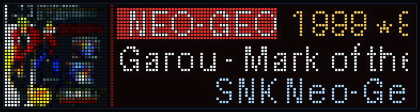
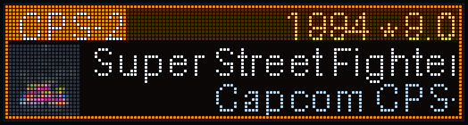
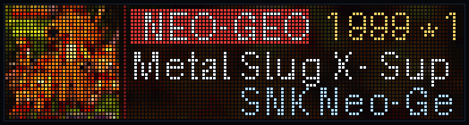
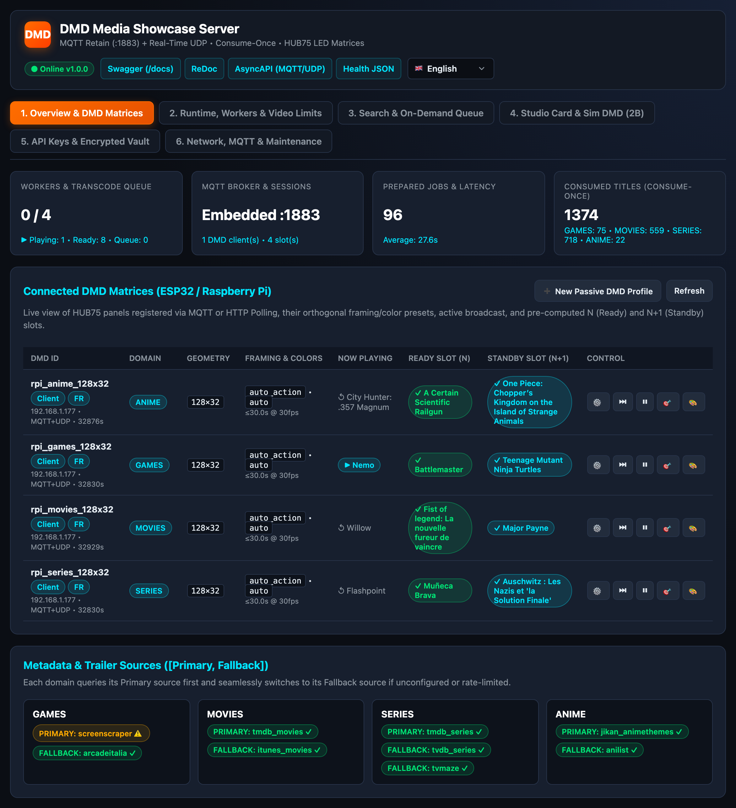
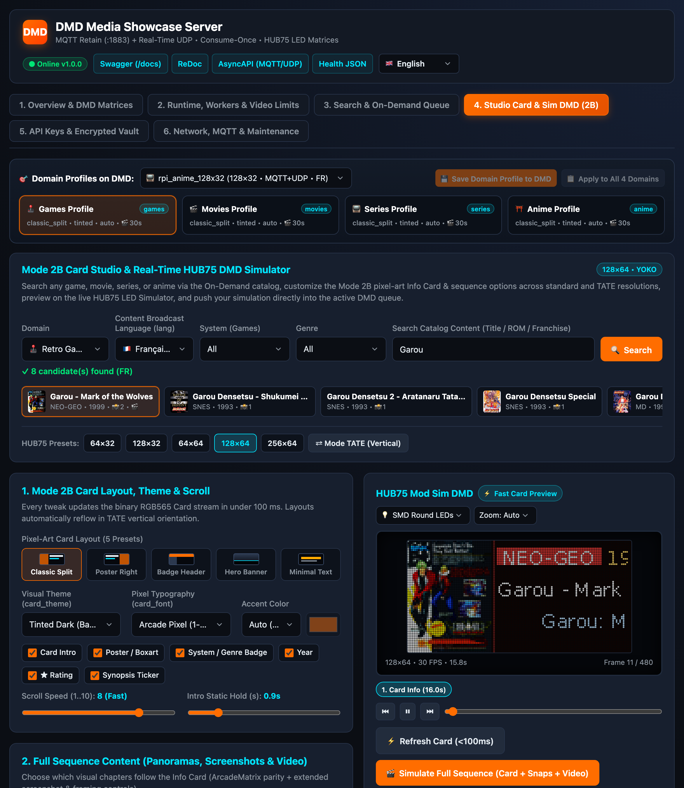
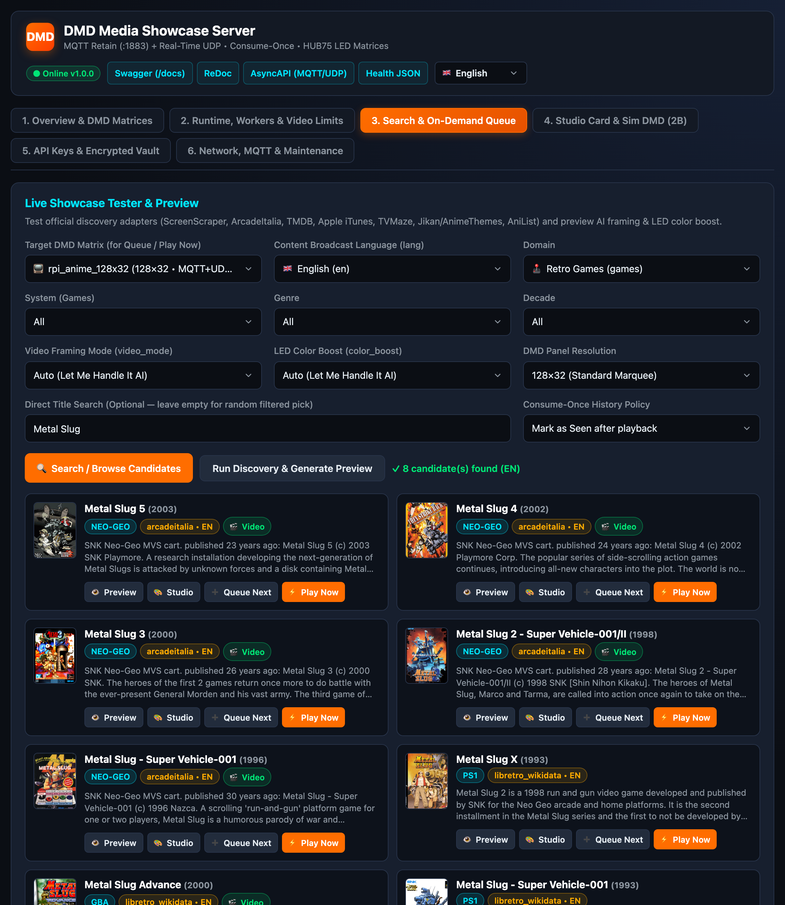
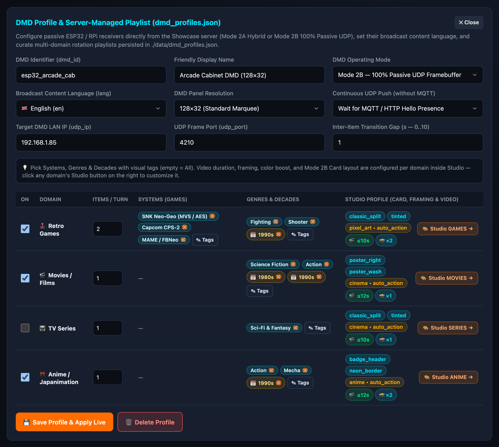

# DMD Media Showcase Server

🇬🇧 English | 🇫🇷 [Français](README_FR.md) | 🇪🇸 [Español](README_ES.md)

[](https://t.me/+DrSdAO8UMUViNmE0)
[](https://ko-fi.com/red1l)

💬 **Telegram Community:** [https://t.me/+DrSdAO8UMUViNmE0](https://t.me/+DrSdAO8UMUViNmE0)  
☕ **Support the Project on Ko-fi:** [https://ko-fi.com/red1l](https://ko-fi.com/red1l)

**DMD Media Showcase Server** is a self-hosted, zero-repetition media discovery, transcoding, and real-time UDP/MQTT streaming microservice designed for **[ArcadeMatrix (ESP32 / ESP32-S3)](https://github.com/red77290/ArcadeMatrix)** and **ArcadeMatrix_RPi** HUB75 LED matrix displays.

---

## 🎬 Live HUB75 DMD Output & Web Control Center

### 🕹️ Real 128×32 HUB75 LED Matrix Sequences (Generated Live via the Showcase API)

Every title automatically assembles a complete multi-chapter RGB565 broadcast tailored to your panel geometry (`128×32` classic `4:1` DMD shown below):
**`1. Animated Info Card`** (boxart, system badge, auto-scrolling year/rating & smooth ticker) $\to$ **`2. Vertical Boxart & Marquee Panoramas`** $\to$ **`3. In-Game Screenshot Scan`** $\to$ **`4. AI-Framed Gameplay / Trailer Video`**.

| **Garou: Mark of the Wolves (`Neo Geo` • `128×32`)** | **Super Street Fighter II X / Turbo (`CPS2` • `128×32`)** | **Metal Slug X (`Neo Geo` • `128×32`)** |
| :---: | :---: | :---: |
|  |  |  |
| `Classic Split` • `Tinted` • `auto_action` + `pixel_art` | `Badge Header` • `Neon Border` • `auto_action` + `pixel_art` | `Classic Split` • `Poster Wash` • `auto_action` + `pixel_art` |

### 🖥️ Multilingual Web Control Center (`EN` / `FR` / `ES`)

| **1. Live Overview & Connected HUB75 Matrices** | **2. Card Studio & Real-Time HUB75 LED Simulator** |
| :---: | :---: |
| [](demo/ui_overview_live.png) | [](demo/ui_card_studio.png) |
| Live MQTT (`:1883`) + UDP telemetry, pre-warmed `Ready (N)` & `Standby (N+1)` slots across all 4 domains, Consume-Once history, and active `[Primary, Fallback]` sources. | Per-domain profiles (`Games`, `Movies`, `Series`, `Anime`), 5 pixel-art layouts (YOKO & TATE), live SMD LED simulator, and `0 ms` injection into any connected DMD queue. |
| **3. Multi-Catalog Search & On-Demand Priority Queue** | **4. Passive DMD Profiles & Visual Multi-Tag Rotation** |
| [](demo/ui_ondemand_search.png) | [](demo/ui_passive_rotation.png) |
| Search Games, Movies, TV Series, and Anime in your preferred language and push titles via `Queue Next` (`FIFO`) or immediate `Play Now` preemption. | Configure Mode 2A/2B server-driven playlists with interactive System, Genre & Decade tag pickers and direct links to each domain's Studio profile. |

---

## ✨ Key Features

- **4 Showcase Domains (`games`, `movies`, `series`, `anime`)**:
  - **Retro Games**: 30 Arcade, Console, Handheld, and Home Computer systems (`ScreenScraper` Primary $\to$ `ArcadeItalia` MAME HTTPS + `Libretro+Wikidata` Console SPARQL Fallback).
  - **Movies**: Classic & Blockbuster Cinema (`TMDB` Primary $\to$ `Apple iTunes` Fallback).
  - **TV Series**: Cult & Modern TV Shows (`TMDB` Primary $\to$ `TVMaze` Fallback).
  - **Anime / Manga**: Creditless Openings (`OP`), Endings (`ED`), and Trailers (`Jikan + AnimeThemes` Primary $\to$ `AniList` Fallback).
- **Dynamic Consolidated Referentials**: Exposes localized (`fr`, `en`, `es`, `de`, `it`), source-agnostic category referentials (`GET /api/v1/{domain}/filters?lang=fr` & MQTT `dmd_showcase/catalog/{domain}/referential`) with relational `System -> Supported Genres & Decades` mapping so DMD WebUIs never hardcode scraper categories.
- **Real-Time MQTT Control Plane (`:1883`) + `ffmpeg -re` UDP `DMDF` Streaming**:
  - Zero-config embedded MQTT 3.1.1 broker (`retain=True` + `Last Will and Testament`).
  - Hardware-timed `ffmpeg -re` UDP `DMDF` chunk streaming directly to the DMD's LAN IP (`client_ip` / `udp_ip`, bypassing Docker bridge NAT).
- **Strict Consume-Once & `N+1` Background Pipelining**:
  - Tracks every presented title in `./data/seen_history.json` (zero repetition until catalog exhaustion).
  - Pre-builds item `N+1` in the background as soon as item `N` starts displaying its Info Card (`start_card`), and purges item `N` from disk immediately on `stream_eof`.
- **Server-Managed Passive ESP32 Profiles (`dmd_profiles.json`) & Live On-Demand Queue**:
  - Supports full multi-engine DMDs (`ArcadeMatrix`) **and** ultra-light ~180-line zero-UI/zero-PSRAM `ESP32_STD` passive UDP `:4210` receivers (`supports_local_card: false`, with even Phase 1 Info Cards rendered into the RGB565 stream) configured centrally in `./data/dmd_profiles.json`.
  - Localized catalog search (`GET /api/v1/{domain}/search`), asynchronous per-DMD priority queue (`POST /api/v1/clients/{dmd_id}/queue/async`, `enqueue_next` / `play_now`), live `Skip` / `Pause` / `Resume` / `Stop` controls, and **`FrontendSync`** (`mark_seen: false` for Recalbox / Batocera / RetroPie / RetroBat / LaunchBox / Playnite).
- **Persistent On-Demand Conversion Cache & 1-Click Eviction**:
  - Optional persistent disk cache (`Admin Dashboard -> 2. Runtime, Workers & Video Limits -> Persistent On-Demand Conversion Cache`) indexed by **`(System + Game + Panel Resolution + Card/Video Style)`** with configurable disk quota (MB).
  - Previously played games skip scraping and video transcoding altogether and enter the DMD queue **immediately (`0 ms`)** on subsequent launches.
  - **🗑 Evict On-Demand Cache** button available in both Showcase's Admin UI and your DMD's `FrontendSync` settings (`POST /api/v1/cache/on-demand/evict`) to clear cached conversions in one click whenever you change your card theme or layout.
- **Powered by `dmd_gif_converter`**: Orthogonal video framing (`auto_action` Let Me Handle It AI motion saliency, `panorama` top-to-bottom scan, `center_crop`) and HUB75 LED colorimetry (`auto` Smart Color Boost AI, `pixel_art`, `anime`, `cinema`), Lanczos + unsharp downscaling, and top-to-bottom sub-pixel scrolling panoramas (`Jacket`, `Marquee`, `Snapshots`) across all Landscape (`128x32`, `128x64`, `256x64`), Square (`64x64`), and TATE (`64x128`, `32x128`) resolutions.
- **OS-Aware Release Update Notification**: Built-in non-intrusive release checker (`GET /api/v1/system/update-check`) that notifies you in the Web UI whenever a newer version is published on GitHub for your runtime platform (`macOS .dmg`, `Windows .zip`, `Linux .tar.gz`, or `Docker`) with direct links to the release notes and installer.

---

## 🚀 Quick Installation & Short Example

### Option 1: Official Multi-Arch Docker Image (`amd64` / `arm64` — Raspberry Pi / NAS / Home-Lab)

#### A. Docker Compose (Recommended — zero `git clone` or local build needed)

Download the ready-to-use [`docker-compose.yml`](docker-compose.yml) and start the stack:

```bash
curl -fsSLO https://raw.githubusercontent.com/red77290/dmd_media_showcase/main/docker-compose.yml
docker compose up -d
```

<details>
<summary>📄 View standalone <code>docker-compose.yml</code></summary>

```yaml
services:
  dmd-media-showcase:
    image: ghcr.io/red77290/dmd_media_showcase:latest
    pull_policy: always
    container_name: dmd-media-showcase
    restart: unless-stopped
    ports:
      - "8890:8890"
      - "1883:1883"
      - "5353:5353/udp"
    volumes:
      - ${DMD_DATA_PATH:-./data}:/app/data
    tmpfs:
      - /tmp/dmd_media_showcase_cache:size=256m,mode=1777
```
</details>

#### B. Direct `docker run` Command (Host Bind Mount or Portainer Named Volume)

```bash
# Option B1: Host directory bind mount (./data — immune to `docker compose down -v`)
docker run -d \
  --name dmd-media-showcase \
  --restart unless-stopped \
  -p 8890:8890 \
  -p 1883:1883 \
  -p 5353:5353/udp \
  -v ./data:/app/data \
  --tmpfs /tmp/dmd_media_showcase_cache:size=256m,mode=1777 \
  ghcr.io/red77290/dmd_media_showcase:latest

# Option B2: Named Docker volume (`dmd_showcase_data` — ideal for Portainer / standalone hosts)
docker run -d \
  --name dmd-media-showcase \
  --restart unless-stopped \
  -p 8890:8890 \
  -p 1883:1883 \
  -p 5353:5353/udp \
  -v dmd_showcase_data:/app/data \
  --tmpfs /tmp/dmd_media_showcase_cache:size=256m,mode=1777 \
  ghcr.io/red77290/dmd_media_showcase:latest
```

> **Persistent State (`/app/data`)**: Stores `server_config.json`, `dmd_profiles.json` (server-managed DMD profiles & broadcast language), `seen_history.json`, and `referentials/`. Using `${DMD_DATA_PATH:-./data}:/app/data` binds a host folder (customizable via `DMD_DATA_PATH` in `.env`) that is **never erased by `docker compose down -v`**, whereas `-v dmd_showcase_data:/app/data` uses a Docker-managed named volume suited for Portainer.

- **Web Admin Dashboard**: `http://dmdmediashowcase.local:8890/` (or `http://<server-ip>:8890/` — configure optional TMDB / ScreenScraper credentials & reset `seen_history.json`)
- **Interactive Swagger UI**: `http://dmdmediashowcase.local:8890/docs`
- **Embedded MQTT Broker**: `mqtt://dmdmediashowcase.local:1883`
- **Automatic Local Network Discovery (mDNS)**: Automatically advertises `dmdmediashowcase.local` (`224.0.0.251:5353`) so your DMD (`ArcadeMatrix` ESP32 or `ArcadeMatrix_RPi`) finds it without typing an IP address. Simply toggle Showcase **ON** in the DMD Web UI (`Settings -> Showcase Server`), verify the **`🟢 Communication OK`** badge, and add the Showcase engines to your rotation!

### Option 2: Native Desktop Installers & Portable Packages (macOS `.dmg` / Windows `.zip` / Linux `.tar.gz`)

Download the package for your OS from **[GitHub Releases](https://github.com/red77290/dmd_media_showcase/releases/latest)** (`0` host Python or FFmpeg installation required):
- **macOS (Apple Silicon `arm64`)**: Open **`DMD_Media_Showcase_macOS_arm64.dmg`**, drag **`DMD Media Showcase.app`** to **`Applications`**, and launch it (`▣ DMD` appears in the macOS Menu Bar and automatically opens `http://localhost:8890/`). *(First launch without Apple Developer notarization: Right-click `DMD Media Showcase.app` → **Open**, or run `xattr -cr "/Applications/DMD Media Showcase.app"` once).*
- **Windows (`x64`)**: Extract **`DMD_Media_Showcase_Windows_x64.zip`** and double-click `Start_Showcase_Windows.bat`.
- **Linux (`x64`)**: Extract **`DMD_Media_Showcase_Linux_x64.tar.gz`** and run `./start_showcase.sh`.

### Quick Verification Example

```bash
# 1. Check server health, active worker pool, and MQTT broker port
curl -s http://localhost:8890/api/v1/health | jq .

# 2. Fetch consolidated French referential for Retro Games (Systems -> Genres & Decades)
curl -s "http://localhost:8890/api/v1/games/filters?lang=fr" | jq '.systems[0], .genres[:3]'
```

---

## 📚 Documentation & API Specifications

| Document | 🇬🇧 English | 🇫🇷 Français | 🇪🇸 Español |
| :--- | :--- | :--- | :--- |
| **QuickStart & Deployment Guide** | [docs/QUICKSTART.md](docs/QUICKSTART.md) | [docs/QUICKSTART_FR.md](docs/QUICKSTART_FR.md) | [docs/QUICKSTART_ES.md](docs/QUICKSTART_ES.md) |
| **ESP32 Integration & Passive Receiver Guide** | [docs/ESP32_INTEGRATION.md](docs/ESP32_INTEGRATION.md) | [docs/ESP32_INTEGRATION_FR.md](docs/ESP32_INTEGRATION_FR.md) | [docs/ESP32_INTEGRATION_ES.md](docs/ESP32_INTEGRATION_ES.md) |
| **System Architecture & Streaming Pipeline** | [docs/ARCHITECTURE.md](docs/ARCHITECTURE.md) | [docs/ARCHITECTURE_FR.md](docs/ARCHITECTURE_FR.md) | [docs/ARCHITECTURE_ES.md](docs/ARCHITECTURE_ES.md) |
| **Developer & Scraper Strategy Guide** | [docs/DEVELOPER.md](docs/DEVELOPER.md) | [docs/DEVELOPER_FR.md](docs/DEVELOPER_FR.md) | [docs/DEVELOPER_ES.md](docs/DEVELOPER_ES.md) |
| **OpenAPI 3.1 REST Specification** | [docs/openapi.yaml](docs/openapi.yaml) / [docs/openapi.json](docs/openapi.json) | — | — |
| **AsyncAPI 2.6 MQTT & UDP Specification** | [docs/asyncapi.yaml](docs/asyncapi.yaml) | — | — |
