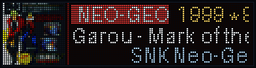
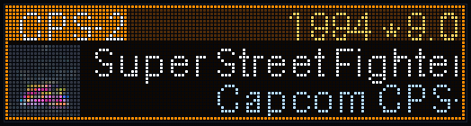
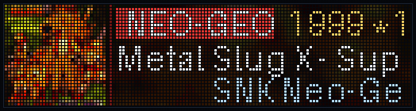
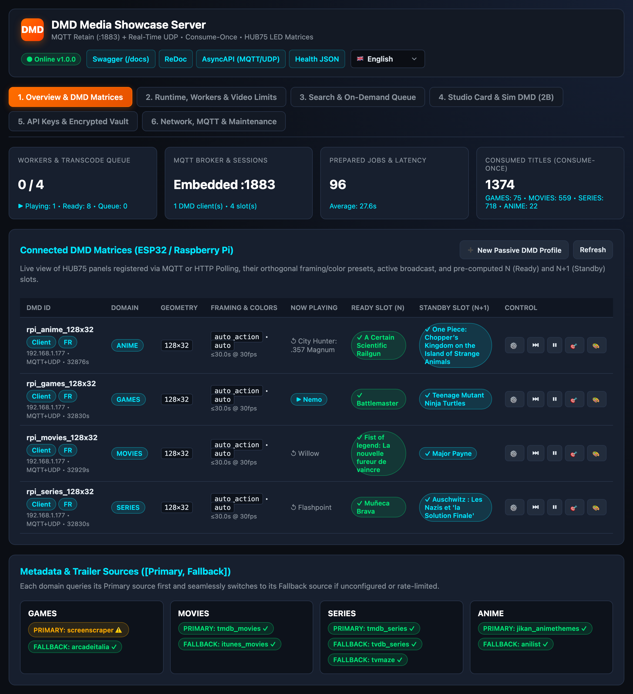
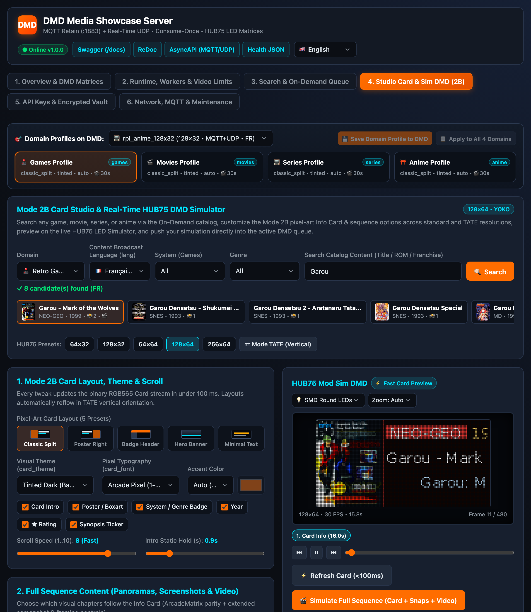
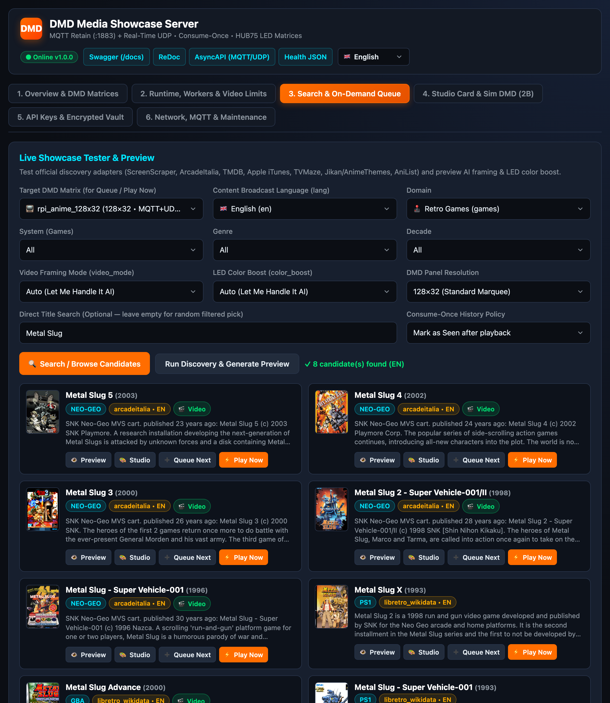
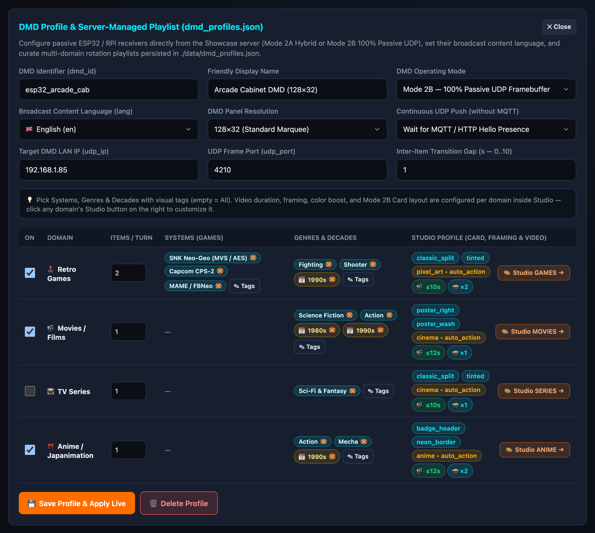
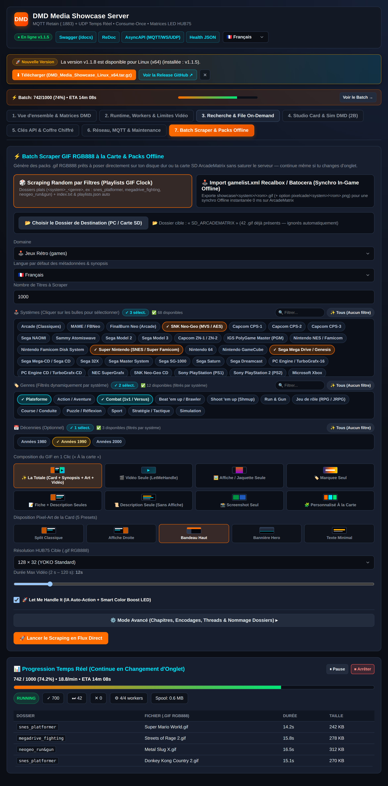
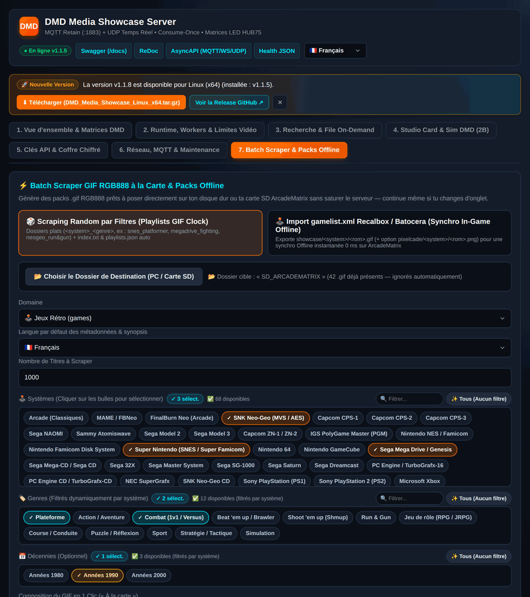

# DMD Media Showcase Server

🇬🇧 [English](README.md) | 🇫🇷 Français | 🇪🇸 [Español](README_ES.md)

[](https://t.me/+DrSdAO8UMUViNmE0)
[](https://ko-fi.com/red1l)

💬 **Communauté Telegram :** [https://t.me/+DrSdAO8UMUViNmE0](https://t.me/+DrSdAO8UMUViNmE0)  
☕ **Soutenir le projet sur Ko-fi :** [https://ko-fi.com/red1l](https://ko-fi.com/red1l)

**Plus besoin de chercher des sources ni de gérer des milliers de GIFs sur carte SD.**  
**DMD Media Showcase** est l'application compagnon clé en main pour **[ArcadeMatrix (ESP32 / ESP32-S3)](https://github.com/red77290/ArcadeMatrix)** et **[ArcadeMatrix_RPi](https://github.com/red77290/ArcadeMatrix_RPI)** : elle diffuse automatiquement et **sans jamais se répéter** des **Jeux Rétro, Films, Séries TV et Animes** en streaming **RGB565 16 bits sans perte** (`MQTT + HTTP DMDZ v2 / DMDS` et UDP passif `DMDF`), et enrichit en direct les lancements de jeux sur **Recalbox / Batocera / RetroPie**.

> [!TIP]
> ### ⚡ Zéro Configuration : Exécutez le `.exe` ou le `.dmg`, ça tourne immédiatement !
> 1. **Téléchargez et lancez** 👉 **[Dernière Release GitHub](https://github.com/red77290/dmd_media_showcase/releases/latest)** : double-cliquez sur **`dmd-media-showcase.exe`** (Windows `.zip`), ouvrez **`DMD Media Showcase.app`** (macOS `.dmg`), lancez `./start_showcase.sh` (Linux `.tar.gz`) ou démarrez le conteneur **Docker**.
> 2. **0 config, 0 compte requis** : Python, FFmpeg, le broker MQTT et **toutes les clés API chiffrées sont déjà embarqués**. L'application s'annonce toute seule sur le réseau (`dmdmediashowcase.local:8890`) — activez simplement le toggle Showcase sur votre DMD et ça diffuse tout de suite.
> 3. **Application Web intégrée pour aller plus loin** : ouvrez `http://localhost:8890/` (ou `http://dmdmediashowcase.local:8890/`) dès que vous souhaitez explorer la **personnalisation** (Studio de cartes avec simulateur LED en direct, filtres par systèmes/genres/décennies, recherche & lancement immédiat d'un titre, priorité des sources) ou le **monitoring temps réel** de vos matrices et flux actifs.

---

## 🎬 Aperçu Réel sur Matrice LED HUB75 & Interface Web

### 🕹️ Séquences Réelles sur Matrice LED HUB75 128×32 (Générées en Direct via l'API Showcase)

Chaque œuvre assemble automatiquement une diffusion RGB565 multi-chapitres adaptée à la géométrie exacte de votre panneau (`128×32` DMD classique `4:1` ci-dessous) :
**`1. Fiche Info Animée`** (jaquette, badge système, défilement auto année/note & synopsis fluide) $\to$ **`2. Panoramas Zoom-to-Cover Jaquette & Marquee`** $\to$ **`3. Balayage Capture In-Game`** $\to$ **`4. Vidéo Gameplay / Trailer Cadrée par IA`**.

| **Garou: Mark of the Wolves (`Neo Geo` • `128×32`)** | **Super Street Fighter II X / Turbo (`CPS2` • `128×32`)** | **Metal Slug X (`Neo Geo` • `128×32`)** |
| :---: | :---: | :---: |
|  |  |  |
| `Classic Split` • `Tinted` • `auto_action` + `pixel_art` | `Badge Header` • `Neon Border` • `auto_action` + `pixel_art` | `Classic Split` • `Poster Wash` • `auto_action` + `pixel_art` |

### 🖥️ Centre de Contrôle Web Multilingue (`FR` / `EN` / `ES`)

| **1. Vue d'Ensemble Live & Matrices HUB75 Connectées** | **2. Studio Card & Simulateur LED HUB75 Temps Réel** |
| :---: | :---: |
| [](demo/ui_overview_live.png) | [](demo/ui_card_studio.png) |
| Télémétrie MQTT (`:1883`) + transports en direct (`MQTT+TCP` par défaut, `HTTP`, `UDP-PASSIVE`, `MQTT+UDP` optionnel), slots pré-calculés `Ready (N)` & `Standby (N+1)` avec badges de source live (`🔗 igdb+screenscraper`), historique Consume-Once et chaînes scrapers multi-sources configurables à chaud. | Profils dédiés par domaine (`Games`, `Movies`, `Series`, `Anime`), 5 mises en page pixel-art (YOKO & TATE), simulateur LED SMD temps réel et injection `0 ms` en file active. |
| **3. Recherche Multi-Catalogues & File Prioritaire On-Demand** | **4. Profils DMD Passifs & Sélecteur Visuel de Tags** |
| [](demo/ui_ondemand_search.png) | [](demo/ui_passive_rotation.png) |
| Recherche localisée (Jeux dont raccourcis joueurs `sf2x`, `3s`, `kof98`, Films, Séries, Anime) dans la langue souhaitée et envoi immédiat via `Queue Next` (`FIFO`) ou préemption directe `Play Now`. | Configuration visuelle de rotations Mode 2A/2B par puces multi-sélection (Systèmes, Genres & Décennies) avec raccourci direct vers chaque profil Studio. |
| **5. Batch Scraper GIF `RGB888` à la Carte & Packs Offline (PC / Docker)** | **6. Interface Mobile Responsive (iPhone / Android) & Démo Live** |
| [](demo/ui_batch_scraper.png) | [](demo/ui_batch_scraper_mobile.png) |
| Scraping aléatoire par filtres (`snes_platformer`, `neogeo_run&gun` + `playlists.json`) ou import `gamelist.xml` Recalbox/Batocera (`showcase/<sys>/<rom>.gif`), composition à la carte (`2s–120s`), écriture directe dossier/SD en tâche de fond (continue en changement d'onglet). | Interface tactile adaptée mobile ([voir l'écran Smartphone complet](demo/ui_batch_scraper_mobile.png)) avec maintien d'écran éveillé (`Wake Lock`), préparation serveur sans blocage et téléchargement `.zip` en 1 tap dans **Fichiers / Téléchargements**. |

---

## 🧭 Mode Online vs Mode Offline vs Mode Hybride — Que choisir ? (Guide Sans Jargon)

Pas besoin d'être informaticien : **DMD Media Showcase** vous laisse choisir librement entre le **streaming en direct** et l'**autonomie totale sur carte MicroSD** (ou les deux à la fois) :

| Votre besoin | Mode recommandé | Ce que vous avez à faire |
| :--- | :--- | :--- |
| 🌐 **« J'ai le Wi-Fi et un PC / Mac / NAS : je ne veux copier aucun fichier »** | **Mode 100 % ONLINE** *(Streaming Direct)* | Lancez Showcase et activez le bouton **Showcase Server** sur votre DMD (`🟢 Communication OK`). Tout arrive en direct sans jamais se répéter. |
| 🕰️ **« Je veux 500 ou 1 000 GIFs triés par console/genre pour l'Horloge, PC éteint »** | **Mode OFFLINE — Playlists Clock** | Ouvrez l'onglet **`7. Batch Scraper`**, choisissez vos filtres + style à la carte, et copiez les dossiers (`snes_platformer`, `neogeo_run&gun`... + `playlists.json`) dans `/gifs/` sur la carte SD. |
| 🕹️ **« J'ai une borne Recalbox / Batocera sans serveur PC ni Internet »** | **Mode OFFLINE — Synchro In-Game** | Importez vos fichiers `gamelist.xml` dans l'onglet **`7. Batch Scraper`**, puis copiez `showcase/` et `pixelcade/` à la racine de la carte SD : fiche + vidéo démarrent en **`0 ms`** à chaque jeu lancé ! |
| ⚡ **« Je veux mes favoris en `0 ms` sur la SD ET la découverte infinie quand mon PC est allumé »** | **Mode HYBRIDE** *(Automatique)* | Copiez votre pack `showcase/` sur la SD **et** laissez **Showcase Server** activé : le DMD lit toujours la carte SD en priorité (`0` trafic réseau) et interroge le serveur uniquement pour les jeux absents de la SD. |

👉 **[📖 Lire le Tutoriel Complet Pas-à-Pas (Débutants, PC, Docker/NAS & Smartphone) : `docs/TUTORIAL_ONLINE_OFFLINE_SCRAPING_FR.md`](docs/TUTORIAL_ONLINE_OFFLINE_SCRAPING_FR.md)**

---

## ✨ Fonctionnalités Clés

- **4 Domaines Showcase & Chaînes Multi-Sources Configurables (`games`, `movies`, `series`, `anime`)** :
  - **Retro & Arcade Games (`55+` / `66` Systèmes Canoniques)** : Systèmes Arcade (`MAME`, `CPS-1/2/3`, `Neo-Geo`, `NAOMI`, `Atomiswave`, `Model 2/3`), Consoles, Portables et Micro-ordinateurs propulsés par **4 sources indépendantes sélectionnables** :
    1. **`igdb`** (`IGDB API v4` via OAuth2 Twitch gratuit — 200+ plateformes, recherche instantanée par acronyme/alias via `alternative_names`, tirage aléatoire par offset, jaquettes/artworks & trailers).
    2. **`screenscraper`** (`ScreenScraper` — wheels/marquees détourés, captures pixel-art, extraits vidéo `.mp4`, avec détection automatique de quota/surcharge HTTP-200 en texte brut et disjoncteur de cooldown).
    3. **`arcadeitalia`** (scraper HTTPS sans clé de référence MAME/CPS/Neo-Geo/NAOMI avec table d'alias intégrée résolvant `sf2x`, `3s`, `kof98`, `garou` en une seule requête).
    4. **`libretro_wikidata`** (source console/portable/micro de premier plan sans clé combinant Wikidata SPARQL, `libretro-thumbnails` vérifiés, synopsis Wikipédia localisés et vidéos Archive.org).
  - **Movies** : Cinéma Classique & Blockbusters (`tmdb_movies` $\to$ `itunes_movies` sans clé).
  - **TV Series** : Séries TV Cultes & Modernes (`tmdb_series` $\to$ `tvdb_series` $\to$ `tvmaze` sans clé).
  - **Anime / Manga** : Openings (`OP`), Endings (`ED`) sans crédits et Trailers (`jikan` + `AnimeThemes` $\to$ `anilist` sans clé).
- **Priorité Multi-Sources à Chaud & Agrégation Inter-Sources (`source_policies`)** :
  - Réordonnez la priorité (`#1 Primaire -> #2 Secondaire -> #3 Tertiaire -> ...`) et activez/désactivez chaque source par domaine en direct depuis le Dashboard Web (**Vue d'Ensemble** et **Clés API & Scrapers**), persisté dans `./data/server_config.json`. Dès qu'une source renvoie `0` résultat, expire, entre en cooldown ou ne couvre pas le système demandé, l'exécution bascule de manière déterministe vers la source active suivante.
  - Choisissez par domaine entre **`enrich_missing` (Agrégation Multi-Sources, par défaut)** — où la source Primaire résout l'identité canonique et les alias (ex. `IGDB` résolvant `"sf2x"` sur `cps2` $\to$ `"Super Street Fighter II Turbo"` / `ssf2t`) tandis que `CandidateAggregator` exécute une passe secondaire bornée (`<= 3.0s`) pour récupérer les assets DMD manquants (marquees/wheels détourés, snaps pixel-art, flux directs `.mp4`/`.webm`/`.m4v`, synopsis localisés) avec attribution combinée transparente (`source_used="igdb+screenscraper"`, `"igdb+arcadeitalia"`, `"tmdb_movies+itunes_movies"`) — et **`fallback_only` (Fallback Strict)**.
- **Référentiels Dynamiques Consolidés** : Expose des référentiels de catégories localisés (`fr`, `en`, `es`, `de`, `it`) et indépendants des sources (`GET /api/v1/{domain}/filters?lang=fr` & MQTT `dmd_showcase/catalog/{domain}/referential`) avec filtrage relationnel `Système -> Genres & Décennies supportés` afin que le WebUI du DMD n'ait jamais de listes figées en dur.
- **Streaming Principal `MQTT + TCP` (HTTP `DMDZ` v2 / `DMDS` Sans Perte `:8890`) & Support UDP Passif `DMDF` (`:4210`)** :
  - **Plan de Contrôle MQTT (`:1883`) + Plan de Données `:8890` Unifié Sans Perte (`MQTT+TCP` par défaut, `codec=dmdz2`)** : Les Modèles 1 (`ArcadeMatrix` ESP32 / ESP32-S3 / `ArcadeMatrix_RPi`) et 2A (`supports_local_card: true`) associent le broker MQTT 3.1.1 embarqué zéro-configuration (`config`, `ready`, `start_card`, `stop_stream` avec `retain=True` + `LWT` et bascule automatique HTTP `/config + /next` dans le même tour) au flux HTTP `1.1` `Content-Length` (`GET /api/v1/{domain}/stream/{item_id}.rgb565.stream?purge={true|false}&codec=dmdz2` + nettoyage idempotent `DELETE`) — **`esp32dev`** (`0` PSRAM : télécharge `.dmdz2.stream` sans perte sur sa carte SD `25 MHz` `/cache/showcase_live.dmdz` ouverte en `O_TRUNC` pendant la Fiche Info de Phase 1, ferme le socket TCP pour `0` trafic Wi-Fi durant la lecture, décode localement via un anneau SPSC de `8 448–9 216 o` avec signalement consommateur dans le canevas `SRAM1` Zéro-Copie, fige la dernière trame en `StreamEndHold` et supprime `/cache/showcase_live.dmdz` via `sd.remove` dès la sortie/interruption), **`ESP32-S3`** (`8 Mo` PSRAM, strictement `0` accès carte SD même sans carte SD insérée : pré-charge `.dmdz2.stream` `<= 4 Mo` en PSRAM pendant la Fiche Info pour `0` trafic Wi-Fi en lecture, ou diffuse les longs flux HD `256x64` via un anneau SPSC PSRAM de `1 Mo`), et **`ArcadeMatrix_RPi`** (pré-charge `.dmdz2.stream` sans perte directement en RAM).
  - **Pourquoi `DMDZ` v2 Sans Perte + `MQTT + TCP` est Recommandé par Défaut** : Préserve à 100 % la colorimétrie True-RGB565 `16 bits` HUB75 (`dmd_gif_converter` `>= 8.0.13`) sans quantification de palette ni flou temporel ; élimine toute contention Wi-Fi / `lwIP` pendant la lecture grâce au pré-téléchargement SD parallèle à la Fiche (`esp32dev`) et au pré-chargement PSRAM (`ESP32-S3`) ; évite les pertes NAT UDP sous Docker Desktop / Rancher Desktop ; et utilise des `item_id` compacts sans collision (`pkg_<domain>_<12hex>`, `<= 24` caractères). Télémétrie en direct du transport (`MQTT+TCP`, `HTTP`, `UDP-PASSIVE`, `MQTT+UDP` legacy optionnel) et de la source par slot (`playing_source`, `ready_source`, `standby_source`, `preparing_source`).
- **Protocole Consume-Once Strict & Pipelining `N+1` en Tâche de Fond** :
  - Mémorise chaque œuvre présentée dans `./data/seen_history.json` (zéro répétition jusqu'à épuisement du catalogue).
  - Prépare l'œuvre suivante (`N+1`) en tâche de fond dès que l'œuvre `N` commence l'affichage de sa fiche (`start_card`), et purge les fichiers de `N` dès la fin du flux HTTP `DMDZ`/`DMDS` (`?purge=true`), via `DELETE /api/v1/{domain}/stream/{item_id}.rgb565.stream`, ou sur `stop_stream` / `stream_eof`.
- **Profils ESP32 Passifs Gérés par le Serveur (`dmd_profiles.json`) & File d'Attente à la Demande** :
  - Supporte les DMD multi-moteurs complets (`ArcadeMatrix`, Modèle 1) et les récepteurs hybrides gérés par le serveur (Modèle 2A, `MQTT+TCP`) **ainsi que** les récepteurs passifs UDP `:4210` `DMDF` ultra-légers optionnels (**Modèle 2B**, ~180 lignes C++, zéro UI, zéro PSRAM sur `ESP32_STD`, `supports_local_card: false`, `UDP-PASSIVE` où même la Fiche Info de Phase 1 est rendue dans le flux RGB565) configurés centralement dans `./data/dmd_profiles.json`.
  - Recherche catalogue localisée (`GET /api/v1/{domain}/search`), file prioritaire asynchrone par DMD (`POST /api/v1/clients/{dmd_id}/queue/async`, `enqueue_next` / `play_now` avec `fallback_query` optionnel), contrôles temps réel `Skip` / `Pause` / `Resume` / `Stop` et intégration **`FrontendSync`** (isolation `{dmd_id}_sync`, `mark_seen: false`, et arrêt instantané des `1..N` arbres de processus de conversion via `DELETE /api/v1/clients/{dmd_id}/queue` à la sortie d'un jeu sur Recalbox / Batocera / RetroPie / RetroBat / LaunchBox / Playnite).
- **Cache Persistant des Conversions On-Demand & Purge en 1 Clic** :
  - Cache disque persistant optionnel (`Dashboard Admin -> 2. Runtime, Workers & Limites Vidéo -> Cache Persistant des Conversions On-Demand`) indexé par **`(Système + Jeu + Résolution du Panneau + Style Carte/Vidéo)`** avec quota disque configurable (Mo) pour une relance instantanée (`0 ms`, purge en 1 clic via `POST /api/v1/cache/on-demand/evict`).
- **Propulsé par `dmd_gif_converter` (`>= 8.0.13`)** : Cadrage vidéo orthogonal (`auto_action` IA Let Me Handle It, `panorama`, `center_crop`), colorimétrie LED HUB75 (`auto` Smart Color Boost IA, `pixel_art`, `anime`, `cinema`), redimensionnement Lanczos + `unsharp`, et **panoramas zoom-to-cover uniformes déterministes** sans bandes noires — **YOKO** (`128x32`, `128x64`, `256x64`) défilant de **haut en bas**, et **TATE** (`64x128`, `32x128`) défilant de **gauche à droite**.
- **Coffre-Fort d'Identifiants à 3 Niveaux & Caviardage Automatique des Logs HTTP** : Résolution `1. Surcharges WebUI server_config.json` $\to$ `2. Variables .env / docker-compose` $\to$ `3. Coffre natif C compilé en CI/CD (_prod_vault)`, protégée par `SecretRedactingLogFilter` (`httpx`/`httpcore` bridés à `WARNING`) garantissant qu'aucun secret API ou mot de passe URL ne fuite dans les logs conteneur.
- **Notification de Mise à Jour Sensible à l'OS** : Vérification légère intégrée (`GET /api/v1/system/update-check`) affichant une bannière discrète dans la Web UI dès qu'une nouvelle release GitHub officielle est disponible pour votre environnement actif (`macOS .dmg`, `Windows .zip`, `Linux .tar.gz` ou `Docker`).
- **Batch Scraper GIF `RGB888` en Streaming & Packs Offline ArcadeMatrix (Onglet #7)** :
  - **Playlists Horloge par Filtres Aléatoires (`random_filter`)** : Scrapez `1..10 000` titres uniques sur `games`, `movies`, `series` et `anime` via des **bulles cliquables à sélection directe** (Systèmes, Genres & Décennies filtrés dynamiquement, zéro `Ctrl+Clic`) et les **icônes visuelles filaires DMD du Studio** pour la composition **à la carte** (`Full Showcase`, `Video Only`, `Poster Only`, `Marquee Only`, `Card + Description`, `Description Only`, `Screenshot Only` ou `Custom`) ainsi que les 5 dispositions de Card pixel-art, durée vidéo réglable de `2s` jusqu'à **`120s` max**, et cadrage IA `LetMeHandle` + boost couleur LED. Trie automatiquement les `.gif` `RGB888` 24 bits dans des dossiers plats (`<system>_<genre>`, ex. `snes_platformer`, `megadrive_fighting`, `neogeo_run&gun`) avec génération automatique de `index.txt` et `playlists.json`.
  - **Synchro In-Game Offline Recalbox / Batocera (`recalbox_gamelist`)** : Chargez un ou plusieurs fichiers `gamelist.xml` pour exporter `showcase/<system>/<rom>.gif` (`showcase_tate/<system>/<rom>.gif` en TATE) ainsi que les marquees compagnons non-entrelacés `pixelcade/<system>/<rom>.png` pour une synchronisation Showcase In-Game `0 ms` 100 % autonome hors-ligne sur `ArcadeMatrix` (ESP32/S3) et `ArcadeMatrix_RPi`.
  - **Streaming Direct vers Dossier Utilisateur en Arrière-Plan (`0` Stockage Serveur / `0` Saturation `tmpfs` Docker)** : Écrit les `.gif` au fil de l'eau directement dans le dossier PC / carte SD sélectionné via un `Web Worker` dédié + `SSE` + maintien actif `AudioContext` sub-audible (continue sans ralentir même en changeant d'onglet, avec repli universel `stream.zip` `ZIP_STORED` en `O(1)` RAM) et supprime (`unlink`) chaque fichier serveur dès réception de l'`ACK`.

---

## 🔌 Sources Média, Clés Chiffrées par Défaut & Fusion Multi-Sources

> [!TIP]
> **100 % Zéro-Configuration Clé en Main :** Les versions officielles (`Docker`, `macOS`, `Windows`, `Linux`) embarquent déjà des **clés développeur/API fonctionnelles chiffrées** (`_prod_vault`) ainsi que **6 sources totalement sans clé**. **Tout fonctionne immédiatement sans toucher à quoi que ce soit** — saisir ses propres clés ou modifier l'ordre des sources dans la Web UI relève uniquement de la personnalisation optionnelle.

| Domaine & Ordre par Défaut | Source (`source_id`) | Clés par Défaut & Obligation Utilisateur | Surcharge Optionnelle WebUI & Contrainte Principale |
| :--- | :--- | :--- | :--- |
| **🕹️ Jeux `#1`** *(Primaire)* | **IGDB API v4** (`igdb`) | 🔐 **Clés app chiffrées intégrées** (`0` conf requise) | `igdb_client_id`, `igdb_client_secret` • ~`4 req/s`, cooldown auto `60s` sur `429`. |
| **🕹️ Jeux `#2`** *(Secondaire)* | **ScreenScraper v2** (`screenscraper`) | 🔐 **`devid` chiffré intégré** (`0` compte dev requis)<br>👤 **Compte joueur `SSID`** : optionnel (*Invité*), **recommandé** *(gratuit)* | **Joueur :** `screenscraper_user` / `pass` *(+ `dev_id` optionnel)* • **L'accès Invité coupe quand le CPU serveur dépasse ~60 %** (soirs/week-ends) ; un compte gratuit sur `screenscraper.fr` débloque ~`20k req/jour` sur le pool Membres. Cooldown auto `60s`. |
| **🕹️ Jeux `#3`** *(Fallback)* | **ArcadeItalia ADB** (`arcadeitalia`) | 🔓 **100 % Sans Clé** (`0` compte, `0` clé) | *Aucune* • Référence MAME / `CPS-1/2/3` / `Neo-Geo` / `NAOMI` (flyers, marquees & snaps). |
| **🕹️ Jeux `#4`** *(Fallback)* | **Libretro + Wikidata** (`libretro_wikidata`) | 🔓 **100 % Sans Clé** (`0` compte, `0` clé) | *Aucune* • Consoles/Portables/Micros : boîtes PNG vérifiées, synopsis Wikipédia & vidéos Archive.org. |
| **🎬 Films `#1`** *(Primaire)* | **TMDB Movies** (`tmdb_movies`) | 🔐 **Clé API chiffrée intégrée** (`0` conf requise) | `tmdb_api_key` • Affiches localisées, backdrops `16:9`, synopsis & bandes-annonces HD. |
| **🎬 Films `#2`** *(Secondaire)* | **Apple iTunes** (`itunes_movies`) | 🔓 **100 % Sans Clé** (`0` compte, `0` clé) | *Aucune* • Affiches `1000×1000` & **flux trailers directs `.m4v`/`.mp4`** (~`20 req/min`). |
| **📺 Séries `#1`** *(Primaire)* | **TMDB Series** (`tmdb_series`) | 🔐 **Clé API chiffrée intégrée** (`0` conf requise) | `tmdb_api_key` • Affiches TV localisées, backdrops, synopsis & bandes-annonces/génériques. |
| **📺 Séries `#2`** *(Secondaire)* | **TheTVDB v4** (`tvdb_series`) | 🔐 **Clé API chiffrée intégrée** (`0` conf requise) | `tvdb_api_key` • Traductions communautaires multilingues, bannières séries & trailers (cache JWT `23h`). |
| **📺 Séries `#3`** *(Fallback)* | **TVMaze** (`tvmaze`) | 🔓 **100 % Sans Clé** (`0` compte, `0` clé) | *Aucune* • ~`70 000` séries scénarisées, posters HD, bannières & photos (~`20 req/10s`). |
| **⛩️ Anime `#1`** *(Primaire)* | **Jikan v4 + AnimeThemes** (`jikan`) | 🔓 **100 % Sans Clé** (`0` compte, `0` clé) | *Aucune* • Catalogue MyAnimeList + **flux directs `.webm` `OP`/`ED` sans crédits** (`3 req/s`). |
| **⛩️ Anime `#2`** *(Secondaire)* | **AniList + AnimeThemes** (`anilist`) | 🔓 **100 % Sans Clé** (`0` compte, `0` clé) | *Aucune* • Couvertures GraphQL AniList, marquees larges `bannerImage` & `.webm` `OP`/`ED` (~`90 req/min`). |

- **Inversion des Rôles & Variation des Visuels / Vidéos (`#1 <-> #2 <-> ...`)** : Réordonnez ou activez/désactivez les sources à chaud dans **`1. Vue d'ensemble`** ou **`5. Clés API & Coffre Chiffré`** (`0 ms`, sans redémarrage) pour obtenir des tirages, jaquettes ou types de vidéos différents — par ex. passer **`screenscraper` en `#1`** pour privilégier les courtes vidéos de gameplay `.mp4` directes et marquees détourés plutôt que les trailers YouTube, **`arcadeitalia` en `#1`** pour les flyers de bornes MAME, ou **`itunes_movies` en `#1`** pour les trailers cinéma `.m4v` directs.
- **Fusion Inter-Sources (`enrich_missing`, par défaut) & Fallback Automatique** : La source `#1 Primaire` conserve son titre, sa jaquette et sa vidéo tandis que `CandidateAggregator` (`<= 3.0s`) interroge `#2`/`#3` pour **compléter uniquement les assets DMD manquants** (marquees/wheels détourés, snaps pixel-art, vidéos directes ou synopsis traduits humainement, tracés en direct via `🔗 igdb+screenscraper`) après vérification stricte de compatibilité (ROM, numéro de suite, année). Vous pouvez aussi choisir **`fallback_only`**, où `#2`/`#3` n'interviennent que si `#1` renvoie `0` résultat ou entre en cooldown.
- 👉 **[Consulter le Guide Complet : Sources, Coffre Chiffré, Quotas ScreenScraper & Fusion Multi-Sources (`docs/SOURCES_AND_AGGREGATION_FR.md`)](docs/SOURCES_AND_AGGREGATION_FR.md)**

---

## 🚀 Installation Rapide & Exemple Court

### Option 1 : Applications Clé en Main — Windows (`.exe`), macOS (`.dmg`) & Linux (`.tar.gz`) *(Recommandé — 0 installation, 0 config)*

Téléchargez le paquet correspondant à votre OS depuis **[GitHub Releases](https://github.com/red77290/dmd_media_showcase/releases/latest)** (aucune installation Python, FFmpeg ou MQTT requise, clés API chiffrées déjà intégrées) :
- **Windows (`x64`)** : Décompressez **`DMD_Media_Showcase_Windows_x64.zip`** et lancez directement **`dmd-media-showcase.exe`** (ou `Start_Showcase_Windows.bat`).
- **macOS (Apple Silicon `arm64`)** : Ouvrez **`DMD_Media_Showcase_macOS_arm64.dmg`**, glissez **`DMD Media Showcase.app`** dans **`Applications`**, puis lancez-la (l'icône `▣ DMD` apparaît dans la barre des menus macOS et ouvre automatiquement l'application Web sur `http://localhost:8890/`). *(1er lancement d'une app open-source non notarisée Apple : Clic droit → **Ouvrir** ou `Réglages Système → Confidentialité et sécurité → Ouvrir quand même`, ou `xattr -cr "/Applications/DMD Media Showcase.app"` une seule fois).*
- **Linux (`x64`)** : Décompressez **`DMD_Media_Showcase_Linux_x64.tar.gz`** et lancez `./start_showcase.sh`.
- **Ça tourne immédiatement (0 réglage côté serveur) !** Vous n'avez rien à configurer dans Showcase : l'interface Web qui s'ouvre sur `http://localhost:8890/` sert uniquement au **monitoring en direct** (votre matrice s'y affichera toute seule dès le 1er média, inutile de l'y créer à la main) et à la personnalisation optionnelle (Studio de cartes, scraping). Côté DMD (`ArcadeMatrix`), rendez-vous dans **`Système -> 🔄 MQTT & API -> 🎬 DMD Media Showcase`** *(rangé en retrait car il s'agit d'une fonctionnalité compagnon optionnelle)* : passez **Activer DMD Media Showcase** sur **Activé**, cliquez sur **🔄 Tester** (si `http://dmdmediashowcase.local:8890` affiche `🔴 Injoignable` en Wi-Fi sur certaines box, remplacez par l'IP locale de votre PC `http://192.168.1.XX:8890`), vérifiez **`🟢 Communication OK`**, puis cliquez impérativement en bas sur **Enregistrer les paramètres Showcase**. Ajoutez ensuite vos moteurs (**Vitrine Jeux Rétro**, **Vitrine Cinéma & Films**, **Vitrine Séries TV**, **Vitrine Anime & OAV**) depuis l'onglet **`Affichage`** (**➕ Ajouter à la boucle**, bouton **🔄 Sync** pour rafraîchir les listes de filtres si besoin, puis **Enregistrer la playlist**).

### Option 2 : Image Docker Officielle Multi-Arch (`amd64` / `arm64` — NAS / Raspberry Pi / Home Assistant / Home-Lab)

#### A. Docker Compose (sans `git clone` ni compilation locale)

Téléchargez le fichier [`docker-compose.yml`](docker-compose.yml) prêt à l'emploi et démarrez le serveur :

```bash
curl -fsSLO https://raw.githubusercontent.com/red77290/dmd_media_showcase/main/docker-compose.yml
docker compose up -d
```

> **Build Local depuis les Sources (`git clone`) :** Dans un dépôt cloné localement, [`docker-compose.override.yml`](docker-compose.override.yml) est chargé automatiquement afin que `docker compose up -d --build` compile vos sources locales et la dernière version de `dmd_gif_converter` au lieu de tirer l'image distante.

<details>
<summary>📄 Afficher le <code>docker-compose.yml</code> autonome</summary>

```yaml
services:
  dmd-media-showcase:
    image: ghcr.io/red77290/dmd_media_showcase:latest
    pull_policy: always
    container_name: dmd-media-showcase
    restart: unless-stopped
    ports:
      - "8890:8890"
      - "1883:1883"
      - "5353:5353/udp"
    volumes:
      - ${DMD_DATA_PATH:-./data}:/app/data
    tmpfs:
      - /tmp/dmd_media_showcase_cache:size=256m,mode=1777
```
</details>

#### B. Commande `docker run` Directe (Bind Mount Hôte ou Volume Nommé Portainer)

```bash
# Option B1 : Montage répertoire hôte (./data — protégé contre `docker compose down -v`)
docker run -d \
  --name dmd-media-showcase \
  --restart unless-stopped \
  -p 8890:8890 \
  -p 1883:1883 \
  -p 5353:5353/udp \
  -v ./data:/app/data \
  --tmpfs /tmp/dmd_media_showcase_cache:size=256m,mode=1777 \
  ghcr.io/red77290/dmd_media_showcase:latest

# Option B2 : Volume nommé Docker (`dmd_showcase_data` — idéal pour Portainer / déploiement autonome)
docker run -d \
  --name dmd-media-showcase \
  --restart unless-stopped \
  -p 8890:8890 \
  -p 1883:1883 \
  -p 5353:5353/udp \
  -v dmd_showcase_data:/app/data \
  --tmpfs /tmp/dmd_media_showcase_cache:size=256m,mode=1777 \
  ghcr.io/red77290/dmd_media_showcase:latest
```

> **Persistance des Données (`/app/data`)** : Stocke `server_config.json` (identifiants scrapers, réglages runtime et politiques multi-sources `source_policies`), `dmd_profiles.json` (profils DMD pilotés par le serveur et langue de diffusion), `seen_history.json` et `referentials/`. Le montage `${DMD_DATA_PATH:-./data}:/app/data` cible un dossier hôte (personnalisable via `DMD_DATA_PATH` dans `.env`) **insensible à `docker compose down -v`**, tandis que `-v dmd_showcase_data:/app/data` utilise un volume nommé géré par Docker pour Portainer.

- **Application Web (Personnalisation & Monitoring)** : `http://dmdmediashowcase.local:8890/` (ou `http://<ip-serveur>:8890/` — Studio de cartes, filtres, file à la demande, monitoring live, chaînes multi-sources, clés optionnelles et remise à zéro de `seen_history.json`)
- **Swagger UI Interactif** : `http://dmdmediashowcase.local:8890/docs`
- **Broker MQTT Embarqué** : `mqtt://dmdmediashowcase.local:1883`
- **Auto-Découverte Réseau Local (mDNS)** : Annonce automatiquement `dmdmediashowcase.local` (`224.0.0.251:5353`) afin que votre DMD (`ArcadeMatrix` ESP32 ou `ArcadeMatrix_RPi`) le détecte sans saisir d'adresse IP (ou via l'IP locale du PC si votre box filtre le multicast Wi-Fi). Il suffit d'activer Showcase dans **`Système -> 🔄 MQTT & API -> 🎬 DMD Media Showcase`**, de cliquer sur **Enregistrer les paramètres Showcase**, de vérifier **`🟢 Communication OK`**, puis d'ajouter les moteurs Showcase depuis **`Affichage`** !

### Exemple Rapide de Vérification

```bash
# 1. Vérifier l'état du serveur, les chaînes multi-sources actives, les workers et le port MQTT
curl -s http://localhost:8890/api/v1/health | jq .

# 2. Récupérer le référentiel consolidé en français pour Retro Games (55+ Systèmes -> Genres & Décennies)
curl -s "http://localhost:8890/api/v1/games/filters?lang=fr" | jq '.systems[0], .genres[:3]'
```

---

## 📚 Documentation & Spécifications API

| Document | 🇬🇧 English | 🇫🇷 Français | 🇪🇸 Español |
| :--- | :--- | :--- | :--- |
| **Tutoriel Débutant : Mode Online, Offline & Batch Scraper** | [docs/TUTORIAL_ONLINE_OFFLINE_SCRAPING.md](docs/TUTORIAL_ONLINE_OFFLINE_SCRAPING.md) | [docs/TUTORIAL_ONLINE_OFFLINE_SCRAPING_FR.md](docs/TUTORIAL_ONLINE_OFFLINE_SCRAPING_FR.md) | [docs/TUTORIAL_ONLINE_OFFLINE_SCRAPING_ES.md](docs/TUTORIAL_ONLINE_OFFLINE_SCRAPING_ES.md) |
| **Guide de Démarrage Rapide (QuickStart)** | [docs/QUICKSTART.md](docs/QUICKSTART.md) | [docs/QUICKSTART_FR.md](docs/QUICKSTART_FR.md) | [docs/QUICKSTART_ES.md](docs/QUICKSTART_ES.md) |
| **Sources Média, Coffre Chiffré & Fusion Multi-Sources** | [docs/SOURCES_AND_AGGREGATION.md](docs/SOURCES_AND_AGGREGATION.md) | [docs/SOURCES_AND_AGGREGATION_FR.md](docs/SOURCES_AND_AGGREGATION_FR.md) | [docs/SOURCES_AND_AGGREGATION_ES.md](docs/SOURCES_AND_AGGREGATION_ES.md) |
| **Guide d'Intégration ESP32 & Récepteur Passif** | [docs/ESP32_INTEGRATION.md](docs/ESP32_INTEGRATION.md) | [docs/ESP32_INTEGRATION_FR.md](docs/ESP32_INTEGRATION_FR.md) | [docs/ESP32_INTEGRATION_ES.md](docs/ESP32_INTEGRATION_ES.md) |
| **Architecture Système & Pipeline de Streaming** | [docs/ARCHITECTURE.md](docs/ARCHITECTURE.md) | [docs/ARCHITECTURE_FR.md](docs/ARCHITECTURE_FR.md) | [docs/ARCHITECTURE_ES.md](docs/ARCHITECTURE_ES.md) |
| **Guide Développeur & Stratégies Scrapers** | [docs/DEVELOPER.md](docs/DEVELOPER.md) | [docs/DEVELOPER_FR.md](docs/DEVELOPER_FR.md) | [docs/DEVELOPER_ES.md](docs/DEVELOPER_ES.md) |
| **Spécification REST OpenAPI 3.1** | [docs/openapi.yaml](docs/openapi.yaml) / [docs/openapi.json](docs/openapi.json) | — | — |
| **Spécification MQTT, HTTP DMDZ v2 Sans Perte & UDP AsyncAPI 2.6** | [docs/asyncapi.yaml](docs/asyncapi.yaml) | — | — |

---

## 🙏 Remerciements — Bases Communautaires & Projets Indépendants

Un grand merci aux projets indépendants de préservation, aux bases de données communautaires et aux contributeurs bénévoles qui maintiennent ce patrimoine arcade, console, cinéma, séries et japanimation ouvert et accessible via leurs APIs développeurs :

- **[ScreenScraper.fr](https://www.screenscraper.fr/)** — Base communautaire francophone de préservation rétrogaming et ses contributeurs bénévoles pour l'accès API développeur, les marquees/wheels détourés, captures pixel-art, synopsis localisés et vidéos de gameplay *(n'hésitez pas à y créer un compte joueur gratuit ou à soutenir leurs serveurs sur Tipeee/Patreon)*.
- **[Arcade Database — ArcadeItalia (ADB)](http://adb.arcadeitalia.net/)** (*Motoschifo* & la communauté ArcadeItalia) — Archive ouverte de référence MAME et bornes d'arcade préservant flyers d'époque, marquees, historique matériel et vidéos d'attract-mode.
- **[Libretro Thumbnails](https://thumbnails.libretro.com/)**, **[Wikidata](https://www.wikidata.org/) / [Wikipédia](https://fr.wikipedia.org/)** & **[Internet Archive](https://archive.org/)** — Dépôts communautaires ouverts assurant la préservation des boîtes régionales consoles/portables, de la taxonomie structurée et des archives vidéo.
- **[The Movie Database (TMDB)](https://www.themoviedb.org/)**, **[TheTVDB](https://thetvdb.com/)** & **[TVMaze](https://www.tvmaze.com/)** — Bases communautaires cinéma et télévision mettant à disposition un accès API développeur ainsi que leurs visuels et traductions multilingues.
- **[Jikan API](https://jikan.moe/)**, **[AnimeThemes.moe](https://animethemes.moe/)** & **[AniList](https://anilist.co/)** — Projets indépendants et open-source dédiés à l'animation japonaise fournissant catalogues structurés et génériques `OP`/`ED` sans crédits.
