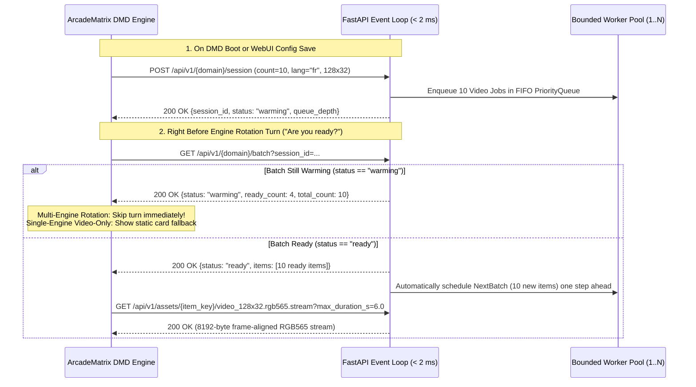

# 📡 REST API, DMD Rotation Protocol & `.rgb565.stream` Specification

> **[🇫🇷 Lire cette spécification en Français (API_AND_PROTOCOL_FR.md)](API_AND_PROTOCOL_FR.md)**

This document specifies the **Engine-Encapsulated 2-Step LAN Protocol** between **ArcadeMatrix** (ESP32 / ESP32-S3 / Raspberry Pi) and **`dmd-media-showcase`**, as well as the binary `.rgb565.stream` (`DMDS`) wire format.

---

## 1. The 2-Step Engine-Encapsulated Protocol (Zero Webhooks on DMD)

To preserve strict architectural isolation inside the DMD firmware, no HTTP webhook receiver is ever exposed on the DMD. Instead, each Showcase engine instance drives the entire lifecycle via two outgoing LAN HTTP requests:



---

## 2. REST Endpoints Reference

### `GET /api/v1/health`
Returns server status, bounded worker pool utilization, and active scraper providers:
```json
{
  "status": "ok",
  "version": "1.0.0",
  "converter_version": "8.0.0",
  "active_workers": 0,
  "max_workers": 2,
  "queue_depth": 0,
  "active_sessions": 1,
  "completed_jobs_total": 10,
  "avg_job_duration_s": 0.42,
  "providers_configured": {
    "games": "steam+curated_catalog",
    "movies": "tmdb+curated_catalog",
    "series": "tvmaze+curated_catalog",
    "anime": "animethemes+jikan+curated_catalog"
  }
}
```

### `POST /api/v1/{domain}/session`
- **Path parameter `domain`:** `games` | `movies` | `series` | `anime`
- **Request body (`SessionRegisterRequest`):**
  ```json
  {
    "client_id": "esp32s3-gameroom:retro_games_1",
    "count": 5,
    "lang": "fr",
    "width": 128,
    "height": 32,
    "include_poster": true,
    "include_synopsis": true,
    "include_snapshot": true,
    "include_video": true,
    "video_max_duration_s": 6.0,
    "video_fps": 15,
    "video_mode": "auto_action",
    "color_boost": true,
    "systems": ["mame", "neogeo", "snes"],
    "genres": ["action", "fighting"]
  }
  ```

### `GET /api/v1/{domain}/batch?session_id={session_id}`
Fast `< 2 ms` LAN readiness check returning `BatchStatusResponse`.

### `POST /api/v1/{domain}/on-demand`
Future-ready endpoint for voice assistants (Google Home / Alexa / Home Assistant) or external webhooks:
```json
{
  "query": "Metal Slug",
  "domain": "games",
  "lang": "fr",
  "width": 128,
  "height": 32,
  "video_max_duration_s": 8.0,
  "video_fps": 15,
  "target_session_id": "ses_games_ee75057c165b"
}
```

---

## 3. Binary `.rgb565.stream` (`DMDS`) Wire Format

Designed specifically for **ESP32-S3 / ESP32** and **Raspberry Pi** HUB75 panels so Core 1 never performs CPU-heavy GIF/LZW or MP4 decoding:

| Byte Offset | Type | Field | Description |
| :--- | :--- | :--- | :--- |
| `0..3` | `char[4]` | `magic` | Exact ASCII bytes `"DMDS"` (`0x44 0x4D 0x44 0x53`). |
| `4` | `uint8` | `version` | Protocol version (`1`). |
| `5` | `uint8` | `fps` | Target playback frame rate (e.g. `15`). |
| `6..7` | `uint16 LE` | `width` | Frame width in pixels (e.g. `128`). |
| `8..9` | `uint16 LE` | `height` | Frame height in pixels (e.g. `32`). |
| `10..11` | `uint16 LE` | `total_frames` | Total number of RGB565 frames in the stream. |
| `12..13` | `uint16 LE` | `frame_delay_ms` | Inter-frame interval in milliseconds (`round(1000 / fps)`). |
| `14..15` | `uint16 LE` | `reserved` | Reserved (`0`). |
| `16..EOF` | `uint16 LE[]` | `frames` | Contiguous raw frames (`width * height * 2` bytes per frame, e.g. `8192` bytes for `128x32`). |
