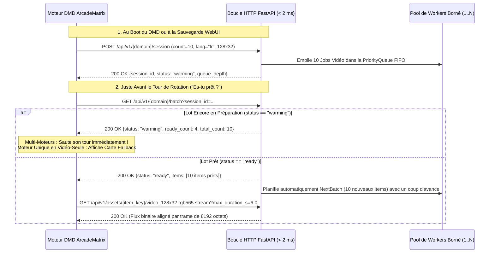

# 📡 API REST, Protocole de Rotation DMD & Spécification `.rgb565.stream`

> **[🇬🇧 Read this specification in English (API_AND_PROTOCOL.md)](API_AND_PROTOCOL.md)**

Ce document détaille le **Protocole LAN en 2 Étapes Encapsulé dans l'Engine** entre **ArcadeMatrix** (ESP32 / ESP32-S3 / Raspberry Pi) et **`dmd-media-showcase`**, ainsi que le format binaire de streaming `.rgb565.stream` (`DMDS`).

---

## 1. Protocole LAN en 2 Étapes (Zéro Webhook sur le DMD)

Pour respecter strictement l'encapsulation des moteurs d'affichage côté DMD, aucun endpoint webhook entrant n'est ajouté au serveur web du DMD. Chaque instance de moteur Showcase pilote son cycle de vie via 2 appels HTTP sortants sur le réseau local :



---

## 2. Référence des Endpoints REST

### `GET /api/v1/health`
Retourne l'état de santé du serveur, la charge du pool de workers et les scrapers actifs :
```json
{
  "status": "ok",
  "version": "1.0.0",
  "converter_version": "8.0.0",
  "active_workers": 0,
  "max_workers": 2,
  "queue_depth": 0,
  "active_sessions": 1,
  "completed_jobs_total": 10,
  "avg_job_duration_s": 0.42,
  "providers_configured": {
    "games": "steam+curated_catalog",
    "movies": "tmdb+curated_catalog",
    "series": "tvmaze+curated_catalog",
    "anime": "animethemes+jikan+curated_catalog"
  }
}
```

### `POST /api/v1/{domain}/session`
- **Paramètre `domain` :** `games` | `movies` | `series` | `anime`
- **Corps de requête (`SessionRegisterRequest`) :**
  ```json
  {
    "client_id": "esp32s3-gameroom:retro_games_1",
    "count": 5,
    "lang": "fr",
    "width": 128,
    "height": 32,
    "include_poster": true,
    "include_synopsis": true,
    "include_snapshot": true,
    "include_video": true,
    "video_max_duration_s": 6.0,
    "video_fps": 15,
    "video_mode": "auto_action",
    "color_boost": true,
    "systems": ["mame", "neogeo", "snes"],
    "genres": ["action", "fighting"]
  }
  ```

### `GET /api/v1/{domain}/batch?session_id={session_id}`
Appel ultra-rapide (`< 2 ms`) vérifiant si le lot de `count` médias est prêt (`status == "ready"` ou `"warming"`).

### `POST /api/v1/{domain}/on-demand`
Endpoint prêt pour les assistants vocaux (Google Home / Alexa / Home Assistant) ou webhooks externes :
```json
{
  "query": "Metal Slug",
  "domain": "games",
  "lang": "fr",
  "width": 128,
  "height": 32,
  "video_max_duration_s": 8.0,
  "video_fps": 15,
  "target_session_id": "ses_games_ee75057c165b"
}
```

---

## 3. Spécification Binaire `.rgb565.stream` (`DMDS`)

Conçu spécialement pour l'ESP32-S3 / ESP32 et le Raspberry Pi afin d'éviter tout décodage LZW/GIF ou MP4 coûteux sur le microcontrôleur :

| Offset Octet | Type | Champ | Description |
| :--- | :--- | :--- | :--- |
| `0..3` | `char[4]` | `magic` | Signature ASCII `"DMDS"` (`0x44 0x4D 0x44 0x53`). |
| `4` | `uint8` | `version` | Version du protocole (`1`). |
| `5` | `uint8` | `fps` | Cadence cible en images/seconde (ex: `15`). |
| `6..7` | `uint16 LE` | `width` | Largeur en pixels (ex: `128`). |
| `8..9` | `uint16 LE` | `height` | Hauteur en pixels (ex: `32`). |
| `10..11` | `uint16 LE` | `total_frames` | Nombre total de trames RGB565 dans le flux. |
| `12..13` | `uint16 LE` | `frame_delay_ms` | Délai inter-trame en millisecondes (`round(1000 / fps)`). |
| `14..15` | `uint16 LE` | `reserved` | Réservé (`0`). |
| `16..EOF` | `uint16 LE[]` | `frames` | Trames brutes contiguës (`width * height * 2` octets par trame, soit `8192` octets en `128x32`). |
