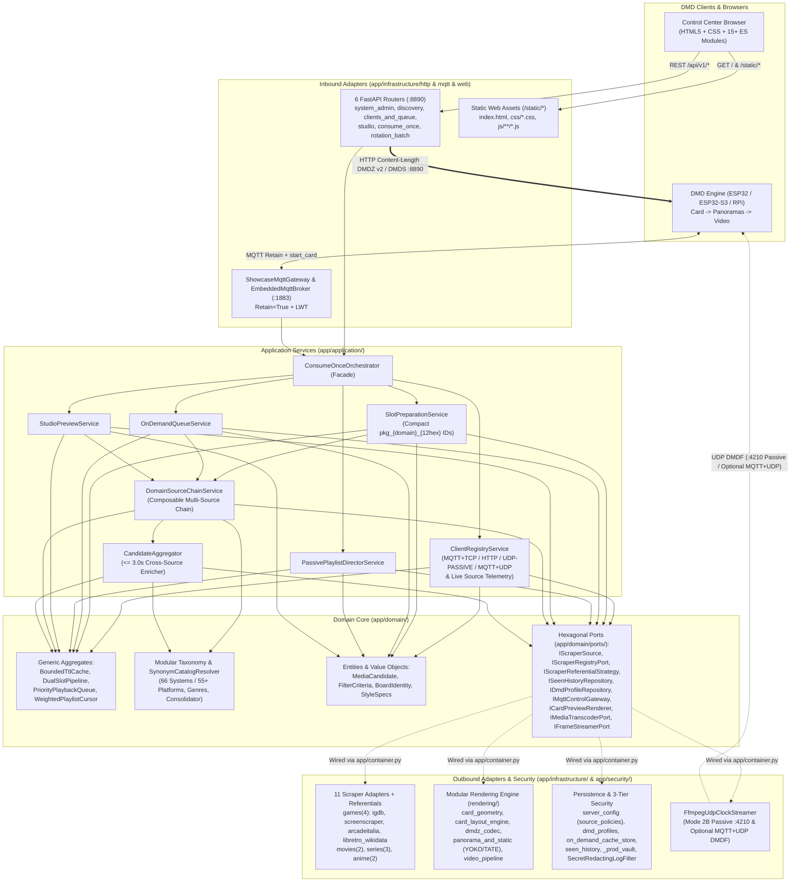
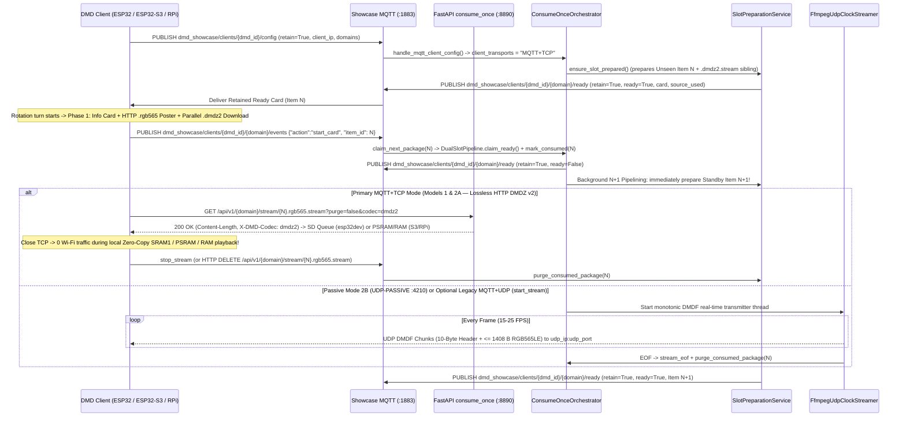

# DDD Architecture & Real-Time Streaming Pipeline — DMD Media Showcase Server

🇬🇧 English | 🇫🇷 [Français](ARCHITECTURE_FR.md) | 🇪🇸 [Español](ARCHITECTURE_ES.md)

---

## 1. Modular Hexagonal / DDD Layered Architecture

The server enforces a strict **Hexagonal (Ports & Adapters) and Domain-Driven Design (DDD)** architecture with inward-only dependencies verified mechanically by `tests/test_architecture_ddd_fitness.py`:

- **Domain Layer (`app/domain/`)**: 100% pure Python (zero FastAPI, HTTPX, Pillow, OpenCV, or Infrastructure imports). Houses immutable Entities & Value Objects (`entities.py`, `board_identity.py`, `style_specs.py`, `on_demand_cache_key.py`), generic reusable Domain Aggregates (`app/domain/aggregates/`), the modular multilingual Taxonomy subpackage (`app/domain/taxonomy/` with `66` canonical retro/arcade systems across `55+` platforms), and Hexagonal Port interfaces (`app/domain/ports/`).
- **Application Layer (`app/application/`)**: Depends strictly on `app/domain/` and Port interfaces. Decomposed into single-responsibility Application Services — including the configurable Chain-of-Responsibility + Strategy router (`DomainSourceChainService`) and Cross-Source Composite Enricher (`CandidateAggregator`) — coordinated by a lightweight `ConsumeOnceOrchestrator` facade (`<= 550` lines) and wired lazily at runtime through the Composition Root (`app/container.py`).
- **Infrastructure, Security & Scheduler Layers (`app/infrastructure/`, `app/security/`, `app/scheduler/`)**: Concrete Inbound Adapters (`6` cohesive FastAPI routers under `app/infrastructure/http/routers/` — including lossless HTTP `1.1` `Content-Length` `DMDZ` v2 / `DMDS` streaming & `DELETE` cleanup in `consume_once.py` — externalized ES-module WebUI under `app/infrastructure/web/static/`, and `ShowcaseMqttGateway`), Outbound Adapters (`11` domain scraper adapters & per-source referential strategies, modular HUB75 card/panorama/video/`DMDZ` rendering pipeline including `dmdz_codec.py` and `dmdz_motion.py`, JSON & mtime-preserving `on_demand_cache_store.py` repositories, `DmdConverterAdapter`, and `FfmpegUdpClockStreamer`), and Security Services (`vault.py` 3-tier native C `_prod_vault` loader and `log_redactor.py` `SecretRedactingLogFilter`).

---

## 2. Generic & Reusable Building Blocks

A core design goal of the architecture is **genericity and reusability** across domains and transports:

| Component | Module | Generic Responsibility |
| :--- | :--- | :--- |
| `BoundedTtlCache[TKey, TVal]` | `app/domain/aggregates/artifact_cache.py` | Deterministic TTL + oldest-first max-capacity cache with optional `on_evict(key, val)` cleanup hook (reused for staged search candidates and rendered Studio `DMDS` previews). |
| `DualSlotPipeline[TKey, TItem]` | `app/domain/aggregates/slot_pipeline.py` | Generic `Ready (N)` + `Standby (N+1)` + `Active` double-buffering state machine with atomic `claim_ready()` promotion and lossless `promote_priority_ready()` demotion. |
| `PriorityPlaybackQueue` | `app/domain/aggregates/priority_queue.py` | Per-board priority queue reconciling `enqueue_next` (FIFO tail) and `play_now` (head preemption) across WebUI, FrontendSync, and voice assistants. |
| `WeightedPlaylistCursor` | `app/domain/aggregates/playlist_cursor.py` | Pure deterministic `(slot_index, items_in_slot)` quota rotation across enabled multi-domain playlist slots (`1..10` items per turn). |
| `CandidateAggregator` | `app/application/candidate_aggregator.py` | Bounded (`<= 3.0s`) Composite Enricher merging missing DMD assets (`marquee_url`, direct `video_url`, `snapshot_urls`, localized `synopsis`) from secondary sources with strict `"1" > "auto" > "0"` localization precedence, donor matching, and composite attribution (`igdb+screenscraper`). |
| `TranslationService` | `app/infrastructure/scrapers/translation_service.py` | Zero-API-key synopsis translation cascade (`Google GTX -> MyMemory -> Lingva`, 512-entry LRU cache) and domain genre badge/subtitle localizer across `games`, `movies`, `series`, and `anime`. |
| `SynonymCatalogResolver` | `app/domain/taxonomy/resolver.py` | Slug-indexed multilingual synonym & substring resolver reusable on any canonical catalog dictionary (`systems`, `games`, `movies`, `series`, `anime`). |
| `PortProviderRegistry` | `app/domain/ports/default_ports.py` | Lightweight lazy DI registry decoupling Domain/Application services from concrete Infrastructure singletons (`app/container.py`). |
| `BoundedWorkerExecutorMixin[TJob]` | `app/scheduler/executor_lifecycle.py` | Event-loop-resilient `ProcessPoolExecutor` / `ThreadPoolExecutor` pool controller with live worker scaling (`reconfigure_workers()`). |
| `SecretRedactingLogFilter` | `app/security/log_redactor.py` | Logging filter scrubbing query-string, JSON, and Bearer credentials across `LogRecord.msg` and `httpx`/`httpcore` URL arguments. |

---

## 3. Composable Multi-Source Chain, Cross-Source Aggregation & Referential Consolidation

### 3.1 Runtime-Configurable Chain-of-Responsibility (`source_policies` / `SourceChainPolicy`) & `CandidateAggregator`

Instead of static hardcoded `[Primary, Fallback]` pairs, `ScraperRegistry` (`app/infrastructure/scrapers/registry.py`) and `DomainSourceChainService` (`app/application/source_chain_service.py`) evaluate per-domain `source_policies` persisted in `./data/server_config.json` and hot-editable in the Web Admin Dashboard under both **Overview** and **API Keys & Scrapers**:

- **`ordered_sources`**: Arbitrary ordered priority list per domain (`#1 Primary -> #2 Secondary -> #3 Tertiary -> ...`):
  - `games`: `["igdb", "screenscraper", "arcadeitalia", "libretro_wikidata"]`
  - `movies`: `["tmdb_movies", "itunes_movies"]`
  - `series`: `["tmdb_series", "tvdb_series", "tvmaze"]`
  - `anime`: `["jikan", "anilist"]`
  Whenever the highest-priority source is unconfigured, returns `0` results (`[]`), times out, enters rate-limit/quota cooldown (`is_in_cooldown()` / health tracker reporting `"ok"`, `"cooldown"`, or `"unconfigured"`), or does not support the requested system (`ReferentialConsolidator.source_supports_criteria()`), execution deterministically falls through to the next enabled & configured source.
- **`disabled_sources`**: Per-domain source toggle with an admin guard ensuring at least one source remains active per domain.
- **`aggregation_mode`**:
  - **`"enrich_missing"` (Multi-Source Aggregation, default)**: Primary resolves canonical identity, fuzzy/alias search, and base metadata (for example, `IGDB` resolving player shorthand `"sf2x"` on `cps2` $\to$ canonical `"Super Street Fighter II Turbo"` / `ssf2t`), and `CandidateAggregator` runs a bounded secondary pass (`<= 3.0s` per secondary source, validating game fingerprints / MAME ROM stems / sequel numbers to prevent sequel cross-contamination) across enabled secondary sources (`ScreenScraper`, `ArcadeItalia`, `Apple iTunes`, `AnimeThemes`, etc.) to pull missing DMD-specialized assets (clean détouré marquees/wheels, pixel-art snaps, direct `.mp4`/`.webm`/`.m4v` streams, localized synopses). Enriched candidates report composite provenance (`source_used="igdb+screenscraper"`, `"igdb+arcadeitalia"`, `"tmdb_movies+itunes_movies"`), surfaced live in `playing_source`, `ready_source`, `standby_source`, and `preparing_source` badges across the Admin Dashboard and priority queues.
  - **`"fallback_only"` (Strict Fallback)**: Secondary sources are queried strictly when Primary yields `0` results or fails.

### 3.2 4 Independent Game Sources & `55+` (`66`) Canonical Retro/Arcade Systems

`RETRO_SYSTEM_CATALOG` (`app/domain/taxonomy/systems.py`, composed from `systems_arcade_console.py` and `systems_handheld_computer.py`) defines **66 canonical systems (`55+` platforms)** across arcade boards, home consoles, handhelds, and classic computers, served by 4 selectable `IScraperSource` adapters:
1. **`igdb` (`IgdbGamesAdapter`)**: Twitch/Amazon `client_credentials` OAuth2 + IGDB API v4 (`api.igdb.com/v4/games`) covering 200+ platforms, instant acronym/shorthand matching via `alternative_names` + `arcade_aliases.py`, uniform random offset discovery, covers, artworks, trailers, and a 60-second circuit-breaker cooldown on upstream auth/429/5xx errors.
2. **`screenscraper` (`ScreenScraperAdapter`)**: ScreenScraper API v2 delivering regional boxarts, clean détouré wheels/marquees, pixel-art snaps, and short `.mp4` video snaps, protected by automatic HTTP-200 plaintext quota/overload detection (`detect_screenscraper_api_error`) and cooldown circuit-breaking (`is_screenscraper_in_cooldown`).
3. **`arcadeitalia` (`ArcadeItaliaAdapter`)**: Keyless authoritative MAME / CPS-1 / CPS-2 / CPS-3 / Neo-Geo / NAOMI / Atomiswave / Sega Model 2-3 HTTPS scraper (`adb.arcadeitalia.net`) with built-in `ARCADE_QUERY_ALIASES` (`arcade_aliases.py`) resolving player shorthands (`sf2x`, `3s`, `kof98`, `garou`, `avsp`, `mvsc`) directly to parent MAME ROM sets in a single HTTPS request.
4. **`libretro_wikidata` (`LibretroWikidataAdapter`)**: First-class keyless console, handheld, and classic computer source combining Wikidata SPARQL (`wd:Q7889`), verified `libretro-thumbnails/{repo}` (`Named_Boxarts`, `Named_Titles`, `Named_Snaps`), localized Wikipedia synopses, and Archive.org video snaps.

### 3.3 Dynamic Referential Consolidation & Capability-Aware Routing (`ReferentialConsolidator`)

1. Each scraper pairs with a dedicated `IScraperReferentialStrategy` harvesting live identifiers into `./data/referentials/{source_id}.json` (`LibretroWikidataReferentialStrategy`, `ArcadeItaliaReferentialStrategy`, `JikanReferentialStrategy`, `AniListReferentialStrategy`, `TvMazeReferentialStrategy`).
2. `ReferentialConsolidator` (`app/domain/taxonomy/consolidator.py`) normalizes scraper-specific synonyms (`Famicom` / `Nintendo Entertainment System` $\to$ `nes`, `Plateforme` / `Platformer` $\to$ `platform`) via `SynonymCatalogResolver` and exposes a relational schema (`System -> Supported Genres & Decades`) on `GET /api/v1/{domain}/filters?lang={lang}` and MQTT `dmd_showcase/catalog/{domain}/referential` (`retain=True`).
3. **Capability-Aware Routing**: When a user selects `systems=["nes"]`, `ReferentialConsolidator.source_supports_criteria("arcadeitalia", criteria)` returns `False` so `DomainSourceChainService` skips arcade-only adapters and routes discovery to console-capable sources (`igdb`, `screenscraper`, `libretro_wikidata`), guaranteeing zero MAME queries and zero console hardware photos.

### 3.4 Deterministic YOKO / TATE Zoom-to-Cover Panoramas & 3-Tier Security Vault

- **Deterministic Panorama Axis (`panorama_and_static.py` + `dmd_gif_converter >= 8.0.4`)**: `resolve_showcase_panorama_axis()` enforces uniform zoom-to-cover scaling (zero black bars, transparent RGBA marquees composited onto pure black) with deterministic axis selection: **YOKO** panels (`width > height`, e.g. `128x32`, `128x64`, `256x64`) always scroll **top-to-bottom**, whereas **TATE** panels (`height > width`, e.g. `64x128`, `32x128`) always scroll **left-to-right** (with square `64x64` panels adapting to source aspect ratio).
- **3-Tier Credential Vault & Log Redaction (`app/security/`)**: `ServerConfigStore` resolves credentials via `1. WebUI ./data/server_config.json` $\to$ `2. .env / OS environment` $\to$ `3. Compiled CI/CD C extension (app/security/_prod_vault*.so)` built by `scripts/compile_prod_vault.py` using `VAULT_MASTER_SECRET` (PBKDF2-HMAC-SHA256 + 16-byte random salt + 3-share XOR, `.c` deleted immediately). At startup, `install_secret_log_redaction()` attaches `SecretRedactingLogFilter` and clamps `httpx`/`httpcore` loggers to `WARNING` so query-string secrets (`devpassword`, `sspassword`, `api_key`, `client_secret`) never appear in container stdout logs.

---

## 4. Unified Lossless `MQTT + TCP` Streaming (`codec=dmdz2`), `N+1` Pipelining & Passive UDP `DMDF`

`ShowcaseRuntimeState.client_transports` tracks four deterministic client transport profiles surfaced live in `ClientRegistryService` and the Admin UI:
- **`MQTT+TCP` (Default & Recommended — Model 1 `ArcadeMatrix` ESP32 / ESP32-S3 / `ArcadeMatrix_RPi` & Model 2A Hybrid `supports_local_card: true`)**: Pairs the **MQTT (`:1883`) Control Plane** (`config`, `ready`, `start_card`, `stop_stream` with `retain=True` + `LWT`, compact collision-free `pkg_<domain>_<12hex>` `item_id`s `<= 24` chars, and automatic same-turn HTTP `/config + /next` fallback) with a unified lossless HTTP `1.1` (`:8890`) `Content-Length` stream (`GET /api/v1/{domain}/stream/{item_id}.rgb565.stream?purge={true|false}&codec=dmdz2` + idempotent `DELETE` cleanup):
  1. **`esp32dev` (`0 KB` PSRAM — Self-Cleaning `25 MHz` SD Card Staging)**: Opens `/cache/showcase_live.dmdz` (`MediaShowcaseBase`) or `/cache/showcase_sync.dmdz` (`FrontendSyncEngine`) with `O_TRUNC`, downloads lossless `.dmdz2.stream` (`?purge=false&codec=dmdz2`) during the Phase 1 Info Card, closes the TCP socket once downloaded (`0` Wi-Fi traffic and `0` `lwIP` `pbuf`s during playback), decodes locally via an `8,448–9,216 B` lock-free SPSC ring with consumer top-up signaling (`shouldRefillSpscRing()`) into the Zero-Copy `SRAM1` Canvas (`ScopedCanvasGuard`), holds the final video frame in `StreamEndHold` (`0` empty Card flash), and deterministically deletes (`sd.remove`) the `.dmdz` file on completion, error, `WebUiYield`, or rotation abort.
  2. **`ESP32-S3` (`8 MB` Octal PSRAM — 100% PSRAM, Strictly `0` SD Card I/O)**: Never touches the microSD card (operates identically even with no SD card inserted). Preloads lossless `.dmdz2.stream` (`<= 4 MB`, `freePsram - 1.5 MB` reserve) directly into PSRAM during the Phase 1 Info Card (`?purge=false&codec=dmdz2` -> `0` Wi-Fi traffic during playback, freed on exit), or streams larger `256x64` HD clips through a `1 MB` PSRAM SPSC ring.
  3. **`ArcadeMatrix_RPi` (High-RAM Linux Preload)**: Preloads lossless `.dmdz2.stream` directly into RAM (`?purge=false|true&codec=dmdz2`), with automatic raw `DMDS` fallback when `codec=dmdz2` is omitted.
- **`HTTP`**: Stateless HTTP Consume-Once polling (`POST /api/v1/{domain}/config` + `GET /api/v1/{domain}/next`) streaming over the same lossless `:8890` data plane.
- **`UDP-PASSIVE` (Model 2B — `supports_local_card: false`)**: Ultra-minimal ~180-line passive UDP `:4210` `DMDF` `<4sHBBH` framebuffer receiver where the server composites even Phase 1 Info Cards directly into the RGB565 stream (`render_card_in_stream=True`).
- **`MQTT+UDP` (Optional Legacy `mqtt_udp`)**: Explicit `start_stream` event triggering `FfmpegUdpClockStreamer` `DMDF` `<4sHBBH` UDP chunks to `{udp_ip}:{udp_port}`.

> **Crash & Container-Restart Resilience (`RetainedClientConfigStore`):** Every Mode 1 retained `dmd_showcase/clients/{dmd_id}/config` payload published to the Embedded MQTT Broker (`:1883`) is atomically persisted to `./data/mqtt_retained_clients.json`. On server or Docker restart, `ShowcaseMqttGateway` reloads all persisted DMD rotation slots into `EmbeddedMqttBroker.retained` and triggers `N / N+1` background pre-warming immediately while keeping `online=False` until live client traffic arrives.

### Binary `DMDZ` v2 (`dmdz2`) Lossless True-RGB565 Container (16-Byte Header `<4sBBHHHHH`)

Pre-encoded into `.dmdz2.stream` (`v2` 100% lossless True-RGB565) by `dmdz_codec.py` + `dmdz_motion.py`:

| Offset | Type | Field | Description |
| :--- | :--- | :--- | :--- |
| `0..3` | `char[4]` | `magic` | `"DMDZ"` (`0x44 0x4D 0x44 0x5A`) |
| `4` | `uint8` | `version` | `DMDZ` wire version (`2` = `"dmdz2"`) |
| `5` | `uint8` | `fps` | Target playback frame rate (`8..60`, e.g. `24–30`) |
| `6..7` | `uint16le` | `width` | Panel width in pixels (`128`, `256`, etc.) |
| `8..9` | `uint16le` | `height` | Panel height in pixels (`32`, `64`, etc.) |
| `10..11` | `uint16le` | `total_frames` | Total encoded frames (`1..65535`) |
| `12..13` | `uint16le` | `frame_dur_ms` | Nominal per-frame duration in ms (`round(1000 / fps)`) |
| `14..15` | `uint16le` | `keyframe_interval` | Periodic keyframe interval (`0` = frame `0` keyframe) |
| `16..EOF` | `uint8[]` | `frames` | Per frame: `<H` `payload_len` + `type` (`0=delta`, `1=scroll(dy)`, `2=keyframe`, `3=scroll_2d(dx,dy)`, `4=raw`) + raster opcodes |

- **Lossless True-RGB565 Opcodes (`type 0..3`, `cache[64]`, `last = 0`)**: `SKIP` (`00nnnnnn`), `LONG_SKIP` (`0xF0 + <H`), `RUN` (`01nnnnnn`), `INDEX[64]` (`10iiiiii`), `DIFF` (`110xxxxx`), `LIT` (`1110nnnn`), spatial `OP_LUMA` (`0xDC..0xDF`), temporal `OP_TLUMA` (`0xF1..0xF4`), backward `OP_LZ` (`0xF6..0xF7`), and 1-byte `OP_TDIFF` (`0xF8..0xFF`), bounded by `FRAME_RAW` (`0x04`, raw `width * height * 2` RGB565LE fallback when incompressible).

### Binary HTTP TCP `DMDS` Raw Stream Header (16 Bytes, Little-Endian `<4sBBHHHHH` — Raw HTTP Fallback)

Served with exact `Content-Length` (`GET /api/v1/{domain}/stream/{item_id}.rgb565.stream?purge=true`) whenever `codec=dmdz2` is omitted (`X-DMD-Consume-Once: 1`, `X-DMD-Codec: dmds`):

| Offset | Type | Field | Description |
| :--- | :--- | :--- | :--- |
| `0..3` | `char[4]` | `magic` | `"DMDS"` (`0x44 0x4D 0x44 0x53`) |
| `4` | `uint8` | `version` | Stream format version (`1`) |
| `5` | `uint8` | `fps` | Target playback frame rate (`8..60`) |
| `6..7` | `uint16le` | `width` | Panel width in pixels (e.g. `128`) |
| `8..9` | `uint16le` | `height` | Panel height in pixels (e.g. `32`) |
| `10..11` | `uint16le` | `total_frames` | Total concatenated RGB565LE frames (`1..65535`) |
| `12..13` | `uint16le` | `frame_dur_ms` | Nominal per-frame duration in ms (`round(1000 / fps)`) |
| `14..15` | `uint16le` | `reserved` | Reserved (`0`) |
| `16..EOF` | `uint8[]` | `frames` | Raw `width * height * 2`-byte RGB565LE frames |

### Binary UDP `DMDF` Packet Header (10 Bytes, Little-Endian `<4sHBBH` — Mode 2B Passive `:4210` & Optional `MQTT+UDP`)

> Full machine-readable specification (MQTT 3.1.1 topics + HTTP `DMDZ` v2 / `DMDS` + UDP `DMDF` datagrams): [`docs/asyncapi.yaml`](asyncapi.yaml) (served directly from disk via `app/asyncapi_spec.py` at `GET /asyncapi.yaml` and `GET /api/v1/asyncapi.yaml`).

| Offset | Type | Field | Description |
| :--- | :--- | :--- | :--- |
| `0..3` | `char[4]` | `magic` | `"DMDF"` (`0x44 0x4D 0x44 0x46`) |
| `4..5` | `uint16le` | `frame_seq` | Wrapping monotonic frame sequence number (`0..65535`) |
| `6` | `uint8` | `chunk_idx` | Zero-based chunk index within the current frame (`0..total_chunks-1`) |
| `7` | `uint8` | `total_chunks` | Total chunks required to assemble the complete frame (`1..64`) |
| `8..9` | `uint16le` | `byte_offset` | Byte offset (`chunk_idx * 1408`) inside the target RGB565LE framebuffer |
| `10..N` | `uint8[]` | `payload` | Raw RGB565LE pixel slice (`<= 1408` bytes, MTU-safe `<= 1418` bytes/UDP packet = `6` chunks for `128x32`) |
