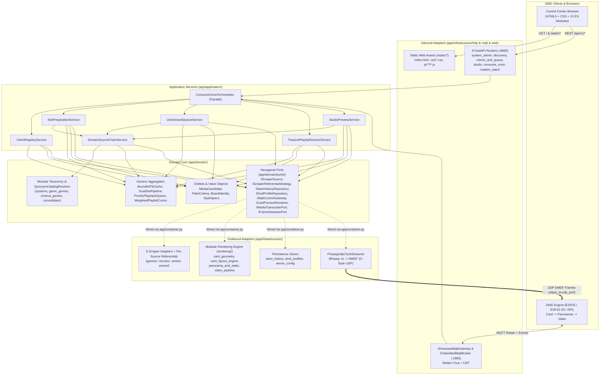
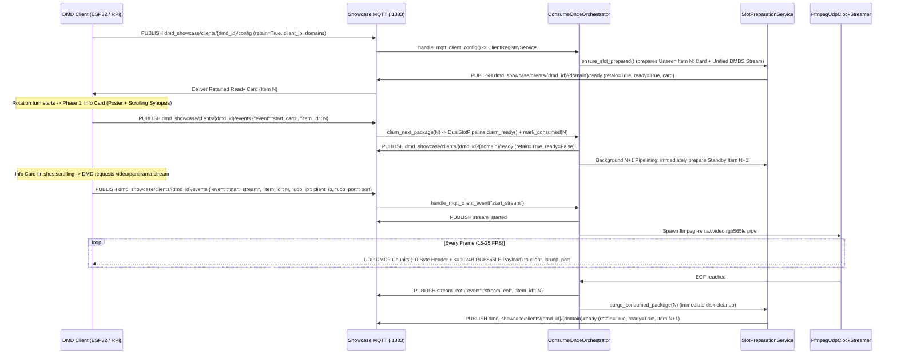

# DDD Architecture & Real-Time Streaming Pipeline — DMD Media Showcase Server

🇬🇧 English | 🇫🇷 [Français](ARCHITECTURE_FR.md) | 🇪🇸 [Español](ARCHITECTURE_ES.md)

---

## 1. Modular Hexagonal / DDD Layered Architecture

The server enforces a strict **Hexagonal (Ports & Adapters) and Domain-Driven Design (DDD)** architecture with inward-only dependencies verified mechanically by `tests/test_architecture_ddd_fitness.py`:

- **Domain Layer (`app/domain/`)**: 100% pure Python (zero FastAPI, HTTPX, Pillow, OpenCV, or Infrastructure imports). Houses immutable Entities & Value Objects (`entities.py`, `board_identity.py`, `style_specs.py`), generic reusable Domain Aggregates (`app/domain/aggregates/`), the modular multilingual Taxonomy subpackage (`app/domain/taxonomy/`), and Hexagonal Port interfaces (`app/domain/ports/`).
- **Application Layer (`app/application/`)**: Depends strictly on `app/domain/` and Port interfaces. Decomposed into single-responsibility Application Services coordinated by a lightweight `ConsumeOnceOrchestrator` facade (`<= 550` lines) and wired lazily at runtime through the Composition Root (`app/container.py`).
- **Infrastructure & Scheduler Layers (`app/infrastructure/`, `app/scheduler/`)**: Concrete Inbound Adapters (`6` cohesive FastAPI routers under `app/infrastructure/http/routers/`, externalized ES-module WebUI under `app/infrastructure/web/static/`, and `ShowcaseMqttGateway`) and Outbound Adapters (per-source scrapers & referential strategies, modular HUB75 card/panorama/video rendering pipeline, JSON repositories, `DmdConverterAdapter`, and `FfmpegUdpClockStreamer`).

---

## 2. Generic & Reusable Building Blocks

A core design goal of the architecture is **genericity and reusability** across domains and transports:

| Component | Module | Generic Responsibility |
| :--- | :--- | :--- |
| `BoundedTtlCache[TKey, TVal]` | `app/domain/aggregates/artifact_cache.py` | Deterministic TTL + oldest-first max-capacity cache with optional `on_evict(key, val)` cleanup hook (reused for staged search candidates and rendered Studio `DMDS` previews). |
| `DualSlotPipeline[TKey, TItem]` | `app/domain/aggregates/slot_pipeline.py` | Generic `Ready (N)` + `Standby (N+1)` + `Active` double-buffering state machine with atomic `claim_ready()` promotion and lossless `promote_priority_ready()` demotion. |
| `PriorityPlaybackQueue` | `app/domain/aggregates/priority_queue.py` | Per-board priority queue reconciling `enqueue_next` (FIFO tail) and `play_now` (head preemption) across WebUI, FrontendSync, and voice assistants. |
| `WeightedPlaylistCursor` | `app/domain/aggregates/playlist_cursor.py` | Pure deterministic `(slot_index, items_in_slot)` quota rotation across enabled multi-domain playlist slots (`1..10` items per turn). |
| `SynonymCatalogResolver` | `app/domain/taxonomy/resolver.py` | Slug-indexed multilingual synonym & substring resolver reusable on any canonical catalog dictionary (`systems`, `games`, `movies`, `series`, `anime`). |
| `PortProviderRegistry` | `app/domain/ports/default_ports.py` | Lightweight lazy DI registry decoupling Domain/Application services from concrete Infrastructure singletons (`app/container.py`). |
| `BoundedWorkerExecutorMixin[TJob]` | `app/scheduler/executor_lifecycle.py` | Event-loop-resilient `ProcessPoolExecutor` / `ThreadPoolExecutor` pool controller with live worker scaling (`reconfigure_workers()`). |

---

## 3. Dynamic Scraper Referential Consolidation (`ReferentialConsolidator`)

Instead of hardcoding category names in DMD firmware or frontend code:
1. Each scraper source pairs with a dedicated `IScraperReferentialStrategy` module that harvests live identifiers into `./data/referentials/{source_id}.json`:
   - **`LibretroWikidataReferentialStrategy`** (`app/infrastructure/scrapers/games/libretro_wikidata_referential.py` + `libretro_tree_resolver.py`): Queries Wikidata SPARQL strictly for Video Games (`wd:Q7889`) filtered by platform QID (`wdt:P400`) and genre QID (`wdt:P136/wdt:P279*`), extracts localized titles and Wikipedia sitelinks, and indexes `libretro-thumbnails/{repo}` (`Named_Boxarts`, `Named_Titles`, `Named_Snaps`) with regional priority `(France) -> (Europe) -> (World) -> (USA)`.
   - **`ArcadeItaliaReferentialStrategy`** (`app/infrastructure/scrapers/games/arcadeitalia_referential.py`): Queries `https://adb.arcadeitalia.net` strictly over HTTPS (`lista_mame.php` + Wikidata `wdt:P2451` MAME ROM IDs).
   - **`JikanReferentialStrategy` / `AniListReferentialStrategy` / `TvMazeReferentialStrategy`** (`anime/` & `series/`): Harvest live anime and TV genres.
2. `ReferentialConsolidator` (`app/domain/taxonomy/consolidator.py`) normalizes all scraper-specific synonyms (`Famicom` / `Nintendo Entertainment System` $\to$ `nes`, `Plateforme` / `Platformer` $\to$ `platform`) via `SynonymCatalogResolver` and exposes a relational schema (`System -> Supported Genres & Decades`) on `GET /api/v1/{domain}/filters?lang={lang}` and MQTT `dmd_showcase/catalog/{domain}/referential` (`retain=True`).
3. **Capability-Aware Routing**: When a user selects `systems=["nes"]`, `ReferentialConsolidator.source_supports_criteria("arcadeitalia", criteria)` returns `False` and `DomainSourceChainService` routes 100% of discovery to `LibretroWikidataAdapter`, guaranteeing zero MAME queries and zero console hardware photos.

---

## 4. Real-Time MQTT Handshake, `N+1` Pipelining & UDP `DMDF` Protocol

### Binary UDP `DMDF` Packet Header (10 Bytes, Little-Endian `<4sHBBH`)

> Full machine-readable specification (MQTT 3.1.1 topics + UDP `DMDF` datagrams): [`docs/asyncapi.yaml`](asyncapi.yaml) (served directly from disk via `app/asyncapi_spec.py` at `GET /asyncapi.yaml` and `GET /api/v1/asyncapi.yaml`).

| Offset | Type | Field | Description |
| :--- | :--- | :--- | :--- |
| `0..3` | `char[4]` | `magic` | `"DMDF"` (`0x44 0x4D 0x44 0x46`) |
| `4..5` | `uint16le` | `frame_seq` | Wrapping monotonic frame sequence number (`0..65535`) |
| `6` | `uint8` | `chunk_idx` | Zero-based chunk index within the current frame (`0..total_chunks-1`) |
| `7` | `uint8` | `total_chunks` | Total chunks required to assemble the complete frame (`1..64`) |
| `8..9` | `uint16le` | `byte_offset` | Byte offset (`chunk_idx * 1024`) inside the target RGB565LE framebuffer |
| `10..N` | `uint8[]` | `payload` | Raw RGB565LE pixel slice (`<= 1024` bytes, MTU-safe `<= 1034` bytes/UDP packet) |

### Binary HTTP `DMDS` Unified Stream Header (16 Bytes, Little-Endian `<4sBBHHHHH`)

| Offset | Type | Field | Description |
| :--- | :--- | :--- | :--- |
| `0..3` | `char[4]` | `magic` | `"DMDS"` (`0x44 0x4D 0x44 0x53`) |
| `4` | `uint8` | `version` | Stream format version (`1`) |
| `5` | `uint8` | `fps` | Target playback frame rate (`8..60`) |
| `6..7` | `uint16le` | `width` | Panel width in pixels (e.g. `128`) |
| `8..9` | `uint16le` | `height` | Panel height in pixels (e.g. `32`) |
| `10..11` | `uint16le` | `total_frames` | Total concatenated RGB565LE frames (`1..65535`) |
| `12..13` | `uint16le` | `frame_dur_ms` | Nominal per-frame duration in ms (`round(1000 / fps)`) |
| `14..15` | `uint16le` | `reserved` | Reserved (`0`) |
| `16..EOF` | `uint8[]` | `frames` | Contiguous `total_frames * width * height * 2` RGB565LE bytes |
