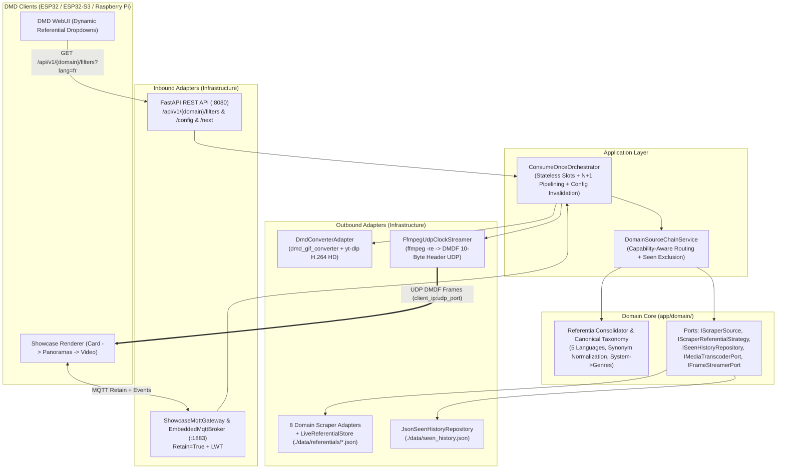
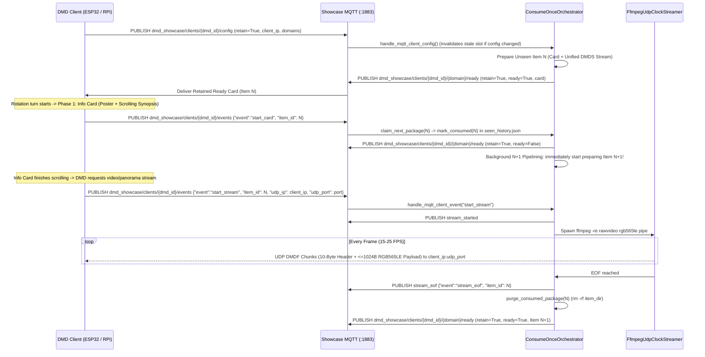

# DDD Architecture & Real-Time Streaming Pipeline — DMD Media Showcase Server (V3.0)

🇬🇧 English | 🇫🇷 [Français](ARCHITECTURE_FR.md) | 🇪🇸 [Español](ARCHITECTURE_ES.md)

---

## 1. Hexagonal / DDD Layered Architecture

---

## 2. Dynamic Scraper Referential Consolidation (`ReferentialConsolidator`)

Instead of hardcoding category names on the DMD firmware or WebUI:
1. Each scraper adapter owns an `IScraperReferentialStrategy` (`./data/referentials/{source_id}.json`) that harvests live identifiers from its upstream API:
   - **`LibretroWikidataReferentialStrategy`** (`games` consoles): Queries Wikidata SPARQL strictly for Video Games (`wd:Q7889`) filtered by platform QID (`wdt:P400`) and genre QID (`wdt:P136/wdt:P279*`), extracts localized titles (`titleFr` / `titleEn`) and Wikipedia sitelinks (`frwiki`), and indexes the GitHub file tree of `libretro-thumbnails/{repo}` (`Named_Boxarts`, `Named_Titles`, `Named_Snaps`) with regional priority `(France) -> (Europe) -> (World) -> (USA)`.
   - **`ArcadeItaliaReferentialStrategy`** (`games` arcade): Queries `https://adb.arcadeitalia.net` strictly over HTTPS (`lista_mame.php` + Wikidata `wdt:P2451` MAME ROM IDs).
   - **`JikanReferentialStrategy` / `AniListReferentialStrategy` / `TvMazeReferentialStrategy`**: Harvest live anime and TV genres.
2. `ReferentialConsolidator` (`app/domain/taxonomy.py`) normalizes all scraper-specific synonyms (`Famicom` / `Nintendo Entertainment System` $\to$ `nes`, `Plateforme` / `Platformer` $\to$ `platform`) and exposes a relational schema (`System -> Supported Genres & Decades`) via `GET /api/v1/{domain}/filters?lang={lang}` and MQTT `dmd_showcase/catalog/{domain}/referential` (`retain=True`).
3. **Capability-Aware Routing**: When a user selects `systems=["nes"]`, `ReferentialConsolidator.source_supports_criteria("arcadeitalia", criteria)` returns `False` and `ArcadeItaliaAdapter` delegates 100% to `LibretroWikidataAdapter`, guaranteeing zero MAME queries and zero console hardware photos.

---

## 3. Real-Time MQTT Handshake, `N+1` Pipelining & UDP `DMDF` Protocol

### Binary UDP `DMDF` Packet Header (10 Bytes, Little-Endian `<4sHBBI`)

| Offset | Type | Field | Description |
| :--- | :--- | :--- | :--- |
| `0..3` | `char[4]` | `magic` | `"DMDF"` (`0x44 0x4D 0x44 0x46`) |
| `4..5` | `uint16` | `frame_seq` | Monotonic frame sequence number (`0..65535`) |
| `6` | `uint8` | `chunk_idx` | Chunk index within the current frame (`0..total_chunks-1`) |
| `7` | `uint8` | `total_chunks` | Total chunks required to assemble the complete frame |
| `8..11` | `uint32` | `byte_offset` | Byte offset of this chunk inside the RGB565LE frame buffer |
| `10..N` | `uint8[]` | `payload` | Raw RGB565LE pixel slice (`<= 1024` bytes, MTU-safe) |
