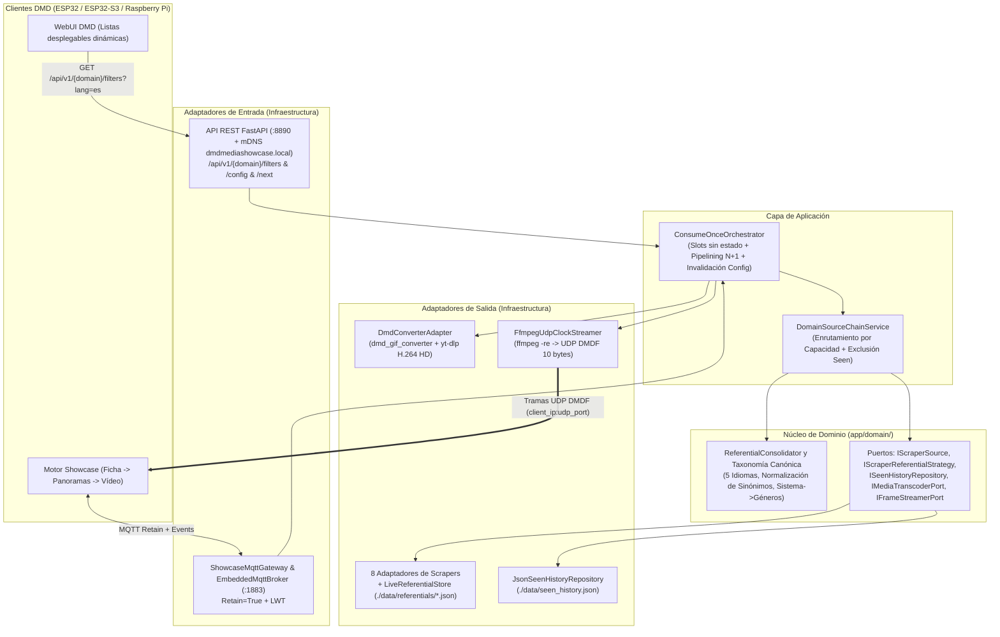

# Arquitectura DDD y Pipeline de Streaming en Tiempo Real — DMD Media Showcase Server (V3.0)

🇬🇧 [English](ARCHITECTURE.md) | 🇫🇷 [Français](ARCHITECTURE_FR.md) | 🇪🇸 Español

---

## 1. Arquitectura Hexagonal / DDD en Capas

---

## 2. Consolidación Dinámica de Referenciales (`ReferentialConsolidator`)

En lugar de codificar categorías fijas en el firmware o en la WebUI del DMD:
1. Cada adaptador posee su propia estrategia `IScraperReferentialStrategy` (`./data/referentials/{source_id}.json`):
   - **`LibretroWikidataReferentialStrategy`** (`games` consolas): Consulta Wikidata SPARQL estrictamente para Videojuegos (`wd:Q7889`) filtrados por el QID de la plataforma (`wdt:P400`) y del género (`wdt:P136/wdt:P279*`), extrae títulos localizados y enlaces de Wikipedia, y cruza con el árbol de archivos de GitHub `libretro-thumbnails/{repo}` con prioridad regional `(France) -> (Europe) -> (World) -> (USA)`.
   - **`ArcadeItaliaReferentialStrategy`** (`games` arcade): Consulta `https://adb.arcadeitalia.net` exclusivamente por HTTPS.
2. `ReferentialConsolidator` (`app/domain/taxonomy.py`) normaliza todos los sinónimos (`Famicom` / `Nintendo Entertainment System` $\to$ `nes`, `Plataformas` / `Platformer` $\to$ `platform`) y expone un esquema relacional (`Sistema -> Géneros y Décadas compatibles`) mediante `GET /api/v1/{domain}/filters?lang={lang}` y MQTT `dmd_showcase/catalog/{domain}/referential` (`retain=True`).

---

## 3. Protocolo MQTT en Tiempo Real, Pipelining `N+1` y Paquetes UDP `DMDF`

### Cabecera Binaria UDP `DMDF` (10 Bytes, Little-Endian `<4sHBBI`)

| Offset | Tipo | Campo | Descripción |
| :--- | :--- | :--- | :--- |
| `0..3` | `char[4]` | `magic` | `"DMDF"` (`0x44 0x4D 0x44 0x46`) |
| `4..5` | `uint16` | `frame_seq` | Número de secuencia monotónico del fotograma (`0..65535`) |
| `6` | `uint8` | `chunk_idx` | Índice del fragmento dentro del fotograma actual (`0..total_chunks-1`) |
| `7` | `uint8` | `total_chunks` | Total de fragmentos del fotograma |
| `8..11` | `uint32` | `byte_offset` | Desplazamiento en bytes dentro del búfer RGB565LE |
| `10..N` | `uint8[]` | `payload` | Datos de píxeles RGB565LE (`<= 1024` bytes) |

