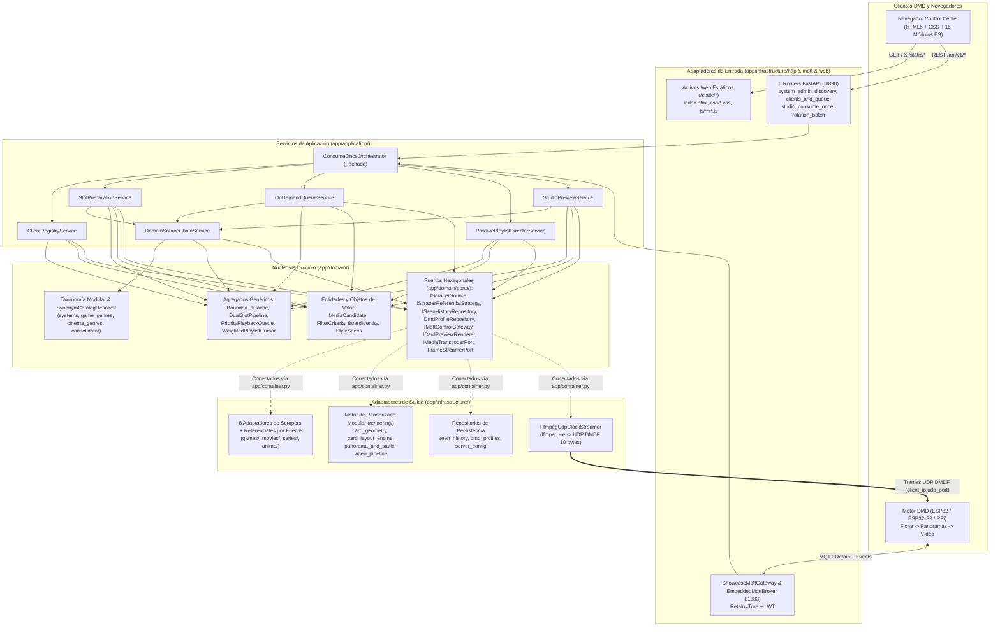

# Arquitectura DDD y Pipeline de Streaming en Tiempo Real — DMD Media Showcase Server

🇬🇧 [English](ARCHITECTURE.md) | 🇫🇷 [Français](ARCHITECTURE_FR.md) | 🇪🇸 Español

---

## 1. Arquitectura Hexagonal / DDD Modular en Capas

El servidor aplica una estricta **Arquitectura Hexagonal (Puertos y Adaptadores) y Domain-Driven Design (DDD)** cuyas reglas de dependencia hacia el interior y límites de tamaño se validan automáticamente mediante `tests/test_architecture_ddd_fitness.py`:

- **Capa de Dominio (`app/domain/`)**: 100 % Python puro (cero importaciones de FastAPI, HTTPX, Pillow, OpenCV o Infraestructura). Contiene Entidades y Objetos de Valor (`entities.py`, `board_identity.py`, `style_specs.py`), Agregados genéricos y reutilizables (`app/domain/aggregates/`), el subpaquete modular de Taxonomía multilingüe (`app/domain/taxonomy/`) y los Puertos Hexagonales (`app/domain/ports/`).
- **Capa de Aplicación (`app/application/`)**: Depende exclusivamente de `app/domain/` y sus Puertos. Dividida en servicios de aplicación de responsabilidad única coordinados por la fachada ligera `ConsumeOnceOrchestrator` (`<= 550` líneas) e inyectados mediante `app/container.py`.
- **Capas de Infraestructura y Scheduler (`app/infrastructure/`, `app/scheduler/`)**: Adaptadores de entrada (`6` routers FastAPI en `app/infrastructure/http/routers/`, WebUI estática en módulos ES en `app/infrastructure/web/static/` y `ShowcaseMqttGateway`) y adaptadores de salida (scrapers y estrategias referenciales por fuente, motor de renderizado HUB75 en `app/infrastructure/rendering/`, repositorios JSON, `DmdConverterAdapter` y `FfmpegUdpClockStreamer`).

---

## 2. Bloques Genéricos y Reutilizables

| Componente | Módulo | Responsabilidad Genérica |
| :--- | :--- | :--- |
| `BoundedTtlCache[TKey, TVal]` | `app/domain/aggregates/artifact_cache.py` | Caché acotada con expiración TTL, límite de entradas y callback `on_evict(key, val)`. |
| `DualSlotPipeline[TKey, TItem]` | `app/domain/aggregates/slot_pipeline.py` | Máquina de estados de doble búfer `Ready (N)` + `Standby (N+1)` + `Active` con promoción atómica `claim_ready()`. |
| `PriorityPlaybackQueue` | `app/domain/aggregates/priority_queue.py` | Cola prioritaria por placa DMD (`enqueue_next` FIFO frente a `play_now` en cabeza). |
| `WeightedPlaylistCursor` | `app/domain/aggregates/playlist_cursor.py` | Cursor determinista `(slot_index, items_in_slot)` para rotación ponderada multi-dominio (`1..10` obras por turno). |
| `SynonymCatalogResolver` | `app/domain/taxonomy/resolver.py` | Resolutor genérico de sinónimos indexado por slug reutilizable sobre cualquier catálogo canónico. |
| `BoundedWorkerExecutorMixin[TJob]` | `app/scheduler/executor_lifecycle.py` | Controlador reutilizable de `ProcessPoolExecutor` / `ThreadPoolExecutor` con escalado en caliente (`reconfigure_workers()`). |

---

## 3. Consolidación Dinámica de Referenciales (`ReferentialConsolidator`)

En lugar de codificar categorías fijas en el firmware o en la WebUI del DMD:
1. Cada adaptador posee su propio módulo `IScraperReferentialStrategy` (`./data/referentials/{source_id}.json`):
   - **`LibretroWikidataReferentialStrategy`** (`app/infrastructure/scrapers/games/libretro_wikidata_referential.py` + `libretro_tree_resolver.py`): Consulta Wikidata SPARQL estrictamente para Videojuegos (`wd:Q7889`) filtrados por el QID de la plataforma (`wdt:P400`) y del género (`wdt:P136/wdt:P279*`), extrae títulos localizados y enlaces de Wikipedia, y cruza con el árbol de GitHub `libretro-thumbnails/{repo}`.
   - **`ArcadeItaliaReferentialStrategy`** (`app/infrastructure/scrapers/games/arcadeitalia_referential.py`): Consulta `https://adb.arcadeitalia.net` exclusivamente por HTTPS.
   - **`JikanReferentialStrategy` / `AniListReferentialStrategy` / `TvMazeReferentialStrategy`** (`anime/` y `series/`): Recolectan dinámicamente géneros de Anime y Series.
2. `ReferentialConsolidator` (`app/domain/taxonomy/consolidator.py`) normaliza todos los sinónimos (`Famicom` / `Nintendo Entertainment System` $\to$ `nes`, `Plataformas` / `Platformer` $\to$ `platform`) mediante `SynonymCatalogResolver` y expone un esquema relacional (`Sistema -> Géneros y Décadas compatibles`) en `GET /api/v1/{domain}/filters?lang={lang}` y MQTT `dmd_showcase/catalog/{domain}/referential` (`retain=True`).

---

## 4. Protocolo MQTT en Tiempo Real, Pipelining `N+1` y Paquetes UDP `DMDF`

### Cabecera Binaria UDP `DMDF` (10 Bytes, Little-Endian `<4sHBBH`)

> Especificación formal completa (tópicos MQTT 3.1.1 + datagramas UDP `DMDF`): [`docs/asyncapi.yaml`](asyncapi.yaml) (cargada directamente por `app/asyncapi_spec.py` y servida en `GET /asyncapi.yaml` y `GET /api/v1/asyncapi.yaml`).

| Offset | Tipo | Campo | Descripción |
| :--- | :--- | :--- | :--- |
| `0..3` | `char[4]` | `magic` | `"DMDF"` (`0x44 0x4D 0x44 0x46`) |
| `4..5` | `uint16le` | `frame_seq` | Número de secuencia monotónico del fotograma (`0..65535`) |
| `6` | `uint8` | `chunk_idx` | Índice del fragmento dentro del fotograma actual (`0..total_chunks-1`) |
| `7` | `uint8` | `total_chunks` | Total de fragmentos del fotograma (`1..64`) |
| `8..9` | `uint16le` | `byte_offset` | Desplazamiento en bytes (`chunk_idx * 1024`) dentro del búfer RGB565LE |
| `10..N` | `uint8[]` | `payload` | Datos de píxeles RGB565LE (`<= 1024` bytes, `<= 1034` bytes/paquete UDP) |

### Cabecera Binaria HTTP `DMDS` del Flujo Unificado (16 Bytes, Little-Endian `<4sBBHHHHH`)

| Offset | Tipo | Campo | Descripción |
| :--- | :--- | :--- | :--- |
| `0..3` | `char[4]` | `magic` | `"DMDS"` (`0x44 0x4D 0x44 0x53`) |
| `4` | `uint8` | `version` | Versión del formato binario (`1`) |
| `5` | `uint8` | `fps` | Frecuencia objetivo (`8..60` FPS) |
| `6..7` | `uint16le` | `width` | Ancho del panel en píxeles (ej. `128`) |
| `8..9` | `uint16le` | `height` | Alto del panel en píxeles (ej. `32`) |
| `10..11` | `uint16le` | `total_frames` | Total de fotogramas RGB565LE concatenados (`1..65535`) |
| `12..13` | `uint16le` | `frame_dur_ms` | Duración nominal por fotograma en ms (`round(1000 / fps)`) |
| `14..15` | `uint16le` | `reserved` | Reservado (`0`) |
| `16..EOF` | `uint8[]` | `frames` | Secuencia contigua de `total_frames * width * height * 2` bytes RGB565LE |
