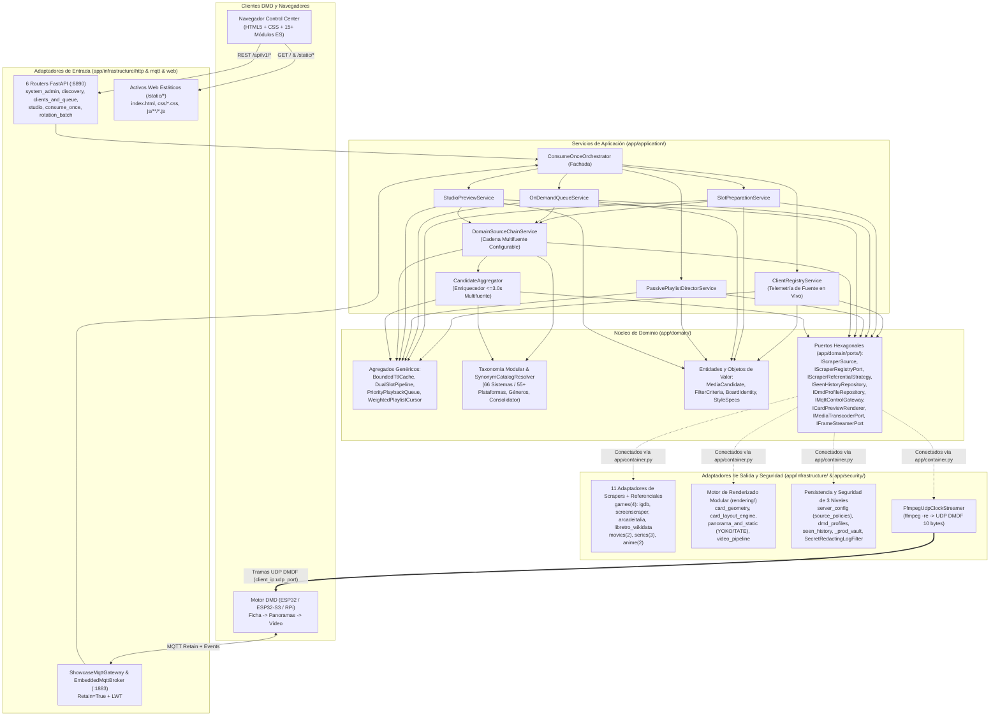
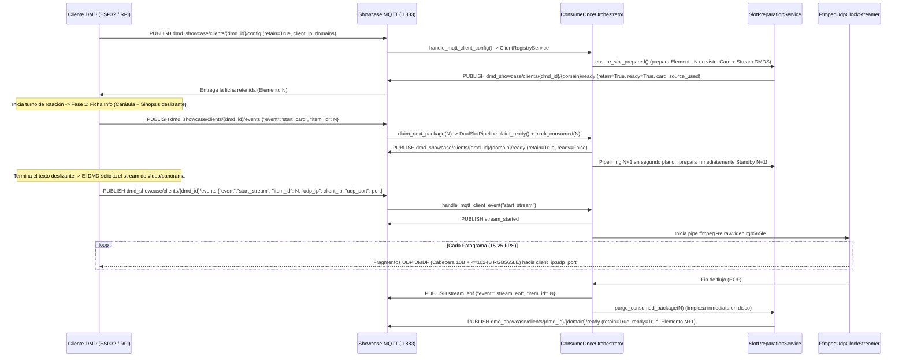

# Arquitectura DDD y Pipeline de Streaming en Tiempo Real — DMD Media Showcase Server

🇬🇧 [English](ARCHITECTURE.md) | 🇫🇷 [Français](ARCHITECTURE_FR.md) | 🇪🇸 Español

---

## 1. Arquitectura Hexagonal / DDD Modular en Capas

El servidor aplica una estricta **Arquitectura Hexagonal (Puertos y Adaptadores) y Domain-Driven Design (DDD)** cuyas reglas de dependencia hacia el interior y límites de tamaño se validan automáticamente mediante `tests/test_architecture_ddd_fitness.py`:

- **Capa de Dominio (`app/domain/`)**: 100 % Python puro (cero importaciones de FastAPI, HTTPX, Pillow, OpenCV o Infraestructura). Contiene Entidades y Objetos de Valor (`entities.py`, `board_identity.py`, `style_specs.py`, `on_demand_cache_key.py`), Agregados genéricos y reutilizables (`app/domain/aggregates/`), el subpaquete modular de Taxonomía multilingüe (`app/domain/taxonomy/` con `66` sistemas retro/arcade canónicos en `55+` plataformas) y los Puertos Hexagonales (`app/domain/ports/`).
- **Capa de Aplicación (`app/application/`)**: Depende exclusivamente de `app/domain/` y sus Puertos. Dividida en servicios de aplicación de responsabilidad única — incluidos el enrutador multifuente configurable (`DomainSourceChainService`) y el enriquecedor compuesto cruzado (`CandidateAggregator`) — coordinados por la fachada ligera `ConsumeOnceOrchestrator` (`<= 550` líneas) e inyectados mediante `app/container.py`.
- **Capas de Infraestructura, Seguridad y Scheduler (`app/infrastructure/`, `app/security/`, `app/scheduler/`)**: Adaptadores de entrada (`6` routers FastAPI en `app/infrastructure/http/routers/`, WebUI estática en módulos ES en `app/infrastructure/web/static/` y `ShowcaseMqttGateway`), adaptadores de salida (`11` adaptadores de scrapers y estrategias referenciales por fuente, motor de renderizado HUB75 en `app/infrastructure/rendering/`, repositorios JSON, `DmdConverterAdapter` y `FfmpegUdpClockStreamer`), y módulos de seguridad (`vault.py` bóveda nativa C `_prod_vault` de 3 niveles y `log_redactor.py` `SecretRedactingLogFilter`).

---

## 2. Bloques Genéricos y Reutilizables

| Componente | Módulo | Responsabilidad Genérica |
| :--- | :--- | :--- |
| `BoundedTtlCache[TKey, TVal]` | `app/domain/aggregates/artifact_cache.py` | Caché acotada con expiración TTL, límite de entradas y callback `on_evict(key, val)`. |
| `DualSlotPipeline[TKey, TItem]` | `app/domain/aggregates/slot_pipeline.py` | Máquina de estados de doble búfer `Ready (N)` + `Standby (N+1)` + `Active` con promoción atómica `claim_ready()` y `promote_priority_ready()`. |
| `PriorityPlaybackQueue` | `app/domain/aggregates/priority_queue.py` | Cola prioritaria por placa DMD (`enqueue_next` FIFO frente a `play_now` en cabeza). |
| `WeightedPlaylistCursor` | `app/domain/aggregates/playlist_cursor.py` | Cursor determinista `(slot_index, items_in_slot)` para rotación ponderada multi-dominio (`1..10` obras por turno). |
| `CandidateAggregator` | `app/application/candidate_aggregator.py` | Enriquecedor compuesto acotado (`<= 3.0s`) que fusiona activos DMD faltantes (`marquee_url`, `video_url` directo, `snapshot_urls`, `synopsis` localizada) desde fuentes secundarias compatibles con atribución combinada (`igdb+screenscraper`). |
| `SynonymCatalogResolver` | `app/domain/taxonomy/resolver.py` | Resolutor genérico de sinónimos indexado por slug reutilizable sobre cualquier catálogo canónico. |
| `PortProviderRegistry` | `app/domain/ports/default_ports.py` | Registro perezoso de inyección de dependencias que desacopla Dominio/Aplicación de singletons de Infraestructura (`app/container.py`). |
| `BoundedWorkerExecutorMixin[TJob]` | `app/scheduler/executor_lifecycle.py` | Controlador reutilizable de `ProcessPoolExecutor` / `ThreadPoolExecutor` con escalado en caliente (`reconfigure_workers()`). |
| `SecretRedactingLogFilter` | `app/security/log_redactor.py` | Filtro de logging que redacta automáticamente secretos en query-string, JSON y tokens Bearer en `LogRecord.msg` y argumentos `httpx`/`httpcore`. |

---

## 3. Cadena Multifuente Componible, Agregación Cruzada y Consolidación de Referenciales

### 3.1 Cadena de Responsabilidad Configurable en Caliente (`source_policies` / `SourceChainPolicy`) y `CandidateAggregator`

En lugar de pares estáticos `[Primaria, Respaldo]` codificados de forma rígida, `ScraperRegistry` (`app/infrastructure/scrapers/registry.py`) y `DomainSourceChainService` (`app/application/source_chain_service.py`) evalúan políticas `source_policies` persistidas en `./data/server_config.json` y editables en caliente desde el Panel Web (**Vista General** y **Claves API y Scrapers**):

- **`ordered_sources`**: Lista ordenada arbitraria de prioridad por dominio (`#1 Primaria -> #2 Secundaria -> #3 Terciaria -> ...`):
  - `games`: `["igdb", "screenscraper", "arcadeitalia", "libretro_wikidata"]`
  - `movies`: `["tmdb_movies", "itunes_movies"]`
  - `series`: `["tmdb_series", "tvdb_series", "tvmaze"]`
  - `anime`: `["jikan", "anilist"]`
  Siempre que la fuente prioritaria no esté configurada, devuelva `0` resultados (`[]`), agote el tiempo de espera, entre en enfriamiento por cuota (`is_in_cooldown()` / estado `"ok"`, `"cooldown"`, `"unconfigured"`) o no soporte el sistema solicitado (`ReferentialConsolidator.source_supports_criteria()`), la ejecución cae de forma determinista hacia la siguiente fuente activa y configurada.
- **`disabled_sources`**: Interruptor por fuente y dominio con protección que mantiene al menos una fuente activa.
- **`aggregation_mode`**:
  - **`"enrich_missing"` (Agregación Multifuente, por defecto)**: La fuente Primaria resuelve la identidad canónica, búsqueda difusa/alias y metadatos base (por ejemplo, `IGDB` resolviendo `"sf2x"` en `cps2` $\to$ `"Super Street Fighter II Turbo"` / `ssf2t`), y `CandidateAggregator` ejecuta un pase secundario acotado (`<= 3.0s` por fuente, validando huellas de juego / ROM MAME / números de secuela) sobre las fuentes secundarias activas (`ScreenScraper`, `ArcadeItalia`, `Apple iTunes`, `AnimeThemes`, etc.) para obtener recursos especializados DMD faltantes (marquees/wheels recortados, capturas pixel-art, streams directos `.mp4`/`.webm`/`.m4v`, sinopsis localizadas). Los elementos enriquecidos declaran atribución combinada (`source_used="igdb+screenscraper"`, `"igdb+arcadeitalia"`, `"tmdb_movies+itunes_movies"`), visible en vivo en `playing_source`, `ready_source`, `standby_source` y `preparing_source`.
  - **`"fallback_only"` (Respaldo Estricto)**: Las fuentes secundarias se consultan únicamente cuando la Primaria devuelve `0` resultados o falla.

### 3.2 4 Fuentes Independientes de Juegos y `55+` (`66`) Sistemas Retro/Arcade Canónicos

`RETRO_SYSTEM_CATALOG` (`app/domain/taxonomy/systems.py`, compuesto por `systems_arcade_console.py` y `systems_handheld_computer.py`) define **66 sistemas canónicos (`55+` plataformas)** entre placas arcade, consolas domésticas, portátiles y microordenadores clásicos, servidos por 4 adaptadores `IScraperSource` seleccionables:
1. **`igdb` (`IgdbGamesAdapter`)**: OAuth2 Twitch/Amazon `client_credentials` + IGDB API v4 (`api.igdb.com/v4/games`) con más de 200 plataformas, búsqueda instantánea por acrónimos/alias mediante `alternative_names` + `arcade_aliases.py`, descubrimiento aleatorio por offset, carátulas, artworks, tráilers y disyuntor de enfriamiento de 60 s ante errores de cuota/5xx.
2. **`screenscraper` (`ScreenScraperAdapter`)**: API ScreenScraper v2 con carátulas regionales, wheels/marquees recortados, capturas pixel-art y vídeos cortos `.mp4`, protegida mediante detección automática de cuota/sobrecarga HTTP-200 en texto plano (`detect_screenscraper_api_error`) y disyuntor de enfriamiento (`is_screenscraper_in_cooldown`).
3. **`arcadeitalia` (`ArcadeItaliaAdapter`)**: Scraper HTTPS sin clave de referencia para MAME / CPS-1 / CPS-2 / CPS-3 / Neo-Geo / NAOMI / Atomiswave / Sega Model 2-3 (`adb.arcadeitalia.net`) con `ARCADE_QUERY_ALIASES` (`arcade_aliases.py`) que resuelve alias de jugadores (`sf2x`, `3s`, `kof98`, `garou`, `avsp`, `mvsc`) en una sola petición HTTPS.
4. **`libretro_wikidata` (`LibretroWikidataAdapter`)**: Fuente sin clave de primer nivel para consolas, portátiles y ordenadores clásicos que combina Wikidata SPARQL (`wd:Q7889`), `libretro-thumbnails/{repo}` verificados (`Named_Boxarts`, `Named_Titles`, `Named_Snaps`), sinopsis localizadas de Wikipedia y vídeos de Archive.org.

### 3.3 Consolidación Dinámica de Referenciales y Enrutamiento por Capacidad (`ReferentialConsolidator`)

1. Cada adaptador posee su propio módulo `IScraperReferentialStrategy` (`./data/referentials/{source_id}.json`: `LibretroWikidataReferentialStrategy`, `ArcadeItaliaReferentialStrategy`, `JikanReferentialStrategy`, `AniListReferentialStrategy`, `TvMazeReferentialStrategy`).
2. `ReferentialConsolidator` (`app/domain/taxonomy/consolidator.py`) normaliza todos los sinónimos (`Famicom` / `Nintendo Entertainment System` $\to$ `nes`, `Plataformas` / `Platformer` $\to$ `platform`) mediante `SynonymCatalogResolver` y expone un esquema relacional (`Sistema -> Géneros y Décadas compatibles`) en `GET /api/v1/{domain}/filters?lang={lang}` y MQTT `dmd_showcase/catalog/{domain}/referential` (`retain=True`).
3. **Enrutamiento por Capacidad**: Al seleccionar `systems=["nes"]`, `ReferentialConsolidator.source_supports_criteria("arcadeitalia", criteria)` devuelve `False` y `DomainSourceChainService` enruta exclusivamente hacia fuentes compatibles con consolas (`igdb`, `screenscraper`, `libretro_wikidata`), garantizando cero consultas MAME y cero fotos de hardware.

### 3.4 Panoramas Deterministas YOKO / TATE Zoom-to-Cover y Bóveda Nativa de 3 Niveles

- **Eje de Panorama Determinista (`panorama_and_static.py` + `dmd_gif_converter >= 8.0.4`)**: `resolve_showcase_panorama_axis()` aplica escalado uniforme *zoom-to-cover* (cero bandas negras y composición RGBA sobre negro puro): los paneles **YOKO** (`width > height`, p. ej. `128x32`, `128x64`, `256x64`) desplazan siempre de **arriba a abajo**, mientras que los paneles **TATE** (`height > width`, p. ej. `64x128`, `32x128`) desplazan siempre de **izquierda a derecha** (y los paneles cuadrados `64x64` se adaptan a la proporción de origen).
- **Bóveda de Credenciales de 3 Niveles y Redacción de Logs (`app/security/`)**: `ServerConfigStore` resuelve credenciales mediante `1. WebUI ./data/server_config.json` $\to$ `2. .env / entorno del SO` $\to$ `3. Extensión nativa C compilada en CI/CD (app/security/_prod_vault*.so)` generada por `scripts/compile_prod_vault.py` con `VAULT_MASTER_SECRET` (PBKDF2-HMAC-SHA256 + sal aleatoria de 16 bytes + XOR de 3 partes, eliminando `.c` al instante). Al iniciar, `install_secret_log_redaction()` activa `SecretRedactingLogFilter` y fija `httpx`/`httpcore` en `WARNING` para evitar cualquier filtración de secretos (`devpassword`, `sspassword`, `api_key`, `client_secret`) en stdout.

---

## 4. Protocolo MQTT en Tiempo Real, Pipelining `N+1` y Paquetes UDP `DMDF`

> **Persistencia ante Reinicios (`RetainedClientConfigStore`):** Cada configuración Modo 1 retenida (`dmd_showcase/clients/{dmd_id}/config`, `retain=True`) en el Broker MQTT integrado (`:1883`) se persiste atómicamente en `./data/mqtt_retained_clients.json`. Al reiniciar el servidor o el contenedor Docker, `ShowcaseMqttGateway` restaura las rotaciones DMD en `EmbeddedMqttBroker.retained` y reactiva de inmediato el precalentamiento `N / N+1` en segundo plano (manteniendo `online=False` hasta recibir tráfico activo del DMD).

### Cabecera Binaria UDP `DMDF` (10 Bytes, Little-Endian `<4sHBBH`)

> Especificación formal completa (tópicos MQTT 3.1.1 + datagramas UDP `DMDF`): [`docs/asyncapi.yaml`](asyncapi.yaml) (cargada directamente por `app/asyncapi_spec.py` y servida en `GET /asyncapi.yaml` y `GET /api/v1/asyncapi.yaml`).

| Offset | Tipo | Campo | Descripción |
| :--- | :--- | :--- | :--- |
| `0..3` | `char[4]` | `magic` | `"DMDF"` (`0x44 0x4D 0x44 0x46`) |
| `4..5` | `uint16le` | `frame_seq` | Número de secuencia monotónico del fotograma (`0..65535`) |
| `6` | `uint8` | `chunk_idx` | Índice del fragmento dentro del fotograma actual (`0..total_chunks-1`) |
| `7` | `uint8` | `total_chunks` | Total de fragmentos del fotograma (`1..64`) |
| `8..9` | `uint16le` | `byte_offset` | Desplazamiento en bytes (`chunk_idx * 1024`) dentro del búfer RGB565LE |
| `10..N` | `uint8[]` | `payload` | Datos de píxeles RGB565LE (`<= 1024` bytes, `<= 1034` bytes/paquete UDP) |

### Cabecera Binaria HTTP `DMDS` del Flujo Unificado (16 Bytes, Little-Endian `<4sBBHHHHH`)

| Offset | Tipo | Campo | Descripción |
| :--- | :--- | :--- | :--- |
| `0..3` | `char[4]` | `magic` | `"DMDS"` (`0x44 0x4D 0x44 0x53`) |
| `4` | `uint8` | `version` | Versión del formato binario (`1`) |
| `5` | `uint8` | `fps` | Frecuencia objetivo (`8..60` FPS) |
| `6..7` | `uint16le` | `width` | Ancho del panel en píxeles (ej. `128`) |
| `8..9` | `uint16le` | `height` | Alto del panel en píxeles (ej. `32`) |
| `10..11` | `uint16le` | `total_frames` | Total de fotogramas RGB565LE concatenados (`1..65535`) |
| `12..13` | `uint16le` | `frame_dur_ms` | Duración nominal por fotograma en ms (`round(1000 / fps)`) |
| `14..15` | `uint16le` | `reserved` | Reservado (`0`) |
| `16..EOF` | `uint8[]` | `frames` | Secuencia contigua de `total_frames * width * height * 2` bytes RGB565LE |
