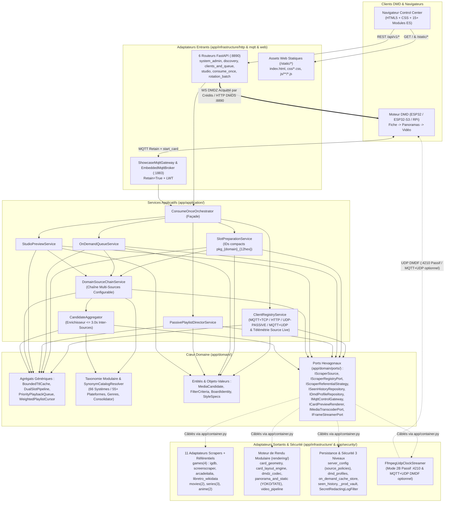
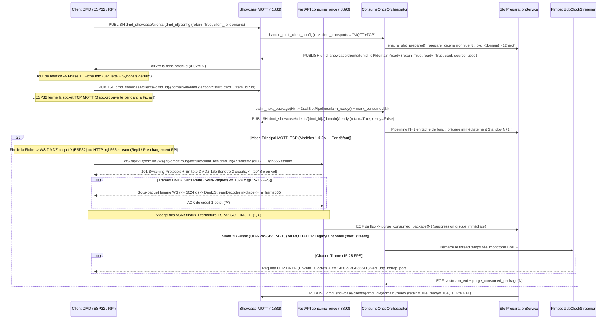

# Architecture DDD & Pipeline de Streaming Temps Réel — DMD Media Showcase Server

🇬🇧 [English](ARCHITECTURE.md) | 🇫🇷 Français | 🇪🇸 [Español](ARCHITECTURE_ES.md)

---

## 1. Architecture Hexagonale / DDD Modulaire en Couches

Le serveur applique une **Architecture Hexagonale (Ports & Adapters) et Domain-Driven Design (DDD)** stricte dont l'isolation des couches et les budgets de taille sont vérifiés automatiquement par `tests/test_architecture_ddd_fitness.py` :

- **Couche Domaine (`app/domain/`)** : 100 % Python pur (zéro import FastAPI, HTTPX, Pillow, OpenCV ou Infrastructure). Regroupe les Entités & Objets-Valeurs immuables (`entities.py`, `board_identity.py`, `style_specs.py`, `on_demand_cache_key.py`), les Agrégats génériques et réutilisables (`app/domain/aggregates/`), le sous-paquet modulaire de Taxonomie multilingue (`app/domain/taxonomy/` couvrant `66` systèmes rétro/arcade canoniques soit `55+` plateformes) et les Ports Hexagonaux (`app/domain/ports/`).
- **Couche Application (`app/application/`)** : Dépend exclusivement de `app/domain/` et de ses Ports. Découpée en services applicatifs à responsabilité unique — dont la chaîne multi-sources configurable (`DomainSourceChainService`) et l'enrichisseur composite inter-sources (`CandidateAggregator`) — orchestrés par la façade légère `ConsumeOnceOrchestrator` (`<= 550` lignes) et câblés via la Composition Root (`app/container.py`).
- **Couches Infrastructure, Sécurité & Scheduler (`app/infrastructure/`, `app/security/`, `app/scheduler/`)** : Adaptateurs entrants (`6` routeurs FastAPI cohérents sous `app/infrastructure/http/routers/` — dont le streaming WebSocket `DMDZ` acquitté par crédits et HTTP `DMDS` dans `consume_once.py` — WebUI statique en ES Modules sous `app/infrastructure/web/static/` et `ShowcaseMqttGateway`), adaptateurs sortants (`11` adaptateurs scrapers & stratégies référentielles par source, moteur de rendu modulaire HUB75 fiches/panoramas/vidéo/`DMDZ` incluant `dmdz_codec.py`, dépôts JSON & `on_demand_cache_store.py` préservant les `mtime`, `DmdConverterAdapter` et `FfmpegUdpClockStreamer`), et briques de sécurité (`vault.py` coffre natif C `_prod_vault` à 3 niveaux et `log_redactor.py` `SecretRedactingLogFilter`).

---

## 2. Briques Génériques & Réutilisables

L'architecture repose sur des composants génériques typés (`Generic[T]`), indépendants du transport et réutilisables dans d'autres contextes :

| Composant | Module | Responsabilité Générique |
| :--- | :--- | :--- |
| `BoundedTtlCache[TKey, TVal]` | `app/domain/aggregates/artifact_cache.py` | Cache borné déterministe (expiration TTL + éviction FIFO à saturation) avec hook `on_evict(key, val)` (réutilisé pour les candidats de recherche et les aperçus binaires Studio `DMDS`). |
| `DualSlotPipeline[TKey, TItem]` | `app/domain/aggregates/slot_pipeline.py` | Machine à états générique de double-buffering `Ready (N)` + `Standby (N+1)` + `Active`, avec promotion atomique `claim_ready()` et rétrogradation sans perte `promote_priority_ready()`. |
| `PriorityPlaybackQueue` | `app/domain/aggregates/priority_queue.py` | File prioritaire par carte DMD arbitrant `enqueue_next` (FIFO) et `play_now` (préemption en tête) pour WebUI, FrontendSync et assistants vocaux. |
| `WeightedPlaylistCursor` | `app/domain/aggregates/playlist_cursor.py` | Curseur déterministe pur `(slot_index, items_in_slot)` gérant les quotas (`1..10` œuvres consécutives) des playlists multi-domaines. |
| `CandidateAggregator` | `app/application/candidate_aggregator.py` | Enrichisseur composite borné (`<= 3.0s`) fusionnant les assets DMD manquants (`marquee_url`, `video_url` direct, `snapshot_urls`, `synopsis` localisé) depuis les sources secondaires compatibles selon la hiérarchie stricte `"1" > "auto" > "0"` et avec attribution combinée (`igdb+screenscraper`). |
| `TranslationService` | `app/infrastructure/scrapers/translation_service.py` | Cascade de traduction gratuite sans clé API (`Google GTX -> MyMemory -> Lingva`, cache LRU 512 entrées) et localisation des badges/sous-titres de genres sur les 4 domaines (`games`, `movies`, `series`, `anime`). |
| `SynonymCatalogResolver` | `app/domain/taxonomy/resolver.py` | Résolveur générique de synonymes et sous-chaînes indexé par slug, réutilisable sur n'importe quel catalogue (`systems`, `games`, `movies`, `series`, `anime`). |
| `PortProviderRegistry` | `app/domain/ports/default_ports.py` | Registre d'injection paresseuse découplant les couches Domaine/Application des singletons d'Infrastructure (`app/container.py`). |
| `BoundedWorkerExecutorMixin[TJob]` | `app/scheduler/executor_lifecycle.py` | Contrôleur générique de pool `ProcessPoolExecutor` / `ThreadPoolExecutor` résilient aux changements d'event-loop avec redimensionnement à chaud (`reconfigure_workers()`). |
| `SecretRedactingLogFilter` | `app/security/log_redactor.py` | Filtre de journalisation caviardant automatiquement les secrets URL, JSON et jetons Bearer dans `LogRecord.msg` et les arguments `httpx`/`httpcore`. |

---

## 3. Chaîne Multi-Sources Composable, Agrégation Inter-Sources & Consolidation des Référentiels

### 3.1 Chaîne de Responsabilité Configurable à Chaud (`source_policies` / `SourceChainPolicy`) & `CandidateAggregator`

En remplacement des paires statiques `[Primaire, Fallback]` codées en dur, `ScraperRegistry` (`app/infrastructure/scrapers/registry.py`) et `DomainSourceChainService` (`app/application/source_chain_service.py`) appliquent les politiques `source_policies` persistées dans `./data/server_config.json` et éditables à chaud dans le Dashboard Web (**Vue d'Ensemble** et **Clés API & Scrapers**) :

- **`ordered_sources`** : Liste ordonnée arbitraire de priorité par domaine (`#1 Primaire -> #2 Secondaire -> #3 Tertiaire -> ...`) :
  - `games` : `["igdb", "screenscraper", "arcadeitalia", "libretro_wikidata"]`
  - `movies` : `["tmdb_movies", "itunes_movies"]`
  - `series` : `["tmdb_series", "tvdb_series", "tvmaze"]`
  - `anime` : `["jikan", "anilist"]`
  Dès que la source prioritaire n'est pas configurée, renvoie `0` résultat (`[]`), expire, entre en cooldown de quota (`is_in_cooldown()` / état de santé `"ok"`, `"cooldown"`, `"unconfigured"`) ou ne supporte pas le système demandé (`ReferentialConsolidator.source_supports_criteria()`), l'exécution bascule de façon déterministe vers la source active et configurée suivante.
- **`disabled_sources`** : Activation/désactivation individuelle par domaine avec garde-fou maintenant au moins une source active.
- **`aggregation_mode`** :
  - **`"enrich_missing"` (Agrégation Multi-Sources, par défaut)** : La source Primaire résout l'identité canonique, la recherche floue/alias et les métadonnées (ex. `IGDB` résolvant `"sf2x"` sur `cps2` $\to$ `"Super Street Fighter II Turbo"` / `ssf2t`), puis `CandidateAggregator` exécute une passe secondaire bornée (`<= 3.0s` par source, avec contrôle strict d'empreinte jeu / ROM MAME / numéro de suite pour éviter toute contamination entre suites) sur les sources secondaires actives (`ScreenScraper`, `ArcadeItalia`, `Apple iTunes`, `AnimeThemes`, etc.) afin de récupérer les assets spécialisés DMD manquants (marquees/wheels détourés, snaps pixel-art, flux directs `.mp4`/`.webm`/`.m4v`, synopsis localisés). Les médias enrichis exposent une attribution combinée (`source_used="igdb+screenscraper"`, `"igdb+arcadeitalia"`, `"tmdb_movies+itunes_movies"`), affichée en direct dans les badges `playing_source`, `ready_source`, `standby_source` et `preparing_source`.
  - **`"fallback_only"` (Fallback Strict)** : Les sources secondaires ne sont sollicitées que si la source Primaire renvoie `0` résultat ou échoue.

### 3.2 4 Sources Jeux Indépendantes & `55+` (`66`) Systèmes Rétro/Arcade Canoniques

`RETRO_SYSTEM_CATALOG` (`app/domain/taxonomy/systems.py`, assemblant `systems_arcade_console.py` et `systems_handheld_computer.py`) définit **66 systèmes canoniques (`55+` plateformes)** (systèmes d'arcade, consoles de salon, portables et micro-ordinateurs classiques), servis par 4 adaptateurs `IScraperSource` sélectionnables :
1. **`igdb` (`IgdbGamesAdapter`)** : OAuth2 Twitch/Amazon `client_credentials` + IGDB API v4 (`api.igdb.com/v4/games`) couvrant 200+ plateformes, recherche instantanée par acronymes/alias via `alternative_names` + `arcade_aliases.py`, tirage aléatoire par offset, jaquettes, artworks, trailers et disjoncteur de cooldown de 60 s en cas d'erreur d'authentification/quota/5xx.
2. **`screenscraper` (`ScreenScraperAdapter`)** : API ScreenScraper v2 fournissant jaquettes régionales, wheels/marquees détourés, captures pixel-art et extraits vidéo `.mp4`, protégée par détection automatique des erreurs de quota/surcharge HTTP-200 en texte brut (`detect_screenscraper_api_error`) et mise en cooldown (`is_screenscraper_in_cooldown`).
3. **`arcadeitalia` (`ArcadeItaliaAdapter`)** : Scraper HTTPS sans clé de référence MAME / CPS-1 / CPS-2 / CPS-3 / Neo-Geo / NAOMI / Atomiswave / Sega Model 2-3 (`adb.arcadeitalia.net`) doté de `ARCADE_QUERY_ALIASES` (`arcade_aliases.py`) résolvant les raccourcis joueurs (`sf2x`, `3s`, `kof98`, `garou`, `avsp`, `mvsc`) en une seule requête HTTPS.
4. **`libretro_wikidata` (`LibretroWikidataAdapter`)** : Source sans clé de premier plan pour consoles, portables et micro-ordinateurs combinant Wikidata SPARQL (`wd:Q7889`), `libretro-thumbnails/{repo}` vérifiés (`Named_Boxarts`, `Named_Titles`, `Named_Snaps`), synopsis Wikipédia localisés et vidéos Archive.org.

### 3.3 Consolidation Dynamique des Référentiels & Routage par Capacité (`ReferentialConsolidator`)

1. Chaque source s'associe à son module `IScraperReferentialStrategy` qui persiste les identifiants distants dans `./data/referentials/{source_id}.json` (`LibretroWikidataReferentialStrategy`, `ArcadeItaliaReferentialStrategy`, `JikanReferentialStrategy`, `AniListReferentialStrategy`, `TvMazeReferentialStrategy`).
2. `ReferentialConsolidator` (`app/domain/taxonomy/consolidator.py`) normalise tous les synonymes (`Famicom` / `Nintendo Entertainment System` $\to$ `nes`, `Plateforme` / `Platformer` $\to$ `platform`) via `SynonymCatalogResolver` et expose un schéma relationnel (`Système -> Genres & Décennies supportés`) sur `GET /api/v1/{domain}/filters?lang={lang}` et MQTT `dmd_showcase/catalog/{domain}/referential` (`retain=True`).
3. **Routage par Capacité** : Lorsque l'utilisateur sélectionne `systems=["nes"]`, `ReferentialConsolidator.source_supports_criteria("arcadeitalia", criteria)` renvoie `False` et `DomainSourceChainService` route exclusivement vers les sources supportant les consoles (`igdb`, `screenscraper`, `libretro_wikidata`), garantissant zéro requête MAME et zéro photo de console matérielle.

### 3.4 Panoramas Déterministes YOKO / TATE Zoom-to-Cover & Coffre-Fort Natif à 3 Niveaux

- **Axe de Panorama Déterministe (`panorama_and_static.py` + `dmd_gif_converter >= 8.0.4`)** : `resolve_showcase_panorama_axis()` garantit un recadrage uniforme *zoom-to-cover* (zéro bande noire, marquees RGBA transparents composés sur noir pur) : les panneaux **YOKO** (`width > height`, ex. `128x32`, `128x64`, `256x64`) défilent toujours de **haut en bas**, tandis que les panneaux **TATE** (`height > width`, ex. `64x128`, `32x128`) défilent toujours de **gauche à droite** (les panneaux carrés `64x64` s'adaptant au ratio de l'image source).
- **Coffre-Fort à 3 Niveaux & Caviardage des Logs (`app/security/`)** : `ServerConfigStore` résout les secrets selon `1. WebUI ./data/server_config.json` $\to$ `2. .env / environnement OS` $\to$ `3. Extension native C compilée en CI/CD (app/security/_prod_vault*.so)` via `scripts/compile_prod_vault.py` et `VAULT_MASTER_SECRET` (PBKDF2-HMAC-SHA256 + sel aléatoire 16 octets + XOR 3 parts, suppression immédiate du `.c`). Au démarrage, `install_secret_log_redaction()` installe `SecretRedactingLogFilter` et fixe `httpx`/`httpcore` à `WARNING` pour empêcher toute fuite de secret (`devpassword`, `sspassword`, `api_key`, `client_secret`) dans les logs stdout.

---

## 4. Pipeline Temps Réel Principal `MQTT + TCP` (WebSocket `DMDZ` Acquitté par Crédits & HTTP `DMDS`), Pipelining `N+1` & UDP Passif `DMDF`

`ShowcaseRuntimeState.client_transports` suit quatre profils de transport déterministes remontés en direct dans `ClientRegistryService` et le Dashboard d'Administration :
- **`MQTT+TCP` (Par défaut & Recommandé — Modèle 1 `ArcadeMatrix` ESP32 / ESP32-S3 / `ArcadeMatrix_RPi` & Modèle 2A Hybride `supports_local_card: true`)** : Associe le **Plan de Contrôle MQTT (`:1883`)** (`config`, `ready`, `start_card` avec `retain=True` + `LWT`, identifiants `item_id` compacts sans collision `pkg_<domain>_<12hex>` `<= 24` caractères) à un plan de données TCP (`:8890`) multi-niveaux additif adapté à chaque classe de client (et éliminant toute perte NAT UDP sous les VMs Docker Desktop / Rancher Desktop) :
  1. **MCU Contraints — Canal Principal (`ESP32_STD` 0 PSRAM & `ESP32-S3` PSRAM) : WebSocket `DMDZ` v1 Sans Perte Acquitté par Crédits** : Se connecte en priorité à `WS /api/v1/{domain}/ws/{item_id}.dmdz?purge=true&client_id={dmd_id}&credits=2` (`ws_per_message_deflate=False` dans `main.py`, sous-paquets binaires RFC 6455 `<= 1 024 o`, fenêtre glissante de `2` crédits = `<= 2 048 o` max en vol, acquittement client `'A'` sur 1 octet par message WS). `dmdz_codec.py` réduit les vidéos `2.4–6x` et les panoramas `23–64x` sans aucune perte visuelle, `101 Switching Protocols` désactive toute mise en tampon HTTP des proxys inverses/VM (`gvproxy`, Nginx), et le plafond `<= 2 048 o` en vol maintient 100 % du trafic RX dans les buffers Wi-Fi statiques pré-alloués (`0` allocation heap dynamique, `0` épuisement de réassemblage LwIP `pcb->ooseq`, et fermeture propre `SO_LINGER {1, 0}`).
  2. **Repli HTTP TCP Cadencé (`?purge=true&paced=1&codec=dmdz1` ou `DMDS` brut)** : `GET /api/v1/{domain}/stream/{item_id}.rgb565.stream` (`X-DMD-Paced: 1`, `X-DMD-Codec: dmdz1`, tranches `<= 1 024 o`, ré-ancrage d'horloge monotone sans rafale de rattrapage — plus l'option `drop_late=1` / `X-DMD-Drop-Late: 1` pour les clients HTTP/1.1 chunk-decoding) utilisé automatiquement lorsqu'un proxy inverse bloque la mise à niveau WebSocket `101 Switching Protocols`.
  3. **Pré-chargement Linux Haute-RAM (`ArcadeMatrix_RPi`)** : Téléchargement HTTP `DMDS` brut non cadencé (`GET /api/v1/{domain}/stream/{item_id}.rgb565.stream?purge=true`) pré-chargé directement en RAM (`0` surcoût de codec ou de cadencement).
- **`HTTP`** : Polling HTTP Consume-Once sans état (`POST /api/v1/{domain}/config` + `GET /api/v1/{domain}/next`) diffusant sur ce même plan de données `:8890` additif (WebSocket `WS /api/v1/{domain}/ws/{item_id}.dmdz` acquitté par crédits, repli HTTP `DMDZ`/`DMDS` cadencé, ou pré-chargement `DMDS` non cadencé).
- **`UDP-PASSIVE` (Modèle 2B — `supports_local_card: false`)** : Récepteur framebuffer UDP `:4210` `DMDF` `<4sHBBH` ultra-minimal (~180 lignes) où le serveur compose directement la Fiche Info (Phase 1) dans le flux RGB565 (`render_card_in_stream=True`).
- **`MQTT+UDP` (`mqtt_udp` Legacy Optionnel)** : Événement explicite `start_stream` déclenchant l'émission de fragments UDP `DMDF` `<4sHBBH` via `FfmpegUdpClockStreamer` vers `{udp_ip}:{udp_port}`.

> **Résilience aux Redémarrages Conteneur (`RetainedClientConfigStore`) :** Chaque configuration Mode 1 retenue (`dmd_showcase/clients/{dmd_id}/config`, `retain=True`) publiée sur le Broker MQTT embarqué (`:1883`) est persistée de manière atomique dans `./data/mqtt_retained_clients.json`. Au redémarrage du serveur ou du conteneur Docker, `ShowcaseMqttGateway` restaure automatiquement les 4 rotations DMD dans `EmbeddedMqttBroker.retained` et relance immédiatement le pré-chauffage `N / N+1` en tâche de fond (tout en conservant `online=False` jusqu'au prochain paquet live du DMD).

### En-tête Binaire `DMDZ` v1 Sans Perte & Opcodes de Trame (16 Octets, Little-Endian `<4sBBHHHHH` — Codec Principal MCU Contraints)

Encodé à la demande en fichiers frères `.dmdz.stream` par `app/infrastructure/rendering/dmdz_codec.py` et servi via **`WS /api/v1/{domain}/ws/{item_id}.dmdz?purge=true&client_id={dmd_id}&credits=2`** (`ws_per_message_deflate=False`, sous-paquets `<= 1 024 o`, fenêtre de `2` crédits) ainsi que via le repli HTTP cadencé **`GET /api/v1/{domain}/stream/{item_id}.rgb565.stream?purge=true&paced=1&codec=dmdz1`** (`X-DMD-Consume-Once: 1`, `X-DMD-Paced: 1`, `X-DMD-Codec: dmdz1`) :

| Offset | Type | Champ | Description |
| :--- | :--- | :--- | :--- |
| `0..3` | `char[4]` | `magic` | `"DMDZ"` (`0x44 0x4D 0x44 0x5A`) |
| `4` | `uint8` | `version` | Version du codec sans perte (`1`, identifiant `"dmdz1"`) |
| `5` | `uint8` | `fps` | Cadence d'affichage cible (`8..60` FPS) |
| `6..7` | `uint16le` | `width` | Largeur panneau en pixels (ex. `128`) |
| `8..9` | `uint16le` | `height` | Hauteur panneau en pixels (ex. `32`) |
| `10..11` | `uint16le` | `total_frames` | Nombre total de trames encodées (`1..65535`) |
| `12..13` | `uint16le` | `frame_dur_ms` | Durée nominale par trame en ms (`round(1000 / fps)`) |
| `14..15` | `uint16le` | `keyframe_interval` | Intervalle de trames clés périodiques (`0` = seule la trame `0` est `keyframe`) |
| `16..EOF` | `uint8[]` | `frames` | Par trame : `<H` `payload_len` + `type` (`0=delta`, `1=scroll(dy)` `int8` signé par `memmove` sur place, `2=keyframe`) + flux d'opcodes couvrant `width * height` pixels RGB565LE |

L'état du décodeur est réinitialisé à chaque trame (`last = 0`, `cache[64] = 0`, `hash(p) = (r * 3 + g * 5 + b * 7) & 63` sur R5/G6/B5) :
- **`SKIP` (`00nnnnnn`, `1..64` px) & `LONG_SKIP` (`0xF0` + `<H` `count`)** : Conserve `count` pixels identiques à la trame de référence (`prev` ou `prev` décalée verticalement), puis met à jour `last = frame[pos - 1]` et `cache[hash(last)] = last`.
- **`RUN` (`01nnnnnn`, `1..64` px)** : Répète `last` `n + 1` fois.
- **`INDEX[64]` (`10iiiiii`)** : Émet `last = cache[i]`.
- **`DIFF` (`110xxxxx`, `x = (dr + 1) * 9 + (dg + 1) * 3 + (db + 1)` avec `dr, dg, db` dans `{-1, 0, +1}`)** : Applique le delta par composante RGB565 à `last`, émet et mémorise dans `cache[hash(p)]`.
- **`LIT` (`1110nnnn` + `n + 1` pixels `<H` RGB565LE bruts, `1..16` px)** : Émet des pixels RGB565 Little-Endian bruts en mettant à jour `last` et `cache[hash(p)]` à chaque pixel.

### En-tête Binaire HTTP TCP `DMDS` Brut (16 Octets, Little-Endian `<4sBBHHHHH` — Pré-chargement RPi & Repli HTTP Brut)

Servi sans cadencement (`?purge=true`) pour le pré-chargement RAM d'`ArcadeMatrix_RPi` ou cadencé (`GET /api/v1/{domain}/stream/{item_id}.rgb565.stream?purge=true&paced=1`, plus `&drop_late=1` optionnel) avec les en-têtes `X-DMD-Consume-Once: 1`, `X-DMD-Paced: 1` et `X-DMD-Drop-Late: 1` :

| Offset | Type | Champ | Description |
| :--- | :--- | :--- | :--- |
| `0..3` | `char[4]` | `magic` | `"DMDS"` (`0x44 0x4D 0x44 0x53`) |
| `4` | `uint8` | `version` | Version du format binaire (`1`) |
| `5` | `uint8` | `fps` | Cadence d'affichage cible (`8..60` FPS) |
| `6..7` | `uint16le` | `width` | Largeur panneau en pixels (ex. `128`) |
| `8..9` | `uint16le` | `height` | Hauteur panneau en pixels (ex. `32`) |
| `10..11` | `uint16le` | `total_frames` | Nombre total de trames RGB565LE concaténées (`1..65535`) |
| `12..13` | `uint16le` | `frame_dur_ms` | Durée nominale par trame en ms (`round(1000 / fps)`) |
| `14..15` | `uint16le` | `reserved` | Réservé (`0`) |
| `16..EOF` | `uint8[]` | `frames` | Trames RGB565LE brutes de `width * height * 2` octets (`total_frames` nominal ; saut horloge si `paced=1&drop_late=1`) |

### En-tête Binaire UDP `DMDF` (10 Octets, Little-Endian `<4sHBBH` — Mode 2B Passif `:4210` & `MQTT+UDP` Optionnel)

> Spécification formelle complète (topics MQTT 3.1.1 + WebSocket `DMDZ` acquitté par crédits + datagrammes UDP `DMDF`) : [`docs/asyncapi.yaml`](asyncapi.yaml) (chargée directement depuis le fichier YAML via `app/asyncapi_spec.py` et exposée sur `GET /asyncapi.yaml` et `GET /api/v1/asyncapi.yaml`).

| Offset | Type | Champ | Description |
| :--- | :--- | :--- | :--- |
| `0..3` | `char[4]` | `magic` | `"DMDF"` (`0x44 0x4D 0x44 0x46`) |
| `4..5` | `uint16le` | `frame_seq` | Numéro de séquence monotone de la trame (`0..65535`) |
| `6` | `uint8` | `chunk_idx` | Index du fragment dans la trame courante (`0..total_chunks-1`) |
| `7` | `uint8` | `total_chunks` | Nombre total de fragments composant la trame (`1..64`) |
| `8..9` | `uint16le` | `byte_offset` | Offset en octets (`chunk_idx * 1408`) dans le framebuffer RGB565LE |
| `10..N` | `uint8[]` | `payload` | Tranche de pixels bruts RGB565LE (`<= 1408` octets, `<= 1418` octets/paquet UDP = `6` chunks en `128x32`) |
