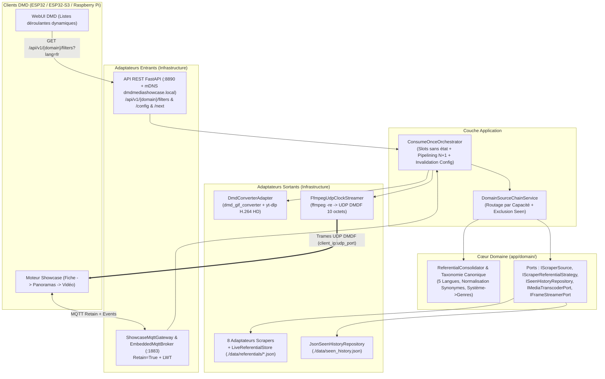
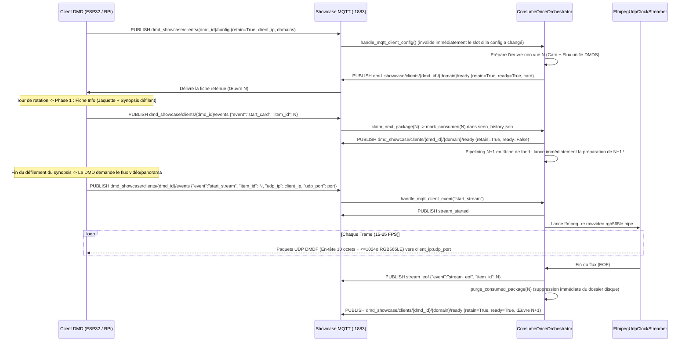

# Architecture DDD & Pipeline de Streaming Temps Réel — DMD Media Showcase Server (V3.0)

🇬🇧 [English](ARCHITECTURE.md) | 🇫🇷 Français | 🇪🇸 [Español](ARCHITECTURE_ES.md)

---

## 1. Architecture Hexagonale / DDD en Couches

---

## 2. Consolidation Dynamique des Référentiels Scrapers (`ReferentialConsolidator`)

Au lieu de figer des catégories en dur dans le firmware ou le WebUI du DMD :
1. Chaque adaptateur de scraper possède sa propre stratégie `IScraperReferentialStrategy` (`./data/referentials/{source_id}.json`) qui synchronise en temps réel les identifiants depuis la source distante :
   - **`LibretroWikidataReferentialStrategy`** (`games` consoles) : Interroge Wikidata SPARQL strictement pour des Jeux Vidéo (`wd:Q7889`) filtrés par le QID exact de la plateforme (`wdt:P400`) et du genre (`wdt:P136/wdt:P279*`), extrait les titres localisés (`titleFr` / `titleEn`) et les liens Wikipédia (`frwiki`), puis croise avec l'arbre GitHub mis en cache de `libretro-thumbnails/{repo}` (`Named_Boxarts`, `Named_Titles`, `Named_Snaps`) selon la priorité régionale `(France) -> (Europe) -> (World) -> (USA)`.
   - **`ArcadeItaliaReferentialStrategy`** (`games` arcade) : Interroge `https://adb.arcadeitalia.net` exclusivement en HTTPS (`lista_mame.php` + propriété Wikidata `wdt:P2451` MAME ROM).
   - **`JikanReferentialStrategy` / `AniListReferentialStrategy` / `TvMazeReferentialStrategy`** : Moissonnent dynamiquement les genres Anime et Séries TV.
2. `ReferentialConsolidator` (`app/domain/taxonomy.py`) normalise tous les synonymes (`Famicom` / `Nintendo Entertainment System` $\to$ `nes`, `Plateforme` / `Platformer` $\to$ `platform`) et expose un schéma relationnel (`Système -> Genres & Décennies supportés`) via `GET /api/v1/{domain}/filters?lang={lang}` et MQTT `dmd_showcase/catalog/{domain}/referential` (`retain=True`).
3. **Routage par Capacité** : Lorsque l'utilisateur sélectionne `systems=["nes"]`, `ArcadeItaliaAdapter` ne contacte jamais `adb.arcadeitalia.net` et délègue 100 % de la recherche à `LibretroWikidataAdapter`, garantissant zéro photo de console matérielle et zéro jeu hors-système.

---

## 3. Cinématique MQTT Temps Réel, Pipelining `N+1` & Protocole UDP `DMDF`

### En-tête Binaire UDP `DMDF` (10 Octets, Little-Endian `<4sHBBI`)

| Offset | Type | Champ | Description |
| :--- | :--- | :--- | :--- |
| `0..3` | `char[4]` | `magic` | `"DMDF"` (`0x44 0x4D 0x44 0x46`) |
| `4..5` | `uint16` | `frame_seq` | Numéro de séquence monotone de la trame (`0..65535`) |
| `6` | `uint8` | `chunk_idx` | Index du fragment dans la trame courante (`0..total_chunks-1`) |
| `7` | `uint8` | `total_chunks` | Nombre total de fragments composant la trame |
| `8..11` | `uint32` | `byte_offset` | Offset en octets de ce fragment dans le framebuffer RGB565LE |
| `10..N` | `uint8[]` | `payload` | Tranche de pixels bruts RGB565LE (`<= 1024` octets, compatible MTU Wi-Fi) |

