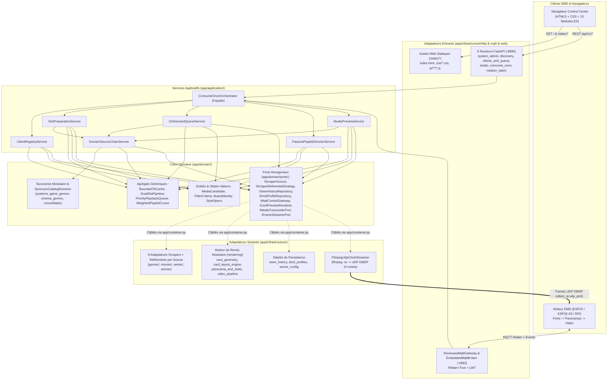
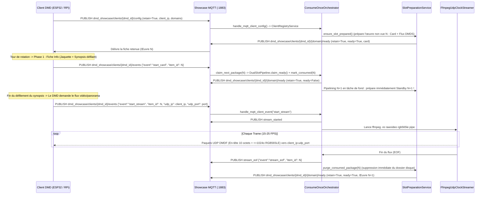

# Architecture DDD & Pipeline de Streaming Temps Réel — DMD Media Showcase Server

🇬🇧 [English](ARCHITECTURE.md) | 🇫🇷 Français | 🇪🇸 [Español](ARCHITECTURE_ES.md)

---

## 1. Architecture Hexagonale / DDD Modulaire en Couches

Le serveur applique une **Architecture Hexagonale (Ports & Adapters) et Domain-Driven Design (DDD)** stricte dont l'isolation des couches et les budgets de taille sont vérifiés automatiquement par `tests/test_architecture_ddd_fitness.py` :

- **Couche Domaine (`app/domain/`)** : 100 % Python pur (zéro import FastAPI, HTTPX, Pillow, OpenCV ou Infrastructure). Regroupe les Entités & Objets-Valeurs immuables (`entities.py`, `board_identity.py`, `style_specs.py`), les Agrégats génériques et réutilisables (`app/domain/aggregates/`), le sous-paquet modulaire de Taxonomie multilingue (`app/domain/taxonomy/`) et les Ports Hexagonaux (`app/domain/ports/`).
- **Couche Application (`app/application/`)** : Dépend exclusivement de `app/domain/` et de ses Ports. Découpée en services applicatifs à responsabilité unique orchestrés par la façade légère `ConsumeOnceOrchestrator` (`<= 550` lignes) et câblés paresseusement via la Composition Root (`app/container.py`).
- **Couches Infrastructure & Scheduler (`app/infrastructure/`, `app/scheduler/`)** : Adaptateurs entrants (`6` routeurs FastAPI cohérents sous `app/infrastructure/http/routers/`, WebUI statique modulaire en ES Modules sous `app/infrastructure/web/static/` et `ShowcaseMqttGateway`) et adaptateurs sortants (scrapers et stratégies référentielles par source, moteur de rendu modulaire HUB75 sous `app/infrastructure/rendering/`, dépôts JSON, `DmdConverterAdapter` et `FfmpegUdpClockStreamer`).

---

## 2. Briques Génériques & Réutilisables

L'architecture repose sur des composants génériques typés (`Generic[T]`), indépendants du transport et réutilisables dans d'autres contextes :

| Composant | Module | Responsabilité Générique |
| :--- | :--- | :--- |
| `BoundedTtlCache[TKey, TVal]` | `app/domain/aggregates/artifact_cache.py` | Cache borné déterministe (expiration TTL + éviction FIFO à saturation) avec hook `on_evict(key, val)` (réutilisé pour les candidats de recherche et les aperçus binaires Studio `DMDS`). |
| `DualSlotPipeline[TKey, TItem]` | `app/domain/aggregates/slot_pipeline.py` | Machine à états générique de double-buffering `Ready (N)` + `Standby (N+1)` + `Active`, avec promotion atomique `claim_ready()` et rétrogradation sans perte `promote_priority_ready()`. |
| `PriorityPlaybackQueue` | `app/domain/aggregates/priority_queue.py` | File prioritaire par carte DMD arbitrant `enqueue_next` (FIFO) et `play_now` (préemption en tête) pour WebUI, FrontendSync et assistants vocaux. |
| `WeightedPlaylistCursor` | `app/domain/aggregates/playlist_cursor.py` | Curseur déterministe pur `(slot_index, items_in_slot)` gérant les quotas (`1..10` œuvres consécutives) des playlists multi-domaines. |
| `SynonymCatalogResolver` | `app/domain/taxonomy/resolver.py` | Résolveur générique de synonymes et sous-chaînes indexé par slug, réutilisable sur n'importe quel catalogue (`systems`, `games`, `movies`, `series`, `anime`). |
| `PortProviderRegistry` | `app/domain/ports/default_ports.py` | Registre d'injection paresseuse découplant les couches Domaine/Application des singletons d'Infrastructure (`app/container.py`). |
| `BoundedWorkerExecutorMixin[TJob]` | `app/scheduler/executor_lifecycle.py` | Contrôleur générique de pool `ProcessPoolExecutor` / `ThreadPoolExecutor` résilient aux changements d'event-loop avec redimensionnement à chaud (`reconfigure_workers()`). |

---

## 3. Consolidation Dynamique des Référentiels Scrapers (`ReferentialConsolidator`)

Au lieu de figer des catégories en dur dans le firmware ou le WebUI du DMD :
1. Chaque source de scraping s'associe à son propre module `IScraperReferentialStrategy` qui persiste les identifiants distants dans `./data/referentials/{source_id}.json` :
   - **`LibretroWikidataReferentialStrategy`** (`app/infrastructure/scrapers/games/libretro_wikidata_referential.py` + `libretro_tree_resolver.py`) : Interroge Wikidata SPARQL strictement pour des Jeux Vidéo (`wd:Q7889`) filtrés par le QID de la plateforme (`wdt:P400`) et du genre (`wdt:P136/wdt:P279*`), extrait les titres localisés et liens Wikipédia, puis croise avec l'arbre GitHub de `libretro-thumbnails/{repo}` selon la priorité régionale `(France) -> (Europe) -> (World) -> (USA)`.
   - **`ArcadeItaliaReferentialStrategy`** (`app/infrastructure/scrapers/games/arcadeitalia_referential.py`) : Interroge `https://adb.arcadeitalia.net` exclusivement en HTTPS (`lista_mame.php` + propriété Wikidata `wdt:P2451`).
   - **`JikanReferentialStrategy` / `AniListReferentialStrategy` / `TvMazeReferentialStrategy`** (`anime/` & `series/`) : Moissonnent dynamiquement les genres Anime et Séries TV.
2. `ReferentialConsolidator` (`app/domain/taxonomy/consolidator.py`) normalise tous les synonymes (`Famicom` / `Nintendo Entertainment System` $\to$ `nes`, `Plateforme` / `Platformer` $\to$ `platform`) via `SynonymCatalogResolver` et expose un schéma relationnel (`Système -> Genres & Décennies supportés`) sur `GET /api/v1/{domain}/filters?lang={lang}` et MQTT `dmd_showcase/catalog/{domain}/referential` (`retain=True`).
3. **Routage par Capacité** : Lorsque l'utilisateur sélectionne `systems=["nes"]`, `DomainSourceChainService` route 100 % des requêtes vers `LibretroWikidataAdapter` sans solliciter MAME, garantissant zéro photo de console matérielle et zéro hors-sujet.

---

## 4. Cinématique MQTT Temps Réel, Pipelining `N+1` & Protocole UDP `DMDF`

> **Résilience aux Redémarrages Conteneur (`RetainedClientConfigStore`) :** Chaque configuration Mode 1 retenue (`dmd_showcase/clients/{dmd_id}/config`, `retain=True`) publiée sur le Broker MQTT embarqué (`:1883`) est persistée de manière atomique dans `./data/mqtt_retained_clients.json`. Au redémarrage du serveur ou du conteneur Docker, `ShowcaseMqttGateway` restaure automatiquement les 4 rotations DMD dans `EmbeddedMqttBroker.retained` et relance immédiatement le pré-chauffage `N / N+1` en tâche de fond (tout en conservant `online=False` jusqu'au prochain paquet live du DMD).

### En-tête Binaire UDP `DMDF` (10 Octets, Little-Endian `<4sHBBH`)

> Spécification formelle complète (topics MQTT 3.1.1 + datagrammes UDP `DMDF`) : [`docs/asyncapi.yaml`](asyncapi.yaml) (chargée directement depuis le fichier YAML via `app/asyncapi_spec.py` et exposée sur `GET /asyncapi.yaml` et `GET /api/v1/asyncapi.yaml`).

| Offset | Type | Champ | Description |
| :--- | :--- | :--- | :--- |
| `0..3` | `char[4]` | `magic` | `"DMDF"` (`0x44 0x4D 0x44 0x46`) |
| `4..5` | `uint16le` | `frame_seq` | Numéro de séquence monotone de la trame (`0..65535`) |
| `6` | `uint8` | `chunk_idx` | Index du fragment dans la trame courante (`0..total_chunks-1`) |
| `7` | `uint8` | `total_chunks` | Nombre total de fragments composant la trame (`1..64`) |
| `8..9` | `uint16le` | `byte_offset` | Offset en octets (`chunk_idx * 1024`) dans le framebuffer RGB565LE |
| `10..N` | `uint8[]` | `payload` | Tranche de pixels bruts RGB565LE (`<= 1024` octets, `<= 1034` octets/paquet UDP) |

### En-tête Binaire HTTP `DMDS` du Flux Unifié (16 Octets, Little-Endian `<4sBBHHHHH`)

| Offset | Type | Champ | Description |
| :--- | :--- | :--- | :--- |
| `0..3` | `char[4]` | `magic` | `"DMDS"` (`0x44 0x4D 0x44 0x53`) |
| `4` | `uint8` | `version` | Version du format binaire (`1`) |
| `5` | `uint8` | `fps` | Cadence d'affichage cible (`8..60` FPS) |
| `6..7` | `uint16le` | `width` | Largeur panneau en pixels (ex. `128`) |
| `8..9` | `uint16le` | `height` | Hauteur panneau en pixels (ex. `32`) |
| `10..11` | `uint16le` | `total_frames` | Nombre total de trames RGB565LE concaténées (`1..65535`) |
| `12..13` | `uint16le` | `frame_dur_ms` | Durée nominale par trame en ms (`round(1000 / fps)`) |
| `14..15` | `uint16le` | `reserved` | Réservé (`0`) |
| `16..EOF` | `uint8[]` | `frames` | Séquence contiguë de `total_frames * width * height * 2` octets RGB565LE |
