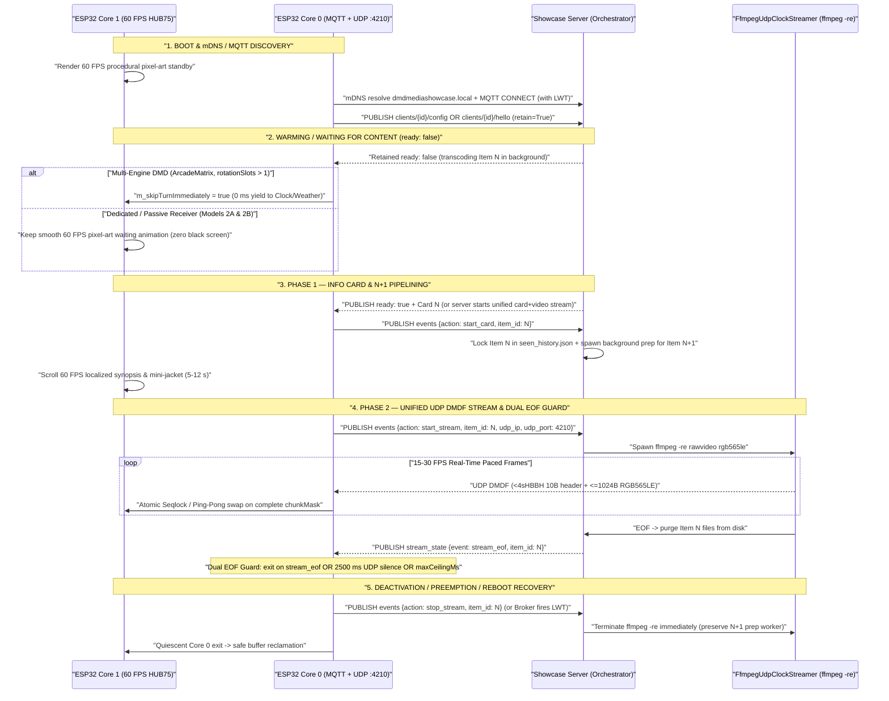
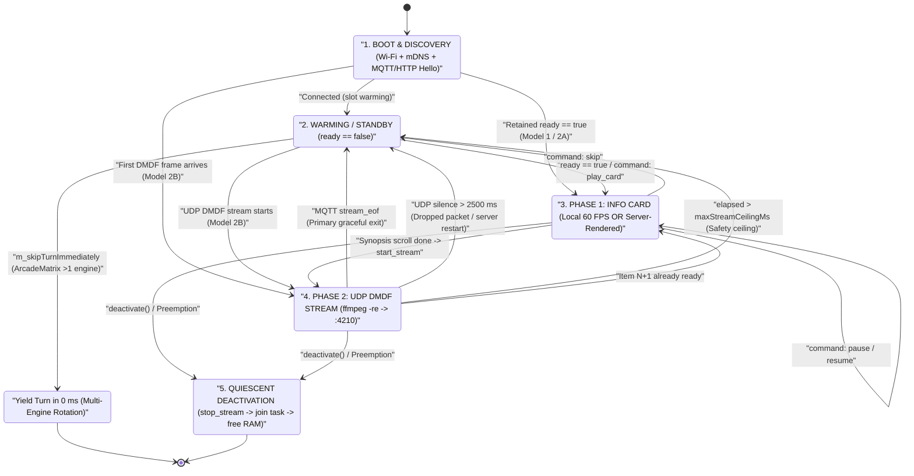

# ESP32 Integration & Passive Receiver Guide — DMD Media Showcase Server

🇬🇧 English | 🇫🇷 [Français](ESP32_INTEGRATION_FR.md) | 🇪🇸 [Español](ESP32_INTEGRATION_ES.md)

[](https://t.me/+DrSdAO8UMUViNmE0)
[](https://ko-fi.com/red1l)

---

**DMD Media Showcase Server** supports three distinct **ESP32 / ESP32-S3 HUB75 LED matrix** integration topologies. Depending on whether you are building a full multi-screen OS with local sensors and clocks or flashing a bare-bones `ESP32_STD` (no PSRAM) dedicated marquee/topper receiver in under 180 lines of C++, all three models share the same real-time **MQTT `:1883` Control Plane** and **`ffmpeg -re` UDP `DMDF` RGB565LE Data Plane**.

---

## 1. Overview & Comparison of the 3 ESP32 Integration Topologies

### Model 1 — Client-Driven Multi-Engine DMD (`config_source: "client"`)

Designed for feature-rich multi-engine firmware where the ESP32 owns its local screen rotation (`Clock`, `Weather`, `Scoreboard`, `AudioSpectrum`, `RetroGames`, `Movies`, `Series`, `Anime`), preemption stack (`DisplayArbiter`), and on-device WebUI.

- **Configuration Authority**: The ESP32 WebUI dynamically queries `GET /api/v1/{domain}/filters?lang={ui_lang}` to populate localized dropdowns, stores per-engine filter settings locally, and publishes its retained configuration to `dmd_showcase/clients/{dmd_id}/config` (`retain=True`).
- **Rotation Behavior**: When a Showcase engine's turn arrives, if the retained slot (`dmd_showcase/clients/{dmd_id}/{domain}/ready`) reports `{"ready": false}`, the engine yields its turn in **`0 ms`** (`m_skipTurnImmediately = true`) so the panel immediately displays the next local engine (`Clock`, `Weather`, etc.) without ever showing a black screen or stalling.
- **Production Reference Implementation (`ArcadeMatrix`)**:
  - Header & Engine Contract: [`src/engines/MediaShowcaseEngines.h`](https://github.com/red77290/ArcadeMatrix/blob/main/src/engines/MediaShowcaseEngines.h)
  - Dual-Core Worker, Zero-Copy `ArduinoJson` Parser & `DMDF` UDP Assembler: [`src/engines/MediaShowcaseEngines.cpp`](https://github.com/red77290/ArcadeMatrix/blob/main/src/engines/MediaShowcaseEngines.cpp)

---

### Model 2A — Server-Managed Hybrid Receiver (`config_source: "server"`, `supports_local_card: true`)

Designed for lightweight dedicated Showcase displays that want crisp 60 FPS hardware font scrolling on the ESP32 **without** embedding a local WebUI, category dropdown logic, or NVS filter schemas.

- **Hardware Announcement Only**: On boot, the ESP32 publishes a tiny retained payload to `dmd_showcase/clients/{dmd_id}/hello` (`retain=True`) declaring only its panel geometry and LAN endpoint (`width`, `height`, `udp_ip`, `udp_port`, `config_source: "server"`, `supports_local_card: true`, and fallback `lang`).
- **Centralized Profile Persistence (`./data/dmd_profiles.json`)**: All domain playlists (`games`, `movies`, `series`, `anime`), scraper filters (`systems`, `genres`, `decades`), AI framing/colorimetry (`video_mode`, `color_boost`), and broadcast content language (`lang`) are configured centrally in the **Showcase Web Admin Dashboard** (`http://dmdmediashowcase.local:8890/`) and persisted in `./data/dmd_profiles.json`.
- **Hybrid Rendering Split**: The ESP32 renders **Phase 1 (Info Card)** locally at 60 FPS (mini-jacket + colored badge + smooth scrolling localized synopsis pushed via `ready` or `dmd_showcase/clients/{dmd_id}/command` `play_card`), then triggers `start_stream` to receive **Phase 2 (Panoramas + Video)** over UDP `DMDF`.

---

### Model 2B — Server-Managed 100% Passive Framebuffer Receiver (`config_source: "server"`, `supports_local_card: false`)

Designed for ultra-minimal, zero-maintenance hardware builds (`ESP32_STD` WROOM-32 **without PSRAM** or `ESP32-S3`) using roughly **~180 lines of C++** — **zero WebUI, zero font tables, zero JSON parser, and zero MQTT library required**.

- **Zero-Config Discovery**: The ESP32 announces its geometry and IP via a periodic HTTP heartbeat `POST /api/v1/clients/hello` (or MQTT `dmd_showcase/clients/{dmd_id}/hello`), or requires **zero outbound handshake at all** when registered with a static LAN IP and `always_stream_udp: true` in `./data/dmd_profiles.json`.
- **100% Server-Composited Stream**: Because `supports_local_card: false`, the Showcase server renders **even the Phase 1 Info Card** (mini-jacket + colored system/domain badge + title + year + rating + localized scrolling synopsis) directly into the unified RGB565 stream and clocks MTU-safe `DMDF` UDP chunks via `ffmpeg -re` straight to UDP `:4210`.
- **Instant Server-Side Control**: Live `Skip`, `Pause`, `Resume`, `Stop`, and `Play Now` (`FrontendSync`) execute **100% server-side** by switching or pausing the `FfmpegUdpClockStreamer` process feeding `:4210` in `< 50 ms`.

---

### Architectural Comparison Matrix

| Dimension | Model 1: Client-Driven (`ArcadeMatrix`) | Model 2A: Server-Managed Hybrid | Model 2B: 100% Passive UDP Receiver |
| :--- | :--- | :--- | :--- |
| **Handshake Mode** | `config_source: "client"` (`.../config`) | `config_source: "server"`, `supports_local_card: true` (`.../hello`) | `config_source: "server"`, `supports_local_card: false` (`POST /clients/hello` or static IP) |
| **Playlist & Filter Storage** | ESP32 Flash (`config.json`) | Server (`./data/dmd_profiles.json`) | Server (`./data/dmd_profiles.json`) |
| **ESP32 Firmware Size / UI** | Full Multi-Engine OS + Rich WebUI | ~350 LoC C++ (MQTT + UDP + Card Font, no WebUI) | **~120–180 LoC C++** (Zero UI, Zero Fonts, Zero JSON) |
| **Phase 1 Info Card Rendering** | Local 60 FPS on ESP32 Core 1 | Local 60 FPS on ESP32 Core 1 | **Server-rendered into RGB565 UDP stream** |
| **Phase 2 Panoramas + Video** | UDP `DMDF` (`:5568+`) + HTTP `DMDS` fallback | UDP `DMDF` (`:4210` / custom) | UDP `DMDF` (`:4210`) |
| **SRAM Footprint (`128x32`)** | `8 KB` frame + `2 KB` (`32x32`) / `6 KB` (`48x64`) poster | `8 KB` frame + `2–6 KB` poster | **`8 KB` single (`16 KB` ping-pong) — `0 B` poster/JSON** |
| **`ESP32_STD` (No PSRAM)** | Qualified (`128x32`, `64x64`, `128x64`) | Qualified (`128x32` up to `128x64`) | **Qualified (`128x32` up to `256x64` single-buffer)** |
| **Core 0 CPU Load** | Low (MQTT + Base64 poster + UDP `memcpy`) | Low (MQTT + Base64 poster + UDP `memcpy`) | **Minimal (pure non-blocking UDP `memcpy`)** |
| **Live `Skip` / `Pause` / `Play Now`** | Via MQTT `.../command` when Showcase slot is active | Instant (`< 50 ms`) via MQTT `.../command` | **Instant (`< 50 ms`) directly in server `ffmpeg` pipe** |

---

## 2. Dual-Core FreeRTOS Task Choreography & HUB75 DMA Invariants

HUB75 LED matrices lack an internal framebuffer controller: the ESP32's I2S/LCD DMA peripheral must continuously scan PWM bitplanes out of internal SRAM. Any Wi-Fi interrupt storm, flash write, heap fragmentation, or mutex stall on the rendering core causes visible row ghosting or brightness flicker.

To guarantee rock-solid **60 FPS** (`16.67 ms` frame cadence), ESP32 integrations enforce strict dual-core physical isolation:

- **Core 0 (`PRO_CPU` — Network & Protocol Worker)**:
  - Runs the Espressif Wi-Fi / LwIP TCP/IP stack, mDNS resolver (`dmdmediashowcase.local` on `224.0.0.251:5353`), MQTT `:1883` control session (or periodic HTTP `POST /api/v1/clients/hello`), and non-blocking UDP socket reader (`:4210` or `:5568+`).
  - Reassembles incoming **UDP `DMDF` datagrams**: each datagram carries a **10-byte Little-Endian `<4sHBBH` header** (`magic = "DMDF"`, `uint16_t frame_seq`, `uint8_t chunk_idx`, `uint8_t total_chunks`, `uint16_t byte_offset`) followed by **`<= 1024 B`** of Little-Endian RGB565 pixels (`<= 1034 B` total UDP payload — guaranteed zero IP fragmentation under standard `1500 B` Wi-Fi MTU).
- **Core 1 (`APP_CPU` — Real-Time 60 FPS HUB75 Render Loop)**:
  - Exclusively drives `IDrawingSurface` / HUB75 DMA presentation at 60 FPS.
  - **Zero Dynamic Allocation**: Never calls `malloc`, `new`, `String`, or `std::vector::push_back` on the render hot path.
  - **Zero Mutex / Zero Blocking**: Never acquires `std::mutex` or FreeRTOS semaphores shared with Core 0.
  - **DMA Isolation**: Never writes network packets directly into an active HUB75 DMA scan buffer; pixels are copied into an off-screen `frame565` buffer and blitted cleanly onto `IDrawingSurface` during the render pass.

### Lock-Free Cross-Core Handoff: Seqlock vs Ping-Pong Double Buffering

Two zero-mutex primitives safely bridge Core 0 (`UDP writer`) and Core 1 (`60 FPS reader`):

1. **Atomic Seqlock (`std::atomic<uint32_t> seq` + Single `frame565` — Minimum SRAM)**:
   - Used in [`MediaShowcaseEngines.cpp`](https://github.com/red77290/ArcadeMatrix/blob/main/src/engines/MediaShowcaseEngines.cpp) when conserving internal SRAM on `ESP32_STD`.
   - Core 0 increments `seq` to an **odd** value (`fetch_add(1, memory_order_acq_rel)`) while committing state, and increments `seq` back to an **even** value (`fetch_add(1, memory_order_release)`) once coherent.
   - Core 1 reads `s1 = seq.load(acquire)`, inspects coherent state only if `(s1 & 1U) == 0`, and verifies `s1 == seq.load(acquire)`. If an update overlaps, Core 1 retains the previous presented frame with zero stall.
2. **Ping-Pong Double-Buffered `frame565[2]` (`std::atomic<uint8_t> frontIdx` — Zero Tear)**:
   - Core 0 writes incoming `DMDF` chunks exclusively into `frame565[backIdx]` while tracking bit `(1ULL << chunk_idx)` in a 64-bit `chunkMask`.
   - Only when `chunkMask == ((1ULL << total_chunks) - 1ULL)` (all chunks for `frame_seq` received) does Core 0 atomically publish `frontIdx.store(backIdx, std::memory_order_release)` and increment `frameReadySeq`. Core 1 blits `frame565[frontIdx.load(acquire)]` with zero tearing even under bursty Wi-Fi jitter.

### Exact SRAM / PSRAM Memory Budgets Across HUB75 Geometries

Every `ESP32_STD` (WROOM-32 / DevKitC without PSRAM, ~`110–140 KB` free internal heap after Wi-Fi + HUB75 DMA init) can run `dmd_media_showcase` smoothly:

| Panel Geometry | Pixels (`W x H`) | `DMDF` Chunks / Frame (`<= 1024 B`) | Single `frame565` (Seqlock) | Ping-Pong `frame565[2]` | Local Card `poster565` (Model 1 / 2A) | Model 2B Total RAM (`ESP32_STD` No-PSRAM Status) |
| :--- | :--- | :--- | :--- | :--- | :--- | :--- |
| **`128x32`** *(Classic WPC)* | `4,096 px` | `8 chunks` | **`8,192 B`** (`8 KB`) | `16,384 B` (`16 KB`) | `2,048 B` (`32x32`) | **`9.2 KB` (Single) / `17.4 KB` (Double)** — Runs effortlessly on `ESP32_STD` |
| **`64x64`** *(Square)* | `4,096 px` | `8 chunks` | **`8,192 B`** (`8 KB`) | `16,384 B` (`16 KB`) | `2,048 B` (`32x32`) | **`9.2 KB` (Single) / `17.4 KB` (Double)** — Runs effortlessly on `ESP32_STD` |
| **`128x64` / `64x128` TATE** | `8,192 px` | `16 chunks` | **`16,384 B`** (`16 KB`) | `32,768 B` (`32 KB`) | `6,144 B` (`48x64`) / `3,200 B` (`40x40`) | **`17.4 KB` (Single) / `33.8 KB` (Double)** — Fits internal SRAM on `ESP32_STD` |
| **`256x64`** *(Super-DMD)* | `16,384 px` | `32 chunks` | **`32,768 B`** (`32 KB`) | `65,536 B` (`64 KB`) | `6,144 B` (`48x64`) | **`33.8 KB` (Single)** on `ESP32_STD`; `64 KB` Double recommended on `ESP32-S3` PSRAM |

> [!TIP]
> In `DMDF`, `total_chunks` is capped at `64` (`uint64_t chunkMask`), supporting up to `65,536` bytes per RGB565 frame (e.g. `256x128` or `512x64` on `ESP32-S3` with Octal PSRAM).

### Recommended HUB75 Display Pipeline: `Single DMA Buffer + Offscreen RGB565 Canvas` (`canvas_single`)

Across all ESP32 HUB75 firmwares (including [`ArcadeMatrix`](https://github.com/red77290/ArcadeMatrix)), the **`Single DMA Buffer + Offscreen RGB565 Canvas` (`canvas_single`)** pipeline built on [`mrfaptastic/ESP32-HUB75-MatrixPanel-I2S-DMA`](https://github.com/mrfaptastic/ESP32-HUB75-MatrixPanel-I2S-DMA) is the **recommended gold-standard architecture**:

1. **50% Savings in Scarce DMA-Capable SRAM (`mxconfig.double_buff = false`)**:
   - On `ESP32_STD` (no PSRAM), HUB75 I2S DMA descriptors and BCM bitplanes must reside in contiguous internal `MALLOC_CAP_DMA` DRAM — the exact memory pool heavily contested by Wi-Fi + LwIP + UDP RX buffers.
   - Disabling hardware DMA double-buffering (`mxconfig.double_buff = false`) cuts bitplane allocation in half (`~24 KB` instead of `~48 KB` at 6-bit depth on `128x32`), while the offscreen linear RGB565 canvas (`GFXcanvas16`) only requires `2 bytes/pixel` (`8 KB` on `128x32`, `16 KB` on `128x64` — and can reside in PSRAM on `ESP32-S3`).
2. **Zero Clear-Strobe & Zero Black Flicker (In-Place Bitplane Overwrite)**:
   - Drawing directly into a single DMA buffer (`direct_single`) and calling `clearScreen()` blanks the active scanning bitplanes mid-refresh, causing severe black-frame flicker.
   - With an **Offscreen RGB565 Canvas**, all clearing, `Adafruit_GFX` text/HUD drawing, waiting animations, and UDP frame updates happen strictly in offscreen RAM. `blitCanvas565()` then overwrites every HUB75 bitplane word **in-place** (`(dmaRow[ax] & ~0x003F) | rgb12`) in **`~300 µs`** (`128x32`) without ever clearing the DMA buffer to black first.
3. **Dirty-Frame Gating (`s_completedUdpSeq != s_lastPresentedUdpSeq`)**:
   - Core 1 runs at `60 Hz` (`16.6 ms`) while incoming UDP `DMDF` video typically runs at `15–25 FPS` (`40–66 ms`).
   - By bursting the offscreen canvas to `frame_buffer[0]` **only when a new frame has actually modified the canvas**, Core 1 performs **zero redundant DMA memory writes** during intermediate ticks, eliminating SRAM bus contention while I2S scans the panel.
4. **Multiplexed BCM Bitplane Burst + Perceptual CIE 1931 Gamma + Classic ESP32 FIFO Word-Swap**:
   - Encodes upper `(y)` and lower `(y + H/2)` HUB75 scan halves simultaneously into `R1G1B1R2G2B2` bitplanes using bit-depth-scaled **CIE 1931 gamma LUTs** (`6-bit` on `ESP32_STD`, `8-bit` on `ESP32-S3`), applies the Classic ESP32 I2S 16-bit FIFO word-pair swap (`MATRIX_TX_ADJUST(x)`), and flushes CPU cache lines (`Cache_WriteBack_Addr`) when `SPIRAM_DMA_BUFFER` is enabled on `ESP32-S3`.

| Pipeline Mode | `mxconfig.double_buff` | Offscreen RGB565 Canvas | `ESP32_STD` DMA DRAM Headroom | Flicker / Tearing | Recommendation |
| :--- | :---: | :---: | :--- | :--- | :--- |
| **`canvas_single`** | **`false`** | **Yes (`GFXcanvas16`)** | **Optimal (50% less DMA DRAM)** | **Zero flicker (in-place `~300 µs` burst + dirty gating)** | **Recommended (`ESP32_STD` & `ESP32-S3`)** |
| `canvas_double` | `true` | Yes (`GFXcanvas16`) | High RAM cost (`2x` DMA + Canvas) | Tear-free swap | Optional on `ESP32-S3` with Octal PSRAM |
| `direct_double` | `true` | No | High DMA DRAM (`2x` bitplanes) | Slow per-pixel `drawPixel()` on video | Legacy GFX-only sketches |
| `direct_single` | `false` | No | Maximal free RAM | Visible strobe on `clearScreen()` | Emergency low-RAM fallback only |

---

## 3. Complete Task Sequencing, Waiting States & Watchdog Recovery

### End-to-End Protocol Sequence Diagram



### ESP32 Receiver Deterministic State Machine



### Detailed Walkthrough of Every State & Watchdog Invariant

1. **`BOOT & mDNS / MQTT DISCOVERY`**:
   - Core 1 starts rendering a procedural 60 FPS pixel-art animation before Wi-Fi even associates, guaranteeing instant visual feedback on power-up.
   - Core 0 resolves `dmdmediashowcase.local` via multicast DNS (`224.0.0.251:5353`) and connects to MQTT `:1883` registering a **Last Will and Testament (`LWT`)** on `dmd_showcase/clients/{dmd_id}/status` with payload `{"online": false}`.
2. **`WARMING / WAITING FOR CONTENT` (`ready: false`)**:
   - **Dedicated / Passive Receivers (Models 2A & 2B)**: Continue animating smoothly at 60 FPS on Core 1 while the Showcase worker pool scrapes and transcodes the first unseen item.
   - **Multi-Engine DMDs (`ArcadeMatrix` — Model 1)**: When `m_rotationSlotCount > 1` and the server publishes `{"ready": false}`, `MediaShowcaseBase` sets `m_skipTurnImmediately = true` so `isFinished()` returns `true` in **`0 ms`**. The user sees `Clock` $\to$ `Weather` $\to$ `Scoreboard` seamlessly with **zero black screen** while transcoding finishes in the background on the server.
3. **`PHASE 1 — INFO CARD & N+1 PIPELINING`**:
   - As soon as item `N` begins displaying its Info Card, `start_card` atomically locks item `N` in `./data/seen_history.json` (unless `mark_seen: false` was requested via `FrontendSync`), flips the retained `ready` topic to `{"ready": false}`, and immediately spawns **background preparation of unseen slot `N+1`**.
   - While the viewer spends `5–12 s` reading the scrolling synopsis + `8–15 s` watching panoramas and video (`~15–25 s` total), the server finishes transcoding `N+1` so back-to-back playback has zero dead air.
4. **`PHASE 2 — UNIFIED UDP DMDF STREAM & DUAL EOF GUARD`**:
   - `start_stream` spawns `FfmpegUdpClockStreamer` (`ffmpeg -re`), slicing every RGB565LE frame into `DMDF` UDP packets toward `{udp_ip}:{udp_port}`.
   - **Mandatory Dual EOF + Ceiling Guard**: Waiting solely on MQTT `stream_eof` would freeze the display on the last video frame if a Wi-Fi roam drops that single TCP packet or if the Showcase container restarts mid-stream. Every ESP32 receiver **MUST** enforce all three exit conditions simultaneously:
     1. **MQTT `stream_eof` (or `command: skip/stop`)**: Primary `0 ms` clean transition when `ffmpeg -re` finishes.
     2. **Local `2,500 ms` UDP Inactivity Watchdog (`millis() - lastUdpPacketMs > 2500`)**: Guarantees automatic recovery to standby/next item within `2.5 s` if UDP packets stop arriving for any reason (Wi-Fi drop, router reboot, server restart). *(Note: if `pause` is active on Model 2A/2B, either the server repeats keepalive frames or the client suspends the inactivity timer while paused).*
     3. **Hard Duration Ceiling (`millis() - streamStartMs > maxStreamCeilingMs`)**: Bounds maximum playback time (`video_max_duration_s + panoramas + safety_margin`) even against a runaway stream. *(On `ArcadeMatrix` Model 1, if zero UDP packets arrive within `850 ms` of `start_stream` due to Docker Desktop VM NAT, Core 0 also falls back automatically to HTTP TCP `DMDS` streaming).*
5. **`DEACTIVATION & MID-STREAM REBOOT RECOVERY`**:
   - **Clean Deactivation (Model 1 / 2A)**: Before freeing `m_frame565`, the engine sets `m_wantActive = false`, publishes `{"action": "stop_stream", "item_id": "..."}` so the server kills `ffmpeg -re` and purges item `N` immediately, joins the Core 0 worker (`stopWorkerTaskBounded()` — quiescent shutdown with zero dynamic allocations), and only then releases heap buffers.
   - **Abrupt ESP32 Reboot / Brownout**: The MQTT broker fires the client's `LWT` (`{"online": false}`), causing the Showcase server to terminate any active `ffmpeg -re` UDP stream immediately while keeping prepared `N+1` slots intact for instant resumption upon reconnect.

---

## 4. Monolithic Reference Implementation (`ESP32-HUB75-MatrixPanel-I2S-DMA` + `Single DMA Buffer + Canvas`)

### A. Model 2B — Complete Drop-In Monolithic Firmware (`platformio.ini` + `src/main.cpp`)

This complete, single-file C++ firmware implements the **`Single DMA Buffer (`mxconfig.double_buff = false`) + Offscreen `GFXcanvas16` + CIE 1931 In-Place Bitplane Burst Encoder (`blitCanvas565`) + Dirty-Frame Gating`** pipeline using [`mrfaptastic/ESP32-HUB75-MatrixPanel-I2S-DMA`](https://github.com/mrfaptastic/ESP32-HUB75-MatrixPanel-I2S-DMA). It compiles out-of-the-box on both **Classic ESP32 (`esp32dev`, no PSRAM)** and **ESP32-S3 (`esp32-s3-devkitc-1` / Waveshare RGB Matrix with PSRAM)**, and can be flashed directly or integrated into any custom HUB75 firmware:

#### `platformio.ini`

```ini
[platformio]
default_envs = esp32dev

[env]
platform = espressif32
framework = arduino
monitor_speed = 115200
lib_deps =
    mrfaptastic/ESP32 HUB75 LED MATRIX PANEL DMA Display @ ^3.0.11
    adafruit/Adafruit GFX Library @ ^1.11.9

; Target 1: Standard ESP32 (WROOM-32 / DevKitC without PSRAM)
[env:esp32dev]
board = esp32dev
build_flags =
    -D CORE_DEBUG_LEVEL=1
    -O2

; Target 2: ESP32-S3 with Octal PSRAM (e.g. Waveshare ESP32-S3-RGB-Matrix / N16R8)
[env:esp32s3]
board = esp32-s3-devkitc-1
board_build.arduino.memory_type = qio_opi
build_flags =
    -D BOARD_HAS_PSRAM
    -D SPIRAM_DMA_BUFFER
    -D CORE_DEBUG_LEVEL=1
    -O2
```

#### `src/main.cpp` (Monolithic Implementation)

```cpp
/**
 * @file main.cpp
 * @brief Monolithic ESP32 / ESP32-S3 HUB75 Receiver for DMD Media Showcase (Mode 2B)
 *        using the "Single DMA Buffer + Offscreen RGB565 Canvas" (`canvas_single`) pipeline.
 *
 * Architectural Highlights (Proven in Production on ArcadeMatrix):
 *  1. Single HUB75 DMA Buffer (`mxconfig.double_buff = false`):
 *     Cuts scarce internal DMA-capable SRAM (`MALLOC_CAP_DMA`) usage by 50% compared to
 *     DMA double-buffering, leaving ample contiguous heap for Wi-Fi + LwIP + UDP on
 *     standard ESP32 boards without PSRAM (`ESP32_STD`).
 *  2. Offscreen Linear RGB565 Canvas (`Adafruit_GFX` / `GFXcanvas16`):
 *     All drawing (idle 60 FPS procedural animation, local HUD overlays, or incoming UDP
 *     frames) happens exclusively in offscreen memory (`2 bytes/pixel`). `clearScreen()` is
 *     NEVER called on the live DMA scanout buffer, eliminating black-frame strobe/flicker.
 *  3. In-Place Multiplexed BCM Bitplane Burst Encoder (`blitCanvas565`):
 *     Encodes upper `(y)` and lower `(y + H/2)` HUB75 scan halves simultaneously with
 *     perceptual CIE 1931 gamma LUTs directly into `frame_buffer[0]` (`~300 us` for 128x32),
 *     bypassing thousands of per-pixel virtual `drawPixel()` calls.
 *  4. Dirty-Frame Gating (`s_completedUdpSeq != s_lastPresentedUdpSeq`):
 *     Core 1 only bursts the offscreen canvas into DMA memory when a brand-new frame is
 *     actually ready, preventing redundant bus contention while I2S scans the panel.
 *  5. Strict Dual-Core Isolation:
 *     - Core 0 (`PRO_CPU`): Wi-Fi, mDNS, periodic HTTP `hello`, lock-free UDP `DMDF` assembly.
 *     - Core 1 (`APP_CPU`): Zero-allocation, zero-mutex 60 Hz canvas composition & DMA commit.
 */

#include <Arduino.h>
#include <WiFi.h>
#include <WiFiUdp.h>
#include <HTTPClient.h>
#include <ESPmDNS.h>
#include <esp_heap_caps.h>
#include <Adafruit_GFX.h>
#include <atomic>
#include <cstring>
#include <memory>
#include <vector>

#if defined(SPIRAM_DMA_BUFFER)
#include "rom/cache.h"
#endif

// Expose `MatrixPanel_I2S_DMA` internal `frame_buffer` row-plane pointers to our subclass
// for direct in-place BCM bitplane burst encoding (must come AFTER STL headers).
#define private protected
#include <ESP32-HUB75-MatrixPanel-I2S-DMA.h>
#undef private

// =========================================================================================
// STEP 1: PANEL GEOMETRY, NETWORK CONFIGURATION & HARDWARE PIN PROFILES
// =========================================================================================

static constexpr uint16_t MODULE_W     = 64;   // Single HUB75 panel width (typically 64)
static constexpr uint16_t MODULE_H     = 32;   // Single HUB75 panel height (32 or 64)
static constexpr uint16_t CHAIN_LEN    = 2;    // Number of chained panels (2 x 64x32 = 128x32)
static constexpr uint16_t PANEL_W      = MODULE_W * CHAIN_LEN;
static constexpr uint16_t PANEL_H      = MODULE_H;
static constexpr size_t   FRAME_PIXELS = static_cast<size_t>(PANEL_W) * PANEL_H;
static constexpr size_t   FRAME_BYTES  = FRAME_PIXELS * sizeof(uint16_t); // 8,192 B for 128x32

static constexpr uint16_t UDP_PORT          = 4210;
static constexpr uint32_t HELLO_INTERVAL_MS = 15000U;
static constexpr uint32_t UDP_WATCHDOG_MS   = 2500U;

static const char* WIFI_SSID    = "YOUR_WIFI_SSID";
static const char* WIFI_PASS    = "YOUR_WIFI_PASSWORD";
static const char* DMD_ID       = "esp32_passive_128x32";
static const char* CONTENT_LANG = "en"; // Broadcast language ("fr", "en", "es", "de", "it", "pt", "ja")
static const char* SHOWCASE_HELLO_URL = "http://dmdmediashowcase.local:8890/api/v1/clients/hello";

// Classic ESP32 (Xtensa LX6) I2S TX FIFO transmits 16-bit words swapped within each 32-bit pair.
// ESP32-S3 LCD_CAM transmits 16-bit words in natural sequential order.
#ifndef MATRIX_TX_ADJUST
#if defined(CONFIG_IDF_TARGET_ESP32) && !defined(CONFIG_IDF_TARGET_ESP32S3)
#define MATRIX_TX_ADJUST(x) (((x) & 1U) ? ((x) - 1U) : ((x) + 1U))
#else
#define MATRIX_TX_ADJUST(x) (x)
#endif
#endif

// Default GPIO mapping per target architecture (adjust to match your shield/wiring).
// Note: On ESP32-S3 with Octal PSRAM, NEVER assign GPIO 32..37 to HUB75!
static void populateHub75Pins(HUB75_I2S_CFG::i2s_pins& pins) {
#if defined(CONFIG_IDF_TARGET_ESP32S3)
    // Waveshare ESP32-S3-RGB-Matrix / Generic ESP32-S3 PSRAM-safe pinout
    pins.r1 = 4;  pins.g1 = 5;  pins.b1 = 6;
    pins.r2 = 7;  pins.g2 = 15; pins.b2 = 16;
    pins.a  = 18; pins.b  = 8;  pins.c  = 3;
    pins.d  = 42; pins.e  = (PANEL_H >= 64) ? 9 : -1;
    pins.lat = 40; pins.oe = 2; pins.clk = 41;
#else
    // Standard ESP32 (WROOM-32 / DevKitC) HUB75 pinout
    pins.r1 = 25; pins.g1 = 26; pins.b1 = 27;
    pins.r2 = 14; pins.g2 = 12; pins.b2 = 13;
    pins.a  = 33; pins.b  = 32; pins.c  = 22;
    pins.d  = 17; pins.e  = (PANEL_H >= 64) ? 21 : -1;
    pins.lat = 4; pins.oe = 15; pins.clk = 16;
#endif
}

// =========================================================================================
// STEP 2: SINGLE-DMA-BUFFER PANEL SUBCLASS WITH IN-PLACE CIE 1931 BITPLANE BURST ENCODER
// =========================================================================================

// Preserves HUB75 control bits (LAT/OE/address in bits 6..15) while clearing R1G1B1R2G2B2 (bits 0..5).
static constexpr uint16_t HUB75_RGB12_CLEAR_MASK = 0b1111111111000000U;

// Perceptual CIE 1931 lightness curve (8-bit, gamma ~2.2) for silky dark gradients on LEDs.
static const uint8_t kCie1931Lut8[256] = {
      0,   0,   0,   0,   0,   0,   0,   0,   0,   0,   1,   1,   1,   1,   1,   1,
      1,   1,   2,   2,   2,   2,   2,   2,   3,   3,   3,   3,   4,   4,   4,   4,
      5,   5,   5,   5,   6,   6,   6,   7,   7,   7,   8,   8,   8,   9,   9,  10,
     10,  10,  11,  11,  12,  12,  13,  13,  14,  14,  15,  15,  16,  16,  17,  18,
     18,  19,  19,  20,  21,  21,  22,  23,  23,  24,  25,  25,  26,  27,  28,  28,
     29,  30,  31,  32,  32,  33,  34,  35,  36,  37,  38,  38,  39,  40,  41,  42,
     43,  44,  45,  46,  47,  48,  49,  51,  52,  53,  54,  55,  56,  57,  58,  60,
     61,  62,  63,  65,  66,  67,  68,  70,  71,  72,  74,  75,  77,  78,  79,  81,
     82,  84,  85,  87,  88,  90,  91,  93,  94,  96,  98,  99, 101, 103, 104, 106,
    108, 110, 111, 113, 115, 117, 119, 120, 122, 124, 126, 128, 130, 132, 134, 136,
    138, 140, 142, 144, 146, 148, 150, 153, 155, 157, 159, 162, 164, 166, 168, 171,
    173, 175, 178, 180, 183, 185, 188, 190, 193, 195, 198, 201, 203, 206, 208, 211,
    214, 216, 219, 222, 225, 227, 230, 233, 236, 239, 242, 245, 247, 250, 253, 255,
    255, 255, 255, 255, 255, 255, 255, 255, 255, 255, 255, 255, 255, 255, 255, 255,
    255, 255, 255, 255, 255, 255, 255, 255, 255, 255, 255, 255, 255, 255, 255, 255,
    255, 255, 255, 255, 255, 255, 255, 255, 255, 255, 255, 255, 255, 255, 255, 255
};

class SingleBufferCanvasPanel : public MatrixPanel_I2S_DMA {
public:
    using MatrixPanel_I2S_DMA::MatrixPanel_I2S_DMA;

    // Precompute channel LUTs scaled to the configured BCM bit depth (e.g. 6-bit on ESP32_STD, 8-bit on S3).
    void initGammaLuts(uint8_t depth) {
        if (depth < 2) depth = 2;
        if (depth > 8) depth = 8;
        m_depth = depth;
        const uint8_t  shift  = static_cast<uint8_t>(8U - depth);
        const uint16_t round  = (shift > 0U) ? static_cast<uint16_t>(1U << (shift - 1U)) : 0U;
        const uint16_t maxVal = static_cast<uint16_t>((1U << depth) - 1U);

        for (uint16_t r = 0; r < 32; ++r) {
            uint8_t r8 = static_cast<uint8_t>((r << 3) | (r >> 2));
            uint16_t v = static_cast<uint16_t>((kCie1931Lut8[r8] + round) >> shift);
            m_lutR[r]  = static_cast<uint8_t>((v > maxVal) ? maxVal : v);
        }
        for (uint16_t g = 0; g < 64; ++g) {
            uint8_t g8 = static_cast<uint8_t>((g << 2) | (g >> 4));
            uint16_t v = static_cast<uint16_t>((kCie1931Lut8[g8] + round) >> shift);
            m_lutG[g]  = static_cast<uint8_t>((v > maxVal) ? maxVal : v);
        }
        for (uint16_t b = 0; b < 32; ++b) {
            uint8_t b8 = static_cast<uint8_t>((b << 3) | (b >> 2));
            uint16_t v = static_cast<uint16_t>((kCie1931Lut8[b8] + round) >> shift);
            m_lutB[b]  = static_cast<uint8_t>((v > maxVal) ? maxVal : v);
        }
    }

    // Burst-encode a linear RGB565 offscreen canvas directly into the single active DMA buffer (`frame_buffer[0]`).
    // Because every bitplane word is overwritten in-place without clearing first, there is zero black strobe.
    void blitCanvas565(const uint16_t* canvas, uint16_t canvasW, uint16_t canvasH) {
        if (!canvas || !initialized) return;
        const uint16_t w   = static_cast<uint16_t>(PIXELS_PER_ROW);
        const uint16_t rpf = static_cast<uint16_t>(ROWS_PER_FRAME); // PANEL_H / 2 (1/16 or 1/32 scan)
        if (canvasW != w || canvasH != static_cast<uint16_t>(m_cfg.mx_height)) return;

        auto& dmaFb = frame_buffer[0]; // Single DMA buffer (`double_buff == false`)
        if (dmaFb.rowBits.size() < rpf) return;

        for (uint16_t y = 0; y < rpf; ++y) {
            const uint16_t* upperRow = canvas + (static_cast<size_t>(y) * w);
            const uint16_t* lowerRow = canvas + (static_cast<size_t>(y + rpf) * w);

            for (uint8_t p = 0; p < m_depth; ++p) {
                uint16_t* dmaRow = dmaFb.rowBits[y]->getDataPtr(p);
                if (!dmaRow) continue;

                for (uint16_t x = 0; x < w; ++x) {
                    const uint16_t c1 = upperRow[x];
                    const uint16_t c2 = lowerRow[x];

                    const uint16_t r1 = (m_lutR[(c1 >> 11) & 0x1FU] >> p) & 1U;
                    const uint16_t g1 = (m_lutG[(c1 >> 5)  & 0x3FU] >> p) & 1U;
                    const uint16_t b1 = (m_lutB[ c1        & 0x1FU] >> p) & 1U;

                    const uint16_t r2 = (m_lutR[(c2 >> 11) & 0x1FU] >> p) & 1U;
                    const uint16_t g2 = (m_lutG[(c2 >> 5)  & 0x3FU] >> p) & 1U;
                    const uint16_t b2 = (m_lutB[ c2        & 0x1FU] >> p) & 1U;

                    const uint16_t rgb12 = static_cast<uint16_t>(
                        r1 | (g1 << 1) | (b1 << 2) | (r2 << 3) | (g2 << 4) | (b2 << 5)
                    );
                    const uint16_t ax = MATRIX_TX_ADJUST(x);
                    dmaRow[ax] = static_cast<uint16_t>((dmaRow[ax] & HUB75_RGB12_CLEAR_MASK) | rgb12);
                }

#if defined(SPIRAM_DMA_BUFFER)
                // Flush CPU dcache line to SPIRAM so LCD_CAM DMA observes updated bitplanes immediately.
                Cache_WriteBack_Addr(reinterpret_cast<uint32_t>(dmaRow), static_cast<uint32_t>(w * sizeof(uint16_t)));
#endif
            }
        }
    }

private:
    uint8_t m_depth = 6;
    uint8_t m_lutR[32]{};
    uint8_t m_lutG[64]{};
    uint8_t m_lutB[32]{};
};

// =========================================================================================
// STEP 3: LOCK-FREE DUAL-CORE BUFFERS (UDP STAGING ON CORE 0 -> OFFSCREEN CANVAS ON CORE 1)
// =========================================================================================

static SingleBufferCanvasPanel* g_panel  = nullptr;
static GFXcanvas16*             g_canvas = nullptr; // Core 1 private offscreen canvas (full Adafruit_GFX API)

// Ping-pong RGB565 buffers for tear-free UDP `DMDF` packet reassembly on Core 0.
// Allocated in PSRAM when present, otherwise in internal SRAM (`2 x 8 KB = 16 KB` for 128x32).
static uint16_t*             g_udpSlots[2]        = {nullptr, nullptr};
static std::atomic<uint8_t>  s_frontUdpIdx{0};
static std::atomic<uint32_t> s_completedUdpSeq{0};
static std::atomic<uint32_t> s_lastUdpPacketMs{0};
static std::atomic<bool>     s_streamActive{false};

static uint16_t* allocRgb565Buffer(size_t bytes) {
    uint16_t* buf = nullptr;
    if (psramFound()) {
        buf = static_cast<uint16_t*>(heap_caps_malloc(bytes, MALLOC_CAP_SPIRAM | MALLOC_CAP_8BIT));
    }
    if (!buf) {
        buf = static_cast<uint16_t*>(heap_caps_malloc(bytes, MALLOC_CAP_INTERNAL | MALLOC_CAP_8BIT));
    }
    if (buf) {
        memset(buf, 0, bytes);
    }
    return buf;
}

// =========================================================================================
// STEP 4: CORE 0 NETWORK WORKER (WIFI + HTTP HELLO + LOCK-FREE UDP `DMDF` REASSEMBLER)
// =========================================================================================

static void netWorkerTask(void*) {
    WiFi.mode(WIFI_STA);
    // CRITICAL: Disable Wi-Fi modem power-save sleep so 100 ms DTIM intervals never stall UDP packets!
    WiFi.setSleep(false);
#if defined(CONFIG_IDF_TARGET_ESP32) && !defined(CONFIG_IDF_TARGET_ESP32S3)
    // Cap RF TX bursts on classic ESP32 to prevent transient USB 5V rail voltage dips during HUB75 scanout.
    WiFi.setTxPower(WIFI_POWER_17dBm);
#endif
    WiFi.begin(WIFI_SSID, WIFI_PASS);
    while (WiFi.status() != WL_CONNECTED) {
        vTaskDelay(pdMS_TO_TICKS(250));
    }
    MDNS.begin(DMD_ID);

    WiFiUDP udp;
    udp.begin(UDP_PORT);

    uint8_t  pkt[1040]; // 10-byte `<4sHBBH` header + up to 1024-byte RGB565LE slice (<= 1034 B < Wi-Fi MTU)
    uint8_t  backIdx      = 1;
    uint16_t curFrameSeq  = 0xFFFFU;
    uint64_t chunkMask    = 0ULL;
    uint32_t lastHelloMs  = 0U;

    for (;;) {
        const uint32_t now = millis();

        // 4.1 Periodic non-blocking HTTP Hello announcement (registers IP + geometry in `./data/dmd_profiles.json`).
        // Skip HTTP heartbeat while UDP packets are actively streaming so socket read latency stays < 1 ms.
        const bool activelyReceiving = s_streamActive.load(std::memory_order_relaxed) &&
                                       ((now - s_lastUdpPacketMs.load(std::memory_order_relaxed)) < 1200U);
        if (!activelyReceiving && WiFi.status() == WL_CONNECTED &&
            (lastHelloMs == 0U || (now - lastHelloMs) >= HELLO_INTERVAL_MS)) {
            lastHelloMs = now;
            HTTPClient http;
            http.setTimeout(1200);
            if (http.begin(SHOWCASE_HELLO_URL)) {
                http.addHeader("Content-Type", "application/json");
                char body[256];
                const IPAddress ip = WiFi.localIP();
                snprintf(
                    body, sizeof(body),
                    "{\"dmd_id\":\"%s\",\"config_source\":\"server\",\"supports_local_card\":false,"
                    "\"width\":%u,\"height\":%u,\"udp_ip\":\"%u.%u.%u.%u\",\"udp_port\":%u,\"lang\":\"%s\"}",
                    DMD_ID, PANEL_W, PANEL_H, ip[0], ip[1], ip[2], ip[3], UDP_PORT, CONTENT_LANG
                );
                http.POST(reinterpret_cast<uint8_t*>(body), strlen(body));
                http.end();
            }
        }

        // 4.2 Drain all pending UDP `DMDF` datagrams in a tight burst before yielding.
        int pktSize = udp.parsePacket();
        if (pktSize > 10 && pktSize <= static_cast<int>(sizeof(pkt))) {
            while (pktSize > 10 && pktSize <= static_cast<int>(sizeof(pkt))) {
                const int len = udp.read(pkt, sizeof(pkt));
                if (len > 10 && memcmp(pkt, "DMDF", 4) == 0) {
                    const uint16_t seq         = static_cast<uint16_t>(pkt[4] | (pkt[5] << 8));
                    const uint8_t  chunkIdx    = pkt[6];
                    const uint8_t  totalChunks = (pkt[7] > 0U) ? pkt[7] : 1U;
                    const uint16_t byteOff     = static_cast<uint16_t>(pkt[8] | (pkt[9] << 8));
                    const size_t   payloadLen  = static_cast<size_t>(len - 10);

                    if (seq != curFrameSeq) {
                        curFrameSeq = seq;
                        chunkMask   = 0ULL;
                    }

                    if (chunkIdx < totalChunks && totalChunks <= 64U && (byteOff + payloadLen) <= FRAME_BYTES) {
                        memcpy(reinterpret_cast<uint8_t*>(g_udpSlots[backIdx]) + byteOff, pkt + 10, payloadLen);
                        chunkMask |= (1ULL << chunkIdx);

                        const uint64_t expectedMask = (totalChunks == 64U) ? ~0ULL : ((1ULL << totalChunks) - 1ULL);
                        if (chunkMask == expectedMask) {
                            chunkMask = 0ULL;
                            // Publish completed frame lock-free to Core 1 and swap Core 0 staging slot.
                            const uint8_t prevFront = s_frontUdpIdx.load(std::memory_order_relaxed);
                            s_frontUdpIdx.store(backIdx, std::memory_order_release);
                            backIdx = prevFront;
                            s_completedUdpSeq.fetch_add(1U, std::memory_order_release);
                            s_streamActive.store(true, std::memory_order_release);
                            // Pre-seed next back buffer with the just-completed frame so any single lost
                            // UDP slice in a future frame preserves prior pixels instead of black tearing.
                            memcpy(g_udpSlots[backIdx], g_udpSlots[s_frontUdpIdx.load(std::memory_order_relaxed)], FRAME_BYTES);
                        }
                        s_lastUdpPacketMs.store(millis(), std::memory_order_release);
                    }
                }
                pktSize = udp.parsePacket();
            }
        } else {
            // 4.3 Local 2,500 ms UDP inactivity watchdog: smoothly return to idle animation on EOF or server reboot.
            const uint32_t lastPkt = s_lastUdpPacketMs.load(std::memory_order_acquire);
            if (s_streamActive.load(std::memory_order_relaxed) && (millis() - lastPkt) > UDP_WATCHDOG_MS) {
                s_streamActive.store(false, std::memory_order_release);
            }
            vTaskDelay(pdMS_TO_TICKS(1));
        }
    }
}

// =========================================================================================
// STEP 5: CORE 1 REAL-TIME 60 HZ RENDER LOOP (OFFSCREEN CANVAS -> DIRTY-GATED SINGLE DMA)
// =========================================================================================

// Non-blocking procedural waiting animation rendered strictly into the offscreen `GFXcanvas16`.
static void renderWaitingAnimationToCanvas(GFXcanvas16& canvas, uint32_t nowMs) {
    uint16_t* dst = canvas.getBuffer();
    const uint32_t t = nowMs >> 4;
    for (uint16_t y = 0; y < PANEL_H; ++y) {
        uint16_t* row = dst + (static_cast<size_t>(y) * PANEL_W);
        for (uint16_t x = 0; x < PANEL_W; ++x) {
            const uint8_t  v = static_cast<uint8_t>((x * 5U + y * 9U + t) & 0x3FU);
            const uint16_t r = static_cast<uint16_t>((v >> 2) & 0x1FU);
            const uint16_t g = static_cast<uint16_t>((v >> 1) & 0x3FU);
            const uint16_t b = static_cast<uint16_t>((v >> 1) & 0x1FU);
            row[x] = static_cast<uint16_t>((r << 11) | (g << 5) | b);
        }
    }
}

void setup() {
    Serial.begin(115200);

    // 5.1 Allocate offscreen `GFXcanvas16` + lock-free UDP staging buffers BEFORE Wi-Fi fragments heap.
    g_canvas      = new GFXcanvas16(PANEL_W, PANEL_H);
    g_udpSlots[0] = allocRgb565Buffer(FRAME_BYTES);
    g_udpSlots[1] = allocRgb565Buffer(FRAME_BYTES);
    if (!g_canvas || !g_canvas->getBuffer() || !g_udpSlots[0] || !g_udpSlots[1]) {
        Serial.println("[FATAL] Failed to allocate offscreen RGB565 buffers!");
        for (;;) { delay(1000); }
    }

    // 5.2 Configure HUB75 with SINGLE DMA BUFFER (`mxconfig.double_buff = false`).
    HUB75_I2S_CFG::i2s_pins pins{};
    populateHub75Pins(pins);
    HUB75_I2S_CFG mxconfig(MODULE_W, MODULE_H, CHAIN_LEN, pins);

    // 6-bit BCM depth (64 perceptual CIE levels/channel) fits comfortably in internal DMA SRAM on ESP32_STD;
    // upgrade automatically to 8-bit BCM depth when PSRAM is available (e.g. ESP32-S3).
    const uint8_t colorDepth = psramFound() ? 8U : 6U;
    mxconfig.setPixelColorDepthBits(colorDepth);
    mxconfig.double_buff      = false; // <--- CRITICAL: Single DMA Buffer saves 50% internal DMA DRAM!
    mxconfig.min_refresh_rate = 90;
    mxconfig.latch_blanking   = 4;
    mxconfig.clkphase         = false;
    mxconfig.driver           = HUB75_I2S_CFG::SHIFTREG; // Or FM6126A / ICN2038S depending on your LED panels

    g_panel = new SingleBufferCanvasPanel(mxconfig);
    if (!g_panel->begin()) {
        Serial.println("[FATAL] HUB75 Single-Buffer DMA allocation failed!");
        for (;;) { delay(1000); }
    }
    g_panel->initGammaLuts(colorDepth);
    g_panel->setBrightness8(96); // 0..255 safe cabinet brightness

    // Commit clean black Frame 0 once at boot via the offscreen canvas.
    g_canvas->fillScreen(0x0000);
    g_panel->blitCanvas565(g_canvas->getBuffer(), PANEL_W, PANEL_H);

    // 5.3 Launch network & UDP reassembly worker strictly pinned to Core 0 (`PRO_CPU`).
    xTaskCreatePinnedToCore(netWorkerTask, "ShowcaseUdpNet", 6144, nullptr, 1, nullptr, 0);
}

void loop() {
    // Runs on Core 1 (`APP_CPU`): strictly ZERO heap allocation and ZERO mutex!
    static uint32_t s_lastPresentedUdpSeq = 0U;
    static uint32_t s_lastFrameTickMs     = 0U;

    const uint32_t now = millis();
    if ((now - s_lastFrameTickMs) < 16U) { // Pace Core 1 composition loop at ~60 Hz (16.6 ms)
        vTaskDelay(pdMS_TO_TICKS(1));
        return;
    }
    s_lastFrameTickMs = now;

    bool canvasDirty = false;

    if (s_streamActive.load(std::memory_order_acquire)) {
        const uint32_t latestSeq = s_completedUdpSeq.load(std::memory_order_acquire);
        // Dirty-Frame Gating: ONLY touch the offscreen canvas & Single DMA Buffer when a new UDP frame arrived!
        if (latestSeq != s_lastPresentedUdpSeq) {
            const uint8_t frontIdx = s_frontUdpIdx.load(std::memory_order_acquire);
            memcpy(g_canvas->getBuffer(), g_udpSlots[frontIdx], FRAME_BYTES);

            // Optional hook for custom firmwares: draw local Adafruit_GFX HUD / score / clock overlays here
            // into `g_canvas` (e.g. `g_canvas->setCursor(...); g_canvas->print(...);`) before DMA burst!

            s_lastPresentedUdpSeq = latestSeq;
            canvasDirty = true;
        }
    } else {
        // Boot / Warming / Idle state: compose smooth 60 FPS animation in offscreen canvas.
        renderWaitingAnimationToCanvas(*g_canvas, now);
        canvasDirty = true;
    }

    // Commit offscreen canvas to Single HUB75 DMA Buffer ONLY when dirty (in-place burst, zero black clear).
    if (canvasDirty) {
        g_panel->blitCanvas565(g_canvas->getBuffer(), PANEL_W, PANEL_H);
    }
}
```

---

### B. Model 2A — Server-Managed Hybrid MQTT Protocol Snippets (`supports_local_card: true`)

In Model 2A, the ESP32 omits local category/domain config schemas and announces `supports_local_card: true` over MQTT (`retain=True`), while listening to `dmd_showcase/clients/{dmd_id}/command` and `stream_state`:

```cpp
// 1. Retained Hardware Announcement on MQTT connect (with LWT on dmd_showcase/clients/{id}/status)
void publishHybridHello(PubSubClient& mqtt, const char* dmdId, const char* localIp) {
    char topic[96], payload[256];
    snprintf(topic, sizeof(topic), "dmd_showcase/clients/%s/hello", dmdId);
    snprintf(payload, sizeof(payload),
        "{\"dmd_id\":\"%s\",\"config_source\":\"server\",\"supports_local_card\":true,"
        "\"width\":128,\"height\":32,\"udp_ip\":\"%s\",\"udp_port\":4210,\"lang\":\"fr\"}",
        dmdId, localIp);
    mqtt.publish(topic, reinterpret_cast<const uint8_t*>(payload), strlen(payload), /*retained=*/true);

    char cmdTopic[96], stateTopic[96], readyWildcard[96];
    snprintf(cmdTopic, sizeof(cmdTopic), "dmd_showcase/clients/%s/command", dmdId);
    snprintf(stateTopic, sizeof(stateTopic), "dmd_showcase/clients/%s/stream_state", dmdId);
    snprintf(readyWildcard, sizeof(readyWildcard), "dmd_showcase/clients/%s/+/ready", dmdId);
    mqtt.subscribe(cmdTopic);
    mqtt.subscribe(stateTopic);
    mqtt.subscribe(readyWildcard);
}

// 2. Handling Server-to-DMD Live Commands & Dual EOF Guard on Core 0
void onMqttMessage(const char* topic, char* jsonPayload) {
    // Parse with stack/static buffer; never allocate on Core 1
    if (strstr(topic, "/command") != nullptr) {
        // action: "play_card" | "skip" | "pause" | "resume" | "stop"
        if (strstr(jsonPayload, "\"skip\"") || strstr(jsonPayload, "\"stop\"")) {
            g_abortCurrentItem.store(true, std::memory_order_release);
        } else if (strstr(jsonPayload, "\"pause\"")) {
            g_paused.store(true, std::memory_order_release);
        } else if (strstr(jsonPayload, "\"resume\"")) {
            g_paused.store(false, std::memory_order_release);
            g_lastUdpPacketMs.store(millis(), std::memory_order_release); // Reset watchdog on resume
        } else if (strstr(jsonPayload, "\"play_card\"")) {
            // Immediate play_now preemption pushed by WebUI or FrontendSync
            parseCardIntoSeqlock(jsonPayload);
            g_preemptWithNewCard.store(true, std::memory_order_release);
        }
    } else if (strstr(topic, "/stream_state") != nullptr && strstr(jsonPayload, "\"stream_eof\"")) {
        g_mqttStreamEof.store(true, std::memory_order_release);
    }
}
```

---

## 5. REST & MQTT API Reference: Content Language (`lang`), Search, On-Demand Queue & `FrontendSync`

All server-managed DMD profiles, live playback controls, localized catalog searches, and external arcade frontend hooks (`FrontendSync`) are exposed over the FastAPI REST API (`:8890`) and bridged automatically to MQTT (`:1883`).

### 5.1 Filtered & Localized Catalog Search (`GET /api/v1/{domain}/search`)

Queries the consolidated `[Primary, Fallback]` scraper chain for a domain (`games`, `movies`, `series`, `anime`) using the requested broadcast content language (`lang`) and optional taxonomy filters, returning ranked candidates ready to enqueue:

```bash
curl -s "http://dmdmediashowcase.local:8890/api/v1/games/search?q=street+fighter&lang=fr&systems=megadrive&genres=fighting&limit=8" | jq .
```

| Parameter | Type | Description |
| :--- | :--- | :--- |
| `q` | `string` | Title keyword query (e.g. `streets of rage`, `akira`, `blade runner`). |
| `lang` | `string` | Target content language for localized title, synopsis, and regional boxart (`fr`, `en`, `es`, `de`, `it`, `ja`). |
| `systems` | `string` | Optional comma-separated canonical system IDs (`megadrive`, `snes`, `neogeo`, `mame`, ...). |
| `genres` | `string` | Optional comma-separated canonical genre IDs (`fighting`, `shmup`, `platform`, `scifi`, ...). |
| `decades` | `string` | Optional comma-separated decade filter (`1980s`, `1990s`, `2000s`, ...). |
| `limit` | `int` | Maximum candidates returned (`1..25`, default `8`). |

---

### 5.2 Connected DMD Clients & Persistent Server Profiles (`./data/dmd_profiles.json`)

- **`GET /api/v1/clients`** — Returns all discovered and configured DMD clients (`client`-driven and `server`-managed), including online status, `config_source`, `supports_local_card`, geometry, `udp_ip:udp_port`, currently playing title, on-demand queue depth, and resolved profile.
- **`POST /api/v1/clients/hello`** — HTTP announcement / heartbeat endpoint (`ClientHelloPayload`) for Model 2B passive ESP32 receivers without MQTT.
- **`GET /api/v1/clients/{dmd_id}/profile`** & **`DELETE /api/v1/clients/{dmd_id}/profile`** — Read or remove a persisted DMD profile.
- **`PUT /api/v1/clients/{dmd_id}/profile`** — Persists a DMD's server-managed configuration and `playlist` rotation slots inside `./data/dmd_profiles.json`, hot-reloading its background `N+1` preparation pipeline immediately:

```bash
curl -X PUT "http://dmdmediashowcase.local:8890/api/v1/clients/esp32_passive_128x32/profile" \
  -H "Content-Type: application/json" \
  -d '{
    "display_name": "Bartop Topper 128x32",
    "config_source": "server",
    "supports_local_card": false,
    "always_stream_udp": true,
    "udp_ip": "192.168.1.60",
    "udp_port": 4210,
    "width": 128,
    "height": 32,
    "lang": "fr",
    "inter_item_gap_s": 1.0,
    "playlist": [
      {
        "enabled": true,
        "domain": "games",
        "count": 2,
        "systems": ["neogeo", "cps2", "megadrive", "snes"],
        "genres": ["fighting", "shmup", "beatemup"],
        "decades": ["1990s"],
        "video_mode": "auto_action",
        "color_boost": "pixel_art",
        "jacket_panorama": true,
        "include_video": true,
        "video_max_duration_s": 10.0,
        "video_fps": 20,
        "text_scroll_speed": "6"
      },
      {
        "enabled": true,
        "domain": "anime",
        "count": 1,
        "video_type": "opening",
        "video_mode": "auto_action",
        "color_boost": "anime"
      }
    ]
  }'
```

---

### 5.3 Per-DMD On-Demand Priority Queue (`GET / POST / DELETE /api/v1/clients/{dmd_id}/queue`)

Inspects (`GET`), pushes (`POST`), or removes (`DELETE /api/v1/clients/{dmd_id}/queue/{queue_id}`) specific titles in a target DMD's priority queue — either by `candidate_id` returned from `/search`, or directly by `{domain, query, systems, lang}`:

- **`mode: "enqueue_next"`** *(Default)*: Transcodes the item at `HIGH_ON_DEMAND` priority and plays it cleanly as soon as the currently playing item finishes.
- **`mode: "play_now"`**: Immediately preempts the current card/stream (`stop`/`play_card` on MQTT + kills running `ffmpeg -re` UDP stream) and broadcasts the requested title on the panel as soon as transcoding completes.
- **`mark_seen: true | false`**: Controls whether playing this item records it in `./data/seen_history.json`.

```bash
# Enqueue by candidate_id from /api/v1/{domain}/search
curl -X POST "http://dmdmediashowcase.local:8890/api/v1/clients/esp32_passive_128x32/queue" \
  -H "Content-Type: application/json" \
  -d '{
    "domain": "movies",
    "candidate_id": "tmdb:movie:78",
    "lang": "fr",
    "mode": "enqueue_next",
    "mark_seen": true
  }'
```

---

### 5.4 Live Playback Control (`POST /api/v1/clients/{dmd_id}/control`)

Controls any active DMD in real time from the Showcase WebUI, Home Assistant, or external scripts (bridged to MQTT `dmd_showcase/clients/{dmd_id}/command` and directly governing `FfmpegUdpClockStreamer` for passive receivers):

```bash
# Supported actions: "skip" | "pause" | "resume" | "stop"
curl -X POST "http://dmdmediashowcase.local:8890/api/v1/clients/esp32_passive_128x32/control" \
  -H "Content-Type: application/json" \
  -d '{"action": "skip"}'
```

---

### 5.5 `FrontendSync` Integration (Batocera / RetroBat / LaunchBox / Playnite)

When your arcade cabinet or HTPC runs **Batocera**, **RetroBat**, **LaunchBox / BigBox**, or **Playnite**, **`FrontendSync`** turns your HUB75 DMD into a reactive marquee/topper synchronized with the game currently selected or launched by the player — while seamlessly returning to zero-repetition Showcase attract mode when idle:

1. **Game Selected or Launched (`mode: "play_now"`, `mark_seen: false`)**:
   - `FrontendSync` sends `POST /api/v1/clients/{dmd_id}/queue` with `mode: "play_now"` and **`mark_seen: false`**.
   - **Why `mark_seen: false` is essential**: Launching your favorite Neo-Geo or Mega Drive game 20 times in a week **never pollutes `./data/seen_history.json`**, preserving strict Consume-Once discovery during idle attract mode!
2. **Game Exited (`action: "skip"`)**:
   - When returning to the frontend menu or idle attract mode, `FrontendSync` posts `{"action": "skip"}` to `/api/v1/clients/{dmd_id}/control`, immediately resuming the pre-warmed `N+1` Showcase rotation.

```bash
# Example: Batocera EmulationStation hook (/userdata/system/configs/emulationstation/scripts/game-start/dmd_sync.sh)
#!/bin/sh
SYSTEM="$1"   # e.g. "megadrive", "neogeo", "mame"
ROM_PATH="$2"
GAME_NAME="$3" # e.g. "Streets of Rage 2"

curl -fsS -m 2 -X POST "http://dmdmediashowcase.local:8890/api/v1/clients/esp32_passive_128x32/queue" \
  -H "Content-Type: application/json" \
  -d "{
    \"domain\": \"games\",
    \"query\": \"${GAME_NAME}\",
    \"systems\": [\"${SYSTEM}\"],
    \"lang\": \"fr\",
    \"mode\": \"play_now\",
    \"mark_seen\": false
  }" >/dev/null 2>&1 &
```

---

### 5.6 Mode 2B Card Studio, HUB75 LED Simulator & Zero-Retranscode Queue Promotion

Tab **`4. Studio Card & Sim DMD (2B)`** in the WebUI (`http://dmdmediashowcase.local:8890/`) provides an interactive design & simulation studio for Mode 2B server-rendered Info Cards and full sequences across horizontal (**YOKO**: `64×32`, `128×32`, `64×64`, `128×64`, `256×64`) and vertical (**TATE**: `32×64`, `32×128`, `64×128`, `64×256`) HUB75 panels:

- **5 Pixel-Art Card Layouts (`card_layout`)**: `classic_split`, `poster_right`, `badge_header`, `hero_banner`, `minimal_arcade` (with automatic TATE reflow).
- **5 Visual Themes (`card_theme`)**: `tinted`, `pure_black`, `neon_border`, `poster_wash`, `amber_dmd` (`#FF7300` pinball plasma monochrome), plus `card_font` (`arcade_pixel` 1-bit crisp glyphs with automatic CJK fallback, or `clean_sans`), `text_scroll_speed` (`1..10`), and `card_hold_s`.
- **Two-Speed Binary `DMDS` Preview Endpoints**:
  - `POST /api/v1/studio/card-preview`: `< 100 ms` Card-only `DMDS` stream bypassing the heavy video semaphore.
  - `POST /api/v1/studio/full-preview`: Full `Card + Panoramas + 0..5 Snapshots + Video` `DMDS` stream returning `X-DMD-Preview-Id` and `X-DMD-Chapters`.
- **Per-Domain Studio Profiles (`domain_styles`) & Visual Tag Rotation**: Each DMD profile in `./data/dmd_profiles.json` persists 4 independent domain profiles (`domain_styles.games`, `domain_styles.movies`, `domain_styles.series`, `domain_styles.anime`), each owning its Card layout, theme, panoramas, screenshot count, framing (`video_mode`), `color_boost`, `video_max_duration_s`, and `video_type`. Tab 1's Passive Rotation editor focuses strictly on rotation weights and visual multi-select tag chips (`systems`, `genres`, `decades` loaded from `/api/v1/{domain}/filters`) with a 1-click **`🎨 Studio [DOMAIN] →`** jump button to Tab 4's 4-Domain Studio Switcher.
- **0 ms Active DMD Queue Promotion**: Passing `preview_id` (`sim_...`) to `POST /api/v1/clients/{dmd_id}/queue` promotes the already-rendered simulation directly into the active DMD's queue in **`0 ms` with zero re-transcoding** when panel dimensions match, or saves per-domain `domain_styles` permanently via `PUT /api/v1/clients/{dmd_id}/profile`.
