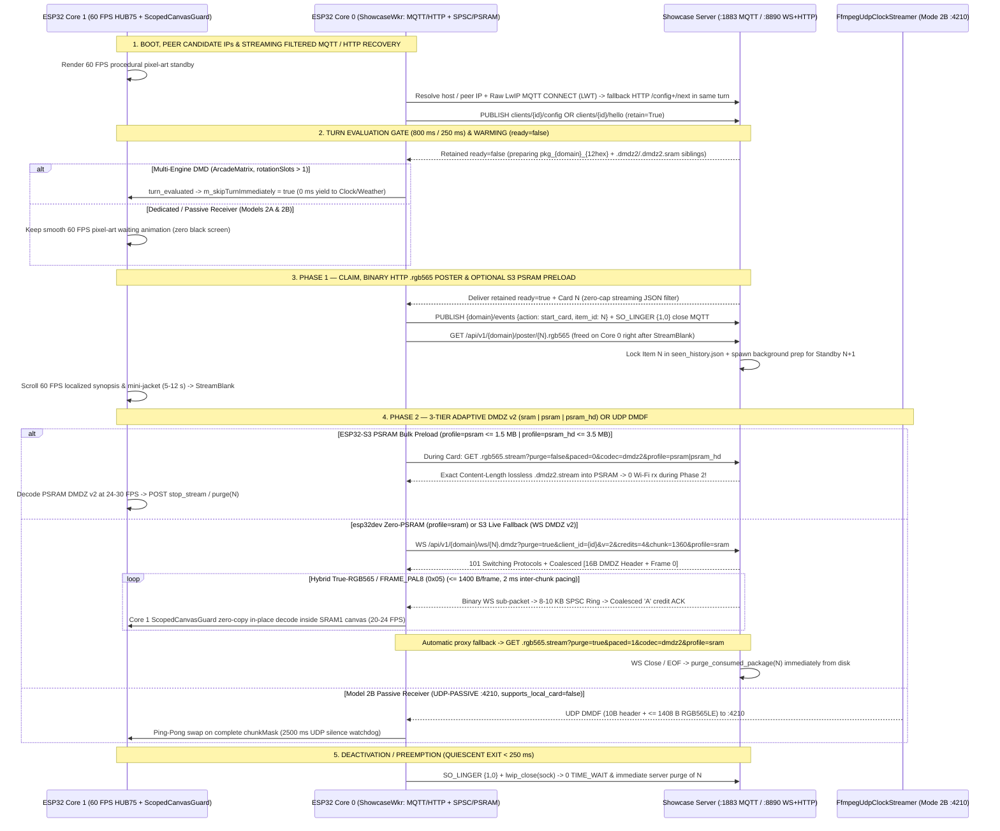
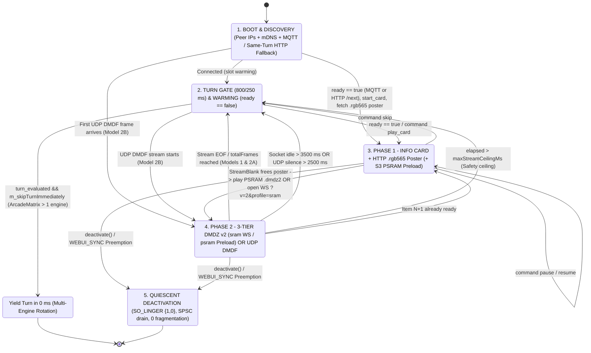

# ESP32 Integration & Passive Receiver Guide — DMD Media Showcase Server

🇬🇧 English | 🇫🇷 [Français](ESP32_INTEGRATION_FR.md) | 🇪🇸 [Español](ESP32_INTEGRATION_ES.md)

[](https://t.me/+DrSdAO8UMUViNmE0)
[](https://ko-fi.com/red1l)

---

**DMD Media Showcase Server** supports three distinct **ESP32 / ESP32-S3 HUB75 LED matrix** integration topologies. **Model 1** (Client-Driven Multi-Engine DMD, e.g. `ArcadeMatrix` ESP32 / ESP32-S3 / `ArcadeMatrix_RPi`) and **Model 2A** (Server-Managed Hybrid Receiver, `supports_local_card: true`) pair the **MQTT `:1883` Control Plane** (`config`/`hello`, retained `ready`, `start_card` — with automatic same-turn **`MQTT -> HTTP (/config + /next)`** recovery and binary HTTP `.rgb565` posters) with **3-Tier Adaptive `DMDZ` v2 (`dmdz2`, `profile=sram | psram | psram_hd`) Streaming on `:8890` (`MQTT+TCP` default)**: credit-acknowledged WebSocket `WS /api/v1/{domain}/ws/{item_id}.dmdz?v=2&profile=sram` (`<= 1,400 B/frame` via hybrid True-RGB565 + `FRAME_PAL8` `0x05`) for `esp32dev`, unpaced HTTP `.dmdz2.stream` PSRAM bulk preloading (`?purge=false&paced=0&codec=dmdz2&profile=psram|psram_hd`) for `ESP32-S3`, and automatic paced HTTP fallback (`?purge=true&paced=1&codec=dmdz2`), while **Model 2B** (`supports_local_card: false`) provides an optional ~180-line **100% Passive UDP `:4210` `DMDF` Framebuffer Receiver** (`UDP-PASSIVE`).

> [!IMPORTANT]
> **Why `MQTT + TCP` with 3-Tier Adaptive `DMDZ` v2 (`profile=sram | psram | psram_hd`) & Unified 1:1 RPi-Parity Recovery is the Default & Recommended Architecture for Models 1 & 2A**
> 1. **Zero Docker / Rancher Desktop VM UDP NAT Loss, Peer Candidate IPs & Same-Turn `MQTT -> HTTP` Fallback**: Inbound TCP `:8890` traverses every container bridge and host VM NAT without UDP return-pinhole timeouts, while `101 Switching Protocols` (`WS /api/v1/{domain}/ws/{item_id}.dmdz`, `ws_per_message_deflate=False`) disables intermediate HTTP proxy buffering end-to-end. WebUI peer candidate IPs resolve Docker/Rancher Desktop host-bridge NAT discrepancies automatically, and if MQTT `:1883` fails or times out, Core 0 transparently falls back to `POST /api/v1/{domain}/config` + `GET /api/v1/{domain}/next` **within the same rotation turn**.
> 2. **Unified 1:1 RPi-Parity Recovery Protocol & Zero-Cap Streaming JSON + Binary `.rgb565` Poster**: `turn_evaluated` gating (`800 ms` active / `250 ms` warm) yields rotation turns in **`0 ms`** when `ready: false` (`0` black screen), parses retained MQTT `ready` payloads via a streaming filtered JSON parser with **zero MQTT payload size cap**, and fetches the card's mini-jacket via binary `GET /api/v1/{domain}/poster/{item_id}.rgb565` on Core 0 (freed right after `StreamBlank` enters Phase 2).
> 3. **Exact `esp32dev` (`0 KB` PSRAM) Memory Audit (`>= 20 KB` Free Wi-Fi/LwIP Headroom & Full 8-Bit CIE-1931 HUB75 Preserved)**: On non-PSRAM `esp32dev` (`128x32` with full **8-bit HUB75 CIE-1931** color depth), **`36.0 KB` free 8-bit internal DRAM + `8.0 KB` `SRAM1` `CanvasBufferedSurface` = `44.2 KB` total**. Decoding `DMDZ` v2 **zero-copy in-place on Core 1 via `ScopedCanvasGuard`** directly inside the existing `8 KB` `SRAM1` offscreen canvas (`0 B` duplicate `frame565` allocation!), paired with a compact `~1.2 KB` `MediaShowcaseBase` footprint and task-first `ShowcaseWkr` startup, leaves **`~30 KB` available** — comfortably accommodating an **`8–10 KB` lock-free SPSC ring** while preserving **`>= 20 KB` of free internal DRAM** permanently for `esp_wifi` / `lwIP` RX buffers.
> 4. **3 Adaptive Stream Profiles (`profile=sram | psram | psram_hd`) & Hybrid `FRAME_PAL8` (`0x05`) Codec**:
>    - **`profile=sram` (`esp32dev` 0 PSRAM)**: `.dmdz2.sram.stream` combines temporal H.264 mosquito-noise stabilization (`stabilize_rgb565_frames_sram`) with hybrid True-RGB565 `DMDZ` v2 (`<= 1,400 B`) and **`FRAME_PAL8` (`0x05`)** (`1..128` RGB565 scene colors + optional 2D scroll + `PAL_INDEX`/`PAL_SKIP`/`PAL_RUN`/`PAL_LONG_SKIP`), guaranteeing **every frame `<= 1,400 B` (`0` reference drift)** while keeping clean panoramas 100% lossless (`8.1x` smaller than noisy raw video). Served over `WS ?v=2&credits=4&chunk=1360&profile=sram` with **coalesced `[16 B DMDZ header + Frame 0]`** and **`2 ms` inter-chunk pacing** (`20–24 FPS`).
>    - **`profile=psram` (`ESP32-S3 <= 128x64`) & `profile=psram_hd` (`ESP32-S3 256x64+`)**: Preload unpaced lossless True-RGB565 `.dmdz2.stream` (`1.5 MB` on `psram`, `3.5 MB` on `psram_hd`) into Octal PSRAM during Phase 1 Card via `GET .rgb565.stream?purge=false&paced=0&codec=dmdz2&profile=psram|psram_hd` (**`0` Wi-Fi traffic during playback at `24–30 FPS`**), with live WebSocket fallback (`256 KB` / `768 KB` PSRAM SPSC ring, `credits=12..16, chunk=1400`), while `ArcadeMatrix_RPi` continues preloading raw `DMDS` (`0` impact).
> 5. **Zero-`TIME_WAIT` Raw LwIP Sockets (`SO_LINGER {1, 0}`) & Compact Collision-Free `item_id`s (`<= 24` chars)**: Scoped MQTT `:1883` and `:8890` stream sockets close with `SO_LINGER {1, 0}` (`0` 120s `TIME_WAIT` PCB accumulation), and every prepared package uses `pkg_<domain>_<12hex>` (`<= 24` chars).

---

## 1. Overview & Comparison of the 3 ESP32 Integration Topologies

### Model 1 — Client-Driven Multi-Engine DMD (`config_source: "client"`, `MQTT+TCP` Default)

Designed for feature-rich multi-engine firmware where the ESP32 owns its local screen rotation (`Clock`, `Weather`, `Scoreboard`, `AudioSpectrum`, `RetroGames`, `Movies`, `Series`, `Anime`), preemption stack (`DisplayArbiter`), and on-device WebUI.

- **Configuration Authority & Peer Candidate IPs**: The ESP32 WebUI dynamically queries `GET /api/v1/{domain}/filters?lang={ui_lang}` to populate localized dropdowns, stores per-engine filter settings locally, records WebUI peer candidate IPs for Docker/Rancher Desktop NAT setups, and publishes its retained configuration to `dmd_showcase/clients/{dmd_id}/config` (`retain=True`).
- **Unified 1:1 RPi-Parity Recovery & 3-Tier Adaptive Streaming**: Core 0 (`ShowcaseWkr`) evaluates the retained `ready` slot within an `800 ms / 250 ms` `turn_evaluated` gate using a zero-cap streaming filtered JSON parser (with automatic same-turn fallback to `POST /api/v1/{domain}/config` + `GET /api/v1/{domain}/next` if MQTT `:1883` is unreachable), claims the item (`start_card`), closes MQTT with `SO_LINGER {1, 0}`, and fetches `GET /api/v1/{domain}/poster/{item_id}.rgb565` (freed on Core 0 after `StreamBlank`). Phase 2 adapts automatically to the board's memory tier:
  - **`esp32dev` (`profile=sram`)**: Streams `WS /api/v1/{domain}/ws/{item_id}.dmdz?purge=true&client_id={dmd_id}&v=2&credits=4&chunk=1360&profile=sram` into an `8–10 KB` lock-free SPSC ring while Core 1 decodes `DMDZ` v2 + `FRAME_PAL8` (`0x05`) zero-copy in-place inside `CanvasBufferedSurface` via `ScopedCanvasGuard`.
  - **`ESP32-S3` (`profile=psram` / `profile=psram_hd`)**: Preloads unpaced `.dmdz2.stream` (`<= 1.5 MB` / `<= 3.5 MB`) into Octal PSRAM during Phase 1 Card (`?purge=false&paced=0&codec=dmdz2&profile=psram|psram_hd` -> `0` Wi-Fi traffic during `24–30 FPS` playback), falling back to live WebSocket (`credits=12..16, chunk=1400`, `256 KB` / `768 KB` PSRAM ring) for extra-long clips.
- **Rotation Behavior**: When a Showcase engine's turn arrives and `ready` is `false`, the engine yields its turn in **`0 ms`** (`m_skipTurnImmediately = true`) so the panel immediately displays the next local engine (`Clock`, `Weather`, etc.) without ever showing a black screen or stalling.
- **Production Reference Implementation (`ArcadeMatrix` — Modular Single-Responsibility Split)**:
  - Showcase Engine Orchestrator & Descriptors: [`src/engines/MediaShowcaseEngines.h`](https://github.com/red77290/ArcadeMatrix/blob/main/src/engines/MediaShowcaseEngines.h) / [`src/engines/MediaShowcaseEngines.cpp`](https://github.com/red77290/ArcadeMatrix/blob/main/src/engines/MediaShowcaseEngines.cpp)
  - Core 1 UTF-8 Pixel-Font, Waiting Pixel-Art & Adaptive Card Layouts: [`src/engines/showcase/ShowcaseCardRenderer.h`](https://github.com/red77290/ArcadeMatrix/blob/main/src/engines/showcase/ShowcaseCardRenderer.h) / [`src/engines/showcase/ShowcaseCardRenderer.cpp`](https://github.com/red77290/ArcadeMatrix/blob/main/src/engines/showcase/ShowcaseCardRenderer.cpp)
  - Shared 3-Tier Adaptive `DMDZ` v2 WebSocket + PSRAM Bulk Preload + Paced HTTP Stream Client (reused by `MediaShowcaseBase` & `FrontendSyncEngine`): [`src/core/net/DmdzStreamClient.h`](https://github.com/red77290/ArcadeMatrix/blob/main/src/core/net/DmdzStreamClient.h) / [`src/core/net/DmdzStreamClient.cpp`](https://github.com/red77290/ArcadeMatrix/blob/main/src/core/net/DmdzStreamClient.cpp)
  - Streaming Filtered MQTT 3.1.1 LwIP Socket & `SO_LINGER {1, 0}` Helpers: [`src/core/net/RawMqttSocket.h`](https://github.com/red77290/ArcadeMatrix/blob/main/src/core/net/RawMqttSocket.h) / [`src/core/net/RawMqttSocket.cpp`](https://github.com/red77290/ArcadeMatrix/blob/main/src/core/net/RawMqttSocket.cpp)
  - In-Place `DMDZ` v1/v2 + `FRAME_PAL8` (`0x05`) Decoder & RFC 6455 Binary Demuxer: [`src/core/drawing/DmdzStreamDecoder.h`](https://github.com/red77290/ArcadeMatrix/blob/main/src/core/drawing/DmdzStreamDecoder.h) / [`src/core/drawing/DmdzStreamDecoder.cpp`](https://github.com/red77290/ArcadeMatrix/blob/main/src/core/drawing/DmdzStreamDecoder.cpp)

---

### Model 2A — Server-Managed Hybrid Receiver (`config_source: "server"`, `supports_local_card: true`, `MQTT+TCP` Default)

Designed for lightweight dedicated Showcase displays that want crisp 60 FPS hardware font scrolling on the ESP32 **without** embedding a local WebUI, category dropdown logic, or NVS filter schemas.

- **Hardware Announcement Only**: On boot, the ESP32 publishes a tiny retained payload to `dmd_showcase/clients/{dmd_id}/hello` (`retain=True`) declaring only its panel geometry and LAN endpoint (`width`, `height`, `config_source: "server"`, `supports_local_card: true`, and fallback `lang`).
- **Centralized Profile Persistence (`./data/dmd_profiles.json`)**: All domain playlists (`games`, `movies`, `series`, `anime`), scraper filters (`systems`, `genres`, `decades`), AI framing/colorimetry (`video_mode`, `color_boost`), and broadcast content language (`lang`) are configured centrally in the **Showcase Web Admin Dashboard** (`http://dmdmediashowcase.local:8890/`) and persisted in `./data/dmd_profiles.json`.
- **Hybrid Rendering Split**: The ESP32 renders **Phase 1 (Info Card)** locally at 60 FPS (mini-jacket from `/api/v1/{domain}/poster/{item_id}.rgb565` + colored badge + smooth scrolling localized synopsis pushed via `ready` or `dmd_showcase/clients/{dmd_id}/command` `play_card`, acknowledged via `start_card`), then streams **Phase 2 (Panoramas + Video)** over 3-tier `DMDZ` v2 (`WS /api/v1/{domain}/ws/{item_id}.dmdz?purge=true&client_id={dmd_id}&v=2&credits=4&chunk=1360&profile=sram` on `esp32dev`, PSRAM bulk `.dmdz2.stream` preload or `credits=12..16&chunk=1400&profile=psram|psram_hd` on `ESP32-S3`, with automatic HTTP `?purge=true&paced=1&codec=dmdz2` fallback and optional legacy `mqtt_udp` `start_stream` support).

---

### Model 2B — Server-Managed 100% Passive Framebuffer Receiver (`config_source: "server"`, `supports_local_card: false`, `UDP-PASSIVE`)

Designed for ultra-minimal, zero-maintenance hardware builds (`ESP32_STD` WROOM-32 **without PSRAM** or `ESP32-S3`) using roughly **~180 lines of C++** — **zero WebUI, zero font tables, zero JSON parser, and zero MQTT library required**.

- **Zero-Config Discovery**: The ESP32 announces its geometry and IP via a periodic HTTP heartbeat `POST /api/v1/clients/hello` (or MQTT `dmd_showcase/clients/{dmd_id}/hello`), or requires **zero outbound handshake at all** when registered with a static LAN IP and `always_stream_udp: true` in `./data/dmd_profiles.json`.
- **100% Server-Composited Stream**: Because `supports_local_card: false`, the Showcase server renders **even the Phase 1 Info Card** (mini-jacket + colored system/domain badge + title + year + rating + localized scrolling synopsis) directly into the unified RGB565 stream and clocks MTU-safe `DMDF` UDP chunks (`<= 1408 B` payload) straight to UDP `:4210`.
- **Instant Server-Side Control**: Live `Skip`, `Pause`, `Resume`, `Stop`, and `Play Now` (`FrontendSync`) execute **100% server-side** by switching or pausing the `FfmpegUdpClockStreamer` thread feeding `:4210` in `< 50 ms`.

---

### Architectural Comparison Matrix

| Dimension | Model 1: Client-Driven (`ArcadeMatrix`) | Model 2A: Server-Managed Hybrid | Model 2B: 100% Passive UDP Receiver |
| :--- | :--- | :--- | :--- |
| **Handshake & Transport** | `config_source: "client"` (`MQTT+TCP` + same-turn HTTP `/config+/next` fallback) | `config_source: "server"`, `supports_local_card: true` (`MQTT+TCP` default) | `config_source: "server"`, `supports_local_card: false` (`UDP-PASSIVE` `:4210`) |
| **Playlist & Filter Storage** | ESP32 Flash (`config.json`) | Server (`./data/dmd_profiles.json`) | Server (`./data/dmd_profiles.json`) |
| **ESP32 Firmware Size / UI** | Full Multi-Engine OS + Rich WebUI | ~350 LoC C++ (Raw MQTT + Credit-Acked WS `DMDZ` v2 + Card Font) | **~120–180 LoC C++** (Zero UI, Zero Fonts, Zero JSON) |
| **Phase 1 Info Card Rendering** | Local 60 FPS on ESP32 Core 1 + binary HTTP `.rgb565` poster | Local 60 FPS on ESP32 Core 1 + binary HTTP `.rgb565` poster | **Server-rendered into RGB565 UDP stream** |
| **Phase 2 Panoramas + Video** | **3-Tier `DMDZ` v2 (`sram` WS `<= 1400 B` PAL8/True565; `psram`/`psram_hd` HTTP bulk preload + WS) + HTTP `?paced=1&codec=dmdz2` fallback** | **3-Tier `DMDZ` v2 (`sram` / `psram` / `psram_hd`) + HTTP `?paced=1&codec=dmdz2` fallback** | **Passive UDP `DMDF` (`:4210`)** |
| **Memory Footprint (`128x32`)** | **`esp32dev`: Zero-Copy `SRAM1` canvas + `8–10 KB` SPSC ring (`>= 20 KB` free Wi-Fi DRAM); `S3`: `1.5–3.5 MB` PSRAM preload** | `2–6 KB` poster + `8 KB` canvas / `DMDZ` v2 decode | **`8 KB` single (`16 KB` ping-pong) — `0 B` poster/JSON** |
| **`ESP32_STD` (`esp32dev`, No PSRAM)** | **Qualified (`128x32` at full 8-bit CIE-1931 HUB75, `20–24 FPS`, `64x64`, `128x64`)** | Qualified (`128x32` up to `128x64`) | **Qualified (`128x32` up to `256x64` single-buffer)** |
| **Core 0 / Core 1 Load** | Low (`sram`: Core 0 SPSC rx + Core 1 in-place decode; `S3`: `0` Wi-Fi rx during PSRAM playback) | Low (Credit-Acked `DMDZ` v2 decode + `'A'` ACK) | **Minimal (pure non-blocking UDP `memcpy`)** |
| **Live `Skip` / `Pause` / `Play Now`** | Priority queue (`N+1`) or MQTT `.../command` | Via MQTT `.../command` (`play_card` / `skip`) | **Instant (`< 50 ms`) directly in server `DMDF` streamer** |

---

## 2. Dual-Core FreeRTOS Task Choreography & HUB75 DMA Invariants

HUB75 LED matrices lack an internal framebuffer controller: the ESP32's I2S/LCD DMA peripheral must continuously scan PWM bitplanes out of internal SRAM. Any Wi-Fi interrupt storm, flash write, heap fragmentation, or mutex stall on the rendering core causes visible row ghosting or brightness flicker.

To guarantee rock-solid **60 FPS** (`16.67 ms` frame cadence), ESP32 integrations enforce strict dual-core physical isolation:

- **Core 0 (`PRO_CPU` — `ShowcaseWkr` Network & Protocol Worker)**:
  - Runs the Espressif Wi-Fi / LwIP TCP/IP stack, mDNS (`dmdmediashowcase.local`), and WebUI peer candidate IP fallback.
  - **Models 1 & 2A (`MQTT+TCP` Default + Same-Turn HTTP Recovery)**: Spawns `ShowcaseWkr` task-first, evaluates retained `ready` via a zero-cap streaming filtered MQTT JSON parser (or falls back in the same turn to `POST /api/v1/{domain}/config` + `GET /api/v1/{domain}/next`), publishes `start_card`, closes MQTT with `SO_LINGER {1, 0}`, and downloads `GET /api/v1/{domain}/poster/{item_id}.rgb565` (freed on Core 0 right after `StreamBlank`). During Phase 1/2:
    - **`profile=sram` (`esp32dev`, 0 PSRAM)**: Upgrades to **`WS /api/v1/{domain}/ws/{item_id}.dmdz?purge=true&client_id={dmd_id}&v=2&credits=4&chunk=1360&profile=sram`**, receives the **coalesced `[16 B DMDZ header + Frame 0]`** binary message and `2 ms`-paced sub-packets (`<= 1,400 B/frame`), pushes compressed `DMDZ` v2 frames into an **`8–10 KB` lock-free SPSC ring**, and returns coalesced `'A'` (`0x41`) credit ACKs.
    - **`profile=psram` / `profile=psram_hd` (`ESP32-S3`, Octal PSRAM)**: Preloads the entire unpaced lossless `.dmdz2.stream` (`<= 1.5 MB` on `psram`, `<= 3.5 MB` on `psram_hd`) into PSRAM **during Phase 1 Card** via `GET /api/v1/{domain}/stream/{item_id}.rgb565.stream?purge=false&paced=0&codec=dmdz2&profile=psram|psram_hd` (`0` Wi-Fi traffic during Phase 2 playback!), or streams live over `WS ?v=2&credits=12..16&chunk=1400&profile=psram|psram_hd` into a `256 KB` / `768 KB` PSRAM SPSC ring.
  - **Model 2B (`UDP-PASSIVE :4210`)**: Runs periodic HTTP `POST /api/v1/clients/hello` heartbeats and reassembles non-blocking **UDP `DMDF` datagrams** (`10-byte` Little-Endian `<4sHBBH` header + `<= 1408 B` RGB565LE slice = `<= 1418 B` UDP payload, zero IP fragmentation under standard `1500 B` Wi-Fi MTU).
- **Core 1 (`APP_CPU` — Real-Time 60 FPS HUB75 Render Loop)**:
  - Exclusively drives `IDrawingSurface` / HUB75 DMA presentation at 60 FPS.
  - **Zero Dynamic Allocation & Zero Mutex**: Never calls `malloc`/`new`/`String` or acquires mutexes shared with Core 0.
  - **Zero-Copy In-Place `ScopedCanvasGuard` (`esp32dev`) / PSRAM Playback (`ESP32-S3`)**: On `esp32dev`, Core 1 pops compressed `<= 1,400 B` `DMDZ` v2 (`True-RGB565` or `FRAME_PAL8` `0x05`) payloads from the `8–10 KB` SPSC ring and decodes them **directly in-place inside the existing `8 KB` `SRAM1` `CanvasBufferedSurface`** before `blitCanvas565()`, completely eliminating any second `8 KB` `frame565` allocation.

### Lock-Free Cross-Core Handoff: Zero-Copy SPSC Ring + `ScopedCanvasGuard` vs Seqlock vs Ping-Pong

Three zero-mutex patterns safely bridge Core 0 (`WS DMDZ` / `HTTP DMDZ` / `UDP DMDF`) and Core 1 (`60 FPS HUB75`):

1. **Zero-Copy `ScopedCanvasGuard` + Lock-Free SPSC Compressed Frame Ring (`ArcadeMatrix` Production `esp32dev` & `ESP32-S3` Live Fallback)**:
   - Core 0 demuxes WebSocket binary frames into a bounded SPSC ring (`8–10 KB` internal DRAM on `esp32dev` holding `6–10` compressed `<= 1,400 B` frames; `256 KB` / `768 KB` PSRAM on `ESP32-S3`) and returns `'A'` credit ACKs only as ring space frees up.
   - Core 1 paces frame presentation monotonically (`20–24 FPS` on `sram`, `24–30 FPS` on `psram`/`psram_hd`) and runs `DmdzStreamDecoder` (`v1`/`v2` + `FRAME_PAL8` `0x05`) **in-place inside `CanvasBufferedSurface` (`SRAM1`)** under `ScopedCanvasGuard`, saving `8,192 B` of precious internal DRAM on `esp32dev`.
2. **Tear-Free Even/Odd `frameSeq` + Dekker `renderBlitSeq` Guard (Standalone Single-File Reference in Section 4.A)**:
   - For standalone custom firmwares without `CanvasBufferedSurface`, Core 0 decodes into a single `g_frame565` buffer bracketed by `ODD`/`EVEN` `g_frameSeq` + Core 1 `g_renderBlitSeq`.
3. **Ping-Pong Double-Buffered `frame565[2]` (`std::atomic<uint8_t> frontIdx` — Model 2B UDP `DMDF`)**:
   - Core 0 reassembles `DMDF` chunks into `frame565[backIdx]` via 64-bit `chunkMask` and atomically publishes `frontIdx` only when all chunks arrive.

### Exact `esp32dev` (`0 KB` PSRAM) Memory Audit & 3-Tier Adaptive Stream Profiles

On a production multi-engine **`esp32dev` (`128x32`, `0 KB` PSRAM)** running **full 8-bit HUB75 CIE-1931 color depth** alongside Wi-Fi, AsyncWebServer, and `CanvasBufferedSurface`:
- **Baseline Pool**: **`36.0 KB` free 8-bit internal DRAM + `8.0 KB` `SRAM1` `CanvasBufferedSurface` = `44.2 KB` total**.
- **Showcase Engine Footprint**: Zero-Copy `ScopedCanvasGuard` (`0 KB` extra `frame565`!) + compact **`~1.2 KB` `MediaShowcaseBase`** + task-first **`ShowcaseWkr`** stack = **`~30 KB` remaining**.
- **Streaming Allocation**: **`8–10 KB` lock-free SPSC ring** -> **`>= 20 KB` free internal DRAM permanently preserved for `esp_wifi` / `lwIP` RX buffers** (`0` `pcb->ooseq` stalls, `0` heap fragmentation, `0` HUB75 8-bit downgrade!).

| Stream Profile | Target Hardware & Geometry | Server Sibling & Codec | Transport & Flow Control | Client Buffer Budget | Playback Rate & Fidelity |
| :--- | :--- | :--- | :--- | :--- | :--- |
| **`profile=sram`** | **`esp32dev` (`0 KB` PSRAM)**, `128x32` / `64x64` (`<= 8,192 px`) | **`.dmdz2.sram.stream`** (`stabilize_rgb565_frames_sram` + True-RGB565 `<= 1,400 B` / `FRAME_PAL8` `0x05` `<= 1,400 B`) | `WS ?v=2&credits=4&chunk=1360&profile=sram` (**coalesced `16 B` hdr + Frame `0`**, **`2 ms` inter-chunk pacing**) | **Zero-Copy `8 KB` `SRAM1` canvas + `8–10 KB` SPSC ring (`>= 20 KB` free Wi-Fi DRAM)** | **`20–24 FPS`**, **8-bit HUB75 CIE-1931**, 100% lossless panoramas, `0` drift |
| **`profile=psram`** | **`ESP32-S3` (Octal PSRAM)**, `<= 128x64` / `64x128` (`<= 8,192 px`) | **`.dmdz2.stream`** (100% lossless True-RGB565 `DMDZ` v2) | **Unpaced HTTP bulk preload** (`?purge=false&paced=0&codec=dmdz2&profile=psram` during Card) + `WS ?v=2&credits=12&chunk=1400&profile=psram` fallback | **`<= 1.5 MB` PSRAM preload** (`256 KB` PSRAM SPSC ring fallback) | **`25–30 FPS`** True-RGB565 (**`0` Wi-Fi traffic during preloaded playback**) |
| **`profile=psram_hd`** | **`ESP32-S3` (Octal PSRAM)**, `256x64+` (`> 8,192 px` HD) | **`.dmdz2.stream`** (100% lossless True-RGB565 `DMDZ` v2) | **Progressive HTTP bulk preload** (`?purge=false&paced=0&codec=dmdz2&profile=psram_hd`) + `WS ?v=2&credits=16&chunk=1400&profile=psram_hd` fallback | **`<= 3.5 MB` PSRAM preload** (`768 KB` PSRAM SPSC ring fallback) | **`24–30 FPS` HD** True-RGB565 |
| **Model 2B `DMDF`** | `esp32dev` / `ESP32-S3`, `128x32` up to `256x64` (`<= 64` chunks) | Live `DMDF` `<4sHBBH` (`<= 1,408 B` slices) | Passive UDP `:4210` (`supports_local_card: false`) | `8 KB` canvas + `16 KB` (`128x32`) ping-pong | `15–25 FPS` passive zero-JSON receiver |

### Recommended HUB75 Display Pipeline: `Single DMA Buffer + Offscreen RGB565 Canvas` (`canvas_single`)

Across all ESP32 HUB75 firmwares (including [`ArcadeMatrix`](https://github.com/red77290/ArcadeMatrix)), the **`Single DMA Buffer + Offscreen RGB565 Canvas` (`canvas_single`)** pipeline built on [`mrfaptastic/ESP32-HUB75-MatrixPanel-I2S-DMA`](https://github.com/mrfaptastic/ESP32-HUB75-MatrixPanel-I2S-DMA) is the **recommended gold-standard architecture**:

1. **50% Savings in Scarce DMA-Capable SRAM (`mxconfig.double_buff = false`)**:
   - On `ESP32_STD` (no PSRAM), HUB75 I2S DMA descriptors and BCM bitplanes must reside in contiguous internal `MALLOC_CAP_DMA` DRAM — the exact memory pool shared with Wi-Fi + LwIP TCP/UDP buffers.
   - Disabling hardware DMA double-buffering (`mxconfig.double_buff = false`) cuts bitplane allocation in half, while the offscreen linear RGB565 canvas (`CanvasBufferedSurface` in `SRAM1` or `GFXcanvas16`) only requires `2 bytes/pixel` (`8 KB` on `128x32`, `16 KB` on `128x64` — and resides in PSRAM on `ESP32-S3`).
2. **Preserving Full 8-Bit HUB75 CIE-1931 Color Depth on `esp32dev` via Zero-Copy `ScopedCanvasGuard` & `WEBUI_SYNC` Eviction**:
   - Multi-engine firmwares (`ArcadeMatrix`) keep **full 8-bit HUB75 BCM color depth** on `128x32` non-PSRAM `esp32dev` boards across unlimited Showcase rotations: `PipelineSelectionPolicy` applies a `3.5 KB` keep-in-place hysteresis once 8-bit DMA is allocated, while Zero-Copy `ScopedCanvasGuard` + `8–10 KB` SPSC ring + `SO_LINGER {1, 0}` preserve `>= 20 KB` free internal DRAM — dropping to `4-bit` depth **only** on larger `128x64` panels without PSRAM.
   - When a user opens the on-device SPA WebUI (`GET /`), `ArcadeMatrix` temporarily engages a zero-heap high-priority **`WEBUI_SYNC`** display source ([`WebUiSyncEngine`](https://github.com/red77290/ArcadeMatrix/blob/main/src/engines/WebUiSyncEngine.h)) on `PreemptionStack`. Preempting the active Showcase/rotation engine triggers `deactivate()` and reclaims internal SRAM (`SPSC` ring, `.rgb565` poster, worker stack, and TCP buffers) so AsyncTCP bursts the gzipped SPA cleanly, then automatically resumes 8-bit Showcase playback once browser sync finishes.
3. **Zero Clear-Strobe & Zero Black Flicker (In-Place Bitplane Overwrite)**:
   - Drawing directly into a single DMA buffer (`direct_single`) and calling `clearScreen()` blanks the active scanning bitplanes mid-refresh, causing severe black-frame flicker.
   - With an **Offscreen RGB565 Canvas**, all clearing, `Adafruit_GFX` text/HUD drawing, waiting animations, and in-place `DMDZ` v2 / `FRAME_PAL8` (`0x05`) / `DMDF` updates happen strictly in offscreen RAM. `blitCanvas565()` then overwrites every HUB75 bitplane word **in-place** (`(dmaRow[ax] & ~0x003F) | rgb12`) in **`~300 µs`** (`128x32`) without ever clearing the DMA buffer to black first.
4. **Dirty-Frame Gating (`frameSeq != lastPresentedSeq`)**:
   - Core 1 runs at `60 Hz` (`16.6 ms`) while incoming `DMDZ` v2 (`20–30 FPS`) / `DMDF` (`15–25 FPS`) video updates at frame cadence.
   - By bursting the offscreen canvas to `frame_buffer[0]` **only when a new frame has modified the canvas**, Core 1 performs **zero redundant DMA memory writes** during intermediate ticks, eliminating SRAM bus contention while I2S scans the panel.
5. **Multiplexed BCM Bitplane Burst + Perceptual CIE 1931 Gamma + Classic ESP32 FIFO Word-Swap**:
   - Encodes upper `(y)` and lower `(y + H/2)` HUB75 scan halves simultaneously into `R1G1B1R2G2B2` bitplanes using bit-depth-scaled **CIE 1931 gamma LUTs**, applies the Classic ESP32 I2S 16-bit FIFO word-pair swap (`MATRIX_TX_ADJUST(x)`), and flushes CPU cache lines (`Cache_WriteBack_Addr`) when `SPIRAM_DMA_BUFFER` is enabled on `ESP32-S3`.

| Pipeline Mode | `mxconfig.double_buff` | Offscreen RGB565 Canvas | `ESP32_STD` DMA DRAM Headroom | Flicker / Tearing | Recommendation |
| :--- | :---: | :---: | :--- | :--- | :--- |
| **`canvas_single`** | **`false`** | **Yes (`GFXcanvas16`)** | **Optimal (50% less DMA DRAM)** | **Zero flicker (in-place `~300 µs` burst + dirty gating)** | **Recommended (`ESP32_STD` & `ESP32-S3`)** |
| `canvas_double` | `true` | Yes (`GFXcanvas16`) | High RAM cost (`2x` DMA + Canvas) | Tear-free swap | Optional on `ESP32-S3` with Octal PSRAM |
| `direct_double` | `true` | No | High DMA DRAM (`2x` bitplanes) | Slow per-pixel `drawPixel()` on video | Legacy GFX-only sketches |
| `direct_single` | `false` | No | Maximal free RAM | Visible strobe on `clearScreen()` | Emergency low-RAM fallback only |

---

## 3. Complete Task Sequencing, Waiting States & Watchdog Recovery

### End-to-End Protocol Sequence Diagram



### ESP32 Receiver Deterministic State Machine



### Detailed Walkthrough of Every State & Watchdog Invariant

1. **`BOOT, PEER CANDIDATE IPs & UNIFIED MQTT / SAME-TURN HTTP RECOVERY`**:
   - Core 1 renders a procedural 60 FPS pixel-art standby before Wi-Fi associates.
   - Core 0 (`ShowcaseWkr`, allocated task-first before temporary buffers) resolves `dmdmediashowcase.local` or uses WebUI peer candidate IPs (essential on Docker Desktop / Rancher Desktop NAT bridges) and connects to MQTT `:1883` (`RawMqttSocket` with `LWT` `{"online": false}`). If MQTT `:1883` is unreachable or times out, Core 0 transparently executes `POST /api/v1/{domain}/config` + `GET /api/v1/{domain}/next` **within the exact same turn**.
2. **`TURN EVALUATION GATE (800 ms / 250 ms) & WARMING` (`ready: false`)**:
   - Retain payloads are parsed with a **streaming filtered JSON parser** (`0` MQTT payload size limit — large localized synopses never drop).
   - **Multi-Engine DMDs (`ArcadeMatrix` — Model 1)**: Once `turn_evaluated` completes (`<= 800 ms` cold / `<= 250 ms` warm) and `ready` is `false`, `MediaShowcaseBase` sets `m_skipTurnImmediately = true` so `isFinished()` returns `true` in **`0 ms`** (`Clock` $\to$ `Weather` $\to$ `Scoreboard` with **zero black screen**).
3. **`PHASE 1 — CLAIM, BINARY HTTP .rgb565 POSTER & N+1 PIPELINING`**:
   - Claiming item `N` (`pkg_<domain>_<12hex>`) via `start_card` immediately closes MQTT with `SO_LINGER {1, 0}`, fetches the binary `GET /api/v1/{domain}/poster/{item_id}.rgb565` mini-jacket on Core 0 (freed right after `StreamBlank`), and triggers server-side **`N+1` background preparation** (including pre-encoded `.dmdz.stream`, `.dmdz2.stream`, and `.dmdz2.sram.stream` siblings). On `ESP32-S3`, Core 0 already preloads unpaced `.dmdz2.stream` (`?purge=false&paced=0&codec=dmdz2&profile=psram|psram_hd`) into Octal PSRAM while the Card scrolls!
4. **`PHASE 2 — 3-TIER ADAPTIVE DMDZ v2 STREAMING OR PASSIVE UDP DMDF`**:
   - **`profile=sram` (`esp32dev` 0 PSRAM)**: Upgrades to `WS /api/v1/{domain}/ws/{item_id}.dmdz?purge=true&client_id={dmd_id}&v=2&credits=4&chunk=1360&profile=sram`. The server sends **coalesced `[16 B DMDZ header + Frame 0]`** followed by `<= 1,400 B` hybrid True-RGB565 / `FRAME_PAL8` (`0x05`) frames (`2 ms` inter-chunk pacing) into the `8–10 KB` SPSC ring (`>= 20 KB` DRAM left free for `esp_wifi`/`lwIP`), decoded zero-copy in-place on Core 1 (`ScopedCanvasGuard`, `20–24 FPS`).
   - **`profile=psram` / `profile=psram_hd` (`ESP32-S3`)**: Plays directly from PSRAM at `24–30 FPS` with **`0` Wi-Fi traffic**, or streams live over `WS ?v=2&credits=12..16&chunk=1400&profile=psram|psram_hd` (`256 KB` / `768 KB` PSRAM ring), with automatic proxy fallback to `?purge=true&paced=1&codec=dmdz2`.
   - **Model 2B (`UDP-PASSIVE :4210`)**: `FfmpegUdpClockStreamer` clocks `DMDF` UDP slices (`<= 1408 B`) to `:4210` (`2,500 ms` UDP silence watchdog).
5. **`DEACTIVATION, WEBUI_SYNC PREEMPTION & REBOOT RECOVERY`**:
   - **Clean Quiescent Deactivation (`< 250 ms`)**: Clearing `m_wantActive` wakes `SO_RCVTIMEO` within `<= 250 ms`, closes any active socket with `SO_LINGER {1, 0}` (`0` `TIME_WAIT` PCBs, triggering immediate server-side purge of `N`), drains `ScopedCanvasGuard` / SPSC state cleanly, and joins `ShowcaseWkr` (`0` heap fragmentation), including during `WEBUI_SYNC` SPA bursts.

---

## 4. Production C++ ESP32 Reference Implementations (`MQTT+TCP` Default & Passive UDP `DMDF`)

### A. Models 1 & 2A — Standalone Zero-Heap Raw MQTT + Adaptive `DMDZ` v2 (`FRAME_PAL8` `0x05`) WebSocket Streamer

This standalone C++17 reference demonstrates the zero-heap **`Raw LwIP Scoped MQTT (:1883) + 3-Tier Adaptive DMDZ v2 WebSocket (:8890, profile=sram | psram | psram_hd) + Paced HTTP dmdz2 Fallback`** wire protocol for custom **Model 1** and **Model 2A** receivers (for full multi-engine Zero-Copy `ScopedCanvasGuard` + SPSC ring + PSRAM bulk preload, see [`ArcadeMatrix`](https://github.com/red77290/ArcadeMatrix/blob/main/src/engines/MediaShowcaseEngines.cpp)):

1. **Zero-Heap Raw LwIP MQTT Claim (`0` Sockets & `0` `TIME_WAIT` During Card Scroll)**: Core 0 connects to `:1883` over `lwip_socket`, publishes retained `config` (Model 1) or `hello` (`supports_local_card: true`, Model 2A), extracts the retained `ready` card (`pkg_<domain>_<12hex>`), publishes `start_card`, and closes with **`SO_LINGER {1, 0}`**.
2. **Adaptive `DMDZ` v2 + `FRAME_PAL8` (`0x05`) Decoder & Coalesced Credit-Acked WebSocket**: Connects to `WS /api/v1/{domain}/ws/{item_id}.dmdz?purge=true&client_id={dmd_id}&v=2&credits=4&chunk=1360&profile=sram` on `esp32dev` (or `credits=12..16&chunk=1400&profile=psram|psram_hd` on `ESP32-S3`, with automatic fallback to `GET .rgb565.stream?purge=true&paced=1&codec=dmdz2&profile=...`), receives the coalesced `[16 B header + Frame 0]`, decodes `DMDZ` v1/v2 True-RGB565 opcodes and **`FRAME_PAL8` (`0x05`)** scene-palette frames in-place, and returns `'A'` credit ACKs.

```cpp
#include <Arduino.h>
#include <WiFi.h>
#include <esp_heap_caps.h>
#include <lwip/sockets.h>
#include <lwip/netdb.h>
#include <atomic>
#include <cstring>

static constexpr uint16_t PANEL_W     = 128;
static constexpr uint16_t PANEL_H     = 32;
static constexpr size_t   FRAME_BYTES = static_cast<size_t>(PANEL_W) * PANEL_H * 2U; // 8,192 B

// Persistent scratch buffer (~1.46 KB); on ESP32_STD (0 PSRAM), g_frame565 (8 KB) is allocated
// strictly during Phase 2 streaming (LIFO) so Phase 1 and engine rotations never fragment heap!
static uint16_t* g_frame565       = nullptr;
static bool      g_hasPsram       = false;
static uint8_t   g_ioScratch[1472]{};
static char      g_itemId[28]{}; // Compact "pkg_<domain>_<12hex>" (<= 24 chars)

// Lock-free synchronization between Core 0 (stream decoder) and Core 1 (60 Hz HUB75)
static std::atomic<uint32_t> g_frameSeq{0};         // EVEN = coherent frame ready, ODD = Core 0 writing
static std::atomic<uint32_t> g_consumedFrameSeq{0}; // Last EVEN frameSeq blitted by Core 1
static std::atomic<uint32_t> g_renderBlitSeq{0};    // Dekker seq_cst guard (ODD while Core 1 reads g_frame565)
static std::atomic<bool>     g_wantActive{true};

// Immediately reclaim LwIP TCP PCB without accumulating 120s TIME_WAIT sockets across rotations
static void closeSocketZeroTimeWait(int& sock) {
    if (sock >= 0) {
        struct linger sl{1, 0};
        lwip_setsockopt(sock, SOL_SOCKET, SO_LINGER, &sl, sizeof(sl));
        lwip_close(sock);
        sock = -1;
    }
}

static bool sendAllBounded(int sock, const uint8_t* buf, size_t len) {
    size_t sent = 0;
    while (sent < len && g_wantActive.load(std::memory_order_relaxed)) {
        const int w = lwip_send(sock, buf + sent, len - sent, 0);
        if (w > 0) {
            sent += static_cast<size_t>(w);
        } else if (w < 0 && (errno == EAGAIN || errno == EWOULDBLOCK || errno == EINTR)) {
            vTaskDelay(pdMS_TO_TICKS(1));
        } else {
            return false;
        }
    }
    return sent == len;
}

// -----------------------------------------------------------------------------------------
// STEP 1 (CORE 0): ZERO-HEAP RAW LWIP MQTT CLAIM -> CLOSE SOCKET WITH 0 TIME_WAIT!
// -----------------------------------------------------------------------------------------
static size_t encodeMqttRemainingLen(uint8_t out[4], size_t remLen) {
    size_t i = 0;
    do {
        uint8_t b = static_cast<uint8_t>(remLen & 0x7FU);
        remLen >>= 7;
        if (remLen > 0U) b |= 0x80U;
        out[i++] = b;
    } while (remLen > 0U && i < 4U);
    return i;
}

static bool sendMqttPacket(int sock, uint8_t fixedHdr, const uint8_t* body, size_t bodyLen) {
    uint8_t hdr[5]{fixedHdr};
    const size_t hdrLen = 1U + encodeMqttRemainingLen(hdr + 1, bodyLen);
    return sendAllBounded(sock, hdr, hdrLen) && (bodyLen == 0U || sendAllBounded(sock, body, bodyLen));
}

static bool sendMqttPublish(int sock, const char* topic, const char* json, bool retain) {
    const uint16_t tLen = static_cast<uint16_t>(strlen(topic));
    const size_t   pLen = strlen(json);
    if (2U + tLen + pLen > sizeof(g_ioScratch)) return false;
    g_ioScratch[0] = static_cast<uint8_t>(tLen >> 8);
    g_ioScratch[1] = static_cast<uint8_t>(tLen & 0xFFU);
    memcpy(g_ioScratch + 2, topic, tLen);
    memcpy(g_ioScratch + 2 + tLen, json, pLen);
    return sendMqttPacket(sock, static_cast<uint8_t>(0x30U | (retain ? 0x01U : 0x00U)), g_ioScratch, 2U + tLen + pLen);
}

bool claimReadyCardZeroHeapMqtt(const char* host, const char* dmdId, const char* domain, bool isModel2A) {
    IPAddress srvIp;
    if (!WiFi.hostByName(host, srvIp)) return false;

    int sock = lwip_socket(AF_INET, SOCK_STREAM, IPPROTO_TCP);
    if (sock < 0) return false;
    int one = 1;
    lwip_setsockopt(sock, IPPROTO_TCP, TCP_NODELAY, &one, sizeof(one));
    struct timeval tv{0, 200000};
    lwip_setsockopt(sock, SOL_SOCKET, SO_RCVTIMEO, &tv, sizeof(tv));
    lwip_setsockopt(sock, SOL_SOCKET, SO_SNDTIMEO, &tv, sizeof(tv));

    struct sockaddr_in addr{};
    addr.sin_family      = AF_INET;
    addr.sin_port        = htons(1883);
    addr.sin_addr.s_addr = static_cast<uint32_t>(srvIp);
    if (lwip_connect(sock, reinterpret_cast<struct sockaddr*>(&addr), sizeof(addr)) != 0) {
        closeSocketZeroTimeWait(sock);
        return false;
    }

    // Minimal MQTT 3.1.1 CONNECT with LWT {"online":false} (zero WiFiClientRxBuffer heap!)
    char lwtTopic[96];
    snprintf(lwtTopic, sizeof(lwtTopic), "dmd_showcase/clients/%s/status", dmdId);
    static constexpr const char* kLwtMsg = "{\"online\":false}";
    const uint16_t idLen = static_cast<uint16_t>(strlen(dmdId));
    const uint16_t lwTLen = static_cast<uint16_t>(strlen(lwtTopic));
    const uint16_t lwMLen = static_cast<uint16_t>(strlen(kLwtMsg));
    size_t pos = 0;
    const uint8_t varHdr[10] = {0, 4, 'M', 'Q', 'T', 'T', 4, 0x26, 0, 30}; // CleanSession + WillFlag + WillRetain
    memcpy(g_ioScratch + pos, varHdr, sizeof(varHdr)); pos += sizeof(varHdr);
    g_ioScratch[pos++] = static_cast<uint8_t>(idLen >> 8);  g_ioScratch[pos++] = static_cast<uint8_t>(idLen & 0xFFU);
    memcpy(g_ioScratch + pos, dmdId, idLen); pos += idLen;
    g_ioScratch[pos++] = static_cast<uint8_t>(lwTLen >> 8); g_ioScratch[pos++] = static_cast<uint8_t>(lwTLen & 0xFFU);
    memcpy(g_ioScratch + pos, lwtTopic, lwTLen); pos += lwTLen;
    g_ioScratch[pos++] = static_cast<uint8_t>(lwMLen >> 8); g_ioScratch[pos++] = static_cast<uint8_t>(lwMLen & 0xFFU);
    memcpy(g_ioScratch + pos, kLwtMsg, lwMLen); pos += lwMLen;
    if (!sendMqttPacket(sock, 0x10U, g_ioScratch, pos)) {
        closeSocketZeroTimeWait(sock);
        return false;
    }

    // Publish retained hello (Model 2A) or config (Model 1), then SUBSCRIBE to {domain}/ready
    const IPAddress ip = WiFi.localIP();
    char topic[128], msg[256];
    if (isModel2A) {
        snprintf(topic, sizeof(topic), "dmd_showcase/clients/%s/hello", dmdId);
        snprintf(msg, sizeof(msg),
            "{\"dmd_id\":\"%s\",\"config_source\":\"server\",\"supports_local_card\":true,"
            "\"transport\":\"mqtt_tcp\",\"width\":%u,\"height\":%u,\"client_ip\":\"%u.%u.%u.%u\",\"lang\":\"en\"}",
            dmdId, PANEL_W, PANEL_H, ip[0], ip[1], ip[2], ip[3]);
    } else {
        snprintf(topic, sizeof(topic), "dmd_showcase/clients/%s/config", dmdId);
        snprintf(msg, sizeof(msg),
            "{\"dmd_id\":\"%s\",\"config_source\":\"client\",\"transport\":\"mqtt_tcp\","
            "\"width\":%u,\"height\":%u,\"client_ip\":\"%u.%u.%u.%u\",\"lang\":\"en\"}",
            dmdId, PANEL_W, PANEL_H, ip[0], ip[1], ip[2], ip[3]);
    }
    sendMqttPublish(sock, topic, msg, /*retain=*/true);

    snprintf(topic, sizeof(topic), "dmd_showcase/clients/%s/%s/ready", dmdId, domain);
    const uint16_t subTLen = static_cast<uint16_t>(strlen(topic));
    g_ioScratch[0] = 0x00; g_ioScratch[1] = 0x01; // Packet ID = 1
    g_ioScratch[2] = static_cast<uint8_t>(subTLen >> 8);
    g_ioScratch[3] = static_cast<uint8_t>(subTLen & 0xFFU);
    memcpy(g_ioScratch + 4, topic, subTLen);
    g_ioScratch[4 + subTLen] = 0x00; // QoS 0
    sendMqttPacket(sock, 0x82U, g_ioScratch, 5U + subTLen);

    // Wait up to 600 ms for retained PUBLISH containing "ready":true + compact item_id
    bool claimed = false;
    size_t rxUsed = 0;
    const uint32_t waitStart = millis();
    while (g_wantActive.load(std::memory_order_relaxed) && (millis() - waitStart) < 600U) {
        const int r = lwip_recv(sock, g_ioScratch + rxUsed, sizeof(g_ioScratch) - 1U - rxUsed, 0);
        if (r > 0) {
            rxUsed += static_cast<size_t>(r);
            g_ioScratch[rxUsed] = '\0';
            if (memmem(g_ioScratch, rxUsed, "\"ready\":true", 12) != nullptr ||
                memmem(g_ioScratch, rxUsed, "\"ready\": true", 13) != nullptr) {
                const char* idKey = static_cast<const char*>(memmem(g_ioScratch, rxUsed, "\"item_id\":\"", 11));
                if (idKey) {
                    idKey += 11;
                    const char* endQ = static_cast<const char*>(memchr(idKey, '"', 27));
                    if (endQ) {
                        const size_t n = static_cast<size_t>(endQ - idKey);
                        memcpy(g_itemId, idKey, n);
                        g_itemId[n] = '\0';
                        claimed = true;
                        break;
                    }
                }
            }
        }
    }

    if (claimed) {
        snprintf(topic, sizeof(topic), "dmd_showcase/clients/%s/%s/events", dmdId, domain);
        snprintf(msg, sizeof(msg),
            "{\"action\":\"start_card\",\"item_id\":\"%s\",\"client_ip\":\"%u.%u.%u.%u\"}",
            g_itemId, ip[0], ip[1], ip[2], ip[3]);
        sendMqttPublish(sock, topic, msg, /*retain=*/false);
    }
    const uint8_t discPkt[2] = {0xE0U, 0x00U};
    lwip_send(sock, discPkt, sizeof(discPkt), 0);
    closeSocketZeroTimeWait(sock); // <--- 0 sockets & 0 TIME_WAIT PCBs during Phase 1 Card scroll!
    return claimed;
}

// -----------------------------------------------------------------------------------------
// STEP 2 (CORE 0): ZERO-HEAP `DMDZ` v1/v2 + `FRAME_PAL8` (0x05) DECODER & CREDIT-ACKED WS
// -----------------------------------------------------------------------------------------
struct DmdzStreamDecoder {
    uint16_t cache[64]{};
    uint16_t pal[128]{};
    uint32_t numPx = 0, pos = 0;
    uint16_t w = 0, h = 0, rem = 0, last = 0;
    uint8_t  ver = 2, litRem = 0, lo = 0, b0 = 0, palCount = 0, palLoaded = 0, state = 0;
    int8_t   sdx = 0;
    bool     palHasScroll = false, err = false;

    static inline uint8_t hashPx(uint16_t p) {
        return static_cast<uint8_t>(((((p >> 11) & 0x1FU) * 3U) + (((p >> 5) & 0x3FU) * 5U) + ((p & 0x1FU) * 7U)) & 63U);
    }
    static inline uint16_t addRgb(uint16_t base, int dr, int dg, int db) {
        const uint16_t r  = static_cast<uint16_t>((static_cast<int>((base >> 11) & 0x1FU) + dr) & 0x1F);
        const uint16_t g  = static_cast<uint16_t>((static_cast<int>((base >> 5)  & 0x3FU) + dg) & 0x3F);
        const uint16_t bl = static_cast<uint16_t>((static_cast<int>( base        & 0x1FU) + db) & 0x1F);
        return static_cast<uint16_t>((r << 11) | (g << 5) | bl);
    }
    bool applyScroll2d(uint16_t* fb, int dx, int dy) {
        const uint16_t ay = static_cast<uint16_t>(dy >= 0 ? dy : -dy);
        const uint16_t ax = static_cast<uint16_t>(dx >= 0 ? dx : -dx);
        if (ay >= h || ax >= w) { err = true; return false; }
        if (dy > 0) memmove(fb, fb + static_cast<size_t>(ay) * w, static_cast<size_t>(h - ay) * w * 2U);
        else if (dy < 0) memmove(fb + static_cast<size_t>(ay) * w, fb, static_cast<size_t>(h - ay) * w * 2U);
        if (dx != 0) {
            for (uint16_t y = 0; y < h; ++y) {
                uint16_t* row = fb + static_cast<size_t>(y) * w;
                if (dx > 0) memmove(row, row + ax, static_cast<size_t>(w - ax) * 2U);
                else memmove(row + ax, row, static_cast<size_t>(w - ax) * 2U);
            }
        }
        return true;
    }
    void init(uint16_t width, uint16_t height, uint8_t version = 2) {
        w = width; h = height; ver = version; numPx = static_cast<uint32_t>(w) * h; err = (numPx == 0U);
    }
    bool beginFrame(uint16_t payloadLen) {
        if (numPx == 0U || payloadLen == 0U) { err = true; return false; }
        memset(cache, 0, sizeof(cache));
        pos = 0; rem = payloadLen; last = 0; litRem = 0; palCount = 0; palLoaded = 0; state = 0; err = false;
        return true;
    }
    bool feed(const uint8_t* src, size_t len, uint16_t* fb) {
        static const int8_t kTdiff[8][3] = {
            {-1, -2, -1}, {-1, -1, -1}, {0, -1, 0}, {0, 1, 0},
            {1, 1, 1}, {1, 2, 1}, {0, -2, 0}, {0, 2, 0}
        };
        if (err || !fb || len > rem) { err = true; return false; }
        for (size_t i = 0; i < len; ++i) {
            const uint8_t b = src[i];
            --rem;
            if (state == 0) { // FrameType: 0=delta, 1=scroll_dy, 2=key, 3=scroll_2d, 4=raw, 5=pal8
                if (b == 0U || b == 2U) state = 2;
                else if (b == 1U) state = 1;
                else if (b == 3U && ver >= 2U) state = 7;
                else if (b == 4U && ver >= 2U && rem == numPx * 2U) state = 9;
                else if (b == 5U && ver >= 2U) state = 14;
                else { err = true; return false; }
            } else if (state == 1) {
                if (!applyScroll2d(fb, 0, static_cast<int8_t>(b))) return false;
                state = 2;
            } else if (state == 7) { sdx = static_cast<int8_t>(b); state = 8; }
            else if (state == 8) {
                if (!applyScroll2d(fb, sdx, static_cast<int8_t>(b))) return false;
                state = 2;
            } else if (state == 9) { lo = b; state = 10; }
            else if (state == 10) {
                fb[pos++] = static_cast<uint16_t>(lo | (static_cast<uint16_t>(b) << 8));
                state = (pos == numPx) ? 2 : 9;
            } else if (state == 2) { // True-RGB565 v1/v2 opcode stream
                if (b < 0x40U) { // SKIP (n + 1)
                    const uint32_t n = static_cast<uint32_t>(b) + 1U;
                    if (pos + n > numPx) { err = true; return false; }
                    pos += n; last = fb[pos - 1U]; cache[hashPx(last)] = last;
                } else if (b < 0x80U) { // RUN (n + 1)
                    const uint32_t n = static_cast<uint32_t>(b & 0x3FU) + 1U;
                    if (pos + n > numPx) { err = true; return false; }
                    for (uint32_t k = 0; k < n; ++k) fb[pos++] = last;
                } else if (b < 0xC0U) { // INDEX[64]
                    if (pos >= numPx) { err = true; return false; }
                    last = cache[b & 0x3FU]; fb[pos++] = last;
                } else if (b <= 0xDAU) { // DIFF
                    const uint8_t x = static_cast<uint8_t>(b & 0x1FU);
                    if (pos >= numPx) { err = true; return false; }
                    last = addRgb(last, static_cast<int>(x / 9U) - 1, static_cast<int>((x / 3U) % 3U) - 1, static_cast<int>(x % 3U) - 1);
                    fb[pos++] = last; cache[hashPx(last)] = last;
                } else if (b >= 0xDCU && b <= 0xDFU && ver >= 2U) { b0 = b; state = 11; } // OP_LUMA / OP_TLUMA
                else if (b >= 0xE0U && b <= 0xEFU) { // LIT (n + 1)
                    litRem = static_cast<uint8_t>((b & 0x0FU) + 1U);
                    if (pos + litRem > numPx) { err = true; return false; }
                    state = 3;
                } else if (b == 0xF0U) { state = 5; } // LONG_SKIP
                else if (b >= 0xF1U && b <= 0xF4U && ver >= 2U) { b0 = b; state = 11; }
                else if ((b == 0xF6U || b == 0xF7U) && ver >= 2U) { b0 = b; state = 12; } // OP_LZ
                else if (b >= 0xF8U && ver >= 2U && pos < numPx) { // OP_TDIFF
                    const int8_t* v = kTdiff[b & 0x07U];
                    last = addRgb(fb[pos], v[0], v[1], v[2]);
                    fb[pos++] = last; cache[hashPx(last)] = last;
                } else { err = true; return false; }
            } else if (state == 3) { lo = b; state = 4; }
            else if (state == 4) {
                last = static_cast<uint16_t>(lo | (static_cast<uint16_t>(b) << 8));
                fb[pos++] = last; cache[hashPx(last)] = last;
                state = (--litRem > 0U) ? 3 : 2;
            } else if (state == 5) { lo = b; state = 6; }
            else if (state == 6) {
                const uint32_t n = static_cast<uint32_t>(lo) | (static_cast<uint32_t>(b) << 8);
                if (n == 0U || pos + n > numPx) { err = true; return false; }
                pos += n; last = fb[pos - 1U]; cache[hashPx(last)] = last; state = 2;
            } else if (state == 11) {
                const bool isT = (b0 >= 0xF1U);
                const int dg = static_cast<int>((((isT ? (b0 - 0xF1U) : (b0 & 0x03U)) << 2) | (b >> 6))) - 8;
                const int dgrb = dg >> 1;
                if (pos >= numPx) { err = true; return false; }
                last = addRgb(isT ? fb[pos] : last, dgrb + static_cast<int>((b >> 3) & 0x07U) - 4, dg, dgrb + static_cast<int>(b & 0x07U) - 4);
                fb[pos++] = last; cache[hashPx(last)] = last; state = 2;
            } else if (state == 12) { lo = b; state = 13; }
            else if (state == 13) {
                const uint32_t p17 = (static_cast<uint32_t>(b0 & 1U) << 16) | lo | (static_cast<uint32_t>(b) << 8);
                const uint32_t cnt = ((p17 >> 11) & 0x3FU) + 3U, dist = (p17 & 0x7FFU) + 1U;
                if (dist > pos || pos + cnt > numPx) { err = true; return false; }
                const uint32_t sIdx = pos - dist;
                for (uint32_t k = 0; k < cnt; ++k) fb[pos++] = fb[sIdx + k];
                last = fb[pos - 1U]; cache[hashPx(last)] = last; state = 2;
            } else if (state == 14) { // FRAME_PAL8 (0x05): pal_hdr
                palHasScroll = (b & 0x80U) != 0U;
                palCount = static_cast<uint8_t>((b & 0x7FU) + 1U);
                palLoaded = 0;
                state = palHasScroll ? 15 : 17;
            } else if (state == 15) { sdx = static_cast<int8_t>(b); state = 16; }
            else if (state == 16) {
                if (!applyScroll2d(fb, sdx, static_cast<int8_t>(b))) return false;
                state = 17;
            } else if (state == 17) { lo = b; state = 18; }
            else if (state == 18) {
                pal[palLoaded++] = static_cast<uint16_t>(lo | (static_cast<uint16_t>(b) << 8));
                if (palLoaded == palCount) { last = pal[0]; state = 19; }
                else state = 17;
            } else if (state == 19) { // FRAME_PAL8 op stream
                if (b < 0x80U) { // PAL_INDEX
                    if (b >= palCount || pos >= numPx) { err = true; return false; }
                    last = pal[b]; fb[pos++] = last;
                } else if (b < 0xC0U) { // PAL_SKIP (1..64)
                    const uint32_t n = static_cast<uint32_t>(b & 0x3FU) + 1U;
                    if (pos + n > numPx) { err = true; return false; }
                    pos += n; last = fb[pos - 1U];
                } else if (b < 0xFFU) { // PAL_RUN (2..64)
                    const uint32_t n = static_cast<uint32_t>(b - 0xC0U) + 2U;
                    if (pos + n > numPx) { err = true; return false; }
                    for (uint32_t k = 0; k < n; ++k) fb[pos++] = last;
                } else { state = 20; } // PAL_LONG_SKIP (<H)
            } else if (state == 20) { lo = b; state = 21; }
            else {
                const uint32_t n = static_cast<uint32_t>(lo) | (static_cast<uint32_t>(b) << 8);
                if (n == 0U || pos + n > numPx) { err = true; return false; }
                pos += n; last = fb[pos - 1U]; state = 19;
            }
        }
        return true;
    }
    bool finishFrame() const { return !err && rem == 0U && (state == 2U || state == 19U) && pos == numPx; }
};

// RFC 6455 masked 1-byte 'A' (0x41) credit ACK frame returned to Showcase per drained WS message
static const uint8_t kWsMaskedCreditAck[7] = {0x82U, 0x81U, 0x37U, 0xFAU, 0x21U, 0x3DU, static_cast<uint8_t>(0x41U ^ 0x37U)};

struct SimpleWsBinaryDemuxer {
    size_t  frameRem = 0;
    uint8_t state = 0, opcode = 0, lenBytes = 0;
    bool    fin = true, closed = false, err = false, pongPending = false;

    size_t decode(const uint8_t* src, size_t srcLen, size_t& consumed, uint8_t* dst, size_t dstCap, uint8_t& creditsOut) {
        consumed = 0; creditsOut = 0;
        size_t written = 0;
        while (consumed < srcLen && !closed && !err) {
            if (state == 3) { // Unmasked server-to-client binary payload
                size_t take = srcLen - consumed;
                if (take > frameRem) take = frameRem;
                if (take > dstCap - written) take = dstCap - written;
                if (take == 0U) break;
                memcpy(dst + written, src + consumed, take);
                written += take; consumed += take; frameRem -= take;
                if (frameRem == 0U) { if (fin) ++creditsOut; state = 0; }
                if (written >= dstCap) break;
                continue;
            }
            const uint8_t b = src[consumed++];
            if (state == 0) {
                fin = (b & 0x80U) != 0U; opcode = static_cast<uint8_t>(b & 0x0FU); state = 1;
            } else if (state == 1) {
                const uint8_t l7 = static_cast<uint8_t>(b & 0x7FU);
                if (l7 < 126U) {
                    frameRem = l7;
                    state = (frameRem == 0U) ? 0 : (opcode >= 0x8U ? 4 : 3);
                    if (frameRem == 0U) {
                        if (opcode == 0x8U) closed = true;
                        else if (fin && opcode <= 0x2U) ++creditsOut;
                    }
                }
                else if (l7 == 126U) { frameRem = 0; lenBytes = 2; state = 2; }
                else { err = true; }
            } else if (state == 2) {
                frameRem = (frameRem << 8) | b;
                if (--lenBytes == 0U) state = (opcode >= 0x8U) ? 4 : 3;
            } else { // Control frame payload (PING / CLOSE)
                if (--frameRem == 0U) {
                    if (opcode == 0x8U) closed = true;
                    else if (opcode == 0x9U) pongPending = true;
                    state = 0;
                }
            }
        }
        return written;
    }
};

// Step-C-only LIFO g_frame565 guard on ESP32_STD (persistent PSRAM on ESP32-S3)
struct StepCFrameBufferGuard {
    bool ok = false;
    StepCFrameBufferGuard() {
        g_hasPsram = psramFound();
        if (!g_frame565) {
            g_frame565 = static_cast<uint16_t*>(heap_caps_malloc(
                FRAME_BYTES, (g_hasPsram ? MALLOC_CAP_SPIRAM : MALLOC_CAP_INTERNAL) | MALLOC_CAP_8BIT));
        }
        if (g_frame565) { memset(g_frame565, 0, FRAME_BYTES); ok = true; }
    }
    ~StepCFrameBufferGuard() {
        if (!g_hasPsram && g_frame565) {
            g_frameSeq.store(1U, std::memory_order_seq_cst); // Block new Core 1 blits
            while ((g_renderBlitSeq.load(std::memory_order_seq_cst) & 1U) != 0U) {
                vTaskDelay(pdMS_TO_TICKS(1)); // Wait for any in-flight Core 1 memcpy (~15 us)
            }
            uint16_t* p = g_frame565;
            g_frame565 = nullptr;
            heap_caps_free(p); // LIFO release after socket closes -> 0 heap fragmentation!
            g_frameSeq.store(0U, std::memory_order_seq_cst);
        }
    }
};

static int connectAndUpgradeOrFallback(
    const IPAddress& srvIp, const char* host, uint16_t port, const char* domain,
    const char* itemId, const char* dmdId, bool tryWebSocket, bool& outIsWs, size_t& outBodyOff, size_t& outUsed
) {
    int sock = lwip_socket(AF_INET, SOCK_STREAM, IPPROTO_TCP);
    if (sock < 0) return -1;
    int one = 1;
    lwip_setsockopt(sock, IPPROTO_TCP, TCP_NODELAY, &one, sizeof(one));
    struct timeval tv{0, 250000};
    lwip_setsockopt(sock, SOL_SOCKET, SO_RCVTIMEO, &tv, sizeof(tv));
    lwip_setsockopt(sock, SOL_SOCKET, SO_SNDTIMEO, &tv, sizeof(tv));

    struct sockaddr_in addr{};
    addr.sin_family = AF_INET; addr.sin_port = htons(port); addr.sin_addr.s_addr = static_cast<uint32_t>(srvIp);
    if (lwip_connect(sock, reinterpret_cast<struct sockaddr*>(&addr), sizeof(addr)) != 0) {
        closeSocketZeroTimeWait(sock);
        return -1;
    }

    const bool isHd = g_hasPsram && (static_cast<uint32_t>(PANEL_W) * PANEL_H > 8192U);
    const char* profile = !g_hasPsram ? "sram" : (isHd ? "psram_hd" : "psram");
    const unsigned credits = !g_hasPsram ? 4U : (isHd ? 16U : 12U);
    const unsigned chunk = !g_hasPsram ? 1360U : 1400U;
    const int reqLen = tryWebSocket
        ? snprintf(reinterpret_cast<char*>(g_ioScratch), sizeof(g_ioScratch),
            "GET /api/v1/%s/ws/%s.dmdz?purge=true&client_id=%s&v=2&credits=%u&chunk=%u&profile=%s HTTP/1.1\r\n"
            "Host: %s:%u\r\nUpgrade: websocket\r\nConnection: Upgrade\r\n"
            "Sec-WebSocket-Key: dGhlIHNhbXBsZSBub25jZQ==\r\nSec-WebSocket-Version: 13\r\n\r\n",
            domain, itemId, dmdId, credits, chunk, profile, host, port)
        : snprintf(reinterpret_cast<char*>(g_ioScratch), sizeof(g_ioScratch),
            "GET /api/v1/%s/stream/%s.rgb565.stream?purge=true&paced=1&codec=dmdz2&profile=%s HTTP/1.1\r\n"
            "Host: %s:%u\r\nConnection: close\r\n\r\n",
            domain, itemId, profile, host, port);
    if (!sendAllBounded(sock, g_ioScratch, static_cast<size_t>(reqLen))) {
        closeSocketZeroTimeWait(sock);
        return -1;
    }

    outUsed = 0; outBodyOff = 0;
    while (outUsed + 1U < sizeof(g_ioScratch) && g_wantActive.load(std::memory_order_relaxed)) {
        const int r = lwip_recv(sock, g_ioScratch + outUsed, sizeof(g_ioScratch) - 1U - outUsed, 0);
        if (r <= 0) {
            if (r < 0 && (errno == EAGAIN || errno == EWOULDBLOCK)) continue;
            closeSocketZeroTimeWait(sock);
            return -1;
        }
        outUsed += static_cast<size_t>(r);
        g_ioScratch[outUsed] = '\0';
        const char* hdrEnd = strstr(reinterpret_cast<const char*>(g_ioScratch), "\r\n\r\n");
        if (hdrEnd) {
            outBodyOff = static_cast<size_t>((hdrEnd + 4) - reinterpret_cast<const char*>(g_ioScratch));
            break;
        }
    }
    const bool okStatus = tryWebSocket
        ? (outBodyOff > 0U && memmem(g_ioScratch, outBodyOff, " 101 ", 5) != nullptr)
        : (outBodyOff > 0U && memmem(g_ioScratch, outBodyOff, " 200 ", 5) != nullptr);
    if (!okStatus) {
        closeSocketZeroTimeWait(sock);
        return -1;
    }
    outIsWs = tryWebSocket;
    return sock;
}

bool streamShowcasePhase2(const char* host, uint16_t port, const char* domain, const char* itemId, const char* dmdId) {
    IPAddress srvIp;
    if (!WiFi.hostByName(host, srvIp)) return false;

    StepCFrameBufferGuard fbGuard; // Allocates 8 KB g_frame565 only during Phase 2 on ESP32_STD!
    if (!fbGuard.ok) return false;

    bool isWs = false;
    size_t bodyOff = 0, rxUsed = 0;
    // Primary: ZeDMD-style credit-acked lossless DMDZ WebSocket; Fallback: paced HTTP ?paced=1&codec=dmdz1
    int sock = connectAndUpgradeOrFallback(srvIp, host, port, domain, itemId, dmdId, /*tryWebSocket=*/true, isWs, bodyOff, rxUsed);
    if (sock < 0) {
        sock = connectAndUpgradeOrFallback(srvIp, host, port, domain, itemId, dmdId, /*tryWebSocket=*/false, isWs, bodyOff, rxUsed);
        if (sock < 0) return false;
    }

    SimpleWsBinaryDemuxer wsDemux{};
    uint8_t appBuf[1408]{};
    size_t  appAvail = 0, appOff = 0;
    size_t  rawLeft = rxUsed - bodyOff, rawOff = bodyOff;

    // Drain stream bytes seamlessly across either credit-acked WebSocket or HTTP TCP fallback
    auto pullStreamBytes = [&](uint8_t* dst, size_t want) -> int {
        size_t got = 0;
        uint32_t lastProgressMs = millis();
        while (got < want && g_wantActive.load(std::memory_order_relaxed)) {
            if (appOff < appAvail) {
                size_t take = appAvail - appOff;
                if (take > want - got) take = want - got;
                memcpy(dst + got, appBuf + appOff, take);
                appOff += take; got += take;
                continue;
            }
            if (rawLeft == 0U) {
                if (isWs && wsDemux.closed) return 0;
                const int r = lwip_recv(sock, g_ioScratch, 1408U, 0);
                if (r > 0) { rawLeft = static_cast<size_t>(r); rawOff = 0; lastProgressMs = millis(); }
                else if (r == 0) return 0;
                else {
                    if (errno != EAGAIN && errno != EWOULDBLOCK && errno != EINTR) return -1;
                    if ((millis() - lastProgressMs) > 3500U) return -1;
                    continue;
                }
            }
            if (!isWs) {
                size_t take = (rawLeft < (want - got)) ? rawLeft : (want - got);
                memcpy(dst + got, g_ioScratch + rawOff, take);
                rawOff += take; rawLeft -= take; got += take;
            } else {
                size_t consumed = 0; uint8_t credits = 0;
                appAvail = wsDemux.decode(g_ioScratch + rawOff, rawLeft, consumed, appBuf, sizeof(appBuf), credits);
                appOff = 0; rawOff += consumed; rawLeft -= consumed;
                // Return 1-byte 'A' credit ACK per drained WS message
                for (uint8_t c = 0; c < credits; ++c) {
                    if (!sendAllBounded(sock, kWsMaskedCreditAck, sizeof(kWsMaskedCreditAck))) return -1;
                }
                if (wsDemux.pongPending) {
                    wsDemux.pongPending = false;
                    const uint8_t pongFrame[6] = {0x8AU, 0x80U, 0x37U, 0xFAU, 0x21U, 0x3DU};
                    sendAllBounded(sock, pongFrame, sizeof(pongFrame));
                }
                if (wsDemux.err) return -1;
            }
        }
        return (got == want) ? static_cast<int>(got) : -1;
    };

    // Parse 16-byte Little-Endian <4sBBHHHHH> DMDZ v1/v2 (or legacy DMDS) container header
    uint8_t hdr[16]{};
    if (pullStreamBytes(hdr, 16U) != 16) { closeSocketZeroTimeWait(sock); return false; }
    const bool isDmdz = (memcmp(hdr, "DMDZ", 4) == 0 && (hdr[4] == 1U || hdr[4] == 2U));
    const bool isDmds = (!isDmdz && memcmp(hdr, "DMDS", 4) == 0);
    const uint8_t  fps         = (hdr[5] > 0U) ? hdr[5] : 15U;
    const uint16_t w           = static_cast<uint16_t>(hdr[6]  | (hdr[7]  << 8));
    const uint16_t h           = static_cast<uint16_t>(hdr[8]  | (hdr[9]  << 8));
    const uint16_t totalFrames = static_cast<uint16_t>(hdr[10] | (hdr[11] << 8));
    const uint16_t frameDurMs  = static_cast<uint16_t>(hdr[12] | (hdr[13] << 8));
    if ((!isDmdz && !isDmds) || w != PANEL_W || h != PANEL_H || totalFrames == 0U) {
        closeSocketZeroTimeWait(sock);
        return false;
    }

    DmdzStreamDecoder dmdzDec{};
    dmdzDec.init(w, h, hdr[4]);
    const uint32_t periodMs = (frameDurMs > 0U) ? frameDurMs : (1000U / fps);
    uint32_t nextPresentMs = millis();

    for (uint16_t f = 0; f < totalFrames && g_wantActive.load(std::memory_order_relaxed); ++f) {
        uint8_t lenRaw[2]{};
        uint16_t payloadLen = 0;
        if (isDmdz) {
            if (pullStreamBytes(lenRaw, 2U) != 2) break;
            payloadLen = static_cast<uint16_t>(lenRaw[0] | (lenRaw[1] << 8));
            if (!dmdzDec.beginFrame(payloadLen)) break;
        }

        // Let Core 1 finish blitting the prior EVEN frame (<= 18 ms) before modifying g_frame565
        const uint32_t curSeq = g_frameSeq.load(std::memory_order_acquire);
        if (curSeq > 0U && g_consumedFrameSeq.load(std::memory_order_acquire) != curSeq) {
            const uint32_t guardStart = millis();
            while (g_wantActive.load(std::memory_order_relaxed) &&
                   g_consumedFrameSeq.load(std::memory_order_acquire) != curSeq &&
                   (millis() - guardStart) < 18U) {
                vTaskDelay(pdMS_TO_TICKS(1));
            }
        }

        g_frameSeq.fetch_add(1U, std::memory_order_acq_rel); // ODD (write in progress)
        bool frameOk = false;
        if (isDmdz) {
            uint16_t rem = payloadLen;
            uint8_t chunk[512];
            frameOk = true;
            while (rem > 0U) {
                const size_t step = (rem < sizeof(chunk)) ? rem : sizeof(chunk);
                if (pullStreamBytes(chunk, step) != static_cast<int>(step) ||
                    !dmdzDec.feed(chunk, step, g_frame565)) {
                    frameOk = false;
                    break;
                }
                rem = static_cast<uint16_t>(rem - step);
            }
            frameOk = frameOk && dmdzDec.finishFrame();
        } else {
            frameOk = (pullStreamBytes(reinterpret_cast<uint8_t*>(g_frame565), FRAME_BYTES) == static_cast<int>(FRAME_BYTES));
        }
        g_frameSeq.fetch_add(1U, std::memory_order_release); // EVEN (coherent frame ready!)
        if (!frameOk) break;

        // Smooth client presentation cadence (re-anchoring if network jitter delayed a frame)
        nextPresentMs += periodMs;
        const int32_t waitMs = static_cast<int32_t>(nextPresentMs - millis());
        if (waitMs > 1) vTaskDelay(pdMS_TO_TICKS(static_cast<uint32_t>(waitMs)));
        else if (waitMs < -static_cast<int32_t>(periodMs)) nextPresentMs = millis();
        else taskYIELD();
    }

    closeSocketZeroTimeWait(sock); // SO_LINGER {1,0} -> 0 TIME_WAIT PCBs & triggers server purge!
    return true; // StepCFrameBufferGuard destructor frees g_frame565 cleanly after socket closes
}

// -----------------------------------------------------------------------------------------
// STEP 3 (CORE 1): ZERO-ALLOCATION 60 HZ `canvas_single` SEQLOCK-GUARDED COMMIT
// -----------------------------------------------------------------------------------------
void renderStreamFrameOnCore1(uint16_t* offscreenCanvas565, uint32_t& lastRenderedSeq) {
    g_renderBlitSeq.fetch_add(1U, std::memory_order_seq_cst); // ODD: Core 1 reading g_frame565
    const uint32_t fSeq = g_frameSeq.load(std::memory_order_seq_cst);
    const uint16_t* src = g_frame565;
    if (src && (fSeq & 1U) == 0U && fSeq != 0U && fSeq != lastRenderedSeq) {
        memcpy(offscreenCanvas565, src, FRAME_BYTES);
        if (g_frameSeq.load(std::memory_order_acquire) == fSeq) {
            lastRenderedSeq = fSeq;
            g_consumedFrameSeq.store(fSeq, std::memory_order_release);
            // Burst offscreenCanvas565 to Single HUB75 DMA Buffer via blitCanvas565()
        }
    }
    g_renderBlitSeq.fetch_add(1U, std::memory_order_seq_cst); // EVEN: Core 1 idle
}
```

> [!TIP]
> **Model 2A Live Remote Control (`dmd_showcase/clients/{dmd_id}/command`)**: Dedicated Model 2A displays that keep a tiny MQTT control listener active (or poll between items) handle `"skip"`, `"stop"`, `"pause"`, `"resume"`, and `"play_card"` (`FrontendSync` / WebUI `play_now` preemption) by clearing `g_wantActive` so `streamShowcasePhase2()` closes its `DMDZ` WebSocket / HTTP socket with `SO_LINGER {1, 0}` and immediately transitions to the new card.

---

### B. Model 2B — Complete ~180-Line Monolithic Passive UDP `:4210` `DMDF` Firmware (`platformio.ini` + `src/main.cpp`)

For ultra-minimal `supports_local_card: false` builds (`UDP-PASSIVE` `:4210`), this complete single-file C++ firmware implements the **`Single DMA Buffer (`mxconfig.double_buff = false`) + Offscreen `GFXcanvas16` + CIE 1931 In-Place Bitplane Burst Encoder (`blitCanvas565`) + Dirty-Frame Gating`** pipeline using [`mrfaptastic/ESP32-HUB75-MatrixPanel-I2S-DMA`](https://github.com/mrfaptastic/ESP32-HUB75-MatrixPanel-I2S-DMA). It compiles out-of-the-box on both **Classic ESP32 (`esp32dev`, no PSRAM)** and **ESP32-S3 (`esp32-s3-devkitc-1` / Waveshare RGB Matrix with PSRAM)**:

#### `platformio.ini`

```ini
[platformio]
default_envs = esp32dev

[env]
platform = espressif32
framework = arduino
monitor_speed = 115200
lib_deps =
    mrfaptastic/ESP32 HUB75 LED MATRIX PANEL DMA Display @ ^3.0.11
    adafruit/Adafruit GFX Library @ ^1.11.9

; Target 1: Standard ESP32 (WROOM-32 / DevKitC without PSRAM)
[env:esp32dev]
board = esp32dev
build_flags =
    -D CORE_DEBUG_LEVEL=1
    -O2

; Target 2: ESP32-S3 with Octal PSRAM (e.g. Waveshare ESP32-S3-RGB-Matrix / N16R8)
[env:esp32s3]
board = esp32-s3-devkitc-1
board_build.arduino.memory_type = qio_opi
build_flags =
    -D BOARD_HAS_PSRAM
    -D SPIRAM_DMA_BUFFER
    -D CORE_DEBUG_LEVEL=1
    -O2
```

#### `src/main.cpp` (Monolithic Implementation)

```cpp
/**
 * @file main.cpp
 * @brief Monolithic ESP32 / ESP32-S3 HUB75 Receiver for DMD Media Showcase (Mode 2B)
 *        using the "Single DMA Buffer + Offscreen RGB565 Canvas" (`canvas_single`) pipeline.
 *
 * Architectural Highlights (Proven in Production on ArcadeMatrix):
 *  1. Single HUB75 DMA Buffer (`mxconfig.double_buff = false`):
 *     Cuts scarce internal DMA-capable SRAM (`MALLOC_CAP_DMA`) usage by 50% compared to
 *     DMA double-buffering, leaving ample contiguous heap for Wi-Fi + LwIP + UDP on
 *     standard ESP32 boards without PSRAM (`ESP32_STD`).
 *  2. Offscreen Linear RGB565 Canvas (`Adafruit_GFX` / `GFXcanvas16`):
 *     All drawing (idle 60 FPS procedural animation, local HUD overlays, or incoming UDP
 *     frames) happens exclusively in offscreen memory (`2 bytes/pixel`). `clearScreen()` is
 *     NEVER called on the live DMA scanout buffer, eliminating black-frame strobe/flicker.
 *  3. In-Place Multiplexed BCM Bitplane Burst Encoder (`blitCanvas565`):
 *     Encodes upper `(y)` and lower `(y + H/2)` HUB75 scan halves simultaneously with
 *     perceptual CIE 1931 gamma LUTs directly into `frame_buffer[0]` (`~300 us` for 128x32),
 *     bypassing thousands of per-pixel virtual `drawPixel()` calls.
 *  4. Dirty-Frame Gating (`s_completedUdpSeq != s_lastPresentedUdpSeq`):
 *     Core 1 only bursts the offscreen canvas into DMA memory when a brand-new frame is
 *     actually ready, preventing redundant bus contention while I2S scans the panel.
 *  5. Strict Dual-Core Isolation:
 *     - Core 0 (`PRO_CPU`): Wi-Fi, mDNS, periodic HTTP `hello`, lock-free UDP `DMDF` assembly.
 *     - Core 1 (`APP_CPU`): Zero-allocation, zero-mutex 60 Hz canvas composition & DMA commit.
 */

#include <Arduino.h>
#include <WiFi.h>
#include <WiFiUdp.h>
#include <HTTPClient.h>
#include <ESPmDNS.h>
#include <esp_heap_caps.h>
#include <Adafruit_GFX.h>
#include <atomic>
#include <cstring>
#include <memory>
#include <vector>

#if defined(SPIRAM_DMA_BUFFER)
#include "rom/cache.h"
#endif

// Expose `MatrixPanel_I2S_DMA` internal `frame_buffer` row-plane pointers to our subclass
// for direct in-place BCM bitplane burst encoding (must come AFTER STL headers).
#define private protected
#include <ESP32-HUB75-MatrixPanel-I2S-DMA.h>
#undef private

// =========================================================================================
// STEP 1: PANEL GEOMETRY, NETWORK CONFIGURATION & HARDWARE PIN PROFILES
// =========================================================================================

static constexpr uint16_t MODULE_W     = 64;   // Single HUB75 panel width (typically 64)
static constexpr uint16_t MODULE_H     = 32;   // Single HUB75 panel height (32 or 64)
static constexpr uint16_t CHAIN_LEN    = 2;    // Number of chained panels (2 x 64x32 = 128x32)
static constexpr uint16_t PANEL_W      = MODULE_W * CHAIN_LEN;
static constexpr uint16_t PANEL_H      = MODULE_H;
static constexpr size_t   FRAME_PIXELS = static_cast<size_t>(PANEL_W) * PANEL_H;
static constexpr size_t   FRAME_BYTES  = FRAME_PIXELS * sizeof(uint16_t); // 8,192 B for 128x32

static constexpr uint16_t UDP_PORT          = 4210;
static constexpr uint32_t HELLO_INTERVAL_MS = 15000U;
static constexpr uint32_t UDP_WATCHDOG_MS   = 2500U;

static const char* WIFI_SSID    = "YOUR_WIFI_SSID";
static const char* WIFI_PASS    = "YOUR_WIFI_PASSWORD";
static const char* DMD_ID       = "esp32_passive_128x32";
static const char* CONTENT_LANG = "en"; // Broadcast language ("fr", "en", "es", "de", "it", "pt", "ja")
static const char* SHOWCASE_HELLO_URL = "http://dmdmediashowcase.local:8890/api/v1/clients/hello";

// Classic ESP32 (Xtensa LX6) I2S TX FIFO transmits 16-bit words swapped within each 32-bit pair.
// ESP32-S3 LCD_CAM transmits 16-bit words in natural sequential order.
#ifndef MATRIX_TX_ADJUST
#if defined(CONFIG_IDF_TARGET_ESP32) && !defined(CONFIG_IDF_TARGET_ESP32S3)
#define MATRIX_TX_ADJUST(x) (((x) & 1U) ? ((x) - 1U) : ((x) + 1U))
#else
#define MATRIX_TX_ADJUST(x) (x)
#endif
#endif

// Default GPIO mapping per target architecture (adjust to match your shield/wiring).
// Note: On ESP32-S3 with Octal PSRAM, NEVER assign GPIO 32..37 to HUB75!
static void populateHub75Pins(HUB75_I2S_CFG::i2s_pins& pins) {
#if defined(CONFIG_IDF_TARGET_ESP32S3)
    // Waveshare ESP32-S3-RGB-Matrix / Generic ESP32-S3 PSRAM-safe pinout
    pins.r1 = 4;  pins.g1 = 5;  pins.b1 = 6;
    pins.r2 = 7;  pins.g2 = 15; pins.b2 = 16;
    pins.a  = 18; pins.b  = 8;  pins.c  = 3;
    pins.d  = 42; pins.e  = (PANEL_H >= 64) ? 9 : -1;
    pins.lat = 40; pins.oe = 2; pins.clk = 41;
#else
    // Standard ESP32 (WROOM-32 / DevKitC) HUB75 pinout
    pins.r1 = 25; pins.g1 = 26; pins.b1 = 27;
    pins.r2 = 14; pins.g2 = 12; pins.b2 = 13;
    pins.a  = 33; pins.b  = 32; pins.c  = 22;
    pins.d  = 17; pins.e  = (PANEL_H >= 64) ? 21 : -1;
    pins.lat = 4; pins.oe = 15; pins.clk = 16;
#endif
}

// =========================================================================================
// STEP 2: SINGLE-DMA-BUFFER PANEL SUBCLASS WITH IN-PLACE CIE 1931 BITPLANE BURST ENCODER
// =========================================================================================

// Preserves HUB75 control bits (LAT/OE/address in bits 6..15) while clearing R1G1B1R2G2B2 (bits 0..5).
static constexpr uint16_t HUB75_RGB12_CLEAR_MASK = 0b1111111111000000U;

// Perceptual CIE 1931 lightness curve (8-bit, gamma ~2.2) for silky dark gradients on LEDs.
static const uint8_t kCie1931Lut8[256] = {
      0,   0,   0,   0,   0,   0,   0,   0,   0,   0,   1,   1,   1,   1,   1,   1,
      1,   1,   2,   2,   2,   2,   2,   2,   3,   3,   3,   3,   4,   4,   4,   4,
      5,   5,   5,   5,   6,   6,   6,   7,   7,   7,   8,   8,   8,   9,   9,  10,
     10,  10,  11,  11,  12,  12,  13,  13,  14,  14,  15,  15,  16,  16,  17,  18,
     18,  19,  19,  20,  21,  21,  22,  23,  23,  24,  25,  25,  26,  27,  28,  28,
     29,  30,  31,  32,  32,  33,  34,  35,  36,  37,  38,  38,  39,  40,  41,  42,
     43,  44,  45,  46,  47,  48,  49,  51,  52,  53,  54,  55,  56,  57,  58,  60,
     61,  62,  63,  65,  66,  67,  68,  70,  71,  72,  74,  75,  77,  78,  79,  81,
     82,  84,  85,  87,  88,  90,  91,  93,  94,  96,  98,  99, 101, 103, 104, 106,
    108, 110, 111, 113, 115, 117, 119, 120, 122, 124, 126, 128, 130, 132, 134, 136,
    138, 140, 142, 144, 146, 148, 150, 153, 155, 157, 159, 162, 164, 166, 168, 171,
    173, 175, 178, 180, 183, 185, 188, 190, 193, 195, 198, 201, 203, 206, 208, 211,
    214, 216, 219, 222, 225, 227, 230, 233, 236, 239, 242, 245, 247, 250, 253, 255,
    255, 255, 255, 255, 255, 255, 255, 255, 255, 255, 255, 255, 255, 255, 255, 255,
    255, 255, 255, 255, 255, 255, 255, 255, 255, 255, 255, 255, 255, 255, 255, 255,
    255, 255, 255, 255, 255, 255, 255, 255, 255, 255, 255, 255, 255, 255, 255, 255
};

class SingleBufferCanvasPanel : public MatrixPanel_I2S_DMA {
public:
    using MatrixPanel_I2S_DMA::MatrixPanel_I2S_DMA;

    // Precompute channel LUTs scaled to the configured BCM bit depth (e.g. 6-bit on ESP32_STD, 8-bit on S3).
    void initGammaLuts(uint8_t depth) {
        if (depth < 2) depth = 2;
        if (depth > 8) depth = 8;
        m_depth = depth;
        const uint8_t  shift  = static_cast<uint8_t>(8U - depth);
        const uint16_t round  = (shift > 0U) ? static_cast<uint16_t>(1U << (shift - 1U)) : 0U;
        const uint16_t maxVal = static_cast<uint16_t>((1U << depth) - 1U);

        for (uint16_t r = 0; r < 32; ++r) {
            uint8_t r8 = static_cast<uint8_t>((r << 3) | (r >> 2));
            uint16_t v = static_cast<uint16_t>((kCie1931Lut8[r8] + round) >> shift);
            m_lutR[r]  = static_cast<uint8_t>((v > maxVal) ? maxVal : v);
        }
        for (uint16_t g = 0; g < 64; ++g) {
            uint8_t g8 = static_cast<uint8_t>((g << 2) | (g >> 4));
            uint16_t v = static_cast<uint16_t>((kCie1931Lut8[g8] + round) >> shift);
            m_lutG[g]  = static_cast<uint8_t>((v > maxVal) ? maxVal : v);
        }
        for (uint16_t b = 0; b < 32; ++b) {
            uint8_t b8 = static_cast<uint8_t>((b << 3) | (b >> 2));
            uint16_t v = static_cast<uint16_t>((kCie1931Lut8[b8] + round) >> shift);
            m_lutB[b]  = static_cast<uint8_t>((v > maxVal) ? maxVal : v);
        }
    }

    // Burst-encode a linear RGB565 offscreen canvas directly into the single active DMA buffer (`frame_buffer[0]`).
    // Because every bitplane word is overwritten in-place without clearing first, there is zero black strobe.
    void blitCanvas565(const uint16_t* canvas, uint16_t canvasW, uint16_t canvasH) {
        if (!canvas || !initialized) return;
        const uint16_t w   = static_cast<uint16_t>(PIXELS_PER_ROW);
        const uint16_t rpf = static_cast<uint16_t>(ROWS_PER_FRAME); // PANEL_H / 2 (1/16 or 1/32 scan)
        if (canvasW != w || canvasH != static_cast<uint16_t>(m_cfg.mx_height)) return;

        auto& dmaFb = frame_buffer[0]; // Single DMA buffer (`double_buff == false`)
        if (dmaFb.rowBits.size() < rpf) return;

        for (uint16_t y = 0; y < rpf; ++y) {
            const uint16_t* upperRow = canvas + (static_cast<size_t>(y) * w);
            const uint16_t* lowerRow = canvas + (static_cast<size_t>(y + rpf) * w);

            for (uint8_t p = 0; p < m_depth; ++p) {
                uint16_t* dmaRow = dmaFb.rowBits[y]->getDataPtr(p);
                if (!dmaRow) continue;

                for (uint16_t x = 0; x < w; ++x) {
                    const uint16_t c1 = upperRow[x];
                    const uint16_t c2 = lowerRow[x];

                    const uint16_t r1 = (m_lutR[(c1 >> 11) & 0x1FU] >> p) & 1U;
                    const uint16_t g1 = (m_lutG[(c1 >> 5)  & 0x3FU] >> p) & 1U;
                    const uint16_t b1 = (m_lutB[ c1        & 0x1FU] >> p) & 1U;

                    const uint16_t r2 = (m_lutR[(c2 >> 11) & 0x1FU] >> p) & 1U;
                    const uint16_t g2 = (m_lutG[(c2 >> 5)  & 0x3FU] >> p) & 1U;
                    const uint16_t b2 = (m_lutB[ c2        & 0x1FU] >> p) & 1U;

                    const uint16_t rgb12 = static_cast<uint16_t>(
                        r1 | (g1 << 1) | (b1 << 2) | (r2 << 3) | (g2 << 4) | (b2 << 5)
                    );
                    const uint16_t ax = MATRIX_TX_ADJUST(x);
                    dmaRow[ax] = static_cast<uint16_t>((dmaRow[ax] & HUB75_RGB12_CLEAR_MASK) | rgb12);
                }

#if defined(SPIRAM_DMA_BUFFER)
                // Flush CPU dcache line to SPIRAM so LCD_CAM DMA observes updated bitplanes immediately.
                Cache_WriteBack_Addr(reinterpret_cast<uint32_t>(dmaRow), static_cast<uint32_t>(w * sizeof(uint16_t)));
#endif
            }
        }
    }

private:
    uint8_t m_depth = 6;
    uint8_t m_lutR[32]{};
    uint8_t m_lutG[64]{};
    uint8_t m_lutB[32]{};
};

// =========================================================================================
// STEP 3: LOCK-FREE DUAL-CORE BUFFERS (UDP STAGING ON CORE 0 -> OFFSCREEN CANVAS ON CORE 1)
// =========================================================================================

static SingleBufferCanvasPanel* g_panel  = nullptr;
static GFXcanvas16*             g_canvas = nullptr; // Core 1 private offscreen canvas (full Adafruit_GFX API)

// Ping-pong RGB565 buffers for tear-free UDP `DMDF` packet reassembly on Core 0.
// Allocated in PSRAM when present, otherwise in internal SRAM (`2 x 8 KB = 16 KB` for 128x32).
static uint16_t*             g_udpSlots[2]        = {nullptr, nullptr};
static std::atomic<uint8_t>  s_frontUdpIdx{0};
static std::atomic<uint32_t> s_completedUdpSeq{0};
static std::atomic<uint32_t> s_lastUdpPacketMs{0};
static std::atomic<bool>     s_streamActive{false};

static uint16_t* allocRgb565Buffer(size_t bytes) {
    uint16_t* buf = nullptr;
    if (psramFound()) {
        buf = static_cast<uint16_t*>(heap_caps_malloc(bytes, MALLOC_CAP_SPIRAM | MALLOC_CAP_8BIT));
    }
    if (!buf) {
        buf = static_cast<uint16_t*>(heap_caps_malloc(bytes, MALLOC_CAP_INTERNAL | MALLOC_CAP_8BIT));
    }
    if (buf) {
        memset(buf, 0, bytes);
    }
    return buf;
}

// =========================================================================================
// STEP 4: CORE 0 NETWORK WORKER (WIFI + HTTP HELLO + LOCK-FREE UDP `DMDF` REASSEMBLER)
// =========================================================================================

static void netWorkerTask(void*) {
    WiFi.mode(WIFI_STA);
    // CRITICAL: Disable Wi-Fi modem power-save sleep so 100 ms DTIM intervals never stall UDP packets!
    WiFi.setSleep(false);
#if defined(CONFIG_IDF_TARGET_ESP32) && !defined(CONFIG_IDF_TARGET_ESP32S3)
    // Cap RF TX bursts on classic ESP32 to prevent transient USB 5V rail voltage dips during HUB75 scanout.
    WiFi.setTxPower(WIFI_POWER_17dBm);
#endif
    WiFi.begin(WIFI_SSID, WIFI_PASS);
    while (WiFi.status() != WL_CONNECTED) {
        vTaskDelay(pdMS_TO_TICKS(250));
    }
    MDNS.begin(DMD_ID);

    WiFiUDP udp;
    udp.begin(UDP_PORT);

    uint8_t  pkt[1440]; // 10-byte `<4sHBBH` header + up to 1408-byte RGB565LE slice (<= 1418 B < Wi-Fi MTU)
    uint8_t  backIdx      = 1;
    uint16_t curFrameSeq  = 0xFFFFU;
    uint64_t chunkMask    = 0ULL;
    uint32_t lastHelloMs  = 0U;

    for (;;) {
        const uint32_t now = millis();

        // 4.1 Periodic non-blocking HTTP Hello announcement (registers IP + geometry in `./data/dmd_profiles.json`).
        // Skip HTTP heartbeat while UDP packets are actively streaming so socket read latency stays < 1 ms.
        const bool activelyReceiving = s_streamActive.load(std::memory_order_relaxed) &&
                                       ((now - s_lastUdpPacketMs.load(std::memory_order_relaxed)) < 1200U);
        if (!activelyReceiving && WiFi.status() == WL_CONNECTED &&
            (lastHelloMs == 0U || (now - lastHelloMs) >= HELLO_INTERVAL_MS)) {
            lastHelloMs = now;
            HTTPClient http;
            http.setTimeout(1200);
            if (http.begin(SHOWCASE_HELLO_URL)) {
                http.addHeader("Content-Type", "application/json");
                char body[256];
                const IPAddress ip = WiFi.localIP();
                snprintf(
                    body, sizeof(body),
                    "{\"dmd_id\":\"%s\",\"config_source\":\"server\",\"supports_local_card\":false,"
                    "\"width\":%u,\"height\":%u,\"udp_ip\":\"%u.%u.%u.%u\",\"udp_port\":%u,\"lang\":\"%s\"}",
                    DMD_ID, PANEL_W, PANEL_H, ip[0], ip[1], ip[2], ip[3], UDP_PORT, CONTENT_LANG
                );
                http.POST(reinterpret_cast<uint8_t*>(body), strlen(body));
                http.end();
            }
        }

        // 4.2 Drain all pending UDP `DMDF` datagrams in a tight burst before yielding.
        int pktSize = udp.parsePacket();
        if (pktSize > 10 && pktSize <= static_cast<int>(sizeof(pkt))) {
            while (pktSize > 10 && pktSize <= static_cast<int>(sizeof(pkt))) {
                const int len = udp.read(pkt, sizeof(pkt));
                if (len > 10 && memcmp(pkt, "DMDF", 4) == 0) {
                    const uint16_t seq         = static_cast<uint16_t>(pkt[4] | (pkt[5] << 8));
                    const uint8_t  chunkIdx    = pkt[6];
                    const uint8_t  totalChunks = (pkt[7] > 0U) ? pkt[7] : 1U;
                    const uint16_t byteOff     = static_cast<uint16_t>(pkt[8] | (pkt[9] << 8));
                    const size_t   payloadLen  = static_cast<size_t>(len - 10);

                    if (seq != curFrameSeq) {
                        curFrameSeq = seq;
                        chunkMask   = 0ULL;
                    }

                    if (chunkIdx < totalChunks && totalChunks <= 64U && (byteOff + payloadLen) <= FRAME_BYTES) {
                        memcpy(reinterpret_cast<uint8_t*>(g_udpSlots[backIdx]) + byteOff, pkt + 10, payloadLen);
                        chunkMask |= (1ULL << chunkIdx);

                        const uint64_t expectedMask = (totalChunks == 64U) ? ~0ULL : ((1ULL << totalChunks) - 1ULL);
                        if (chunkMask == expectedMask) {
                            chunkMask = 0ULL;
                            // Publish completed frame lock-free to Core 1 and swap Core 0 staging slot.
                            const uint8_t prevFront = s_frontUdpIdx.load(std::memory_order_relaxed);
                            s_frontUdpIdx.store(backIdx, std::memory_order_release);
                            backIdx = prevFront;
                            s_completedUdpSeq.fetch_add(1U, std::memory_order_release);
                            s_streamActive.store(true, std::memory_order_release);
                            // Pre-seed next back buffer with the just-completed frame so any single lost
                            // UDP slice in a future frame preserves prior pixels instead of black tearing.
                            memcpy(g_udpSlots[backIdx], g_udpSlots[s_frontUdpIdx.load(std::memory_order_relaxed)], FRAME_BYTES);
                        }
                        s_lastUdpPacketMs.store(millis(), std::memory_order_release);
                    }
                }
                pktSize = udp.parsePacket();
            }
        } else {
            // 4.3 Local 2,500 ms UDP inactivity watchdog: smoothly return to idle animation on EOF or server reboot.
            const uint32_t lastPkt = s_lastUdpPacketMs.load(std::memory_order_acquire);
            if (s_streamActive.load(std::memory_order_relaxed) && (millis() - lastPkt) > UDP_WATCHDOG_MS) {
                s_streamActive.store(false, std::memory_order_release);
            }
            vTaskDelay(pdMS_TO_TICKS(1));
        }
    }
}

// =========================================================================================
// STEP 5: CORE 1 REAL-TIME 60 HZ RENDER LOOP (OFFSCREEN CANVAS -> DIRTY-GATED SINGLE DMA)
// =========================================================================================

// Non-blocking procedural waiting animation rendered strictly into the offscreen `GFXcanvas16`.
static void renderWaitingAnimationToCanvas(GFXcanvas16& canvas, uint32_t nowMs) {
    uint16_t* dst = canvas.getBuffer();
    const uint32_t t = nowMs >> 4;
    for (uint16_t y = 0; y < PANEL_H; ++y) {
        uint16_t* row = dst + (static_cast<size_t>(y) * PANEL_W);
        for (uint16_t x = 0; x < PANEL_W; ++x) {
            const uint8_t  v = static_cast<uint8_t>((x * 5U + y * 9U + t) & 0x3FU);
            const uint16_t r = static_cast<uint16_t>((v >> 2) & 0x1FU);
            const uint16_t g = static_cast<uint16_t>((v >> 1) & 0x3FU);
            const uint16_t b = static_cast<uint16_t>((v >> 1) & 0x1FU);
            row[x] = static_cast<uint16_t>((r << 11) | (g << 5) | b);
        }
    }
}

void setup() {
    Serial.begin(115200);

    // 5.1 Allocate offscreen `GFXcanvas16` + lock-free UDP staging buffers BEFORE Wi-Fi fragments heap.
    g_canvas      = new GFXcanvas16(PANEL_W, PANEL_H);
    g_udpSlots[0] = allocRgb565Buffer(FRAME_BYTES);
    g_udpSlots[1] = allocRgb565Buffer(FRAME_BYTES);
    if (!g_canvas || !g_canvas->getBuffer() || !g_udpSlots[0] || !g_udpSlots[1]) {
        Serial.println("[FATAL] Failed to allocate offscreen RGB565 buffers!");
        for (;;) { delay(1000); }
    }

    // 5.2 Configure HUB75 with SINGLE DMA BUFFER (`mxconfig.double_buff = false`).
    HUB75_I2S_CFG::i2s_pins pins{};
    populateHub75Pins(pins);
    HUB75_I2S_CFG mxconfig(MODULE_W, MODULE_H, CHAIN_LEN, pins);

    // 6-bit BCM depth (64 perceptual CIE levels/channel) fits comfortably in internal DMA SRAM on ESP32_STD;
    // upgrade automatically to 8-bit BCM depth when PSRAM is available (e.g. ESP32-S3).
    const uint8_t colorDepth = psramFound() ? 8U : 6U;
    mxconfig.setPixelColorDepthBits(colorDepth);
    mxconfig.double_buff      = false; // <--- CRITICAL: Single DMA Buffer saves 50% internal DMA DRAM!
    mxconfig.min_refresh_rate = 90;
    mxconfig.latch_blanking   = 4;
    mxconfig.clkphase         = false;
    mxconfig.driver           = HUB75_I2S_CFG::SHIFTREG; // Or FM6126A / ICN2038S depending on your LED panels

    g_panel = new SingleBufferCanvasPanel(mxconfig);
    if (!g_panel->begin()) {
        Serial.println("[FATAL] HUB75 Single-Buffer DMA allocation failed!");
        for (;;) { delay(1000); }
    }
    g_panel->initGammaLuts(colorDepth);
    g_panel->setBrightness8(96); // 0..255 safe cabinet brightness

    // Commit clean black Frame 0 once at boot via the offscreen canvas.
    g_canvas->fillScreen(0x0000);
    g_panel->blitCanvas565(g_canvas->getBuffer(), PANEL_W, PANEL_H);

    // 5.3 Launch network & UDP reassembly worker strictly pinned to Core 0 (`PRO_CPU`).
    xTaskCreatePinnedToCore(netWorkerTask, "ShowcaseUdpNet", 6144, nullptr, 1, nullptr, 0);
}

void loop() {
    // Runs on Core 1 (`APP_CPU`): strictly ZERO heap allocation and ZERO mutex!
    static uint32_t s_lastPresentedUdpSeq = 0U;
    static uint32_t s_lastFrameTickMs     = 0U;

    const uint32_t now = millis();
    if ((now - s_lastFrameTickMs) < 16U) { // Pace Core 1 composition loop at ~60 Hz (16.6 ms)
        vTaskDelay(pdMS_TO_TICKS(1));
        return;
    }
    s_lastFrameTickMs = now;

    bool canvasDirty = false;

    if (s_streamActive.load(std::memory_order_acquire)) {
        const uint32_t latestSeq = s_completedUdpSeq.load(std::memory_order_acquire);
        // Dirty-Frame Gating: ONLY touch the offscreen canvas & Single DMA Buffer when a new UDP frame arrived!
        if (latestSeq != s_lastPresentedUdpSeq) {
            const uint8_t frontIdx = s_frontUdpIdx.load(std::memory_order_acquire);
            memcpy(g_canvas->getBuffer(), g_udpSlots[frontIdx], FRAME_BYTES);

            // Optional hook for custom firmwares: draw local Adafruit_GFX HUD / score / clock overlays here
            // into `g_canvas` (e.g. `g_canvas->setCursor(...); g_canvas->print(...);`) before DMA burst!

            s_lastPresentedUdpSeq = latestSeq;
            canvasDirty = true;
        }
    } else {
        // Boot / Warming / Idle state: compose smooth 60 FPS animation in offscreen canvas.
        renderWaitingAnimationToCanvas(*g_canvas, now);
        canvasDirty = true;
    }

    // Commit offscreen canvas to Single HUB75 DMA Buffer ONLY when dirty (in-place burst, zero black clear).
    if (canvasDirty) {
        g_panel->blitCanvas565(g_canvas->getBuffer(), PANEL_W, PANEL_H);
    }
}
```

---

### C. Optional Model 2A Persistent Live Command Callback (`dmd_showcase/clients/{dmd_id}/command`)

When a dedicated Model 2A display (`ESP32-S3` or dedicated `ESP32_STD` without local WebUI) keeps an MQTT control listener open for sub-50 ms remote `Skip` / `Pause` / `Play Now` preemption while streaming over WebSocket `DMDZ` / HTTP TCP fallback:

```cpp
void onHybridCommandMessage(const char* topic, const char* jsonPayload) {
    if (strstr(topic, "/command") == nullptr) return;
    // action: "play_card" | "skip" | "pause" | "resume" | "stop"
    if (strstr(jsonPayload, "\"skip\"") || strstr(jsonPayload, "\"stop\"")) {
        // Exits streamShowcasePhase2() -> closes WS DMDZ / TCP socket (SO_LINGER {1,0}) & purges item!
        g_wantActive.store(false, std::memory_order_release);
    } else if (strstr(jsonPayload, "\"pause\"")) {
        g_paused.store(true, std::memory_order_release);
    } else if (strstr(jsonPayload, "\"resume\"")) {
        g_paused.store(false, std::memory_order_release);
    } else if (strstr(jsonPayload, "\"play_card\"")) {
        // Immediate play_now preemption pushed by WebUI or FrontendSync
        g_wantActive.store(false, std::memory_order_release);
        parseCardIntoState(jsonPayload);
        g_preemptWithNewCard.store(true, std::memory_order_release);
    }
}
```

---

## 5. REST & MQTT API Reference: Content Language (`lang`), Search, On-Demand Queue & `FrontendSync`

All server-managed DMD profiles, live playback controls, localized catalog searches, and external arcade frontend hooks (`FrontendSync`) are exposed over the FastAPI REST API (`:8890`) and bridged automatically to MQTT (`:1883`).

### 5.1 Filtered Catalog Search, Referentials & Configurable Source Chains (`GET /api/v1/{domain}/search`, `/filters`)

Queries the configurable multi-source scraper chain (`source_policies` in `/api/v1/admin/config`: `IGDB v4`, `ScreenScraper`, `ArcadeItalia`, `Libretro/Wikidata` for `games`; `TMDB` + `iTunes` for `movies`; `TMDB` + `TheTVDB v4` + `TVMaze` for `series`; `Jikan/AnimeThemes` + `AniList` for `anime`) using the requested broadcast content language (`lang`) and optional taxonomy filters.

- **Cross-Source Enrichment (`enrich_missing`) & Provenance (`source_used`)**: When the primary source returns metadata missing an arcade marquee, high-res cover, or gameplay/trailer video, `CandidateAggregator` automatically enriches the missing assets from secondary sources in the chain without overwriting primary metadata, reporting single or composite provenance (e.g. `"source_used": "igdb+arcadeitalia"`). If the primary source returns `0` matches or is in quota cooldown, the chain falls through immediately to the next configured source.
- **66-System Relational Referential (`GET /api/v1/games/filters`)**: Exposes **66 canonical retro, arcade, handheld, and computer systems** (`cps1`, `cps2`, `cps3`, `neogeo`, `mame`, `megadrive`, `snes`, `pcengine`, `saturn`, `dreamcast`, `psx`, ...), each carrying `supported_genres` and `supported_decades` (plus `genres`/`decades` aliases) for dynamic WebUI tag filtering on both `ArcadeMatrix` (ESP32) and `ArcadeMatrix_RPi`.

```bash
curl -s "http://dmdmediashowcase.local:8890/api/v1/games/search?q=sf2x&lang=fr&systems=cps2&genres=fighting&limit=8" | jq .
```

| Parameter | Type | Description |
| :--- | :--- | :--- |
| `q` | `string` | Title keyword or arcade ROM alias (`sf2x`, `streets of rage`, `akira`, `blade runner`). |
| `lang` | `string` | Target content language for localized title, synopsis, and regional boxart (`fr`, `en`, `es`, `de`, `it`, `ja`). |
| `systems` | `string` | Optional comma-separated canonical system IDs across 66 supported platforms (`cps2`, `neogeo`, `megadrive`, `snes`, `mame`, ...). |
| `genres` | `string` | Optional comma-separated canonical genre IDs (`fighting`, `shmup`, `platform`, `scifi`, ...). |
| `decades` | `string` | Optional comma-separated decade filter (`1970s`, `1980s`, `1990s`, `2000s`, ...). |
| `limit` | `int` | Maximum candidates returned (`1..25`, default `8`). |

---

### 5.2 Connected DMD Clients & Persistent Server Profiles (`./data/dmd_profiles.json`)

- **`GET /api/v1/clients`** — Returns all discovered and configured DMD clients (`client`-driven and `server`-managed), including online status, `config_source`, `supports_local_card`, geometry, `udp_ip:udp_port`, currently playing title, on-demand queue depth, and resolved profile.
- **`POST /api/v1/clients/hello`** — HTTP announcement / heartbeat endpoint (`ClientHelloPayload`) for Model 2B passive ESP32 receivers without MQTT.
- **`GET /api/v1/clients/{dmd_id}/profile`** & **`DELETE /api/v1/clients/{dmd_id}/profile`** — Read or remove a persisted DMD profile.
- **`PUT /api/v1/clients/{dmd_id}/profile`** — Persists a DMD's server-managed configuration and `playlist` rotation slots inside `./data/dmd_profiles.json`, hot-reloading its background `N+1` preparation pipeline immediately:

```bash
curl -X PUT "http://dmdmediashowcase.local:8890/api/v1/clients/esp32_passive_128x32/profile" \
  -H "Content-Type: application/json" \
  -d '{
    "display_name": "Bartop Topper 128x32",
    "config_source": "server",
    "supports_local_card": false,
    "always_stream_udp": true,
    "udp_ip": "192.168.1.60",
    "udp_port": 4210,
    "width": 128,
    "height": 32,
    "lang": "fr",
    "inter_item_gap_s": 1.0,
    "playlist": [
      {
        "enabled": true,
        "domain": "games",
        "count": 2,
        "systems": ["neogeo", "cps2", "megadrive", "snes"],
        "genres": ["fighting", "shmup", "beatemup"],
        "decades": ["1990s"],
        "video_mode": "auto_action",
        "color_boost": "pixel_art",
        "jacket_panorama": true,
        "include_video": true,
        "video_max_duration_s": 10.0,
        "video_fps": 20,
        "text_scroll_speed": "6"
      },
      {
        "enabled": true,
        "domain": "anime",
        "count": 1,
        "video_type": "opening",
        "video_mode": "auto_action",
        "color_boost": "anime"
      }
    ]
  }'
```

---

### 5.3 Per-DMD On-Demand Priority Queue (`GET / POST / DELETE /api/v1/clients/{dmd_id}/queue`, `POST /queue/async`, `POST /api/v1/{domain}/on-demand`)

Inspects (`GET` — including per-item `source_used` provenance), pushes (`POST /queue` synchronous or `POST /queue/async` non-blocking `< 3 ms` `202 Accepted`), or removes (`DELETE /api/v1/clients/{dmd_id}/queue/{queue_id}`) specific titles in a target DMD's priority queue — either by `candidate_id` returned from `/search`, or directly by `{domain, query, systems, genres, decades, lang}` (also supported on `POST /api/v1/{domain}/on-demand`):

- **`mode: "enqueue_next"`** *(Default)*: Transcodes the item at `HIGH_ON_DEMAND` priority and plays it cleanly as soon as the currently playing item finishes.
- **`mode: "play_now"`**: Immediately preempts the current card/stream (`stop`/`play_card` on MQTT + kills running `ffmpeg -re` UDP stream) and broadcasts the requested title on the panel as soon as transcoding completes.
- **`POST /api/v1/clients/{dmd_id}/queue/async`** *(Recommended for embedded firmware & `FrontendSync`)*: Registers an immediate `preparing` placeholder and schedules scraping + transcoding asynchronously in the background, returning `202 Accepted` in `< 3 ms` so client HTTP sockets never block.
- **`mark_seen: true | false`**: Controls whether playing this item records it in `./data/seen_history.json`.

```bash
# Enqueue by candidate_id from /api/v1/{domain}/search
curl -X POST "http://dmdmediashowcase.local:8890/api/v1/clients/esp32_passive_128x32/queue" \
  -H "Content-Type: application/json" \
  -d '{
    "domain": "movies",
    "candidate_id": "tmdb:movie:78",
    "lang": "fr",
    "mode": "enqueue_next",
    "mark_seen": true
  }'
```

---

### 5.4 Live Playback Control (`POST /api/v1/clients/{dmd_id}/control`)

Controls any active DMD in real time from the Showcase WebUI, Home Assistant, or external scripts (bridged to MQTT `dmd_showcase/clients/{dmd_id}/command` and directly governing `FfmpegUdpClockStreamer` for passive receivers):

```bash
# Supported actions: "skip" | "pause" | "resume" | "stop"
curl -X POST "http://dmdmediashowcase.local:8890/api/v1/clients/esp32_passive_128x32/control" \
  -H "Content-Type: application/json" \
  -d '{"action": "skip"}'
```

---

### 5.5 `FrontendSync` Integration (Batocera / RetroBat / LaunchBox / Playnite)

When your arcade cabinet or HTPC runs **Batocera**, **RetroBat**, **LaunchBox / BigBox**, or **Playnite**, **`FrontendSync`** turns your HUB75 DMD into a reactive marquee/topper synchronized with the game currently selected or launched by the player — while seamlessly returning to zero-repetition Showcase attract mode when idle:

1. **Game Selected or Launched (`POST /queue/async`, `mode: "play_now"`, `mark_seen: false`)**:
   - `FrontendSync` (on both `ArcadeMatrix` ESP32 and `ArcadeMatrix_RPi`) sends `POST /api/v1/clients/{dmd_id}/queue/async` with `mode: "play_now"` and **`mark_seen: false`**, returning `202 Accepted` in `< 3 ms` while `DomainSourceChainService` resolves arcade shortnames (e.g. `sf2x` on `cps2`) and transcodes in the background.
   - **Why `mark_seen: false` is essential**: Launching your favorite Neo-Geo, CPS-2, or Mega Drive game 20 times in a week **never pollutes `./data/seen_history.json`**, preserving strict Consume-Once discovery during idle attract mode!
2. **In-Game Stream Transport (`DmdzStreamClient`, `purge=false`) & Game Exit**:
   - On `ArcadeMatrix` ESP32, `FrontendSyncEngine` shares the exact same 3-tier `net::DmdzStreamClient` and `net::RawMqttSocket` primitives as the autonomous Showcase engines: once `/queue` reports `ready`, it streams `WS /api/v1/games/ws/{item_id}.dmdz?purge=false&client_id={sync_id}&v=2&credits=4&chunk=1360&profile=sram` on `esp32dev` (or PSRAM `.dmdz2.stream` bulk preload / `&v=2&credits=12..16&chunk=1400&profile=psram|psram_hd` on `ESP32-S3`, with automatic HTTP `?purge=false&paced=1&codec=dmdz2` fallback), keeping `purge=false` so `once` / `loop` / `alternating` In-Game cycle modes replay cleanly before reclaiming the queue item via zero-`TIME_WAIT` `DELETE /api/v1/clients/{sync_id}/queue/{queue_id}` (`SO_LINGER {1, 0}`).
   - On passive receivers (`Model 2B`), when returning to the frontend menu or idle attract mode, `FrontendSync` posts `{"action": "skip"}` to `/api/v1/clients/{dmd_id}/control`, immediately resuming the pre-warmed `N+1` Showcase rotation.

```bash
# Example: Batocera EmulationStation hook (/userdata/system/configs/emulationstation/scripts/game-start/dmd_sync.sh)
#!/bin/sh
SYSTEM="$1"   # e.g. "cps2", "megadrive", "neogeo", "mame"
ROM_PATH="$2"
GAME_NAME="$3" # e.g. "sf2x" or "Streets of Rage 2"

curl -fsS -m 2 -X POST "http://dmdmediashowcase.local:8890/api/v1/clients/esp32_passive_128x32/queue/async" \
  -H "Content-Type: application/json" \
  -d "{
    \"domain\": \"games\",
    \"query\": \"${GAME_NAME}\",
    \"systems\": [\"${SYSTEM}\"],
    \"lang\": \"fr\",
    \"mode\": \"play_now\",
    \"mark_seen\": false
  }" >/dev/null 2>&1 &
```

---

### 5.6 Mode 2B Card Studio, HUB75 LED Simulator & Zero-Retranscode Queue Promotion

Tab **`4. Studio Card & Sim DMD (2B)`** in the WebUI (`http://dmdmediashowcase.local:8890/`) provides an interactive design & simulation studio for Mode 2B server-rendered Info Cards and full sequences across horizontal (**YOKO**: `64×32`, `128×32`, `64×64`, `128×64`, `256×64`) and vertical (**TATE**: `32×64`, `32×128`, `64×128`, `64×256`) HUB75 panels:

- **5 Pixel-Art Card Layouts (`card_layout`)**: `classic_split`, `poster_right`, `badge_header`, `hero_banner`, `minimal_arcade` (with automatic TATE reflow).
- **5 Visual Themes (`card_theme`)**: `tinted`, `pure_black`, `neon_border`, `poster_wash`, `amber_dmd` (`#FF7300` pinball plasma monochrome), plus `card_font` (`arcade_pixel` 1-bit crisp glyphs with automatic CJK fallback, or `clean_sans`), `text_scroll_speed` (`1..10`), and `card_hold_s`.
- **Two-Speed Binary `DMDS` Preview Endpoints**:
  - `POST /api/v1/studio/card-preview`: `< 100 ms` Card-only `DMDS` stream bypassing the heavy video semaphore.
  - `POST /api/v1/studio/full-preview`: Full `Card + Panoramas + 0..5 Snapshots + Video` `DMDS` stream returning `X-DMD-Preview-Id` and `X-DMD-Chapters`.
- **Per-Domain Studio Profiles (`domain_styles`) & Visual Tag Rotation**: Each DMD profile in `./data/dmd_profiles.json` persists 4 independent domain profiles (`domain_styles.games`, `domain_styles.movies`, `domain_styles.series`, `domain_styles.anime`), each owning its Card layout, theme, panoramas, screenshot count, framing (`video_mode`), `color_boost`, `video_max_duration_s`, and `video_type`. Tab 1's Passive Rotation editor focuses strictly on rotation weights and visual multi-select tag chips (`systems`, `genres`, `decades` loaded from `/api/v1/{domain}/filters`) with a 1-click **`🎨 Studio [DOMAIN] →`** jump button to Tab 4's 4-Domain Studio Switcher.
- **0 ms Active DMD Queue Promotion**: Passing `preview_id` (`sim_...`) to `POST /api/v1/clients/{dmd_id}/queue` promotes the already-rendered simulation directly into the active DMD's queue in **`0 ms` with zero re-transcoding** when panel dimensions match, or saves per-domain `domain_styles` permanently via `PUT /api/v1/clients/{dmd_id}/profile`.
