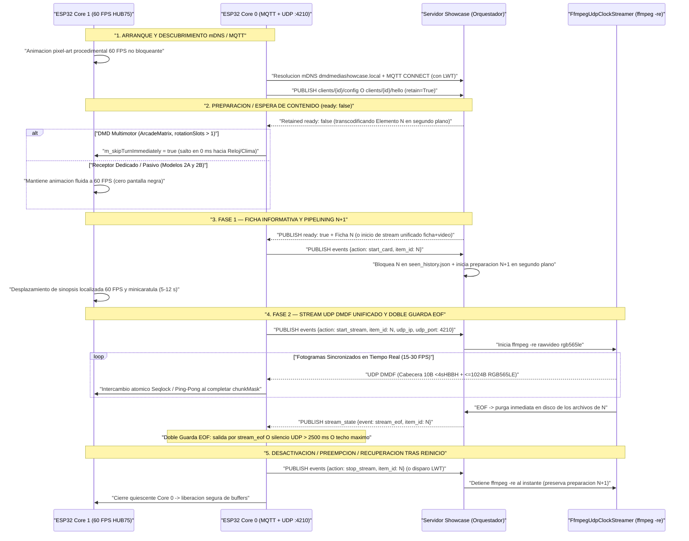
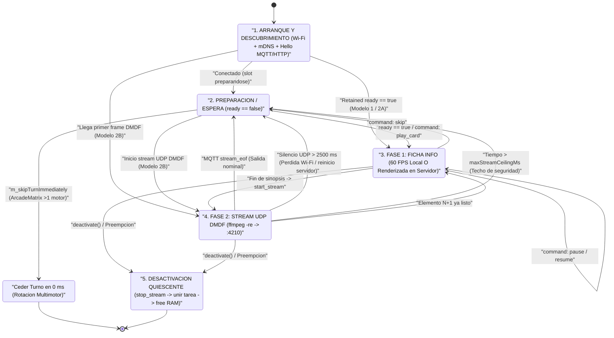

# Guía de Integración ESP32 y Receptor Pasivo — DMD Media Showcase Server

🇬🇧 [English](ESP32_INTEGRATION.md) | 🇫🇷 [Français](ESP32_INTEGRATION_FR.md) | 🇪🇸 Español

[](https://t.me/+DrSdAO8UMUViNmE0)
[](https://ko-fi.com/red1l)

---

**DMD Media Showcase Server** soporta tres topologías complementarias de integración para paneles LED HUB75 basados en **ESP32 y ESP32-S3**. Tanto si ejecuta un firmware multimotor completo con relojes y sensores locales como si flashea un receptor dedicado ultramínimo de ~180 líneas de C++ en un **`ESP32_STD` sin PSRAM**, los tres modelos comparten el mismo **plano de control MQTT `:1883`** y el mismo **plano de datos en tiempo real UDP `DMDF` RGB565LE sincronizado por `ffmpeg -re`**.

---

## 1. Visión General y Comparación de las 3 Topologías de Integración ESP32

### Modelo 1 — DMD Multimotor Controlado por el Cliente (`config_source: "client"`)

Diseñado para firmwares avanzados donde el ESP32 gestiona su propia rotación local de pantallas (`Clock`, `Weather`, `Scoreboard`, `AudioSpectrum`, `RetroGames`, `Movies`, `Series`, `Anime`), su pila de preempción (`DisplayArbiter`) y su propia WebUI integrada.

- **Autoridad de Configuración**: La WebUI del ESP32 consulta dinámicamente `GET /api/v1/{domain}/filters?lang={ui_lang}` para poblar sus listas desplegables localizadas, guarda los filtros localmente y publica su configuración retenida en `dmd_showcase/clients/{dmd_id}/config` (`retain=True`).
- **Comportamiento en Rotación**: Cuando llega el turno de un motor Showcase y el slot MQTT retenido (`dmd_showcase/clients/{dmd_id}/{domain}/ready`) indica `{"ready": false}`, el motor cede su turno en **`0 ms`** (`m_skipTurnImmediately = true`). El panel pasa al instante al siguiente motor local (`Clock`, `Weather`, etc.) sin pantallas negras ni bloqueos.
- **Implementación de Referencia en Producción (`ArcadeMatrix`)**:
  - Cabecera y Contrato de Motor: [`src/engines/MediaShowcaseEngines.h`](https://github.com/red77290/ArcadeMatrix/blob/main/src/engines/MediaShowcaseEngines.h)
  - Worker Core 0, Parser `ArduinoJson` Zero-Copy y Ensamblador UDP `DMDF`: [`src/engines/MediaShowcaseEngines.cpp`](https://github.com/red77290/ArcadeMatrix/blob/main/src/engines/MediaShowcaseEngines.cpp)

---

### Modelo 2A — Receptor Híbrido Gestionado por el Servidor (`config_source: "server"`, `supports_local_card: true`)

Diseñado para paneles Showcase dedicados que desean mantener el desplazamiento de texto local a 60 FPS en el ESP32 **sin** incorporar WebUI local, lógica de catálogos ni esquemas de filtros en NVS.

- **Anuncio de Hardware Ligero**: Al arrancar, el ESP32 publica un mensaje retenido mínimo en `dmd_showcase/clients/{dmd_id}/hello` (`retain=True`) anunciando únicamente su geometría e IP LAN (`width`, `height`, `udp_ip`, `udp_port`, `config_source: "server"`, `supports_local_card: true` e idioma base `lang`).
- **Perfiles Centralizados Persistentes (`./data/dmd_profiles.json`)**: Todas las listas de reproducción (`games`, `movies`, `series`, `anime`), categorías (`systems`, `genres`, `decades`), ajustes de encuadre/colorimetría IA (`video_mode`, `color_boost`) y el idioma del contenido emitido (`lang`) se configuran en el **Panel Web de Showcase** (`http://dmdmediashowcase.local:8890/`) y se guardan en `./data/dmd_profiles.json`.
- **Renderizado Híbrido**: El ESP32 dibuja localmente la **Fase 1 (Ficha Informativa)** a 60 FPS (minicarátula + insignia de color + sinopsis fluida recibida vía `ready` o `dmd_showcase/clients/{dmd_id}/command` `play_card`) y solicita `start_stream` para recibir la **Fase 2 (Panoramas + Vídeo)** por UDP `DMDF`.

---

### Modelo 2B — Receptor Framebuffer 100 % Pasivo Gestionado por el Servidor (`config_source: "server"`, `supports_local_card: false`)

Diseñado para montajes ultramínimos y sin mantenimiento (`ESP32_STD` WROOM-32 **sin PSRAM** o `ESP32-S3`) en **~180 líneas de C++** — **cero WebUI, cero fuentes tipográficas, cero parser JSON y cero librería MQTT necesaria**.

- **Descubrimiento Cero-Configuración**: El ESP32 se anuncia mediante un heartbeat HTTP periódico `POST /api/v1/clients/hello` (o MQTT `dmd_showcase/clients/{dmd_id}/hello`), o incluso **sin ningún tráfico saliente** configurando una IP LAN estática con `always_stream_udp: true` en `./data/dmd_profiles.json`.
- **Stream 100 % Renderizado en el Servidor**: Con `supports_local_card: false`, el servidor Showcase renderiza **incluso la Ficha Informativa de la Fase 1** (minicarátula + insignia coloreada + título + año + puntuación + sinopsis localizada en desplazamiento) directamente dentro del stream RGB565 y envía los fragmentos UDP `DMDF` mediante `ffmpeg -re` hacia el puerto `:4210`.
- **Control en Vivo Instantáneo**: Las acciones `Skip`, `Pause`, `Resume`, `Stop` y `Play Now` (`FrontendSync`) se ejecutan **100 % en el servidor**, conmutando el proceso `FfmpegUdpClockStreamer` hacia `:4210` en `< 50 ms`.

---

### Tabla Comparativa de las 3 Topologías

| Criterio | Modelo 1: Controlado por Cliente (`ArcadeMatrix`) | Modelo 2A: Híbrido Gestionado por Servidor | Modelo 2B: Receptor UDP 100 % Pasivo |
| :--- | :--- | :--- | :--- |
| **Modo de Anuncio** | `config_source: "client"` (`.../config`) | `config_source: "server"`, `supports_local_card: true` (`.../hello`) | `config_source: "server"`, `supports_local_card: false` (`POST /clients/hello` o IP fija) |
| **Almacenamiento de Filtros** | Flash ESP32 (`config.json`) | Servidor (`./data/dmd_profiles.json`) | Servidor (`./data/dmd_profiles.json`) |
| **Complejidad Firmware / UI** | OS Multimotor completo + WebUI | ~350 líneas C++ (MQTT + UDP + Fuente, sin WebUI) | **~120–180 líneas C++** (Cero UI, Cero Fuentes, Cero JSON) |
| **Fase 1 (Ficha Informativa)** | Local 60 FPS en Core 1 del ESP32 | Local 60 FPS en Core 1 del ESP32 | **Renderizada por el servidor en el stream UDP RGB565** |
| **Fase 2 (Panoramas + Vídeo)** | UDP `DMDF` (`:5568+`) + fallback HTTP `DMDS` | UDP `DMDF` (`:4210` / personalizado) | UDP `DMDF` (`:4210`) |
| **Consumo SRAM (`128x32`)** | `8 KB` frame + `2 KB` (`32x32`) / `6 KB` (`48x64`) carátula | `8 KB` frame + `2–6 KB` carátula | **`8 KB` simple (`16 KB` ping-pong) — `0 B` carátula/JSON** |
| **Soporte `ESP32_STD` (Sin PSRAM)** | Cualificado (`128x32`, `64x64`, `128x64`) | Cualificado (`128x32` a `128x64`) | **Cualificado (`128x32` hasta `256x64` buffer simple)** |
| **Carga CPU Core 0** | Baja (MQTT + Base64 + `memcpy` UDP) | Baja (MQTT + Base64 + `memcpy` UDP) | **Mínima (puro `memcpy` UDP no bloqueante)** |
| **Respuesta `Skip` / `Pause` / `Play Now`** | Vía MQTT `.../command` durante su turno | Instantánea (`< 50 ms`) vía MQTT `.../command` | **Instantánea (`< 50 ms`) directo en el pipe `ffmpeg`** |

---

## 2. Coreografía FreeRTOS de Doble Núcleo e Invariantes DMA HUB75

Los paneles LED HUB75 carecen de controlador de memoria propio: el periférico I2S/LCD DMA del ESP32 debe barrer continuamente los planos de bits PWM desde la SRAM interna. Cualquier ráfaga de interrupciones Wi-Fi, reserva dinámica de memoria o bloqueo por mutex en el núcleo de renderizado provoca parpadeos visibles.

Para garantizar **60 FPS constantes** (`16,67 ms` por fotograma), la arquitectura impone un aislamiento estricto entre ambos núcleos:

- **Core 0 (`PRO_CPU` — Worker de Red y Protocolo)**:
  - Ejecuta la pila Wi-Fi / LwIP, la resolución mDNS (`dmdmediashowcase.local` en `224.0.0.251:5353`), el cliente MQTT `:1883` (o el heartbeat HTTP `POST /api/v1/clients/hello`) y la recepción UDP no bloqueante (`:4210` o `:5568+`).
  - Reensambla los datagramas **UDP `DMDF`**: cada paquete incluye una **cabecera Little-Endian `<4sHBBH` de 10 bytes** (`magic = "DMDF"`, `uint16_t frame_seq`, `uint8_t chunk_idx`, `uint8_t total_chunks`, `uint16_t byte_offset`) seguida de **`<= 1024 bytes`** de píxeles RGB565LE (`<= 1034 bytes` totales por paquete UDP — cero fragmentación IP bajo el MTU Wi-Fi estándar de `1500 bytes`).
- **Core 1 (`APP_CPU` — Bucle de Renderizado HUB75 a 60 FPS)**:
  - Controla exclusivamente `IDrawingSurface` / DMA HUB75 a 60 FPS.
  - **Cero Asignación Dinámica**: Jamás invoca `malloc`, `new`, `String` ni `std::vector::push_back` en la ruta crítica.
  - **Cero Mutex / Cero Contención**: Jamás adquiere `std::mutex` ni semáforos compartidos con Core 0.
  - **Aislamiento Estricto de DMA**: Nunca escribe paquetes de red directamente sobre el buffer físico DMA en barrido activo; todo pasa por el framebuffer intermedio `frame565` y `IDrawingSurface`.

### Transferencia Lock-Free entre Núcleos: Seqlock Atómico vs Doble Buffer Ping-Pong

1. **Seqlock Atómico (`std::atomic<uint32_t> seq` + `frame565` Único — Mínima SRAM)**:
   - Empleado en [`MediaShowcaseEngines.cpp`](https://github.com/red77290/ArcadeMatrix/blob/main/src/engines/MediaShowcaseEngines.cpp) para minimizar el consumo de SRAM en `ESP32_STD`.
   - Core 0 incrementa `seq` a un valor **impar** (`fetch_add(1, memory_order_acq_rel)`) al actualizar el estado y lo devuelve a **par** (`fetch_add(1, memory_order_release)`) al finalizar.
   - Core 1 comprueba `(s1 & 1U) == 0` y `s1 == seq.load(acquire)` sin bloquearse jamás.
2. **Doble Buffer Ping-Pong `frame565[2]` (`std::atomic<uint8_t> frontIdx` — Cero Tearing)**:
   - Core 0 copia los fragmentos `DMDF` en `frame565[backIdx]` marcando `(1ULL << chunk_idx)` en `chunkMask`.
   - Al completarse `chunkMask == ((1ULL << total_chunks) - 1ULL)`, Core 0 publica atómicamente `frontIdx.store(backIdx, std::memory_order_release)`. Core 1 lee siempre un fotograma íntegro.

### Presupuestos Exactos de SRAM / PSRAM por Geometría HUB75

Cualquier **`ESP32_STD` sin PSRAM** (WROOM-32 con ~`110–140 KB` de heap interno libre tras iniciar Wi-Fi + HUB75 DMA) ejecuta `dmd_media_showcase` con total fluidez:

| Geometría del Panel | Píxeles (`An x Al`) | Fragmentos `DMDF` / Frame (`<= 1024 B`) | `frame565` Simple (Seqlock) | Ping-Pong `frame565[2]` | `poster565` Ficha Local (Modelo 1 / 2A) | RAM Total Modelo 2B (Estado `ESP32_STD` Sin PSRAM) |
| :--- | :--- | :--- | :--- | :--- | :--- | :--- |
| **`128x32`** *(DMD WPC)* | `4.096 px` | `8 fragmentos` | **`8.192 B`** (`8 KB`) | `16.384 B` (`16 KB`) | `2.048 B` (`32x32`) | **`9,2 KB` (Simple) / `17,4 KB` (Doble)** — Fluido en `ESP32_STD` |
| **`64x64`** *(Cuadrado)* | `4.096 px` | `8 fragmentos` | **`8.192 B`** (`8 KB`) | `16.384 B` (`16 KB`) | `2.048 B` (`32x32`) | **`9,2 KB` (Simple) / `17,4 KB` (Doble)** — Fluido en `ESP32_STD` |
| **`128x64` / `64x128` TATE** | `8.192 px` | `16 fragmentos` | **`16.384 B`** (`16 KB`) | `32.768 B` (`32 KB`) | `6.144 B` (`48x64`) / `3.200 B` (`40x40`) | **`17,4 KB` (Simple) / `33,8 KB` (Doble)** — Cabe en SRAM interna `ESP32_STD` |
| **`256x64`** *(Super-DMD)* | `16.384 px` | `32 fragmentos` | **`32.768 B`** (`32 KB`) | `65.536 B` (`64 KB`) | `6.144 B` (`48x64`) | **`33,8 KB` (Simple)** en `ESP32_STD`; `64 KB` Doble recomendado en `ESP32-S3` PSRAM |

---

## 3. Secuenciación Completa de Tareas, Estados de Espera y Recuperación por Watchdog

### Diagrama de Secuencia de Extremo a Extremo



### Máquina de Estados Determinista en el ESP32



### Detalle de Cada Estado y Recuperación ante Fallos

1. **`ARRANQUE Y DESCUBRIMIENTO mDNS / MQTT`**:
   - Core 1 muestra de inmediato una animación pixel-art procedimental a 60 FPS mientras Core 0 conecta al Wi-Fi, resuelve `dmdmediashowcase.local` (`224.0.0.251:5353`) y abre sesión MQTT `:1883` con **Last Will and Testament (`LWT`)** `{"online": false}` en `dmd_showcase/clients/{dmd_id}/status`.
2. **`PREPARACIÓN / ESPERA DE CONTENIDO` (`ready: false`)**:
   - **Receptores Dedicados / Pasivos (Modelos 2A y 2B)**: Mantienen su animación fluida a 60 FPS sin pantalla negra mientras el servidor descarga y transcodifica el primer título.
   - **DMDs Multimotores (`ArcadeMatrix` — Modelo 1)**: Cuando hay más de un motor en rotación (`m_rotationSlotCount > 1`) y el servidor informa `{"ready": false}`, `MediaShowcaseBase` activa `m_skipTurnImmediately = true` (`isFinished() == true` en **`0 ms`**), saltando de inmediato al reloj o al clima sin congelar jamás el panel.
3. **`FASE 1 — FICHA INFORMATIVA Y PIPELINING N+1`**:
   - Al enviar `start_card`, el servidor registra el elemento `N` en `./data/seen_history.json` (salvo cuando `mark_seen: false` proviene de `FrontendSync`), actualiza `ready` a `{"ready": false}` y lanza **de inmediato la preparación en segundo plano del slot `N+1`** mientras el espectador lee la sinopsis en desplazamiento (`5–12 s`).
4. **`FASE 2 — STREAM UDP DMDF UNIFICADO Y DOBLE GUARDA EOF`**:
   - `start_stream` inicia `FfmpegUdpClockStreamer` (`ffmpeg -re`) enviando fragmentos UDP `DMDF` hacia `{udp_ip}:{udp_port}`.
   - **Por qué es Obligatoria la Doble Guarda EOF**: Depender únicamente del evento MQTT `stream_eof` congelaría la imagen si un paquete Wi-Fi se pierde o si el contenedor del servidor se reinicia a mitad de reproducción. El ESP32 **DEBE** combinar siempre:
     1. **Evento MQTT `stream_eof` (o `command: skip/stop`)**: Cierre limpio en `0 ms` al terminar `ffmpeg -re`.
     2. **Watchdog Local de Inactividad UDP de `2.500 ms` (`millis() - lastUdpPacketMs > 2500`)**: Recuperación automática en `2,5 s` ante pérdida de paquetes Wi-Fi o caída del servidor.
     3. **Techo de Duración Máxima (`millis() - streamStartMs > maxStreamCeilingMs`)**: Límite absoluto de seguridad. *(Además, en `ArcadeMatrix` Modelo 1, si no llega ningún paquete UDP en `850 ms` tras `start_stream` por bloqueo NAT en Docker Desktop, Core 0 conmuta automáticamente al stream HTTP TCP `DMDS`).*
5. **`DESACTIVACIÓN Y RECUPERACIÓN TRAS REINICIO EN MITAD DEL STREAM`**:
   - **Desactivación Quiescente**: Antes de liberar `m_frame565`, el motor marca `m_wantActive = false`, publica `{"action": "stop_stream", "item_id": "..."}`, espera a que la tarea de Core 0 termine limpiamente sin realizar ninguna reserva dinámica de memoria (`stopWorkerTaskBounded()`) y finalmente libera los buffers.
   - **Reinicio Abrupto del ESP32**: El broker dispara el `LWT` (`{"online": false}`), deteniendo al instante cualquier proceso `ffmpeg -re` activo en el servidor sin cancelar la preparación en curso de `N+1`.

---

## 4. Esqueletos de Referencia en C++ / FreeRTOS

### A. Modelo 2B — Receptor UDP `DMDF` 100 % Pasivo Completo en ~120 Líneas (`ESP32_STD` / `ESP32-S3`)

Este sketch completo no necesita **librería JSON, ni cliente MQTT, ni fuentes tipográficas, ni PSRAM**. Core 0 envía un heartbeat `POST /api/v1/clients/hello` cada `15 s` y ensambla los paquetes UDP `:4210` `DMDF` en un doble buffer RGB565; Core 1 refresca el panel HUB75 a 60 FPS y vuelve automáticamente a la animación de espera si `millis() - lastUdpPacketMs > 2500`:

```cpp
#include <Arduino.h>
#include <WiFi.h>
#include <WiFiUdp.h>
#include <HTTPClient.h>
#include <ESPmDNS.h>
#include <atomic>

static constexpr uint16_t PANEL_W = 128;
static constexpr uint16_t PANEL_H = 32;
static constexpr size_t FRAME_PIXELS = PANEL_W * PANEL_H;
static constexpr size_t FRAME_BYTES  = FRAME_PIXELS * sizeof(uint16_t); // 8,192 B
static constexpr uint16_t UDP_PORT   = 4210;
static constexpr uint32_t UDP_WATCHDOG_MS = 2500;

static const char* WIFI_SSID    = "YOUR_WIFI_SSID";
static const char* WIFI_PASS    = "YOUR_WIFI_PASSWORD";
static const char* DMD_ID       = "esp32_passive_128x32";
static const char* SHOWCASE_URL = "http://dmdmediashowcase.local:8890/api/v1/clients/hello";

// Ping-pong RGB565 framebuffers in internal SRAM (2 x 8,192 B = 16 KB -> fits ESP32_STD without PSRAM)
static uint16_t s_frame565[2][FRAME_PIXELS];
static std::atomic<uint8_t>  s_frontIdx{0};
static std::atomic<uint32_t> s_lastUdpPacketMs{0};
static std::atomic<bool>     s_streamActive{false};

// Replace with your HUB75 driver's off-screen canvas pixel call (e.g. IDrawingSurface / MatrixPanel_I2S_DMA)
extern void hub75DrawPixel565(int16_t x, int16_t y, uint16_t rgb565);
extern void hub75PresentFrame();

static void netWorkerTask(void*) {
    WiFi.mode(WIFI_STA);
    WiFi.setSleep(false); // Critical: disable Wi-Fi modem sleep for jitter-free UDP DMDF reception
    WiFi.begin(WIFI_SSID, WIFI_PASS);
    while (WiFi.status() != WL_CONNECTED) { vTaskDelay(pdMS_TO_TICKS(250)); }
    MDNS.begin(DMD_ID);

    WiFiUDP udp;
    udp.begin(UDP_PORT);

    uint8_t  pkt[1040];
    uint8_t  backIdx = 1;
    uint16_t curSeq  = 0xFFFF;
    uint64_t chunkMask = 0;
    uint32_t lastHelloMs = 0;

    for (;;) {
        uint32_t now = millis();
        // Periodic lightweight HTTP Hello heartbeat every 15 s (registers IP + geometry in dmd_profiles.json)
        if (WiFi.status() == WL_CONNECTED && (lastHelloMs == 0 || (now - lastHelloMs) >= 15000U)) {
            lastHelloMs = now;
            HTTPClient http;
            http.setTimeout(1500);
            if (http.begin(SHOWCASE_URL)) {
                http.addHeader("Content-Type", "application/json");
                char body[224];
                IPAddress ip = WiFi.localIP();
                snprintf(body, sizeof(body),
                    "{\"dmd_id\":\"%s\",\"config_source\":\"server\",\"supports_local_card\":false,"
                    "\"width\":%u,\"height\":%u,\"udp_ip\":\"%u.%u.%u.%u\",\"udp_port\":%u,\"lang\":\"es\"}",
                    DMD_ID, PANEL_W, PANEL_H, ip[0], ip[1], ip[2], ip[3], UDP_PORT);
                http.POST(reinterpret_cast<uint8_t*>(body), strlen(body));
                http.end();
            }
        }

        // Drain all queued DMDF UDP slices (<4sHBBH 10-byte Little-Endian header + <= 1024 B RGB565LE)
        int pktSize = udp.parsePacket();
        if (pktSize > 10 && pktSize <= static_cast<int>(sizeof(pkt))) {
            int len = udp.read(pkt, sizeof(pkt));
            if (len > 10 && memcmp(pkt, "DMDF", 4) == 0) {
                uint16_t seq         = static_cast<uint16_t>(pkt[4] | (pkt[5] << 8));
                uint8_t  chunkIdx    = pkt[6];
                uint8_t  totalChunks = pkt[7] > 0 ? pkt[7] : 1;
                uint16_t byteOff     = static_cast<uint16_t>(pkt[8] | (pkt[9] << 8));
                size_t   payloadLen  = static_cast<size_t>(len - 10);

                if (seq != curSeq) {
                    curSeq = seq;
                    chunkMask = 0;
                }
                if (chunkIdx < totalChunks && totalChunks <= 64 && (byteOff + payloadLen) <= FRAME_BYTES) {
                    memcpy(reinterpret_cast<uint8_t*>(s_frame565[backIdx]) + byteOff, pkt + 10, payloadLen);
                    chunkMask |= (1ULL << chunkIdx);
                    uint64_t fullMask = (totalChunks == 64) ? ~0ULL : ((1ULL << totalChunks) - 1ULL);
                    if (chunkMask == fullMask) {
                        chunkMask = 0;
                        uint8_t prevFront = s_frontIdx.load(std::memory_order_relaxed);
                        s_frontIdx.store(backIdx, std::memory_order_release);
                        backIdx = prevFront; // Swap ping-pong target for next frame
                        s_streamActive.store(true, std::memory_order_release);
                    }
                    s_lastUdpPacketMs.store(millis(), std::memory_order_release);
                }
            }
        } else {
            // Local 2,500 ms UDP inactivity watchdog: never freeze on dropped Wi-Fi or server restart
            uint32_t lastPkt = s_lastUdpPacketMs.load(std::memory_order_acquire);
            if (s_streamActive.load(std::memory_order_relaxed) && (millis() - lastPkt) > UDP_WATCHDOG_MS) {
                s_streamActive.store(false, std::memory_order_release);
            }
            vTaskDelay(pdMS_TO_TICKS(1));
        }
    }
}

void setup() {
    // Initialize HUB75 panel on Core 1 before spawning Core 0 network worker
    xTaskCreatePinnedToCore(netWorkerTask, "DmdUdpNet", 6144, nullptr, 1, nullptr, 0);
}

void loop() {
    // Runs on Core 1 (APP_CPU): strictly zero heap allocation and zero mutex
    uint32_t now = millis();
    if (s_streamActive.load(std::memory_order_acquire)) {
        const uint16_t* fb = s_frame565[s_frontIdx.load(std::memory_order_acquire)];
        for (uint16_t y = 0; y < PANEL_H; ++y) {
            const uint16_t* row = fb + (y * PANEL_W);
            for (uint16_t x = 0; x < PANEL_W; ++x) {
                hub75DrawPixel565(x, y, row[x]);
            }
        }
    } else {
        // Non-blocking 60 FPS procedural pixel-art waiting animation during boot / warming
        uint32_t t = now >> 4;
        for (uint16_t y = 0; y < PANEL_H; ++y) {
            for (uint16_t x = 0; x < PANEL_W; ++x) {
                uint8_t v = static_cast<uint8_t>((x * 5 + y * 9 + t) & 0x3F);
                uint16_t c = static_cast<uint16_t>(((v >> 2) << 11) | ((v >> 1) << 5) | (v >> 1));
                hub75DrawPixel565(x, y, c);
            }
        }
    }
    hub75PresentFrame();
    vTaskDelay(pdMS_TO_TICKS(16)); // ~60 FPS cadence
}
```

---

### B. Modelo 2A — Fragmentos MQTT para Receptor Híbrido (`supports_local_card: true`)

En el Modelo 2A, el ESP32 publica `dmd_showcase/clients/{dmd_id}/hello` (`retain=True`) y se suscribe a `dmd_showcase/clients/{dmd_id}/command` y `stream_state`:

```cpp
// 1. Retained Hardware Announcement on MQTT connect (with LWT on dmd_showcase/clients/{id}/status)
void publishHybridHello(PubSubClient& mqtt, const char* dmdId, const char* localIp) {
    char topic[96], payload[256];
    snprintf(topic, sizeof(topic), "dmd_showcase/clients/%s/hello", dmdId);
    snprintf(payload, sizeof(payload),
        "{\"dmd_id\":\"%s\",\"config_source\":\"server\",\"supports_local_card\":true,"
        "\"width\":128,\"height\":32,\"udp_ip\":\"%s\",\"udp_port\":4210,\"lang\":\"es\"}",
        dmdId, localIp);
    mqtt.publish(topic, reinterpret_cast<const uint8_t*>(payload), strlen(payload), /*retained=*/true);

    char cmdTopic[96], stateTopic[96], readyWildcard[96];
    snprintf(cmdTopic, sizeof(cmdTopic), "dmd_showcase/clients/%s/command", dmdId);
    snprintf(stateTopic, sizeof(stateTopic), "dmd_showcase/clients/%s/stream_state", dmdId);
    snprintf(readyWildcard, sizeof(readyWildcard), "dmd_showcase/clients/%s/+/ready", dmdId);
    mqtt.subscribe(cmdTopic);
    mqtt.subscribe(stateTopic);
    mqtt.subscribe(readyWildcard);
}

// 2. Handling Server-to-DMD Live Commands & Dual EOF Guard on Core 0
void onMqttMessage(const char* topic, char* jsonPayload) {
    // Parse with stack/static buffer; never allocate on Core 1
    if (strstr(topic, "/command") != nullptr) {
        // action: "play_card" | "skip" | "pause" | "resume" | "stop"
        if (strstr(jsonPayload, "\"skip\"") || strstr(jsonPayload, "\"stop\"")) {
            g_abortCurrentItem.store(true, std::memory_order_release);
        } else if (strstr(jsonPayload, "\"pause\"")) {
            g_paused.store(true, std::memory_order_release);
        } else if (strstr(jsonPayload, "\"resume\"")) {
            g_paused.store(false, std::memory_order_release);
            g_lastUdpPacketMs.store(millis(), std::memory_order_release); // Reset watchdog on resume
        } else if (strstr(jsonPayload, "\"play_card\"")) {
            // Immediate play_now preemption pushed by WebUI or FrontendSync
            parseCardIntoSeqlock(jsonPayload);
            g_preemptWithNewCard.store(true, std::memory_order_release);
        }
    } else if (strstr(topic, "/stream_state") != nullptr && strstr(jsonPayload, "\"stream_eof\"")) {
        g_mqttStreamEof.store(true, std::memory_order_release);
    }
}
```

---

## 5. Referencia API REST y MQTT: Idioma (`lang`), Búsqueda Filtrada, Cola Bajo Demanda y `FrontendSync`

Todos los perfiles DMD gestionados en el servidor, controles en vivo, búsquedas multilingües e integraciones con frontends arcade (`FrontendSync`) se exponen mediante la API REST FastAPI (`:8890`) y se sincronizan por MQTT (`:1883`).

### 5.1 Búsqueda de Catálogo Filtrada y Localizada (`GET /api/v1/{domain}/search`)

Consulta la cadena de scrapers `[Primario, Fallback]` de un dominio (`games`, `movies`, `series`, `anime`) en el idioma de emisión solicitado (`lang`) con filtros opcionales:

```bash
curl -s "http://dmdmediashowcase.local:8890/api/v1/games/search?q=street+fighter&lang=es&systems=megadrive&genres=fighting&limit=8" | jq .
```

| Parámetro | Tipo | Descripción |
| :--- | :--- | :--- |
| `q` | `string` | Texto de búsqueda del título (ej. `streets of rage`, `akira`, `blade runner`). |
| `lang` | `string` | Idioma objetivo para título, sinopsis y carátulas regionales (`fr`, `en`, `es`, `de`, `it`, `ja`). |
| `systems` | `string` | IDs canónicos de sistemas separados por comas (`megadrive`, `snes`, `neogeo`, `mame`, ...). |
| `genres` | `string` | IDs canónicos de géneros separados por comas (`fighting`, `shmup`, `platform`, `scifi`, ...). |
| `decades` | `string` | Filtro de décadas separado por comas (`1980s`, `1990s`, `2000s`, ...). |
| `limit` | `int` | Número máximo de candidatos devueltos (`1..25`, por defecto `8`). |

---

### 5.2 Clientes DMD Conectados y Perfiles Persistentes (`./data/dmd_profiles.json`)

- **`GET /api/v1/clients`** — Lista todos los paneles DMD descubiertos y configurados (`client` y `server`), su estado en línea, `config_source`, `supports_local_card`, geometría, `udp_ip:udp_port`, título activo y cola bajo demanda.
- **`POST /api/v1/clients/hello`** — Endpoint HTTP de anuncio / heartbeat (`ClientHelloPayload`) para receptores pasivos Modelo 2B sin MQTT.
- **`GET /api/v1/clients/{dmd_id}/profile`** y **`DELETE /api/v1/clients/{dmd_id}/profile`** — Consulta o elimina un perfil DMD guardado.
- **`PUT /api/v1/clients/{dmd_id}/profile`** — Guarda el perfil gestionado en el servidor y su `playlist` de rotación dentro de `./data/dmd_profiles.json`, recargando al instante su preparación `N+1`:

```bash
curl -X PUT "http://dmdmediashowcase.local:8890/api/v1/clients/esp32_passive_128x32/profile" \
  -H "Content-Type: application/json" \
  -d '{
    "display_name": "Topper Bartop 128x32",
    "config_source": "server",
    "supports_local_card": false,
    "always_stream_udp": true,
    "udp_ip": "192.168.1.60",
    "udp_port": 4210,
    "width": 128,
    "height": 32,
    "lang": "es",
    "inter_item_gap_s": 1.0,
    "playlist": [
      {
        "enabled": true,
        "domain": "games",
        "count": 2,
        "systems": ["neogeo", "cps2", "megadrive", "snes"],
        "genres": ["fighting", "shmup", "beatemup"],
        "decades": ["1990s"],
        "video_mode": "auto_action",
        "color_boost": "pixel_art",
        "jacket_panorama": true,
        "include_video": true,
        "video_max_duration_s": 10.0,
        "video_fps": 20,
        "text_scroll_speed": "6"
      },
      {
        "enabled": true,
        "domain": "anime",
        "count": 1,
        "video_type": "opening",
        "video_mode": "auto_action",
        "color_boost": "anime"
      }
    ]
  }'
```

---

### 5.3 Cola Prioritaria Bajo Demanda (`GET / POST / DELETE /api/v1/clients/{dmd_id}/queue`)

Consulta (`GET`), envía (`POST`) o elimina (`DELETE /api/v1/clients/{dmd_id}/queue/{queue_id}`) un título específico en la cola prioritaria de un DMD — ya sea mediante el `candidate_id` devuelto por `/search` o mediante `{domain, query, systems, lang}`:

- **`mode: "enqueue_next"`** *(Por defecto)*: Transcodifica el elemento con prioridad alta (`HIGH_ON_DEMAND`) y lo reproduce justo al terminar el elemento actual.
- **`mode: "play_now"`**: Interrumpe de inmediato la emisión en curso (`stop`/`play_card` por MQTT + corte del stream UDP `ffmpeg -re`) y lanza el título solicitado en cuanto termina su transcodificación.
- **`mark_seen: true | false`**: Controla si la reproducción se registra en `./data/seen_history.json`.

```bash
# Encolar por candidate_id obtenido en /api/v1/{domain}/search
curl -X POST "http://dmdmediashowcase.local:8890/api/v1/clients/esp32_passive_128x32/queue" \
  -H "Content-Type: application/json" \
  -d '{
    "domain": "movies",
    "candidate_id": "tmdb:movie:78",
    "lang": "es",
    "mode": "enqueue_next",
    "mark_seen": true
  }'
```

---

### 5.4 Control de Reproducción en Vivo (`POST /api/v1/clients/{dmd_id}/control`)

Controla cualquier DMD activo en tiempo real desde la WebUI de Showcase, Home Assistant o scripts externos (enrutado hacia MQTT `dmd_showcase/clients/{dmd_id}/command` y directamente sobre `FfmpegUdpClockStreamer` para receptores pasivos):

```bash
# Acciones soportadas: "skip" | "pause" | "resume" | "stop"
curl -X POST "http://dmdmediashowcase.local:8890/api/v1/clients/esp32_passive_128x32/control" \
  -H "Content-Type: application/json" \
  -d '{"action": "skip"}'
```

---

### 5.5 Integración `FrontendSync` (Batocera / RetroBat / LaunchBox / Playnite)

En máquinas recreativas o HTPC con **Batocera**, **RetroBat**, **LaunchBox / BigBox** o **Playnite**, **`FrontendSync`** convierte su DMD HUB75 en una marquesina/topper reactivo sincronizado con el juego explorado o iniciado por el jugador, regresando automáticamente a la rotación Showcase sin repetición cuando la máquina queda en reposo:

1. **Al Seleccionar o Iniciar un Juego (`mode: "play_now"`, `mark_seen: false`)**:
   - `FrontendSync` invoca `POST /api/v1/clients/{dmd_id}/queue` con `mode: "play_now"` y **`mark_seen: false`**.
   - **Por qué `mark_seen: false` es clave**: Jugar 20 veces a su clásico favorito de Neo-Geo o Mega Drive **jamás contamina `./data/seen_history.json`**, preservando intacto el descubrimiento Consume-Once durante el modo attract.
2. **Al Salir del Juego (`action: "skip"`)**:
   - Al volver al menú o al modo reposo, `FrontendSync` envía `{"action": "skip"}` a `/api/v1/clients/{dmd_id}/control` para retomar al instante el siguiente elemento `N+1` precalentado.

```bash
# Ejemplo: Script EmulationStation en Batocera (/userdata/system/configs/emulationstation/scripts/game-start/dmd_sync.sh)
#!/bin/sh
SYSTEM="$1"    # ej. "megadrive", "neogeo", "mame"
ROM_PATH="$2"
GAME_NAME="$3" # ej. "Streets of Rage 2"

curl -fsS -m 2 -X POST "http://dmdmediashowcase.local:8890/api/v1/clients/esp32_passive_128x32/queue" \
  -H "Content-Type: application/json" \
  -d "{
    \"domain\": \"games\",
    \"query\": \"${GAME_NAME}\",
    \"systems\": [\"${SYSTEM}\"],
    \"lang\": \"es\",
    \"mode\": \"play_now\",
    \"mark_seen\": false
  }" >/dev/null 2>&1 &
```
