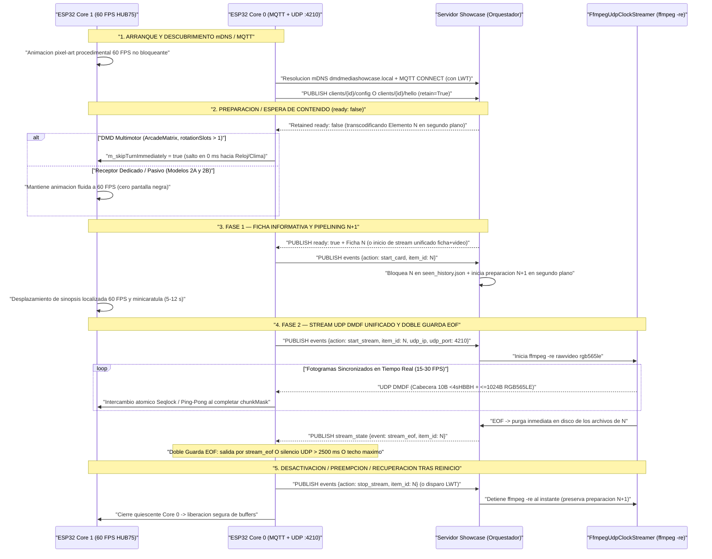
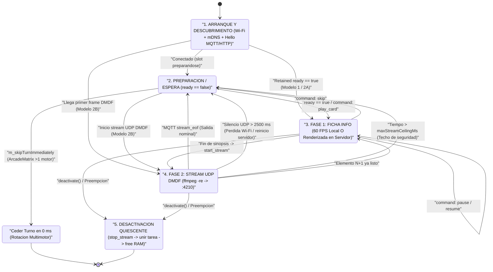

# Guía de Integración ESP32 y Receptor Pasivo — DMD Media Showcase Server

🇬🇧 [English](ESP32_INTEGRATION.md) | 🇫🇷 [Français](ESP32_INTEGRATION_FR.md) | 🇪🇸 Español

[](https://t.me/+DrSdAO8UMUViNmE0)
[](https://ko-fi.com/red1l)

---

**DMD Media Showcase Server** soporta tres topologías complementarias de integración para paneles LED HUB75 basados en **ESP32 y ESP32-S3**. Tanto si ejecuta un firmware multimotor completo con relojes y sensores locales como si flashea un receptor dedicado ultramínimo de ~180 líneas de C++ en un **`ESP32_STD` sin PSRAM**, los tres modelos comparten el mismo **plano de control MQTT `:1883`** y el mismo **plano de datos en tiempo real UDP `DMDF` RGB565LE sincronizado por `ffmpeg -re`**.

---

## 1. Visión General y Comparación de las 3 Topologías de Integración ESP32

### Modelo 1 — DMD Multimotor Controlado por el Cliente (`config_source: "client"`)

Diseñado para firmwares avanzados donde el ESP32 gestiona su propia rotación local de pantallas (`Clock`, `Weather`, `Scoreboard`, `AudioSpectrum`, `RetroGames`, `Movies`, `Series`, `Anime`), su pila de preempción (`DisplayArbiter`) y su propia WebUI integrada.

- **Autoridad de Configuración**: La WebUI del ESP32 consulta dinámicamente `GET /api/v1/{domain}/filters?lang={ui_lang}` para poblar sus listas desplegables localizadas, guarda los filtros localmente y publica su configuración retenida en `dmd_showcase/clients/{dmd_id}/config` (`retain=True`).
- **Comportamiento en Rotación**: Cuando llega el turno de un motor Showcase y el slot MQTT retenido (`dmd_showcase/clients/{dmd_id}/{domain}/ready`) indica `{"ready": false}`, el motor cede su turno en **`0 ms`** (`m_skipTurnImmediately = true`). El panel pasa al instante al siguiente motor local (`Clock`, `Weather`, etc.) sin pantallas negras ni bloqueos.
- **Implementación de Referencia en Producción (`ArcadeMatrix`)**:
  - Cabecera y Contrato de Motor: [`src/engines/MediaShowcaseEngines.h`](https://github.com/red77290/ArcadeMatrix/blob/main/src/engines/MediaShowcaseEngines.h)
  - Worker Core 0, Parser `ArduinoJson` Zero-Copy y Ensamblador UDP `DMDF`: [`src/engines/MediaShowcaseEngines.cpp`](https://github.com/red77290/ArcadeMatrix/blob/main/src/engines/MediaShowcaseEngines.cpp)

---

### Modelo 2A — Receptor Híbrido Gestionado por el Servidor (`config_source: "server"`, `supports_local_card: true`)

Diseñado para paneles Showcase dedicados que desean mantener el desplazamiento de texto local a 60 FPS en el ESP32 **sin** incorporar WebUI local, lógica de catálogos ni esquemas de filtros en NVS.

- **Anuncio de Hardware Ligero**: Al arrancar, el ESP32 publica un mensaje retenido mínimo en `dmd_showcase/clients/{dmd_id}/hello` (`retain=True`) anunciando únicamente su geometría e IP LAN (`width`, `height`, `udp_ip`, `udp_port`, `config_source: "server"`, `supports_local_card: true` e idioma base `lang`).
- **Perfiles Centralizados Persistentes (`./data/dmd_profiles.json`)**: Todas las listas de reproducción (`games`, `movies`, `series`, `anime`), categorías (`systems`, `genres`, `decades`), ajustes de encuadre/colorimetría IA (`video_mode`, `color_boost`) y el idioma del contenido emitido (`lang`) se configuran en el **Panel Web de Showcase** (`http://dmdmediashowcase.local:8890/`) y se guardan en `./data/dmd_profiles.json`.
- **Renderizado Híbrido**: El ESP32 dibuja localmente la **Fase 1 (Ficha Informativa)** a 60 FPS (minicarátula + insignia de color + sinopsis fluida recibida vía `ready` o `dmd_showcase/clients/{dmd_id}/command` `play_card`) y solicita `start_stream` para recibir la **Fase 2 (Panoramas + Vídeo)** por UDP `DMDF`.

---

### Modelo 2B — Receptor Framebuffer 100 % Pasivo Gestionado por el Servidor (`config_source: "server"`, `supports_local_card: false`)

Diseñado para montajes ultramínimos y sin mantenimiento (`ESP32_STD` WROOM-32 **sin PSRAM** o `ESP32-S3`) en **~180 líneas de C++** — **cero WebUI, cero fuentes tipográficas, cero parser JSON y cero librería MQTT necesaria**.

- **Descubrimiento Cero-Configuración**: El ESP32 se anuncia mediante un heartbeat HTTP periódico `POST /api/v1/clients/hello` (o MQTT `dmd_showcase/clients/{dmd_id}/hello`), o incluso **sin ningún tráfico saliente** configurando una IP LAN estática con `always_stream_udp: true` en `./data/dmd_profiles.json`.
- **Stream 100 % Renderizado en el Servidor**: Con `supports_local_card: false`, el servidor Showcase renderiza **incluso la Ficha Informativa de la Fase 1** (minicarátula + insignia coloreada + título + año + puntuación + sinopsis localizada en desplazamiento) directamente dentro del stream RGB565 y envía los fragmentos UDP `DMDF` mediante `ffmpeg -re` hacia el puerto `:4210`.
- **Control en Vivo Instantáneo**: Las acciones `Skip`, `Pause`, `Resume`, `Stop` y `Play Now` (`FrontendSync`) se ejecutan **100 % en el servidor**, conmutando el proceso `FfmpegUdpClockStreamer` hacia `:4210` en `< 50 ms`.

---

### Tabla Comparativa de las 3 Topologías

| Criterio | Modelo 1: Controlado por Cliente (`ArcadeMatrix`) | Modelo 2A: Híbrido Gestionado por Servidor | Modelo 2B: Receptor UDP 100 % Pasivo |
| :--- | :--- | :--- | :--- |
| **Modo de Anuncio** | `config_source: "client"` (`.../config`) | `config_source: "server"`, `supports_local_card: true` (`.../hello`) | `config_source: "server"`, `supports_local_card: false` (`POST /clients/hello` o IP fija) |
| **Almacenamiento de Filtros** | Flash ESP32 (`config.json`) | Servidor (`./data/dmd_profiles.json`) | Servidor (`./data/dmd_profiles.json`) |
| **Complejidad Firmware / UI** | OS Multimotor completo + WebUI | ~350 líneas C++ (MQTT + UDP + Fuente, sin WebUI) | **~120–180 líneas C++** (Cero UI, Cero Fuentes, Cero JSON) |
| **Fase 1 (Ficha Informativa)** | Local 60 FPS en Core 1 del ESP32 | Local 60 FPS en Core 1 del ESP32 | **Renderizada por el servidor en el stream UDP RGB565** |
| **Fase 2 (Panoramas + Vídeo)** | UDP `DMDF` (`:5568+`) + fallback HTTP `DMDS` | UDP `DMDF` (`:4210` / personalizado) | UDP `DMDF` (`:4210`) |
| **Consumo SRAM (`128x32`)** | `8 KB` frame + `2 KB` (`32x32`) / `6 KB` (`48x64`) carátula | `8 KB` frame + `2–6 KB` carátula | **`8 KB` simple (`16 KB` ping-pong) — `0 B` carátula/JSON** |
| **Soporte `ESP32_STD` (Sin PSRAM)** | Cualificado (`128x32`, `64x64`, `128x64`) | Cualificado (`128x32` a `128x64`) | **Cualificado (`128x32` hasta `256x64` buffer simple)** |
| **Carga CPU Core 0** | Baja (MQTT + Base64 + `memcpy` UDP) | Baja (MQTT + Base64 + `memcpy` UDP) | **Mínima (puro `memcpy` UDP no bloqueante)** |
| **Respuesta `Skip` / `Pause` / `Play Now`** | Vía MQTT `.../command` durante su turno | Instantánea (`< 50 ms`) vía MQTT `.../command` | **Instantánea (`< 50 ms`) directo en el pipe `ffmpeg`** |

---

## 2. Coreografía FreeRTOS de Doble Núcleo e Invariantes DMA HUB75

Los paneles LED HUB75 carecen de controlador de memoria propio: el periférico I2S/LCD DMA del ESP32 debe barrer continuamente los planos de bits PWM desde la SRAM interna. Cualquier ráfaga de interrupciones Wi-Fi, reserva dinámica de memoria o bloqueo por mutex en el núcleo de renderizado provoca parpadeos visibles.

Para garantizar **60 FPS constantes** (`16,67 ms` por fotograma), la arquitectura impone un aislamiento estricto entre ambos núcleos:

- **Core 0 (`PRO_CPU` — Worker de Red y Protocolo)**:
  - Ejecuta la pila Wi-Fi / LwIP, la resolución mDNS (`dmdmediashowcase.local` en `224.0.0.251:5353`), el cliente MQTT `:1883` (o el heartbeat HTTP `POST /api/v1/clients/hello`) y la recepción UDP no bloqueante (`:4210` o `:5568+`).
  - Reensambla los datagramas **UDP `DMDF`**: cada paquete incluye una **cabecera Little-Endian `<4sHBBH` de 10 bytes** (`magic = "DMDF"`, `uint16_t frame_seq`, `uint8_t chunk_idx`, `uint8_t total_chunks`, `uint16_t byte_offset`) seguida de **`<= 1024 bytes`** de píxeles RGB565LE (`<= 1034 bytes` totales por paquete UDP — cero fragmentación IP bajo el MTU Wi-Fi estándar de `1500 bytes`).
- **Core 1 (`APP_CPU` — Bucle de Renderizado HUB75 a 60 FPS)**:
  - Controla exclusivamente `IDrawingSurface` / DMA HUB75 a 60 FPS.
  - **Cero Asignación Dinámica**: Jamás invoca `malloc`, `new`, `String` ni `std::vector::push_back` en la ruta crítica.
  - **Cero Mutex / Cero Contención**: Jamás adquiere `std::mutex` ni semáforos compartidos con Core 0.
  - **Aislamiento Estricto de DMA**: Nunca escribe paquetes de red directamente sobre el buffer físico DMA en barrido activo; todo pasa por el framebuffer intermedio `frame565` y `IDrawingSurface`.

### Transferencia Lock-Free entre Núcleos: Seqlock Atómico vs Doble Buffer Ping-Pong

1. **Seqlock Atómico (`std::atomic<uint32_t> seq` + `frame565` Único — Mínima SRAM)**:
   - Empleado en [`MediaShowcaseEngines.cpp`](https://github.com/red77290/ArcadeMatrix/blob/main/src/engines/MediaShowcaseEngines.cpp) para minimizar el consumo de SRAM en `ESP32_STD`.
   - Core 0 incrementa `seq` a un valor **impar** (`fetch_add(1, memory_order_acq_rel)`) al actualizar el estado y lo devuelve a **par** (`fetch_add(1, memory_order_release)`) al finalizar.
   - Core 1 comprueba `(s1 & 1U) == 0` y `s1 == seq.load(acquire)` sin bloquearse jamás.
2. **Doble Buffer Ping-Pong `frame565[2]` (`std::atomic<uint8_t> frontIdx` — Cero Tearing)**:
   - Core 0 copia los fragmentos `DMDF` en `frame565[backIdx]` marcando `(1ULL << chunk_idx)` en `chunkMask`.
   - Al completarse `chunkMask == ((1ULL << total_chunks) - 1ULL)`, Core 0 publica atómicamente `frontIdx.store(backIdx, std::memory_order_release)`. Core 1 lee siempre un fotograma íntegro.

### Presupuestos Exactos de SRAM / PSRAM por Geometría HUB75

Cualquier **`ESP32_STD` sin PSRAM** (WROOM-32 con ~`110–140 KB` de heap interno libre tras iniciar Wi-Fi + HUB75 DMA) ejecuta `dmd_media_showcase` con total fluidez:

| Geometría del Panel | Píxeles (`An x Al`) | Fragmentos `DMDF` / Frame (`<= 1024 B`) | `frame565` Simple (Seqlock) | Ping-Pong `frame565[2]` | `poster565` Ficha Local (Modelo 1 / 2A) | RAM Total Modelo 2B (Estado `ESP32_STD` Sin PSRAM) |
| :--- | :--- | :--- | :--- | :--- | :--- | :--- |
| **`128x32`** *(DMD WPC)* | `4.096 px` | `8 fragmentos` | **`8.192 B`** (`8 KB`) | `16.384 B` (`16 KB`) | `2.048 B` (`32x32`) | **`9,2 KB` (Simple) / `17,4 KB` (Doble)** — Fluido en `ESP32_STD` |
| **`64x64`** *(Cuadrado)* | `4.096 px` | `8 fragmentos` | **`8.192 B`** (`8 KB`) | `16.384 B` (`16 KB`) | `2.048 B` (`32x32`) | **`9,2 KB` (Simple) / `17,4 KB` (Doble)** — Fluido en `ESP32_STD` |
| **`128x64` / `64x128` TATE** | `8.192 px` | `16 fragmentos` | **`16.384 B`** (`16 KB`) | `32.768 B` (`32 KB`) | `6.144 B` (`48x64`) / `3.200 B` (`40x40`) | **`17,4 KB` (Simple) / `33,8 KB` (Doble)** — Cabe en SRAM interna `ESP32_STD` |
| **`256x64`** *(Super-DMD)* | `16.384 px` | `32 fragmentos` | **`32.768 B`** (`32 KB`) | `65.536 B` (`64 KB`) | `6.144 B` (`48x64`) | **`33,8 KB` (Simple)** en `ESP32_STD`; `64 KB` Doble recomendado en `ESP32-S3` PSRAM |

### Pipeline de Visualización HUB75 Recomendado: `Single DMA Buffer + Offscreen RGB565 Canvas` (`canvas_single`)

En todos los firmwares ESP32 HUB75 (incluido [`ArcadeMatrix`](https://github.com/red77290/ArcadeMatrix)), el pipeline **`Single DMA Buffer + Offscreen RGB565 Canvas` (`canvas_single`)** sobre [`mrfaptastic/ESP32-HUB75-MatrixPanel-I2S-DMA`](https://github.com/mrfaptastic/ESP32-HUB75-MatrixPanel-I2S-DMA) es **la arquitectura de referencia recomendada**:

1. **Ahorro del 50 % en SRAM Interna Compatible con DMA (`mxconfig.double_buff = false`)**:
   - En `ESP32_STD` (sin PSRAM), los descriptores DMA I2S y los planos de bits BCM deben residir en DRAM interna contigua (`MALLOC_CAP_DMA`), exactamente el mismo recurso demandado por la pila Wi-Fi + LwIP + UDP.
   - Desactivar el doble buffer DMA por hardware (`mxconfig.double_buff = false`) reduce a la mitad la memoria de planos de bits (`~24 KB` frente a `~48 KB` a 6 bits en `128x32`), mientras que el lienzo lineal RGB565 fuera de pantalla (`GFXcanvas16`) solo requiere `2 bytes/píxel` (`8 KB` en `128x32`, `16 KB` en `128x64`, y puede residir en PSRAM en `ESP32-S3`).
2. **Cero Parpadeo Negro al Limpiar (Sobrescritura de Planos de Bits en Sitio)**:
   - Dibujar directamente sobre un único buffer DMA (`direct_single`) invocando `clearScreen()` apaga los planos de bits en pleno barrido activo, produciendo un parpadeo negro visible.
   - Con un **Lienzo RGB565 Fuera de Pantalla**, todo borrado, trazado `Adafruit_GFX` (texto, HUD, puntuación), animación de espera y actualización de fotogramas UDP ocurre exclusivamente en RAM fuera de pantalla. `blitCanvas565()` sobrescribe después cada palabra de plano de bits HUB75 **en sitio** (`(dmaRow[ax] & ~0x003F) | rgb12`) en **`~300 µs`** (`128x32`) sin pasar jamás por un borrado previo en negro.
3. **Activación por Bandera `Dirty` (`s_completedUdpSeq != s_lastPresentedUdpSeq`)**:
   - Core 1 opera a `60 Hz` (`16,6 ms`) mientras que el vídeo UDP `DMDF` llega a `15–25 FPS` (`40–66 ms`).
   - Al volcar el lienzo a `frame_buffer[0]` **únicamente cuando un nuevo fotograma ha modificado realmente el lienzo**, Core 1 evita cualquier escritura DMA redundante entre fotogramas de vídeo, eliminando la contención del bus SRAM durante el barrido I2S.
4. **Codificación Burst BCM Multiplexada + Gamma Perceptual CIE 1931 + Ajuste FIFO I2S en ESP32 Clásico**:
   - Codifica simultáneamente la semifila superior `(y)` y la inferior `(y + H/2)` en `R1G1B1R2G2B2` usando tablas **gamma CIE 1931** escaladas a la profundidad de color activa (`6 bits` en `ESP32_STD`, `8 bits` en `ESP32-S3`), aplica el intercambio de palabras de 16 bits del FIFO I2S del ESP32 original (`MATRIX_TX_ADJUST(x)`) y vuelca las líneas de caché de CPU (`Cache_WriteBack_Addr`) cuando `SPIRAM_DMA_BUFFER` está habilitado en `ESP32-S3`.

| Modo de Pipeline | `mxconfig.double_buff` | Lienzo RGB565 Fuera de Pantalla | Margen DRAM DMA (`ESP32_STD`) | Parpadeo / Tearing | Recomendación |
| :--- | :---: | :---: | :--- | :--- | :--- |
| **`canvas_single`** | **`false`** | **Sí (`GFXcanvas16`)** | **Óptimo (-50 % DRAM DMA)** | **Cero parpadeo (burst `~300 µs` en sitio + dirty gating)** | **Recomendado (`ESP32_STD` y `ESP32-S3`)** |
| `canvas_double` | `true` | Sí (`GFXcanvas16`) | Alto consumo RAM (`2x` DMA + Lienzo) | Intercambio sin tearing | Opcional en `ESP32-S3` Octal PSRAM |
| `direct_double` | `true` | No | Alta presión DRAM (`2x` planos) | `drawPixel()` lento en vídeo | Solo sketches GFX heredados |
| `direct_single` | `false` | No | Máxima RAM libre | Parpadeo visible con `clearScreen()` | Solo emergencia de ultra baja RAM |

---

## 3. Secuenciación Completa de Tareas, Estados de Espera y Recuperación por Watchdog

### Diagrama de Secuencia de Extremo a Extremo



### Máquina de Estados Determinista en el ESP32



### Detalle de Cada Estado y Recuperación ante Fallos

1. **`ARRANQUE Y DESCUBRIMIENTO mDNS / MQTT`**:
   - Core 1 muestra de inmediato una animación pixel-art procedimental a 60 FPS mientras Core 0 conecta al Wi-Fi, resuelve `dmdmediashowcase.local` (`224.0.0.251:5353`) y abre sesión MQTT `:1883` con **Last Will and Testament (`LWT`)** `{"online": false}` en `dmd_showcase/clients/{dmd_id}/status`.
2. **`PREPARACIÓN / ESPERA DE CONTENIDO` (`ready: false`)**:
   - **Receptores Dedicados / Pasivos (Modelos 2A y 2B)**: Mantienen su animación fluida a 60 FPS sin pantalla negra mientras el servidor descarga y transcodifica el primer título.
   - **DMDs Multimotores (`ArcadeMatrix` — Modelo 1)**: Cuando hay más de un motor en rotación (`m_rotationSlotCount > 1`) y el servidor informa `{"ready": false}`, `MediaShowcaseBase` activa `m_skipTurnImmediately = true` (`isFinished() == true` en **`0 ms`**), saltando de inmediato al reloj o al clima sin congelar jamás el panel.
3. **`FASE 1 — FICHA INFORMATIVA Y PIPELINING N+1`**:
   - Al enviar `start_card`, el servidor registra el elemento `N` en `./data/seen_history.json` (salvo cuando `mark_seen: false` proviene de `FrontendSync`), actualiza `ready` a `{"ready": false}` y lanza **de inmediato la preparación en segundo plano del slot `N+1`** mientras el espectador lee la sinopsis en desplazamiento (`5–12 s`).
4. **`FASE 2 — STREAM UDP DMDF UNIFICADO Y DOBLE GUARDA EOF`**:
   - `start_stream` inicia `FfmpegUdpClockStreamer` (`ffmpeg -re`) enviando fragmentos UDP `DMDF` hacia `{udp_ip}:{udp_port}`.
   - **Por qué es Obligatoria la Doble Guarda EOF**: Depender únicamente del evento MQTT `stream_eof` congelaría la imagen si un paquete Wi-Fi se pierde o si el contenedor del servidor se reinicia a mitad de reproducción. El ESP32 **DEBE** combinar siempre:
     1. **Evento MQTT `stream_eof` (o `command: skip/stop`)**: Cierre limpio en `0 ms` al terminar `ffmpeg -re`.
     2. **Watchdog Local de Inactividad UDP de `2.500 ms` (`millis() - lastUdpPacketMs > 2500`)**: Recuperación automática en `2,5 s` ante pérdida de paquetes Wi-Fi o caída del servidor.
     3. **Techo de Duración Máxima (`millis() - streamStartMs > maxStreamCeilingMs`)**: Límite absoluto de seguridad. *(Además, en `ArcadeMatrix` Modelo 1, si no llega ningún paquete UDP en `850 ms` tras `start_stream` por bloqueo NAT en Docker Desktop, Core 0 conmuta automáticamente al stream HTTP TCP `DMDS`).*
5. **`DESACTIVACIÓN Y RECUPERACIÓN TRAS REINICIO EN MITAD DEL STREAM`**:
   - **Desactivación Quiescente**: Antes de liberar `m_frame565`, el motor marca `m_wantActive = false`, publica `{"action": "stop_stream", "item_id": "..."}`, espera a que la tarea de Core 0 termine limpiamente sin realizar ninguna reserva dinámica de memoria (`stopWorkerTaskBounded()`) y finalmente libera los buffers.
   - **Reinicio Abrupto del ESP32**: El broker dispara el `LWT` (`{"online": false}`), deteniendo al instante cualquier proceso `ffmpeg -re` activo en el servidor sin cancelar la preparación en curso de `N+1`.

---

## 4. Implementación Monolítica de Referencia (`ESP32-HUB75-MatrixPanel-I2S-DMA` + `Single DMA Buffer + Canvas`)

### A. Modelo 2B — Firmware Monolítico Listo para Usar (`platformio.ini` + `src/main.cpp`)

Este firmware C++ monolítico y autónomo implementa por completo el pipeline **`Single DMA Buffer (`mxconfig.double_buff = false`) + Lienzo Fuera de Pantalla `GFXcanvas16` + Codificador Bitplane Burst CIE 1931 (`blitCanvas565`) + Dirty-Frame Gating`** usando [`mrfaptastic/ESP32-HUB75-MatrixPanel-I2S-DMA`](https://github.com/mrfaptastic/ESP32-HUB75-MatrixPanel-I2S-DMA). Compila directamente tanto en **ESP32 Clásico (`esp32dev`, sin PSRAM)** como en **ESP32-S3 (`esp32-s3-devkitc-1` / Waveshare RGB Matrix con PSRAM)**, y puede grabarse tal cual o integrarse en cualquier firmware HUB75 externo:

#### `platformio.ini`

```ini
[platformio]
default_envs = esp32dev

[env]
platform = espressif32
framework = arduino
monitor_speed = 115200
lib_deps =
    mrfaptastic/ESP32 HUB75 LED MATRIX PANEL DMA Display @ ^3.0.11
    adafruit/Adafruit GFX Library @ ^1.11.9

; Target 1: Standard ESP32 (WROOM-32 / DevKitC without PSRAM)
[env:esp32dev]
board = esp32dev
build_flags =
    -D CORE_DEBUG_LEVEL=1
    -O2

; Target 2: ESP32-S3 with Octal PSRAM (e.g. Waveshare ESP32-S3-RGB-Matrix / N16R8)
[env:esp32s3]
board = esp32-s3-devkitc-1
board_build.arduino.memory_type = qio_opi
build_flags =
    -D BOARD_HAS_PSRAM
    -D SPIRAM_DMA_BUFFER
    -D CORE_DEBUG_LEVEL=1
    -O2
```

#### `src/main.cpp` (Implementación Monolítica Completa)

```cpp
/**
 * @file main.cpp
 * @brief Monolithic ESP32 / ESP32-S3 HUB75 Receiver for DMD Media Showcase (Mode 2B)
 *        using the "Single DMA Buffer + Offscreen RGB565 Canvas" (`canvas_single`) pipeline.
 *
 * Architectural Highlights (Proven in Production on ArcadeMatrix):
 *  1. Single HUB75 DMA Buffer (`mxconfig.double_buff = false`):
 *     Cuts scarce internal DMA-capable SRAM (`MALLOC_CAP_DMA`) usage by 50% compared to
 *     DMA double-buffering, leaving ample contiguous heap for Wi-Fi + LwIP + UDP on
 *     standard ESP32 boards without PSRAM (`ESP32_STD`).
 *  2. Offscreen Linear RGB565 Canvas (`Adafruit_GFX` / `GFXcanvas16`):
 *     All drawing (idle 60 FPS procedural animation, local HUD overlays, or incoming UDP
 *     frames) happens exclusively in offscreen memory (`2 bytes/pixel`). `clearScreen()` is
 *     NEVER called on the live DMA scanout buffer, eliminating black-frame strobe/flicker.
 *  3. In-Place Multiplexed BCM Bitplane Burst Encoder (`blitCanvas565`):
 *     Encodes upper `(y)` and lower `(y + H/2)` HUB75 scan halves simultaneously with
 *     perceptual CIE 1931 gamma LUTs directly into `frame_buffer[0]` (`~300 us` for 128x32),
 *     bypassing thousands of per-pixel virtual `drawPixel()` calls.
 *  4. Dirty-Frame Gating (`s_completedUdpSeq != s_lastPresentedUdpSeq`):
 *     Core 1 only bursts the offscreen canvas into DMA memory when a brand-new frame is
 *     actually ready, preventing redundant bus contention while I2S scans the panel.
 *  5. Strict Dual-Core Isolation:
 *     - Core 0 (`PRO_CPU`): Wi-Fi, mDNS, periodic HTTP `hello`, lock-free UDP `DMDF` assembly.
 *     - Core 1 (`APP_CPU`): Zero-allocation, zero-mutex 60 Hz canvas composition & DMA commit.
 */

#include <Arduino.h>
#include <WiFi.h>
#include <WiFiUdp.h>
#include <HTTPClient.h>
#include <ESPmDNS.h>
#include <esp_heap_caps.h>
#include <Adafruit_GFX.h>
#include <atomic>
#include <cstring>
#include <memory>
#include <vector>

#if defined(SPIRAM_DMA_BUFFER)
#include "rom/cache.h"
#endif

// Expose `MatrixPanel_I2S_DMA` internal `frame_buffer` row-plane pointers to our subclass
// for direct in-place BCM bitplane burst encoding (must come AFTER STL headers).
#define private protected
#include <ESP32-HUB75-MatrixPanel-I2S-DMA.h>
#undef private

// =========================================================================================
// STEP 1: PANEL GEOMETRY, NETWORK CONFIGURATION & HARDWARE PIN PROFILES
// =========================================================================================

static constexpr uint16_t MODULE_W     = 64;   // Single HUB75 panel width (typically 64)
static constexpr uint16_t MODULE_H     = 32;   // Single HUB75 panel height (32 or 64)
static constexpr uint16_t CHAIN_LEN    = 2;    // Number of chained panels (2 x 64x32 = 128x32)
static constexpr uint16_t PANEL_W      = MODULE_W * CHAIN_LEN;
static constexpr uint16_t PANEL_H      = MODULE_H;
static constexpr size_t   FRAME_PIXELS = static_cast<size_t>(PANEL_W) * PANEL_H;
static constexpr size_t   FRAME_BYTES  = FRAME_PIXELS * sizeof(uint16_t); // 8,192 B for 128x32

static constexpr uint16_t UDP_PORT          = 4210;
static constexpr uint32_t HELLO_INTERVAL_MS = 15000U;
static constexpr uint32_t UDP_WATCHDOG_MS   = 2500U;

static const char* WIFI_SSID    = "YOUR_WIFI_SSID";
static const char* WIFI_PASS    = "YOUR_WIFI_PASSWORD";
static const char* DMD_ID       = "esp32_passive_128x32";
static const char* CONTENT_LANG = "es"; // Broadcast language ("fr", "en", "es", "de", "it", "pt", "ja")
static const char* SHOWCASE_HELLO_URL = "http://dmdmediashowcase.local:8890/api/v1/clients/hello";

// Classic ESP32 (Xtensa LX6) I2S TX FIFO transmits 16-bit words swapped within each 32-bit pair.
// ESP32-S3 LCD_CAM transmits 16-bit words in natural sequential order.
#ifndef MATRIX_TX_ADJUST
#if defined(CONFIG_IDF_TARGET_ESP32) && !defined(CONFIG_IDF_TARGET_ESP32S3)
#define MATRIX_TX_ADJUST(x) (((x) & 1U) ? ((x) - 1U) : ((x) + 1U))
#else
#define MATRIX_TX_ADJUST(x) (x)
#endif
#endif

// Default GPIO mapping per target architecture (adjust to match your shield/wiring).
// Note: On ESP32-S3 with Octal PSRAM, NEVER assign GPIO 32..37 to HUB75!
static void populateHub75Pins(HUB75_I2S_CFG::i2s_pins& pins) {
#if defined(CONFIG_IDF_TARGET_ESP32S3)
    // Waveshare ESP32-S3-RGB-Matrix / Generic ESP32-S3 PSRAM-safe pinout
    pins.r1 = 4;  pins.g1 = 5;  pins.b1 = 6;
    pins.r2 = 7;  pins.g2 = 15; pins.b2 = 16;
    pins.a  = 18; pins.b  = 8;  pins.c  = 3;
    pins.d  = 42; pins.e  = (PANEL_H >= 64) ? 9 : -1;
    pins.lat = 40; pins.oe = 2; pins.clk = 41;
#else
    // Standard ESP32 (WROOM-32 / DevKitC) HUB75 pinout
    pins.r1 = 25; pins.g1 = 26; pins.b1 = 27;
    pins.r2 = 14; pins.g2 = 12; pins.b2 = 13;
    pins.a  = 33; pins.b  = 32; pins.c  = 22;
    pins.d  = 17; pins.e  = (PANEL_H >= 64) ? 21 : -1;
    pins.lat = 4; pins.oe = 15; pins.clk = 16;
#endif
}

// =========================================================================================
// STEP 2: SINGLE-DMA-BUFFER PANEL SUBCLASS WITH IN-PLACE CIE 1931 BITPLANE BURST ENCODER
// =========================================================================================

// Preserves HUB75 control bits (LAT/OE/address in bits 6..15) while clearing R1G1B1R2G2B2 (bits 0..5).
static constexpr uint16_t HUB75_RGB12_CLEAR_MASK = 0b1111111111000000U;

// Perceptual CIE 1931 lightness curve (8-bit, gamma ~2.2) for silky dark gradients on LEDs.
static const uint8_t kCie1931Lut8[256] = {
      0,   0,   0,   0,   0,   0,   0,   0,   0,   0,   1,   1,   1,   1,   1,   1,
      1,   1,   2,   2,   2,   2,   2,   2,   3,   3,   3,   3,   4,   4,   4,   4,
      5,   5,   5,   5,   6,   6,   6,   7,   7,   7,   8,   8,   8,   9,   9,  10,
     10,  10,  11,  11,  12,  12,  13,  13,  14,  14,  15,  15,  16,  16,  17,  18,
     18,  19,  19,  20,  21,  21,  22,  23,  23,  24,  25,  25,  26,  27,  28,  28,
     29,  30,  31,  32,  32,  33,  34,  35,  36,  37,  38,  38,  39,  40,  41,  42,
     43,  44,  45,  46,  47,  48,  49,  51,  52,  53,  54,  55,  56,  57,  58,  60,
     61,  62,  63,  65,  66,  67,  68,  70,  71,  72,  74,  75,  77,  78,  79,  81,
     82,  84,  85,  87,  88,  90,  91,  93,  94,  96,  98,  99, 101, 103, 104, 106,
    108, 110, 111, 113, 115, 117, 119, 120, 122, 124, 126, 128, 130, 132, 134, 136,
    138, 140, 142, 144, 146, 148, 150, 153, 155, 157, 159, 162, 164, 166, 168, 171,
    173, 175, 178, 180, 183, 185, 188, 190, 193, 195, 198, 201, 203, 206, 208, 211,
    214, 216, 219, 222, 225, 227, 230, 233, 236, 239, 242, 245, 247, 250, 253, 255,
    255, 255, 255, 255, 255, 255, 255, 255, 255, 255, 255, 255, 255, 255, 255, 255,
    255, 255, 255, 255, 255, 255, 255, 255, 255, 255, 255, 255, 255, 255, 255, 255,
    255, 255, 255, 255, 255, 255, 255, 255, 255, 255, 255, 255, 255, 255, 255, 255
};

class SingleBufferCanvasPanel : public MatrixPanel_I2S_DMA {
public:
    using MatrixPanel_I2S_DMA::MatrixPanel_I2S_DMA;

    // Precompute channel LUTs scaled to the configured BCM bit depth (e.g. 6-bit on ESP32_STD, 8-bit on S3).
    void initGammaLuts(uint8_t depth) {
        if (depth < 2) depth = 2;
        if (depth > 8) depth = 8;
        m_depth = depth;
        const uint8_t  shift  = static_cast<uint8_t>(8U - depth);
        const uint16_t round  = (shift > 0U) ? static_cast<uint16_t>(1U << (shift - 1U)) : 0U;
        const uint16_t maxVal = static_cast<uint16_t>((1U << depth) - 1U);

        for (uint16_t r = 0; r < 32; ++r) {
            uint8_t r8 = static_cast<uint8_t>((r << 3) | (r >> 2));
            uint16_t v = static_cast<uint16_t>((kCie1931Lut8[r8] + round) >> shift);
            m_lutR[r]  = static_cast<uint8_t>((v > maxVal) ? maxVal : v);
        }
        for (uint16_t g = 0; g < 64; ++g) {
            uint8_t g8 = static_cast<uint8_t>((g << 2) | (g >> 4));
            uint16_t v = static_cast<uint16_t>((kCie1931Lut8[g8] + round) >> shift);
            m_lutG[g]  = static_cast<uint8_t>((v > maxVal) ? maxVal : v);
        }
        for (uint16_t b = 0; b < 32; ++b) {
            uint8_t b8 = static_cast<uint8_t>((b << 3) | (b >> 2));
            uint16_t v = static_cast<uint16_t>((kCie1931Lut8[b8] + round) >> shift);
            m_lutB[b]  = static_cast<uint8_t>((v > maxVal) ? maxVal : v);
        }
    }

    // Burst-encode a linear RGB565 offscreen canvas directly into the single active DMA buffer (`frame_buffer[0]`).
    // Because every bitplane word is overwritten in-place without clearing first, there is zero black strobe.
    void blitCanvas565(const uint16_t* canvas, uint16_t canvasW, uint16_t canvasH) {
        if (!canvas || !initialized) return;
        const uint16_t w   = static_cast<uint16_t>(PIXELS_PER_ROW);
        const uint16_t rpf = static_cast<uint16_t>(ROWS_PER_FRAME); // PANEL_H / 2 (1/16 or 1/32 scan)
        if (canvasW != w || canvasH != static_cast<uint16_t>(m_cfg.mx_height)) return;

        auto& dmaFb = frame_buffer[0]; // Single DMA buffer (`double_buff == false`)
        if (dmaFb.rowBits.size() < rpf) return;

        for (uint16_t y = 0; y < rpf; ++y) {
            const uint16_t* upperRow = canvas + (static_cast<size_t>(y) * w);
            const uint16_t* lowerRow = canvas + (static_cast<size_t>(y + rpf) * w);

            for (uint8_t p = 0; p < m_depth; ++p) {
                uint16_t* dmaRow = dmaFb.rowBits[y]->getDataPtr(p);
                if (!dmaRow) continue;

                for (uint16_t x = 0; x < w; ++x) {
                    const uint16_t c1 = upperRow[x];
                    const uint16_t c2 = lowerRow[x];

                    const uint16_t r1 = (m_lutR[(c1 >> 11) & 0x1FU] >> p) & 1U;
                    const uint16_t g1 = (m_lutG[(c1 >> 5)  & 0x3FU] >> p) & 1U;
                    const uint16_t b1 = (m_lutB[ c1        & 0x1FU] >> p) & 1U;

                    const uint16_t r2 = (m_lutR[(c2 >> 11) & 0x1FU] >> p) & 1U;
                    const uint16_t g2 = (m_lutG[(c2 >> 5)  & 0x3FU] >> p) & 1U;
                    const uint16_t b2 = (m_lutB[ c2        & 0x1FU] >> p) & 1U;

                    const uint16_t rgb12 = static_cast<uint16_t>(
                        r1 | (g1 << 1) | (b1 << 2) | (r2 << 3) | (g2 << 4) | (b2 << 5)
                    );
                    const uint16_t ax = MATRIX_TX_ADJUST(x);
                    dmaRow[ax] = static_cast<uint16_t>((dmaRow[ax] & HUB75_RGB12_CLEAR_MASK) | rgb12);
                }

#if defined(SPIRAM_DMA_BUFFER)
                // Flush CPU dcache line to SPIRAM so LCD_CAM DMA observes updated bitplanes immediately.
                Cache_WriteBack_Addr(reinterpret_cast<uint32_t>(dmaRow), static_cast<uint32_t>(w * sizeof(uint16_t)));
#endif
            }
        }
    }

private:
    uint8_t m_depth = 6;
    uint8_t m_lutR[32]{};
    uint8_t m_lutG[64]{};
    uint8_t m_lutB[32]{};
};

// =========================================================================================
// STEP 3: LOCK-FREE DUAL-CORE BUFFERS (UDP STAGING ON CORE 0 -> OFFSCREEN CANVAS ON CORE 1)
// =========================================================================================

static SingleBufferCanvasPanel* g_panel  = nullptr;
static GFXcanvas16*             g_canvas = nullptr; // Core 1 private offscreen canvas (full Adafruit_GFX API)

// Ping-pong RGB565 buffers for tear-free UDP `DMDF` packet reassembly on Core 0.
// Allocated in PSRAM when present, otherwise in internal SRAM (`2 x 8 KB = 16 KB` for 128x32).
static uint16_t*             g_udpSlots[2]        = {nullptr, nullptr};
static std::atomic<uint8_t>  s_frontUdpIdx{0};
static std::atomic<uint32_t> s_completedUdpSeq{0};
static std::atomic<uint32_t> s_lastUdpPacketMs{0};
static std::atomic<bool>     s_streamActive{false};

static uint16_t* allocRgb565Buffer(size_t bytes) {
    uint16_t* buf = nullptr;
    if (psramFound()) {
        buf = static_cast<uint16_t*>(heap_caps_malloc(bytes, MALLOC_CAP_SPIRAM | MALLOC_CAP_8BIT));
    }
    if (!buf) {
        buf = static_cast<uint16_t*>(heap_caps_malloc(bytes, MALLOC_CAP_INTERNAL | MALLOC_CAP_8BIT));
    }
    if (buf) {
        memset(buf, 0, bytes);
    }
    return buf;
}

// =========================================================================================
// STEP 4: CORE 0 NETWORK WORKER (WIFI + HTTP HELLO + LOCK-FREE UDP `DMDF` REASSEMBLER)
// =========================================================================================

static void netWorkerTask(void*) {
    WiFi.mode(WIFI_STA);
    // CRITICAL: Disable Wi-Fi modem power-save sleep so 100 ms DTIM intervals never stall UDP packets!
    WiFi.setSleep(false);
#if defined(CONFIG_IDF_TARGET_ESP32) && !defined(CONFIG_IDF_TARGET_ESP32S3)
    // Cap RF TX bursts on classic ESP32 to prevent transient USB 5V rail voltage dips during HUB75 scanout.
    WiFi.setTxPower(WIFI_POWER_17dBm);
#endif
    WiFi.begin(WIFI_SSID, WIFI_PASS);
    while (WiFi.status() != WL_CONNECTED) {
        vTaskDelay(pdMS_TO_TICKS(250));
    }
    MDNS.begin(DMD_ID);

    WiFiUDP udp;
    udp.begin(UDP_PORT);

    uint8_t  pkt[1040]; // 10-byte `<4sHBBH` header + up to 1024-byte RGB565LE slice (<= 1034 B < Wi-Fi MTU)
    uint8_t  backIdx      = 1;
    uint16_t curFrameSeq  = 0xFFFFU;
    uint64_t chunkMask    = 0ULL;
    uint32_t lastHelloMs  = 0U;

    for (;;) {
        const uint32_t now = millis();

        // 4.1 Periodic non-blocking HTTP Hello announcement (registers IP + geometry in `./data/dmd_profiles.json`).
        // Skip HTTP heartbeat while UDP packets are actively streaming so socket read latency stays < 1 ms.
        const bool activelyReceiving = s_streamActive.load(std::memory_order_relaxed) &&
                                       ((now - s_lastUdpPacketMs.load(std::memory_order_relaxed)) < 1200U);
        if (!activelyReceiving && WiFi.status() == WL_CONNECTED &&
            (lastHelloMs == 0U || (now - lastHelloMs) >= HELLO_INTERVAL_MS)) {
            lastHelloMs = now;
            HTTPClient http;
            http.setTimeout(1200);
            if (http.begin(SHOWCASE_HELLO_URL)) {
                http.addHeader("Content-Type", "application/json");
                char body[256];
                const IPAddress ip = WiFi.localIP();
                snprintf(
                    body, sizeof(body),
                    "{\"dmd_id\":\"%s\",\"config_source\":\"server\",\"supports_local_card\":false,"
                    "\"width\":%u,\"height\":%u,\"udp_ip\":\"%u.%u.%u.%u\",\"udp_port\":%u,\"lang\":\"%s\"}",
                    DMD_ID, PANEL_W, PANEL_H, ip[0], ip[1], ip[2], ip[3], UDP_PORT, CONTENT_LANG
                );
                http.POST(reinterpret_cast<uint8_t*>(body), strlen(body));
                http.end();
            }
        }

        // 4.2 Drain all pending UDP `DMDF` datagrams in a tight burst before yielding.
        int pktSize = udp.parsePacket();
        if (pktSize > 10 && pktSize <= static_cast<int>(sizeof(pkt))) {
            while (pktSize > 10 && pktSize <= static_cast<int>(sizeof(pkt))) {
                const int len = udp.read(pkt, sizeof(pkt));
                if (len > 10 && memcmp(pkt, "DMDF", 4) == 0) {
                    const uint16_t seq         = static_cast<uint16_t>(pkt[4] | (pkt[5] << 8));
                    const uint8_t  chunkIdx    = pkt[6];
                    const uint8_t  totalChunks = (pkt[7] > 0U) ? pkt[7] : 1U;
                    const uint16_t byteOff     = static_cast<uint16_t>(pkt[8] | (pkt[9] << 8));
                    const size_t   payloadLen  = static_cast<size_t>(len - 10);

                    if (seq != curFrameSeq) {
                        curFrameSeq = seq;
                        chunkMask   = 0ULL;
                    }

                    if (chunkIdx < totalChunks && totalChunks <= 64U && (byteOff + payloadLen) <= FRAME_BYTES) {
                        memcpy(reinterpret_cast<uint8_t*>(g_udpSlots[backIdx]) + byteOff, pkt + 10, payloadLen);
                        chunkMask |= (1ULL << chunkIdx);

                        const uint64_t expectedMask = (totalChunks == 64U) ? ~0ULL : ((1ULL << totalChunks) - 1ULL);
                        if (chunkMask == expectedMask) {
                            chunkMask = 0ULL;
                            // Publish completed frame lock-free to Core 1 and swap Core 0 staging slot.
                            const uint8_t prevFront = s_frontUdpIdx.load(std::memory_order_relaxed);
                            s_frontUdpIdx.store(backIdx, std::memory_order_release);
                            backIdx = prevFront;
                            s_completedUdpSeq.fetch_add(1U, std::memory_order_release);
                            s_streamActive.store(true, std::memory_order_release);
                            // Pre-seed next back buffer with the just-completed frame so any single lost
                            // UDP slice in a future frame preserves prior pixels instead of black tearing.
                            memcpy(g_udpSlots[backIdx], g_udpSlots[s_frontUdpIdx.load(std::memory_order_relaxed)], FRAME_BYTES);
                        }
                        s_lastUdpPacketMs.store(millis(), std::memory_order_release);
                    }
                }
                pktSize = udp.parsePacket();
            }
        } else {
            // 4.3 Local 2,500 ms UDP inactivity watchdog: smoothly return to idle animation on EOF or server reboot.
            const uint32_t lastPkt = s_lastUdpPacketMs.load(std::memory_order_acquire);
            if (s_streamActive.load(std::memory_order_relaxed) && (millis() - lastPkt) > UDP_WATCHDOG_MS) {
                s_streamActive.store(false, std::memory_order_release);
            }
            vTaskDelay(pdMS_TO_TICKS(1));
        }
    }
}

// =========================================================================================
// STEP 5: CORE 1 REAL-TIME 60 HZ RENDER LOOP (OFFSCREEN CANVAS -> DIRTY-GATED SINGLE DMA)
// =========================================================================================

// Non-blocking procedural waiting animation rendered strictly into the offscreen `GFXcanvas16`.
static void renderWaitingAnimationToCanvas(GFXcanvas16& canvas, uint32_t nowMs) {
    uint16_t* dst = canvas.getBuffer();
    const uint32_t t = nowMs >> 4;
    for (uint16_t y = 0; y < PANEL_H; ++y) {
        uint16_t* row = dst + (static_cast<size_t>(y) * PANEL_W);
        for (uint16_t x = 0; x < PANEL_W; ++x) {
            const uint8_t  v = static_cast<uint8_t>((x * 5U + y * 9U + t) & 0x3FU);
            const uint16_t r = static_cast<uint16_t>((v >> 2) & 0x1FU);
            const uint16_t g = static_cast<uint16_t>((v >> 1) & 0x3FU);
            const uint16_t b = static_cast<uint16_t>((v >> 1) & 0x1FU);
            row[x] = static_cast<uint16_t>((r << 11) | (g << 5) | b);
        }
    }
}

void setup() {
    Serial.begin(115200);

    // 5.1 Allocate offscreen `GFXcanvas16` + lock-free UDP staging buffers BEFORE Wi-Fi fragments heap.
    g_canvas      = new GFXcanvas16(PANEL_W, PANEL_H);
    g_udpSlots[0] = allocRgb565Buffer(FRAME_BYTES);
    g_udpSlots[1] = allocRgb565Buffer(FRAME_BYTES);
    if (!g_canvas || !g_canvas->getBuffer() || !g_udpSlots[0] || !g_udpSlots[1]) {
        Serial.println("[FATAL] Failed to allocate offscreen RGB565 buffers!");
        for (;;) { delay(1000); }
    }

    // 5.2 Configure HUB75 with SINGLE DMA BUFFER (`mxconfig.double_buff = false`).
    HUB75_I2S_CFG::i2s_pins pins{};
    populateHub75Pins(pins);
    HUB75_I2S_CFG mxconfig(MODULE_W, MODULE_H, CHAIN_LEN, pins);

    // 6-bit BCM depth (64 perceptual CIE levels/channel) fits comfortably in internal DMA SRAM on ESP32_STD;
    // upgrade automatically to 8-bit BCM depth when PSRAM is available (e.g. ESP32-S3).
    const uint8_t colorDepth = psramFound() ? 8U : 6U;
    mxconfig.setPixelColorDepthBits(colorDepth);
    mxconfig.double_buff      = false; // <--- CRITICAL: Single DMA Buffer saves 50% internal DMA DRAM!
    mxconfig.min_refresh_rate = 90;
    mxconfig.latch_blanking   = 4;
    mxconfig.clkphase         = false;
    mxconfig.driver           = HUB75_I2S_CFG::SHIFTREG; // Or FM6126A / ICN2038S depending on your LED panels

    g_panel = new SingleBufferCanvasPanel(mxconfig);
    if (!g_panel->begin()) {
        Serial.println("[FATAL] HUB75 Single-Buffer DMA allocation failed!");
        for (;;) { delay(1000); }
    }
    g_panel->initGammaLuts(colorDepth);
    g_panel->setBrightness8(96); // 0..255 safe cabinet brightness

    // Commit clean black Frame 0 once at boot via the offscreen canvas.
    g_canvas->fillScreen(0x0000);
    g_panel->blitCanvas565(g_canvas->getBuffer(), PANEL_W, PANEL_H);

    // 5.3 Launch network & UDP reassembly worker strictly pinned to Core 0 (`PRO_CPU`).
    xTaskCreatePinnedToCore(netWorkerTask, "ShowcaseUdpNet", 6144, nullptr, 1, nullptr, 0);
}

void loop() {
    // Runs on Core 1 (`APP_CPU`): strictly ZERO heap allocation and ZERO mutex!
    static uint32_t s_lastPresentedUdpSeq = 0U;
    static uint32_t s_lastFrameTickMs     = 0U;

    const uint32_t now = millis();
    if ((now - s_lastFrameTickMs) < 16U) { // Pace Core 1 composition loop at ~60 Hz (16.6 ms)
        vTaskDelay(pdMS_TO_TICKS(1));
        return;
    }
    s_lastFrameTickMs = now;

    bool canvasDirty = false;

    if (s_streamActive.load(std::memory_order_acquire)) {
        const uint32_t latestSeq = s_completedUdpSeq.load(std::memory_order_acquire);
        // Dirty-Frame Gating: ONLY touch the offscreen canvas & Single DMA Buffer when a new UDP frame arrived!
        if (latestSeq != s_lastPresentedUdpSeq) {
            const uint8_t frontIdx = s_frontUdpIdx.load(std::memory_order_acquire);
            memcpy(g_canvas->getBuffer(), g_udpSlots[frontIdx], FRAME_BYTES);

            // Optional hook for custom firmwares: draw local Adafruit_GFX HUD / score / clock overlays here
            // into `g_canvas` (e.g. `g_canvas->setCursor(...); g_canvas->print(...);`) before DMA burst!

            s_lastPresentedUdpSeq = latestSeq;
            canvasDirty = true;
        }
    } else {
        // Boot / Warming / Idle state: compose smooth 60 FPS animation in offscreen canvas.
        renderWaitingAnimationToCanvas(*g_canvas, now);
        canvasDirty = true;
    }

    // Commit offscreen canvas to Single HUB75 DMA Buffer ONLY when dirty (in-place burst, zero black clear).
    if (canvasDirty) {
        g_panel->blitCanvas565(g_canvas->getBuffer(), PANEL_W, PANEL_H);
    }
}
```

---

### B. Modelo 2A — Fragmentos MQTT para Receptor Híbrido (`supports_local_card: true`)

En el Modelo 2A, el ESP32 publica `dmd_showcase/clients/{dmd_id}/hello` (`retain=True`) y se suscribe a `dmd_showcase/clients/{dmd_id}/command` y `stream_state`:

```cpp
// 1. Retained Hardware Announcement on MQTT connect (with LWT on dmd_showcase/clients/{id}/status)
void publishHybridHello(PubSubClient& mqtt, const char* dmdId, const char* localIp) {
    char topic[96], payload[256];
    snprintf(topic, sizeof(topic), "dmd_showcase/clients/%s/hello", dmdId);
    snprintf(payload, sizeof(payload),
        "{\"dmd_id\":\"%s\",\"config_source\":\"server\",\"supports_local_card\":true,"
        "\"width\":128,\"height\":32,\"udp_ip\":\"%s\",\"udp_port\":4210,\"lang\":\"es\"}",
        dmdId, localIp);
    mqtt.publish(topic, reinterpret_cast<const uint8_t*>(payload), strlen(payload), /*retained=*/true);

    char cmdTopic[96], stateTopic[96], readyWildcard[96];
    snprintf(cmdTopic, sizeof(cmdTopic), "dmd_showcase/clients/%s/command", dmdId);
    snprintf(stateTopic, sizeof(stateTopic), "dmd_showcase/clients/%s/stream_state", dmdId);
    snprintf(readyWildcard, sizeof(readyWildcard), "dmd_showcase/clients/%s/+/ready", dmdId);
    mqtt.subscribe(cmdTopic);
    mqtt.subscribe(stateTopic);
    mqtt.subscribe(readyWildcard);
}

// 2. Handling Server-to-DMD Live Commands & Dual EOF Guard on Core 0
void onMqttMessage(const char* topic, char* jsonPayload) {
    // Parse with stack/static buffer; never allocate on Core 1
    if (strstr(topic, "/command") != nullptr) {
        // action: "play_card" | "skip" | "pause" | "resume" | "stop"
        if (strstr(jsonPayload, "\"skip\"") || strstr(jsonPayload, "\"stop\"")) {
            g_abortCurrentItem.store(true, std::memory_order_release);
        } else if (strstr(jsonPayload, "\"pause\"")) {
            g_paused.store(true, std::memory_order_release);
        } else if (strstr(jsonPayload, "\"resume\"")) {
            g_paused.store(false, std::memory_order_release);
            g_lastUdpPacketMs.store(millis(), std::memory_order_release); // Reset watchdog on resume
        } else if (strstr(jsonPayload, "\"play_card\"")) {
            // Immediate play_now preemption pushed by WebUI or FrontendSync
            parseCardIntoSeqlock(jsonPayload);
            g_preemptWithNewCard.store(true, std::memory_order_release);
        }
    } else if (strstr(topic, "/stream_state") != nullptr && strstr(jsonPayload, "\"stream_eof\"")) {
        g_mqttStreamEof.store(true, std::memory_order_release);
    }
}
```

---

## 5. Referencia API REST y MQTT: Idioma (`lang`), Búsqueda Filtrada, Cola Bajo Demanda y `FrontendSync`

Todos los perfiles DMD gestionados en el servidor, controles en vivo, búsquedas multilingües e integraciones con frontends arcade (`FrontendSync`) se exponen mediante la API REST FastAPI (`:8890`) y se sincronizan por MQTT (`:1883`).

### 5.1 Búsqueda de Catálogo Filtrada y Localizada (`GET /api/v1/{domain}/search`)

Consulta la cadena de scrapers `[Primario, Fallback]` de un dominio (`games`, `movies`, `series`, `anime`) en el idioma de emisión solicitado (`lang`) con filtros opcionales:

```bash
curl -s "http://dmdmediashowcase.local:8890/api/v1/games/search?q=street+fighter&lang=es&systems=megadrive&genres=fighting&limit=8" | jq .
```

| Parámetro | Tipo | Descripción |
| :--- | :--- | :--- |
| `q` | `string` | Texto de búsqueda del título (ej. `streets of rage`, `akira`, `blade runner`). |
| `lang` | `string` | Idioma objetivo para título, sinopsis y carátulas regionales (`fr`, `en`, `es`, `de`, `it`, `ja`). |
| `systems` | `string` | IDs canónicos de sistemas separados por comas (`megadrive`, `snes`, `neogeo`, `mame`, ...). |
| `genres` | `string` | IDs canónicos de géneros separados por comas (`fighting`, `shmup`, `platform`, `scifi`, ...). |
| `decades` | `string` | Filtro de décadas separado por comas (`1980s`, `1990s`, `2000s`, ...). |
| `limit` | `int` | Número máximo de candidatos devueltos (`1..25`, por defecto `8`). |

---

### 5.2 Clientes DMD Conectados y Perfiles Persistentes (`./data/dmd_profiles.json`)

- **`GET /api/v1/clients`** — Lista todos los paneles DMD descubiertos y configurados (`client` y `server`), su estado en línea, `config_source`, `supports_local_card`, geometría, `udp_ip:udp_port`, título activo y cola bajo demanda.
- **`POST /api/v1/clients/hello`** — Endpoint HTTP de anuncio / heartbeat (`ClientHelloPayload`) para receptores pasivos Modelo 2B sin MQTT.
- **`GET /api/v1/clients/{dmd_id}/profile`** y **`DELETE /api/v1/clients/{dmd_id}/profile`** — Consulta o elimina un perfil DMD guardado.
- **`PUT /api/v1/clients/{dmd_id}/profile`** — Guarda el perfil gestionado en el servidor y su `playlist` de rotación dentro de `./data/dmd_profiles.json`, recargando al instante su preparación `N+1`:

```bash
curl -X PUT "http://dmdmediashowcase.local:8890/api/v1/clients/esp32_passive_128x32/profile" \
  -H "Content-Type: application/json" \
  -d '{
    "display_name": "Topper Bartop 128x32",
    "config_source": "server",
    "supports_local_card": false,
    "always_stream_udp": true,
    "udp_ip": "192.168.1.60",
    "udp_port": 4210,
    "width": 128,
    "height": 32,
    "lang": "es",
    "inter_item_gap_s": 1.0,
    "playlist": [
      {
        "enabled": true,
        "domain": "games",
        "count": 2,
        "systems": ["neogeo", "cps2", "megadrive", "snes"],
        "genres": ["fighting", "shmup", "beatemup"],
        "decades": ["1990s"],
        "video_mode": "auto_action",
        "color_boost": "pixel_art",
        "jacket_panorama": true,
        "include_video": true,
        "video_max_duration_s": 10.0,
        "video_fps": 20,
        "text_scroll_speed": "6"
      },
      {
        "enabled": true,
        "domain": "anime",
        "count": 1,
        "video_type": "opening",
        "video_mode": "auto_action",
        "color_boost": "anime"
      }
    ]
  }'
```

---

### 5.3 Cola Prioritaria Bajo Demanda (`GET / POST / DELETE /api/v1/clients/{dmd_id}/queue`)

Consulta (`GET`), envía (`POST`) o elimina (`DELETE /api/v1/clients/{dmd_id}/queue/{queue_id}`) un título específico en la cola prioritaria de un DMD — ya sea mediante el `candidate_id` devuelto por `/search` o mediante `{domain, query, systems, lang}`:

- **`mode: "enqueue_next"`** *(Por defecto)*: Transcodifica el elemento con prioridad alta (`HIGH_ON_DEMAND`) y lo reproduce justo al terminar el elemento actual.
- **`mode: "play_now"`**: Interrumpe de inmediato la emisión en curso (`stop`/`play_card` por MQTT + corte del stream UDP `ffmpeg -re`) y lanza el título solicitado en cuanto termina su transcodificación.
- **`mark_seen: true | false`**: Controla si la reproducción se registra en `./data/seen_history.json`.

```bash
# Encolar por candidate_id obtenido en /api/v1/{domain}/search
curl -X POST "http://dmdmediashowcase.local:8890/api/v1/clients/esp32_passive_128x32/queue" \
  -H "Content-Type: application/json" \
  -d '{
    "domain": "movies",
    "candidate_id": "tmdb:movie:78",
    "lang": "es",
    "mode": "enqueue_next",
    "mark_seen": true
  }'
```

---

### 5.4 Control de Reproducción en Vivo (`POST /api/v1/clients/{dmd_id}/control`)

Controla cualquier DMD activo en tiempo real desde la WebUI de Showcase, Home Assistant o scripts externos (enrutado hacia MQTT `dmd_showcase/clients/{dmd_id}/command` y directamente sobre `FfmpegUdpClockStreamer` para receptores pasivos):

```bash
# Acciones soportadas: "skip" | "pause" | "resume" | "stop"
curl -X POST "http://dmdmediashowcase.local:8890/api/v1/clients/esp32_passive_128x32/control" \
  -H "Content-Type: application/json" \
  -d '{"action": "skip"}'
```

---

### 5.5 Integración `FrontendSync` (Batocera / RetroBat / LaunchBox / Playnite)

En máquinas recreativas o HTPC con **Batocera**, **RetroBat**, **LaunchBox / BigBox** o **Playnite**, **`FrontendSync`** convierte su DMD HUB75 en una marquesina/topper reactivo sincronizado con el juego explorado o iniciado por el jugador, regresando automáticamente a la rotación Showcase sin repetición cuando la máquina queda en reposo:

1. **Al Seleccionar o Iniciar un Juego (`mode: "play_now"`, `mark_seen: false`)**:
   - `FrontendSync` invoca `POST /api/v1/clients/{dmd_id}/queue` con `mode: "play_now"` y **`mark_seen: false`**.
   - **Por qué `mark_seen: false` es clave**: Jugar 20 veces a su clásico favorito de Neo-Geo o Mega Drive **jamás contamina `./data/seen_history.json`**, preservando intacto el descubrimiento Consume-Once durante el modo attract.
2. **Al Salir del Juego (`action: "skip"`)**:
   - Al volver al menú o al modo reposo, `FrontendSync` envía `{"action": "skip"}` a `/api/v1/clients/{dmd_id}/control` para retomar al instante el siguiente elemento `N+1` precalentado.

```bash
# Ejemplo: Script EmulationStation en Batocera (/userdata/system/configs/emulationstation/scripts/game-start/dmd_sync.sh)
#!/bin/sh
SYSTEM="$1"    # ej. "megadrive", "neogeo", "mame"
ROM_PATH="$2"
GAME_NAME="$3" # ej. "Streets of Rage 2"

curl -fsS -m 2 -X POST "http://dmdmediashowcase.local:8890/api/v1/clients/esp32_passive_128x32/queue" \
  -H "Content-Type: application/json" \
  -d "{
    \"domain\": \"games\",
    \"query\": \"${GAME_NAME}\",
    \"systems\": [\"${SYSTEM}\"],
    \"lang\": \"es\",
    \"mode\": \"play_now\",
    \"mark_seen\": false
  }" >/dev/null 2>&1 &
```

---

### 5.6 Estudio Card Modo 2B, Simulador LED HUB75 y Promoción 0 ms en Cola

La pestaña **`4. Estudio Card y Sim DMD (2B)`** de la WebUI (`http://dmdmediashowcase.local:8890/`) ofrece un estudio interactivo de diseño y simulación para las Cards del Modo 2B y secuencias completas en formatos horizontales (**YOKO**: `64×32`, `128×32`, `64×64`, `128×64`, `256×64`) y verticales (**TATE**: `32×64`, `32×128`, `64×128`, `64×256`):

- **5 Diseños Pixel-Art (`card_layout`)**: `classic_split`, `poster_right`, `badge_header`, `hero_banner`, `minimal_arcade` (con adaptación automática en TATE).
- **5 Temas Visuales (`card_theme`)**: `tinted`, `pure_black`, `neon_border`, `poster_wash`, `amber_dmd` (monocromo plasma pinball `#FF7300`), junto con `card_font` (`arcade_pixel` 1-bit nítido con soporte CJK automático, o `clean_sans`), `text_scroll_speed` (`1..10`) y `card_hold_s`.
- **Endpoints Binarios `DMDS` de Doble Velocidad**:
  - `POST /api/v1/studio/card-preview`: Vista previa rápida de Card (`< 100 ms`) fuera del semáforo pesado de vídeo.
  - `POST /api/v1/studio/full-preview`: Secuencia completa `Card + Panoramas + 0..5 Capturas + Vídeo` con cabeceras `X-DMD-Preview-Id` y `X-DMD-Chapters`.
- **Perfiles de Estudio por Dominio (`domain_styles`) y Etiquetas Visuales de Rotación**: Cada perfil DMD en `./data/dmd_profiles.json` conserva 4 perfiles de estudio independientes (`domain_styles.games`, `domain_styles.movies`, `domain_styles.series`, `domain_styles.anime`) con su diseño de Card, tema, panoramas, capturas, encuadre (`video_mode`), `color_boost`, `video_max_duration_s` y `video_type`. La tabla de rotación pasiva (Pestaña 1) utiliza selectores visuales multietiqueta (`systems`, `genres`, `decades` desde `/api/v1/{domain}/filters`) con acceso directo **`🎨 Estudio [DOMINIO] →`** a la Pestaña 4.
- **Promoción en 0 ms a la Cola del DMD Activo**: Pasar `preview_id` (`sim_...`) a `POST /api/v1/clients/{dmd_id}/queue` inyecta la simulación ya renderizada en la cola del DMD activo en **`0 ms` sin recodificación** cuando coinciden las dimensiones, o guarda `domain_styles` permanentemente mediante `PUT /api/v1/clients/{dmd_id}/profile`.
