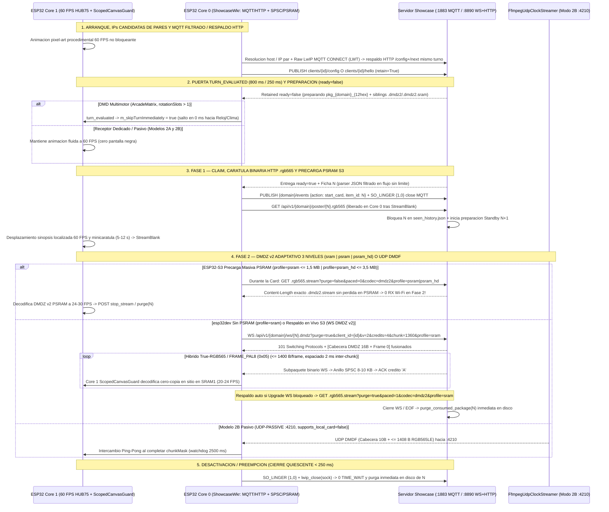
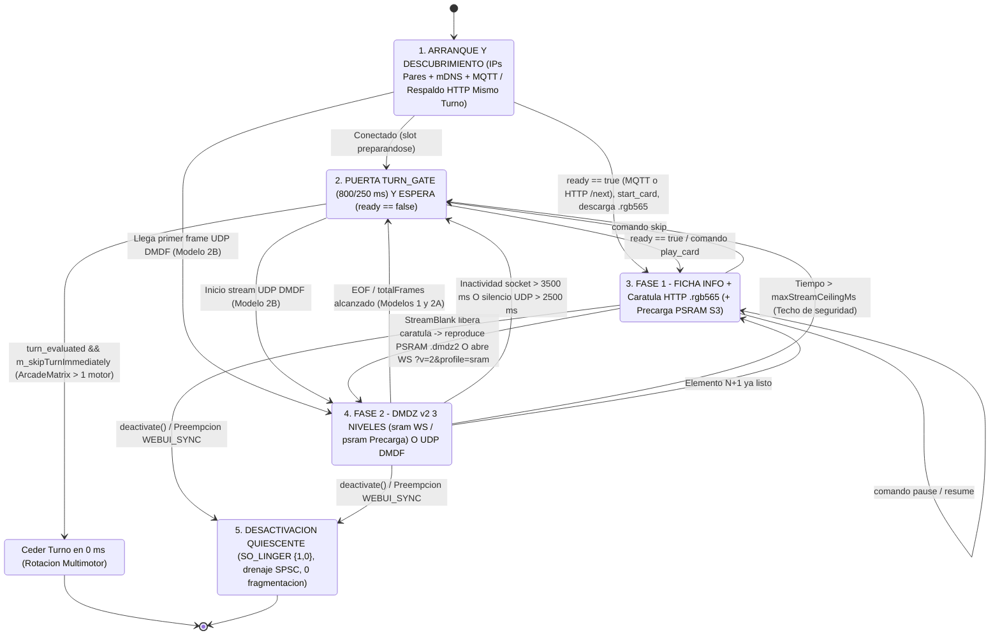

# Guía de Integración ESP32 y Receptor Pasivo — DMD Media Showcase Server

🇬🇧 [English](ESP32_INTEGRATION.md) | 🇫🇷 [Français](ESP32_INTEGRATION_FR.md) | 🇪🇸 Español

[](https://t.me/+DrSdAO8UMUViNmE0)
[](https://ko-fi.com/red1l)

---

**DMD Media Showcase Server** soporta tres topologías complementarias de integración para paneles LED HUB75 basados en **ESP32 y ESP32-S3**. El **Modelo 1** (DMD Multimotor controlado por el cliente, ej. `ArcadeMatrix` ESP32 / ESP32-S3 / `ArcadeMatrix_RPi`) y el **Modelo 2A** (Receptor Híbrido gestionado por el servidor, `supports_local_card: true`) combinan el **plano de control MQTT `:1883`** (`config`/`hello`, `ready` retenido, `start_card` — con recuperación automática en el mismo turno **`MQTT -> HTTP (/config + /next)`** y carátulas binarias HTTP `.rgb565`) con **Streaming Adaptativo `DMDZ` v2 de 3 Niveles (`dmdz2`, `profile=sram | psram | psram_hd`) en `:8890` (`MQTT+TCP` por defecto)**: WebSocket confirmado por créditos `WS /api/v1/{domain}/ws/{item_id}.dmdz?v=2&profile=sram` (`<= 1.400 B/frame` mediante True-RGB565 híbrido + `FRAME_PAL8` `0x05`) para `esp32dev`, precarga masiva HTTP sin marcapasos `.dmdz2.stream` en PSRAM (`?purge=false&paced=0&codec=dmdz2&profile=psram|psram_hd`) para `ESP32-S3`, y respaldo automático HTTP con marcapasos (`?purge=true&paced=1&codec=dmdz2`), mientras que el **Modelo 2B** (`supports_local_card: false`) ofrece un receptor opcional ultramínimo (~180 líneas de C++) **100 % Pasivo UDP `:4210` `DMDF`** (`UDP-PASSIVE`).

> [!IMPORTANT]
> **Por Qué `MQTT + TCP` con `DMDZ` v2 Adaptativo de 3 Niveles (`profile=sram | psram | psram_hd`) y Recuperación Unificada 1:1 en Paridad RPi es la Arquitectura por Defecto y Recomendada para los Modelos 1 y 2A**
> 1. **Cero Pérdidas NAT UDP en VMs de Docker / Rancher Desktop, IPs Candidatas de Pares y Respaldo `MQTT -> HTTP` en el Mismo Turno**: El tráfico entrante TCP `:8890` atraviesa de forma nativa todos los puentes de contenedores y el NAT de la VM anfitriona sin bloqueos de retorno UDP, mientras que `101 Switching Protocols` (`WS /api/v1/{domain}/ws/{item_id}.dmdz`, `ws_per_message_deflate=False`) desactiva cualquier buffering HTTP intermedio de extremo a extremo. Las IPs candidatas de pares de la WebUI resuelven discrepancias NAT en puentes Docker/Rancher Desktop, y si MQTT `:1883` falla o expira, Core 0 recurre de forma transparente a `POST /api/v1/{domain}/config` + `GET /api/v1/{domain}/next` **dentro del mismo turno de rotación**.
> 2. **Protocolo de Recuperación Unificado 1:1 en Paridad RPi, JSON Filtrado en Flujo sin Límite y Carátula Binaria `.rgb565`**: La puerta `turn_evaluated` (`800 ms` activo / `250 ms` tibio) cede el turno de rotación en **`0 ms`** cuando `ready: false` (`0` pantalla negra), analiza cargas MQTT `ready` retenidas mediante un parser JSON filtrado en flujo con **cero límite de tamaño de payload MQTT**, y descarga la minicarátula por HTTP binario `GET /api/v1/{domain}/poster/{item_id}.rgb565` en Core 0 (liberada justo tras `StreamBlank` al entrar en la Fase 2).
> 3. **Auditoría Exacta de Memoria en `esp32dev` (`0 KB` PSRAM — `>= 20 KB` de DRAM Libre para Wi-Fi/LwIP y HUB75 CIE-1931 de 8 Bits Preservado)**: En placas `esp32dev` sin PSRAM (`128x32` con profundidad completa **HUB75 CIE-1931 de 8 bits**), **`36,0 KB` de DRAM interna 8-bit libre + `8,0 KB` de `CanvasBufferedSurface` en `SRAM1` = `44,2 KB` totales**. Decodificar `DMDZ` v2 **cero-copia en sitio en Core 1 mediante `ScopedCanvasGuard`** directamente dentro del lienzo `SRAM1` de `8 KB` existente (`0 B` de segundo búfer `frame565`), junto a la huella compacta de `~1,2 KB` de `MediaShowcaseBase` y el arranque task-first de `ShowcaseWkr`, deja **`~30 KB` disponibles** — alojando un **anillo SPSC sin bloqueo de `8–10 KB`** y preservando **`>= 20 KB` de DRAM interna libre** permanentemente para los búferes RX de `esp_wifi` / `lwIP`.
> 4. **3 Perfiles de Stream Adaptativos (`profile=sram | psram | psram_hd`) y Códec Híbrido `FRAME_PAL8` (`0x05`)**:
>    - **`profile=sram` (`esp32dev` 0 PSRAM)**: `.dmdz2.sram.stream` combina estabilización temporal del ruido mosquito H.264 (`stabilize_rgb565_frames_sram`) con `DMDZ` v2 True-RGB565 híbrido (`<= 1.400 B`) y **`FRAME_PAL8` (`0x05`)** (`1..128` colores RGB565 por escena + desplazamiento 2D opcional + `PAL_INDEX`/`PAL_SKIP`/`PAL_RUN`/`PAL_LONG_SKIP`), garantizando **cada fotograma `<= 1.400 B` (`0` deriva de referencia)** y panoramas limpios 100 % sin pérdida (`8,1x` más compacto que el vídeo crudo ruidoso). Se sirve por `WS ?v=2&credits=4&chunk=1360&profile=sram` con **`[cabecera DMDZ de 16 B + Frame 0]` fusionados** y **espaciado inter-fragmento de `2 ms`** (`20–24 FPS`).
>    - **`profile=psram` (`ESP32-S3 <= 128x64`) y `profile=psram_hd` (`ESP32-S3 256x64+`)**: Precargan el `.dmdz2.stream` True-RGB565 sin pérdida y sin marcapasos (`1,5 MB` en `psram`, `3,5 MB` en `psram_hd`) en PSRAM Octal durante la Fase 1 Card mediante `GET .rgb565.stream?purge=false&paced=0&codec=dmdz2&profile=psram|psram_hd` (**`0` tráfico Wi-Fi durante la reproducción a `24–30 FPS`**), con respaldo WebSocket en vivo (`256 KB` / `768 KB` de anillo SPSC en PSRAM, `credits=12..16, chunk=1400`), mientras `ArcadeMatrix_RPi` conserva la precarga `DMDS` cruda (`0` impacto).
> 5. **Sockets LwIP Puros Cero-`TIME_WAIT` (`SO_LINGER {1, 0}`) e Identificadores `item_id` Compactos sin Colisión (`<= 24` caracteres)**: Tanto la sesión MQTT `:1883` como los sockets `:8890` cierran con `SO_LINGER {1, 0}` (`0` acumulación de PCB `TIME_WAIT` de 120 s), y cada paquete preparado emplea `pkg_<domain>_<12hex>` (`<= 24` caracteres).

---

## 1. Visión General y Comparación de las 3 Topologías de Integración ESP32

### Modelo 1 — DMD Multimotor Controlado por el Cliente (`config_source: "client"`, `MQTT+TCP` por defecto)

Diseñado para firmwares avanzados donde el ESP32 gestiona su propia rotación local de pantallas (`Clock`, `Weather`, `Scoreboard`, `AudioSpectrum`, `RetroGames`, `Movies`, `Series`, `Anime`), su pila de preempción (`DisplayArbiter`) y su propia WebUI integrada.

- **Autoridad de Configuración e IPs Candidatas de Pares**: La WebUI del ESP32 consulta dinámicamente `GET /api/v1/{domain}/filters?lang={ui_lang}` para poblar sus listas desplegables localizadas, guarda los filtros localmente, registra IPs candidatas de pares para entornos NAT Docker/Rancher Desktop y publica su configuración retenida en `dmd_showcase/clients/{dmd_id}/config` (`retain=True`).
- **Recuperación Unificada 1:1 en Paridad RPi y Streaming Adaptativo de 3 Niveles**: Core 0 (`ShowcaseWkr`) evalúa el slot `ready` retenido dentro de una puerta `turn_evaluated` de `800 ms / 250 ms` usando un parser JSON filtrado en flujo sin límite de tamaño (con respaldo automático en el mismo turno a `POST /api/v1/{domain}/config` + `GET /api/v1/{domain}/next` si MQTT `:1883` no responde), reclama el título (`start_card`), cierra MQTT con `SO_LINGER {1, 0}` y descarga `GET /api/v1/{domain}/poster/{item_id}.rgb565` (liberado en Core 0 tras `StreamBlank`). La Fase 2 se adapta automáticamente al nivel de memoria de la placa:
  - **`esp32dev` (`profile=sram`)**: Reproduce `WS /api/v1/{domain}/ws/{item_id}.dmdz?purge=true&client_id={dmd_id}&v=2&credits=4&chunk=1360&profile=sram` hacia un anillo SPSC sin bloqueo de `8–10 KB`, mientras Core 1 decodifica `DMDZ` v2 + `FRAME_PAL8` (`0x05`) cero-copia en sitio dentro de `CanvasBufferedSurface` bajo `ScopedCanvasGuard`.
  - **`ESP32-S3` (`profile=psram` / `profile=psram_hd`)**: Precarga `.dmdz2.stream` sin marcapasos (`<= 1,5 MB` / `<= 3,5 MB`) en PSRAM Octal durante la Fase 1 Card (`?purge=false&paced=0&codec=dmdz2&profile=psram|psram_hd` -> `0` tráfico Wi-Fi durante la reproducción a `24–30 FPS`), con respaldo a WebSocket en vivo (`credits=12..16, chunk=1400`, anillo PSRAM `256 KB` / `768 KB`) para clips extralargos.
- **Comportamiento en Rotación**: Cuando llega el turno de un motor Showcase y `ready` es `false`, el motor cede su turno en **`0 ms`** (`m_skipTurnImmediately = true`). El panel pasa al instante al siguiente motor local (`Clock`, `Weather`, etc.) sin pantallas negras ni bloqueos.
- **Implementación de Referencia en Producción (`ArcadeMatrix` — Diseño Modular de Responsabilidad Única)**:
  - Orquestador de Motores Showcase y Descriptores: [`src/engines/MediaShowcaseEngines.h`](https://github.com/red77290/ArcadeMatrix/blob/main/src/engines/MediaShowcaseEngines.h) / [`src/engines/MediaShowcaseEngines.cpp`](https://github.com/red77290/ArcadeMatrix/blob/main/src/engines/MediaShowcaseEngines.cpp)
  - Fuente Píxel UTF-8 en Core 1, Pixel-Art de Espera y Diseños Adaptativos de Card: [`src/engines/showcase/ShowcaseCardRenderer.h`](https://github.com/red77290/ArcadeMatrix/blob/main/src/engines/showcase/ShowcaseCardRenderer.h) / [`src/engines/showcase/ShowcaseCardRenderer.cpp`](https://github.com/red77290/ArcadeMatrix/blob/main/src/engines/showcase/ShowcaseCardRenderer.cpp)
  - Cliente de Stream Compartido Adaptativo `DMDZ` v2 de 3 Niveles WebSocket + Precarga Masiva PSRAM + Respaldo HTTP con Marcapasos (reutilizado por `MediaShowcaseBase` y `FrontendSyncEngine`): [`src/core/net/DmdzStreamClient.h`](https://github.com/red77290/ArcadeMatrix/blob/main/src/core/net/DmdzStreamClient.h) / [`src/core/net/DmdzStreamClient.cpp`](https://github.com/red77290/ArcadeMatrix/blob/main/src/core/net/DmdzStreamClient.cpp)
  - Socket MQTT 3.1.1 LwIP con Filtrado en Flujo y Cierre `SO_LINGER {1, 0}`: [`src/core/net/RawMqttSocket.h`](https://github.com/red77290/ArcadeMatrix/blob/main/src/core/net/RawMqttSocket.h) / [`src/core/net/RawMqttSocket.cpp`](https://github.com/red77290/ArcadeMatrix/blob/main/src/core/net/RawMqttSocket.cpp)
  - Decodificador en Sitio `DMDZ` v1/v2 + `FRAME_PAL8` (`0x05`) y Demultiplexor Binario RFC 6455: [`src/core/drawing/DmdzStreamDecoder.h`](https://github.com/red77290/ArcadeMatrix/blob/main/src/core/drawing/DmdzStreamDecoder.h) / [`src/core/drawing/DmdzStreamDecoder.cpp`](https://github.com/red77290/ArcadeMatrix/blob/main/src/core/drawing/DmdzStreamDecoder.cpp)

---

### Modelo 2A — Receptor Híbrido Gestionado por el Servidor (`config_source: "server"`, `supports_local_card: true`, `MQTT+TCP` por defecto)

Diseñado para paneles Showcase dedicados que desean mantener el desplazamiento de texto local a 60 FPS en el ESP32 **sin** incorporar WebUI local, lógica de catálogos ni esquemas de filtros en NVS.

- **Anuncio de Hardware Ligero**: Al arrancar, el ESP32 publica un mensaje retenido mínimo en `dmd_showcase/clients/{dmd_id}/hello` (`retain=True`) anunciando únicamente su geometría e IP LAN (`width`, `height`, `config_source: "server"`, `supports_local_card: true` e idioma base `lang`).
- **Perfiles Centralizados Persistentes (`./data/dmd_profiles.json`)**: Todas las listas de reproducción (`games`, `movies`, `series`, `anime`), categorías (`systems`, `genres`, `decades`), ajustes de encuadre/colorimetría IA (`video_mode`, `color_boost`) y el idioma del contenido emitido (`lang`) se configuran en el **Panel Web de Showcase** (`http://dmdmediashowcase.local:8890/`) y se guardan en `./data/dmd_profiles.json`.
- **Renderizado Híbrido**: El ESP32 dibuja localmente la **Fase 1 (Ficha Informativa)** a 60 FPS (minicarátula desde `/api/v1/{domain}/poster/{item_id}.rgb565` + insignia de color + sinopsis fluida recibida vía `ready` o `dmd_showcase/clients/{dmd_id}/command` `play_card`, confirmada con `start_card`) y reproduce la **Fase 2 (Panoramas + Vídeo)** mediante `DMDZ` v2 de 3 niveles (`WS /api/v1/{domain}/ws/{item_id}.dmdz?purge=true&client_id={dmd_id}&v=2&credits=4&chunk=1360&profile=sram` en `esp32dev`, precarga masiva PSRAM `.dmdz2.stream` o `credits=12..16&chunk=1400&profile=psram|psram_hd` en `ESP32-S3`, con respaldo automático HTTP `?purge=true&paced=1&codec=dmdz2` y soporte opcional `mqtt_udp` `start_stream`).

---

### Modelo 2B — Receptor Framebuffer 100 % Pasivo Gestionado por el Servidor (`config_source: "server"`, `supports_local_card: false`, `UDP-PASSIVE`)

Diseñado para montajes ultramínimos y sin mantenimiento (`ESP32_STD` WROOM-32 **sin PSRAM** o `ESP32-S3`) en **~180 líneas de C++** — **cero WebUI, cero fuentes tipográficas, cero parser JSON y cero librería MQTT necesaria**.

- **Descubrimiento Cero-Configuración**: El ESP32 se anuncia mediante un heartbeat HTTP periódico `POST /api/v1/clients/hello` (o MQTT `dmd_showcase/clients/{dmd_id}/hello`), o incluso **sin ningún tráfico saliente** configurando una IP LAN estática con `always_stream_udp: true` en `./data/dmd_profiles.json`.
- **Stream 100 % Renderizado en el Servidor**: Con `supports_local_card: false`, el servidor Showcase renderiza **incluso la Ficha Informativa de la Fase 1** (minicarátula + insignia coloreada + título + año + puntuación + sinopsis localizada en desplazamiento) directamente dentro del stream RGB565 y envía fragmentos UDP `DMDF` (`<= 1408 B` útiles) hacia el puerto `:4210`.
- **Control en Vivo Instantáneo**: Las acciones `Skip`, `Pause`, `Resume`, `Stop` y `Play Now` (`FrontendSync`) se ejecutan **100 % en el servidor**, conmutando el hilo `FfmpegUdpClockStreamer` hacia `:4210` en `< 50 ms`.

---

### Tabla Comparativa de las 3 Topologías

| Criterio | Modelo 1: Controlado por Cliente (`ArcadeMatrix`) | Modelo 2A: Híbrido Gestionado por Servidor | Modelo 2B: Receptor UDP 100 % Pasivo |
| :--- | :--- | :--- | :--- |
| **Anuncio y Transporte** | `config_source: "client"` (`MQTT+TCP` + respaldo HTTP `/config+/next` en el mismo turno) | `config_source: "server"`, `supports_local_card: true` (`MQTT+TCP` por defecto) | `config_source: "server"`, `supports_local_card: false` (`UDP-PASSIVE` `:4210`) |
| **Almacenamiento de Filtros** | Flash ESP32 (`config.json`) | Servidor (`./data/dmd_profiles.json`) | Servidor (`./data/dmd_profiles.json`) |
| **Complejidad Firmware / UI** | OS Multimotor completo + WebUI | ~350 líneas C++ (MQTT puro + WS `DMDZ` v2 por créditos + Fuente) | **~120–180 líneas C++** (Cero UI, Cero Fuentes, Cero JSON) |
| **Fase 1 (Ficha Informativa)** | Local 60 FPS en Core 1 + carátula binaria HTTP `.rgb565` | Local 60 FPS en Core 1 + carátula binaria HTTP `.rgb565` | **Renderizada por el servidor en el stream UDP RGB565** |
| **Fase 2 (Panoramas + Vídeo)** | **`DMDZ` v2 de 3 niveles (`sram` WS `<= 1400 B` PAL8/True565; `psram`/`psram_hd` precarga HTTP + WS) + respaldo HTTP `?paced=1&codec=dmdz2`** | **`DMDZ` v2 de 3 niveles (`sram` / `psram` / `psram_hd`) + respaldo HTTP `?paced=1&codec=dmdz2`** | **UDP Pasivo `DMDF` (`:4210`)** |
| **Consumo RAM (`128x32`)** | **`esp32dev`: Lienzo `SRAM1` Cero-Copia + anillo SPSC `8–10 KB` (`>= 20 KB` DRAM Wi-Fi libre); `S3`: precarga PSRAM `1,5–3,5 MB`** | `2–6 KB` carátula + `8 KB` lienzo / decodificación `DMDZ` v2 | **`8 KB` simple (`16 KB` ping-pong) — `0 B` carátula/JSON** |
| **Soporte `ESP32_STD` (`esp32dev` Sin PSRAM)** | **Cualificado (`128x32` a profundidad HUB75 CIE-1931 de 8 bits, `20–24 FPS`, `64x64`, `128x64`)** | Cualificado (`128x32` a `128x64`) | **Cualificado (`128x32` hasta `256x64` buffer simple)** |
| **Carga CPU Core 0 / Core 1** | Baja (`sram`: RX SPSC Core 0 + decodificación en sitio Core 1; `S3`: `0` RX Wi-Fi durante precarga PSRAM) | Baja (decodificación `DMDZ` v2 por créditos + ACK `'A'`) | **Mínima (puro `memcpy` UDP no bloqueante)** |
| **Respuesta `Skip` / `Pause` / `Play Now`** | Cola prioritaria (`N+1`) o MQTT `.../command` | Vía MQTT `.../command` (`play_card` / `skip`) | **Instantánea (`< 50 ms`) directo en el streamer `DMDF`** |

---

## 2. Coreografía FreeRTOS de Doble Núcleo e Invariantes DMA HUB75

Los paneles LED HUB75 carecen de controlador de memoria propio: el periférico I2S/LCD DMA del ESP32 debe barrer continuamente los planos de bits PWM desde la SRAM interna. Cualquier ráfaga de interrupciones Wi-Fi, reserva dinámica de memoria o bloqueo por mutex en el núcleo de renderizado provoca parpadeos visibles.

Para garantizar **60 FPS constantes** (`16,67 ms` por fotograma), la arquitectura impone un aislamiento estricto entre ambos núcleos:

- **Core 0 (`PRO_CPU` — Worker de Red y Protocolo `ShowcaseWkr`)**:
  - Ejecuta la pila Wi-Fi / LwIP, la resolución mDNS (`dmdmediashowcase.local`) y las IPs candidatas de pares de la WebUI.
  - **Modelos 1 y 2A (`MQTT+TCP` por defecto + Recuperación HTTP en el Mismo Turno)**: Lanza `ShowcaseWkr` task-first, evalúa `ready` retenido mediante un parser JSON MQTT filtrado en flujo sin límite de tamaño (o recurre en el mismo turno a `POST /api/v1/{domain}/config` + `GET /api/v1/{domain}/next`), publica `start_card`, cierra MQTT con `SO_LINGER {1, 0}` y descarga `GET /api/v1/{domain}/poster/{item_id}.rgb565` (liberado en Core 0 justo tras `StreamBlank`). Durante la Fase 1/2:
    - **`profile=sram` (`esp32dev`, 0 PSRAM)**: Actualiza a **`WS /api/v1/{domain}/ws/{item_id}.dmdz?purge=true&client_id={dmd_id}&v=2&credits=4&chunk=1360&profile=sram`**, recibe el mensaje binario fusionado **`[cabecera DMDZ de 16 B + Frame 0]`** y subpaquetes espaciados `2 ms` (`<= 1.400 B/frame`), escribe los fotogramas `DMDZ` v2 comprimidos en un **anillo SPSC sin bloqueo de `8–10 KB`** y devuelve ACKs de crédito `'A'` (`0x41`).
    - **`profile=psram` / `profile=psram_hd` (`ESP32-S3`, PSRAM Octal)**: Precarga el `.dmdz2.stream` completo sin pérdida y sin marcapasos (`<= 1,5 MB` en `psram`, `<= 3,5 MB` en `psram_hd`) en PSRAM **durante la Fase 1 Card** mediante `GET /api/v1/{domain}/stream/{item_id}.rgb565.stream?purge=false&paced=0&codec=dmdz2&profile=psram|psram_hd` (`0` tráfico Wi-Fi durante la reproducción de la Fase 2), o transmite en vivo por `WS ?v=2&credits=12..16&chunk=1400&profile=psram|psram_hd` hacia un anillo SPSC PSRAM de `256 KB` / `768 KB`.
  - **Modelo 2B (`UDP-PASSIVE :4210`)**: Ejecuta el heartbeat HTTP `POST /api/v1/clients/hello` y reensambla datagramas **UDP `DMDF`** no bloqueantes (cabecera `<4sHBBH` de `10 bytes` + fragmento `<= 1408 bytes` RGB565LE = `<= 1418 bytes` por paquete UDP, cero fragmentación IP bajo el MTU Wi-Fi de `1500 bytes`).
- **Core 1 (`APP_CPU` — Bucle de Renderizado HUB75 a 60 FPS)**:
  - Controla exclusivamente `IDrawingSurface` / DMA HUB75 a 60 FPS.
  - **Cero Asignación Dinámica y Cero Mutex**: Jamás invoca `malloc`/`new`/`String` ni adquiere mutex compartidos con Core 0.
  - **`ScopedCanvasGuard` Cero-Copia en Sitio (`esp32dev`) / Reproducción desde PSRAM (`ESP32-S3`)**: En `esp32dev`, Core 1 extrae fotogramas comprimidos `<= 1.400 B` `DMDZ` v2 (`True-RGB565` o `FRAME_PAL8` `0x05`) del anillo SPSC de `8–10 KB` y los decodifica **directamente en sitio dentro del `CanvasBufferedSurface` `SRAM1` de `8 KB` existente** antes de `blitCanvas565()`, eliminando por completo cualquier segunda asignación `frame565` de `8 KB`.

### Transferencia Lock-Free entre Núcleos: Anillo SPSC Cero-Copia + `ScopedCanvasGuard` vs Seqlock vs Ping-Pong

Tres patrones sin mutex conectan de forma segura Core 0 (`WS DMDZ` / `HTTP DMDZ` / `UDP DMDF`) y Core 1 (`60 FPS HUB75`):

1. **`ScopedCanvasGuard` Cero-Copia + Anillo SPSC de Fotogramas Comprimidos (`ArcadeMatrix` en Producción sobre `esp32dev` y Respaldo en Vivo `ESP32-S3`)**:
   - Core 0 demultiplexa los mensajes binarios WebSocket en un anillo SPSC acotado (`8–10 KB` de DRAM interna en `esp32dev` alojando `6–10` fotogramas comprimidos `<= 1.400 B`; `256 KB` / `768 KB` de PSRAM en `ESP32-S3`) y devuelve ACKs `'A'` conforme se libera espacio en el anillo.
   - Core 1 marca el ritmo de presentación monotónicamente (`20–24 FPS` en `sram`, `24–30 FPS` en `psram`/`psram_hd`) y ejecuta `DmdzStreamDecoder` (`v1`/`v2` + `FRAME_PAL8` `0x05`) **en sitio dentro de `CanvasBufferedSurface` (`SRAM1`)** bajo `ScopedCanvasGuard`, ahorrando `8.192 B` de DRAM interna en `esp32dev`.
2. **Sincronización Sin Tearing `frameSeq` Par/Impar + Barrera Dekker `renderBlitSeq` (Referencia Autónoma de Archivo Único en la Sección 4.A)**:
   - Para firmwares personalizados sin `CanvasBufferedSurface`, Core 0 decodifica sobre un único búfer `g_frame565` protegido por `g_frameSeq` `IMPAR`/`PAR` + `g_renderBlitSeq` en Core 1.
3. **Doble Buffer Ping-Pong `frame565[2]` (`std::atomic<uint8_t> frontIdx` — Modelo 2B UDP `DMDF`)**:
   - Core 0 reensambla los fragmentos `DMDF` en `frame565[backIdx]` mediante `chunkMask` de 64 bits y publica atómicamente `frontIdx` solo cuando llegan todos los fragmentos.

### Auditoría Exacta de Memoria en `esp32dev` (`0 KB` PSRAM) y los 3 Perfiles Adaptativos de Stream

En una placa multimotor **`esp32dev` (`128x32`, `0 KB` PSRAM)** ejecutando **profundidad completa HUB75 CIE-1931 de 8 bits** junto a Wi-Fi, AsyncWebServer y `CanvasBufferedSurface`:
- **Reserva Base**: **`36,0 KB` de DRAM interna 8-bit libre + `8,0 KB` de `CanvasBufferedSurface` en `SRAM1` = `44,2 KB` totales**.
- **Huella del Motor Showcase**: `ScopedCanvasGuard` Cero-Copia (`0 KB` de `frame565` adicional) + **`MediaShowcaseBase` compacto de `~1,2 KB`** + pila task-first de **`ShowcaseWkr`** = **`~30 KB` restantes**.
- **Asignación de Streaming**: **Anillo SPSC sin bloqueo de `8–10 KB`** -> **`>= 20 KB` de DRAM interna libre preservados permanentemente para los búferes RX de `esp_wifi` / `lwIP`** (`0` bloqueos `pcb->ooseq`, `0` fragmentación de heap, `0` degradación de los 8 bits HUB75).

| Perfil de Stream | Hardware y Geometría Objetivo | Sibling en Servidor y Códec | Transporte y Control de Flujo | Presupuesto de Búfer Cliente | Cadencia y Fidelidad |
| :--- | :--- | :--- | :--- | :--- | :--- |
| **`profile=sram`** | **`esp32dev` (`0 KB` PSRAM)**, `128x32` / `64x64` (`<= 8.192 px`) | **`.dmdz2.sram.stream`** (`stabilize_rgb565_frames_sram` + True-RGB565 `<= 1.400 B` / `FRAME_PAL8` `0x05` `<= 1.400 B`) | `WS ?v=2&credits=4&chunk=1360&profile=sram` (**cabecera `16 B` + Frame `0` fusionados**, **espaciado `2 ms` inter-fragmento**) | **Lienzo `SRAM1` `8 KB` Cero-Copia + anillo SPSC `8–10 KB` (`>= 20 KB` DRAM Wi-Fi libre)** | **`20–24 FPS`**, **HUB75 CIE-1931 8 bits**, panoramas 100 % sin pérdida, `0` deriva |
| **`profile=psram`** | **`ESP32-S3` (PSRAM Octal)**, `<= 128x64` / `64x128` (`<= 8.192 px`) | **`.dmdz2.stream`** (`DMDZ` v2 True-RGB565 100 % sin pérdida) | **Precarga masiva HTTP sin marcapasos** (`?purge=false&paced=0&codec=dmdz2&profile=psram` durante la Card) + respaldo `WS ?v=2&credits=12&chunk=1400&profile=psram` | **Precarga PSRAM `<= 1,5 MB`** (anillo SPSC PSRAM `256 KB` de respaldo) | **`25–30 FPS`** True-RGB565 (**`0` tráfico Wi-Fi durante la reproducción precargada**) |
| **`profile=psram_hd`** | **`ESP32-S3` (PSRAM Octal)**, `256x64+` (`> 8.192 px` HD) | **`.dmdz2.stream`** (`DMDZ` v2 True-RGB565 100 % sin pérdida) | **Precarga masiva HTTP progresiva** (`?purge=false&paced=0&codec=dmdz2&profile=psram_hd`) + respaldo `WS ?v=2&credits=16&chunk=1400&profile=psram_hd` | **Precarga PSRAM `<= 3,5 MB`** (anillo SPSC PSRAM `768 KB` de respaldo) | **`24–30 FPS` HD** True-RGB565 |
| **Modelo 2B `DMDF`** | `esp32dev` / `ESP32-S3`, `128x32` hasta `256x64` (`<= 64` fragmentos) | `DMDF` `<4sHBBH` en vivo (`<= 1.408 B` por fragmento) | UDP Pasivo `:4210` (`supports_local_card: false`) | Lienzo `8 KB` + ping-pong `16 KB` (`128x32`) | `15–25 FPS` receptor pasivo cero-JSON |

### Pipeline de Visualización HUB75 Recomendado: `Single DMA Buffer + Offscreen RGB565 Canvas` (`canvas_single`)

En todos los firmwares ESP32 HUB75 (incluido [`ArcadeMatrix`](https://github.com/red77290/ArcadeMatrix)), el pipeline **`Single DMA Buffer + Offscreen RGB565 Canvas` (`canvas_single`)** sobre [`mrfaptastic/ESP32-HUB75-MatrixPanel-I2S-DMA`](https://github.com/mrfaptastic/ESP32-HUB75-MatrixPanel-I2S-DMA) es **la arquitectura de referencia recomendada**:

1. **Ahorro del 50 % en SRAM Interna Compatible con DMA (`mxconfig.double_buff = false`)**:
   - En `ESP32_STD` (sin PSRAM), los descriptores DMA I2S y los planos de bits BCM deben residir en DRAM interna contigua (`MALLOC_CAP_DMA`), exactamente el mismo recurso demandado por la pila Wi-Fi + LwIP TCP/UDP.
   - Desactivar el doble buffer DMA por hardware (`mxconfig.double_buff = false`) reduce a la mitad la memoria de planos de bits, mientras que el lienzo lineal RGB565 fuera de pantalla (`CanvasBufferedSurface` en `SRAM1` o `GFXcanvas16`) solo requiere `2 bytes/píxel` (`8 KB` en `128x32`, `16 KB` en `128x64`, y reside en PSRAM en `ESP32-S3`).
2. **Profundidad de Color HUB75 CIE-1931 Completa de 8 Bits en `esp32dev` mediante `ScopedCanvasGuard` Cero-Copia y Preempción `WEBUI_SYNC`**:
   - Los firmwares multimotor (`ArcadeMatrix`) mantienen **la profundidad completa HUB75 BCM de 8 bits** en paneles `128x32` sobre placas `esp32dev` sin PSRAM durante rotaciones indefinidas de Showcase: `PipelineSelectionPolicy` aplica una histéresis de retención de `3,5 KB` una vez asignado el DMA de 8 bits, mientras que `ScopedCanvasGuard` Cero-Copia + anillo SPSC `8–10 KB` + `SO_LINGER {1, 0}` preservan `>= 20 KB` de DRAM interna libre — bajando a `4 bits` **únicamente** en paneles mayores (`128x64` sin PSRAM).
   - Al cargar inicialmente la SPA WebUI integrada (`GET /`), `ArcadeMatrix` activa temporalmente una fuente de visualización prioritaria cero-heap **`WEBUI_SYNC`** ([`WebUiSyncEngine`](https://github.com/red77290/ArcadeMatrix/blob/main/src/engines/WebUiSyncEngine.h)) en `PreemptionStack`. Desalojar el motor activo (`deactivate()`) libera al instante la SRAM interna (anillo `SPSC`, carátula `.rgb565`, pila del worker y búferes TCP) para servir la SPA comprimida sin errores de memoria, reanudando automáticamente la rotación Showcase a 8 bits en cuanto termina la carga.
3. **Cero Parpadeo Negro al Limpiar (Sobrescritura de Planos de Bits en Sitio)**:
   - Dibujar directamente sobre un único buffer DMA (`direct_single`) invocando `clearScreen()` apaga los planos de bits en pleno barrido activo, produciendo un parpadeo negro visible.
   - Con un **Lienzo RGB565 Fuera de Pantalla**, todo borrado, trazado `Adafruit_GFX` (texto, HUD, puntuación), animación de espera y actualización en sitio de fotogramas `DMDZ` v2 / `FRAME_PAL8` (`0x05`) / `DMDF` ocurre exclusivamente en RAM fuera de pantalla. `blitCanvas565()` sobrescribe después cada palabra de plano de bits HUB75 **en sitio** (`(dmaRow[ax] & ~0x003F) | rgb12`) en **`~300 µs`** (`128x32`) sin pasar jamás por un borrado previo en negro.
4. **Activación por Bandera `Dirty` (`frameSeq != lastPresentedSeq`)**:
   - Core 1 opera a `60 Hz` (`16,6 ms`) mientras que el vídeo `DMDZ` v2 (`20–30 FPS`) / `DMDF` (`15–25 FPS`) se actualiza a cadencia de fotograma.
   - Al volcar el lienzo a `frame_buffer[0]` **únicamente cuando un nuevo fotograma ha modificado realmente el lienzo**, Core 1 evita cualquier escritura DMA redundante entre fotogramas de vídeo, eliminando la contención del bus SRAM durante el barrido I2S.
5. **Codificación Burst BCM Multiplexada + Gamma Perceptual CIE 1931 + Ajuste FIFO I2S en ESP32 Clásico**:
   - Codifica simultáneamente la semifila superior `(y)` y la inferior `(y + H/2)` en `R1G1B1R2G2B2` usando tablas **gamma CIE 1931** escaladas a la profundidad activa, aplica el intercambio de palabras de 16 bits del FIFO I2S del ESP32 original (`MATRIX_TX_ADJUST(x)`) y vuelca las líneas de caché de CPU (`Cache_WriteBack_Addr`) cuando `SPIRAM_DMA_BUFFER` está habilitado en `ESP32-S3`.

| Modo de Pipeline | `mxconfig.double_buff` | Lienzo RGB565 Fuera de Pantalla | Margen DRAM DMA (`ESP32_STD`) | Parpadeo / Tearing | Recomendación |
| :--- | :---: | :---: | :--- | :--- | :--- |
| **`canvas_single`** | **`false`** | **Sí (`GFXcanvas16`)** | **Óptimo (-50 % DRAM DMA)** | **Cero parpadeo (burst `~300 µs` en sitio + dirty gating)** | **Recomendado (`ESP32_STD` y `ESP32-S3`)** |
| `canvas_double` | `true` | Sí (`GFXcanvas16`) | Alto consumo RAM (`2x` DMA + Lienzo) | Intercambio sin tearing | Opcional en `ESP32-S3` Octal PSRAM |
| `direct_double` | `true` | No | Alta presión DRAM (`2x` planos) | `drawPixel()` lento en vídeo | Solo sketches GFX heredados |
| `direct_single` | `false` | No | Máxima RAM libre | Parpadeo visible con `clearScreen()` | Solo emergencia de ultra baja RAM |

---

## 3. Secuenciación Completa de Tareas, Estados de Espera y Recuperación por Watchdog

### Diagrama de Secuencia de Extremo a Extremo



### Máquina de Estados Determinista en el ESP32



### Detalle de Cada Estado y Recuperación ante Fallos

1. **`ARRANQUE, IPs CANDIDATAS DE PARES Y RECUPERACIÓN UNIFICADA MQTT / HTTP EN EL MISMO TURNO`**:
   - Core 1 muestra de inmediato una animación pixel-art procedimental a 60 FPS antes incluso de conectar al Wi-Fi.
   - Core 0 (`ShowcaseWkr`, lanzado task-first antes de los búferes temporales) resuelve `dmdmediashowcase.local` o utiliza las IPs candidatas de pares de la WebUI (esenciales en puentes NAT de Docker Desktop / Rancher Desktop) y abre sesión MQTT `:1883` (`RawMqttSocket` con `LWT` `{"online": false}`). Si MQTT `:1883` no responde o expira, Core 0 ejecuta de forma transparente `POST /api/v1/{domain}/config` + `GET /api/v1/{domain}/next` **dentro del mismo turno de rotación**.
2. **`PUERTA TURN_EVALUATED (800 ms / 250 ms) Y ESPERA` (`ready: false`)**:
   - Las cargas retenidas se analizan mediante un **parser JSON filtrado en flujo** (`0` límite de tamaño de payload MQTT — las sinopsis extensas jamás se descartan).
   - **DMDs Multimotores (`ArcadeMatrix` — Modelo 1)**: Una vez completado `turn_evaluated` (`<= 800 ms` en frío / `<= 250 ms` tibio) con `ready: false`, `MediaShowcaseBase` activa `m_skipTurnImmediately = true` (`isFinished() == true` en **`0 ms`**), saltando de inmediato a `Clock` / `Weather` / `Scoreboard` con **cero pantalla negra**.
3. **`FASE 1 — CLAIM, CARÁTULA BINARIA HTTP .rgb565 Y PIPELINING N+1`**:
   - Al reclamar el elemento `N` (`pkg_<domain>_<12hex>`) mediante `start_card`, Core 0 cierra de inmediato MQTT con `SO_LINGER {1, 0}`, descarga la minicarátula binaria `GET /api/v1/{domain}/poster/{item_id}.rgb565` (liberada justo tras `StreamBlank`) y lanza en el servidor **la preparación en segundo plano de `N+1`** (incluidos los siblings pre-codificados `.dmdz.stream`, `.dmdz2.stream` y `.dmdz2.sram.stream`). En `ESP32-S3`, Core 0 precarga ya el `.dmdz2.stream` sin marcapasos (`?purge=false&paced=0&codec=dmdz2&profile=psram|psram_hd`) en PSRAM Octal mientras se desplaza la Card.
4. **`FASE 2 — STREAMING ADAPTATIVO DMDZ v2 DE 3 NIVELES O UDP PASIVO DMDF`**:
   - **`profile=sram` (`esp32dev` 0 PSRAM)**: Actualiza a `WS /api/v1/{domain}/ws/{item_id}.dmdz?purge=true&client_id={dmd_id}&v=2&credits=4&chunk=1360&profile=sram`. El servidor envía **`[cabecera DMDZ de 16 B + Frame 0]` fusionados** seguidos de fotogramas híbridos True-RGB565 / `FRAME_PAL8` (`0x05`) `<= 1.400 B` (espaciado inter-fragmento de `2 ms`) hacia el anillo SPSC de `8–10 KB` (`>= 20 KB` de DRAM libres para `esp_wifi`/`lwIP`), decodificados cero-copia en sitio en Core 1 (`ScopedCanvasGuard`, `20–24 FPS`).
   - **`profile=psram` / `profile=psram_hd` (`ESP32-S3`)**: Reproduce directamente desde PSRAM a `24–30 FPS` con **`0` tráfico Wi-Fi**, o transmite en vivo por `WS ?v=2&credits=12..16&chunk=1400&profile=psram|psram_hd` (anillo PSRAM `256 KB` / `768 KB`), con respaldo automático de proxy a `?purge=true&paced=1&codec=dmdz2`.
   - **Modelo 2B (`UDP-PASSIVE :4210`)**: `FfmpegUdpClockStreamer` envía fragmentos UDP `DMDF` (`<= 1408 B`) hacia `:4210` (watchdog de silencio UDP de `2.500 ms`).
5. **`DESACTIVACIÓN, PREEMPCIÓN WEBUI_SYNC Y RECUPERACIÓN TRAS REINICIO`**:
   - **Desactivación Quiescente (`< 250 ms`)**: Al marcar `m_wantActive = false`, `SO_RCVTIMEO` despierta en `<= 250 ms`, cierra cualquier socket activo con `SO_LINGER {1, 0}` (`0` PCB `TIME_WAIT`, disparando la limpieza inmediata de `N` en el servidor), drena limpiamente `ScopedCanvasGuard` / el anillo SPSC y une `ShowcaseWkr` (`0` fragmentación de heap), incluida la preempción `WEBUI_SYNC`.

---

## 4. Implementaciones C++ ESP32 de Referencia (`MQTT+TCP` por defecto y UDP Pasivo `DMDF`)

### A. Modelos 1 y 2A — Referencia Autónoma MQTT Cero-Heap + Streamer WebSocket `DMDZ` v2 Adaptativo (`FRAME_PAL8` `0x05`)

Esta implementación C++17 autónoma muestra el protocolo cero-heap **`MQTT LwIP puro (:1883) + WebSocket DMDZ v2 adaptativo de 3 niveles (:8890, profile=sram | psram | psram_hd) + Respaldo HTTP dmdz2 con marcapasos`** para receptores personalizados **Modelo 1** y **Modelo 2A** (para la integración multimotor completa con `ScopedCanvasGuard` Cero-Copia + anillo SPSC + precarga masiva PSRAM, consulte [`ArcadeMatrix`](https://github.com/red77290/ArcadeMatrix/blob/main/src/engines/MediaShowcaseEngines.cpp)):

1. **Claim MQTT LwIP Puro Cero-Heap (`0` Sockets y `0` `TIME_WAIT` Durante la Ficha)**: Core 0 conecta a `:1883` por `lwip_socket`, publica `config` (Modelo 1) o `hello` (`supports_local_card: true`, Modelo 2A), extrae la ficha `ready` retenida (`pkg_<domain>_<12hex>`), publica `start_card` y cierra con **`SO_LINGER {1, 0}`**.
2. **Decodificador Adaptativo `DMDZ` v2 + `FRAME_PAL8` (`0x05`) y WebSocket por Créditos Fusionado**: Conecta a `WS /api/v1/{domain}/ws/{item_id}.dmdz?purge=true&client_id={dmd_id}&v=2&credits=4&chunk=1360&profile=sram` en `esp32dev` (o `credits=12..16&chunk=1400&profile=psram|psram_hd` en `ESP32-S3`, con respaldo automático hacia `GET .rgb565.stream?purge=true&paced=1&codec=dmdz2&profile=...`), recibe `[cabecera 16 B + Frame 0]` fusionados, decodifica en sitio los opcodes True-RGB565 `DMDZ` v1/v2 y los fotogramas de paleta de escena **`FRAME_PAL8` (`0x05`)**, y devuelve ACKs `'A'`.

```cpp
#include <Arduino.h>
#include <WiFi.h>
#include <esp_heap_caps.h>
#include <lwip/sockets.h>
#include <lwip/netdb.h>
#include <atomic>
#include <cstring>

static constexpr uint16_t PANEL_W     = 128;
static constexpr uint16_t PANEL_H     = 32;
static constexpr size_t   FRAME_BYTES = static_cast<size_t>(PANEL_W) * PANEL_H * 2U; // 8,192 B

// Persistent scratch buffer (~1.46 KB); on ESP32_STD (0 PSRAM), g_frame565 (8 KB) is allocated
// strictly during Phase 2 streaming (LIFO) so Phase 1 and engine rotations never fragment heap!
static uint16_t* g_frame565       = nullptr;
static bool      g_hasPsram       = false;
static uint8_t   g_ioScratch[1472]{};
static char      g_itemId[28]{}; // Compact "pkg_<domain>_<12hex>" (<= 24 chars)

// Lock-free synchronization between Core 0 (stream decoder) and Core 1 (60 Hz HUB75)
static std::atomic<uint32_t> g_frameSeq{0};         // EVEN = coherent frame ready, ODD = Core 0 writing
static std::atomic<uint32_t> g_consumedFrameSeq{0}; // Last EVEN frameSeq blitted by Core 1
static std::atomic<uint32_t> g_renderBlitSeq{0};    // Dekker seq_cst guard (ODD while Core 1 reads g_frame565)
static std::atomic<bool>     g_wantActive{true};

// Immediately reclaim LwIP TCP PCB without accumulating 120s TIME_WAIT sockets across rotations
static void closeSocketZeroTimeWait(int& sock) {
    if (sock >= 0) {
        struct linger sl{1, 0};
        lwip_setsockopt(sock, SOL_SOCKET, SO_LINGER, &sl, sizeof(sl));
        lwip_close(sock);
        sock = -1;
    }
}

static bool sendAllBounded(int sock, const uint8_t* buf, size_t len) {
    size_t sent = 0;
    while (sent < len && g_wantActive.load(std::memory_order_relaxed)) {
        const int w = lwip_send(sock, buf + sent, len - sent, 0);
        if (w > 0) {
            sent += static_cast<size_t>(w);
        } else if (w < 0 && (errno == EAGAIN || errno == EWOULDBLOCK || errno == EINTR)) {
            vTaskDelay(pdMS_TO_TICKS(1));
        } else {
            return false;
        }
    }
    return sent == len;
}

// -----------------------------------------------------------------------------------------
// STEP 1 (CORE 0): ZERO-HEAP RAW LWIP MQTT CLAIM -> CLOSE SOCKET WITH 0 TIME_WAIT!
// -----------------------------------------------------------------------------------------
static size_t encodeMqttRemainingLen(uint8_t out[4], size_t remLen) {
    size_t i = 0;
    do {
        uint8_t b = static_cast<uint8_t>(remLen & 0x7FU);
        remLen >>= 7;
        if (remLen > 0U) b |= 0x80U;
        out[i++] = b;
    } while (remLen > 0U && i < 4U);
    return i;
}

static bool sendMqttPacket(int sock, uint8_t fixedHdr, const uint8_t* body, size_t bodyLen) {
    uint8_t hdr[5]{fixedHdr};
    const size_t hdrLen = 1U + encodeMqttRemainingLen(hdr + 1, bodyLen);
    return sendAllBounded(sock, hdr, hdrLen) && (bodyLen == 0U || sendAllBounded(sock, body, bodyLen));
}

static bool sendMqttPublish(int sock, const char* topic, const char* json, bool retain) {
    const uint16_t tLen = static_cast<uint16_t>(strlen(topic));
    const size_t   pLen = strlen(json);
    if (2U + tLen + pLen > sizeof(g_ioScratch)) return false;
    g_ioScratch[0] = static_cast<uint8_t>(tLen >> 8);
    g_ioScratch[1] = static_cast<uint8_t>(tLen & 0xFFU);
    memcpy(g_ioScratch + 2, topic, tLen);
    memcpy(g_ioScratch + 2 + tLen, json, pLen);
    return sendMqttPacket(sock, static_cast<uint8_t>(0x30U | (retain ? 0x01U : 0x00U)), g_ioScratch, 2U + tLen + pLen);
}

bool claimReadyCardZeroHeapMqtt(const char* host, const char* dmdId, const char* domain, bool isModel2A) {
    IPAddress srvIp;
    if (!WiFi.hostByName(host, srvIp)) return false;

    int sock = lwip_socket(AF_INET, SOCK_STREAM, IPPROTO_TCP);
    if (sock < 0) return false;
    int one = 1;
    lwip_setsockopt(sock, IPPROTO_TCP, TCP_NODELAY, &one, sizeof(one));
    struct timeval tv{0, 200000};
    lwip_setsockopt(sock, SOL_SOCKET, SO_RCVTIMEO, &tv, sizeof(tv));
    lwip_setsockopt(sock, SOL_SOCKET, SO_SNDTIMEO, &tv, sizeof(tv));

    struct sockaddr_in addr{};
    addr.sin_family      = AF_INET;
    addr.sin_port        = htons(1883);
    addr.sin_addr.s_addr = static_cast<uint32_t>(srvIp);
    if (lwip_connect(sock, reinterpret_cast<struct sockaddr*>(&addr), sizeof(addr)) != 0) {
        closeSocketZeroTimeWait(sock);
        return false;
    }

    // Minimal MQTT 3.1.1 CONNECT with LWT {"online":false} (zero WiFiClientRxBuffer heap!)
    char lwtTopic[96];
    snprintf(lwtTopic, sizeof(lwtTopic), "dmd_showcase/clients/%s/status", dmdId);
    static constexpr const char* kLwtMsg = "{\"online\":false}";
    const uint16_t idLen = static_cast<uint16_t>(strlen(dmdId));
    const uint16_t lwTLen = static_cast<uint16_t>(strlen(lwtTopic));
    const uint16_t lwMLen = static_cast<uint16_t>(strlen(kLwtMsg));
    size_t pos = 0;
    const uint8_t varHdr[10] = {0, 4, 'M', 'Q', 'T', 'T', 4, 0x26, 0, 30}; // CleanSession + WillFlag + WillRetain
    memcpy(g_ioScratch + pos, varHdr, sizeof(varHdr)); pos += sizeof(varHdr);
    g_ioScratch[pos++] = static_cast<uint8_t>(idLen >> 8);  g_ioScratch[pos++] = static_cast<uint8_t>(idLen & 0xFFU);
    memcpy(g_ioScratch + pos, dmdId, idLen); pos += idLen;
    g_ioScratch[pos++] = static_cast<uint8_t>(lwTLen >> 8); g_ioScratch[pos++] = static_cast<uint8_t>(lwTLen & 0xFFU);
    memcpy(g_ioScratch + pos, lwtTopic, lwTLen); pos += lwTLen;
    g_ioScratch[pos++] = static_cast<uint8_t>(lwMLen >> 8); g_ioScratch[pos++] = static_cast<uint8_t>(lwMLen & 0xFFU);
    memcpy(g_ioScratch + pos, kLwtMsg, lwMLen); pos += lwMLen;
    if (!sendMqttPacket(sock, 0x10U, g_ioScratch, pos)) {
        closeSocketZeroTimeWait(sock);
        return false;
    }

    // Publish retained hello (Model 2A) or config (Model 1), then SUBSCRIBE to {domain}/ready
    const IPAddress ip = WiFi.localIP();
    char topic[128], msg[256];
    if (isModel2A) {
        snprintf(topic, sizeof(topic), "dmd_showcase/clients/%s/hello", dmdId);
        snprintf(msg, sizeof(msg),
            "{\"dmd_id\":\"%s\",\"config_source\":\"server\",\"supports_local_card\":true,"
            "\"transport\":\"mqtt_tcp\",\"width\":%u,\"height\":%u,\"client_ip\":\"%u.%u.%u.%u\",\"lang\":\"es\"}",
            dmdId, PANEL_W, PANEL_H, ip[0], ip[1], ip[2], ip[3]);
    } else {
        snprintf(topic, sizeof(topic), "dmd_showcase/clients/%s/config", dmdId);
        snprintf(msg, sizeof(msg),
            "{\"dmd_id\":\"%s\",\"config_source\":\"client\",\"transport\":\"mqtt_tcp\","
            "\"width\":%u,\"height\":%u,\"client_ip\":\"%u.%u.%u.%u\",\"lang\":\"es\"}",
            dmdId, PANEL_W, PANEL_H, ip[0], ip[1], ip[2], ip[3]);
    }
    sendMqttPublish(sock, topic, msg, /*retain=*/true);

    snprintf(topic, sizeof(topic), "dmd_showcase/clients/%s/%s/ready", dmdId, domain);
    const uint16_t subTLen = static_cast<uint16_t>(strlen(topic));
    g_ioScratch[0] = 0x00; g_ioScratch[1] = 0x01; // Packet ID = 1
    g_ioScratch[2] = static_cast<uint8_t>(subTLen >> 8);
    g_ioScratch[3] = static_cast<uint8_t>(subTLen & 0xFFU);
    memcpy(g_ioScratch + 4, topic, subTLen);
    g_ioScratch[4 + subTLen] = 0x00; // QoS 0
    sendMqttPacket(sock, 0x82U, g_ioScratch, 5U + subTLen);

    // Wait up to 600 ms for retained PUBLISH containing "ready":true + compact item_id
    bool claimed = false;
    size_t rxUsed = 0;
    const uint32_t waitStart = millis();
    while (g_wantActive.load(std::memory_order_relaxed) && (millis() - waitStart) < 600U) {
        const int r = lwip_recv(sock, g_ioScratch + rxUsed, sizeof(g_ioScratch) - 1U - rxUsed, 0);
        if (r > 0) {
            rxUsed += static_cast<size_t>(r);
            g_ioScratch[rxUsed] = '\0';
            if (memmem(g_ioScratch, rxUsed, "\"ready\":true", 12) != nullptr ||
                memmem(g_ioScratch, rxUsed, "\"ready\": true", 13) != nullptr) {
                const char* idKey = static_cast<const char*>(memmem(g_ioScratch, rxUsed, "\"item_id\":\"", 11));
                if (idKey) {
                    idKey += 11;
                    const char* endQ = static_cast<const char*>(memchr(idKey, '"', 27));
                    if (endQ) {
                        const size_t n = static_cast<size_t>(endQ - idKey);
                        memcpy(g_itemId, idKey, n);
                        g_itemId[n] = '\0';
                        claimed = true;
                        break;
                    }
                }
            }
        }
    }

    if (claimed) {
        snprintf(topic, sizeof(topic), "dmd_showcase/clients/%s/%s/events", dmdId, domain);
        snprintf(msg, sizeof(msg),
            "{\"action\":\"start_card\",\"item_id\":\"%s\",\"client_ip\":\"%u.%u.%u.%u\"}",
            g_itemId, ip[0], ip[1], ip[2], ip[3]);
        sendMqttPublish(sock, topic, msg, /*retain=*/false);
    }
    const uint8_t discPkt[2] = {0xE0U, 0x00U};
    lwip_send(sock, discPkt, sizeof(discPkt), 0);
    closeSocketZeroTimeWait(sock); // <--- 0 sockets & 0 TIME_WAIT PCBs during Phase 1 Card scroll!
    return claimed;
}

// -----------------------------------------------------------------------------------------
// STEP 2 (CORE 0): ZERO-HEAP `DMDZ` v1/v2 + `FRAME_PAL8` (0x05) DECODER & CREDIT-ACKED WS
// -----------------------------------------------------------------------------------------
struct DmdzStreamDecoder {
    uint16_t cache[64]{};
    uint16_t pal[128]{};
    uint32_t numPx = 0, pos = 0;
    uint16_t w = 0, h = 0, rem = 0, last = 0;
    uint8_t  ver = 2, litRem = 0, lo = 0, b0 = 0, palCount = 0, palLoaded = 0, state = 0;
    int8_t   sdx = 0;
    bool     palHasScroll = false, err = false;

    static inline uint8_t hashPx(uint16_t p) {
        return static_cast<uint8_t>(((((p >> 11) & 0x1FU) * 3U) + (((p >> 5) & 0x3FU) * 5U) + ((p & 0x1FU) * 7U)) & 63U);
    }
    static inline uint16_t addRgb(uint16_t base, int dr, int dg, int db) {
        const uint16_t r  = static_cast<uint16_t>((static_cast<int>((base >> 11) & 0x1FU) + dr) & 0x1F);
        const uint16_t g  = static_cast<uint16_t>((static_cast<int>((base >> 5)  & 0x3FU) + dg) & 0x3F);
        const uint16_t bl = static_cast<uint16_t>((static_cast<int>( base        & 0x1FU) + db) & 0x1F);
        return static_cast<uint16_t>((r << 11) | (g << 5) | bl);
    }
    bool applyScroll2d(uint16_t* fb, int dx, int dy) {
        const uint16_t ay = static_cast<uint16_t>(dy >= 0 ? dy : -dy);
        const uint16_t ax = static_cast<uint16_t>(dx >= 0 ? dx : -dx);
        if (ay >= h || ax >= w) { err = true; return false; }
        if (dy > 0) memmove(fb, fb + static_cast<size_t>(ay) * w, static_cast<size_t>(h - ay) * w * 2U);
        else if (dy < 0) memmove(fb + static_cast<size_t>(ay) * w, fb, static_cast<size_t>(h - ay) * w * 2U);
        if (dx != 0) {
            for (uint16_t y = 0; y < h; ++y) {
                uint16_t* row = fb + static_cast<size_t>(y) * w;
                if (dx > 0) memmove(row, row + ax, static_cast<size_t>(w - ax) * 2U);
                else memmove(row + ax, row, static_cast<size_t>(w - ax) * 2U);
            }
        }
        return true;
    }
    void init(uint16_t width, uint16_t height, uint8_t version = 2) {
        w = width; h = height; ver = version; numPx = static_cast<uint32_t>(w) * h; err = (numPx == 0U);
    }
    bool beginFrame(uint16_t payloadLen) {
        if (numPx == 0U || payloadLen == 0U) { err = true; return false; }
        memset(cache, 0, sizeof(cache));
        pos = 0; rem = payloadLen; last = 0; litRem = 0; palCount = 0; palLoaded = 0; state = 0; err = false;
        return true;
    }
    bool feed(const uint8_t* src, size_t len, uint16_t* fb) {
        static const int8_t kTdiff[8][3] = {
            {-1, -2, -1}, {-1, -1, -1}, {0, -1, 0}, {0, 1, 0},
            {1, 1, 1}, {1, 2, 1}, {0, -2, 0}, {0, 2, 0}
        };
        if (err || !fb || len > rem) { err = true; return false; }
        for (size_t i = 0; i < len; ++i) {
            const uint8_t b = src[i];
            --rem;
            if (state == 0) { // FrameType: 0=delta, 1=scroll_dy, 2=key, 3=scroll_2d, 4=raw, 5=pal8
                if (b == 0U || b == 2U) state = 2;
                else if (b == 1U) state = 1;
                else if (b == 3U && ver >= 2U) state = 7;
                else if (b == 4U && ver >= 2U && rem == numPx * 2U) state = 9;
                else if (b == 5U && ver >= 2U) state = 14;
                else { err = true; return false; }
            } else if (state == 1) {
                if (!applyScroll2d(fb, 0, static_cast<int8_t>(b))) return false;
                state = 2;
            } else if (state == 7) { sdx = static_cast<int8_t>(b); state = 8; }
            else if (state == 8) {
                if (!applyScroll2d(fb, sdx, static_cast<int8_t>(b))) return false;
                state = 2;
            } else if (state == 9) { lo = b; state = 10; }
            else if (state == 10) {
                fb[pos++] = static_cast<uint16_t>(lo | (static_cast<uint16_t>(b) << 8));
                state = (pos == numPx) ? 2 : 9;
            } else if (state == 2) { // True-RGB565 v1/v2 opcode stream
                if (b < 0x40U) { // SKIP (n + 1)
                    const uint32_t n = static_cast<uint32_t>(b) + 1U;
                    if (pos + n > numPx) { err = true; return false; }
                    pos += n; last = fb[pos - 1U]; cache[hashPx(last)] = last;
                } else if (b < 0x80U) { // RUN (n + 1)
                    const uint32_t n = static_cast<uint32_t>(b & 0x3FU) + 1U;
                    if (pos + n > numPx) { err = true; return false; }
                    for (uint32_t k = 0; k < n; ++k) fb[pos++] = last;
                } else if (b < 0xC0U) { // INDEX[64]
                    if (pos >= numPx) { err = true; return false; }
                    last = cache[b & 0x3FU]; fb[pos++] = last;
                } else if (b <= 0xDAU) { // DIFF
                    const uint8_t x = static_cast<uint8_t>(b & 0x1FU);
                    if (pos >= numPx) { err = true; return false; }
                    last = addRgb(last, static_cast<int>(x / 9U) - 1, static_cast<int>((x / 3U) % 3U) - 1, static_cast<int>(x % 3U) - 1);
                    fb[pos++] = last; cache[hashPx(last)] = last;
                } else if (b >= 0xDCU && b <= 0xDFU && ver >= 2U) { b0 = b; state = 11; } // OP_LUMA / OP_TLUMA
                else if (b >= 0xE0U && b <= 0xEFU) { // LIT (n + 1)
                    litRem = static_cast<uint8_t>((b & 0x0FU) + 1U);
                    if (pos + litRem > numPx) { err = true; return false; }
                    state = 3;
                } else if (b == 0xF0U) { state = 5; } // LONG_SKIP
                else if (b >= 0xF1U && b <= 0xF4U && ver >= 2U) { b0 = b; state = 11; }
                else if ((b == 0xF6U || b == 0xF7U) && ver >= 2U) { b0 = b; state = 12; } // OP_LZ
                else if (b >= 0xF8U && ver >= 2U && pos < numPx) { // OP_TDIFF
                    const int8_t* v = kTdiff[b & 0x07U];
                    last = addRgb(fb[pos], v[0], v[1], v[2]);
                    fb[pos++] = last; cache[hashPx(last)] = last;
                } else { err = true; return false; }
            } else if (state == 3) { lo = b; state = 4; }
            else if (state == 4) {
                last = static_cast<uint16_t>(lo | (static_cast<uint16_t>(b) << 8));
                fb[pos++] = last; cache[hashPx(last)] = last;
                state = (--litRem > 0U) ? 3 : 2;
            } else if (state == 5) { lo = b; state = 6; }
            else if (state == 6) {
                const uint32_t n = static_cast<uint32_t>(lo) | (static_cast<uint32_t>(b) << 8);
                if (n == 0U || pos + n > numPx) { err = true; return false; }
                pos += n; last = fb[pos - 1U]; cache[hashPx(last)] = last; state = 2;
            } else if (state == 11) {
                const bool isT = (b0 >= 0xF1U);
                const int dg = static_cast<int>((((isT ? (b0 - 0xF1U) : (b0 & 0x03U)) << 2) | (b >> 6))) - 8;
                const int dgrb = dg >> 1;
                if (pos >= numPx) { err = true; return false; }
                last = addRgb(isT ? fb[pos] : last, dgrb + static_cast<int>((b >> 3) & 0x07U) - 4, dg, dgrb + static_cast<int>(b & 0x07U) - 4);
                fb[pos++] = last; cache[hashPx(last)] = last; state = 2;
            } else if (state == 12) { lo = b; state = 13; }
            else if (state == 13) {
                const uint32_t p17 = (static_cast<uint32_t>(b0 & 1U) << 16) | lo | (static_cast<uint32_t>(b) << 8);
                const uint32_t cnt = ((p17 >> 11) & 0x3FU) + 3U, dist = (p17 & 0x7FFU) + 1U;
                if (dist > pos || pos + cnt > numPx) { err = true; return false; }
                const uint32_t sIdx = pos - dist;
                for (uint32_t k = 0; k < cnt; ++k) fb[pos++] = fb[sIdx + k];
                last = fb[pos - 1U]; cache[hashPx(last)] = last; state = 2;
            } else if (state == 14) { // FRAME_PAL8 (0x05): pal_hdr
                palHasScroll = (b & 0x80U) != 0U;
                palCount = static_cast<uint8_t>((b & 0x7FU) + 1U);
                palLoaded = 0;
                state = palHasScroll ? 15 : 17;
            } else if (state == 15) { sdx = static_cast<int8_t>(b); state = 16; }
            else if (state == 16) {
                if (!applyScroll2d(fb, sdx, static_cast<int8_t>(b))) return false;
                state = 17;
            } else if (state == 17) { lo = b; state = 18; }
            else if (state == 18) {
                pal[palLoaded++] = static_cast<uint16_t>(lo | (static_cast<uint16_t>(b) << 8));
                if (palLoaded == palCount) { last = pal[0]; state = 19; }
                else state = 17;
            } else if (state == 19) { // FRAME_PAL8 op stream
                if (b < 0x80U) { // PAL_INDEX
                    if (b >= palCount || pos >= numPx) { err = true; return false; }
                    last = pal[b]; fb[pos++] = last;
                } else if (b < 0xC0U) { // PAL_SKIP (1..64)
                    const uint32_t n = static_cast<uint32_t>(b & 0x3FU) + 1U;
                    if (pos + n > numPx) { err = true; return false; }
                    pos += n; last = fb[pos - 1U];
                } else if (b < 0xFFU) { // PAL_RUN (2..64)
                    const uint32_t n = static_cast<uint32_t>(b - 0xC0U) + 2U;
                    if (pos + n > numPx) { err = true; return false; }
                    for (uint32_t k = 0; k < n; ++k) fb[pos++] = last;
                } else { state = 20; } // PAL_LONG_SKIP (<H)
            } else if (state == 20) { lo = b; state = 21; }
            else {
                const uint32_t n = static_cast<uint32_t>(lo) | (static_cast<uint32_t>(b) << 8);
                if (n == 0U || pos + n > numPx) { err = true; return false; }
                pos += n; last = fb[pos - 1U]; state = 19;
            }
        }
        return true;
    }
    bool finishFrame() const { return !err && rem == 0U && (state == 2U || state == 19U) && pos == numPx; }
};

// RFC 6455 masked 1-byte 'A' (0x41) credit ACK frame returned to Showcase per drained WS message
static const uint8_t kWsMaskedCreditAck[7] = {0x82U, 0x81U, 0x37U, 0xFAU, 0x21U, 0x3DU, static_cast<uint8_t>(0x41U ^ 0x37U)};

struct SimpleWsBinaryDemuxer {
    size_t  frameRem = 0;
    uint8_t state = 0, opcode = 0, lenBytes = 0;
    bool    fin = true, closed = false, err = false, pongPending = false;

    size_t decode(const uint8_t* src, size_t srcLen, size_t& consumed, uint8_t* dst, size_t dstCap, uint8_t& creditsOut) {
        consumed = 0; creditsOut = 0;
        size_t written = 0;
        while (consumed < srcLen && !closed && !err) {
            if (state == 3) { // Unmasked server-to-client binary payload
                size_t take = srcLen - consumed;
                if (take > frameRem) take = frameRem;
                if (take > dstCap - written) take = dstCap - written;
                if (take == 0U) break;
                memcpy(dst + written, src + consumed, take);
                written += take; consumed += take; frameRem -= take;
                if (frameRem == 0U) { if (fin) ++creditsOut; state = 0; }
                if (written >= dstCap) break;
                continue;
            }
            const uint8_t b = src[consumed++];
            if (state == 0) {
                fin = (b & 0x80U) != 0U; opcode = static_cast<uint8_t>(b & 0x0FU); state = 1;
            } else if (state == 1) {
                const uint8_t l7 = static_cast<uint8_t>(b & 0x7FU);
                if (l7 < 126U) {
                    frameRem = l7;
                    state = (frameRem == 0U) ? 0 : (opcode >= 0x8U ? 4 : 3);
                    if (frameRem == 0U) {
                        if (opcode == 0x8U) closed = true;
                        else if (fin && opcode <= 0x2U) ++creditsOut;
                    }
                }
                else if (l7 == 126U) { frameRem = 0; lenBytes = 2; state = 2; }
                else { err = true; }
            } else if (state == 2) {
                frameRem = (frameRem << 8) | b;
                if (--lenBytes == 0U) state = (opcode >= 0x8U) ? 4 : 3;
            } else { // Control frame payload (PING / CLOSE)
                if (--frameRem == 0U) {
                    if (opcode == 0x8U) closed = true;
                    else if (opcode == 0x9U) pongPending = true;
                    state = 0;
                }
            }
        }
        return written;
    }
};

// Step-C-only LIFO g_frame565 guard on ESP32_STD (persistent PSRAM on ESP32-S3)
struct StepCFrameBufferGuard {
    bool ok = false;
    StepCFrameBufferGuard() {
        g_hasPsram = psramFound();
        if (!g_frame565) {
            g_frame565 = static_cast<uint16_t*>(heap_caps_malloc(
                FRAME_BYTES, (g_hasPsram ? MALLOC_CAP_SPIRAM : MALLOC_CAP_INTERNAL) | MALLOC_CAP_8BIT));
        }
        if (g_frame565) { memset(g_frame565, 0, FRAME_BYTES); ok = true; }
    }
    ~StepCFrameBufferGuard() {
        if (!g_hasPsram && g_frame565) {
            g_frameSeq.store(1U, std::memory_order_seq_cst); // Block new Core 1 blits
            while ((g_renderBlitSeq.load(std::memory_order_seq_cst) & 1U) != 0U) {
                vTaskDelay(pdMS_TO_TICKS(1)); // Wait for any in-flight Core 1 memcpy (~15 us)
            }
            uint16_t* p = g_frame565;
            g_frame565 = nullptr;
            heap_caps_free(p); // LIFO release after socket closes -> 0 heap fragmentation!
            g_frameSeq.store(0U, std::memory_order_seq_cst);
        }
    }
};

static int connectAndUpgradeOrFallback(
    const IPAddress& srvIp, const char* host, uint16_t port, const char* domain,
    const char* itemId, const char* dmdId, bool tryWebSocket, bool& outIsWs, size_t& outBodyOff, size_t& outUsed
) {
    int sock = lwip_socket(AF_INET, SOCK_STREAM, IPPROTO_TCP);
    if (sock < 0) return -1;
    int one = 1;
    lwip_setsockopt(sock, IPPROTO_TCP, TCP_NODELAY, &one, sizeof(one));
    struct timeval tv{0, 250000};
    lwip_setsockopt(sock, SOL_SOCKET, SO_RCVTIMEO, &tv, sizeof(tv));
    lwip_setsockopt(sock, SOL_SOCKET, SO_SNDTIMEO, &tv, sizeof(tv));

    struct sockaddr_in addr{};
    addr.sin_family = AF_INET; addr.sin_port = htons(port); addr.sin_addr.s_addr = static_cast<uint32_t>(srvIp);
    if (lwip_connect(sock, reinterpret_cast<struct sockaddr*>(&addr), sizeof(addr)) != 0) {
        closeSocketZeroTimeWait(sock);
        return -1;
    }

    const bool isHd = g_hasPsram && (static_cast<uint32_t>(PANEL_W) * PANEL_H > 8192U);
    const char* profile = !g_hasPsram ? "sram" : (isHd ? "psram_hd" : "psram");
    const unsigned credits = !g_hasPsram ? 4U : (isHd ? 16U : 12U);
    const unsigned chunk = !g_hasPsram ? 1360U : 1400U;
    const int reqLen = tryWebSocket
        ? snprintf(reinterpret_cast<char*>(g_ioScratch), sizeof(g_ioScratch),
            "GET /api/v1/%s/ws/%s.dmdz?purge=true&client_id=%s&v=2&credits=%u&chunk=%u&profile=%s HTTP/1.1\r\n"
            "Host: %s:%u\r\nUpgrade: websocket\r\nConnection: Upgrade\r\n"
            "Sec-WebSocket-Key: dGhlIHNhbXBsZSBub25jZQ==\r\nSec-WebSocket-Version: 13\r\n\r\n",
            domain, itemId, dmdId, credits, chunk, profile, host, port)
        : snprintf(reinterpret_cast<char*>(g_ioScratch), sizeof(g_ioScratch),
            "GET /api/v1/%s/stream/%s.rgb565.stream?purge=true&paced=1&codec=dmdz2&profile=%s HTTP/1.1\r\n"
            "Host: %s:%u\r\nConnection: close\r\n\r\n",
            domain, itemId, profile, host, port);
    if (!sendAllBounded(sock, g_ioScratch, static_cast<size_t>(reqLen))) {
        closeSocketZeroTimeWait(sock);
        return -1;
    }

    outUsed = 0; outBodyOff = 0;
    while (outUsed + 1U < sizeof(g_ioScratch) && g_wantActive.load(std::memory_order_relaxed)) {
        const int r = lwip_recv(sock, g_ioScratch + outUsed, sizeof(g_ioScratch) - 1U - outUsed, 0);
        if (r <= 0) {
            if (r < 0 && (errno == EAGAIN || errno == EWOULDBLOCK)) continue;
            closeSocketZeroTimeWait(sock);
            return -1;
        }
        outUsed += static_cast<size_t>(r);
        g_ioScratch[outUsed] = '\0';
        const char* hdrEnd = strstr(reinterpret_cast<const char*>(g_ioScratch), "\r\n\r\n");
        if (hdrEnd) {
            outBodyOff = static_cast<size_t>((hdrEnd + 4) - reinterpret_cast<const char*>(g_ioScratch));
            break;
        }
    }
    const bool okStatus = tryWebSocket
        ? (outBodyOff > 0U && memmem(g_ioScratch, outBodyOff, " 101 ", 5) != nullptr)
        : (outBodyOff > 0U && memmem(g_ioScratch, outBodyOff, " 200 ", 5) != nullptr);
    if (!okStatus) {
        closeSocketZeroTimeWait(sock);
        return -1;
    }
    outIsWs = tryWebSocket;
    return sock;
}

bool streamShowcasePhase2(const char* host, uint16_t port, const char* domain, const char* itemId, const char* dmdId) {
    IPAddress srvIp;
    if (!WiFi.hostByName(host, srvIp)) return false;

    StepCFrameBufferGuard fbGuard; // Allocates 8 KB g_frame565 only during Phase 2 on ESP32_STD!
    if (!fbGuard.ok) return false;

    bool isWs = false;
    size_t bodyOff = 0, rxUsed = 0;
    // Primary: ZeDMD-style credit-acked adaptive DMDZ v2 WebSocket; Fallback: paced HTTP ?paced=1&codec=dmdz2
    int sock = connectAndUpgradeOrFallback(srvIp, host, port, domain, itemId, dmdId, /*tryWebSocket=*/true, isWs, bodyOff, rxUsed);
    if (sock < 0) {
        sock = connectAndUpgradeOrFallback(srvIp, host, port, domain, itemId, dmdId, /*tryWebSocket=*/false, isWs, bodyOff, rxUsed);
        if (sock < 0) return false;
    }

    SimpleWsBinaryDemuxer wsDemux{};
    uint8_t appBuf[1408]{};
    size_t  appAvail = 0, appOff = 0;
    size_t  rawLeft = rxUsed - bodyOff, rawOff = bodyOff;

    // Drain stream bytes seamlessly across either credit-acked WebSocket or HTTP TCP fallback
    auto pullStreamBytes = [&](uint8_t* dst, size_t want) -> int {
        size_t got = 0;
        uint32_t lastProgressMs = millis();
        while (got < want && g_wantActive.load(std::memory_order_relaxed)) {
            if (appOff < appAvail) {
                size_t take = appAvail - appOff;
                if (take > want - got) take = want - got;
                memcpy(dst + got, appBuf + appOff, take);
                appOff += take; got += take;
                continue;
            }
            if (rawLeft == 0U) {
                if (isWs && wsDemux.closed) return 0;
                const int r = lwip_recv(sock, g_ioScratch, 1408U, 0);
                if (r > 0) { rawLeft = static_cast<size_t>(r); rawOff = 0; lastProgressMs = millis(); }
                else if (r == 0) return 0;
                else {
                    if (errno != EAGAIN && errno != EWOULDBLOCK && errno != EINTR) return -1;
                    if ((millis() - lastProgressMs) > 3500U) return -1;
                    continue;
                }
            }
            if (!isWs) {
                size_t take = (rawLeft < (want - got)) ? rawLeft : (want - got);
                memcpy(dst + got, g_ioScratch + rawOff, take);
                rawOff += take; rawLeft -= take; got += take;
            } else {
                size_t consumed = 0; uint8_t credits = 0;
                appAvail = wsDemux.decode(g_ioScratch + rawOff, rawLeft, consumed, appBuf, sizeof(appBuf), credits);
                appOff = 0; rawOff += consumed; rawLeft -= consumed;
                // Return 1-byte 'A' credit ACK per drained WS message
                for (uint8_t c = 0; c < credits; ++c) {
                    if (!sendAllBounded(sock, kWsMaskedCreditAck, sizeof(kWsMaskedCreditAck))) return -1;
                }
                if (wsDemux.pongPending) {
                    wsDemux.pongPending = false;
                    const uint8_t pongFrame[6] = {0x8AU, 0x80U, 0x37U, 0xFAU, 0x21U, 0x3DU};
                    sendAllBounded(sock, pongFrame, sizeof(pongFrame));
                }
                if (wsDemux.err) return -1;
            }
        }
        return (got == want) ? static_cast<int>(got) : -1;
    };

    // Parse 16-byte Little-Endian <4sBBHHHHH> DMDZ v1/v2 (or legacy DMDS) container header
    uint8_t hdr[16]{};
    if (pullStreamBytes(hdr, 16U) != 16) { closeSocketZeroTimeWait(sock); return false; }
    const bool isDmdz = (memcmp(hdr, "DMDZ", 4) == 0 && (hdr[4] == 1U || hdr[4] == 2U));
    const bool isDmds = (!isDmdz && memcmp(hdr, "DMDS", 4) == 0);
    const uint8_t  fps         = (hdr[5] > 0U) ? hdr[5] : 15U;
    const uint16_t w           = static_cast<uint16_t>(hdr[6]  | (hdr[7]  << 8));
    const uint16_t h           = static_cast<uint16_t>(hdr[8]  | (hdr[9]  << 8));
    const uint16_t totalFrames = static_cast<uint16_t>(hdr[10] | (hdr[11] << 8));
    const uint16_t frameDurMs  = static_cast<uint16_t>(hdr[12] | (hdr[13] << 8));
    if ((!isDmdz && !isDmds) || w != PANEL_W || h != PANEL_H || totalFrames == 0U) {
        closeSocketZeroTimeWait(sock);
        return false;
    }

    DmdzStreamDecoder dmdzDec{};
    dmdzDec.init(w, h, hdr[4]);
    const uint32_t periodMs = (frameDurMs > 0U) ? frameDurMs : (1000U / fps);
    uint32_t nextPresentMs = millis();

    for (uint16_t f = 0; f < totalFrames && g_wantActive.load(std::memory_order_relaxed); ++f) {
        uint8_t lenRaw[2]{};
        uint16_t payloadLen = 0;
        if (isDmdz) {
            if (pullStreamBytes(lenRaw, 2U) != 2) break;
            payloadLen = static_cast<uint16_t>(lenRaw[0] | (lenRaw[1] << 8));
            if (!dmdzDec.beginFrame(payloadLen)) break;
        }

        // Let Core 1 finish blitting the prior EVEN frame (<= 18 ms) before modifying g_frame565
        const uint32_t curSeq = g_frameSeq.load(std::memory_order_acquire);
        if (curSeq > 0U && g_consumedFrameSeq.load(std::memory_order_acquire) != curSeq) {
            const uint32_t guardStart = millis();
            while (g_wantActive.load(std::memory_order_relaxed) &&
                   g_consumedFrameSeq.load(std::memory_order_acquire) != curSeq &&
                   (millis() - guardStart) < 18U) {
                vTaskDelay(pdMS_TO_TICKS(1));
            }
        }

        g_frameSeq.fetch_add(1U, std::memory_order_acq_rel); // ODD (write in progress)
        bool frameOk = false;
        if (isDmdz) {
            uint16_t rem = payloadLen;
            uint8_t chunk[512];
            frameOk = true;
            while (rem > 0U) {
                const size_t step = (rem < sizeof(chunk)) ? rem : sizeof(chunk);
                if (pullStreamBytes(chunk, step) != static_cast<int>(step) ||
                    !dmdzDec.feed(chunk, step, g_frame565)) {
                    frameOk = false;
                    break;
                }
                rem = static_cast<uint16_t>(rem - step);
            }
            frameOk = frameOk && dmdzDec.finishFrame();
        } else {
            frameOk = (pullStreamBytes(reinterpret_cast<uint8_t*>(g_frame565), FRAME_BYTES) == static_cast<int>(FRAME_BYTES));
        }
        g_frameSeq.fetch_add(1U, std::memory_order_release); // EVEN (coherent frame ready!)
        if (!frameOk) break;

        // Smooth client presentation cadence (re-anchoring if network jitter delayed a frame)
        nextPresentMs += periodMs;
        const int32_t waitMs = static_cast<int32_t>(nextPresentMs - millis());
        if (waitMs > 1) vTaskDelay(pdMS_TO_TICKS(static_cast<uint32_t>(waitMs)));
        else if (waitMs < -static_cast<int32_t>(periodMs)) nextPresentMs = millis();
        else taskYIELD();
    }

    closeSocketZeroTimeWait(sock); // SO_LINGER {1,0} -> 0 TIME_WAIT PCBs & triggers server purge!
    return true; // StepCFrameBufferGuard destructor frees g_frame565 cleanly after socket closes
}

// -----------------------------------------------------------------------------------------
// STEP 3 (CORE 1): ZERO-ALLOCATION 60 HZ `canvas_single` SEQLOCK-GUARDED COMMIT
// -----------------------------------------------------------------------------------------
void renderStreamFrameOnCore1(uint16_t* offscreenCanvas565, uint32_t& lastRenderedSeq) {
    g_renderBlitSeq.fetch_add(1U, std::memory_order_seq_cst); // ODD: Core 1 reading g_frame565
    const uint32_t fSeq = g_frameSeq.load(std::memory_order_seq_cst);
    const uint16_t* src = g_frame565;
    if (src && (fSeq & 1U) == 0U && fSeq != 0U && fSeq != lastRenderedSeq) {
        memcpy(offscreenCanvas565, src, FRAME_BYTES);
        if (g_frameSeq.load(std::memory_order_acquire) == fSeq) {
            lastRenderedSeq = fSeq;
            g_consumedFrameSeq.store(fSeq, std::memory_order_release);
            // Burst offscreenCanvas565 to Single HUB75 DMA Buffer via blitCanvas565()
        }
    }
    g_renderBlitSeq.fetch_add(1U, std::memory_order_seq_cst); // EVEN: Core 1 idle
}
```

> [!TIP]
> **Control en Vivo Modelo 2A (`dmd_showcase/clients/{dmd_id}/command`)**: Los paneles dedicados Modelo 2A que mantienen una escucha ligera MQTT en `command` gestionan `"skip"`, `"stop"`, `"pause"`, `"resume"` y `"play_card"` (`FrontendSync` / `play_now`) poniendo `g_wantActive = false`, lo que cierra el socket WebSocket `DMDZ` / HTTP con `SO_LINGER {1, 0}` y pasa de inmediato a la nueva ficha.

---

### B. Modelo 2B — Firmware Monolítico ~180 Líneas UDP Pasivo `:4210` `DMDF` (`platformio.ini` + `src/main.cpp`)

Para montajes ultramínimos `supports_local_card: false` (`UDP-PASSIVE` `:4210`), este firmware C++ monolítico y autónomo implementa el pipeline **`Single DMA Buffer (`mxconfig.double_buff = false`) + Lienzo Fuera de Pantalla `GFXcanvas16` + Codificador Bitplane Burst CIE 1931 (`blitCanvas565`) + Dirty-Frame Gating`** usando [`mrfaptastic/ESP32-HUB75-MatrixPanel-I2S-DMA`](https://github.com/mrfaptastic/ESP32-HUB75-MatrixPanel-I2S-DMA). Compila directamente en **ESP32 Clásico (`esp32dev`, sin PSRAM)** y **ESP32-S3 (`esp32-s3-devkitc-1` / Waveshare RGB Matrix con PSRAM)**:

#### `platformio.ini`

```ini
[platformio]
default_envs = esp32dev

[env]
platform = espressif32
framework = arduino
monitor_speed = 115200
lib_deps =
    mrfaptastic/ESP32 HUB75 LED MATRIX PANEL DMA Display @ ^3.0.11
    adafruit/Adafruit GFX Library @ ^1.11.9

; Target 1: Standard ESP32 (WROOM-32 / DevKitC without PSRAM)
[env:esp32dev]
board = esp32dev
build_flags =
    -D CORE_DEBUG_LEVEL=1
    -O2

; Target 2: ESP32-S3 with Octal PSRAM (e.g. Waveshare ESP32-S3-RGB-Matrix / N16R8)
[env:esp32s3]
board = esp32-s3-devkitc-1
board_build.arduino.memory_type = qio_opi
build_flags =
    -D BOARD_HAS_PSRAM
    -D SPIRAM_DMA_BUFFER
    -D CORE_DEBUG_LEVEL=1
    -O2
```

#### `src/main.cpp` (Implementación Monolítica Completa)

```cpp
/**
 * @file main.cpp
 * @brief Monolithic ESP32 / ESP32-S3 HUB75 Receiver for DMD Media Showcase (Mode 2B)
 *        using the "Single DMA Buffer + Offscreen RGB565 Canvas" (`canvas_single`) pipeline.
 *
 * Architectural Highlights (Proven in Production on ArcadeMatrix):
 *  1. Single HUB75 DMA Buffer (`mxconfig.double_buff = false`):
 *     Cuts scarce internal DMA-capable SRAM (`MALLOC_CAP_DMA`) usage by 50% compared to
 *     DMA double-buffering, leaving ample contiguous heap for Wi-Fi + LwIP + UDP on
 *     standard ESP32 boards without PSRAM (`ESP32_STD`).
 *  2. Offscreen Linear RGB565 Canvas (`Adafruit_GFX` / `GFXcanvas16`):
 *     All drawing (idle 60 FPS procedural animation, local HUD overlays, or incoming UDP
 *     frames) happens exclusively in offscreen memory (`2 bytes/pixel`). `clearScreen()` is
 *     NEVER called on the live DMA scanout buffer, eliminating black-frame strobe/flicker.
 *  3. In-Place Multiplexed BCM Bitplane Burst Encoder (`blitCanvas565`):
 *     Encodes upper `(y)` and lower `(y + H/2)` HUB75 scan halves simultaneously with
 *     perceptual CIE 1931 gamma LUTs directly into `frame_buffer[0]` (`~300 us` for 128x32),
 *     bypassing thousands of per-pixel virtual `drawPixel()` calls.
 *  4. Dirty-Frame Gating (`s_completedUdpSeq != s_lastPresentedUdpSeq`):
 *     Core 1 only bursts the offscreen canvas into DMA memory when a brand-new frame is
 *     actually ready, preventing redundant bus contention while I2S scans the panel.
 *  5. Strict Dual-Core Isolation:
 *     - Core 0 (`PRO_CPU`): Wi-Fi, mDNS, periodic HTTP `hello`, lock-free UDP `DMDF` assembly.
 *     - Core 1 (`APP_CPU`): Zero-allocation, zero-mutex 60 Hz canvas composition & DMA commit.
 */

#include <Arduino.h>
#include <WiFi.h>
#include <WiFiUdp.h>
#include <HTTPClient.h>
#include <ESPmDNS.h>
#include <esp_heap_caps.h>
#include <Adafruit_GFX.h>
#include <atomic>
#include <cstring>
#include <memory>
#include <vector>

#if defined(SPIRAM_DMA_BUFFER)
#include "rom/cache.h"
#endif

// Expose `MatrixPanel_I2S_DMA` internal `frame_buffer` row-plane pointers to our subclass
// for direct in-place BCM bitplane burst encoding (must come AFTER STL headers).
#define private protected
#include <ESP32-HUB75-MatrixPanel-I2S-DMA.h>
#undef private

// =========================================================================================
// STEP 1: PANEL GEOMETRY, NETWORK CONFIGURATION & HARDWARE PIN PROFILES
// =========================================================================================

static constexpr uint16_t MODULE_W     = 64;   // Single HUB75 panel width (typically 64)
static constexpr uint16_t MODULE_H     = 32;   // Single HUB75 panel height (32 or 64)
static constexpr uint16_t CHAIN_LEN    = 2;    // Number of chained panels (2 x 64x32 = 128x32)
static constexpr uint16_t PANEL_W      = MODULE_W * CHAIN_LEN;
static constexpr uint16_t PANEL_H      = MODULE_H;
static constexpr size_t   FRAME_PIXELS = static_cast<size_t>(PANEL_W) * PANEL_H;
static constexpr size_t   FRAME_BYTES  = FRAME_PIXELS * sizeof(uint16_t); // 8,192 B for 128x32

static constexpr uint16_t UDP_PORT          = 4210;
static constexpr uint32_t HELLO_INTERVAL_MS = 15000U;
static constexpr uint32_t UDP_WATCHDOG_MS   = 2500U;

static const char* WIFI_SSID    = "YOUR_WIFI_SSID";
static const char* WIFI_PASS    = "YOUR_WIFI_PASSWORD";
static const char* DMD_ID       = "esp32_passive_128x32";
static const char* CONTENT_LANG = "es"; // Broadcast language ("fr", "en", "es", "de", "it", "pt", "ja")
static const char* SHOWCASE_HELLO_URL = "http://dmdmediashowcase.local:8890/api/v1/clients/hello";

// Classic ESP32 (Xtensa LX6) I2S TX FIFO transmits 16-bit words swapped within each 32-bit pair.
// ESP32-S3 LCD_CAM transmits 16-bit words in natural sequential order.
#ifndef MATRIX_TX_ADJUST
#if defined(CONFIG_IDF_TARGET_ESP32) && !defined(CONFIG_IDF_TARGET_ESP32S3)
#define MATRIX_TX_ADJUST(x) (((x) & 1U) ? ((x) - 1U) : ((x) + 1U))
#else
#define MATRIX_TX_ADJUST(x) (x)
#endif
#endif

// Default GPIO mapping per target architecture (adjust to match your shield/wiring).
// Note: On ESP32-S3 with Octal PSRAM, NEVER assign GPIO 32..37 to HUB75!
static void populateHub75Pins(HUB75_I2S_CFG::i2s_pins& pins) {
#if defined(CONFIG_IDF_TARGET_ESP32S3)
    // Waveshare ESP32-S3-RGB-Matrix / Generic ESP32-S3 PSRAM-safe pinout
    pins.r1 = 4;  pins.g1 = 5;  pins.b1 = 6;
    pins.r2 = 7;  pins.g2 = 15; pins.b2 = 16;
    pins.a  = 18; pins.b  = 8;  pins.c  = 3;
    pins.d  = 42; pins.e  = (PANEL_H >= 64) ? 9 : -1;
    pins.lat = 40; pins.oe = 2; pins.clk = 41;
#else
    // Standard ESP32 (WROOM-32 / DevKitC) HUB75 pinout
    pins.r1 = 25; pins.g1 = 26; pins.b1 = 27;
    pins.r2 = 14; pins.g2 = 12; pins.b2 = 13;
    pins.a  = 33; pins.b  = 32; pins.c  = 22;
    pins.d  = 17; pins.e  = (PANEL_H >= 64) ? 21 : -1;
    pins.lat = 4; pins.oe = 15; pins.clk = 16;
#endif
}

// =========================================================================================
// STEP 2: SINGLE-DMA-BUFFER PANEL SUBCLASS WITH IN-PLACE CIE 1931 BITPLANE BURST ENCODER
// =========================================================================================

// Preserves HUB75 control bits (LAT/OE/address in bits 6..15) while clearing R1G1B1R2G2B2 (bits 0..5).
static constexpr uint16_t HUB75_RGB12_CLEAR_MASK = 0b1111111111000000U;

// Perceptual CIE 1931 lightness curve (8-bit, gamma ~2.2) for silky dark gradients on LEDs.
static const uint8_t kCie1931Lut8[256] = {
      0,   0,   0,   0,   0,   0,   0,   0,   0,   0,   1,   1,   1,   1,   1,   1,
      1,   1,   2,   2,   2,   2,   2,   2,   3,   3,   3,   3,   4,   4,   4,   4,
      5,   5,   5,   5,   6,   6,   6,   7,   7,   7,   8,   8,   8,   9,   9,  10,
     10,  10,  11,  11,  12,  12,  13,  13,  14,  14,  15,  15,  16,  16,  17,  18,
     18,  19,  19,  20,  21,  21,  22,  23,  23,  24,  25,  25,  26,  27,  28,  28,
     29,  30,  31,  32,  32,  33,  34,  35,  36,  37,  38,  38,  39,  40,  41,  42,
     43,  44,  45,  46,  47,  48,  49,  51,  52,  53,  54,  55,  56,  57,  58,  60,
     61,  62,  63,  65,  66,  67,  68,  70,  71,  72,  74,  75,  77,  78,  79,  81,
     82,  84,  85,  87,  88,  90,  91,  93,  94,  96,  98,  99, 101, 103, 104, 106,
    108, 110, 111, 113, 115, 117, 119, 120, 122, 124, 126, 128, 130, 132, 134, 136,
    138, 140, 142, 144, 146, 148, 150, 153, 155, 157, 159, 162, 164, 166, 168, 171,
    173, 175, 178, 180, 183, 185, 188, 190, 193, 195, 198, 201, 203, 206, 208, 211,
    214, 216, 219, 222, 225, 227, 230, 233, 236, 239, 242, 245, 247, 250, 253, 255,
    255, 255, 255, 255, 255, 255, 255, 255, 255, 255, 255, 255, 255, 255, 255, 255,
    255, 255, 255, 255, 255, 255, 255, 255, 255, 255, 255, 255, 255, 255, 255, 255,
    255, 255, 255, 255, 255, 255, 255, 255, 255, 255, 255, 255, 255, 255, 255, 255
};

class SingleBufferCanvasPanel : public MatrixPanel_I2S_DMA {
public:
    using MatrixPanel_I2S_DMA::MatrixPanel_I2S_DMA;

    // Precompute channel LUTs scaled to the configured BCM bit depth (e.g. 6-bit on ESP32_STD, 8-bit on S3).
    void initGammaLuts(uint8_t depth) {
        if (depth < 2) depth = 2;
        if (depth > 8) depth = 8;
        m_depth = depth;
        const uint8_t  shift  = static_cast<uint8_t>(8U - depth);
        const uint16_t round  = (shift > 0U) ? static_cast<uint16_t>(1U << (shift - 1U)) : 0U;
        const uint16_t maxVal = static_cast<uint16_t>((1U << depth) - 1U);

        for (uint16_t r = 0; r < 32; ++r) {
            uint8_t r8 = static_cast<uint8_t>((r << 3) | (r >> 2));
            uint16_t v = static_cast<uint16_t>((kCie1931Lut8[r8] + round) >> shift);
            m_lutR[r]  = static_cast<uint8_t>((v > maxVal) ? maxVal : v);
        }
        for (uint16_t g = 0; g < 64; ++g) {
            uint8_t g8 = static_cast<uint8_t>((g << 2) | (g >> 4));
            uint16_t v = static_cast<uint16_t>((kCie1931Lut8[g8] + round) >> shift);
            m_lutG[g]  = static_cast<uint8_t>((v > maxVal) ? maxVal : v);
        }
        for (uint16_t b = 0; b < 32; ++b) {
            uint8_t b8 = static_cast<uint8_t>((b << 3) | (b >> 2));
            uint16_t v = static_cast<uint16_t>((kCie1931Lut8[b8] + round) >> shift);
            m_lutB[b]  = static_cast<uint8_t>((v > maxVal) ? maxVal : v);
        }
    }

    // Burst-encode a linear RGB565 offscreen canvas directly into the single active DMA buffer (`frame_buffer[0]`).
    // Because every bitplane word is overwritten in-place without clearing first, there is zero black strobe.
    void blitCanvas565(const uint16_t* canvas, uint16_t canvasW, uint16_t canvasH) {
        if (!canvas || !initialized) return;
        const uint16_t w   = static_cast<uint16_t>(PIXELS_PER_ROW);
        const uint16_t rpf = static_cast<uint16_t>(ROWS_PER_FRAME); // PANEL_H / 2 (1/16 or 1/32 scan)
        if (canvasW != w || canvasH != static_cast<uint16_t>(m_cfg.mx_height)) return;

        auto& dmaFb = frame_buffer[0]; // Single DMA buffer (`double_buff == false`)
        if (dmaFb.rowBits.size() < rpf) return;

        for (uint16_t y = 0; y < rpf; ++y) {
            const uint16_t* upperRow = canvas + (static_cast<size_t>(y) * w);
            const uint16_t* lowerRow = canvas + (static_cast<size_t>(y + rpf) * w);

            for (uint8_t p = 0; p < m_depth; ++p) {
                uint16_t* dmaRow = dmaFb.rowBits[y]->getDataPtr(p);
                if (!dmaRow) continue;

                for (uint16_t x = 0; x < w; ++x) {
                    const uint16_t c1 = upperRow[x];
                    const uint16_t c2 = lowerRow[x];

                    const uint16_t r1 = (m_lutR[(c1 >> 11) & 0x1FU] >> p) & 1U;
                    const uint16_t g1 = (m_lutG[(c1 >> 5)  & 0x3FU] >> p) & 1U;
                    const uint16_t b1 = (m_lutB[ c1        & 0x1FU] >> p) & 1U;

                    const uint16_t r2 = (m_lutR[(c2 >> 11) & 0x1FU] >> p) & 1U;
                    const uint16_t g2 = (m_lutG[(c2 >> 5)  & 0x3FU] >> p) & 1U;
                    const uint16_t b2 = (m_lutB[ c2        & 0x1FU] >> p) & 1U;

                    const uint16_t rgb12 = static_cast<uint16_t>(
                        r1 | (g1 << 1) | (b1 << 2) | (r2 << 3) | (g2 << 4) | (b2 << 5)
                    );
                    const uint16_t ax = MATRIX_TX_ADJUST(x);
                    dmaRow[ax] = static_cast<uint16_t>((dmaRow[ax] & HUB75_RGB12_CLEAR_MASK) | rgb12);
                }

#if defined(SPIRAM_DMA_BUFFER)
                // Flush CPU dcache line to SPIRAM so LCD_CAM DMA observes updated bitplanes immediately.
                Cache_WriteBack_Addr(reinterpret_cast<uint32_t>(dmaRow), static_cast<uint32_t>(w * sizeof(uint16_t)));
#endif
            }
        }
    }

private:
    uint8_t m_depth = 6;
    uint8_t m_lutR[32]{};
    uint8_t m_lutG[64]{};
    uint8_t m_lutB[32]{};
};

// =========================================================================================
// STEP 3: LOCK-FREE DUAL-CORE BUFFERS (UDP STAGING ON CORE 0 -> OFFSCREEN CANVAS ON CORE 1)
// =========================================================================================

static SingleBufferCanvasPanel* g_panel  = nullptr;
static GFXcanvas16*             g_canvas = nullptr; // Core 1 private offscreen canvas (full Adafruit_GFX API)

// Ping-pong RGB565 buffers for tear-free UDP `DMDF` packet reassembly on Core 0.
// Allocated in PSRAM when present, otherwise in internal SRAM (`2 x 8 KB = 16 KB` for 128x32).
static uint16_t*             g_udpSlots[2]        = {nullptr, nullptr};
static std::atomic<uint8_t>  s_frontUdpIdx{0};
static std::atomic<uint32_t> s_completedUdpSeq{0};
static std::atomic<uint32_t> s_lastUdpPacketMs{0};
static std::atomic<bool>     s_streamActive{false};

static uint16_t* allocRgb565Buffer(size_t bytes) {
    uint16_t* buf = nullptr;
    if (psramFound()) {
        buf = static_cast<uint16_t*>(heap_caps_malloc(bytes, MALLOC_CAP_SPIRAM | MALLOC_CAP_8BIT));
    }
    if (!buf) {
        buf = static_cast<uint16_t*>(heap_caps_malloc(bytes, MALLOC_CAP_INTERNAL | MALLOC_CAP_8BIT));
    }
    if (buf) {
        memset(buf, 0, bytes);
    }
    return buf;
}

// =========================================================================================
// STEP 4: CORE 0 NETWORK WORKER (WIFI + HTTP HELLO + LOCK-FREE UDP `DMDF` REASSEMBLER)
// =========================================================================================

static void netWorkerTask(void*) {
    WiFi.mode(WIFI_STA);
    // CRITICAL: Disable Wi-Fi modem power-save sleep so 100 ms DTIM intervals never stall UDP packets!
    WiFi.setSleep(false);
#if defined(CONFIG_IDF_TARGET_ESP32) && !defined(CONFIG_IDF_TARGET_ESP32S3)
    // Cap RF TX bursts on classic ESP32 to prevent transient USB 5V rail voltage dips during HUB75 scanout.
    WiFi.setTxPower(WIFI_POWER_17dBm);
#endif
    WiFi.begin(WIFI_SSID, WIFI_PASS);
    while (WiFi.status() != WL_CONNECTED) {
        vTaskDelay(pdMS_TO_TICKS(250));
    }
    MDNS.begin(DMD_ID);

    WiFiUDP udp;
    udp.begin(UDP_PORT);

    uint8_t  pkt[1440]; // 10-byte `<4sHBBH` header + up to 1408-byte RGB565LE slice (<= 1418 B < Wi-Fi MTU)
    uint8_t  backIdx      = 1;
    uint16_t curFrameSeq  = 0xFFFFU;
    uint64_t chunkMask    = 0ULL;
    uint32_t lastHelloMs  = 0U;

    for (;;) {
        const uint32_t now = millis();

        // 4.1 Periodic non-blocking HTTP Hello announcement (registers IP + geometry in `./data/dmd_profiles.json`).
        // Skip HTTP heartbeat while UDP packets are actively streaming so socket read latency stays < 1 ms.
        const bool activelyReceiving = s_streamActive.load(std::memory_order_relaxed) &&
                                       ((now - s_lastUdpPacketMs.load(std::memory_order_relaxed)) < 1200U);
        if (!activelyReceiving && WiFi.status() == WL_CONNECTED &&
            (lastHelloMs == 0U || (now - lastHelloMs) >= HELLO_INTERVAL_MS)) {
            lastHelloMs = now;
            HTTPClient http;
            http.setTimeout(1200);
            if (http.begin(SHOWCASE_HELLO_URL)) {
                http.addHeader("Content-Type", "application/json");
                char body[256];
                const IPAddress ip = WiFi.localIP();
                snprintf(
                    body, sizeof(body),
                    "{\"dmd_id\":\"%s\",\"config_source\":\"server\",\"supports_local_card\":false,"
                    "\"width\":%u,\"height\":%u,\"udp_ip\":\"%u.%u.%u.%u\",\"udp_port\":%u,\"lang\":\"%s\"}",
                    DMD_ID, PANEL_W, PANEL_H, ip[0], ip[1], ip[2], ip[3], UDP_PORT, CONTENT_LANG
                );
                http.POST(reinterpret_cast<uint8_t*>(body), strlen(body));
                http.end();
            }
        }

        // 4.2 Drain all pending UDP `DMDF` datagrams in a tight burst before yielding.
        int pktSize = udp.parsePacket();
        if (pktSize > 10 && pktSize <= static_cast<int>(sizeof(pkt))) {
            while (pktSize > 10 && pktSize <= static_cast<int>(sizeof(pkt))) {
                const int len = udp.read(pkt, sizeof(pkt));
                if (len > 10 && memcmp(pkt, "DMDF", 4) == 0) {
                    const uint16_t seq         = static_cast<uint16_t>(pkt[4] | (pkt[5] << 8));
                    const uint8_t  chunkIdx    = pkt[6];
                    const uint8_t  totalChunks = (pkt[7] > 0U) ? pkt[7] : 1U;
                    const uint16_t byteOff     = static_cast<uint16_t>(pkt[8] | (pkt[9] << 8));
                    const size_t   payloadLen  = static_cast<size_t>(len - 10);

                    if (seq != curFrameSeq) {
                        curFrameSeq = seq;
                        chunkMask   = 0ULL;
                    }

                    if (chunkIdx < totalChunks && totalChunks <= 64U && (byteOff + payloadLen) <= FRAME_BYTES) {
                        memcpy(reinterpret_cast<uint8_t*>(g_udpSlots[backIdx]) + byteOff, pkt + 10, payloadLen);
                        chunkMask |= (1ULL << chunkIdx);

                        const uint64_t expectedMask = (totalChunks == 64U) ? ~0ULL : ((1ULL << totalChunks) - 1ULL);
                        if (chunkMask == expectedMask) {
                            chunkMask = 0ULL;
                            // Publish completed frame lock-free to Core 1 and swap Core 0 staging slot.
                            const uint8_t prevFront = s_frontUdpIdx.load(std::memory_order_relaxed);
                            s_frontUdpIdx.store(backIdx, std::memory_order_release);
                            backIdx = prevFront;
                            s_completedUdpSeq.fetch_add(1U, std::memory_order_release);
                            s_streamActive.store(true, std::memory_order_release);
                            // Pre-seed next back buffer with the just-completed frame so any single lost
                            // UDP slice in a future frame preserves prior pixels instead of black tearing.
                            memcpy(g_udpSlots[backIdx], g_udpSlots[s_frontUdpIdx.load(std::memory_order_relaxed)], FRAME_BYTES);
                        }
                        s_lastUdpPacketMs.store(millis(), std::memory_order_release);
                    }
                }
                pktSize = udp.parsePacket();
            }
        } else {
            // 4.3 Local 2,500 ms UDP inactivity watchdog: smoothly return to idle animation on EOF or server reboot.
            const uint32_t lastPkt = s_lastUdpPacketMs.load(std::memory_order_acquire);
            if (s_streamActive.load(std::memory_order_relaxed) && (millis() - lastPkt) > UDP_WATCHDOG_MS) {
                s_streamActive.store(false, std::memory_order_release);
            }
            vTaskDelay(pdMS_TO_TICKS(1));
        }
    }
}

// =========================================================================================
// STEP 5: CORE 1 REAL-TIME 60 HZ RENDER LOOP (OFFSCREEN CANVAS -> DIRTY-GATED SINGLE DMA)
// =========================================================================================

// Non-blocking procedural waiting animation rendered strictly into the offscreen `GFXcanvas16`.
static void renderWaitingAnimationToCanvas(GFXcanvas16& canvas, uint32_t nowMs) {
    uint16_t* dst = canvas.getBuffer();
    const uint32_t t = nowMs >> 4;
    for (uint16_t y = 0; y < PANEL_H; ++y) {
        uint16_t* row = dst + (static_cast<size_t>(y) * PANEL_W);
        for (uint16_t x = 0; x < PANEL_W; ++x) {
            const uint8_t  v = static_cast<uint8_t>((x * 5U + y * 9U + t) & 0x3FU);
            const uint16_t r = static_cast<uint16_t>((v >> 2) & 0x1FU);
            const uint16_t g = static_cast<uint16_t>((v >> 1) & 0x3FU);
            const uint16_t b = static_cast<uint16_t>((v >> 1) & 0x1FU);
            row[x] = static_cast<uint16_t>((r << 11) | (g << 5) | b);
        }
    }
}

void setup() {
    Serial.begin(115200);

    // 5.1 Allocate offscreen `GFXcanvas16` + lock-free UDP staging buffers BEFORE Wi-Fi fragments heap.
    g_canvas      = new GFXcanvas16(PANEL_W, PANEL_H);
    g_udpSlots[0] = allocRgb565Buffer(FRAME_BYTES);
    g_udpSlots[1] = allocRgb565Buffer(FRAME_BYTES);
    if (!g_canvas || !g_canvas->getBuffer() || !g_udpSlots[0] || !g_udpSlots[1]) {
        Serial.println("[FATAL] Failed to allocate offscreen RGB565 buffers!");
        for (;;) { delay(1000); }
    }

    // 5.2 Configure HUB75 with SINGLE DMA BUFFER (`mxconfig.double_buff = false`).
    HUB75_I2S_CFG::i2s_pins pins{};
    populateHub75Pins(pins);
    HUB75_I2S_CFG mxconfig(MODULE_W, MODULE_H, CHAIN_LEN, pins);

    // 6-bit BCM depth (64 perceptual CIE levels/channel) fits comfortably in internal DMA SRAM on ESP32_STD;
    // upgrade automatically to 8-bit BCM depth when PSRAM is available (e.g. ESP32-S3).
    const uint8_t colorDepth = psramFound() ? 8U : 6U;
    mxconfig.setPixelColorDepthBits(colorDepth);
    mxconfig.double_buff      = false; // <--- CRITICAL: Single DMA Buffer saves 50% internal DMA DRAM!
    mxconfig.min_refresh_rate = 90;
    mxconfig.latch_blanking   = 4;
    mxconfig.clkphase         = false;
    mxconfig.driver           = HUB75_I2S_CFG::SHIFTREG; // Or FM6126A / ICN2038S depending on your LED panels

    g_panel = new SingleBufferCanvasPanel(mxconfig);
    if (!g_panel->begin()) {
        Serial.println("[FATAL] HUB75 Single-Buffer DMA allocation failed!");
        for (;;) { delay(1000); }
    }
    g_panel->initGammaLuts(colorDepth);
    g_panel->setBrightness8(96); // 0..255 safe cabinet brightness

    // Commit clean black Frame 0 once at boot via the offscreen canvas.
    g_canvas->fillScreen(0x0000);
    g_panel->blitCanvas565(g_canvas->getBuffer(), PANEL_W, PANEL_H);

    // 5.3 Launch network & UDP reassembly worker strictly pinned to Core 0 (`PRO_CPU`).
    xTaskCreatePinnedToCore(netWorkerTask, "ShowcaseUdpNet", 6144, nullptr, 1, nullptr, 0);
}

void loop() {
    // Runs on Core 1 (`APP_CPU`): strictly ZERO heap allocation and ZERO mutex!
    static uint32_t s_lastPresentedUdpSeq = 0U;
    static uint32_t s_lastFrameTickMs     = 0U;

    const uint32_t now = millis();
    if ((now - s_lastFrameTickMs) < 16U) { // Pace Core 1 composition loop at ~60 Hz (16.6 ms)
        vTaskDelay(pdMS_TO_TICKS(1));
        return;
    }
    s_lastFrameTickMs = now;

    bool canvasDirty = false;

    if (s_streamActive.load(std::memory_order_acquire)) {
        const uint32_t latestSeq = s_completedUdpSeq.load(std::memory_order_acquire);
        // Dirty-Frame Gating: ONLY touch the offscreen canvas & Single DMA Buffer when a new UDP frame arrived!
        if (latestSeq != s_lastPresentedUdpSeq) {
            const uint8_t frontIdx = s_frontUdpIdx.load(std::memory_order_acquire);
            memcpy(g_canvas->getBuffer(), g_udpSlots[frontIdx], FRAME_BYTES);

            // Optional hook for custom firmwares: draw local Adafruit_GFX HUD / score / clock overlays here
            // into `g_canvas` (e.g. `g_canvas->setCursor(...); g_canvas->print(...);`) before DMA burst!

            s_lastPresentedUdpSeq = latestSeq;
            canvasDirty = true;
        }
    } else {
        // Boot / Warming / Idle state: compose smooth 60 FPS animation in offscreen canvas.
        renderWaitingAnimationToCanvas(*g_canvas, now);
        canvasDirty = true;
    }

    // Commit offscreen canvas to Single HUB75 DMA Buffer ONLY when dirty (in-place burst, zero black clear).
    if (canvasDirty) {
        g_panel->blitCanvas565(g_canvas->getBuffer(), PANEL_W, PANEL_H);
    }
}
```

---

### C. Callback Opcional de Comandos en Vivo Modelo 2A (`dmd_showcase/clients/{dmd_id}/command`)

Cuando un panel dedicado Modelo 2A (`ESP32-S3` o `ESP32_STD` sin WebUI local) mantiene un suscriptor ligero MQTT abierto para recibir `Skip` / `Pause` / `Play Now` en `< 50 ms` mientras reproduce por WebSocket `DMDZ` / respaldo HTTP TCP:

```cpp
void onHybridCommandMessage(const char* topic, const char* jsonPayload) {
    if (strstr(topic, "/command") == nullptr) return;
    // action: "play_card" | "skip" | "pause" | "resume" | "stop"
    if (strstr(jsonPayload, "\"skip\"") || strstr(jsonPayload, "\"stop\"")) {
        // Exits streamShowcasePhase2() -> closes WS DMDZ / TCP socket (SO_LINGER {1,0}) & purges item!
        g_wantActive.store(false, std::memory_order_release);
    } else if (strstr(jsonPayload, "\"pause\"")) {
        g_paused.store(true, std::memory_order_release);
    } else if (strstr(jsonPayload, "\"resume\"")) {
        g_paused.store(false, std::memory_order_release);
    } else if (strstr(jsonPayload, "\"play_card\"")) {
        // Immediate play_now preemption pushed by WebUI or FrontendSync
        g_wantActive.store(false, std::memory_order_release);
        parseCardIntoState(jsonPayload);
        g_preemptWithNewCard.store(true, std::memory_order_release);
    }
}
```

---

## 5. Referencia API REST y MQTT: Idioma (`lang`), Búsqueda Filtrada, Cola Bajo Demanda y `FrontendSync`

Todos los perfiles DMD gestionados en el servidor, controles en vivo, búsquedas multilingües e integraciones con frontends arcade (`FrontendSync`) se exponen mediante la API REST FastAPI (`:8890`) y se sincronizan por MQTT (`:1883`).

### 5.1 Búsqueda Filtrada, Referenciales y Cadenas de Fuentes Configurables (`GET /api/v1/{domain}/search`, `/filters`)

Consulta la cadena multifuente configurable (`source_policies` en `/api/v1/admin/config`: `IGDB v4`, `ScreenScraper`, `ArcadeItalia`, `Libretro/Wikidata` para `games`; `TMDB` + `iTunes` para `movies`; `TMDB` + `TheTVDB v4` + `TVMaze` para `series`; `Jikan/AnimeThemes` + `AniList` para `anime`) en el idioma de emisión solicitado (`lang`) con filtros opcionales.

- **Enriquecimiento entre Fuentes (`enrich_missing`) y Procedencia (`source_used`)**: Cuando a la fuente primaria le falta una marquesina arcade, carátula HD o tráiler/gameplay, `CandidateAggregator` completa automáticamente los activos faltantes desde las fuentes secundarias sin sobrescribir los metadatos primarios, informando la procedencia simple o compuesta (ej. `"source_used": "igdb+arcadeitalia"`). Si la fuente primaria no devuelve resultados o está en enfriamiento de cuota, pasa de inmediato a la fuente secundaria.
- **Referencial Relacional de 66 Sistemas (`GET /api/v1/games/filters`)**: Expone **66 sistemas retro, arcade, portátiles y microordenadores canónicos** (`cps1`, `cps2`, `cps3`, `neogeo`, `mame`, `megadrive`, `snes`, `pcengine`, `saturn`, `dreamcast`, `psx`, ...), cada uno con `supported_genres` y `supported_decades` (más alias `genres`/`decades`) para el filtrado dinámico por etiquetas en `ArcadeMatrix` (ESP32) y `ArcadeMatrix_RPi`.

```bash
curl -s "http://dmdmediashowcase.local:8890/api/v1/games/search?q=sf2x&lang=es&systems=cps2&genres=fighting&limit=8" | jq .
```

| Parámetro | Tipo | Descripción |
| :--- | :--- | :--- |
| `q` | `string` | Texto del título o alias de ROM arcade (`sf2x`, `streets of rage`, `akira`, `blade runner`). |
| `lang` | `string` | Idioma objetivo para título, sinopsis y carátulas regionales (`fr`, `en`, `es`, `de`, `it`, `ja`). |
| `systems` | `string` | IDs canónicos de sistemas entre las 66 plataformas (`cps2`, `neogeo`, `megadrive`, `snes`, `mame`, ...). |
| `genres` | `string` | IDs canónicos de géneros separados por comas (`fighting`, `shmup`, `platform`, `scifi`, ...). |
| `decades` | `string` | Filtro de décadas separado por comas (`1970s`, `1980s`, `1990s`, `2000s`, ...). |
| `limit` | `int` | Número máximo de candidatos devueltos (`1..25`, por defecto `8`). |

---

### 5.2 Clientes DMD Conectados y Perfiles Persistentes (`./data/dmd_profiles.json`)

- **`GET /api/v1/clients`** — Lista todos los paneles DMD descubiertos y configurados (`client` y `server`), su estado en línea, `config_source`, `supports_local_card`, geometría, `udp_ip:udp_port`, título activo y cola bajo demanda.
- **`POST /api/v1/clients/hello`** — Endpoint HTTP de anuncio / heartbeat (`ClientHelloPayload`) para receptores pasivos Modelo 2B sin MQTT.
- **`GET /api/v1/clients/{dmd_id}/profile`** y **`DELETE /api/v1/clients/{dmd_id}/profile`** — Consulta o elimina un perfil DMD guardado.
- **`PUT /api/v1/clients/{dmd_id}/profile`** — Guarda el perfil gestionado en el servidor y su `playlist` de rotación dentro de `./data/dmd_profiles.json`, recargando al instante su preparación `N+1`:

```bash
curl -X PUT "http://dmdmediashowcase.local:8890/api/v1/clients/esp32_passive_128x32/profile" \
  -H "Content-Type: application/json" \
  -d '{
    "display_name": "Topper Bartop 128x32",
    "config_source": "server",
    "supports_local_card": false,
    "always_stream_udp": true,
    "udp_ip": "192.168.1.60",
    "udp_port": 4210,
    "width": 128,
    "height": 32,
    "lang": "es",
    "inter_item_gap_s": 1.0,
    "playlist": [
      {
        "enabled": true,
        "domain": "games",
        "count": 2,
        "systems": ["neogeo", "cps2", "megadrive", "snes"],
        "genres": ["fighting", "shmup", "beatemup"],
        "decades": ["1990s"],
        "video_mode": "auto_action",
        "color_boost": "pixel_art",
        "jacket_panorama": true,
        "include_video": true,
        "video_max_duration_s": 10.0,
        "video_fps": 20,
        "text_scroll_speed": "6"
      },
      {
        "enabled": true,
        "domain": "anime",
        "count": 1,
        "video_type": "opening",
        "video_mode": "auto_action",
        "color_boost": "anime"
      }
    ]
  }'
```

---

### 5.3 Cola Prioritaria Bajo Demanda (`GET / POST / DELETE /api/v1/clients/{dmd_id}/queue`, `POST /queue/async`, `POST /api/v1/{domain}/on-demand`)

Consulta (`GET` — incluyendo la procedencia `source_used` de cada elemento), envía (`POST /queue` síncrono o `POST /queue/async` no bloqueante `< 3 ms` `202 Accepted`) o elimina (`DELETE /api/v1/clients/{dmd_id}/queue/{queue_id}`) un título específico en la cola prioritaria de un DMD — ya sea mediante el `candidate_id` devuelto por `/search` o mediante `{domain, query, systems, genres, decades, lang}` (también soportado en `POST /api/v1/{domain}/on-demand`):

- **`mode: "enqueue_next"`** *(Por defecto)*: Transcodifica el elemento con prioridad alta (`HIGH_ON_DEMAND`) y lo reproduce justo al terminar el elemento actual.
- **`mode: "play_now"`**: Interrumpe de inmediato la emisión en curso (`stop`/`play_card` por MQTT + corte del stream UDP `ffmpeg -re`) y lanza el título solicitado en cuanto termina su transcodificación.
- **`POST /api/v1/clients/{dmd_id}/queue/async`** *(Recomendado para firmware embebido y `FrontendSync`)*: Registra de inmediato un marcador `preparing` y planifica el scraping + transcodificación en segundo plano devolviendo `202 Accepted` en `< 3 ms` sin bloquear sockets HTTP.
- **`mark_seen: true | false`**: Controla si la reproducción se registra en `./data/seen_history.json`.

```bash
# Encolar por candidate_id obtenido en /api/v1/{domain}/search
curl -X POST "http://dmdmediashowcase.local:8890/api/v1/clients/esp32_passive_128x32/queue" \
  -H "Content-Type: application/json" \
  -d '{
    "domain": "movies",
    "candidate_id": "tmdb:movie:78",
    "lang": "es",
    "mode": "enqueue_next",
    "mark_seen": true
  }'
```

---

### 5.4 Control de Reproducción en Vivo (`POST /api/v1/clients/{dmd_id}/control`)

Controla cualquier DMD activo en tiempo real desde la WebUI de Showcase, Home Assistant o scripts externos (enrutado hacia MQTT `dmd_showcase/clients/{dmd_id}/command` y directamente sobre `FfmpegUdpClockStreamer` para receptores pasivos):

```bash
# Acciones soportadas: "skip" | "pause" | "resume" | "stop"
curl -X POST "http://dmdmediashowcase.local:8890/api/v1/clients/esp32_passive_128x32/control" \
  -H "Content-Type: application/json" \
  -d '{"action": "skip"}'
```

---

### 5.5 Integración `FrontendSync` (Batocera / RetroBat / LaunchBox / Playnite)

En máquinas recreativas o HTPC con **Batocera**, **RetroBat**, **LaunchBox / BigBox** o **Playnite**, **`FrontendSync`** convierte su DMD HUB75 en una marquesina/topper reactivo sincronizado con el juego explorado o iniciado por el jugador, regresando automáticamente a la rotación Showcase sin repetición cuando la máquina queda en reposo:

1. **Al Seleccionar o Iniciar un Juego (`POST /queue/async`, `mode: "play_now"`, `mark_seen: false`)**:
   - `FrontendSync` (tanto en `ArcadeMatrix` ESP32 como en `ArcadeMatrix_RPi`) invoca `POST /api/v1/clients/{dmd_id}/queue/async` con `mode: "play_now"` y **`mark_seen: false`**, recibiendo `202 Accepted` en `< 3 ms` mientras `DomainSourceChainService` resuelve alias de ROM arcade (ej. `sf2x` en `cps2`) y transcodifica en segundo plano.
   - **Por qué `mark_seen: false` es clave**: Jugar 20 veces a su clásico favorito de Neo-Geo, CPS-2 o Mega Drive **jamás contamina `./data/seen_history.json`**, preservando intacto el descubrimiento Consume-Once durante el modo attract.
2. **Transporte del Stream en Juego (`DmdzStreamClient`, `purge=false`) y Salida del Juego**:
   - En `ArcadeMatrix` ESP32, `FrontendSyncEngine` comparte exactamente las mismas primitivas cero-heap `net::DmdzStreamClient` y `net::RawMqttSocket` que los motores Showcase autónomos: cuando `/queue` indica `ready`, reproduce `WS /api/v1/games/ws/{item_id}.dmdz?purge=false&client_id={sync_id}&v=2&credits=4&chunk=1360&profile=sram` en `esp32dev` (o precarga sin marcapasos `.dmdz2.stream` `?purge=false&paced=0&codec=dmdz2&profile=psram|psram_hd` / `credits=12..16&chunk=1400` en `ESP32-S3` PSRAM, con respaldo automático HTTP `?purge=false&paced=1&codec=dmdz2`), manteniendo `purge=false` para los ciclos `once` / `loop` / `alternating` antes de liberar la cola mediante `DELETE /api/v1/clients/{sync_id}/queue/{queue_id}` sin `TIME_WAIT` (`SO_LINGER {1, 0}`).
   - En receptores pasivos (`Modelo 2B`), al volver al menú o al modo reposo, `FrontendSync` envía `{"action": "skip"}` a `/api/v1/clients/{dmd_id}/control` para retomar al instante el siguiente elemento `N+1` precalentado.

```bash
# Ejemplo: Script EmulationStation en Batocera (/userdata/system/configs/emulationstation/scripts/game-start/dmd_sync.sh)
#!/bin/sh
SYSTEM="$1"    # ej. "cps2", "megadrive", "neogeo", "mame"
ROM_PATH="$2"
GAME_NAME="$3" # ej. "sf2x" o "Streets of Rage 2"

curl -fsS -m 2 -X POST "http://dmdmediashowcase.local:8890/api/v1/clients/esp32_passive_128x32/queue/async" \
  -H "Content-Type: application/json" \
  -d "{
    \"domain\": \"games\",
    \"query\": \"${GAME_NAME}\",
    \"systems\": [\"${SYSTEM}\"],
    \"lang\": \"es\",
    \"mode\": \"play_now\",
    \"mark_seen\": false
  }" >/dev/null 2>&1 &
```

---

### 5.6 Estudio Card Modo 2B, Simulador LED HUB75 y Promoción 0 ms en Cola

La pestaña **`4. Estudio Card y Sim DMD (2B)`** de la WebUI (`http://dmdmediashowcase.local:8890/`) ofrece un estudio interactivo de diseño y simulación para las Cards del Modo 2B y secuencias completas en formatos horizontales (**YOKO**: `64×32`, `128×32`, `64×64`, `128×64`, `256×64`) y verticales (**TATE**: `32×64`, `32×128`, `64×128`, `64×256`):

- **5 Diseños Pixel-Art (`card_layout`)**: `classic_split`, `poster_right`, `badge_header`, `hero_banner`, `minimal_arcade` (con adaptación automática en TATE).
- **5 Temas Visuales (`card_theme`)**: `tinted`, `pure_black`, `neon_border`, `poster_wash`, `amber_dmd` (monocromo plasma pinball `#FF7300`), junto con `card_font` (`arcade_pixel` 1-bit nítido con soporte CJK automático, o `clean_sans`), `text_scroll_speed` (`1..10`) y `card_hold_s`.
- **Endpoints Binarios `DMDS` de Doble Velocidad**:
  - `POST /api/v1/studio/card-preview`: Vista previa rápida de Card (`< 100 ms`) fuera del semáforo pesado de vídeo.
  - `POST /api/v1/studio/full-preview`: Secuencia completa `Card + Panoramas + 0..5 Capturas + Vídeo` con cabeceras `X-DMD-Preview-Id` y `X-DMD-Chapters`.
- **Perfiles de Estudio por Dominio (`domain_styles`) y Etiquetas Visuales de Rotación**: Cada perfil DMD en `./data/dmd_profiles.json` conserva 4 perfiles de estudio independientes (`domain_styles.games`, `domain_styles.movies`, `domain_styles.series`, `domain_styles.anime`) con su diseño de Card, tema, panoramas, capturas, encuadre (`video_mode`), `color_boost`, `video_max_duration_s` y `video_type`. La tabla de rotación pasiva (Pestaña 1) utiliza selectores visuales multietiqueta (`systems`, `genres`, `decades` desde `/api/v1/{domain}/filters`) con acceso directo **`🎨 Estudio [DOMINIO] →`** a la Pestaña 4.
- **Promoción en 0 ms a la Cola del DMD Activo**: Pasar `preview_id` (`sim_...`) a `POST /api/v1/clients/{dmd_id}/queue` inyecta la simulación ya renderizada en la cola del DMD activo en **`0 ms` sin recodificación** cuando coinciden las dimensiones, o guarda `domain_styles` permanentemente mediante `PUT /api/v1/clients/{dmd_id}/profile`.
