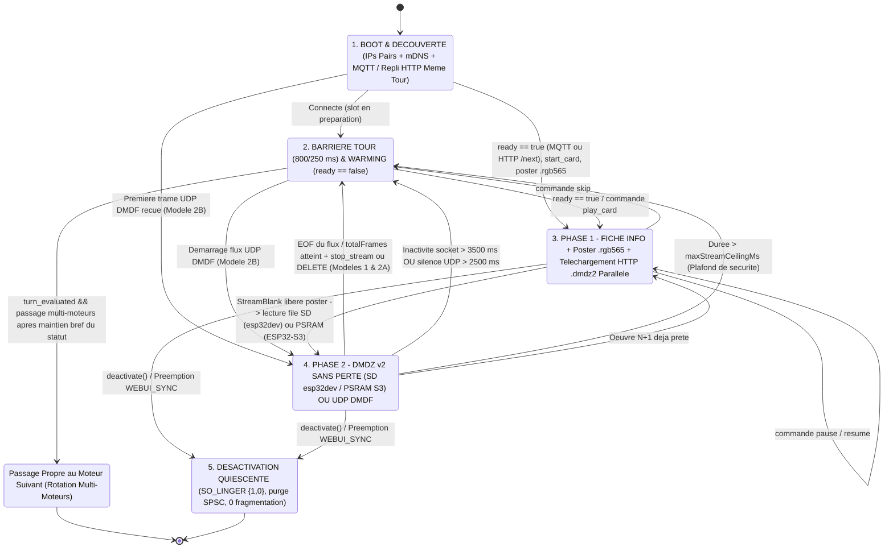

# Guide d'Intégration ESP32 & Récepteur Passif — DMD Media Showcase Server

🇬🇧 [English](ESP32_INTEGRATION.md) | 🇫🇷 Français | 🇪🇸 [Español](ESP32_INTEGRATION_ES.md)

[](https://t.me/+DrSdAO8UMUViNmE0)
[](https://ko-fi.com/red1l)

---

**DMD Media Showcase Server** prend en charge trois topologies complémentaires d'intégration pour les matrices LED HUB75 **ESP32 et ESP32-S3**. Le **Modèle 1** (DMD Multi-Moteurs piloté par le client, ex. `ArcadeMatrix` ESP32 / ESP32-S3 / `ArcadeMatrix_RPi`) et le **Modèle 2A** (Récepteur Hybride piloté par le serveur, `supports_local_card: true`) associent le **plan de contrôle MQTT `:1883`** (`config`/`hello`, `ready` retenu, `start_card` — avec bascule automatique **`MQTT -> HTTP (/config + /next)`** dans le même tour et posters binaires HTTP `.rgb565`) au **Streaming Unifié 100 % Sans Perte True-RGB565 16 bits `DMDZ` v2 (`codec=dmdz2`) sur HTTP `1.1` `Content-Length` (`:8890`, `MQTT+TCP` par défaut)** : `GET /api/v1/{domain}/stream/{item_id}.rgb565.stream?purge={true|false}&codec=dmdz2` (+ nettoyage `DELETE`), mis en file sur la carte SD locale `25 MHz` (`/cache/showcase_live.dmdz`) pendant la Fiche Info sur `esp32dev` sans PSRAM (`0` trafic Wi-Fi durant la lecture + anneau SPSC `8 448 o` + canevas `SRAM1` Zéro-Copie) et diffusé 100 % en PSRAM Octale (`<= 4 Mo` pré-chargés pendant la Fiche, ou anneau SPSC PSRAM `1 Mo` pour les clips HD `256x64`) sur `ESP32-S3`, tandis que le **Modèle 2B** (`supports_local_card: false`) offre un récepteur optionnel ultra-minimal (~180 lignes C++) **100 % Passif UDP `:4210` `DMDF`** (`UDP-PASSIVE`).

> [!IMPORTANT]
> **Pourquoi `MQTT + TCP` avec Streaming HTTP `Content-Length` `DMDZ` v2 Sans Perte (`codec=dmdz2`) & Récupération Unifiée 1:1 (Parité RPi) est l'Architecture par Défaut & Recommandée pour les Modèles 1 & 2A**
> 1. **Zéro Perte NAT UDP VM Docker / Rancher Desktop, IPs Pairs Candidates & Repli `MQTT -> HTTP` dans le Même Tour** : Le trafic entrant TCP `:8890` traverse nativement les ponts conteneurs et NAT des VMs hôtes sans expiration de trou NAT UDP retour, en délivrant un flux HTTP `1.1` `Content-Length` unique et déterministe (`GET /api/v1/{domain}/stream/{item_id}.rgb565.stream?purge={true|false}&codec=dmdz2`). Les IPs candidates issues du WebUI résolvent les écarts NAT hôte/pont de Docker/Rancher Desktop, et si MQTT `:1883` échoue ou expire, Core 0 bascule automatiquement sur `POST /api/v1/{domain}/config` + `GET /api/v1/{domain}/next` **au sein du même tour de rotation**.
> 2. **Protocole de Récupération Unifié 1:1 (Parité RPi), JSON Filtré en Flux Sans Plafond & Poster Binaire `.rgb565`** : La barrière `turn_evaluated` (`800 ms` à froid / `250 ms` à chaud) cède proprement le tour en multi-moteurs (`0` écran noir, avec maintien bref du statut si `0` œuvre jouée dans le tour), analyse les messages MQTT `ready` retenus via un parseur JSON filtré en flux **sans aucune limite de taille**, et télécharge la mini-jaquette binaire `GET /api/v1/{domain}/poster/{item_id}.rgb565` sur Core 0 (libérée juste après `StreamBlank` à l'entrée en Phase 2).
> 3. **Audit Mémoire Exact `esp32dev` (`0 Ko` PSRAM) (`>= 20 Ko` DRAM Libre Wi-Fi/LwIP & HUB75 8 Bits CIE-1931 Préservé)** : Sur `esp32dev` sans PSRAM (`128x32` en pleine profondeur **HUB75 8 bits CIE-1931**), **`36,0 Ko` de DRAM interne 8 bits libre + `8,0 Ko` `SRAM1` `CanvasBufferedSurface` = `44,2 Ko` au total**. En téléchargeant `.dmdz2.stream` sur `/cache/showcase_live.dmdz` via la carte SD `25 MHz` pendant la Fiche Info (`4,5–17 s`), en fermant la socket TCP (`0` `pbuf` `lwIP` pendant la lecture !), puis en décodant **zéro-copie sur place sur Core 1 via `ScopedCanvasGuard`** depuis un **anneau SPSC de `8 448 o` (`> 8 195 o` max `FRAME_RAW`)**, il reste **`>= 20 Ko` de DRAM interne libre** en permanence pour `esp_wifi` / `lwIP` avec zéro gigue Wi-Fi.
> 4. **Un Seul Fichier Serveur `.dmdz2.stream` Pré-Encodé & 2 Chemins Clients Épurés (File SD `esp32dev` vs 100 % PSRAM `ESP32-S3`)** :
>    - **Côté Serveur (`dmd_gif_converter` `v8.0.13` + `DMDZ` v2)** : Restaure la colorimétrie et la netteté LED HUB75 d'origine (`STREAM_PIPELINE_VERSION = "led_boost_dmdz_v2"`) et pré-encode **un unique** fichier `.dmdz2.stream` True-RGB565 16 bits 100 % sans perte (`FRAME_DELTA`, `FRAME_SCROLL`, `FRAME_KEY`, `FRAME_SCROLL_2D`, `FRAME_RAW` — `0` quantification palette, `0` flou de dithering temporel, `0` report de préparation en arrière-plan).
>    - **`esp32dev` (`0` PSRAM — File SD `25 MHz`)** : Core 0 télécharge `.dmdz2.stream` (`?purge=false&codec=dmdz2`) vers `/cache/showcase_live.dmdz` pendant la Fiche Info (par blocs `SdLockGuard` de `2 Ko`), ferme immédiatement la socket TCP une fois complet (`0` trafic Wi-Fi durant la lecture ; ou alterne `4 Ko` TCP->SD / `2 Ko` SD->SPSC sur clips géants), injecte des blocs SD de `1 024 o` dans un anneau SPSC de `8 448 o` et purge via MQTT `stop_stream` ou `DELETE /api/v1/{domain}/stream/{item_id}.rgb565.stream` (avec repli propre Fiche-seule si aucune carte SD n'est montée).
>    - **`ESP32-S3` (`8 Mo` PSRAM Octale — 100 % PSRAM, `0` Carte SD)** : Identique à `ArcadeMatrix_RPi` et `GifEngine` — pré-charge `.dmdz2.stream` (`<= min(4 Mo, freePsram - 1,5 Mo)`) directement en PSRAM pendant la Fiche Info (+ jusqu'à `1 200 ms` de budget de fin), ferme la socket TCP (`0` Wi-Fi durant la lecture à `24–30 FPS`), ou alloue un **anneau SPSC PSRAM de `1 Mo`** (`MALLOC_CAP_SPIRAM`) pré-rempli pendant la Fiche depuis la socket HTTP déjà ouverte pour les clips HD `256x64` géants (`> 4 Mo` jusqu'à `16+ Mo`).
> 5. **Sockets LwIP Brutes Zéro-`TIME_WAIT` (`SO_LINGER {1, 0}`) & Identifiants `item_id` Compacts (`<= 24` caractères)** : Les sockets MQTT `:1883` et `:8890` se ferment avec `SO_LINGER {1, 0}` (`0` accumulation PCB `TIME_WAIT` de 120 s), et chaque package préparé utilise `pkg_<domain>_<12hex>` (`<= 24` caractères).

---

## 1. Vue d'Ensemble & Comparaison des 3 Topologies d'Intégration ESP32

### Modèle 1 — DMD Multi-Moteurs Piloté par le Client (`config_source: "client"`, `MQTT+TCP` par défaut)

Conçu pour les firmwares riches multi-écrans où l'ESP32 orchestre sa propre rotation locale (`Clock`, `Weather`, `Scoreboard`, `AudioSpectrum`, `RetroGames`, `Movies`, `Series`, `Anime`), sa pile de préemption (`DisplayArbiter`) et son propre WebUI embarqué.

- **Autorité de Configuration & IPs Pairs Candidates** : Le WebUI de l'ESP32 interroge dynamiquement `GET /api/v1/{domain}/filters?lang={ui_lang}`, sauvegarde les filtres en flash locale, mémorise les IPs candidates des pairs WebUI pour les ponts NAT Docker/Rancher Desktop, et publie sa configuration retenue sur `dmd_showcase/clients/{dmd_id}/config` (`retain=True`).
- **Récupération Unifiée 1:1 (Parité RPi) & Streaming `DMDZ` v2 Sans Perte** : Core 0 (`ShowcaseWkr`) évalue le slot `ready` retenu dans une fenêtre `turn_evaluated` de `800 ms / 250 ms` via un parseur JSON filtré en flux sans plafond (avec repli automatique dans le même tour vers `POST /api/v1/{domain}/config` + `GET /api/v1/{domain}/next`, propageant `include_poster: showPoster`, si MQTT `:1883` est injoignable), réclame l'œuvre (`start_card`), ferme MQTT avec `SO_LINGER {1, 0}` et télécharge `GET /api/v1/{domain}/poster/{item_id}.rgb565` (libéré sur Core 0 après `StreamBlank`). La Phase 2 s'adapte automatiquement à l'architecture mémoire tout en partageant 100 % de sa brique de lecture (`ShowcaseStreamPlayer`) avec `FrontendSyncEngine` :
  - **`esp32dev` (`0` PSRAM — File SD `25 MHz`)** : Télécharge `GET /api/v1/{domain}/stream/{item_id}.rgb565.stream?purge=false&codec=dmdz2` vers `/cache/showcase_live.dmdz` pendant la Fiche Info, ferme TCP (`0` trafic Wi-Fi durant la lecture) et lit des blocs SD de `1 Ko` dans un anneau SPSC sans verrou de `8 448 o` pendant que Core 1 décode `DMDZ` v2 sans perte zéro-copie sur place dans `CanvasBufferedSurface` via `ScopedCanvasGuard`.
  - **`ESP32-S3` (PSRAM Octale — 100 % PSRAM, `0` Carte SD)** : Pré-charge `.dmdz2.stream` (`<= 4 Mo`) en PSRAM Octale pendant la Fiche Info (`?purge=false&codec=dmdz2` -> `0` trafic Wi-Fi durant la lecture à `24–30 FPS`), ou alloue un **anneau SPSC PSRAM de `1 Mo`** (`MALLOC_CAP_SPIRAM`) pré-rempli pendant la Fiche pour les clips HD `256x64` géants (`> 4 Mo`), puis purge via MQTT `stop_stream` ou HTTP `DELETE`.
- **Comportement en Rotation** : Lorsque le tour d'un moteur Showcase arrive et que `ready` vaut `false`, les configurations multi-moteurs maintiennent brièvement le statut (`2,5 s` en préparation / `1,5 s` hors-ligne si `0` œuvre jouée durant le tour, interruptible en `50 ms`) avant de céder proprement la main au moteur local suivant (`Clock`, `Weather`, etc.), éliminant tout emballement de rotation à `720 ms` et tout écran noir.
- **Implémentation de Référence en Production (`ArcadeMatrix` — Découpe Modulaire à Responsabilité Unique)** :
  - Orchestrateur des Moteurs Showcase & Descripteurs : [`src/engines/MediaShowcaseEngines.h`](https://github.com/red77290/ArcadeMatrix/blob/main/src/engines/MediaShowcaseEngines.h) / [`src/engines/MediaShowcaseEngines.cpp`](https://github.com/red77290/ArcadeMatrix/blob/main/src/engines/MediaShowcaseEngines.cpp)
  - Police Pixel UTF-8 Core 1, Pixel-Art d'Attente & Dispositions Card Adaptatives : [`src/engines/showcase/ShowcaseCardRenderer.h`](https://github.com/red77290/ArcadeMatrix/blob/main/src/engines/showcase/ShowcaseCardRenderer.h) / [`src/engines/showcase/ShowcaseCardRenderer.cpp`](https://github.com/red77290/ArcadeMatrix/blob/main/src/engines/showcase/ShowcaseCardRenderer.cpp)
  - Orchestrateur de Flux Core 0 Unifié (File SD `esp32dev` + 100 % PSRAM `ESP32-S3`) & Présentateur Core 1 Zero-Copy `ScopedCanvasGuard` (partagés 1:1 par `MediaShowcaseBase` & `FrontendSyncEngine` / `InGameShowcaseEngine`) : [`src/engines/showcase/ShowcaseStreamPlayer.h`](https://github.com/red77290/ArcadeMatrix/blob/main/src/engines/showcase/ShowcaseStreamPlayer.h) / [`src/engines/showcase/ShowcaseStreamPlayer.cpp`](https://github.com/red77290/ArcadeMatrix/blob/main/src/engines/showcase/ShowcaseStreamPlayer.cpp)
  - Lecteur HTTP `1.1` `Content-Length` `DMDZ` v2 Zéro-Heap & Nettoyage `DELETE` : [`src/core/net/DmdzStreamClient.h`](https://github.com/red77290/ArcadeMatrix/blob/main/src/core/net/DmdzStreamClient.h) / [`src/core/net/DmdzStreamClient.cpp`](https://github.com/red77290/ArcadeMatrix/blob/main/src/core/net/DmdzStreamClient.cpp)
  - Socket MQTT 3.1.1 LwIP Filtrée en Flux & Fermeture `SO_LINGER {1, 0}` : [`src/core/net/RawMqttSocket.h`](https://github.com/red77290/ArcadeMatrix/blob/main/src/core/net/RawMqttSocket.h) / [`src/core/net/RawMqttSocket.cpp`](https://github.com/red77290/ArcadeMatrix/blob/main/src/core/net/RawMqttSocket.cpp)
  - Décodeur Sur Place True-RGB565 16 Bits `DMDZ` v2 100 % Sans Perte : [`src/core/drawing/DmdzStreamDecoder.h`](https://github.com/red77290/ArcadeMatrix/blob/main/src/core/drawing/DmdzStreamDecoder.h) / [`src/core/drawing/DmdzStreamDecoder.cpp`](https://github.com/red77290/ArcadeMatrix/blob/main/src/core/drawing/DmdzStreamDecoder.cpp)

---

### Modèle 2A — Récepteur Hybride Piloté par le Serveur (`config_source: "server"`, `supports_local_card: true`, `MQTT+TCP` par défaut)

Conçu pour les afficheurs Showcase dédiés souhaitant conserver un rendu texte local ultra-net à 60 FPS sur l'ESP32 **sans** embarquer de WebUI, de logique de référentiels scrapers ni de schémas NVS complexes.

- **Annonce Matérielle Légère** : Au démarrage, l'ESP32 publie un court message retenu sur `dmd_showcase/clients/{dmd_id}/hello` (`retain=True`) déclarant uniquement sa géométrie et son adresse LAN (`width`, `height`, `config_source: "server"`, `supports_local_card: true` et langue par défaut `lang`).
- **Profil Centralisé Persisté (`./data/dmd_profiles.json`)** : Toutes les playlists de domaines (`games`, `movies`, `series`, `anime`), catégories (`systems`, `genres`, `decades`), préréglages de cadrage/colorimétrie IA (`video_mode`, `color_boost`) et la langue de diffusion du contenu (`lang`) sont configurés dans le **Dashboard Web Showcase** (`http://dmdmediashowcase.local:8890/`) et sauvegardés dans `./data/dmd_profiles.json`.
- **Rendu Hybride** : L'ESP32 affiche localement la **Phase 1 (Fiche Info)** à 60 FPS (mini-jaquette `/api/v1/{domain}/poster/{item_id}.rgb565` + badge coloré + défilement fluide du synopsis poussé via `ready` ou `dmd_showcase/clients/{dmd_id}/command` `play_card`, acquitté par `start_card`), puis lit la **Phase 2 (Panoramas + Vidéo)** en HTTP `1.1` `Content-Length` `DMDZ` v2 sans perte (`GET /api/v1/{domain}/stream/{item_id}.rgb565.stream?purge=true&codec=dmdz2`, ou `?purge=false&codec=dmdz2` en pré-chargement pendant la Fiche + `stop_stream` / `DELETE`, et support `mqtt_udp` `start_stream` optionnel).

---

### Modèle 2B — Récepteur Framebuffer 100 % Passif Piloté par le Serveur (`config_source: "server"`, `supports_local_card: false`, `UDP-PASSIVE`)

Conçu pour des montages matériels ultra-légers et sans maintenance (`ESP32_STD` WROOM-32 **sans PSRAM** ou `ESP32-S3`) en **~180 lignes de C++** — **zéro WebUI, zéro police de caractères, zéro parseur JSON et zéro bibliothèque MQTT requise**.

- **Découverte Zéro-Configuration** : L'ESP32 s'annonce via un simple heartbeat HTTP périodique `POST /api/v1/clients/hello` (ou MQTT `dmd_showcase/clients/{dmd_id}/hello`), voire **sans aucun appel sortant** s'il possède une IP LAN fixe déclarée avec `always_stream_udp: true` dans `./data/dmd_profiles.json`.
- **Flux 100 % Composité par le Serveur** : Avec `supports_local_card: false`, le serveur Showcase génère **y compris la Fiche Info de Phase 1** (mini-jaquette + badge système/domaine coloré + titre + année + note + synopsis localisé défilant) directement dans le flux binaire RGB565 et cadence l'envoi des tranches UDP `DMDF` (`<= 1408 o` utiles) vers le port `:4210`.
- **Contrôle Temps Réel Instantané** : Les actions `Skip`, `Pause`, `Resume`, `Stop` et `Play Now` (`FrontendSync`) s'exécutent **100 % côté serveur** en commutant le flux `FfmpegUdpClockStreamer` vers `:4210` en `< 50 ms`.

---

### Tableau Comparatif des 3 Topologies

| Critère | Modèle 1 : Piloté Client (`ArcadeMatrix`) | Modèle 2A : Hybride Piloté Serveur | Modèle 2B : Récepteur UDP 100 % Passif |
| :--- | :--- | :--- | :--- |
| **Annonce & Transport** | `config_source: "client"` (`MQTT+TCP` + repli HTTP `/config+/next` même tour) | `config_source: "server"`, `supports_local_card: true` (`MQTT+TCP` par défaut) | `config_source: "server"`, `supports_local_card: false` (`UDP-PASSIVE` `:4210`) |
| **Stockage Playlists & Filtres** | Flash ESP32 (`config.json`) | Serveur (`./data/dmd_profiles.json`) | Serveur (`./data/dmd_profiles.json`) |
| **Complexité Firmware / UI** | OS Multi-Moteurs complet + WebUI | ~300 lignes C++ (MQTT brut + HTTP `DMDZ` v2 + Police) | **~120–180 lignes C++** (Zéro UI, Zéro Police, Zéro JSON) |
| **Rendu Phase 1 (Fiche Info)** | Local 60 FPS sur Core 1 ESP32 + poster HTTP `.rgb565` | Local 60 FPS sur Core 1 ESP32 + poster HTTP `.rgb565` | **Rendu par le serveur dans le flux UDP RGB565** |
| **Rendu Phase 2 (Panoramas + Vidéo)** | **`DMDZ` v2 sans perte (`esp32dev` file SD `25 MHz` ; `ESP32-S3` pré-chargement PSRAM `<= 4 Mo` / anneau PSRAM `1 Mo`)** | **HTTP `1.1` `Content-Length` `DMDZ` v2 sans perte (`?purge=true&codec=dmdz2`)** | **UDP Passif `DMDF` (`:4210`)** |
| **Empreinte Mémoire (`128x32`)** | **`esp32dev` : Canevas `SRAM1` Zéro-Copie + anneau SPSC `8 448 o` (`>= 20 Ko` DRAM Wi-Fi libre) ; `S3` : PSRAM `<= 4 Mo` / anneau `1 Mo`** | `2–6 Ko` poster + canevas `8 Ko` / décodage `DMDZ` v2 | **`8 Ko` simple (`16 Ko` ping-pong) — `0 o` jaquette/JSON** |
| **Qualification `ESP32_STD` (`esp32dev`, Sans PSRAM)** | **Qualifié (`128x32` en HUB75 8 bits CIE-1931, `20–25 FPS` depuis SD, `64x64`, `128x64`)** | Qualifié (`128x32` à `128x64`) | **Qualifié (`128x32` jusqu'à `256x64` simple buffer)** |
| **Charge CPU Core 0 / Core 1** | Minimale (`0` RX Wi-Fi durant lecture SD ou PSRAM pré-chargée ; décodage sur place Core 1) | Faible (décodage HTTP `DMDZ` v2) | **Minimale (pur `memcpy` UDP non-bloquant)** |
| **Réactivité `Skip` / `Pause` / `Play Now`** | File prioritaire (`N+1`) ou MQTT `.../command` | Via MQTT `.../command` (`play_card` / `skip`) | **Instantanée (`< 50 ms`) directement dans le streamer `DMDF`** |

---

## 2. Chorégraphie FreeRTOS Dual-Core & Invariants DMA HUB75

Les dalles LED HUB75 ne possèdent pas de mémoire vidéo interne : le périphérique I2S/LCD DMA de l'ESP32 doit balayer en permanence les plans de bits PWM depuis la SRAM interne. Toute tempête d'interruptions Wi-Fi, allocation dynamique ou contention de mutex sur le cœur de rendu provoque immédiatement du scintillement ou des lignes fantômes.

Pour garantir un rafraîchissement irréprochable à **60 FPS** (`16,67 ms` par trame), l'architecture impose une séparation matérielle stricte entre les deux cœurs :

- **Core 0 (`PRO_CPU` — Worker Réseau & Stockage `ShowcaseWkr`)** :
  - Exécute la pile Wi-Fi / LwIP, la résolution mDNS (`dmdmediashowcase.local`), le repli vers les IPs candidates pairs du WebUI et les E/S SPI SD `25 MHz` à verrous courts (`esp32dev` uniquement).
  - **Modèles 1 & 2A (`MQTT+TCP` + Repli HTTP Même Tour)** : Démarre `ShowcaseWkr` en priorité (task-first), analyse `ready` retenu via un parseur JSON filtré en flux sans plafond (ou bascule dans le même tour vers `POST /api/v1/{domain}/config` + `GET /api/v1/{domain}/next`), publie `start_card`, ferme MQTT avec `SO_LINGER {1, 0}` et télécharge `GET /api/v1/{domain}/poster/{item_id}.rgb565` (libéré sur Core 0 dès `StreamBlank`). En Phase 1/2 :
    - **`esp32dev` (`0` PSRAM — File SD Locale `25 MHz`)** : Ouvre `GET /api/v1/{domain}/stream/{item_id}.rgb565.stream?purge=false&codec=dmdz2` dès le début de la Fiche, écrit par tranches de `2 Ko` dans `/cache/showcase_live.dmdz` sous `SdLockGuard` courts pendant le défilement de la Fiche, **ferme immédiatement la socket TCP dès que `Content-Length` est atteint** (`0` trafic Wi-Fi et `0` `pbuf` `lwIP` pendant la lecture vidéo !), puis pousse des blocs SD de `1 024 o` dans un **anneau SPSC sans verrou de `8 448 o`** (ou alterne `4 Ko` TCP->SD / `2 Ko` SD->SPSC si un clip géant dépasse la durée de la Fiche).
    - **`ESP32-S3` (PSRAM Octale — 100 % PSRAM, `0` Carte SD)** : Ouvre `GET /api/v1/{domain}/stream/{item_id}.rgb565.stream?purge=false&codec=dmdz2` au début de la Fiche : si `Content-Length <= min(4 Mo, freePsram - 1,5 Mo)`, pré-charge l'intégralité de `.dmdz2.stream` en PSRAM pendant la Fiche (+ jusqu'à `1 200 ms` de budget de fin) et ferme la socket TCP (`0` trafic Wi-Fi durant la lecture Phase 2 !) ; si `Content-Length > maxPreloadPsram` (`256x64` HD / clips géants jusqu'à `16+ Mo`), alloue un **anneau SPSC PSRAM de `1 Mo`** (`MALLOC_CAP_SPIRAM`), pré-remplit `1 Mo` pendant la Fiche depuis la socket HTTP déjà ouverte, et alimente le reste en flux continu pendant que Core 1 décode.
  - **Modèle 2B (`UDP-PASSIVE :4210`)** : Assure le heartbeat HTTP `POST /api/v1/clients/hello` et réassemble les datagrammes **UDP `DMDF`** non-bloquants (en-tête `<4sHBBH` de `10 octets` + tranche `<= 1408 octets` RGB565LE = `<= 1418 octets` par paquet UDP).
- **Core 1 (`APP_CPU` — Boucle Temps Réel HUB75 à 60 FPS)** :
  - Pilote exclusivement `IDrawingSurface` / le DMA HUB75 à 60 FPS, avec **zéro allocation dynamique**, **zéro mutex** et **zéro E/S réseau ou SD**.
  - **Décodage Atomique 1-Tick `ScopedCanvasGuard` Zéro-Copie Sur Place (`esp32dev`) / Lecture PSRAM (`ESP32-S3`)** : Comme l'anneau SPSC de `8 448 o` sur `esp32dev` dépasse toujours la taille maximale d'une trame `FRAME_RAW` `128x32` (`8 195 o`), Core 1 décode chaque trame `DMDZ` v2 True-RGB565 16 bits sans perte de manière atomique en un seul tick **directement sur place dans le `CanvasBufferedSurface` `SRAM1` de `8 Ko`** avant `blitCanvas565()`, éliminant tout second buffer `frame565` et toute écriture partielle du canevas.

### Passage de Trames Lock-Free : Anneau SPSC + `ScopedCanvasGuard` Zéro-Copie vs Seqlock vs Ping-Pong

1. **`ScopedCanvasGuard` Zéro-Copie + Anneau SPSC d'Octets (`ArcadeMatrix` Production File SD `esp32dev` & Anneau HD `1 Mo` `ESP32-S3`)** :
   - Core 0 alimente séquentiellement les octets `.dmdz2.stream` (depuis `/cache/showcase_live.dmdz` sur `esp32dev` vers un anneau SPSC DRAM de `8 448 o`, ou depuis TCP vers un anneau SPSC PSRAM de `1 Mo` sur `ESP32-S3` pour les clips HD ; les clips `<= 4 Mo` sur `ESP32-S3` sont lus directement depuis un tampon PSRAM contigu).
   - Core 1 cadence la présentation (`20–30 FPS`) et exécute `DmdzStreamDecoder` `DMDZ` v2 100 % sans perte **sur place dans `CanvasBufferedSurface` (`SRAM1`)** sous `ScopedCanvasGuard`, économisant `8 192 o` de DRAM interne sur `esp32dev`.
2. **Seqlock `frameSeq` Pair/Impair + Barrière Dekker `renderBlitSeq` (Référence Autonome Monofichier Section 4.A)** :
   - Pour les firmwares autonomes sans `CanvasBufferedSurface` ni carte SD, Core 0 décode le flux HTTP `DMDZ` v2 dans un buffer unique `g_frame565` encadré par `g_frameSeq` + `g_renderBlitSeq`.
3. **Double-Buffer Ping-Pong `frame565[2]` (`std::atomic<uint8_t> frontIdx` — Modèle 2B UDP `DMDF`)** :
   - Core 0 réassemble les fragments `DMDF` dans `frame565[backIdx]` via `chunkMask` 64 bits et permute atomiquement `frontIdx` lorsque la trame est complète.

### Audit Mémoire Exact `esp32dev` (`0 Ko` PSRAM) & Matrice de Streaming Client

Sur un **`esp32dev` (`128x32`, `0 Ko` PSRAM)** multi-moteurs en production exécutant le **HUB75 8 bits CIE-1931 complet** avec Wi-Fi, AsyncWebServer, carte SD `25 MHz` et `CanvasBufferedSurface` :
- **Réserve de Base** : **`36,0 Ko` de DRAM interne 8 bits libre + `8,0 Ko` `SRAM1` `CanvasBufferedSurface` = `44,2 Ko` au total**.
- **Empreinte Moteur Showcase** : `ScopedCanvasGuard` Zéro-Copie (`0 Ko` `frame565` additionnel en `128x32` non pivoté !) + **`~1,2 Ko` `MediaShowcaseBase`** + pile **`ShowcaseWkr`** task-first = **`~30 Ko` disponibles**.
- **Allocation Streaming** : **Anneau SPSC sans verrou de `8 448 o` (`8,25 Ko`, `> 8 195 o` max `FRAME_RAW`)** + socket TCP fermée durant la lecture SD -> **`>= 20 Ko` de DRAM interne libre conservés en permanence pour `esp_wifi` / `lwIP`** (`0` saturation `pcb->ooseq`, `0` chute d'airtime Wi-Fi, `0` fragmentation heap, `0` rétrogradation HUB75 8 bits !).

| Cible Client | Matériel & Géométrie | Conteneur & Codec Serveur | Transport & Stratégie de Cache | Budget Mémoire Client | Cadence & Fidélité |
| :--- | :--- | :--- | :--- | :--- | :--- |
| **File SD `esp32dev`** | **`esp32dev` (`0 Ko` PSRAM + SD `25 MHz`)**, `128x32` / `64x64` | **`.dmdz2.stream`** (True-RGB565 16 bits `DMDZ` v2 100 % sans perte, boost LED `v8.0.13`) | `GET .rgb565.stream?purge=false&codec=dmdz2` -> `/cache/showcase_live.dmdz` pendant la Fiche -> fermeture TCP -> `DELETE` / `stop_stream` | **Canevas `SRAM1` `8 Ko` Zéro-Copie + anneau SPSC `8 448 o` (`>= 20 Ko` DRAM Wi-Fi libre)** | **`20–25 FPS`**, **HUB75 8 bits CIE-1931**, **True-RGB565 100 % sans perte**, `0` gel Wi-Fi |
| **Pré-chargement PSRAM `ESP32-S3`** | **`ESP32-S3` (`8 Mo` OPI PSRAM)**, clips `<= 4 Mo` (`128x32`, `128x64`, `256x64` standard) | **`.dmdz2.stream`** (True-RGB565 16 bits `DMDZ` v2 100 % sans perte) | `GET .rgb565.stream?purge=false&codec=dmdz2` -> PSRAM pendant la Fiche (`0` carte SD) -> fermeture TCP -> `DELETE` / `stop_stream` | **Pré-chargement PSRAM `<= 4 Mo`** (`1,5 Mo` PSRAM réservés libres) | **`24–30 FPS`** True-RGB565 (**`0` trafic Wi-Fi en lecture**) |
| **Anneau HD PSRAM `ESP32-S3`** | **`ESP32-S3` (`8 Mo` OPI PSRAM)**, clips HD `256x64+` géants (`> 4 Mo` jusqu'à `16+ Mo`) | **`.dmdz2.stream`** (True-RGB565 16 bits `DMDZ` v2 100 % sans perte) | Pré-remplit un **anneau SPSC PSRAM de `1 Mo`** pendant la Fiche depuis la socket HTTP ouverte, puis flux continu sur Core 0 (`0` carte SD) | **Anneau SPSC PSRAM `1 Mo`** | **`24–30 FPS` HD** True-RGB565 |
| **Modèle 2B `DMDF`** | `esp32dev` / `ESP32-S3`, `128x32` à `256x64` (`<= 64` chunks) | `DMDF` `<4sHBBH` live (`<= 1 408 o` par tranche) | UDP Passif `:4210` (`supports_local_card: false`) | Canevas `8 Ko` + ping-pong `16 Ko` (`128x32`) | `15–25 FPS` récepteur passif zéro-JSON |

### Pipeline d'Affichage HUB75 Préconisé : `Single DMA Buffer + Offscreen RGB565 Canvas` (`canvas_single`)

Sur l'ensemble des firmwares ESP32 HUB75 (dont [`ArcadeMatrix`](https://github.com/red77290/ArcadeMatrix)), le pipeline **`Single DMA Buffer + Offscreen RGB565 Canvas` (`canvas_single`)** adossé à [`mrfaptastic/ESP32-HUB75-MatrixPanel-I2S-DMA`](https://github.com/mrfaptastic/ESP32-HUB75-MatrixPanel-I2S-DMA) constitue **l'architecture de référence préconisée** :

1. **Économie de 50 % sur la SRAM Interne Compatible DMA (`mxconfig.double_buff = false`)** :
   - Sur `ESP32_STD` (sans PSRAM), les descripteurs DMA I2S et les bitplanes BCM doivent résider en DRAM interne contiguë (`MALLOC_CAP_DMA`), partagée avec Wi-Fi + LwIP.
   - Désactiver le double-buffering DMA matériel (`mxconfig.double_buff = false`) divise par deux l'empreinte des bitplanes, tandis que le canevas linéaire RGB565 hors-écran (`CanvasBufferedSurface` en `SRAM1` ou `GFXcanvas16`) ne consomme que `2 octets/pixel` (`8 Ko` en `128x32`, `16 Ko` en `128x64`, logeable en PSRAM sur `ESP32-S3`).
2. **Maintien du HUB75 8 Bits CIE-1931 sur `esp32dev` via `ScopedCanvasGuard` Zéro-Copie & Préemption `WEBUI_SYNC`** :
   - Les firmwares multi-moteurs (`ArcadeMatrix`) conservent **la pleine profondeur couleur HUB75 BCM 8 bits** sur dalle `128x32` sur `esp32dev` sans PSRAM sur un nombre illimité de rotations : `PipelineSelectionPolicy` applique une hystérésis de maintien de `3,5 Ko` une fois le DMA 8 bits alloué, tandis que `ScopedCanvasGuard` + l'anneau SPSC `8 448 o` + `SO_LINGER {1, 0}` préservent `>= 20 Ko` de DRAM interne libre — ne descendant à `4 bits` **que** sur `128x64` sans PSRAM.
   - Lors du chargement initial de la SPA WebUI embarquée (`GET /`), `ArcadeMatrix` active **`WEBUI_SYNC`** ([`WebUiSyncEngine`](https://github.com/red77290/ArcadeMatrix/blob/main/src/engines/WebUiSyncEngine.h)) sur `PreemptionStack` : `deactivate()` libère immédiatement l'anneau SPSC, le poster `.rgb565`, la pile worker et les buffers TCP afin de servir la SPA compressée sans erreur mémoire, puis reprend automatiquement la diffusion Showcase 8 bits.
3. **Zéro Scintillement Noir & Zéro Effet Stroboscopique (Écrasement Bitplane Sur Place)** :
   - Tous les tracés `Adafruit_GFX`, animations d'attente et décodages sur place `DMDZ` v2 sans perte / `DMDF` s'effectuent à 100 % en mémoire hors-écran. `blitCanvas565()` réécrit ensuite chaque mot de bitplane HUB75 **sur place** (`(dmaRow[ax] & ~0x003F) | rgb12`) en **`~300 µs`** (`128x32`) sans jamais passer par un `clearScreen()` noir préalable.
4. **Gating par Compteur d'État `Dirty` (`frameSeq != lastPresentedSeq`)** :
   - Core 1 (`60 Hz`) ne déclenche le burst vers `frame_buffer[0]` **que lorsqu'une nouvelle trame a modifié le canevas**, supprimant toute contention sur le bus SRAM pendant le balayage I2S.
5. **Encodage Burst BCM Multiplexé + Gamma Perceptif CIE 1931 + Swap FIFO I2S ESP32 Classique** :
   - Encode simultanément `(y)` et `(y + H/2)` dans `R1G1B1R2G2B2` via des tables **gamma CIE 1931**, applique `MATRIX_TX_ADJUST(x)` sur ESP32 classique et vide le cache (`Cache_WriteBack_Addr`) lorsque `SPIRAM_DMA_BUFFER` est actif sur `ESP32-S3`.

| Mode Pipeline | `mxconfig.double_buff` | Canevas RGB565 Hors-Écran | Marge DRAM DMA (`ESP32_STD`) | Scintillement / Tearing | Préconisation |
| :--- | :---: | :---: | :--- | :--- | :--- |
| **`canvas_single`** | **`false`** | **Oui (`GFXcanvas16`)** | **Optimale (-50 % DRAM DMA)** | **Zéro scintillement (burst `~300 µs` sur place + dirty gating)** | **Préconisé (`ESP32_STD` & `ESP32-S3`)** |
| `canvas_double` | `true` | Oui (`GFXcanvas16`) | Coût RAM élevé (`2x` DMA + Canvas) | Swap sans déchirement | Optionnel sur `ESP32-S3` Octal PSRAM |
| `direct_double` | `true` | Non | Forte pression DRAM (`2x` bitplanes) | `drawPixel()` unitaire lent en vidéo | Sketches GFX legacy uniquement |
| `direct_single` | `false` | Non | RAM libre maximale | Scintillement visible sur `clearScreen()` | Repli d'urgence très basse RAM uniquement |

---

## 3. Séquencement Complet des Tâches, États d'Attente & Watchdog de Récupération

### Diagramme de Séquence de Bout en Bout

```mermaid
sequenceDiagram
    participant C1 as ESP32 Core 1 (60 FPS HUB75 + ScopedCanvasGuard)
    participant C0 as ESP32 Core 0 (ShowcaseWkr : MQTT/HTTP + SD/PSRAM)
    participant SRV as Serveur Showcase (:1883 MQTT / :8890 HTTP)
    participant UDP as FfmpegUdpClockStreamer (Mode 2B :4210)

    Note over C1,C0: 1. BOOT, IPs PAIRS CANDIDATES & RECUPERATION MQTT / HTTP MEME TOUR
    C1->>C1: Animation pixel-art procedurale 60 FPS non-bloquante
    C0->>SRV: Resolution mDNS / IP pair + MQTT CONNECT (LWT) -> repli HTTP /config+/next meme tour
    C0->>SRV: PUBLISH clients/{id}/config OU clients/{id}/hello (retain=True)

    Note over C1,SRV: 2. BARRIERE TURN_EVALUATED (800 ms / 250 ms) & WARMING (ready=false)
    SRV-->>C0: Retained ready=false (preparation pkg_{domain}_{12hex} + unique .dmdz2.stream sans perte)
    alt DMD Multi-Moteurs (ArcadeMatrix, rotationSlots > 1)
        C0->>C1: Maintien bref du statut si 0 oeuvre jouee, puis passage propre vers Horloge/Meteo
    else Recepteur Dedie / Passif (Modeles 2A & 2B)
        C1->>C1: Maintien de l'animation d'attente fluide a 60 FPS (zero ecran noir)
    end

    Note over C1,SRV: 3. PHASE 1 — CLAIM, POSTER HTTP .rgb565 & TELECHARGEMENT PARALLELE DU FLUX
    SRV-->>C0: Delivre ready=true + Carte N (parseur JSON filtre en flux sans plafond)
    C0->>SRV: PUBLISH {domain}/events {action: start_card, item_id: N} + fermeture MQTT SO_LINGER {1,0}
    C0->>SRV: GET /api/v1/{domain}/poster/{N}.rgb565 (libere sur Core 0 des StreamBlank)
    SRV->>SRV: Verrouille N dans seen_history.json + lance preparation immediate Standby N+1
    C0->>SRV: GET /api/v1/{domain}/stream/{N}.rgb565.stream?purge=false&codec=dmdz2 (en parallele de la Fiche !)
    C1->>C1: Defilement synopsis localise 60 FPS & mini-jaquette (5-12 s) -> StreamBlank

    Note over C1,UDP: 4. PHASE 2 — LECTURE DMDZ v2 SANS PERTE (FILE SD / 100% PSRAM) OU UDP DMDF
    alt ESP32-S3 100% PSRAM (Pre-chargement <= 4 Mo OU Anneau SPSC PSRAM 1 Mo en 256x64 HD)
        SRV-->>C0: Content-Length .dmdz2.stream en PSRAM (0 carte SD ; ferme TCP des fin de preload !)
        C1->>C1: Lecture DMDZ v2 sans perte a 24-30 FPS -> MQTT stop_stream ou HTTP DELETE
    else esp32dev Sans PSRAM (File SD 25 MHz /cache/showcase_live.dmdz)
        SRV-->>C0: Content-Length .dmdz2.stream -> /cache/showcase_live.dmdz -> ferme TCP (0 Wi-Fi en Phase 2 !)
        loop Lectures SD sequentielles 1 Ko -> Anneau SPSC 8 448 o (> 8 195 o max FRAME_RAW)
            C0->>C1: Decodage atomique 1-tick zero-copie Core 1 ScopedCanvasGuard dans SRAM1 (20-25 FPS)
        end
        C0->>SRV: MQTT stop_stream OU DELETE /api/v1/{domain}/stream/{N}.rgb565.stream -> purge(N)
    else Modele 2B Passif (UDP-PASSIVE :4210, supports_local_card=false)
        UDP-->>C0: UDP DMDF (En-tete 10o + <= 1408 o RGB565LE) vers :4210
        C0->>C1: Permutation Ping-Pong sur chunkMask complet (watchdog 2500 ms)
    end

    Note over C1,SRV: 5. DESACTIVATION / PREEMPTION (EXTINCTION QUIESCENTE < 250 ms)
    C0->>SRV: SO_LINGER {1,0} + lwip_close(sock) -> 0 TIME_WAIT & purge propre sur serveur
```

### Machine à États Déterministe du Récepteur ESP32



### Analyse Détaillée des 5 États & Garanties de Résilience

1. **`BOOT, IPs PAIRS CANDIDATES & RÉCUPÉRATION UNIFIÉE MQTT / HTTP MÊME TOUR`** :
   - Dès la mise sous tension, Core 1 affiche une animation procédurale pixel-art à 60 FPS sans attendre la connexion Wi-Fi.
   - Core 0 (`ShowcaseWkr`, alloué en priorité task-first) résout `dmdmediashowcase.local` ou utilise les IPs candidates pairs du WebUI (indispensables sous ponts NAT Docker Desktop / Rancher Desktop) et ouvre la session MQTT `:1883` (`RawMqttSocket` avec `LWT` `{"online": false}`). Si MQTT `:1883` échoue ou expire, Core 0 exécute de façon transparente `POST /api/v1/{domain}/config` (avec `include_poster` cohérent) + `GET /api/v1/{domain}/next` **au sein du même tour**.
2. **`BARRIÈRE TURN_EVALUATED (800 ms / 250 ms) & WARMING` (`ready: false`)** :
   - Les messages retenus sont lus par un **parseur JSON filtré en flux sans aucune limite de taille** (`0` rejet de synopsis localisé long).
   - **DMD Multi-Moteurs (`ArcadeMatrix` — Modèle 1)** : Dès que `turn_evaluated` s'achève (`<= 800 ms` à froid / `<= 250 ms` à chaud) avec `ready: false`, les configurations multi-moteurs maintiennent brièvement le statut (`2,5 s` warming / `1,5 s` offline si `0` œuvre jouée durant le tour, évitant tout emballement de rotation à `720 ms`) avant de céder proprement la main à `Clock` / `Weather` / `Scoreboard` avec **zéro écran noir**.
3. **`PHASE 1 — CLAIM, POSTER BINAIRE HTTP .rgb565, TÉLÉCHARGEMENT PARALLÈLE & PIPELINING N+1`** :
   - Le claim de l'œuvre `N` (`pkg_<domain>_<12hex>`) via `start_card` ferme immédiatement MQTT avec `SO_LINGER {1, 0}`, télécharge le poster binaire `GET /api/v1/{domain}/poster/{item_id}.rgb565` sur Core 0 (libéré dès `StreamBlank`) et déclenche la **préparation immédiate en arrière-plan du slot `N+1`** (encodant un unique fichier `.dmdz2.stream` sans perte et sans report de slot). En parallèle du défilement de la Fiche, Core 0 télécharge `GET /api/v1/{domain}/stream/{item_id}.rgb565.stream?purge=false&codec=dmdz2` vers `/cache/showcase_live.dmdz` (`esp32dev`) ou en PSRAM Octale (`ESP32-S3`) !
4. **`PHASE 2 — LECTURE DMDZ v2 SANS PERTE OU UDP PASSIF DMDF`** :
   - **`esp32dev` (`0` PSRAM — File SD `25 MHz`)** : Ferme la socket HTTP TCP dès que `Content-Length` est téléchargé (`0` `pbuf` `lwIP` pendant la lecture ; ou alterne `4 Ko` TCP->SD / `2 Ko` SD->SPSC sur clips géants), injecte des blocs SD de `1 024 o` dans l'anneau SPSC de `8 448 o` (`>= 20 Ko` DRAM libre pour `esp_wifi`/`lwIP`), décode True-RGB565 sans perte zéro-copie sur place sur Core 1 (`ScopedCanvasGuard`, `20–25 FPS`), puis purge via MQTT `stop_stream` ou `DELETE /api/v1/{domain}/stream/{item_id}.rgb565.stream`.
   - **`ESP32-S3` (`8 Mo` PSRAM Octale — 100 % PSRAM)** : Lit directement depuis la PSRAM pré-chargée (`<= 4 Mo`) à `24–30 FPS` avec **`0` trafic Wi-Fi et `0` accès carte SD**, ou diffuse les clips HD `256x64` géants (`> 4 Mo`) via un **anneau SPSC PSRAM de `1 Mo`** pré-rempli pendant la Fiche, puis purge via MQTT `stop_stream` ou HTTP `DELETE`.
   - **Modèle 2B (`UDP-PASSIVE :4210`)** : `FfmpegUdpClockStreamer` cadence les tranches UDP `DMDF` (`<= 1408 o`) vers `:4210` (watchdog UDP de `2 500 ms`).
5. **`DÉSACTIVATION, PRÉEMPTION WEBUI_SYNC & REPRISE APRÈS REBOOT`** :
   - **Désactivation Propre & Quiescente (`< 250 ms`)** : `m_wantActive = false` réveille `SO_RCVTIMEO` en `<= 250 ms`, ferme la socket avec `SO_LINGER {1, 0}` (`0` PCB `TIME_WAIT`), draine proprement `ScopedCanvasGuard` / l'anneau SPSC et joint `ShowcaseWkr` (`0` fragmentation heap), y compris lors d'une préemption `WEBUI_SYNC`.

---

## 4. Implémentations C++ ESP32 de Référence (`MQTT+TCP` par défaut & UDP Passif `DMDF`)

### A. Modèles 1 & 2A — Session MQTT Brute Autonome + Streamer HTTP `Content-Length` `DMDZ` v2 Sans Perte

Cette référence C++17 autonome illustre le protocole filaire zéro-heap **`MQTT LwIP brut (:1883) + HTTP 1.1 Content-Length DMDZ v2 sans perte (:8890, codec=dmdz2)`** pour récepteurs **Modèle 1** et **Modèle 2A** personnalisés (pour l'architecture multi-moteurs complète file SD `25 MHz` + anneau SPSC `8 448 o` + `ScopedCanvasGuard` zéro-copie sur `esp32dev` et 100 % PSRAM pré-chargement / anneau HD `1 Mo` sur `ESP32-S3`, voir [`ShowcaseStreamPlayer.cpp`](https://github.com/red77290/ArcadeMatrix/blob/main/src/engines/showcase/ShowcaseStreamPlayer.cpp)) :

1. **Claim MQTT LwIP Brut Zéro-Heap (`0` Socket & `0` `TIME_WAIT` Pendant la Fiche)** : Core 0 se connecte à `:1883` via `lwip_socket`, publie `config` (Modèle 1) ou `hello` (`supports_local_card: true`, Modèle 2A), extrait la fiche `ready` retenue (`pkg_<domain>_<12hex>`), publie `start_card` et ferme avec **`SO_LINGER {1, 0}`**.
2. **Décodeur True-RGB565 16 Bits `DMDZ` v2 100 % Sans Perte sur HTTP `1.1`** : Appelle `GET /api/v1/{domain}/stream/{item_id}.rgb565.stream?purge=true&codec=dmdz2`, suit exactement `Content-Length` sur TCP (`SO_LINGER {1, 0}`) et décode sur place les trames True-RGB565 `DMDZ` v2 (`hdr[4] == 2U` : `FRAME_DELTA`, `FRAME_SCROLL`, `FRAME_KEY`, `FRAME_SCROLL_2D`, `FRAME_RAW`).

```cpp
#include <Arduino.h>
#include <WiFi.h>
#include <esp_heap_caps.h>
#include <lwip/sockets.h>
#include <lwip/netdb.h>
#include <atomic>
#include <cstring>

static constexpr uint16_t PANEL_W     = 128;
static constexpr uint16_t PANEL_H     = 32;
static constexpr size_t   FRAME_BYTES = static_cast<size_t>(PANEL_W) * PANEL_H * 2U; // 8,192 B

// Persistent scratch buffer (~1.46 KB); on ESP32_STD (0 PSRAM), g_frame565 (8 KB) is allocated
// strictly during Phase 2 streaming (LIFO) so Phase 1 and engine rotations never fragment heap!
static uint16_t* g_frame565       = nullptr;
static bool      g_hasPsram       = false;
static uint8_t   g_ioScratch[1472]{};
static char      g_itemId[28]{}; // Compact "pkg_<domain>_<12hex>" (<= 24 chars)

// Lock-free synchronization between Core 0 (stream decoder) and Core 1 (60 Hz HUB75)
static std::atomic<uint32_t> g_frameSeq{0};         // EVEN = coherent frame ready, ODD = Core 0 writing
static std::atomic<uint32_t> g_consumedFrameSeq{0}; // Last EVEN frameSeq blitted by Core 1
static std::atomic<uint32_t> g_renderBlitSeq{0};    // Dekker seq_cst guard (ODD while Core 1 reads g_frame565)
static std::atomic<bool>     g_wantActive{true};

// Immediately reclaim LwIP TCP PCB without accumulating 120s TIME_WAIT sockets across rotations
static void closeSocketZeroTimeWait(int& sock) {
    if (sock >= 0) {
        struct linger sl{1, 0};
        lwip_setsockopt(sock, SOL_SOCKET, SO_LINGER, &sl, sizeof(sl));
        lwip_close(sock);
        sock = -1;
    }
}

static bool sendAllBounded(int sock, const uint8_t* buf, size_t len) {
    size_t sent = 0;
    while (sent < len && g_wantActive.load(std::memory_order_relaxed)) {
        const int w = lwip_send(sock, buf + sent, len - sent, 0);
        if (w > 0) {
            sent += static_cast<size_t>(w);
        } else if (w < 0 && (errno == EAGAIN || errno == EWOULDBLOCK || errno == EINTR)) {
            vTaskDelay(pdMS_TO_TICKS(1));
        } else {
            return false;
        }
    }
    return sent == len;
}

// -----------------------------------------------------------------------------------------
// STEP 1 (CORE 0): ZERO-HEAP RAW LWIP MQTT CLAIM -> CLOSE SOCKET WITH 0 TIME_WAIT!
// -----------------------------------------------------------------------------------------
static size_t encodeMqttRemainingLen(uint8_t out[4], size_t remLen) {
    size_t i = 0;
    do {
        uint8_t b = static_cast<uint8_t>(remLen & 0x7FU);
        remLen >>= 7;
        if (remLen > 0U) b |= 0x80U;
        out[i++] = b;
    } while (remLen > 0U && i < 4U);
    return i;
}

static bool sendMqttPacket(int sock, uint8_t fixedHdr, const uint8_t* body, size_t bodyLen) {
    uint8_t hdr[5]{fixedHdr};
    const size_t hdrLen = 1U + encodeMqttRemainingLen(hdr + 1, bodyLen);
    return sendAllBounded(sock, hdr, hdrLen) && (bodyLen == 0U || sendAllBounded(sock, body, bodyLen));
}

static bool sendMqttPublish(int sock, const char* topic, const char* json, bool retain) {
    const uint16_t tLen = static_cast<uint16_t>(strlen(topic));
    const size_t   pLen = strlen(json);
    if (2U + tLen + pLen > sizeof(g_ioScratch)) return false;
    g_ioScratch[0] = static_cast<uint8_t>(tLen >> 8);
    g_ioScratch[1] = static_cast<uint8_t>(tLen & 0xFFU);
    memcpy(g_ioScratch + 2, topic, tLen);
    memcpy(g_ioScratch + 2 + tLen, json, pLen);
    return sendMqttPacket(sock, static_cast<uint8_t>(0x30U | (retain ? 0x01U : 0x00U)), g_ioScratch, 2U + tLen + pLen);
}

bool claimReadyCardZeroHeapMqtt(const char* host, const char* dmdId, const char* domain, bool isModel2A) {
    IPAddress srvIp;
    if (!WiFi.hostByName(host, srvIp)) return false;

    int sock = lwip_socket(AF_INET, SOCK_STREAM, IPPROTO_TCP);
    if (sock < 0) return false;
    int one = 1;
    lwip_setsockopt(sock, IPPROTO_TCP, TCP_NODELAY, &one, sizeof(one));
    struct timeval tv{0, 200000};
    lwip_setsockopt(sock, SOL_SOCKET, SO_RCVTIMEO, &tv, sizeof(tv));
    lwip_setsockopt(sock, SOL_SOCKET, SO_SNDTIMEO, &tv, sizeof(tv));

    struct sockaddr_in addr{};
    addr.sin_family      = AF_INET;
    addr.sin_port        = htons(1883);
    addr.sin_addr.s_addr = static_cast<uint32_t>(srvIp);
    if (lwip_connect(sock, reinterpret_cast<struct sockaddr*>(&addr), sizeof(addr)) != 0) {
        closeSocketZeroTimeWait(sock);
        return false;
    }

    // Minimal MQTT 3.1.1 CONNECT with LWT {"online":false} (zero WiFiClientRxBuffer heap!)
    char lwtTopic[96];
    snprintf(lwtTopic, sizeof(lwtTopic), "dmd_showcase/clients/%s/status", dmdId);
    static constexpr const char* kLwtMsg = "{\"online\":false}";
    const uint16_t idLen = static_cast<uint16_t>(strlen(dmdId));
    const uint16_t lwTLen = static_cast<uint16_t>(strlen(lwtTopic));
    const uint16_t lwMLen = static_cast<uint16_t>(strlen(kLwtMsg));
    size_t pos = 0;
    const uint8_t varHdr[10] = {0, 4, 'M', 'Q', 'T', 'T', 4, 0x26, 0, 30}; // CleanSession + WillFlag + WillRetain
    memcpy(g_ioScratch + pos, varHdr, sizeof(varHdr)); pos += sizeof(varHdr);
    g_ioScratch[pos++] = static_cast<uint8_t>(idLen >> 8);  g_ioScratch[pos++] = static_cast<uint8_t>(idLen & 0xFFU);
    memcpy(g_ioScratch + pos, dmdId, idLen); pos += idLen;
    g_ioScratch[pos++] = static_cast<uint8_t>(lwTLen >> 8); g_ioScratch[pos++] = static_cast<uint8_t>(lwTLen & 0xFFU);
    memcpy(g_ioScratch + pos, lwtTopic, lwTLen); pos += lwTLen;
    g_ioScratch[pos++] = static_cast<uint8_t>(lwMLen >> 8); g_ioScratch[pos++] = static_cast<uint8_t>(lwMLen & 0xFFU);
    memcpy(g_ioScratch + pos, kLwtMsg, lwMLen); pos += lwMLen;
    if (!sendMqttPacket(sock, 0x10U, g_ioScratch, pos)) {
        closeSocketZeroTimeWait(sock);
        return false;
    }

    // Publish retained hello (Model 2A) or config (Model 1), then SUBSCRIBE to {domain}/ready
    const IPAddress ip = WiFi.localIP();
    char topic[128], msg[256];
    if (isModel2A) {
        snprintf(topic, sizeof(topic), "dmd_showcase/clients/%s/hello", dmdId);
        snprintf(msg, sizeof(msg),
            "{\"dmd_id\":\"%s\",\"config_source\":\"server\",\"supports_local_card\":true,"
            "\"transport\":\"mqtt_tcp\",\"width\":%u,\"height\":%u,\"client_ip\":\"%u.%u.%u.%u\",\"lang\":\"fr\"}",
            dmdId, PANEL_W, PANEL_H, ip[0], ip[1], ip[2], ip[3]);
    } else {
        snprintf(topic, sizeof(topic), "dmd_showcase/clients/%s/config", dmdId);
        snprintf(msg, sizeof(msg),
            "{\"dmd_id\":\"%s\",\"config_source\":\"client\",\"transport\":\"mqtt_tcp\","
            "\"width\":%u,\"height\":%u,\"client_ip\":\"%u.%u.%u.%u\",\"lang\":\"fr\"}",
            dmdId, PANEL_W, PANEL_H, ip[0], ip[1], ip[2], ip[3]);
    }
    sendMqttPublish(sock, topic, msg, /*retain=*/true);

    snprintf(topic, sizeof(topic), "dmd_showcase/clients/%s/%s/ready", dmdId, domain);
    const uint16_t subTLen = static_cast<uint16_t>(strlen(topic));
    g_ioScratch[0] = 0x00; g_ioScratch[1] = 0x01; // Packet ID = 1
    g_ioScratch[2] = static_cast<uint8_t>(subTLen >> 8);
    g_ioScratch[3] = static_cast<uint8_t>(subTLen & 0xFFU);
    memcpy(g_ioScratch + 4, topic, subTLen);
    g_ioScratch[4 + subTLen] = 0x00; // QoS 0
    sendMqttPacket(sock, 0x82U, g_ioScratch, 5U + subTLen);

    // Wait up to 600 ms for retained PUBLISH containing "ready":true + compact item_id
    bool claimed = false;
    size_t rxUsed = 0;
    const uint32_t waitStart = millis();
    while (g_wantActive.load(std::memory_order_relaxed) && (millis() - waitStart) < 600U) {
        const int r = lwip_recv(sock, g_ioScratch + rxUsed, sizeof(g_ioScratch) - 1U - rxUsed, 0);
        if (r > 0) {
            rxUsed += static_cast<size_t>(r);
            g_ioScratch[rxUsed] = '\0';
            if (memmem(g_ioScratch, rxUsed, "\"ready\":true", 12) != nullptr ||
                memmem(g_ioScratch, rxUsed, "\"ready\": true", 13) != nullptr) {
                const char* idKey = static_cast<const char*>(memmem(g_ioScratch, rxUsed, "\"item_id\":\"", 11));
                if (idKey) {
                    idKey += 11;
                    const char* endQ = static_cast<const char*>(memchr(idKey, '"', 27));
                    if (endQ) {
                        const size_t n = static_cast<size_t>(endQ - idKey);
                        memcpy(g_itemId, idKey, n);
                        g_itemId[n] = '\0';
                        claimed = true;
                        break;
                    }
                }
            }
        }
    }

    if (claimed) {
        snprintf(topic, sizeof(topic), "dmd_showcase/clients/%s/%s/events", dmdId, domain);
        snprintf(msg, sizeof(msg),
            "{\"action\":\"start_card\",\"item_id\":\"%s\",\"client_ip\":\"%u.%u.%u.%u\"}",
            g_itemId, ip[0], ip[1], ip[2], ip[3]);
        sendMqttPublish(sock, topic, msg, /*retain=*/false);
    }
    const uint8_t discPkt[2] = {0xE0U, 0x00U};
    lwip_send(sock, discPkt, sizeof(discPkt), 0);
    closeSocketZeroTimeWait(sock); // <--- 0 sockets & 0 TIME_WAIT PCBs during Phase 1 Card scroll!
    return claimed;
}

// -----------------------------------------------------------------------------------------
// STEP 2 (CORE 0): ZERO-HEAP LOSSLESS `DMDZ` v2 DECODER & PLAIN-HTTP `Content-Length` STREAM
// -----------------------------------------------------------------------------------------
struct DmdzStreamDecoder {
    uint16_t cache[64]{};
    uint32_t numPx = 0, pos = 0;
    uint16_t w = 0, h = 0, rem = 0, last = 0;
    uint8_t  litRem = 0, lo = 0, b0 = 0, state = 0;
    int8_t   sdx = 0;
    bool     err = false;

    static inline uint8_t hashPx(uint16_t p) {
        return static_cast<uint8_t>(((((p >> 11) & 0x1FU) * 3U) + (((p >> 5) & 0x3FU) * 5U) + ((p & 0x1FU) * 7U)) & 63U);
    }
    static inline uint16_t addRgb(uint16_t base, int dr, int dg, int db) {
        const uint16_t r  = static_cast<uint16_t>((static_cast<int>((base >> 11) & 0x1FU) + dr) & 0x1F);
        const uint16_t g  = static_cast<uint16_t>((static_cast<int>((base >> 5)  & 0x3FU) + dg) & 0x3F);
        const uint16_t bl = static_cast<uint16_t>((static_cast<int>( base        & 0x1FU) + db) & 0x1F);
        return static_cast<uint16_t>((r << 11) | (g << 5) | bl);
    }
    bool applyScroll2d(uint16_t* fb, int dx, int dy) {
        const uint16_t ay = static_cast<uint16_t>(dy >= 0 ? dy : -dy);
        const uint16_t ax = static_cast<uint16_t>(dx >= 0 ? dx : -dx);
        if (ay >= h || ax >= w) { err = true; return false; }
        if (dy > 0) memmove(fb, fb + static_cast<size_t>(ay) * w, static_cast<size_t>(h - ay) * w * 2U);
        else if (dy < 0) memmove(fb + static_cast<size_t>(ay) * w, fb, static_cast<size_t>(h - ay) * w * 2U);
        if (dx != 0) {
            for (uint16_t y = 0; y < h; ++y) {
                uint16_t* row = fb + static_cast<size_t>(y) * w;
                if (dx > 0) memmove(row, row + ax, static_cast<size_t>(w - ax) * 2U);
                else memmove(row + ax, row, static_cast<size_t>(w - ax) * 2U);
            }
        }
        return true;
    }
    void init(uint16_t width, uint16_t height) {
        w = width; h = height; numPx = static_cast<uint32_t>(w) * h; err = (numPx == 0U);
    }
    bool beginFrame(uint16_t payloadLen) {
        if (numPx == 0U || payloadLen == 0U) { err = true; return false; }
        memset(cache, 0, sizeof(cache));
        pos = 0; rem = payloadLen; last = 0; litRem = 0; state = 0; err = false;
        return true;
    }
    bool feed(const uint8_t* src, size_t len, uint16_t* fb) {
        static const int8_t kTdiff[8][3] = {
            {-1, -2, -1}, {-1, -1, -1}, {0, -1, 0}, {0, 1, 0},
            {1, 1, 1}, {1, 2, 1}, {0, -2, 0}, {0, 2, 0}
        };
        if (err || !fb || len > rem) { err = true; return false; }
        for (size_t i = 0; i < len; ++i) {
            const uint8_t b = src[i];
            --rem;
            if (state == 0) { // FrameType: 0=delta, 1=scroll_dy, 2=key, 3=scroll_2d, 4=raw
                if (b == 0U || b == 2U) state = 2;
                else if (b == 1U) state = 1;
                else if (b == 3U) state = 7;
                else if (b == 4U && rem == numPx * 2U) state = 9;
                else { err = true; return false; }
            } else if (state == 1) {
                if (!applyScroll2d(fb, 0, static_cast<int8_t>(b))) return false;
                state = 2;
            } else if (state == 7) { sdx = static_cast<int8_t>(b); state = 8; }
            else if (state == 8) {
                if (!applyScroll2d(fb, sdx, static_cast<int8_t>(b))) return false;
                state = 2;
            } else if (state == 9) { lo = b; state = 10; }
            else if (state == 10) {
                fb[pos++] = static_cast<uint16_t>(lo | (static_cast<uint16_t>(b) << 8));
                state = (pos == numPx) ? 2 : 9;
            } else if (state == 2) { // Lossless 16-bit True-RGB565 DMDZ v2 opcode stream
                if (b < 0x40U) { // SKIP (n + 1)
                    const uint32_t n = static_cast<uint32_t>(b) + 1U;
                    if (pos + n > numPx) { err = true; return false; }
                    pos += n; last = fb[pos - 1U]; cache[hashPx(last)] = last;
                } else if (b < 0x80U) { // RUN (n + 1)
                    const uint32_t n = static_cast<uint32_t>(b & 0x3FU) + 1U;
                    if (pos + n > numPx) { err = true; return false; }
                    for (uint32_t k = 0; k < n; ++k) fb[pos++] = last;
                } else if (b < 0xC0U) { // INDEX[64]
                    if (pos >= numPx) { err = true; return false; }
                    last = cache[b & 0x3FU]; fb[pos++] = last;
                } else if (b <= 0xDAU) { // DIFF
                    const uint8_t x = static_cast<uint8_t>(b & 0x1FU);
                    if (pos >= numPx) { err = true; return false; }
                    last = addRgb(last, static_cast<int>(x / 9U) - 1, static_cast<int>((x / 3U) % 3U) - 1, static_cast<int>(x % 3U) - 1);
                    fb[pos++] = last; cache[hashPx(last)] = last;
                } else if (b >= 0xDCU && b <= 0xDFU) { b0 = b; state = 11; } // OP_LUMA
                else if (b >= 0xE0U && b <= 0xEFU) { // LIT (n + 1)
                    litRem = static_cast<uint8_t>((b & 0x0FU) + 1U);
                    if (pos + litRem > numPx) { err = true; return false; }
                    state = 3;
                } else if (b == 0xF0U) { state = 5; } // LONG_SKIP
                else if (b >= 0xF1U && b <= 0xF4U) { b0 = b; state = 11; } // OP_TLUMA
                else if (b == 0xF6U || b == 0xF7U) { b0 = b; state = 12; } // OP_LZ
                else if (b >= 0xF8U && pos < numPx) { // OP_TDIFF
                    const int8_t* v = kTdiff[b & 0x07U];
                    last = addRgb(fb[pos], v[0], v[1], v[2]);
                    fb[pos++] = last; cache[hashPx(last)] = last;
                } else { err = true; return false; }
            } else if (state == 3) { lo = b; state = 4; }
            else if (state == 4) {
                last = static_cast<uint16_t>(lo | (static_cast<uint16_t>(b) << 8));
                fb[pos++] = last; cache[hashPx(last)] = last;
                state = (--litRem > 0U) ? 3 : 2;
            } else if (state == 5) { lo = b; state = 6; }
            else if (state == 6) {
                const uint32_t n = static_cast<uint32_t>(lo) | (static_cast<uint32_t>(b) << 8);
                if (n == 0U || pos + n > numPx) { err = true; return false; }
                pos += n; last = fb[pos - 1U]; cache[hashPx(last)] = last; state = 2;
            } else if (state == 11) {
                const bool isT = (b0 >= 0xF1U);
                const int dg = static_cast<int>((((isT ? (b0 - 0xF1U) : (b0 & 0x03U)) << 2) | (b >> 6))) - 8;
                const int dgrb = dg >> 1;
                if (pos >= numPx) { err = true; return false; }
                last = addRgb(isT ? fb[pos] : last, dgrb + static_cast<int>((b >> 3) & 0x07U) - 4, dg, dgrb + static_cast<int>(b & 0x07U) - 4);
                fb[pos++] = last; cache[hashPx(last)] = last; state = 2;
            } else if (state == 12) { lo = b; state = 13; }
            else {
                const uint32_t p17 = (static_cast<uint32_t>(b0 & 1U) << 16) | lo | (static_cast<uint32_t>(b) << 8);
                const uint32_t cnt = ((p17 >> 11) & 0x3FU) + 3U, dist = (p17 & 0x7FFU) + 1U;
                if (dist > pos || pos + cnt > numPx) { err = true; return false; }
                const uint32_t sIdx = pos - dist;
                for (uint32_t k = 0; k < cnt; ++k) fb[pos++] = fb[sIdx + k];
                last = fb[pos - 1U]; cache[hashPx(last)] = last; state = 2;
            }
        }
        return true;
    }
    bool finishFrame() const { return !err && rem == 0U && state == 2U && pos == numPx; }
};

// Step-C-only LIFO g_frame565 guard on ESP32_STD (persistent PSRAM on ESP32-S3)
struct StepCFrameBufferGuard {
    bool ok = false;
    StepCFrameBufferGuard() {
        g_hasPsram = psramFound();
        if (!g_frame565) {
            g_frame565 = static_cast<uint16_t*>(heap_caps_malloc(
                FRAME_BYTES, (g_hasPsram ? MALLOC_CAP_SPIRAM : MALLOC_CAP_INTERNAL) | MALLOC_CAP_8BIT));
        }
        if (g_frame565) { memset(g_frame565, 0, FRAME_BYTES); ok = true; }
    }
    ~StepCFrameBufferGuard() {
        if (!g_hasPsram && g_frame565) {
            g_frameSeq.store(1U, std::memory_order_seq_cst); // Block new Core 1 blits
            while ((g_renderBlitSeq.load(std::memory_order_seq_cst) & 1U) != 0U) {
                vTaskDelay(pdMS_TO_TICKS(1)); // Wait for any in-flight Core 1 memcpy (~15 us)
            }
            uint16_t* p = g_frame565;
            g_frame565 = nullptr;
            heap_caps_free(p); // LIFO release after socket closes -> 0 heap fragmentation!
            g_frameSeq.store(0U, std::memory_order_seq_cst);
        }
    }
};

static int connectHttpDmdz2Stream(
    const IPAddress& srvIp, const char* host, uint16_t port, const char* domain,
    const char* itemId, const char* dmdId, size_t& outBodyOff, size_t& outUsed, size_t& outContentLen
) {
    int sock = lwip_socket(AF_INET, SOCK_STREAM, IPPROTO_TCP);
    if (sock < 0) return -1;
    int one = 1;
    lwip_setsockopt(sock, IPPROTO_TCP, TCP_NODELAY, &one, sizeof(one));
    struct timeval tv{0, 250000};
    lwip_setsockopt(sock, SOL_SOCKET, SO_RCVTIMEO, &tv, sizeof(tv));
    lwip_setsockopt(sock, SOL_SOCKET, SO_SNDTIMEO, &tv, sizeof(tv));

    struct sockaddr_in addr{};
    addr.sin_family = AF_INET; addr.sin_port = htons(port); addr.sin_addr.s_addr = static_cast<uint32_t>(srvIp);
    if (lwip_connect(sock, reinterpret_cast<struct sockaddr*>(&addr), sizeof(addr)) != 0) {
        closeSocketZeroTimeWait(sock);
        return -1;
    }

    const int reqLen = snprintf(reinterpret_cast<char*>(g_ioScratch), sizeof(g_ioScratch),
        "GET /api/v1/%s/stream/%s.rgb565.stream?purge=true&codec=dmdz2&client_id=%s HTTP/1.1\r\n"
        "Host: %s:%u\r\nConnection: close\r\n\r\n",
        domain, itemId, dmdId, host, port);
    if (!sendAllBounded(sock, g_ioScratch, static_cast<size_t>(reqLen))) {
        closeSocketZeroTimeWait(sock);
        return -1;
    }

    outUsed = 0; outBodyOff = 0; outContentLen = 0;
    while (outUsed + 1U < sizeof(g_ioScratch) && g_wantActive.load(std::memory_order_relaxed)) {
        const int r = lwip_recv(sock, g_ioScratch + outUsed, sizeof(g_ioScratch) - 1U - outUsed, 0);
        if (r <= 0) {
            if (r < 0 && (errno == EAGAIN || errno == EWOULDBLOCK)) continue;
            closeSocketZeroTimeWait(sock);
            return -1;
        }
        outUsed += static_cast<size_t>(r);
        g_ioScratch[outUsed] = '\0';
        const char* hdrEnd = strstr(reinterpret_cast<const char*>(g_ioScratch), "\r\n\r\n");
        if (hdrEnd) {
            outBodyOff = static_cast<size_t>((hdrEnd + 4) - reinterpret_cast<const char*>(g_ioScratch));
            for (const char* p = reinterpret_cast<const char*>(g_ioScratch); p < hdrEnd; ++p) {
                if (strncasecmp(p, "Content-Length:", 15) == 0) {
                    outContentLen = static_cast<size_t>(strtoul(p + 15, nullptr, 10));
                    break;
                }
            }
            break;
        }
    }
    if (outBodyOff == 0U || memmem(g_ioScratch, outBodyOff, " 200 ", 5) == nullptr) {
        closeSocketZeroTimeWait(sock);
        return -1;
    }
    return sock;
}

bool streamShowcasePhase2(const char* host, uint16_t port, const char* domain, const char* itemId, const char* dmdId) {
    IPAddress srvIp;
    if (!WiFi.hostByName(host, srvIp)) return false;

    StepCFrameBufferGuard fbGuard; // Allocates 8 KB g_frame565 only during Phase 2 on ESP32_STD!
    if (!fbGuard.ok) return false;

    size_t bodyOff = 0, rxUsed = 0, contentLen = 0;
    int sock = connectHttpDmdz2Stream(srvIp, host, port, domain, itemId, dmdId, bodyOff, rxUsed, contentLen);
    if (sock < 0) return false;

    size_t rawLeft = rxUsed - bodyOff, rawOff = bodyOff, totalRead = 0;

    auto pullStreamBytes = [&](uint8_t* dst, size_t want) -> int {
        if (contentLen > 0U && totalRead + want > contentLen) return -1;
        size_t got = 0;
        uint32_t lastProgressMs = millis();
        while (got < want && g_wantActive.load(std::memory_order_relaxed)) {
            if (rawLeft == 0U) {
                const int r = lwip_recv(sock, g_ioScratch, 1408U, 0);
                if (r > 0) { rawLeft = static_cast<size_t>(r); rawOff = 0; lastProgressMs = millis(); }
                else if (r == 0) return 0;
                else {
                    if (errno != EAGAIN && errno != EWOULDBLOCK && errno != EINTR) return -1;
                    if ((millis() - lastProgressMs) > 3500U) return -1;
                    continue;
                }
            }
            const size_t take = (rawLeft < (want - got)) ? rawLeft : (want - got);
            memcpy(dst + got, g_ioScratch + rawOff, take);
            rawOff += take; rawLeft -= take; got += take; totalRead += take;
        }
        return (got == want) ? static_cast<int>(got) : -1;
    };

    // Parse 16-byte Little-Endian <4sBBHHHHH> lossless DMDZ v2 (or raw DMDS) container header
    uint8_t hdr[16]{};
    if (pullStreamBytes(hdr, 16U) != 16) { closeSocketZeroTimeWait(sock); return false; }
    const bool isDmdz = (memcmp(hdr, "DMDZ", 4) == 0 && hdr[4] == 2U);
    const bool isDmds = (!isDmdz && memcmp(hdr, "DMDS", 4) == 0);
    const uint8_t  fps         = (hdr[5] > 0U) ? hdr[5] : 15U;
    const uint16_t w           = static_cast<uint16_t>(hdr[6]  | (hdr[7]  << 8));
    const uint16_t h           = static_cast<uint16_t>(hdr[8]  | (hdr[9]  << 8));
    const uint16_t totalFrames = static_cast<uint16_t>(hdr[10] | (hdr[11] << 8));
    const uint16_t frameDurMs  = static_cast<uint16_t>(hdr[12] | (hdr[13] << 8));
    if ((!isDmdz && !isDmds) || w != PANEL_W || h != PANEL_H || totalFrames == 0U) {
        closeSocketZeroTimeWait(sock);
        return false;
    }

    DmdzStreamDecoder dmdzDec{};
    dmdzDec.init(w, h);
    const uint32_t periodMs = (frameDurMs > 0U) ? frameDurMs : (1000U / fps);
    uint32_t nextPresentMs = millis();

    for (uint16_t f = 0; f < totalFrames && g_wantActive.load(std::memory_order_relaxed); ++f) {
        uint8_t lenRaw[2]{};
        uint16_t payloadLen = 0;
        if (isDmdz) {
            if (pullStreamBytes(lenRaw, 2U) != 2) break;
            payloadLen = static_cast<uint16_t>(lenRaw[0] | (lenRaw[1] << 8));
            if (!dmdzDec.beginFrame(payloadLen)) break;
        }

        // Let Core 1 finish blitting the prior EVEN frame (<= 18 ms) before modifying g_frame565
        const uint32_t curSeq = g_frameSeq.load(std::memory_order_acquire);
        if (curSeq > 0U && g_consumedFrameSeq.load(std::memory_order_acquire) != curSeq) {
            const uint32_t guardStart = millis();
            while (g_wantActive.load(std::memory_order_relaxed) &&
                   g_consumedFrameSeq.load(std::memory_order_acquire) != curSeq &&
                   (millis() - guardStart) < 18U) {
                vTaskDelay(pdMS_TO_TICKS(1));
            }
        }

        g_frameSeq.fetch_add(1U, std::memory_order_acq_rel); // ODD (write in progress)
        bool frameOk = false;
        if (isDmdz) {
            uint16_t rem = payloadLen;
            uint8_t chunk[512];
            frameOk = true;
            while (rem > 0U) {
                const size_t step = (rem < sizeof(chunk)) ? rem : sizeof(chunk);
                if (pullStreamBytes(chunk, step) != static_cast<int>(step) ||
                    !dmdzDec.feed(chunk, step, g_frame565)) {
                    frameOk = false;
                    break;
                }
                rem = static_cast<uint16_t>(rem - step);
            }
            frameOk = frameOk && dmdzDec.finishFrame();
        } else {
            frameOk = (pullStreamBytes(reinterpret_cast<uint8_t*>(g_frame565), FRAME_BYTES) == static_cast<int>(FRAME_BYTES));
        }
        g_frameSeq.fetch_add(1U, std::memory_order_release); // EVEN (coherent frame ready!)
        if (!frameOk) break;

        // Smooth client presentation cadence (re-anchoring if network jitter delayed a frame)
        nextPresentMs += periodMs;
        const int32_t waitMs = static_cast<int32_t>(nextPresentMs - millis());
        if (waitMs > 1) vTaskDelay(pdMS_TO_TICKS(static_cast<uint32_t>(waitMs)));
        else if (waitMs < -static_cast<int32_t>(periodMs)) nextPresentMs = millis();
        else taskYIELD();
    }

    closeSocketZeroTimeWait(sock); // SO_LINGER {1,0} -> 0 TIME_WAIT PCBs & triggers server purge!
    return true; // StepCFrameBufferGuard destructor frees g_frame565 cleanly after socket closes
}

// -----------------------------------------------------------------------------------------
// STEP 3 (CORE 1): ZERO-ALLOCATION 60 HZ `canvas_single` SEQLOCK-GUARDED COMMIT
// -----------------------------------------------------------------------------------------
void renderStreamFrameOnCore1(uint16_t* offscreenCanvas565, uint32_t& lastRenderedSeq) {
    g_renderBlitSeq.fetch_add(1U, std::memory_order_seq_cst); // ODD: Core 1 reading g_frame565
    const uint32_t fSeq = g_frameSeq.load(std::memory_order_seq_cst);
    const uint16_t* src = g_frame565;
    if (src && (fSeq & 1U) == 0U && fSeq != 0U && fSeq != lastRenderedSeq) {
        memcpy(offscreenCanvas565, src, FRAME_BYTES);
        if (g_frameSeq.load(std::memory_order_acquire) == fSeq) {
            lastRenderedSeq = fSeq;
            g_consumedFrameSeq.store(fSeq, std::memory_order_release);
            // Burst offscreenCanvas565 to Single HUB75 DMA Buffer via blitCanvas565()
        }
    }
    g_renderBlitSeq.fetch_add(1U, std::memory_order_seq_cst); // EVEN: Core 1 idle
}
```

> [!TIP]
> **Contrôle Temps Réel Modèle 2A (`dmd_showcase/clients/{dmd_id}/command`)** : Les afficheurs dédiés Modèle 2A qui maintiennent une écoute MQTT légère sur `command` traitent `"skip"`, `"stop"`, `"pause"`, `"resume"` et `"play_card"` (`FrontendSync` / `play_now`) en basculant `g_wantActive = false`, ce qui ferme la socket HTTP `DMDZ` v2 avec `SO_LINGER {1, 0}` et enchaîne immédiatement sur la nouvelle fiche.

---

### B. Modèle 2B — Firmware Monolithique ~180 Lignes UDP Passif `:4210` `DMDF` (`platformio.ini` + `src/main.cpp`)

Pour les montages ultra-légers `supports_local_card: false` (`UDP-PASSIVE` `:4210`), ce firmware C++ monolithique et auto-suffisant implémente le pipeline **`Single DMA Buffer (`mxconfig.double_buff = false`) + Canevas Hors-Écran `GFXcanvas16` + Encodeur Bitplane Burst CIE 1931 (`blitCanvas565`) + Dirty-Frame Gating`** sur [`mrfaptastic/ESP32-HUB75-MatrixPanel-I2S-DMA`](https://github.com/mrfaptastic/ESP32-HUB75-MatrixPanel-I2S-DMA). Il compile tel quel sur **ESP32 Classique (`esp32dev`, sans PSRAM)** et **ESP32-S3 (`esp32-s3-devkitc-1` / Waveshare RGB Matrix avec PSRAM)** :

#### `platformio.ini`

```ini
[platformio]
default_envs = esp32dev

[env]
platform = espressif32
framework = arduino
monitor_speed = 115200
lib_deps =
    mrfaptastic/ESP32 HUB75 LED MATRIX PANEL DMA Display @ ^3.0.11
    adafruit/Adafruit GFX Library @ ^1.11.9

; Target 1: Standard ESP32 (WROOM-32 / DevKitC without PSRAM)
[env:esp32dev]
board = esp32dev
build_flags =
    -D CORE_DEBUG_LEVEL=1
    -O2

; Target 2: ESP32-S3 with Octal PSRAM (e.g. Waveshare ESP32-S3-RGB-Matrix / N16R8)
[env:esp32s3]
board = esp32-s3-devkitc-1
board_build.arduino.memory_type = qio_opi
build_flags =
    -D BOARD_HAS_PSRAM
    -D SPIRAM_DMA_BUFFER
    -D CORE_DEBUG_LEVEL=1
    -O2
```

#### `src/main.cpp` (Implémentation Monolithique Complète)

```cpp
/**
 * @file main.cpp
 * @brief Monolithic ESP32 / ESP32-S3 HUB75 Receiver for DMD Media Showcase (Mode 2B)
 *        using the "Single DMA Buffer + Offscreen RGB565 Canvas" (`canvas_single`) pipeline.
 *
 * Architectural Highlights (Proven in Production on ArcadeMatrix):
 *  1. Single HUB75 DMA Buffer (`mxconfig.double_buff = false`):
 *     Cuts scarce internal DMA-capable SRAM (`MALLOC_CAP_DMA`) usage by 50% compared to
 *     DMA double-buffering, leaving ample contiguous heap for Wi-Fi + LwIP + UDP on
 *     standard ESP32 boards without PSRAM (`ESP32_STD`).
 *  2. Offscreen Linear RGB565 Canvas (`Adafruit_GFX` / `GFXcanvas16`):
 *     All drawing (idle 60 FPS procedural animation, local HUD overlays, or incoming UDP
 *     frames) happens exclusively in offscreen memory (`2 bytes/pixel`). `clearScreen()` is
 *     NEVER called on the live DMA scanout buffer, eliminating black-frame strobe/flicker.
 *  3. In-Place Multiplexed BCM Bitplane Burst Encoder (`blitCanvas565`):
 *     Encodes upper `(y)` and lower `(y + H/2)` HUB75 scan halves simultaneously with
 *     perceptual CIE 1931 gamma LUTs directly into `frame_buffer[0]` (`~300 us` for 128x32),
 *     bypassing thousands of per-pixel virtual `drawPixel()` calls.
 *  4. Dirty-Frame Gating (`s_completedUdpSeq != s_lastPresentedUdpSeq`):
 *     Core 1 only bursts the offscreen canvas into DMA memory when a brand-new frame is
 *     actually ready, preventing redundant bus contention while I2S scans the panel.
 *  5. Strict Dual-Core Isolation:
 *     - Core 0 (`PRO_CPU`): Wi-Fi, mDNS, periodic HTTP `hello`, lock-free UDP `DMDF` assembly.
 *     - Core 1 (`APP_CPU`): Zero-allocation, zero-mutex 60 Hz canvas composition & DMA commit.
 */

#include <Arduino.h>
#include <WiFi.h>
#include <WiFiUdp.h>
#include <HTTPClient.h>
#include <ESPmDNS.h>
#include <esp_heap_caps.h>
#include <Adafruit_GFX.h>
#include <atomic>
#include <cstring>
#include <memory>
#include <vector>

#if defined(SPIRAM_DMA_BUFFER)
#include "rom/cache.h"
#endif

// Expose `MatrixPanel_I2S_DMA` internal `frame_buffer` row-plane pointers to our subclass
// for direct in-place BCM bitplane burst encoding (must come AFTER STL headers).
#define private protected
#include <ESP32-HUB75-MatrixPanel-I2S-DMA.h>
#undef private

// =========================================================================================
// STEP 1: PANEL GEOMETRY, NETWORK CONFIGURATION & HARDWARE PIN PROFILES
// =========================================================================================

static constexpr uint16_t MODULE_W     = 64;   // Single HUB75 panel width (typically 64)
static constexpr uint16_t MODULE_H     = 32;   // Single HUB75 panel height (32 or 64)
static constexpr uint16_t CHAIN_LEN    = 2;    // Number of chained panels (2 x 64x32 = 128x32)
static constexpr uint16_t PANEL_W      = MODULE_W * CHAIN_LEN;
static constexpr uint16_t PANEL_H      = MODULE_H;
static constexpr size_t   FRAME_PIXELS = static_cast<size_t>(PANEL_W) * PANEL_H;
static constexpr size_t   FRAME_BYTES  = FRAME_PIXELS * sizeof(uint16_t); // 8,192 B for 128x32

static constexpr uint16_t UDP_PORT          = 4210;
static constexpr uint32_t HELLO_INTERVAL_MS = 15000U;
static constexpr uint32_t UDP_WATCHDOG_MS   = 2500U;

static const char* WIFI_SSID    = "YOUR_WIFI_SSID";
static const char* WIFI_PASS    = "YOUR_WIFI_PASSWORD";
static const char* DMD_ID       = "esp32_passive_128x32";
static const char* CONTENT_LANG = "fr"; // Broadcast language ("fr", "en", "es", "de", "it", "pt", "ja")
static const char* SHOWCASE_HELLO_URL = "http://dmdmediashowcase.local:8890/api/v1/clients/hello";

// Classic ESP32 (Xtensa LX6) I2S TX FIFO transmits 16-bit words swapped within each 32-bit pair.
// ESP32-S3 LCD_CAM transmits 16-bit words in natural sequential order.
#ifndef MATRIX_TX_ADJUST
#if defined(CONFIG_IDF_TARGET_ESP32) && !defined(CONFIG_IDF_TARGET_ESP32S3)
#define MATRIX_TX_ADJUST(x) (((x) & 1U) ? ((x) - 1U) : ((x) + 1U))
#else
#define MATRIX_TX_ADJUST(x) (x)
#endif
#endif

// Default GPIO mapping per target architecture (adjust to match your shield/wiring).
// Note: On ESP32-S3 with Octal PSRAM, NEVER assign GPIO 32..37 to HUB75!
static void populateHub75Pins(HUB75_I2S_CFG::i2s_pins& pins) {
#if defined(CONFIG_IDF_TARGET_ESP32S3)
    // Waveshare ESP32-S3-RGB-Matrix / Generic ESP32-S3 PSRAM-safe pinout
    pins.r1 = 4;  pins.g1 = 5;  pins.b1 = 6;
    pins.r2 = 7;  pins.g2 = 15; pins.b2 = 16;
    pins.a  = 18; pins.b  = 8;  pins.c  = 3;
    pins.d  = 42; pins.e  = (PANEL_H >= 64) ? 9 : -1;
    pins.lat = 40; pins.oe = 2; pins.clk = 41;
#else
    // Standard ESP32 (WROOM-32 / DevKitC) HUB75 pinout
    pins.r1 = 25; pins.g1 = 26; pins.b1 = 27;
    pins.r2 = 14; pins.g2 = 12; pins.b2 = 13;
    pins.a  = 33; pins.b  = 32; pins.c  = 22;
    pins.d  = 17; pins.e  = (PANEL_H >= 64) ? 21 : -1;
    pins.lat = 4; pins.oe = 15; pins.clk = 16;
#endif
}

// =========================================================================================
// STEP 2: SINGLE-DMA-BUFFER PANEL SUBCLASS WITH IN-PLACE CIE 1931 BITPLANE BURST ENCODER
// =========================================================================================

// Preserves HUB75 control bits (LAT/OE/address in bits 6..15) while clearing R1G1B1R2G2B2 (bits 0..5).
static constexpr uint16_t HUB75_RGB12_CLEAR_MASK = 0b1111111111000000U;

// Perceptual CIE 1931 lightness curve (8-bit, gamma ~2.2) for silky dark gradients on LEDs.
static const uint8_t kCie1931Lut8[256] = {
      0,   0,   0,   0,   0,   0,   0,   0,   0,   0,   1,   1,   1,   1,   1,   1,
      1,   1,   2,   2,   2,   2,   2,   2,   3,   3,   3,   3,   4,   4,   4,   4,
      5,   5,   5,   5,   6,   6,   6,   7,   7,   7,   8,   8,   8,   9,   9,  10,
     10,  10,  11,  11,  12,  12,  13,  13,  14,  14,  15,  15,  16,  16,  17,  18,
     18,  19,  19,  20,  21,  21,  22,  23,  23,  24,  25,  25,  26,  27,  28,  28,
     29,  30,  31,  32,  32,  33,  34,  35,  36,  37,  38,  38,  39,  40,  41,  42,
     43,  44,  45,  46,  47,  48,  49,  51,  52,  53,  54,  55,  56,  57,  58,  60,
     61,  62,  63,  65,  66,  67,  68,  70,  71,  72,  74,  75,  77,  78,  79,  81,
     82,  84,  85,  87,  88,  90,  91,  93,  94,  96,  98,  99, 101, 103, 104, 106,
    108, 110, 111, 113, 115, 117, 119, 120, 122, 124, 126, 128, 130, 132, 134, 136,
    138, 140, 142, 144, 146, 148, 150, 153, 155, 157, 159, 162, 164, 166, 168, 171,
    173, 175, 178, 180, 183, 185, 188, 190, 193, 195, 198, 201, 203, 206, 208, 211,
    214, 216, 219, 222, 225, 227, 230, 233, 236, 239, 242, 245, 247, 250, 253, 255,
    255, 255, 255, 255, 255, 255, 255, 255, 255, 255, 255, 255, 255, 255, 255, 255,
    255, 255, 255, 255, 255, 255, 255, 255, 255, 255, 255, 255, 255, 255, 255, 255,
    255, 255, 255, 255, 255, 255, 255, 255, 255, 255, 255, 255, 255, 255, 255, 255
};

class SingleBufferCanvasPanel : public MatrixPanel_I2S_DMA {
public:
    using MatrixPanel_I2S_DMA::MatrixPanel_I2S_DMA;

    // Precompute channel LUTs scaled to the configured BCM bit depth (e.g. 6-bit on ESP32_STD, 8-bit on S3).
    void initGammaLuts(uint8_t depth) {
        if (depth < 2) depth = 2;
        if (depth > 8) depth = 8;
        m_depth = depth;
        const uint8_t  shift  = static_cast<uint8_t>(8U - depth);
        const uint16_t round  = (shift > 0U) ? static_cast<uint16_t>(1U << (shift - 1U)) : 0U;
        const uint16_t maxVal = static_cast<uint16_t>((1U << depth) - 1U);

        for (uint16_t r = 0; r < 32; ++r) {
            uint8_t r8 = static_cast<uint8_t>((r << 3) | (r >> 2));
            uint16_t v = static_cast<uint16_t>((kCie1931Lut8[r8] + round) >> shift);
            m_lutR[r]  = static_cast<uint8_t>((v > maxVal) ? maxVal : v);
        }
        for (uint16_t g = 0; g < 64; ++g) {
            uint8_t g8 = static_cast<uint8_t>((g << 2) | (g >> 4));
            uint16_t v = static_cast<uint16_t>((kCie1931Lut8[g8] + round) >> shift);
            m_lutG[g]  = static_cast<uint8_t>((v > maxVal) ? maxVal : v);
        }
        for (uint16_t b = 0; b < 32; ++b) {
            uint8_t b8 = static_cast<uint8_t>((b << 3) | (b >> 2));
            uint16_t v = static_cast<uint16_t>((kCie1931Lut8[b8] + round) >> shift);
            m_lutB[b]  = static_cast<uint8_t>((v > maxVal) ? maxVal : v);
        }
    }

    // Burst-encode a linear RGB565 offscreen canvas directly into the single active DMA buffer (`frame_buffer[0]`).
    // Because every bitplane word is overwritten in-place without clearing first, there is zero black strobe.
    void blitCanvas565(const uint16_t* canvas, uint16_t canvasW, uint16_t canvasH) {
        if (!canvas || !initialized) return;
        const uint16_t w   = static_cast<uint16_t>(PIXELS_PER_ROW);
        const uint16_t rpf = static_cast<uint16_t>(ROWS_PER_FRAME); // PANEL_H / 2 (1/16 or 1/32 scan)
        if (canvasW != w || canvasH != static_cast<uint16_t>(m_cfg.mx_height)) return;

        auto& dmaFb = frame_buffer[0]; // Single DMA buffer (`double_buff == false`)
        if (dmaFb.rowBits.size() < rpf) return;

        for (uint16_t y = 0; y < rpf; ++y) {
            const uint16_t* upperRow = canvas + (static_cast<size_t>(y) * w);
            const uint16_t* lowerRow = canvas + (static_cast<size_t>(y + rpf) * w);

            for (uint8_t p = 0; p < m_depth; ++p) {
                uint16_t* dmaRow = dmaFb.rowBits[y]->getDataPtr(p);
                if (!dmaRow) continue;

                for (uint16_t x = 0; x < w; ++x) {
                    const uint16_t c1 = upperRow[x];
                    const uint16_t c2 = lowerRow[x];

                    const uint16_t r1 = (m_lutR[(c1 >> 11) & 0x1FU] >> p) & 1U;
                    const uint16_t g1 = (m_lutG[(c1 >> 5)  & 0x3FU] >> p) & 1U;
                    const uint16_t b1 = (m_lutB[ c1        & 0x1FU] >> p) & 1U;

                    const uint16_t r2 = (m_lutR[(c2 >> 11) & 0x1FU] >> p) & 1U;
                    const uint16_t g2 = (m_lutG[(c2 >> 5)  & 0x3FU] >> p) & 1U;
                    const uint16_t b2 = (m_lutB[ c2        & 0x1FU] >> p) & 1U;

                    const uint16_t rgb12 = static_cast<uint16_t>(
                        r1 | (g1 << 1) | (b1 << 2) | (r2 << 3) | (g2 << 4) | (b2 << 5)
                    );
                    const uint16_t ax = MATRIX_TX_ADJUST(x);
                    dmaRow[ax] = static_cast<uint16_t>((dmaRow[ax] & HUB75_RGB12_CLEAR_MASK) | rgb12);
                }

#if defined(SPIRAM_DMA_BUFFER)
                // Flush CPU dcache line to SPIRAM so LCD_CAM DMA observes updated bitplanes immediately.
                Cache_WriteBack_Addr(reinterpret_cast<uint32_t>(dmaRow), static_cast<uint32_t>(w * sizeof(uint16_t)));
#endif
            }
        }
    }

private:
    uint8_t m_depth = 6;
    uint8_t m_lutR[32]{};
    uint8_t m_lutG[64]{};
    uint8_t m_lutB[32]{};
};

// =========================================================================================
// STEP 3: LOCK-FREE DUAL-CORE BUFFERS (UDP STAGING ON CORE 0 -> OFFSCREEN CANVAS ON CORE 1)
// =========================================================================================

static SingleBufferCanvasPanel* g_panel  = nullptr;
static GFXcanvas16*             g_canvas = nullptr; // Core 1 private offscreen canvas (full Adafruit_GFX API)

// Ping-pong RGB565 buffers for tear-free UDP `DMDF` packet reassembly on Core 0.
// Allocated in PSRAM when present, otherwise in internal SRAM (`2 x 8 KB = 16 KB` for 128x32).
static uint16_t*             g_udpSlots[2]        = {nullptr, nullptr};
static std::atomic<uint8_t>  s_frontUdpIdx{0};
static std::atomic<uint32_t> s_completedUdpSeq{0};
static std::atomic<uint32_t> s_lastUdpPacketMs{0};
static std::atomic<bool>     s_streamActive{false};

static uint16_t* allocRgb565Buffer(size_t bytes) {
    uint16_t* buf = nullptr;
    if (psramFound()) {
        buf = static_cast<uint16_t*>(heap_caps_malloc(bytes, MALLOC_CAP_SPIRAM | MALLOC_CAP_8BIT));
    }
    if (!buf) {
        buf = static_cast<uint16_t*>(heap_caps_malloc(bytes, MALLOC_CAP_INTERNAL | MALLOC_CAP_8BIT));
    }
    if (buf) {
        memset(buf, 0, bytes);
    }
    return buf;
}

// =========================================================================================
// STEP 4: CORE 0 NETWORK WORKER (WIFI + HTTP HELLO + LOCK-FREE UDP `DMDF` REASSEMBLER)
// =========================================================================================

static void netWorkerTask(void*) {
    WiFi.mode(WIFI_STA);
    // CRITICAL: Disable Wi-Fi modem power-save sleep so 100 ms DTIM intervals never stall UDP packets!
    WiFi.setSleep(false);
#if defined(CONFIG_IDF_TARGET_ESP32) && !defined(CONFIG_IDF_TARGET_ESP32S3)
    // Cap RF TX bursts on classic ESP32 to prevent transient USB 5V rail voltage dips during HUB75 scanout.
    WiFi.setTxPower(WIFI_POWER_17dBm);
#endif
    WiFi.begin(WIFI_SSID, WIFI_PASS);
    while (WiFi.status() != WL_CONNECTED) {
        vTaskDelay(pdMS_TO_TICKS(250));
    }
    MDNS.begin(DMD_ID);

    WiFiUDP udp;
    udp.begin(UDP_PORT);

    uint8_t  pkt[1440]; // 10-byte `<4sHBBH` header + up to 1408-byte RGB565LE slice (<= 1418 B < Wi-Fi MTU)
    uint8_t  backIdx      = 1;
    uint16_t curFrameSeq  = 0xFFFFU;
    uint64_t chunkMask    = 0ULL;
    uint32_t lastHelloMs  = 0U;

    for (;;) {
        const uint32_t now = millis();

        // 4.1 Periodic non-blocking HTTP Hello announcement (registers IP + geometry in `./data/dmd_profiles.json`).
        // Skip HTTP heartbeat while UDP packets are actively streaming so socket read latency stays < 1 ms.
        const bool activelyReceiving = s_streamActive.load(std::memory_order_relaxed) &&
                                       ((now - s_lastUdpPacketMs.load(std::memory_order_relaxed)) < 1200U);
        if (!activelyReceiving && WiFi.status() == WL_CONNECTED &&
            (lastHelloMs == 0U || (now - lastHelloMs) >= HELLO_INTERVAL_MS)) {
            lastHelloMs = now;
            HTTPClient http;
            http.setTimeout(1200);
            if (http.begin(SHOWCASE_HELLO_URL)) {
                http.addHeader("Content-Type", "application/json");
                char body[256];
                const IPAddress ip = WiFi.localIP();
                snprintf(
                    body, sizeof(body),
                    "{\"dmd_id\":\"%s\",\"config_source\":\"server\",\"supports_local_card\":false,"
                    "\"width\":%u,\"height\":%u,\"udp_ip\":\"%u.%u.%u.%u\",\"udp_port\":%u,\"lang\":\"%s\"}",
                    DMD_ID, PANEL_W, PANEL_H, ip[0], ip[1], ip[2], ip[3], UDP_PORT, CONTENT_LANG
                );
                http.POST(reinterpret_cast<uint8_t*>(body), strlen(body));
                http.end();
            }
        }

        // 4.2 Drain all pending UDP `DMDF` datagrams in a tight burst before yielding.
        int pktSize = udp.parsePacket();
        if (pktSize > 10 && pktSize <= static_cast<int>(sizeof(pkt))) {
            while (pktSize > 10 && pktSize <= static_cast<int>(sizeof(pkt))) {
                const int len = udp.read(pkt, sizeof(pkt));
                if (len > 10 && memcmp(pkt, "DMDF", 4) == 0) {
                    const uint16_t seq         = static_cast<uint16_t>(pkt[4] | (pkt[5] << 8));
                    const uint8_t  chunkIdx    = pkt[6];
                    const uint8_t  totalChunks = (pkt[7] > 0U) ? pkt[7] : 1U;
                    const uint16_t byteOff     = static_cast<uint16_t>(pkt[8] | (pkt[9] << 8));
                    const size_t   payloadLen  = static_cast<size_t>(len - 10);

                    if (seq != curFrameSeq) {
                        curFrameSeq = seq;
                        chunkMask   = 0ULL;
                    }

                    if (chunkIdx < totalChunks && totalChunks <= 64U && (byteOff + payloadLen) <= FRAME_BYTES) {
                        memcpy(reinterpret_cast<uint8_t*>(g_udpSlots[backIdx]) + byteOff, pkt + 10, payloadLen);
                        chunkMask |= (1ULL << chunkIdx);

                        const uint64_t expectedMask = (totalChunks == 64U) ? ~0ULL : ((1ULL << totalChunks) - 1ULL);
                        if (chunkMask == expectedMask) {
                            chunkMask = 0ULL;
                            // Publish completed frame lock-free to Core 1 and swap Core 0 staging slot.
                            const uint8_t prevFront = s_frontUdpIdx.load(std::memory_order_relaxed);
                            s_frontUdpIdx.store(backIdx, std::memory_order_release);
                            backIdx = prevFront;
                            s_completedUdpSeq.fetch_add(1U, std::memory_order_release);
                            s_streamActive.store(true, std::memory_order_release);
                            // Pre-seed next back buffer with the just-completed frame so any single lost
                            // UDP slice in a future frame preserves prior pixels instead of black tearing.
                            memcpy(g_udpSlots[backIdx], g_udpSlots[s_frontUdpIdx.load(std::memory_order_relaxed)], FRAME_BYTES);
                        }
                        s_lastUdpPacketMs.store(millis(), std::memory_order_release);
                    }
                }
                pktSize = udp.parsePacket();
            }
        } else {
            // 4.3 Local 2,500 ms UDP inactivity watchdog: smoothly return to idle animation on EOF or server reboot.
            const uint32_t lastPkt = s_lastUdpPacketMs.load(std::memory_order_acquire);
            if (s_streamActive.load(std::memory_order_relaxed) && (millis() - lastPkt) > UDP_WATCHDOG_MS) {
                s_streamActive.store(false, std::memory_order_release);
            }
            vTaskDelay(pdMS_TO_TICKS(1));
        }
    }
}

// =========================================================================================
// STEP 5: CORE 1 REAL-TIME 60 HZ RENDER LOOP (OFFSCREEN CANVAS -> DIRTY-GATED SINGLE DMA)
// =========================================================================================

// Non-blocking procedural waiting animation rendered strictly into the offscreen `GFXcanvas16`.
static void renderWaitingAnimationToCanvas(GFXcanvas16& canvas, uint32_t nowMs) {
    uint16_t* dst = canvas.getBuffer();
    const uint32_t t = nowMs >> 4;
    for (uint16_t y = 0; y < PANEL_H; ++y) {
        uint16_t* row = dst + (static_cast<size_t>(y) * PANEL_W);
        for (uint16_t x = 0; x < PANEL_W; ++x) {
            const uint8_t  v = static_cast<uint8_t>((x * 5U + y * 9U + t) & 0x3FU);
            const uint16_t r = static_cast<uint16_t>((v >> 2) & 0x1FU);
            const uint16_t g = static_cast<uint16_t>((v >> 1) & 0x3FU);
            const uint16_t b = static_cast<uint16_t>((v >> 1) & 0x1FU);
            row[x] = static_cast<uint16_t>((r << 11) | (g << 5) | b);
        }
    }
}

void setup() {
    Serial.begin(115200);

    // 5.1 Allocate offscreen `GFXcanvas16` + lock-free UDP staging buffers BEFORE Wi-Fi fragments heap.
    g_canvas      = new GFXcanvas16(PANEL_W, PANEL_H);
    g_udpSlots[0] = allocRgb565Buffer(FRAME_BYTES);
    g_udpSlots[1] = allocRgb565Buffer(FRAME_BYTES);
    if (!g_canvas || !g_canvas->getBuffer() || !g_udpSlots[0] || !g_udpSlots[1]) {
        Serial.println("[FATAL] Failed to allocate offscreen RGB565 buffers!");
        for (;;) { delay(1000); }
    }

    // 5.2 Configure HUB75 with SINGLE DMA BUFFER (`mxconfig.double_buff = false`).
    HUB75_I2S_CFG::i2s_pins pins{};
    populateHub75Pins(pins);
    HUB75_I2S_CFG mxconfig(MODULE_W, MODULE_H, CHAIN_LEN, pins);

    // 6-bit BCM depth (64 perceptual CIE levels/channel) fits comfortably in internal DMA SRAM on ESP32_STD;
    // upgrade automatically to 8-bit BCM depth when PSRAM is available (e.g. ESP32-S3).
    const uint8_t colorDepth = psramFound() ? 8U : 6U;
    mxconfig.setPixelColorDepthBits(colorDepth);
    mxconfig.double_buff      = false; // <--- CRITICAL: Single DMA Buffer saves 50% internal DMA DRAM!
    mxconfig.min_refresh_rate = 90;
    mxconfig.latch_blanking   = 4;
    mxconfig.clkphase         = false;
    mxconfig.driver           = HUB75_I2S_CFG::SHIFTREG; // Or FM6126A / ICN2038S depending on your LED panels

    g_panel = new SingleBufferCanvasPanel(mxconfig);
    if (!g_panel->begin()) {
        Serial.println("[FATAL] HUB75 Single-Buffer DMA allocation failed!");
        for (;;) { delay(1000); }
    }
    g_panel->initGammaLuts(colorDepth);
    g_panel->setBrightness8(96); // 0..255 safe cabinet brightness

    // Commit clean black Frame 0 once at boot via the offscreen canvas.
    g_canvas->fillScreen(0x0000);
    g_panel->blitCanvas565(g_canvas->getBuffer(), PANEL_W, PANEL_H);

    // 5.3 Launch network & UDP reassembly worker strictly pinned to Core 0 (`PRO_CPU`).
    xTaskCreatePinnedToCore(netWorkerTask, "ShowcaseUdpNet", 6144, nullptr, 1, nullptr, 0);
}

void loop() {
    // Runs on Core 1 (`APP_CPU`): strictly ZERO heap allocation and ZERO mutex!
    static uint32_t s_lastPresentedUdpSeq = 0U;
    static uint32_t s_lastFrameTickMs     = 0U;

    const uint32_t now = millis();
    if ((now - s_lastFrameTickMs) < 16U) { // Pace Core 1 composition loop at ~60 Hz (16.6 ms)
        vTaskDelay(pdMS_TO_TICKS(1));
        return;
    }
    s_lastFrameTickMs = now;

    bool canvasDirty = false;

    if (s_streamActive.load(std::memory_order_acquire)) {
        const uint32_t latestSeq = s_completedUdpSeq.load(std::memory_order_acquire);
        // Dirty-Frame Gating: ONLY touch the offscreen canvas & Single DMA Buffer when a new UDP frame arrived!
        if (latestSeq != s_lastPresentedUdpSeq) {
            const uint8_t frontIdx = s_frontUdpIdx.load(std::memory_order_acquire);
            memcpy(g_canvas->getBuffer(), g_udpSlots[frontIdx], FRAME_BYTES);

            // Optional hook for custom firmwares: draw local Adafruit_GFX HUD / score / clock overlays here
            // into `g_canvas` (e.g. `g_canvas->setCursor(...); g_canvas->print(...);`) before DMA burst!

            s_lastPresentedUdpSeq = latestSeq;
            canvasDirty = true;
        }
    } else {
        // Boot / Warming / Idle state: compose smooth 60 FPS animation in offscreen canvas.
        renderWaitingAnimationToCanvas(*g_canvas, now);
        canvasDirty = true;
    }

    // Commit offscreen canvas to Single HUB75 DMA Buffer ONLY when dirty (in-place burst, zero black clear).
    if (canvasDirty) {
        g_panel->blitCanvas565(g_canvas->getBuffer(), PANEL_W, PANEL_H);
    }
}
```

---

### C. Callback Optionnel de Commandes Live Modèle 2A (`dmd_showcase/clients/{dmd_id}/command`)

Lorsqu'un afficheur dédié Modèle 2A (`ESP32-S3` ou `ESP32_STD` sans WebUI locale) garde un écouteur MQTT léger ouvert pour recevoir les commandes `Skip` / `Pause` / `Play Now` en `< 50 ms` pendant un flux WebSocket `DMDZ` / repli HTTP TCP :

```cpp
void onHybridCommandMessage(const char* topic, const char* jsonPayload) {
    if (strstr(topic, "/command") == nullptr) return;
    // action: "play_card" | "skip" | "pause" | "resume" | "stop"
    if (strstr(jsonPayload, "\"skip\"") || strstr(jsonPayload, "\"stop\"")) {
        // Exits streamShowcasePhase2() -> closes WS DMDZ / TCP socket (SO_LINGER {1,0}) & purges item!
        g_wantActive.store(false, std::memory_order_release);
    } else if (strstr(jsonPayload, "\"pause\"")) {
        g_paused.store(true, std::memory_order_release);
    } else if (strstr(jsonPayload, "\"resume\"")) {
        g_paused.store(false, std::memory_order_release);
    } else if (strstr(jsonPayload, "\"play_card\"")) {
        // Immediate play_now preemption pushed by WebUI or FrontendSync
        g_wantActive.store(false, std::memory_order_release);
        parseCardIntoState(jsonPayload);
        g_preemptWithNewCard.store(true, std::memory_order_release);
    }
}
```

---

## 5. Référence API REST & MQTT : Langue (`lang`), Recherche Filtrée, File à la Demande & `FrontendSync`

Tous les profils DMD gérés par le serveur, les contrôles live, la recherche multilingue et l'intégration avec les frontends d'arcade (`FrontendSync`) sont exposés via l'API REST FastAPI (`:8890`) et synchronisés en temps réel sur MQTT (`:1883`).

### 5.1 Recherche Catalogue Filtrée, Référentiels & Chaînes de Sources Configurables (`GET /api/v1/{domain}/search`, `/filters`)

Interroge la chaîne de scrapers multi-sources configurable (`source_policies` dans `/api/v1/admin/config` : `IGDB v4`, `ScreenScraper`, `ArcadeItalia`, `Libretro/Wikidata` pour `games` ; `TMDB` + `iTunes` pour `movies` ; `TMDB` + `TheTVDB v4` + `TVMaze` pour `series` ; `Jikan/AnimeThemes` + `AniList` pour `anime`) dans la langue de diffusion souhaitée (`lang`) avec filtrage optionnel par système, genre ou décennie.

- **Enrichissement Inter-Sources (`enrich_missing`) & Provenance (`source_used`)** : Lorsque la source primaire renvoie une fiche à laquelle il manque un marquee d'arcade, une jaquette HD ou un extrait vidéo, `CandidateAggregator` enrichit automatiquement les médias manquants auprès des sources secondaires configurées sans écraser les métadonnées primaires, et remonte la provenance simple ou composite (ex. `"source_used": "igdb+arcadeitalia"`). Si la source primaire ne trouve aucun résultat ou est en refroidissement de quota, la chaîne bascule immédiatement sur la source suivante.
- **Référentiel Relationnel 66 Systèmes (`GET /api/v1/games/filters`)** : Expose **66 systèmes rétro, arcade, portables et micro-ordinateurs canoniques** (`cps1`, `cps2`, `cps3`, `neogeo`, `mame`, `megadrive`, `snes`, `pcengine`, `saturn`, `dreamcast`, `psx`, ...), chacun muni de `supported_genres` et `supported_decades` (ainsi que des alias `genres`/`decades`) pour le filtrage dynamique par tags dans les WebUI `ArcadeMatrix` (ESP32) et `ArcadeMatrix_RPi`.

```bash
curl -s "http://dmdmediashowcase.local:8890/api/v1/games/search?q=sf2x&lang=fr&systems=cps2&genres=fighting&limit=8" | jq .
```

| Paramètre | Type | Description |
| :--- | :--- | :--- |
| `q` | `string` | Titre ou nom court de ROM arcade (`sf2x`, `streets of rage`, `akira`, `blade runner`). |
| `lang` | `string` | Langue cible du titre, du synopsis et des jaquettes régionales (`fr`, `en`, `es`, `de`, `it`, `ja`). |
| `systems` | `string` | Identifiants systèmes canoniques séparés par virgule parmi les 66 plateformes (`cps2`, `neogeo`, `megadrive`, `snes`, `mame`, ...). |
| `genres` | `string` | Identifiants genres canoniques séparés par virgule (`fighting`, `shmup`, `platform`, `scifi`, ...). |
| `decades` | `string` | Filtre décennies séparé par virgule (`1970s`, `1980s`, `1990s`, `2000s`, ...). |
| `limit` | `int` | Nombre maximal de candidats retournés (`1..25`, défaut `8`). |

---

### 5.2 Clients DMD Connectés & Profils Serveur Persistés (`./data/dmd_profiles.json`)

- **`GET /api/v1/clients`** — Liste l'ensemble des panneaux DMD découverts et configurés (`client` et `server`), leur état en direct, `config_source`, `supports_local_card`, leur géométrie, `udp_ip:udp_port`, l'œuvre en cours et la file d'attente à la demande.
- **`POST /api/v1/clients/hello`** — Endpoint HTTP d'annonce / heartbeat (`ClientHelloPayload`) pour les récepteurs passifs Modèle 2B sans MQTT.
- **`GET /api/v1/clients/{dmd_id}/profile`** & **`DELETE /api/v1/clients/{dmd_id}/profile`** — Lecture ou suppression d'un profil DMD persisté.
- **`PUT /api/v1/clients/{dmd_id}/profile`** — Sauvegarde le profil serveur et la `playlist` de rotation d'un DMD dans `./data/dmd_profiles.json` et recharge immédiatement son pipeline `N+1` :

```bash
curl -X PUT "http://dmdmediashowcase.local:8890/api/v1/clients/esp32_passive_128x32/profile" \
  -H "Content-Type: application/json" \
  -d '{
    "display_name": "Topper Bartop 128x32",
    "config_source": "server",
    "supports_local_card": false,
    "always_stream_udp": true,
    "udp_ip": "192.168.1.60",
    "udp_port": 4210,
    "width": 128,
    "height": 32,
    "lang": "fr",
    "inter_item_gap_s": 1.0,
    "playlist": [
      {
        "enabled": true,
        "domain": "games",
        "count": 2,
        "systems": ["neogeo", "cps2", "megadrive", "snes"],
        "genres": ["fighting", "shmup", "beatemup"],
        "decades": ["1990s"],
        "video_mode": "auto_action",
        "color_boost": "pixel_art",
        "jacket_panorama": true,
        "include_video": true,
        "video_max_duration_s": 10.0,
        "video_fps": 20,
        "text_scroll_speed": "6"
      },
      {
        "enabled": true,
        "domain": "anime",
        "count": 1,
        "video_type": "opening",
        "video_mode": "auto_action",
        "color_boost": "anime"
      }
    ]
  }'
```

---

### 5.3 File d'Attente Prioritaire à la Demande (`GET / POST / DELETE /api/v1/clients/{dmd_id}/queue`, `POST /queue/async`, `POST /api/v1/{domain}/on-demand`)

Consulte (`GET` — incluant la provenance `source_used` de chaque élément), injecte (`POST /queue` synchrone ou `POST /queue/async` non-bloquant `< 3 ms` `202 Accepted`) ou retire (`DELETE /api/v1/clients/{dmd_id}/queue/{queue_id}`) une œuvre précise dans la file prioritaire d'un DMD cible — soit via son `candidate_id` issu de `/search`, soit directement par `{domain, query, systems, genres, decades, lang}` (également supporté sur `POST /api/v1/{domain}/on-demand`) :

- **`mode: "enqueue_next"`** *(Défaut)* : Transcode l'œuvre en priorité haute (`HIGH_ON_DEMAND`) et la diffuse juste après la fin de l'élément en cours.
- **`mode: "play_now"`** : Préempte immédiatement la diffusion actuelle (`stop`/`play_card` MQTT + arrêt du flux UDP `ffmpeg -re` actif) et lance l'œuvre dès la fin du transcodage.
- **`POST /api/v1/clients/{dmd_id}/queue/async`** *(Recommandé pour le firmware embarqué & `FrontendSync`)* : Enregistre immédiatement un placeholder `preparing` et planifie le scraping + transcodage en arrière-plan en retournant `202 Accepted` en `< 3 ms` sans bloquer les sockets HTTP clientes.
- **`mark_seen: true | false`** : Détermine si la lecture doit inscrire l'œuvre dans `./data/seen_history.json`.

```bash
# Ajout par candidate_id issu de /api/v1/{domain}/search
curl -X POST "http://dmdmediashowcase.local:8890/api/v1/clients/esp32_passive_128x32/queue" \
  -H "Content-Type: application/json" \
  -d '{
    "domain": "movies",
    "candidate_id": "tmdb:movie:78",
    "lang": "fr",
    "mode": "enqueue_next",
    "mark_seen": true
  }'
```

---

### 5.4 Contrôle de Lecture en Direct (`POST /api/v1/clients/{dmd_id}/control`)

Pilote instantanément n'importe quel DMD depuis le WebUI Showcase, Home Assistant ou un script externe (relayé sur MQTT `dmd_showcase/clients/{dmd_id}/command` et directement sur `FfmpegUdpClockStreamer` pour les récepteurs passifs) :

```bash
# Actions supportees : "skip" | "pause" | "resume" | "stop"
curl -X POST "http://dmdmediashowcase.local:8890/api/v1/clients/esp32_passive_128x32/control" \
  -H "Content-Type: application/json" \
  -d '{"action": "skip"}'
```

---

### 5.5 Intégration `FrontendSync` (Batocera / RetroBat / LaunchBox / Playnite)

Sur une borne d'arcade ou un PC de salon exécutant **Batocera**, **RetroBat**, **LaunchBox / BigBox** ou **Playnite**, **`FrontendSync`** transforme votre DMD HUB75 en topper/marquee dynamique synchronisé avec le jeu parcouru ou lancé par le joueur, tout en revenant automatiquement au mode Showcase sans répétition au repos :

1. **Sélection ou Lancement d'un Jeu (`POST /queue/async`, `mode: "play_now"`, `mark_seen: false`)** :
   - `FrontendSync` (sur `ArcadeMatrix` ESP32 comme sur `ArcadeMatrix_RPi`) appelle `POST /api/v1/clients/{dmd_id}/queue/async` avec `mode: "play_now"` et **`mark_seen: false`**, recevant `202 Accepted` en `< 3 ms` pendant que `DomainSourceChainService` résout les alias ROM d'arcade (ex. `sf2x` sur `cps2`) et transcode en arrière-plan.
   - **Pourquoi `mark_seen: false` est indispensable** : Lancer 20 fois votre jeu Neo-Geo, CPS-2 ou Mega Drive favori **ne pollue jamais `./data/seen_history.json`**, préservant intacte la découverte Consume-Once en mode attract !
2. **Transport du Flux En Jeu (`ShowcaseStreamPlayer` + `DmdzStreamClient`, `purge=false`) & Sortie du Jeu** :
   - Sur `ArcadeMatrix` ESP32, `FrontendSyncEngine` + `InGameShowcaseEngine` (`allowsOverlay() == false`) partagent 100 % du même `engines::showcase::ShowcaseStreamPlayer`, `net::DmdzStreamClient` et `net::RawMqttSocket` que les moteurs Showcase autonomes (`0` code de streaming dupliqué et `0 o` de tampon RGB565 privé sur `esp32dev` non pivoté via Core 1 Zero-Copy `ScopedCanvasGuard`) : dès que `/queue` passe à `ready`, il télécharge `GET /api/v1/games/stream/{item_id}.rgb565.stream?purge=false&codec=dmdz2` vers `/cache/showcase_live.dmdz` (file SD `25 MHz` + anneau SPSC `8 448 o` sur `esp32dev`) ou en PSRAM Octale (pré-chargement `<= 4 Mo` ou anneau SPSC PSRAM `1 Mo` en `256x64` HD sur `ESP32-S3`) avec **Late Preemption** (`waitFirstFrameBeforeLive = true`), en conservant `purge=false` pour les modes de cycle `once` / `loop` / `alternating` avant de nettoyer l'entrée via `DELETE /api/v1/clients/{sync_id}/queue/{queue_id}` sans `TIME_WAIT` (`SO_LINGER {1, 0}`).
   - Sur les récepteurs passifs (`Modèle 2B`), au retour sur le menu ou en veille, `FrontendSync` envoie `{"action": "skip"}` sur `/api/v1/clients/{dmd_id}/control` pour reprendre immédiatement la rotation Showcase `N+1` pré-chauffée.

```bash
# Exemple : Script EmulationStation Batocera (/userdata/system/configs/emulationstation/scripts/game-start/dmd_sync.sh)
#!/bin/sh
SYSTEM="$1"    # ex. "cps2", "megadrive", "neogeo", "mame"
ROM_PATH="$2"
GAME_NAME="$3" # ex. "sf2x" ou "Streets of Rage 2"

curl -fsS -m 2 -X POST "http://dmdmediashowcase.local:8890/api/v1/clients/esp32_passive_128x32/queue/async" \
  -H "Content-Type: application/json" \
  -d "{
    \"domain\": \"games\",
    \"query\": \"${GAME_NAME}\",
    \"systems\": [\"${SYSTEM}\"],
    \"lang\": \"fr\",
    \"mode\": \"play_now\",
    \"mark_seen\": false
  }" >/dev/null 2>&1 &
```

---

### 5.6 Studio Card Mode 2B, Simulateur LED HUB75 & Injection 0 ms dans la Queue

L'onglet **`4. Studio Card & Sim DMD (2B)`** du WebUI (`http://dmdmediashowcase.local:8890/`) offre un atelier interactif de personnalisation et de simulation des Cards Mode 2B et séquences complètes en orientation horizontale (**YOKO** : `64×32`, `128×32`, `64×64`, `128×64`, `256×64`) et verticale (**TATE** : `32×64`, `32×128`, `64×128`, `64×256`) :

- **5 Dispositions Pixel-Art (`card_layout`)** : `classic_split`, `poster_right`, `badge_header`, `hero_banner`, `minimal_arcade` (avec adaptation automatique en TATE).
- **5 Thèmes Visuels (`card_theme`)** : `tinted`, `pure_black`, `neon_border`, `poster_wash`, `amber_dmd` (monochrome plasma flipper `#FF7300`), ainsi que `card_font` (`arcade_pixel` 1-bit net avec repli CJK automatique, ou `clean_sans`), `text_scroll_speed` (`1..10`) et `card_hold_s`.
- **Endpoints Binaires `DMDS` à Deux Vitesses** :
  - `POST /api/v1/studio/card-preview` : Aperçu Card ultra-rapide (`< 100 ms`) hors sémaphore vidéo lourd.
  - `POST /api/v1/studio/full-preview` : Séquence complète `Card + Panoramas + 0..5 Screenshots + Vidéo` renvoyant `X-DMD-Preview-Id` et `X-DMD-Chapters`.
- **Profils Studio par Domaine (`domain_styles`) & Tags Visuels de Rotation** : Chaque profil DMD dans `./data/dmd_profiles.json` persiste 4 profils Studio dédiés (`domain_styles.games`, `domain_styles.movies`, `domain_styles.series`, `domain_styles.anime`) regroupant disposition Card, thème, panoramas, nombre de screenshots, cadrage (`video_mode`), `color_boost`, `video_max_duration_s` et `video_type`. Le tableau de rotation passive (Onglet 1) se concentre exclusivement sur l'ordre de passage et la sélection visuelle par tags multi-choix (`systems`, `genres`, `decades` issus de `/api/v1/{domain}/filters`) avec un bouton direct **`🎨 Studio [DOMAINE] →`** vers le sélecteur de profils de l'Onglet 4.
- **Promotion 0 ms dans la Queue du DMD en Cours** : Envoyer `preview_id` (`sim_...`) à `POST /api/v1/clients/{dmd_id}/queue` injecte la simulation déjà calculée dans la file du DMD actif en **`0 ms` sans aucun re-transcodage** lorsque la géométrie correspond, ou sauvegarde `domain_styles` de façon persistante via `PUT /api/v1/clients/{dmd_id}/profile`.
