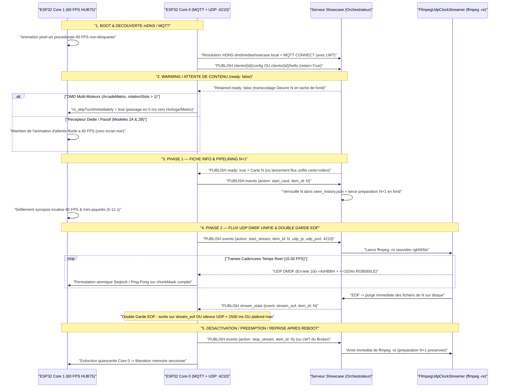
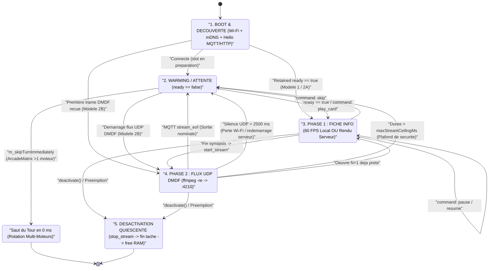

# Guide d'Intégration ESP32 & Récepteur Passif — DMD Media Showcase Server

🇬🇧 [English](ESP32_INTEGRATION.md) | 🇫🇷 Français | 🇪🇸 [Español](ESP32_INTEGRATION_ES.md)

[](https://t.me/+DrSdAO8UMUViNmE0)
[](https://ko-fi.com/red1l)

---

**DMD Media Showcase Server** prend en charge trois topologies complémentaires d'intégration pour les matrices LED HUB75 **ESP32 et ESP32-S3**. Que vous utilisiez un système complet multi-écrans avec capteurs locaux et horloges ou un micro-firmware dédié de ~180 lignes C++ sur un **`ESP32_STD` sans PSRAM**, les trois modèles partagent le même **plan de contrôle MQTT `:1883`** et le même **plan de données temps réel UDP `DMDF` RGB565LE cadencé par `ffmpeg -re`**.

---

## 1. Vue d'Ensemble & Comparaison des 3 Topologies d'Intégration ESP32

### Modèle 1 — DMD Multi-Moteurs Piloté par le Client (`config_source: "client"`)

Conçu pour les firmwares riches multi-écrans où l'ESP32 orchestre sa propre rotation locale (`Clock`, `Weather`, `Scoreboard`, `AudioSpectrum`, `RetroGames`, `Movies`, `Series`, `Anime`), sa pile de préemption (`DisplayArbiter`) et son propre WebUI embarqué.

- **Autorité de Configuration** : Le WebUI de l'ESP32 interroge dynamiquement `GET /api/v1/{domain}/filters?lang={ui_lang}` pour peupler ses listes déroulantes localisées, sauvegarde les filtres en flash locale, et publie sa configuration retenue sur `dmd_showcase/clients/{dmd_id}/config` (`retain=True`).
- **Comportement en Rotation** : Lorsque le tour d'un moteur Showcase arrive et que le slot MQTT retenu (`dmd_showcase/clients/{dmd_id}/{domain}/ready`) indique `{"ready": false}`, le moteur cède son tour en **`0 ms`** (`m_skipTurnImmediately = true`). Le panneau affiche instantanément le moteur local suivant (`Clock`, `Weather`, etc.) sans jamais provoquer d'écran noir ni de latence.
- **Implémentation de Référence en Production (`ArcadeMatrix`)** :
  - En-tête & Contrat Moteur : [`src/engines/MediaShowcaseEngines.h`](https://github.com/red77290/ArcadeMatrix/blob/main/src/engines/MediaShowcaseEngines.h)
  - Worker Core 0, Parseur `ArduinoJson` Zéro-Copie & Assembleur UDP `DMDF` : [`src/engines/MediaShowcaseEngines.cpp`](https://github.com/red77290/ArcadeMatrix/blob/main/src/engines/MediaShowcaseEngines.cpp)

---

### Modèle 2A — Récepteur Hybride Piloté par le Serveur (`config_source: "server"`, `supports_local_card: true`)

Conçu pour les afficheurs Showcase dédiés souhaitant conserver un rendu texte local ultra-net à 60 FPS sur l'ESP32 **sans** embarquer de WebUI, de logique de référentiels scrapers ni de schémas NVS complexes.

- **Annonce Matérielle Légère** : Au démarrage, l'ESP32 publie un court message retenu sur `dmd_showcase/clients/{dmd_id}/hello` (`retain=True`) déclarant uniquement sa géométrie et son adresse LAN (`width`, `height`, `udp_ip`, `udp_port`, `config_source: "server"`, `supports_local_card: true` et langue par défaut `lang`).
- **Profil Centralisé Persisté (`./data/dmd_profiles.json`)** : Toutes les playlists de domaines (`games`, `movies`, `series`, `anime`), catégories (`systems`, `genres`, `decades`), préréglages de cadrage/colorimétrie IA (`video_mode`, `color_boost`) et la langue de diffusion du contenu (`lang`) sont configurés dans le **Dashboard Web Showcase** (`http://dmdmediashowcase.local:8890/`) et sauvegardés dans `./data/dmd_profiles.json`.
- **Rendu Hybride** : L'ESP32 affiche localement la **Phase 1 (Fiche Info)** à 60 FPS (mini-jaquette + badge coloré + défilement fluide du synopsis poussé via `ready` ou `dmd_showcase/clients/{dmd_id}/command` `play_card`), puis déclenche `start_stream` pour recevoir la **Phase 2 (Panoramas + Vidéo)** en UDP `DMDF`.

---

### Modèle 2B — Récepteur Framebuffer 100 % Passif Piloté par le Serveur (`config_source: "server"`, `supports_local_card: false`)

Conçu pour des montages matériels ultra-légers et sans maintenance (`ESP32_STD` WROOM-32 **sans PSRAM** ou `ESP32-S3`) en **~180 lignes de C++** — **zéro WebUI, zéro police de caractères, zéro parseur JSON et zéro bibliothèque MQTT requise**.

- **Découverte Zéro-Configuration** : L'ESP32 s'annonce via un simple heartbeat HTTP périodique `POST /api/v1/clients/hello` (ou MQTT `dmd_showcase/clients/{dmd_id}/hello`), voire **sans aucun appel sortant** s'il possède une IP LAN fixe déclarée avec `always_stream_udp: true` dans `./data/dmd_profiles.json`.
- **Flux 100 % Composité par le Serveur** : Avec `supports_local_card: false`, le serveur Showcase génère **y compris la Fiche Info de Phase 1** (mini-jaquette + badge système/domaine coloré + titre + année + note + synopsis localisé défilant) directement dans le flux binaire RGB565 et cadence l'envoi des tranches UDP `DMDF` via `ffmpeg -re` vers le port `:4210`.
- **Contrôle Temps Réel Instantané** : Les actions `Skip`, `Pause`, `Resume`, `Stop` et `Play Now` (`FrontendSync`) s'exécutent **100 % côté serveur** en commutant le flux `FfmpegUdpClockStreamer` vers `:4210` en `< 50 ms`.

---

### Tableau Comparatif des 3 Topologies

| Critère | Modèle 1 : Piloté Client (`ArcadeMatrix`) | Modèle 2A : Hybride Piloté Serveur | Modèle 2B : Récepteur UDP 100 % Passif |
| :--- | :--- | :--- | :--- |
| **Mode d'Annonce** | `config_source: "client"` (`.../config`) | `config_source: "server"`, `supports_local_card: true` (`.../hello`) | `config_source: "server"`, `supports_local_card: false` (`POST /clients/hello` ou IP statique) |
| **Stockage Playlists & Filtres** | Flash ESP32 (`config.json`) | Serveur (`./data/dmd_profiles.json`) | Serveur (`./data/dmd_profiles.json`) |
| **Complexité Firmware / UI** | OS Multi-Moteurs complet + WebUI | ~350 lignes C++ (MQTT + UDP + Police, zéro WebUI) | **~120–180 lignes C++** (Zéro UI, Zéro Police, Zéro JSON) |
| **Rendu Phase 1 (Fiche Info)** | Local 60 FPS sur Core 1 ESP32 | Local 60 FPS sur Core 1 ESP32 | **Rendu par le serveur dans le flux UDP RGB565** |
| **Rendu Phase 2 (Panoramas + Vidéo)** | UDP `DMDF` (`:5568+`) + repli HTTP `DMDS` | UDP `DMDF` (`:4210` / personnalisé) | UDP `DMDF` (`:4210`) |
| **Empreinte SRAM (`128x32`)** | `8 Ko` frame + `2 Ko` (`32x32`) / `6 Ko` (`48x64`) jaquette | `8 Ko` frame + `2–6 Ko` jaquette | **`8 Ko` simple (`16 Ko` ping-pong) — `0 o` jaquette/JSON** |
| **Qualification `ESP32_STD` (Sans PSRAM)** | Qualifié (`128x32`, `64x64`, `128x64`) | Qualifié (`128x32` à `128x64`) | **Qualifié (`128x32` jusqu'à `256x64` simple buffer)** |
| **Charge CPU Core 0** | Faible (MQTT + Base64 + `memcpy` UDP) | Faible (MQTT + Base64 + `memcpy` UDP) | **Minimale (pur `memcpy` UDP non-bloquant)** |
| **Réactivité `Skip` / `Pause` / `Play Now`** | Via MQTT `.../command` quand le slot est actif | Instantanée (`< 50 ms`) via MQTT `.../command` | **Instantanée (`< 50 ms`) directement dans le pipe `ffmpeg`** |

---

## 2. Chorégraphie FreeRTOS Dual-Core & Invariants DMA HUB75

Les dalles LED HUB75 ne possèdent pas de mémoire vidéo interne : le périphérique I2S/LCD DMA de l'ESP32 doit balayer en permanence les plans de bits PWM depuis la SRAM interne. Toute tempête d'interruptions Wi-Fi, allocation dynamique ou contention de mutex sur le cœur de rendu provoque immédiatement du scintillement ou des lignes fantômes.

Pour garantir un rafraîchissement irréprochable à **60 FPS** (`16,67 ms` par trame), l'architecture impose une séparation matérielle stricte entre les deux cœurs :

- **Core 0 (`PRO_CPU` — Worker Réseau & Protocole)** :
  - Exécute la pile Wi-Fi / LwIP, la résolution mDNS (`dmdmediashowcase.local` sur `224.0.0.251:5353`), le client MQTT `:1883` (ou le heartbeat HTTP `POST /api/v1/clients/hello`) et la lecture non-bloquante du socket UDP (`:4210` ou `:5568+`).
  - Réassemble les datagrammes **UDP `DMDF`** : chaque paquet contient un **en-tête Little-Endian `<4sHBBH` de 10 octets** (`magic = "DMDF"`, `uint16_t frame_seq`, `uint8_t chunk_idx`, `uint8_t total_chunks`, `uint16_t byte_offset`) suivi d'une tranche de **`<= 1024 octets`** de pixels RGB565LE (`<= 1034 octets` par paquet UDP — zéro fragmentation IP sous le MTU Wi-Fi standard de `1500 octets`).
- **Core 1 (`APP_CPU` — Boucle Temps Réel HUB75 à 60 FPS)** :
  - Pilote exclusivement `IDrawingSurface` / le DMA HUB75 à 60 FPS.
  - **Zéro Allocation Dynamique** : Aucun appel à `malloc`, `new`, `String` ni `std::vector::push_back` dans la boucle chaude de rendu.
  - **Zéro Mutex / Zéro Contention** : Aucun `std::mutex` ni sémaphore FreeRTOS partagé avec Core 0.
  - **Isolation Stricte du DMA** : Le worker réseau n'écrit jamais directement dans le buffer DMA HUB75 en cours de balayage ; les tranches sont assemblées dans `frame565` puis copiées proprement via `IDrawingSurface` lors de la passe de rendu.

### Passage de Trames Lock-Free : Seqlock Atomique vs Double-Buffer Ping-Pong

Deux mécanismes sans verrou permettent de transférer les trames de Core 0 vers Core 1 :

1. **Seqlock Atomique (`std::atomic<uint32_t> seq` + `frame565` Unique — Économie SRAM Maximale)** :
   - Utilisé dans [`MediaShowcaseEngines.cpp`](https://github.com/red77290/ArcadeMatrix/blob/main/src/engines/MediaShowcaseEngines.cpp) pour minimiser l'empreinte SRAM sur `ESP32_STD`.
   - Core 0 incrémente `seq` vers une valeur **impaire** (`fetch_add(1, memory_order_acq_rel)`) avant validation, puis vers une valeur **paire** (`fetch_add(1, memory_order_release)`) une fois l'état cohérent.
   - Core 1 vérifie que `(s1 & 1U) == 0` et `s1 == seq.load(acquire)` sans jamais bloquer.
2. **Double-Buffer Ping-Pong `frame565[2]` (`std::atomic<uint8_t> frontIdx` — Zéro Déchirement)** :
   - Core 0 écrit les tranches `DMDF` dans `frame565[backIdx]` en marquant chaque bit `(1ULL << chunk_idx)` dans un masque 64 bits `chunkMask`.
   - Dès que `chunkMask == ((1ULL << total_chunks) - 1ULL)`, Core 0 permute atomiquement `frontIdx.store(backIdx, std::memory_order_release)`. Core 1 lit toujours une trame 100 % complète.

### Budgets Exacts SRAM / PSRAM par Géométrie HUB75

Un **`ESP32_STD` sans PSRAM** (WROOM-32 disposant d'environ `110–140 Ko` de heap interne libre après initialisation Wi-Fi + HUB75 DMA) exécute l'intégralité du pipeline avec une large marge de sécurité :

| Géométrie Dalle | Pixels (`L x H`) | Tranches `DMDF` / Trame (`<= 1024 o`) | Simple `frame565` (Seqlock) | Ping-Pong `frame565[2]` | `poster565` Carte Locale (Modèle 1 / 2A) | RAM Totale Modèle 2B (Compatibilité `ESP32_STD` Sans PSRAM) |
| :--- | :--- | :--- | :--- | :--- | :--- | :--- |
| **`128x32`** *(DMD WPC)* | `4 096 px` | `8 tranches` | **`8 192 o`** (`8 Ko`) | `16 384 o` (`16 Ko`) | `2 048 o` (`32x32`) | **`9,2 Ko` (Simple) / `17,4 Ko` (Double)** — Fluide sur `ESP32_STD` |
| **`64x64`** *(Carré)* | `4 096 px` | `8 tranches` | **`8 192 o`** (`8 Ko`) | `16 384 o` (`16 Ko`) | `2 048 o` (`32x32`) | **`9,2 Ko` (Simple) / `17,4 Ko` (Double)** — Fluide sur `ESP32_STD` |
| **`128x64` / `64x128` TATE** | `8 192 px` | `16 tranches` | **`16 384 o`** (`16 Ko`) | `32 768 o` (`32 Ko`) | `6 144 o` (`48x64`) / `3 200 o` (`40x40`) | **`17,4 Ko` (Simple) / `33,8 Ko` (Double)** — Tient en SRAM interne `ESP32_STD` |
| **`256x64`** *(Super-DMD)* | `16 384 px` | `32 tranches` | **`32 768 o`** (`32 Ko`) | `65 536 o` (`64 Ko`) | `6 144 o` (`48x64`) | **`33,8 Ko` (Simple)** sur `ESP32_STD` ; `64 Ko` Double recommandé sur `ESP32-S3` PSRAM |

---

## 3. Séquencement Complet des Tâches, États d'Attente & Watchdog de Récupération

### Diagramme de Séquence de Bout en Bout



### Machine à États Déterministe du Récepteur ESP32



### Analyse Détaillée des 5 États & Garanties de Résilience

1. **`BOOT & DÉCOUVERTE mDNS / MQTT`** :
   - Dès la mise sous tension, Core 1 affiche une animation procédurale pixel-art à 60 FPS sans attendre la connexion Wi-Fi.
   - Core 0 résout `dmdmediashowcase.local` par mDNS (`224.0.0.251:5353`) et ouvre la session MQTT `:1883` avec un **Last Will and Testament (`LWT`)** `{"online": false}` sur `dmd_showcase/clients/{dmd_id}/status`.
2. **`WARMING / ATTENTE DE CONTENU` (`ready: false`)** :
   - **Récepteurs Dédiés / Passifs (Modèles 2A & 2B)** : Maintiennent leur animation 60 FPS fluide pendant que le serveur télécharge et transcode la première œuvre.
   - **DMD Multi-Moteurs (`ArcadeMatrix` — Modèle 1)** : Si `m_rotationSlotCount > 1` et que le topic retenu publie `{"ready": false}`, `MediaShowcaseBase` positionne `m_skipTurnImmediately = true` (`isFinished() == true` en **`0 ms`**). L'afficheur enchaîne immédiatement sur l'horloge ou la météo sans **aucun écran noir** pendant que le serveur prépare l'œuvre en arrière-plan.
3. **`PHASE 1 — FICHE INFO & PIPELINING N+1`** :
   - L'événement `start_card` verrouille immédiatement l'œuvre `N` dans `./data/seen_history.json` (sauf si `mark_seen: false` via `FrontendSync`), bascule le topic retenu `ready` à `{"ready": false}` et déclenche **instantanément la préparation en tâche de fond du slot `N+1`**.
   - Le temps que le spectateur lise le synopsis défilant (`5–12 s`) puis visionne les panoramas et l'extrait vidéo (`8–15 s`), l'œuvre `N+1` est déjà transcodée et prête à être diffusée sans temps mort.
4. **`PHASE 2 — FLUX UDP DMDF UNIFIÉ & DOUBLE GARDE EOF`** :
   - `start_stream` démarre `FfmpegUdpClockStreamer` (`ffmpeg -re`), qui découpe chaque trame RGB565LE en paquets UDP `DMDF` vers `{udp_ip}:{udp_port}`.
   - **Pourquoi la Double Garde EOF est Obligatoire** : Se fier uniquement au message MQTT `stream_eof` figerait indéfiniment la matrice sur la dernière image en cas de micro-coupure Wi-Fi ou de redémarrage du conteneur serveur en plein milieu d'un clip. L'ESP32 **DOIT** impérativement combiner :
     1. **L'événement MQTT `stream_eof` (ou `command: skip/stop`)** : Transition nominale instantanée dès la fin de `ffmpeg -re`.
     2. **Le Watchdog Local d'Inactivité UDP de `2 500 ms` (`millis() - lastUdpPacketMs > 2500`)** : Garantit un retour automatique à l'animation d'attente ou au moteur suivant en `2,5 s` si le flux UDP s'interrompt (paquet `stream_eof` perdu, routeur ou serveur redémarré).
     3. **Le Plafond de Durée Maximale (`millis() - streamStartMs > maxStreamCeilingMs`)** : Borne strictement la durée maximale d'une séquence. *(Sur `ArcadeMatrix` Modèle 1, l'absence totale de paquet UDP dans les `850 ms` suivant `start_stream` déclenche en outre un basculement transparent vers le flux TCP HTTP `DMDS` afin de contourner un éventuel blocage NAT Docker Desktop).*
5. **`DÉSACTIVATION & REPRISE APRÈS REDÉMARRAGE EN COURS DE FLUX`** :
   - **Désactivation Propre & Quiescente** : Le moteur passe `m_wantActive = false`, envoie `{"action": "stop_stream", "item_id": "..."}` pour stopper immédiatement `ffmpeg -re` côté serveur, attend la terminaison complète de la tâche Core 0 (`stopWorkerTaskBounded()` sans aucune allocation dynamique), puis libère ses buffers mémoire.
   - **Reboot Brutal de l'ESP32 en Plein Stream** : Le broker déclenche le `LWT` (`{"online": false}`), ce qui tue immédiatement le processus `ffmpeg -re` orphelin tout en conservant le slot `N+1` préparé en tâche de fond.

---

## 4. Squelettes C++ / FreeRTOS de Référence

### A. Modèle 2B — Récepteur UDP `DMDF` 100 % Passif Complet en ~120 Lignes (`ESP32_STD` / `ESP32-S3`)

Ce firmware autonome ne requiert **aucune bibliothèque JSON, aucun client MQTT, aucune police de caractères ni aucune PSRAM**. Core 0 publie un heartbeat `POST /api/v1/clients/hello` toutes les `15 s` et assemble les paquets UDP `:4210` `DMDF` dans un double-buffer RGB565 ; Core 1 rafraîchit la dalle HUB75 à 60 FPS et bascule automatiquement sur l'animation procédurale dès que `millis() - lastUdpPacketMs > 2500` :

```cpp
#include <Arduino.h>
#include <WiFi.h>
#include <WiFiUdp.h>
#include <HTTPClient.h>
#include <ESPmDNS.h>
#include <atomic>

static constexpr uint16_t PANEL_W = 128;
static constexpr uint16_t PANEL_H = 32;
static constexpr size_t FRAME_PIXELS = PANEL_W * PANEL_H;
static constexpr size_t FRAME_BYTES  = FRAME_PIXELS * sizeof(uint16_t); // 8,192 B
static constexpr uint16_t UDP_PORT   = 4210;
static constexpr uint32_t UDP_WATCHDOG_MS = 2500;

static const char* WIFI_SSID    = "YOUR_WIFI_SSID";
static const char* WIFI_PASS    = "YOUR_WIFI_PASSWORD";
static const char* DMD_ID       = "esp32_passive_128x32";
static const char* SHOWCASE_URL = "http://dmdmediashowcase.local:8890/api/v1/clients/hello";

// Ping-pong RGB565 framebuffers in internal SRAM (2 x 8,192 B = 16 KB -> fits ESP32_STD without PSRAM)
static uint16_t s_frame565[2][FRAME_PIXELS];
static std::atomic<uint8_t>  s_frontIdx{0};
static std::atomic<uint32_t> s_lastUdpPacketMs{0};
static std::atomic<bool>     s_streamActive{false};

// Replace with your HUB75 driver's off-screen canvas pixel call (e.g. IDrawingSurface / MatrixPanel_I2S_DMA)
extern void hub75DrawPixel565(int16_t x, int16_t y, uint16_t rgb565);
extern void hub75PresentFrame();

static void netWorkerTask(void*) {
    WiFi.mode(WIFI_STA);
    WiFi.setSleep(false); // Critical: disable Wi-Fi modem sleep for jitter-free UDP DMDF reception
    WiFi.begin(WIFI_SSID, WIFI_PASS);
    while (WiFi.status() != WL_CONNECTED) { vTaskDelay(pdMS_TO_TICKS(250)); }
    MDNS.begin(DMD_ID);

    WiFiUDP udp;
    udp.begin(UDP_PORT);

    uint8_t  pkt[1040];
    uint8_t  backIdx = 1;
    uint16_t curSeq  = 0xFFFF;
    uint64_t chunkMask = 0;
    uint32_t lastHelloMs = 0;

    for (;;) {
        uint32_t now = millis();
        // Periodic lightweight HTTP Hello heartbeat every 15 s (registers IP + geometry in dmd_profiles.json)
        if (WiFi.status() == WL_CONNECTED && (lastHelloMs == 0 || (now - lastHelloMs) >= 15000U)) {
            lastHelloMs = now;
            HTTPClient http;
            http.setTimeout(1500);
            if (http.begin(SHOWCASE_URL)) {
                http.addHeader("Content-Type", "application/json");
                char body[224];
                IPAddress ip = WiFi.localIP();
                snprintf(body, sizeof(body),
                    "{\"dmd_id\":\"%s\",\"config_source\":\"server\",\"supports_local_card\":false,"
                    "\"width\":%u,\"height\":%u,\"udp_ip\":\"%u.%u.%u.%u\",\"udp_port\":%u,\"lang\":\"fr\"}",
                    DMD_ID, PANEL_W, PANEL_H, ip[0], ip[1], ip[2], ip[3], UDP_PORT);
                http.POST(reinterpret_cast<uint8_t*>(body), strlen(body));
                http.end();
            }
        }

        // Drain all queued DMDF UDP slices (<4sHBBH 10-byte Little-Endian header + <= 1024 B RGB565LE)
        int pktSize = udp.parsePacket();
        if (pktSize > 10 && pktSize <= static_cast<int>(sizeof(pkt))) {
            int len = udp.read(pkt, sizeof(pkt));
            if (len > 10 && memcmp(pkt, "DMDF", 4) == 0) {
                uint16_t seq         = static_cast<uint16_t>(pkt[4] | (pkt[5] << 8));
                uint8_t  chunkIdx    = pkt[6];
                uint8_t  totalChunks = pkt[7] > 0 ? pkt[7] : 1;
                uint16_t byteOff     = static_cast<uint16_t>(pkt[8] | (pkt[9] << 8));
                size_t   payloadLen  = static_cast<size_t>(len - 10);

                if (seq != curSeq) {
                    curSeq = seq;
                    chunkMask = 0;
                }
                if (chunkIdx < totalChunks && totalChunks <= 64 && (byteOff + payloadLen) <= FRAME_BYTES) {
                    memcpy(reinterpret_cast<uint8_t*>(s_frame565[backIdx]) + byteOff, pkt + 10, payloadLen);
                    chunkMask |= (1ULL << chunkIdx);
                    uint64_t fullMask = (totalChunks == 64) ? ~0ULL : ((1ULL << totalChunks) - 1ULL);
                    if (chunkMask == fullMask) {
                        chunkMask = 0;
                        uint8_t prevFront = s_frontIdx.load(std::memory_order_relaxed);
                        s_frontIdx.store(backIdx, std::memory_order_release);
                        backIdx = prevFront; // Swap ping-pong target for next frame
                        s_streamActive.store(true, std::memory_order_release);
                    }
                    s_lastUdpPacketMs.store(millis(), std::memory_order_release);
                }
            }
        } else {
            // Local 2,500 ms UDP inactivity watchdog: never freeze on dropped Wi-Fi or server restart
            uint32_t lastPkt = s_lastUdpPacketMs.load(std::memory_order_acquire);
            if (s_streamActive.load(std::memory_order_relaxed) && (millis() - lastPkt) > UDP_WATCHDOG_MS) {
                s_streamActive.store(false, std::memory_order_release);
            }
            vTaskDelay(pdMS_TO_TICKS(1));
        }
    }
}

void setup() {
    // Initialize HUB75 panel on Core 1 before spawning Core 0 network worker
    xTaskCreatePinnedToCore(netWorkerTask, "DmdUdpNet", 6144, nullptr, 1, nullptr, 0);
}

void loop() {
    // Runs on Core 1 (APP_CPU): strictly zero heap allocation and zero mutex
    uint32_t now = millis();
    if (s_streamActive.load(std::memory_order_acquire)) {
        const uint16_t* fb = s_frame565[s_frontIdx.load(std::memory_order_acquire)];
        for (uint16_t y = 0; y < PANEL_H; ++y) {
            const uint16_t* row = fb + (y * PANEL_W);
            for (uint16_t x = 0; x < PANEL_W; ++x) {
                hub75DrawPixel565(x, y, row[x]);
            }
        }
    } else {
        // Non-blocking 60 FPS procedural pixel-art waiting animation during boot / warming
        uint32_t t = now >> 4;
        for (uint16_t y = 0; y < PANEL_H; ++y) {
            for (uint16_t x = 0; x < PANEL_W; ++x) {
                uint8_t v = static_cast<uint8_t>((x * 5 + y * 9 + t) & 0x3F);
                uint16_t c = static_cast<uint16_t>(((v >> 2) << 11) | ((v >> 1) << 5) | (v >> 1));
                hub75DrawPixel565(x, y, c);
            }
        }
    }
    hub75PresentFrame();
    vTaskDelay(pdMS_TO_TICKS(16)); // ~60 FPS cadence
}
```

---

### B. Modèle 2A — Extraits Protocole MQTT Hybride Piloté Serveur (`supports_local_card: true`)

Dans le Modèle 2A, l'ESP32 annonce `supports_local_card: true` via MQTT (`retain=True`) et écoute les topics `dmd_showcase/clients/{dmd_id}/command` et `stream_state` :

```cpp
// 1. Retained Hardware Announcement on MQTT connect (with LWT on dmd_showcase/clients/{id}/status)
void publishHybridHello(PubSubClient& mqtt, const char* dmdId, const char* localIp) {
    char topic[96], payload[256];
    snprintf(topic, sizeof(topic), "dmd_showcase/clients/%s/hello", dmdId);
    snprintf(payload, sizeof(payload),
        "{\"dmd_id\":\"%s\",\"config_source\":\"server\",\"supports_local_card\":true,"
        "\"width\":128,\"height\":32,\"udp_ip\":\"%s\",\"udp_port\":4210,\"lang\":\"fr\"}",
        dmdId, localIp);
    mqtt.publish(topic, reinterpret_cast<const uint8_t*>(payload), strlen(payload), /*retained=*/true);

    char cmdTopic[96], stateTopic[96], readyWildcard[96];
    snprintf(cmdTopic, sizeof(cmdTopic), "dmd_showcase/clients/%s/command", dmdId);
    snprintf(stateTopic, sizeof(stateTopic), "dmd_showcase/clients/%s/stream_state", dmdId);
    snprintf(readyWildcard, sizeof(readyWildcard), "dmd_showcase/clients/%s/+/ready", dmdId);
    mqtt.subscribe(cmdTopic);
    mqtt.subscribe(stateTopic);
    mqtt.subscribe(readyWildcard);
}

// 2. Handling Server-to-DMD Live Commands & Dual EOF Guard on Core 0
void onMqttMessage(const char* topic, char* jsonPayload) {
    // Parse with stack/static buffer; never allocate on Core 1
    if (strstr(topic, "/command") != nullptr) {
        // action: "play_card" | "skip" | "pause" | "resume" | "stop"
        if (strstr(jsonPayload, "\"skip\"") || strstr(jsonPayload, "\"stop\"")) {
            g_abortCurrentItem.store(true, std::memory_order_release);
        } else if (strstr(jsonPayload, "\"pause\"")) {
            g_paused.store(true, std::memory_order_release);
        } else if (strstr(jsonPayload, "\"resume\"")) {
            g_paused.store(false, std::memory_order_release);
            g_lastUdpPacketMs.store(millis(), std::memory_order_release); // Reset watchdog on resume
        } else if (strstr(jsonPayload, "\"play_card\"")) {
            // Immediate play_now preemption pushed by WebUI or FrontendSync
            parseCardIntoSeqlock(jsonPayload);
            g_preemptWithNewCard.store(true, std::memory_order_release);
        }
    } else if (strstr(topic, "/stream_state") != nullptr && strstr(jsonPayload, "\"stream_eof\"")) {
        g_mqttStreamEof.store(true, std::memory_order_release);
    }
}
```

---

## 5. Référence API REST & MQTT : Langue (`lang`), Recherche Filtrée, File à la Demande & `FrontendSync`

Tous les profils DMD gérés par le serveur, les contrôles live, la recherche multilingue et l'intégration avec les frontends d'arcade (`FrontendSync`) sont exposés via l'API REST FastAPI (`:8890`) et synchronisés en temps réel sur MQTT (`:1883`).

### 5.1 Recherche Catalogue Filtrée & Localisée (`GET /api/v1/{domain}/search`)

Interroge la chaîne de scrapers `[Primaire, Fallback]` d'un domaine (`games`, `movies`, `series`, `anime`) dans la langue de diffusion souhaitée (`lang`) avec filtrage optionnel par système, genre ou décennie :

```bash
curl -s "http://dmdmediashowcase.local:8890/api/v1/games/search?q=street+fighter&lang=fr&systems=megadrive&genres=fighting&limit=8" | jq .
```

| Paramètre | Type | Description |
| :--- | :--- | :--- |
| `q` | `string` | Requête texte sur le titre (ex. `streets of rage`, `akira`, `blade runner`). |
| `lang` | `string` | Langue cible du titre, du synopsis et des jaquettes régionales (`fr`, `en`, `es`, `de`, `it`, `ja`). |
| `systems` | `string` | Identifiants systèmes canoniques séparés par virgule (`megadrive`, `snes`, `neogeo`, `mame`, ...). |
| `genres` | `string` | Identifiants genres canoniques séparés par virgule (`fighting`, `shmup`, `platform`, `scifi`, ...). |
| `decades` | `string` | Filtre décennies séparé par virgule (`1980s`, `1990s`, `2000s`, ...). |
| `limit` | `int` | Nombre maximal de candidats retournés (`1..25`, défaut `8`). |

---

### 5.2 Clients DMD Connectés & Profils Serveur Persistés (`./data/dmd_profiles.json`)

- **`GET /api/v1/clients`** — Liste l'ensemble des panneaux DMD découverts et configurés (`client` et `server`), leur état en direct, `config_source`, `supports_local_card`, leur géométrie, `udp_ip:udp_port`, l'œuvre en cours et la file d'attente à la demande.
- **`POST /api/v1/clients/hello`** — Endpoint HTTP d'annonce / heartbeat (`ClientHelloPayload`) pour les récepteurs passifs Modèle 2B sans MQTT.
- **`GET /api/v1/clients/{dmd_id}/profile`** & **`DELETE /api/v1/clients/{dmd_id}/profile`** — Lecture ou suppression d'un profil DMD persisté.
- **`PUT /api/v1/clients/{dmd_id}/profile`** — Sauvegarde le profil serveur et la `playlist` de rotation d'un DMD dans `./data/dmd_profiles.json` et recharge immédiatement son pipeline `N+1` :

```bash
curl -X PUT "http://dmdmediashowcase.local:8890/api/v1/clients/esp32_passive_128x32/profile" \
  -H "Content-Type: application/json" \
  -d '{
    "display_name": "Topper Bartop 128x32",
    "config_source": "server",
    "supports_local_card": false,
    "always_stream_udp": true,
    "udp_ip": "192.168.1.60",
    "udp_port": 4210,
    "width": 128,
    "height": 32,
    "lang": "fr",
    "inter_item_gap_s": 1.0,
    "playlist": [
      {
        "enabled": true,
        "domain": "games",
        "count": 2,
        "systems": ["neogeo", "cps2", "megadrive", "snes"],
        "genres": ["fighting", "shmup", "beatemup"],
        "decades": ["1990s"],
        "video_mode": "auto_action",
        "color_boost": "pixel_art",
        "jacket_panorama": true,
        "include_video": true,
        "video_max_duration_s": 10.0,
        "video_fps": 20,
        "text_scroll_speed": "6"
      },
      {
        "enabled": true,
        "domain": "anime",
        "count": 1,
        "video_type": "opening",
        "video_mode": "auto_action",
        "color_boost": "anime"
      }
    ]
  }'
```

---

### 5.3 File d'Attente Prioritaire à la Demande (`GET / POST / DELETE /api/v1/clients/{dmd_id}/queue`)

Consulte (`GET`), injecte (`POST`) ou retire (`DELETE /api/v1/clients/{dmd_id}/queue/{queue_id}`) une œuvre précise dans la file prioritaire d'un DMD cible — soit via son `candidate_id` issu de `/search`, soit directement par `{domain, query, systems, lang}` :

- **`mode: "enqueue_next"`** *(Défaut)* : Transcode l'œuvre en priorité haute (`HIGH_ON_DEMAND`) et la diffuse juste après la fin de l'élément en cours.
- **`mode: "play_now"`** : Préempte immédiatement la diffusion actuelle (`stop`/`play_card` MQTT + arrêt du flux UDP `ffmpeg -re` actif) et lance l'œuvre dès la fin du transcodage.
- **`mark_seen: true | false`** : Détermine si la lecture doit inscrire l'œuvre dans `./data/seen_history.json`.

```bash
# Ajout par candidate_id issu de /api/v1/{domain}/search
curl -X POST "http://dmdmediashowcase.local:8890/api/v1/clients/esp32_passive_128x32/queue" \
  -H "Content-Type: application/json" \
  -d '{
    "domain": "movies",
    "candidate_id": "tmdb:movie:78",
    "lang": "fr",
    "mode": "enqueue_next",
    "mark_seen": true
  }'
```

---

### 5.4 Contrôle de Lecture en Direct (`POST /api/v1/clients/{dmd_id}/control`)

Pilote instantanément n'importe quel DMD depuis le WebUI Showcase, Home Assistant ou un script externe (relayé sur MQTT `dmd_showcase/clients/{dmd_id}/command` et directement sur `FfmpegUdpClockStreamer` pour les récepteurs passifs) :

```bash
# Actions supportees : "skip" | "pause" | "resume" | "stop"
curl -X POST "http://dmdmediashowcase.local:8890/api/v1/clients/esp32_passive_128x32/control" \
  -H "Content-Type: application/json" \
  -d '{"action": "skip"}'
```

---

### 5.5 Intégration `FrontendSync` (Batocera / RetroBat / LaunchBox / Playnite)

Sur une borne d'arcade ou un PC de salon exécutant **Batocera**, **RetroBat**, **LaunchBox / BigBox** ou **Playnite**, **`FrontendSync`** transforme votre DMD HUB75 en topper/marquee dynamique synchronisé avec le jeu parcouru ou lancé par le joueur, tout en revenant automatiquement au mode Showcase sans répétition au repos :

1. **Sélection ou Lancement d'un Jeu (`mode: "play_now"`, `mark_seen: false`)** :
   - `FrontendSync` appelle `POST /api/v1/clients/{dmd_id}/queue` avec `mode: "play_now"` et **`mark_seen: false`**.
   - **Pourquoi `mark_seen: false` est indispensable** : Lancer 20 fois votre jeu Neo-Geo ou Mega Drive favori **ne pollue jamais `./data/seen_history.json`**, préservant intacte la découverte Consume-Once en mode attract !
2. **Sortie du Jeu (`action: "skip"`)** :
   - Au retour sur le menu ou en veille, `FrontendSync` envoie `{"action": "skip"}` sur `/api/v1/clients/{dmd_id}/control` pour reprendre immédiatement la rotation Showcase `N+1` pré-chauffée.

```bash
# Exemple : Script EmulationStation Batocera (/userdata/system/configs/emulationstation/scripts/game-start/dmd_sync.sh)
#!/bin/sh
SYSTEM="$1"    # ex. "megadrive", "neogeo", "mame"
ROM_PATH="$2"
GAME_NAME="$3" # ex. "Streets of Rage 2"

curl -fsS -m 2 -X POST "http://dmdmediashowcase.local:8890/api/v1/clients/esp32_passive_128x32/queue" \
  -H "Content-Type: application/json" \
  -d "{
    \"domain\": \"games\",
    \"query\": \"${GAME_NAME}\",
    \"systems\": [\"${SYSTEM}\"],
    \"lang\": \"fr\",
    \"mode\": \"play_now\",
    \"mark_seen\": false
  }" >/dev/null 2>&1 &
```
