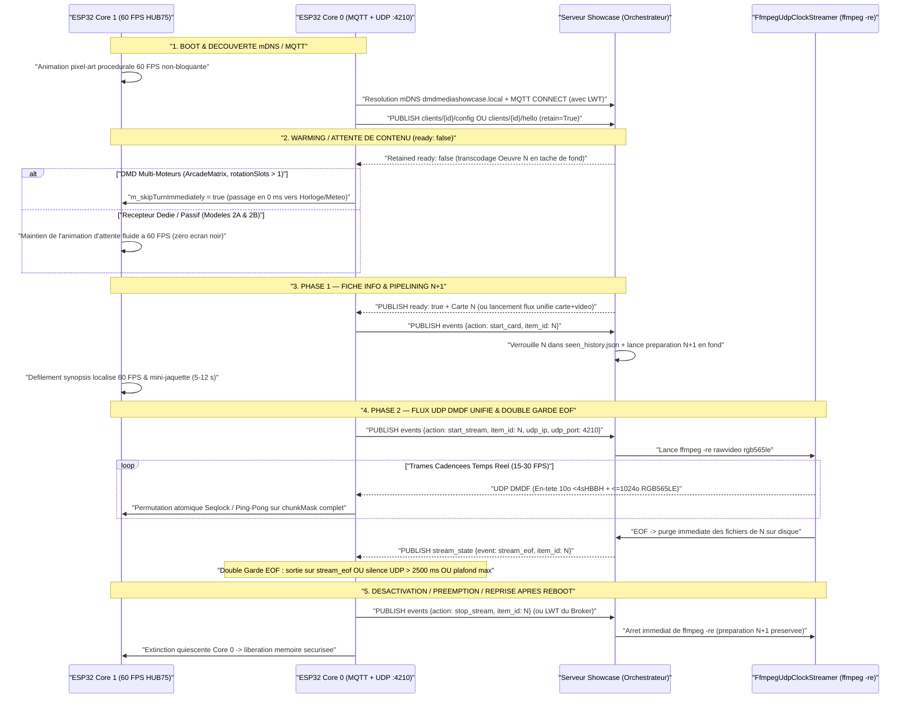
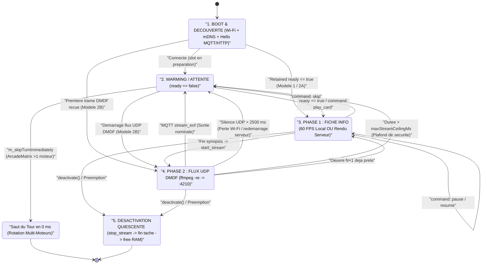

# Guide d'Intégration ESP32 & Récepteur Passif — DMD Media Showcase Server

🇬🇧 [English](ESP32_INTEGRATION.md) | 🇫🇷 Français | 🇪🇸 [Español](ESP32_INTEGRATION_ES.md)

[](https://t.me/+DrSdAO8UMUViNmE0)
[](https://ko-fi.com/red1l)

---

**DMD Media Showcase Server** prend en charge trois topologies complémentaires d'intégration pour les matrices LED HUB75 **ESP32 et ESP32-S3**. Que vous utilisiez un système complet multi-écrans avec capteurs locaux et horloges ou un micro-firmware dédié de ~180 lignes C++ sur un **`ESP32_STD` sans PSRAM**, les trois modèles partagent le même **plan de contrôle MQTT `:1883`** et le même **plan de données temps réel UDP `DMDF` RGB565LE cadencé par `ffmpeg -re`**.

---

## 1. Vue d'Ensemble & Comparaison des 3 Topologies d'Intégration ESP32

### Modèle 1 — DMD Multi-Moteurs Piloté par le Client (`config_source: "client"`)

Conçu pour les firmwares riches multi-écrans où l'ESP32 orchestre sa propre rotation locale (`Clock`, `Weather`, `Scoreboard`, `AudioSpectrum`, `RetroGames`, `Movies`, `Series`, `Anime`), sa pile de préemption (`DisplayArbiter`) et son propre WebUI embarqué.

- **Autorité de Configuration** : Le WebUI de l'ESP32 interroge dynamiquement `GET /api/v1/{domain}/filters?lang={ui_lang}` pour peupler ses listes déroulantes localisées, sauvegarde les filtres en flash locale, et publie sa configuration retenue sur `dmd_showcase/clients/{dmd_id}/config` (`retain=True`).
- **Comportement en Rotation** : Lorsque le tour d'un moteur Showcase arrive et que le slot MQTT retenu (`dmd_showcase/clients/{dmd_id}/{domain}/ready`) indique `{"ready": false}`, le moteur cède son tour en **`0 ms`** (`m_skipTurnImmediately = true`). Le panneau affiche instantanément le moteur local suivant (`Clock`, `Weather`, etc.) sans jamais provoquer d'écran noir ni de latence.
- **Implémentation de Référence en Production (`ArcadeMatrix`)** :
  - En-tête & Contrat Moteur : [`src/engines/MediaShowcaseEngines.h`](https://github.com/red77290/ArcadeMatrix/blob/main/src/engines/MediaShowcaseEngines.h)
  - Worker Core 0, Parseur `ArduinoJson` Zéro-Copie & Assembleur UDP `DMDF` : [`src/engines/MediaShowcaseEngines.cpp`](https://github.com/red77290/ArcadeMatrix/blob/main/src/engines/MediaShowcaseEngines.cpp)

---

### Modèle 2A — Récepteur Hybride Piloté par le Serveur (`config_source: "server"`, `supports_local_card: true`)

Conçu pour les afficheurs Showcase dédiés souhaitant conserver un rendu texte local ultra-net à 60 FPS sur l'ESP32 **sans** embarquer de WebUI, de logique de référentiels scrapers ni de schémas NVS complexes.

- **Annonce Matérielle Légère** : Au démarrage, l'ESP32 publie un court message retenu sur `dmd_showcase/clients/{dmd_id}/hello` (`retain=True`) déclarant uniquement sa géométrie et son adresse LAN (`width`, `height`, `udp_ip`, `udp_port`, `config_source: "server"`, `supports_local_card: true` et langue par défaut `lang`).
- **Profil Centralisé Persisté (`./data/dmd_profiles.json`)** : Toutes les playlists de domaines (`games`, `movies`, `series`, `anime`), catégories (`systems`, `genres`, `decades`), préréglages de cadrage/colorimétrie IA (`video_mode`, `color_boost`) et la langue de diffusion du contenu (`lang`) sont configurés dans le **Dashboard Web Showcase** (`http://dmdmediashowcase.local:8890/`) et sauvegardés dans `./data/dmd_profiles.json`.
- **Rendu Hybride** : L'ESP32 affiche localement la **Phase 1 (Fiche Info)** à 60 FPS (mini-jaquette + badge coloré + défilement fluide du synopsis poussé via `ready` ou `dmd_showcase/clients/{dmd_id}/command` `play_card`), puis déclenche `start_stream` pour recevoir la **Phase 2 (Panoramas + Vidéo)** en UDP `DMDF`.

---

### Modèle 2B — Récepteur Framebuffer 100 % Passif Piloté par le Serveur (`config_source: "server"`, `supports_local_card: false`)

Conçu pour des montages matériels ultra-légers et sans maintenance (`ESP32_STD` WROOM-32 **sans PSRAM** ou `ESP32-S3`) en **~180 lignes de C++** — **zéro WebUI, zéro police de caractères, zéro parseur JSON et zéro bibliothèque MQTT requise**.

- **Découverte Zéro-Configuration** : L'ESP32 s'annonce via un simple heartbeat HTTP périodique `POST /api/v1/clients/hello` (ou MQTT `dmd_showcase/clients/{dmd_id}/hello`), voire **sans aucun appel sortant** s'il possède une IP LAN fixe déclarée avec `always_stream_udp: true` dans `./data/dmd_profiles.json`.
- **Flux 100 % Composité par le Serveur** : Avec `supports_local_card: false`, le serveur Showcase génère **y compris la Fiche Info de Phase 1** (mini-jaquette + badge système/domaine coloré + titre + année + note + synopsis localisé défilant) directement dans le flux binaire RGB565 et cadence l'envoi des tranches UDP `DMDF` via `ffmpeg -re` vers le port `:4210`.
- **Contrôle Temps Réel Instantané** : Les actions `Skip`, `Pause`, `Resume`, `Stop` et `Play Now` (`FrontendSync`) s'exécutent **100 % côté serveur** en commutant le flux `FfmpegUdpClockStreamer` vers `:4210` en `< 50 ms`.

---

### Tableau Comparatif des 3 Topologies

| Critère | Modèle 1 : Piloté Client (`ArcadeMatrix`) | Modèle 2A : Hybride Piloté Serveur | Modèle 2B : Récepteur UDP 100 % Passif |
| :--- | :--- | :--- | :--- |
| **Mode d'Annonce** | `config_source: "client"` (`.../config`) | `config_source: "server"`, `supports_local_card: true` (`.../hello`) | `config_source: "server"`, `supports_local_card: false` (`POST /clients/hello` ou IP statique) |
| **Stockage Playlists & Filtres** | Flash ESP32 (`config.json`) | Serveur (`./data/dmd_profiles.json`) | Serveur (`./data/dmd_profiles.json`) |
| **Complexité Firmware / UI** | OS Multi-Moteurs complet + WebUI | ~350 lignes C++ (MQTT + UDP + Police, zéro WebUI) | **~120–180 lignes C++** (Zéro UI, Zéro Police, Zéro JSON) |
| **Rendu Phase 1 (Fiche Info)** | Local 60 FPS sur Core 1 ESP32 | Local 60 FPS sur Core 1 ESP32 | **Rendu par le serveur dans le flux UDP RGB565** |
| **Rendu Phase 2 (Panoramas + Vidéo)** | UDP `DMDF` (`:5568+`) + repli HTTP `DMDS` | UDP `DMDF` (`:4210` / personnalisé) | UDP `DMDF` (`:4210`) |
| **Empreinte SRAM (`128x32`)** | `8 Ko` frame + `2 Ko` (`32x32`) / `6 Ko` (`48x64`) jaquette | `8 Ko` frame + `2–6 Ko` jaquette | **`8 Ko` simple (`16 Ko` ping-pong) — `0 o` jaquette/JSON** |
| **Qualification `ESP32_STD` (Sans PSRAM)** | Qualifié (`128x32`, `64x64`, `128x64`) | Qualifié (`128x32` à `128x64`) | **Qualifié (`128x32` jusqu'à `256x64` simple buffer)** |
| **Charge CPU Core 0** | Faible (MQTT + Base64 + `memcpy` UDP) | Faible (MQTT + Base64 + `memcpy` UDP) | **Minimale (pur `memcpy` UDP non-bloquant)** |
| **Réactivité `Skip` / `Pause` / `Play Now`** | Via MQTT `.../command` quand le slot est actif | Instantanée (`< 50 ms`) via MQTT `.../command` | **Instantanée (`< 50 ms`) directement dans le pipe `ffmpeg`** |

---

## 2. Chorégraphie FreeRTOS Dual-Core & Invariants DMA HUB75

Les dalles LED HUB75 ne possèdent pas de mémoire vidéo interne : le périphérique I2S/LCD DMA de l'ESP32 doit balayer en permanence les plans de bits PWM depuis la SRAM interne. Toute tempête d'interruptions Wi-Fi, allocation dynamique ou contention de mutex sur le cœur de rendu provoque immédiatement du scintillement ou des lignes fantômes.

Pour garantir un rafraîchissement irréprochable à **60 FPS** (`16,67 ms` par trame), l'architecture impose une séparation matérielle stricte entre les deux cœurs :

- **Core 0 (`PRO_CPU` — Worker Réseau & Protocole)** :
  - Exécute la pile Wi-Fi / LwIP, la résolution mDNS (`dmdmediashowcase.local` sur `224.0.0.251:5353`), le client MQTT `:1883` (ou le heartbeat HTTP `POST /api/v1/clients/hello`) et la lecture non-bloquante du socket UDP (`:4210` ou `:5568+`).
  - Réassemble les datagrammes **UDP `DMDF`** : chaque paquet contient un **en-tête Little-Endian `<4sHBBH` de 10 octets** (`magic = "DMDF"`, `uint16_t frame_seq`, `uint8_t chunk_idx`, `uint8_t total_chunks`, `uint16_t byte_offset`) suivi d'une tranche de **`<= 1024 octets`** de pixels RGB565LE (`<= 1034 octets` par paquet UDP — zéro fragmentation IP sous le MTU Wi-Fi standard de `1500 octets`).
- **Core 1 (`APP_CPU` — Boucle Temps Réel HUB75 à 60 FPS)** :
  - Pilote exclusivement `IDrawingSurface` / le DMA HUB75 à 60 FPS.
  - **Zéro Allocation Dynamique** : Aucun appel à `malloc`, `new`, `String` ni `std::vector::push_back` dans la boucle chaude de rendu.
  - **Zéro Mutex / Zéro Contention** : Aucun `std::mutex` ni sémaphore FreeRTOS partagé avec Core 0.
  - **Isolation Stricte du DMA** : Le worker réseau n'écrit jamais directement dans le buffer DMA HUB75 en cours de balayage ; les tranches sont assemblées dans `frame565` puis copiées proprement via `IDrawingSurface` lors de la passe de rendu.

### Passage de Trames Lock-Free : Seqlock Atomique vs Double-Buffer Ping-Pong

Deux mécanismes sans verrou permettent de transférer les trames de Core 0 vers Core 1 :

1. **Seqlock Atomique (`std::atomic<uint32_t> seq` + `frame565` Unique — Économie SRAM Maximale)** :
   - Utilisé dans [`MediaShowcaseEngines.cpp`](https://github.com/red77290/ArcadeMatrix/blob/main/src/engines/MediaShowcaseEngines.cpp) pour minimiser l'empreinte SRAM sur `ESP32_STD`.
   - Core 0 incrémente `seq` vers une valeur **impaire** (`fetch_add(1, memory_order_acq_rel)`) avant validation, puis vers une valeur **paire** (`fetch_add(1, memory_order_release)`) une fois l'état cohérent.
   - Core 1 vérifie que `(s1 & 1U) == 0` et `s1 == seq.load(acquire)` sans jamais bloquer.
2. **Double-Buffer Ping-Pong `frame565[2]` (`std::atomic<uint8_t> frontIdx` — Zéro Déchirement)** :
   - Core 0 écrit les tranches `DMDF` dans `frame565[backIdx]` en marquant chaque bit `(1ULL << chunk_idx)` dans un masque 64 bits `chunkMask`.
   - Dès que `chunkMask == ((1ULL << total_chunks) - 1ULL)`, Core 0 permute atomiquement `frontIdx.store(backIdx, std::memory_order_release)`. Core 1 lit toujours une trame 100 % complète.

### Budgets Exacts SRAM / PSRAM par Géométrie HUB75

Un **`ESP32_STD` sans PSRAM** (WROOM-32 disposant d'environ `110–140 Ko` de heap interne libre après initialisation Wi-Fi + HUB75 DMA) exécute l'intégralité du pipeline avec une large marge de sécurité :

| Géométrie Dalle | Pixels (`L x H`) | Tranches `DMDF` / Trame (`<= 1024 o`) | Simple `frame565` (Seqlock) | Ping-Pong `frame565[2]` | `poster565` Carte Locale (Modèle 1 / 2A) | RAM Totale Modèle 2B (Compatibilité `ESP32_STD` Sans PSRAM) |
| :--- | :--- | :--- | :--- | :--- | :--- | :--- |
| **`128x32`** *(DMD WPC)* | `4 096 px` | `8 tranches` | **`8 192 o`** (`8 Ko`) | `16 384 o` (`16 Ko`) | `2 048 o` (`32x32`) | **`9,2 Ko` (Simple) / `17,4 Ko` (Double)** — Fluide sur `ESP32_STD` |
| **`64x64`** *(Carré)* | `4 096 px` | `8 tranches` | **`8 192 o`** (`8 Ko`) | `16 384 o` (`16 Ko`) | `2 048 o` (`32x32`) | **`9,2 Ko` (Simple) / `17,4 Ko` (Double)** — Fluide sur `ESP32_STD` |
| **`128x64` / `64x128` TATE** | `8 192 px` | `16 tranches` | **`16 384 o`** (`16 Ko`) | `32 768 o` (`32 Ko`) | `6 144 o` (`48x64`) / `3 200 o` (`40x40`) | **`17,4 Ko` (Simple) / `33,8 Ko` (Double)** — Tient en SRAM interne `ESP32_STD` |
| **`256x64`** *(Super-DMD)* | `16 384 px` | `32 tranches` | **`32 768 o`** (`32 Ko`) | `65 536 o` (`64 Ko`) | `6 144 o` (`48x64`) | **`33,8 Ko` (Simple)** sur `ESP32_STD` ; `64 Ko` Double recommandé sur `ESP32-S3` PSRAM |

### Pipeline d'Affichage HUB75 Préconisé : `Single DMA Buffer + Offscreen RGB565 Canvas` (`canvas_single`)

Sur l'ensemble des firmwares ESP32 HUB75 (dont [`ArcadeMatrix`](https://github.com/red77290/ArcadeMatrix)), le pipeline **`Single DMA Buffer + Offscreen RGB565 Canvas` (`canvas_single`)** adossé à [`mrfaptastic/ESP32-HUB75-MatrixPanel-I2S-DMA`](https://github.com/mrfaptastic/ESP32-HUB75-MatrixPanel-I2S-DMA) constitue **l'architecture de référence préconisée** :

1. **Économie de 50 % sur la SRAM Interne Compatible DMA (`mxconfig.double_buff = false`)** :
   - Sur `ESP32_STD` (sans PSRAM), les descripteurs DMA I2S et les bitplanes BCM doivent impérativement être alloués dans la DRAM interne contiguë (`MALLOC_CAP_DMA`) — exactement la ressource sollicitée par la pile Wi-Fi + LwIP + UDP.
   - Désactiver le double-buffering DMA matériel (`mxconfig.double_buff = false`) divise par deux l'empreinte des bitplanes (`~24 Ko` au lieu de `~48 Ko` en 6 bits sur `128x32`), tandis que le canevas linéaire RGB565 hors-écran (`GFXcanvas16`) ne consomme que `2 octets/pixel` (`8 Ko` en `128x32`, `16 Ko` en `128x64`, et logeable en PSRAM sur `ESP32-S3`).
2. **Zéro Scintillement Noir & Zéro Effet Stroboscopique (Écrasement Bitplane Sur Place)** :
   - Dessiner directement dans un unique buffer DMA (`direct_single`) en appelant `clearScreen()` efface les bitplanes en cours de balayage actif, provoquant un clignotement noir permanent.
   - Avec un **Canevas RGB565 Hors-Écran**, tous les effacements, tracés `Adafruit_GFX` (texte, HUD, score), animations d'attente et copies de trames UDP s'effectuent à 100 % en mémoire hors-écran. `blitCanvas565()` réécrit ensuite chaque mot de bitplane HUB75 **sur place** (`(dmaRow[ax] & ~0x003F) | rgb12`) en **`~300 µs`** (`128x32`) **sans jamais passer par un `clearScreen()` noir préalable**.
3. **Gating par Compteur d'État `Dirty` (`s_completedUdpSeq != s_lastPresentedUdpSeq`)** :
   - Core 1 cadencé à `60 Hz` (`16,6 ms`) cohabite avec un flux vidéo UDP `DMDF` à `15–25 FPS` (`40–66 ms`).
   - En ne déclenchant le burst vers `frame_buffer[0]` **que lorsqu'une nouvelle trame a réellement modifié le canevas**, Core 1 n'effectue **aucune écriture DMA redondante** entre deux trames vidéo, supprimant toute contention sur le bus SRAM pendant le balayage I2S.
4. **Encodage Burst BCM Multiplexé + Gamma Perceptif CIE 1931 + Swap FIFO I2S ESP32 Classique** :
   - Encode simultanément la demi-ligne haute `(y)` et la demi-ligne basse `(y + H/2)` dans `R1G1B1R2G2B2` via des tables **gamma CIE 1931** calibrées à la profondeur active (`6 bits` sur `ESP32_STD`, `8 bits` sur `ESP32-S3`), applique la permutation 16 bits du FIFO I2S de l'ESP32 original (`MATRIX_TX_ADJUST(x)`) et vide les lignes de cache CPU (`Cache_WriteBack_Addr`) lorsque `SPIRAM_DMA_BUFFER` est actif sur `ESP32-S3`.

| Mode Pipeline | `mxconfig.double_buff` | Canevas RGB565 Hors-Écran | Marge DRAM DMA (`ESP32_STD`) | Scintillement / Tearing | Préconisation |
| :--- | :---: | :---: | :--- | :--- | :--- |
| **`canvas_single`** | **`false`** | **Oui (`GFXcanvas16`)** | **Optimale (-50 % DRAM DMA)** | **Zéro scintillement (burst `~300 µs` sur place + dirty gating)** | **Préconisé (`ESP32_STD` & `ESP32-S3`)** |
| `canvas_double` | `true` | Oui (`GFXcanvas16`) | Coût RAM élevé (`2x` DMA + Canvas) | Swap sans déchirement | Optionnel sur `ESP32-S3` Octal PSRAM |
| `direct_double` | `true` | Non | Forte pression DRAM (`2x` bitplanes) | `drawPixel()` unitaire lent en vidéo | Sketches GFX legacy uniquement |
| `direct_single` | `false` | Non | RAM libre maximale | Scintillement visible sur `clearScreen()` | Repli d'urgence très basse RAM uniquement |

---

## 3. Séquencement Complet des Tâches, États d'Attente & Watchdog de Récupération

### Diagramme de Séquence de Bout en Bout



### Machine à États Déterministe du Récepteur ESP32



### Analyse Détaillée des 5 États & Garanties de Résilience

1. **`BOOT & DÉCOUVERTE mDNS / MQTT`** :
   - Dès la mise sous tension, Core 1 affiche une animation procédurale pixel-art à 60 FPS sans attendre la connexion Wi-Fi.
   - Core 0 résout `dmdmediashowcase.local` par mDNS (`224.0.0.251:5353`) et ouvre la session MQTT `:1883` avec un **Last Will and Testament (`LWT`)** `{"online": false}` sur `dmd_showcase/clients/{dmd_id}/status`.
2. **`WARMING / ATTENTE DE CONTENU` (`ready: false`)** :
   - **Récepteurs Dédiés / Passifs (Modèles 2A & 2B)** : Maintiennent leur animation 60 FPS fluide pendant que le serveur télécharge et transcode la première œuvre.
   - **DMD Multi-Moteurs (`ArcadeMatrix` — Modèle 1)** : Si `m_rotationSlotCount > 1` et que le topic retenu publie `{"ready": false}`, `MediaShowcaseBase` positionne `m_skipTurnImmediately = true` (`isFinished() == true` en **`0 ms`**). L'afficheur enchaîne immédiatement sur l'horloge ou la météo sans **aucun écran noir** pendant que le serveur prépare l'œuvre en arrière-plan.
3. **`PHASE 1 — FICHE INFO & PIPELINING N+1`** :
   - L'événement `start_card` verrouille immédiatement l'œuvre `N` dans `./data/seen_history.json` (sauf si `mark_seen: false` via `FrontendSync`), bascule le topic retenu `ready` à `{"ready": false}` et déclenche **instantanément la préparation en tâche de fond du slot `N+1`**.
   - Le temps que le spectateur lise le synopsis défilant (`5–12 s`) puis visionne les panoramas et l'extrait vidéo (`8–15 s`), l'œuvre `N+1` est déjà transcodée et prête à être diffusée sans temps mort.
4. **`PHASE 2 — FLUX UDP DMDF UNIFIÉ & DOUBLE GARDE EOF`** :
   - `start_stream` démarre `FfmpegUdpClockStreamer` (`ffmpeg -re`), qui découpe chaque trame RGB565LE en paquets UDP `DMDF` vers `{udp_ip}:{udp_port}`.
   - **Pourquoi la Double Garde EOF est Obligatoire** : Se fier uniquement au message MQTT `stream_eof` figerait indéfiniment la matrice sur la dernière image en cas de micro-coupure Wi-Fi ou de redémarrage du conteneur serveur en plein milieu d'un clip. L'ESP32 **DOIT** impérativement combiner :
     1. **L'événement MQTT `stream_eof` (ou `command: skip/stop`)** : Transition nominale instantanée dès la fin de `ffmpeg -re`.
     2. **Le Watchdog Local d'Inactivité UDP de `2 500 ms` (`millis() - lastUdpPacketMs > 2500`)** : Garantit un retour automatique à l'animation d'attente ou au moteur suivant en `2,5 s` si le flux UDP s'interrompt (paquet `stream_eof` perdu, routeur ou serveur redémarré).
     3. **Le Plafond de Durée Maximale (`millis() - streamStartMs > maxStreamCeilingMs`)** : Borne strictement la durée maximale d'une séquence. *(Sur `ArcadeMatrix` Modèle 1, l'absence totale de paquet UDP dans les `850 ms` suivant `start_stream` déclenche en outre un basculement transparent vers le flux TCP HTTP `DMDS` afin de contourner un éventuel blocage NAT Docker Desktop).*
5. **`DÉSACTIVATION & REPRISE APRÈS REDÉMARRAGE EN COURS DE FLUX`** :
   - **Désactivation Propre & Quiescente** : Le moteur passe `m_wantActive = false`, envoie `{"action": "stop_stream", "item_id": "..."}` pour stopper immédiatement `ffmpeg -re` côté serveur, attend la terminaison complète de la tâche Core 0 (`stopWorkerTaskBounded()` sans aucune allocation dynamique), puis libère ses buffers mémoire.
   - **Reboot Brutal de l'ESP32 en Plein Stream** : Le broker déclenche le `LWT` (`{"online": false}`), ce qui tue immédiatement le processus `ffmpeg -re` orphelin tout en conservant le slot `N+1` préparé en tâche de fond.

---

## 4. Implémentation Monolithique de Référence (`ESP32-HUB75-MatrixPanel-I2S-DMA` + `Single DMA Buffer + Canvas`)

### A. Modèle 2B — Firmware Monolithique Clé en Main (`platformio.ini` + `src/main.cpp`)

Ce firmware C++ monolithique et auto-suffisant implémente l'intégralité du pipeline **`Single DMA Buffer (`mxconfig.double_buff = false`) + Canevas Hors-Écran `GFXcanvas16` + Encodeur Bitplane Burst CIE 1931 (`blitCanvas565`) + Dirty-Frame Gating`** sur [`mrfaptastic/ESP32-HUB75-MatrixPanel-I2S-DMA`](https://github.com/mrfaptastic/ESP32-HUB75-MatrixPanel-I2S-DMA). Il compile tel quel aussi bien sur **ESP32 Classique (`esp32dev`, sans PSRAM)** que sur **ESP32-S3 (`esp32-s3-devkitc-1` / Waveshare RGB Matrix avec PSRAM)**, et peut être flashé directement ou intégré dans n'importe quel firmware HUB75 tiers :

#### `platformio.ini`

```ini
[platformio]
default_envs = esp32dev

[env]
platform = espressif32
framework = arduino
monitor_speed = 115200
lib_deps =
    mrfaptastic/ESP32 HUB75 LED MATRIX PANEL DMA Display @ ^3.0.11
    adafruit/Adafruit GFX Library @ ^1.11.9

; Target 1: Standard ESP32 (WROOM-32 / DevKitC without PSRAM)
[env:esp32dev]
board = esp32dev
build_flags =
    -D CORE_DEBUG_LEVEL=1
    -O2

; Target 2: ESP32-S3 with Octal PSRAM (e.g. Waveshare ESP32-S3-RGB-Matrix / N16R8)
[env:esp32s3]
board = esp32-s3-devkitc-1
board_build.arduino.memory_type = qio_opi
build_flags =
    -D BOARD_HAS_PSRAM
    -D SPIRAM_DMA_BUFFER
    -D CORE_DEBUG_LEVEL=1
    -O2
```

#### `src/main.cpp` (Implémentation Monolithique Complète)

```cpp
/**
 * @file main.cpp
 * @brief Monolithic ESP32 / ESP32-S3 HUB75 Receiver for DMD Media Showcase (Mode 2B)
 *        using the "Single DMA Buffer + Offscreen RGB565 Canvas" (`canvas_single`) pipeline.
 *
 * Architectural Highlights (Proven in Production on ArcadeMatrix):
 *  1. Single HUB75 DMA Buffer (`mxconfig.double_buff = false`):
 *     Cuts scarce internal DMA-capable SRAM (`MALLOC_CAP_DMA`) usage by 50% compared to
 *     DMA double-buffering, leaving ample contiguous heap for Wi-Fi + LwIP + UDP on
 *     standard ESP32 boards without PSRAM (`ESP32_STD`).
 *  2. Offscreen Linear RGB565 Canvas (`Adafruit_GFX` / `GFXcanvas16`):
 *     All drawing (idle 60 FPS procedural animation, local HUD overlays, or incoming UDP
 *     frames) happens exclusively in offscreen memory (`2 bytes/pixel`). `clearScreen()` is
 *     NEVER called on the live DMA scanout buffer, eliminating black-frame strobe/flicker.
 *  3. In-Place Multiplexed BCM Bitplane Burst Encoder (`blitCanvas565`):
 *     Encodes upper `(y)` and lower `(y + H/2)` HUB75 scan halves simultaneously with
 *     perceptual CIE 1931 gamma LUTs directly into `frame_buffer[0]` (`~300 us` for 128x32),
 *     bypassing thousands of per-pixel virtual `drawPixel()` calls.
 *  4. Dirty-Frame Gating (`s_completedUdpSeq != s_lastPresentedUdpSeq`):
 *     Core 1 only bursts the offscreen canvas into DMA memory when a brand-new frame is
 *     actually ready, preventing redundant bus contention while I2S scans the panel.
 *  5. Strict Dual-Core Isolation:
 *     - Core 0 (`PRO_CPU`): Wi-Fi, mDNS, periodic HTTP `hello`, lock-free UDP `DMDF` assembly.
 *     - Core 1 (`APP_CPU`): Zero-allocation, zero-mutex 60 Hz canvas composition & DMA commit.
 */

#include <Arduino.h>
#include <WiFi.h>
#include <WiFiUdp.h>
#include <HTTPClient.h>
#include <ESPmDNS.h>
#include <esp_heap_caps.h>
#include <Adafruit_GFX.h>
#include <atomic>
#include <cstring>
#include <memory>
#include <vector>

#if defined(SPIRAM_DMA_BUFFER)
#include "rom/cache.h"
#endif

// Expose `MatrixPanel_I2S_DMA` internal `frame_buffer` row-plane pointers to our subclass
// for direct in-place BCM bitplane burst encoding (must come AFTER STL headers).
#define private protected
#include <ESP32-HUB75-MatrixPanel-I2S-DMA.h>
#undef private

// =========================================================================================
// STEP 1: PANEL GEOMETRY, NETWORK CONFIGURATION & HARDWARE PIN PROFILES
// =========================================================================================

static constexpr uint16_t MODULE_W     = 64;   // Single HUB75 panel width (typically 64)
static constexpr uint16_t MODULE_H     = 32;   // Single HUB75 panel height (32 or 64)
static constexpr uint16_t CHAIN_LEN    = 2;    // Number of chained panels (2 x 64x32 = 128x32)
static constexpr uint16_t PANEL_W      = MODULE_W * CHAIN_LEN;
static constexpr uint16_t PANEL_H      = MODULE_H;
static constexpr size_t   FRAME_PIXELS = static_cast<size_t>(PANEL_W) * PANEL_H;
static constexpr size_t   FRAME_BYTES  = FRAME_PIXELS * sizeof(uint16_t); // 8,192 B for 128x32

static constexpr uint16_t UDP_PORT          = 4210;
static constexpr uint32_t HELLO_INTERVAL_MS = 15000U;
static constexpr uint32_t UDP_WATCHDOG_MS   = 2500U;

static const char* WIFI_SSID    = "YOUR_WIFI_SSID";
static const char* WIFI_PASS    = "YOUR_WIFI_PASSWORD";
static const char* DMD_ID       = "esp32_passive_128x32";
static const char* CONTENT_LANG = "fr"; // Broadcast language ("fr", "en", "es", "de", "it", "pt", "ja")
static const char* SHOWCASE_HELLO_URL = "http://dmdmediashowcase.local:8890/api/v1/clients/hello";

// Classic ESP32 (Xtensa LX6) I2S TX FIFO transmits 16-bit words swapped within each 32-bit pair.
// ESP32-S3 LCD_CAM transmits 16-bit words in natural sequential order.
#ifndef MATRIX_TX_ADJUST
#if defined(CONFIG_IDF_TARGET_ESP32) && !defined(CONFIG_IDF_TARGET_ESP32S3)
#define MATRIX_TX_ADJUST(x) (((x) & 1U) ? ((x) - 1U) : ((x) + 1U))
#else
#define MATRIX_TX_ADJUST(x) (x)
#endif
#endif

// Default GPIO mapping per target architecture (adjust to match your shield/wiring).
// Note: On ESP32-S3 with Octal PSRAM, NEVER assign GPIO 32..37 to HUB75!
static void populateHub75Pins(HUB75_I2S_CFG::i2s_pins& pins) {
#if defined(CONFIG_IDF_TARGET_ESP32S3)
    // Waveshare ESP32-S3-RGB-Matrix / Generic ESP32-S3 PSRAM-safe pinout
    pins.r1 = 4;  pins.g1 = 5;  pins.b1 = 6;
    pins.r2 = 7;  pins.g2 = 15; pins.b2 = 16;
    pins.a  = 18; pins.b  = 8;  pins.c  = 3;
    pins.d  = 42; pins.e  = (PANEL_H >= 64) ? 9 : -1;
    pins.lat = 40; pins.oe = 2; pins.clk = 41;
#else
    // Standard ESP32 (WROOM-32 / DevKitC) HUB75 pinout
    pins.r1 = 25; pins.g1 = 26; pins.b1 = 27;
    pins.r2 = 14; pins.g2 = 12; pins.b2 = 13;
    pins.a  = 33; pins.b  = 32; pins.c  = 22;
    pins.d  = 17; pins.e  = (PANEL_H >= 64) ? 21 : -1;
    pins.lat = 4; pins.oe = 15; pins.clk = 16;
#endif
}

// =========================================================================================
// STEP 2: SINGLE-DMA-BUFFER PANEL SUBCLASS WITH IN-PLACE CIE 1931 BITPLANE BURST ENCODER
// =========================================================================================

// Preserves HUB75 control bits (LAT/OE/address in bits 6..15) while clearing R1G1B1R2G2B2 (bits 0..5).
static constexpr uint16_t HUB75_RGB12_CLEAR_MASK = 0b1111111111000000U;

// Perceptual CIE 1931 lightness curve (8-bit, gamma ~2.2) for silky dark gradients on LEDs.
static const uint8_t kCie1931Lut8[256] = {
      0,   0,   0,   0,   0,   0,   0,   0,   0,   0,   1,   1,   1,   1,   1,   1,
      1,   1,   2,   2,   2,   2,   2,   2,   3,   3,   3,   3,   4,   4,   4,   4,
      5,   5,   5,   5,   6,   6,   6,   7,   7,   7,   8,   8,   8,   9,   9,  10,
     10,  10,  11,  11,  12,  12,  13,  13,  14,  14,  15,  15,  16,  16,  17,  18,
     18,  19,  19,  20,  21,  21,  22,  23,  23,  24,  25,  25,  26,  27,  28,  28,
     29,  30,  31,  32,  32,  33,  34,  35,  36,  37,  38,  38,  39,  40,  41,  42,
     43,  44,  45,  46,  47,  48,  49,  51,  52,  53,  54,  55,  56,  57,  58,  60,
     61,  62,  63,  65,  66,  67,  68,  70,  71,  72,  74,  75,  77,  78,  79,  81,
     82,  84,  85,  87,  88,  90,  91,  93,  94,  96,  98,  99, 101, 103, 104, 106,
    108, 110, 111, 113, 115, 117, 119, 120, 122, 124, 126, 128, 130, 132, 134, 136,
    138, 140, 142, 144, 146, 148, 150, 153, 155, 157, 159, 162, 164, 166, 168, 171,
    173, 175, 178, 180, 183, 185, 188, 190, 193, 195, 198, 201, 203, 206, 208, 211,
    214, 216, 219, 222, 225, 227, 230, 233, 236, 239, 242, 245, 247, 250, 253, 255,
    255, 255, 255, 255, 255, 255, 255, 255, 255, 255, 255, 255, 255, 255, 255, 255,
    255, 255, 255, 255, 255, 255, 255, 255, 255, 255, 255, 255, 255, 255, 255, 255,
    255, 255, 255, 255, 255, 255, 255, 255, 255, 255, 255, 255, 255, 255, 255, 255
};

class SingleBufferCanvasPanel : public MatrixPanel_I2S_DMA {
public:
    using MatrixPanel_I2S_DMA::MatrixPanel_I2S_DMA;

    // Precompute channel LUTs scaled to the configured BCM bit depth (e.g. 6-bit on ESP32_STD, 8-bit on S3).
    void initGammaLuts(uint8_t depth) {
        if (depth < 2) depth = 2;
        if (depth > 8) depth = 8;
        m_depth = depth;
        const uint8_t  shift  = static_cast<uint8_t>(8U - depth);
        const uint16_t round  = (shift > 0U) ? static_cast<uint16_t>(1U << (shift - 1U)) : 0U;
        const uint16_t maxVal = static_cast<uint16_t>((1U << depth) - 1U);

        for (uint16_t r = 0; r < 32; ++r) {
            uint8_t r8 = static_cast<uint8_t>((r << 3) | (r >> 2));
            uint16_t v = static_cast<uint16_t>((kCie1931Lut8[r8] + round) >> shift);
            m_lutR[r]  = static_cast<uint8_t>((v > maxVal) ? maxVal : v);
        }
        for (uint16_t g = 0; g < 64; ++g) {
            uint8_t g8 = static_cast<uint8_t>((g << 2) | (g >> 4));
            uint16_t v = static_cast<uint16_t>((kCie1931Lut8[g8] + round) >> shift);
            m_lutG[g]  = static_cast<uint8_t>((v > maxVal) ? maxVal : v);
        }
        for (uint16_t b = 0; b < 32; ++b) {
            uint8_t b8 = static_cast<uint8_t>((b << 3) | (b >> 2));
            uint16_t v = static_cast<uint16_t>((kCie1931Lut8[b8] + round) >> shift);
            m_lutB[b]  = static_cast<uint8_t>((v > maxVal) ? maxVal : v);
        }
    }

    // Burst-encode a linear RGB565 offscreen canvas directly into the single active DMA buffer (`frame_buffer[0]`).
    // Because every bitplane word is overwritten in-place without clearing first, there is zero black strobe.
    void blitCanvas565(const uint16_t* canvas, uint16_t canvasW, uint16_t canvasH) {
        if (!canvas || !initialized) return;
        const uint16_t w   = static_cast<uint16_t>(PIXELS_PER_ROW);
        const uint16_t rpf = static_cast<uint16_t>(ROWS_PER_FRAME); // PANEL_H / 2 (1/16 or 1/32 scan)
        if (canvasW != w || canvasH != static_cast<uint16_t>(m_cfg.mx_height)) return;

        auto& dmaFb = frame_buffer[0]; // Single DMA buffer (`double_buff == false`)
        if (dmaFb.rowBits.size() < rpf) return;

        for (uint16_t y = 0; y < rpf; ++y) {
            const uint16_t* upperRow = canvas + (static_cast<size_t>(y) * w);
            const uint16_t* lowerRow = canvas + (static_cast<size_t>(y + rpf) * w);

            for (uint8_t p = 0; p < m_depth; ++p) {
                uint16_t* dmaRow = dmaFb.rowBits[y]->getDataPtr(p);
                if (!dmaRow) continue;

                for (uint16_t x = 0; x < w; ++x) {
                    const uint16_t c1 = upperRow[x];
                    const uint16_t c2 = lowerRow[x];

                    const uint16_t r1 = (m_lutR[(c1 >> 11) & 0x1FU] >> p) & 1U;
                    const uint16_t g1 = (m_lutG[(c1 >> 5)  & 0x3FU] >> p) & 1U;
                    const uint16_t b1 = (m_lutB[ c1        & 0x1FU] >> p) & 1U;

                    const uint16_t r2 = (m_lutR[(c2 >> 11) & 0x1FU] >> p) & 1U;
                    const uint16_t g2 = (m_lutG[(c2 >> 5)  & 0x3FU] >> p) & 1U;
                    const uint16_t b2 = (m_lutB[ c2        & 0x1FU] >> p) & 1U;

                    const uint16_t rgb12 = static_cast<uint16_t>(
                        r1 | (g1 << 1) | (b1 << 2) | (r2 << 3) | (g2 << 4) | (b2 << 5)
                    );
                    const uint16_t ax = MATRIX_TX_ADJUST(x);
                    dmaRow[ax] = static_cast<uint16_t>((dmaRow[ax] & HUB75_RGB12_CLEAR_MASK) | rgb12);
                }

#if defined(SPIRAM_DMA_BUFFER)
                // Flush CPU dcache line to SPIRAM so LCD_CAM DMA observes updated bitplanes immediately.
                Cache_WriteBack_Addr(reinterpret_cast<uint32_t>(dmaRow), static_cast<uint32_t>(w * sizeof(uint16_t)));
#endif
            }
        }
    }

private:
    uint8_t m_depth = 6;
    uint8_t m_lutR[32]{};
    uint8_t m_lutG[64]{};
    uint8_t m_lutB[32]{};
};

// =========================================================================================
// STEP 3: LOCK-FREE DUAL-CORE BUFFERS (UDP STAGING ON CORE 0 -> OFFSCREEN CANVAS ON CORE 1)
// =========================================================================================

static SingleBufferCanvasPanel* g_panel  = nullptr;
static GFXcanvas16*             g_canvas = nullptr; // Core 1 private offscreen canvas (full Adafruit_GFX API)

// Ping-pong RGB565 buffers for tear-free UDP `DMDF` packet reassembly on Core 0.
// Allocated in PSRAM when present, otherwise in internal SRAM (`2 x 8 KB = 16 KB` for 128x32).
static uint16_t*             g_udpSlots[2]        = {nullptr, nullptr};
static std::atomic<uint8_t>  s_frontUdpIdx{0};
static std::atomic<uint32_t> s_completedUdpSeq{0};
static std::atomic<uint32_t> s_lastUdpPacketMs{0};
static std::atomic<bool>     s_streamActive{false};

static uint16_t* allocRgb565Buffer(size_t bytes) {
    uint16_t* buf = nullptr;
    if (psramFound()) {
        buf = static_cast<uint16_t*>(heap_caps_malloc(bytes, MALLOC_CAP_SPIRAM | MALLOC_CAP_8BIT));
    }
    if (!buf) {
        buf = static_cast<uint16_t*>(heap_caps_malloc(bytes, MALLOC_CAP_INTERNAL | MALLOC_CAP_8BIT));
    }
    if (buf) {
        memset(buf, 0, bytes);
    }
    return buf;
}

// =========================================================================================
// STEP 4: CORE 0 NETWORK WORKER (WIFI + HTTP HELLO + LOCK-FREE UDP `DMDF` REASSEMBLER)
// =========================================================================================

static void netWorkerTask(void*) {
    WiFi.mode(WIFI_STA);
    // CRITICAL: Disable Wi-Fi modem power-save sleep so 100 ms DTIM intervals never stall UDP packets!
    WiFi.setSleep(false);
#if defined(CONFIG_IDF_TARGET_ESP32) && !defined(CONFIG_IDF_TARGET_ESP32S3)
    // Cap RF TX bursts on classic ESP32 to prevent transient USB 5V rail voltage dips during HUB75 scanout.
    WiFi.setTxPower(WIFI_POWER_17dBm);
#endif
    WiFi.begin(WIFI_SSID, WIFI_PASS);
    while (WiFi.status() != WL_CONNECTED) {
        vTaskDelay(pdMS_TO_TICKS(250));
    }
    MDNS.begin(DMD_ID);

    WiFiUDP udp;
    udp.begin(UDP_PORT);

    uint8_t  pkt[1040]; // 10-byte `<4sHBBH` header + up to 1024-byte RGB565LE slice (<= 1034 B < Wi-Fi MTU)
    uint8_t  backIdx      = 1;
    uint16_t curFrameSeq  = 0xFFFFU;
    uint64_t chunkMask    = 0ULL;
    uint32_t lastHelloMs  = 0U;

    for (;;) {
        const uint32_t now = millis();

        // 4.1 Periodic non-blocking HTTP Hello announcement (registers IP + geometry in `./data/dmd_profiles.json`).
        // Skip HTTP heartbeat while UDP packets are actively streaming so socket read latency stays < 1 ms.
        const bool activelyReceiving = s_streamActive.load(std::memory_order_relaxed) &&
                                       ((now - s_lastUdpPacketMs.load(std::memory_order_relaxed)) < 1200U);
        if (!activelyReceiving && WiFi.status() == WL_CONNECTED &&
            (lastHelloMs == 0U || (now - lastHelloMs) >= HELLO_INTERVAL_MS)) {
            lastHelloMs = now;
            HTTPClient http;
            http.setTimeout(1200);
            if (http.begin(SHOWCASE_HELLO_URL)) {
                http.addHeader("Content-Type", "application/json");
                char body[256];
                const IPAddress ip = WiFi.localIP();
                snprintf(
                    body, sizeof(body),
                    "{\"dmd_id\":\"%s\",\"config_source\":\"server\",\"supports_local_card\":false,"
                    "\"width\":%u,\"height\":%u,\"udp_ip\":\"%u.%u.%u.%u\",\"udp_port\":%u,\"lang\":\"%s\"}",
                    DMD_ID, PANEL_W, PANEL_H, ip[0], ip[1], ip[2], ip[3], UDP_PORT, CONTENT_LANG
                );
                http.POST(reinterpret_cast<uint8_t*>(body), strlen(body));
                http.end();
            }
        }

        // 4.2 Drain all pending UDP `DMDF` datagrams in a tight burst before yielding.
        int pktSize = udp.parsePacket();
        if (pktSize > 10 && pktSize <= static_cast<int>(sizeof(pkt))) {
            while (pktSize > 10 && pktSize <= static_cast<int>(sizeof(pkt))) {
                const int len = udp.read(pkt, sizeof(pkt));
                if (len > 10 && memcmp(pkt, "DMDF", 4) == 0) {
                    const uint16_t seq         = static_cast<uint16_t>(pkt[4] | (pkt[5] << 8));
                    const uint8_t  chunkIdx    = pkt[6];
                    const uint8_t  totalChunks = (pkt[7] > 0U) ? pkt[7] : 1U;
                    const uint16_t byteOff     = static_cast<uint16_t>(pkt[8] | (pkt[9] << 8));
                    const size_t   payloadLen  = static_cast<size_t>(len - 10);

                    if (seq != curFrameSeq) {
                        curFrameSeq = seq;
                        chunkMask   = 0ULL;
                    }

                    if (chunkIdx < totalChunks && totalChunks <= 64U && (byteOff + payloadLen) <= FRAME_BYTES) {
                        memcpy(reinterpret_cast<uint8_t*>(g_udpSlots[backIdx]) + byteOff, pkt + 10, payloadLen);
                        chunkMask |= (1ULL << chunkIdx);

                        const uint64_t expectedMask = (totalChunks == 64U) ? ~0ULL : ((1ULL << totalChunks) - 1ULL);
                        if (chunkMask == expectedMask) {
                            chunkMask = 0ULL;
                            // Publish completed frame lock-free to Core 1 and swap Core 0 staging slot.
                            const uint8_t prevFront = s_frontUdpIdx.load(std::memory_order_relaxed);
                            s_frontUdpIdx.store(backIdx, std::memory_order_release);
                            backIdx = prevFront;
                            s_completedUdpSeq.fetch_add(1U, std::memory_order_release);
                            s_streamActive.store(true, std::memory_order_release);
                            // Pre-seed next back buffer with the just-completed frame so any single lost
                            // UDP slice in a future frame preserves prior pixels instead of black tearing.
                            memcpy(g_udpSlots[backIdx], g_udpSlots[s_frontUdpIdx.load(std::memory_order_relaxed)], FRAME_BYTES);
                        }
                        s_lastUdpPacketMs.store(millis(), std::memory_order_release);
                    }
                }
                pktSize = udp.parsePacket();
            }
        } else {
            // 4.3 Local 2,500 ms UDP inactivity watchdog: smoothly return to idle animation on EOF or server reboot.
            const uint32_t lastPkt = s_lastUdpPacketMs.load(std::memory_order_acquire);
            if (s_streamActive.load(std::memory_order_relaxed) && (millis() - lastPkt) > UDP_WATCHDOG_MS) {
                s_streamActive.store(false, std::memory_order_release);
            }
            vTaskDelay(pdMS_TO_TICKS(1));
        }
    }
}

// =========================================================================================
// STEP 5: CORE 1 REAL-TIME 60 HZ RENDER LOOP (OFFSCREEN CANVAS -> DIRTY-GATED SINGLE DMA)
// =========================================================================================

// Non-blocking procedural waiting animation rendered strictly into the offscreen `GFXcanvas16`.
static void renderWaitingAnimationToCanvas(GFXcanvas16& canvas, uint32_t nowMs) {
    uint16_t* dst = canvas.getBuffer();
    const uint32_t t = nowMs >> 4;
    for (uint16_t y = 0; y < PANEL_H; ++y) {
        uint16_t* row = dst + (static_cast<size_t>(y) * PANEL_W);
        for (uint16_t x = 0; x < PANEL_W; ++x) {
            const uint8_t  v = static_cast<uint8_t>((x * 5U + y * 9U + t) & 0x3FU);
            const uint16_t r = static_cast<uint16_t>((v >> 2) & 0x1FU);
            const uint16_t g = static_cast<uint16_t>((v >> 1) & 0x3FU);
            const uint16_t b = static_cast<uint16_t>((v >> 1) & 0x1FU);
            row[x] = static_cast<uint16_t>((r << 11) | (g << 5) | b);
        }
    }
}

void setup() {
    Serial.begin(115200);

    // 5.1 Allocate offscreen `GFXcanvas16` + lock-free UDP staging buffers BEFORE Wi-Fi fragments heap.
    g_canvas      = new GFXcanvas16(PANEL_W, PANEL_H);
    g_udpSlots[0] = allocRgb565Buffer(FRAME_BYTES);
    g_udpSlots[1] = allocRgb565Buffer(FRAME_BYTES);
    if (!g_canvas || !g_canvas->getBuffer() || !g_udpSlots[0] || !g_udpSlots[1]) {
        Serial.println("[FATAL] Failed to allocate offscreen RGB565 buffers!");
        for (;;) { delay(1000); }
    }

    // 5.2 Configure HUB75 with SINGLE DMA BUFFER (`mxconfig.double_buff = false`).
    HUB75_I2S_CFG::i2s_pins pins{};
    populateHub75Pins(pins);
    HUB75_I2S_CFG mxconfig(MODULE_W, MODULE_H, CHAIN_LEN, pins);

    // 6-bit BCM depth (64 perceptual CIE levels/channel) fits comfortably in internal DMA SRAM on ESP32_STD;
    // upgrade automatically to 8-bit BCM depth when PSRAM is available (e.g. ESP32-S3).
    const uint8_t colorDepth = psramFound() ? 8U : 6U;
    mxconfig.setPixelColorDepthBits(colorDepth);
    mxconfig.double_buff      = false; // <--- CRITICAL: Single DMA Buffer saves 50% internal DMA DRAM!
    mxconfig.min_refresh_rate = 90;
    mxconfig.latch_blanking   = 4;
    mxconfig.clkphase         = false;
    mxconfig.driver           = HUB75_I2S_CFG::SHIFTREG; // Or FM6126A / ICN2038S depending on your LED panels

    g_panel = new SingleBufferCanvasPanel(mxconfig);
    if (!g_panel->begin()) {
        Serial.println("[FATAL] HUB75 Single-Buffer DMA allocation failed!");
        for (;;) { delay(1000); }
    }
    g_panel->initGammaLuts(colorDepth);
    g_panel->setBrightness8(96); // 0..255 safe cabinet brightness

    // Commit clean black Frame 0 once at boot via the offscreen canvas.
    g_canvas->fillScreen(0x0000);
    g_panel->blitCanvas565(g_canvas->getBuffer(), PANEL_W, PANEL_H);

    // 5.3 Launch network & UDP reassembly worker strictly pinned to Core 0 (`PRO_CPU`).
    xTaskCreatePinnedToCore(netWorkerTask, "ShowcaseUdpNet", 6144, nullptr, 1, nullptr, 0);
}

void loop() {
    // Runs on Core 1 (`APP_CPU`): strictly ZERO heap allocation and ZERO mutex!
    static uint32_t s_lastPresentedUdpSeq = 0U;
    static uint32_t s_lastFrameTickMs     = 0U;

    const uint32_t now = millis();
    if ((now - s_lastFrameTickMs) < 16U) { // Pace Core 1 composition loop at ~60 Hz (16.6 ms)
        vTaskDelay(pdMS_TO_TICKS(1));
        return;
    }
    s_lastFrameTickMs = now;

    bool canvasDirty = false;

    if (s_streamActive.load(std::memory_order_acquire)) {
        const uint32_t latestSeq = s_completedUdpSeq.load(std::memory_order_acquire);
        // Dirty-Frame Gating: ONLY touch the offscreen canvas & Single DMA Buffer when a new UDP frame arrived!
        if (latestSeq != s_lastPresentedUdpSeq) {
            const uint8_t frontIdx = s_frontUdpIdx.load(std::memory_order_acquire);
            memcpy(g_canvas->getBuffer(), g_udpSlots[frontIdx], FRAME_BYTES);

            // Optional hook for custom firmwares: draw local Adafruit_GFX HUD / score / clock overlays here
            // into `g_canvas` (e.g. `g_canvas->setCursor(...); g_canvas->print(...);`) before DMA burst!

            s_lastPresentedUdpSeq = latestSeq;
            canvasDirty = true;
        }
    } else {
        // Boot / Warming / Idle state: compose smooth 60 FPS animation in offscreen canvas.
        renderWaitingAnimationToCanvas(*g_canvas, now);
        canvasDirty = true;
    }

    // Commit offscreen canvas to Single HUB75 DMA Buffer ONLY when dirty (in-place burst, zero black clear).
    if (canvasDirty) {
        g_panel->blitCanvas565(g_canvas->getBuffer(), PANEL_W, PANEL_H);
    }
}
```

---

### B. Modèle 2A — Extraits Protocole MQTT Hybride Piloté Serveur (`supports_local_card: true`)

Dans le Modèle 2A, l'ESP32 annonce `supports_local_card: true` via MQTT (`retain=True`) et écoute les topics `dmd_showcase/clients/{dmd_id}/command` et `stream_state` :

```cpp
// 1. Retained Hardware Announcement on MQTT connect (with LWT on dmd_showcase/clients/{id}/status)
void publishHybridHello(PubSubClient& mqtt, const char* dmdId, const char* localIp) {
    char topic[96], payload[256];
    snprintf(topic, sizeof(topic), "dmd_showcase/clients/%s/hello", dmdId);
    snprintf(payload, sizeof(payload),
        "{\"dmd_id\":\"%s\",\"config_source\":\"server\",\"supports_local_card\":true,"
        "\"width\":128,\"height\":32,\"udp_ip\":\"%s\",\"udp_port\":4210,\"lang\":\"fr\"}",
        dmdId, localIp);
    mqtt.publish(topic, reinterpret_cast<const uint8_t*>(payload), strlen(payload), /*retained=*/true);

    char cmdTopic[96], stateTopic[96], readyWildcard[96];
    snprintf(cmdTopic, sizeof(cmdTopic), "dmd_showcase/clients/%s/command", dmdId);
    snprintf(stateTopic, sizeof(stateTopic), "dmd_showcase/clients/%s/stream_state", dmdId);
    snprintf(readyWildcard, sizeof(readyWildcard), "dmd_showcase/clients/%s/+/ready", dmdId);
    mqtt.subscribe(cmdTopic);
    mqtt.subscribe(stateTopic);
    mqtt.subscribe(readyWildcard);
}

// 2. Handling Server-to-DMD Live Commands & Dual EOF Guard on Core 0
void onMqttMessage(const char* topic, char* jsonPayload) {
    // Parse with stack/static buffer; never allocate on Core 1
    if (strstr(topic, "/command") != nullptr) {
        // action: "play_card" | "skip" | "pause" | "resume" | "stop"
        if (strstr(jsonPayload, "\"skip\"") || strstr(jsonPayload, "\"stop\"")) {
            g_abortCurrentItem.store(true, std::memory_order_release);
        } else if (strstr(jsonPayload, "\"pause\"")) {
            g_paused.store(true, std::memory_order_release);
        } else if (strstr(jsonPayload, "\"resume\"")) {
            g_paused.store(false, std::memory_order_release);
            g_lastUdpPacketMs.store(millis(), std::memory_order_release); // Reset watchdog on resume
        } else if (strstr(jsonPayload, "\"play_card\"")) {
            // Immediate play_now preemption pushed by WebUI or FrontendSync
            parseCardIntoSeqlock(jsonPayload);
            g_preemptWithNewCard.store(true, std::memory_order_release);
        }
    } else if (strstr(topic, "/stream_state") != nullptr && strstr(jsonPayload, "\"stream_eof\"")) {
        g_mqttStreamEof.store(true, std::memory_order_release);
    }
}
```

---

## 5. Référence API REST & MQTT : Langue (`lang`), Recherche Filtrée, File à la Demande & `FrontendSync`

Tous les profils DMD gérés par le serveur, les contrôles live, la recherche multilingue et l'intégration avec les frontends d'arcade (`FrontendSync`) sont exposés via l'API REST FastAPI (`:8890`) et synchronisés en temps réel sur MQTT (`:1883`).

### 5.1 Recherche Catalogue Filtrée & Localisée (`GET /api/v1/{domain}/search`)

Interroge la chaîne de scrapers `[Primaire, Fallback]` d'un domaine (`games`, `movies`, `series`, `anime`) dans la langue de diffusion souhaitée (`lang`) avec filtrage optionnel par système, genre ou décennie :

```bash
curl -s "http://dmdmediashowcase.local:8890/api/v1/games/search?q=street+fighter&lang=fr&systems=megadrive&genres=fighting&limit=8" | jq .
```

| Paramètre | Type | Description |
| :--- | :--- | :--- |
| `q` | `string` | Requête texte sur le titre (ex. `streets of rage`, `akira`, `blade runner`). |
| `lang` | `string` | Langue cible du titre, du synopsis et des jaquettes régionales (`fr`, `en`, `es`, `de`, `it`, `ja`). |
| `systems` | `string` | Identifiants systèmes canoniques séparés par virgule (`megadrive`, `snes`, `neogeo`, `mame`, ...). |
| `genres` | `string` | Identifiants genres canoniques séparés par virgule (`fighting`, `shmup`, `platform`, `scifi`, ...). |
| `decades` | `string` | Filtre décennies séparé par virgule (`1980s`, `1990s`, `2000s`, ...). |
| `limit` | `int` | Nombre maximal de candidats retournés (`1..25`, défaut `8`). |

---

### 5.2 Clients DMD Connectés & Profils Serveur Persistés (`./data/dmd_profiles.json`)

- **`GET /api/v1/clients`** — Liste l'ensemble des panneaux DMD découverts et configurés (`client` et `server`), leur état en direct, `config_source`, `supports_local_card`, leur géométrie, `udp_ip:udp_port`, l'œuvre en cours et la file d'attente à la demande.
- **`POST /api/v1/clients/hello`** — Endpoint HTTP d'annonce / heartbeat (`ClientHelloPayload`) pour les récepteurs passifs Modèle 2B sans MQTT.
- **`GET /api/v1/clients/{dmd_id}/profile`** & **`DELETE /api/v1/clients/{dmd_id}/profile`** — Lecture ou suppression d'un profil DMD persisté.
- **`PUT /api/v1/clients/{dmd_id}/profile`** — Sauvegarde le profil serveur et la `playlist` de rotation d'un DMD dans `./data/dmd_profiles.json` et recharge immédiatement son pipeline `N+1` :

```bash
curl -X PUT "http://dmdmediashowcase.local:8890/api/v1/clients/esp32_passive_128x32/profile" \
  -H "Content-Type: application/json" \
  -d '{
    "display_name": "Topper Bartop 128x32",
    "config_source": "server",
    "supports_local_card": false,
    "always_stream_udp": true,
    "udp_ip": "192.168.1.60",
    "udp_port": 4210,
    "width": 128,
    "height": 32,
    "lang": "fr",
    "inter_item_gap_s": 1.0,
    "playlist": [
      {
        "enabled": true,
        "domain": "games",
        "count": 2,
        "systems": ["neogeo", "cps2", "megadrive", "snes"],
        "genres": ["fighting", "shmup", "beatemup"],
        "decades": ["1990s"],
        "video_mode": "auto_action",
        "color_boost": "pixel_art",
        "jacket_panorama": true,
        "include_video": true,
        "video_max_duration_s": 10.0,
        "video_fps": 20,
        "text_scroll_speed": "6"
      },
      {
        "enabled": true,
        "domain": "anime",
        "count": 1,
        "video_type": "opening",
        "video_mode": "auto_action",
        "color_boost": "anime"
      }
    ]
  }'
```

---

### 5.3 File d'Attente Prioritaire à la Demande (`GET / POST / DELETE /api/v1/clients/{dmd_id}/queue`)

Consulte (`GET`), injecte (`POST`) ou retire (`DELETE /api/v1/clients/{dmd_id}/queue/{queue_id}`) une œuvre précise dans la file prioritaire d'un DMD cible — soit via son `candidate_id` issu de `/search`, soit directement par `{domain, query, systems, lang}` :

- **`mode: "enqueue_next"`** *(Défaut)* : Transcode l'œuvre en priorité haute (`HIGH_ON_DEMAND`) et la diffuse juste après la fin de l'élément en cours.
- **`mode: "play_now"`** : Préempte immédiatement la diffusion actuelle (`stop`/`play_card` MQTT + arrêt du flux UDP `ffmpeg -re` actif) et lance l'œuvre dès la fin du transcodage.
- **`mark_seen: true | false`** : Détermine si la lecture doit inscrire l'œuvre dans `./data/seen_history.json`.

```bash
# Ajout par candidate_id issu de /api/v1/{domain}/search
curl -X POST "http://dmdmediashowcase.local:8890/api/v1/clients/esp32_passive_128x32/queue" \
  -H "Content-Type: application/json" \
  -d '{
    "domain": "movies",
    "candidate_id": "tmdb:movie:78",
    "lang": "fr",
    "mode": "enqueue_next",
    "mark_seen": true
  }'
```

---

### 5.4 Contrôle de Lecture en Direct (`POST /api/v1/clients/{dmd_id}/control`)

Pilote instantanément n'importe quel DMD depuis le WebUI Showcase, Home Assistant ou un script externe (relayé sur MQTT `dmd_showcase/clients/{dmd_id}/command` et directement sur `FfmpegUdpClockStreamer` pour les récepteurs passifs) :

```bash
# Actions supportees : "skip" | "pause" | "resume" | "stop"
curl -X POST "http://dmdmediashowcase.local:8890/api/v1/clients/esp32_passive_128x32/control" \
  -H "Content-Type: application/json" \
  -d '{"action": "skip"}'
```

---

### 5.5 Intégration `FrontendSync` (Batocera / RetroBat / LaunchBox / Playnite)

Sur une borne d'arcade ou un PC de salon exécutant **Batocera**, **RetroBat**, **LaunchBox / BigBox** ou **Playnite**, **`FrontendSync`** transforme votre DMD HUB75 en topper/marquee dynamique synchronisé avec le jeu parcouru ou lancé par le joueur, tout en revenant automatiquement au mode Showcase sans répétition au repos :

1. **Sélection ou Lancement d'un Jeu (`mode: "play_now"`, `mark_seen: false`)** :
   - `FrontendSync` appelle `POST /api/v1/clients/{dmd_id}/queue` avec `mode: "play_now"` et **`mark_seen: false`**.
   - **Pourquoi `mark_seen: false` est indispensable** : Lancer 20 fois votre jeu Neo-Geo ou Mega Drive favori **ne pollue jamais `./data/seen_history.json`**, préservant intacte la découverte Consume-Once en mode attract !
2. **Sortie du Jeu (`action: "skip"`)** :
   - Au retour sur le menu ou en veille, `FrontendSync` envoie `{"action": "skip"}` sur `/api/v1/clients/{dmd_id}/control` pour reprendre immédiatement la rotation Showcase `N+1` pré-chauffée.

```bash
# Exemple : Script EmulationStation Batocera (/userdata/system/configs/emulationstation/scripts/game-start/dmd_sync.sh)
#!/bin/sh
SYSTEM="$1"    # ex. "megadrive", "neogeo", "mame"
ROM_PATH="$2"
GAME_NAME="$3" # ex. "Streets of Rage 2"

curl -fsS -m 2 -X POST "http://dmdmediashowcase.local:8890/api/v1/clients/esp32_passive_128x32/queue" \
  -H "Content-Type: application/json" \
  -d "{
    \"domain\": \"games\",
    \"query\": \"${GAME_NAME}\",
    \"systems\": [\"${SYSTEM}\"],
    \"lang\": \"fr\",
    \"mode\": \"play_now\",
    \"mark_seen\": false
  }" >/dev/null 2>&1 &
```
