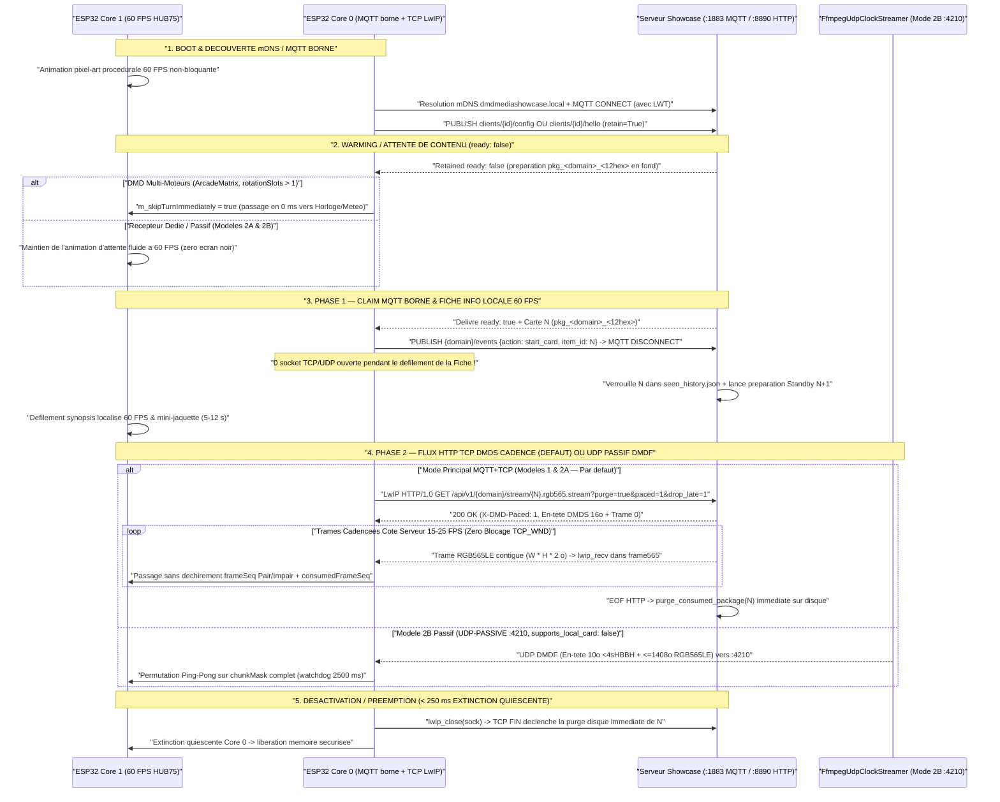
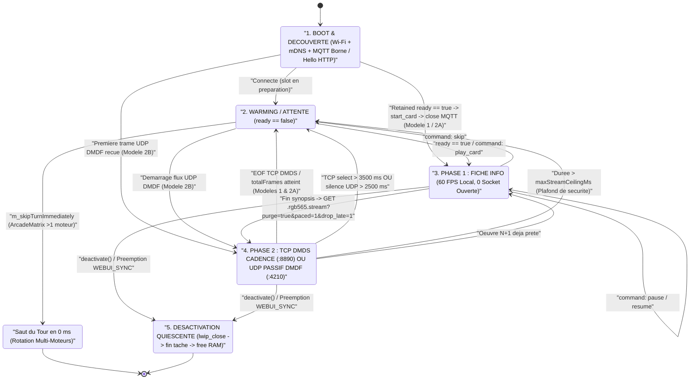

# Guide d'Intégration ESP32 & Récepteur Passif — DMD Media Showcase Server

🇬🇧 [English](ESP32_INTEGRATION.md) | 🇫🇷 Français | 🇪🇸 [Español](ESP32_INTEGRATION_ES.md)

[](https://t.me/+DrSdAO8UMUViNmE0)
[](https://ko-fi.com/red1l)

---

**DMD Media Showcase Server** prend en charge trois topologies complémentaires d'intégration pour les matrices LED HUB75 **ESP32 et ESP32-S3**. Le **Modèle 1** (DMD Multi-Moteurs piloté par le client, ex. `ArcadeMatrix` ESP32 / `ArcadeMatrix_RPi`) et le **Modèle 2A** (Récepteur Hybride piloté par le serveur, `supports_local_card: true`) associent le **plan de contrôle MQTT `:1883`** (`config`/`hello`, `ready`, `start_card`) au **Streaming HTTP TCP `DMDS` Cadencé Temps Réel (`:8890`, `MQTT+TCP` par défaut)**, tandis que le **Modèle 2B** (`supports_local_card: false`) offre un récepteur optionnel ultra-minimal (~180 lignes C++) **100 % Passif UDP `:4210` `DMDF`** (`UDP-PASSIVE`).

> [!IMPORTANT]
> **Pourquoi `MQTT + TCP` (`DMDS` `:8890`) est le Transport par Défaut & Recommandé pour les Modèles 1 & 2A**
> 1. **Zéro Perte NAT UDP VM Docker Desktop / Rancher Desktop** : La connexion entrante HTTP TCP `:8890` (`GET /api/v1/{domain}/stream/{item_id}.rgb565.stream?purge=true&paced=1&drop_late=1`) traverse nativement tous les ponts conteneurs et NAT des VMs hôtes sans expiration de trou NAT UDP retour ni blocage pare-feu.
> 2. **Zéro Surcharge de Réassemblage MTU** : Les trames RGB565LE contiguës arrivent dans l'ordre du flux (en-tête Little-Endian `<4sBBHHHHH` `DMDS` de `16 octets` + `width * height * 2` octets/trame) sans réassemblage par masque binaire.
> 3. **Zéro Heap Client & Zéro Blocage `TCP_WND`** : Les clients embarqués ouvrent un `lwip_socket` brut (`HTTP/1.0`, `Connection: close`) lisant directement dans `m_frame565`. Le cadencement monotone côté serveur (`X-DMD-Paced: 1`) délivre les trames à la cadence cible pour que l'ESP32 ne dorme jamais avec des octets non lus (`0` `TCP ZeroWindow`), tandis que `drop_late=1` (`X-DMD-Drop-Late: 1`, sans `Content-Length`) saute les trames en retard par `seek` horloge temps réel.
> 4. **Identifiants `item_id` Compacts sans Collision (`<= 24` caractères)** : Chaque package préparé utilise le format `pkg_<domain>_<12hex>` (ex. `pkg_games_a1b2c3d4e5f6`), tenant dans un buffer fixe sur pile `ESP32_STD` sans allocation dynamique.

---

## 1. Vue d'Ensemble & Comparaison des 3 Topologies d'Intégration ESP32

### Modèle 1 — DMD Multi-Moteurs Piloté par le Client (`config_source: "client"`, `MQTT+TCP` par défaut)

Conçu pour les firmwares riches multi-écrans où l'ESP32 orchestre sa propre rotation locale (`Clock`, `Weather`, `Scoreboard`, `AudioSpectrum`, `RetroGames`, `Movies`, `Series`, `Anime`), sa pile de préemption (`DisplayArbiter`) et son propre WebUI embarqué.

- **Autorité de Configuration** : Le WebUI de l'ESP32 interroge dynamiquement `GET /api/v1/{domain}/filters?lang={ui_lang}` pour peupler ses listes déroulantes localisées, sauvegarde les filtres en flash locale, et publie sa configuration retenue sur `dmd_showcase/clients/{dmd_id}/config` (`retain=True`).
- **Session MQTT Bornée + Streaming TCP `DMDS` Cadencé** : Core 0 réclame la fiche `ready` retenue via MQTT (`start_card`), **ferme immédiatement la socket TCP MQTT** (`0` socket ouverte pendant le défilement de la Fiche en Phase 1), puis lit la Phase 2 (`Panoramas + Captures + Vidéo`) via un flux `HTTP/1.0` TCP `DMDS` brut LwIP (`:8890`, `?purge=true&paced=1&drop_late=1`).
- **Comportement en Rotation** : Lorsque le tour d'un moteur Showcase arrive et que le slot MQTT retenu (`dmd_showcase/clients/{dmd_id}/{domain}/ready`) indique `{"ready": false}`, le moteur cède son tour en **`0 ms`** (`m_skipTurnImmediately = true`). Le panneau affiche instantanément le moteur local suivant (`Clock`, `Weather`, etc.) sans jamais provoquer d'écran noir ni de latence.
- **Implémentation de Référence en Production (`ArcadeMatrix`)** :
  - En-tête & Contrat Moteur : [`src/engines/MediaShowcaseEngines.h`](https://github.com/red77290/ArcadeMatrix/blob/main/src/engines/MediaShowcaseEngines.h)
  - Worker MQTT Borné, Parseur `ArduinoJson` Zéro-Copie & Streamer TCP `DMDS` Brut LwIP : [`src/engines/MediaShowcaseEngines.cpp`](https://github.com/red77290/ArcadeMatrix/blob/main/src/engines/MediaShowcaseEngines.cpp)

---

### Modèle 2A — Récepteur Hybride Piloté par le Serveur (`config_source: "server"`, `supports_local_card: true`, `MQTT+TCP` par défaut)

Conçu pour les afficheurs Showcase dédiés souhaitant conserver un rendu texte local ultra-net à 60 FPS sur l'ESP32 **sans** embarquer de WebUI, de logique de référentiels scrapers ni de schémas NVS complexes.

- **Annonce Matérielle Légère** : Au démarrage, l'ESP32 publie un court message retenu sur `dmd_showcase/clients/{dmd_id}/hello` (`retain=True`) déclarant uniquement sa géométrie et son adresse LAN (`width`, `height`, `config_source: "server"`, `supports_local_card: true` et langue par défaut `lang`).
- **Profil Centralisé Persisté (`./data/dmd_profiles.json`)** : Toutes les playlists de domaines (`games`, `movies`, `series`, `anime`), catégories (`systems`, `genres`, `decades`), préréglages de cadrage/colorimétrie IA (`video_mode`, `color_boost`) et la langue de diffusion du contenu (`lang`) sont configurés dans le **Dashboard Web Showcase** (`http://dmdmediashowcase.local:8890/`) et sauvegardés dans `./data/dmd_profiles.json`.
- **Rendu Hybride** : L'ESP32 affiche localement la **Phase 1 (Fiche Info)** à 60 FPS (mini-jaquette + badge coloré + défilement fluide du synopsis poussé via `ready` ou `dmd_showcase/clients/{dmd_id}/command` `play_card`, acquitté par `start_card`), puis ouvre `GET /api/v1/{domain}/stream/{item_id}.rgb565.stream?purge=true&paced=1&drop_late=1` sur `:8890` pour recevoir la **Phase 2 (Panoramas + Vidéo)** en HTTP TCP `DMDS` cadencé (avec support `mqtt_udp` `start_stream` optionnel).

---

### Modèle 2B — Récepteur Framebuffer 100 % Passif Piloté par le Serveur (`config_source: "server"`, `supports_local_card: false`, `UDP-PASSIVE`)

Conçu pour des montages matériels ultra-légers et sans maintenance (`ESP32_STD` WROOM-32 **sans PSRAM** ou `ESP32-S3`) en **~180 lignes de C++** — **zéro WebUI, zéro police de caractères, zéro parseur JSON et zéro bibliothèque MQTT requise**.

- **Découverte Zéro-Configuration** : L'ESP32 s'annonce via un simple heartbeat HTTP périodique `POST /api/v1/clients/hello` (ou MQTT `dmd_showcase/clients/{dmd_id}/hello`), voire **sans aucun appel sortant** s'il possède une IP LAN fixe déclarée avec `always_stream_udp: true` dans `./data/dmd_profiles.json`.
- **Flux 100 % Composité par le Serveur** : Avec `supports_local_card: false`, le serveur Showcase génère **y compris la Fiche Info de Phase 1** (mini-jaquette + badge système/domaine coloré + titre + année + note + synopsis localisé défilant) directement dans le flux binaire RGB565 et cadence l'envoi des tranches UDP `DMDF` (`<= 1408 o` utiles) vers le port `:4210`.
- **Contrôle Temps Réel Instantané** : Les actions `Skip`, `Pause`, `Resume`, `Stop` et `Play Now` (`FrontendSync`) s'exécutent **100 % côté serveur** en commutant le flux `FfmpegUdpClockStreamer` vers `:4210` en `< 50 ms`.

---

### Tableau Comparatif des 3 Topologies

| Critère | Modèle 1 : Piloté Client (`ArcadeMatrix`) | Modèle 2A : Hybride Piloté Serveur | Modèle 2B : Récepteur UDP 100 % Passif |
| :--- | :--- | :--- | :--- |
| **Annonce & Transport** | `config_source: "client"` (`MQTT+TCP` par défaut) | `config_source: "server"`, `supports_local_card: true` (`MQTT+TCP` par défaut) | `config_source: "server"`, `supports_local_card: false` (`UDP-PASSIVE` `:4210`) |
| **Stockage Playlists & Filtres** | Flash ESP32 (`config.json`) | Serveur (`./data/dmd_profiles.json`) | Serveur (`./data/dmd_profiles.json`) |
| **Complexité Firmware / UI** | OS Multi-Moteurs complet + WebUI | ~320 lignes C++ (MQTT borné + TCP `DMDS` LwIP + Police) | **~120–180 lignes C++** (Zéro UI, Zéro Police, Zéro JSON) |
| **Rendu Phase 1 (Fiche Info)** | Local 60 FPS sur Core 1 ESP32 | Local 60 FPS sur Core 1 ESP32 | **Rendu par le serveur dans le flux UDP RGB565** |
| **Rendu Phase 2 (Panoramas + Vidéo)** | **HTTP TCP `DMDS` cadencé (`:8890`, `?paced=1&drop_late=1`)** *(option `mqtt_udp`)* | **HTTP TCP `DMDS` cadencé (`:8890`, `?paced=1&drop_late=1`)** *(option `mqtt_udp`)* | **UDP Passif `DMDF` (`:4210`)** |
| **Empreinte SRAM (`128x32`)** | `8 Ko` frame + `2 Ko` (`32x32`) / `6 Ko` (`48x64`) jaquette | `8 Ko` frame + `2–6 Ko` jaquette | **`8 Ko` simple (`16 Ko` ping-pong) — `0 o` jaquette/JSON** |
| **Qualification `ESP32_STD` (Sans PSRAM)** | Qualifié (`128x32` en **HUB75 8 bits**, `64x64`, `128x64`) | Qualifié (`128x32` à `128x64`) | **Qualifié (`128x32` jusqu'à `256x64` simple buffer)** |
| **Charge CPU Core 0** | Faible (MQTT borné + Base64 + `lwip_recv` dans `frame565`) | Faible (MQTT borné + Base64 + `lwip_recv` dans `frame565`) | **Minimale (pur `memcpy` UDP non-bloquant)** |
| **Réactivité `Skip` / `Pause` / `Play Now`** | File prioritaire (`N+1`) ou MQTT `.../command` | Via MQTT `.../command` (`play_card` / `skip`) | **Instantanée (`< 50 ms`) directement dans le streamer `DMDF`** |

---

## 2. Chorégraphie FreeRTOS Dual-Core & Invariants DMA HUB75

Les dalles LED HUB75 ne possèdent pas de mémoire vidéo interne : le périphérique I2S/LCD DMA de l'ESP32 doit balayer en permanence les plans de bits PWM depuis la SRAM interne. Toute tempête d'interruptions Wi-Fi, allocation dynamique ou contention de mutex sur le cœur de rendu provoque immédiatement du scintillement ou des lignes fantômes.

Pour garantir un rafraîchissement irréprochable à **60 FPS** (`16,67 ms` par trame), l'architecture impose une séparation matérielle stricte entre les deux cœurs :

- **Core 0 (`PRO_CPU` — Worker Réseau & Protocole)** :
  - Exécute la pile Wi-Fi / LwIP et la résolution mDNS (`dmdmediashowcase.local` sur `224.0.0.251:5353`).
  - **Modèles 1 & 2A (`MQTT+TCP` par défaut)** : Exécute une courte **session MQTT `:1883` bornée** (`config` ou `hello` $\to$ `ready` retenu $\to$ `start_card` $\to$ fermeture immédiate de la socket TCP afin que `0` socket ne reste ouverte pendant le défilement de la Fiche), puis ouvre un `lwip_socket` brut zéro-heap (`HTTP/1.0`, `TCP_NODELAY`, `SO_RCVTIMEO` de `250 ms`) vers `:8890` (`GET /api/v1/{domain}/stream/{item_id}.rgb565.stream?purge=true&paced=1&drop_late=1`), lisant l'**en-tête Little-Endian `<4sBBHHHHH` `DMDS` de 16 octets** suivi des trames RGB565LE contiguës cadencées côté serveur (`X-DMD-Paced: 1`) directement dans `frame565`.
  - **Modèle 2B (`UDP-PASSIVE :4210`)** : Assure le heartbeat HTTP `POST /api/v1/clients/hello` et réassemble les datagrammes **UDP `DMDF`** non-bloquants (en-tête `<4sHBBH` de `10 octets` + tranche `<= 1408 octets` RGB565LE = `<= 1418 octets` par paquet UDP, zéro fragmentation IP sous le MTU Wi-Fi de `1500 octets`).
- **Core 1 (`APP_CPU` — Boucle Temps Réel HUB75 à 60 FPS)** :
  - Pilote exclusivement `IDrawingSurface` / le DMA HUB75 à 60 FPS.
  - **Zéro Allocation Dynamique** : Aucun appel à `malloc`, `new`, `String` ni `std::vector::push_back` dans la boucle chaude de rendu.
  - **Zéro Mutex / Zéro Contention** : Aucun `std::mutex` ni sémaphore FreeRTOS partagé avec Core 0.
  - **Isolation Stricte du DMA** : Le worker réseau n'écrit jamais directement dans le buffer DMA HUB75 en cours de balayage ; les pixels sont lus dans `frame565` puis copiés proprement via `IDrawingSurface` lors de la passe de rendu.

### Passage de Trames Lock-Free : `frameSeq` Pair/Impair + `consumedFrameSeq` vs Double-Buffer Ping-Pong

Deux mécanismes sans verrou permettent de transférer les trames de Core 0 vers Core 1 :

1. **Synchronisation Sans Déchirement `frameSeq` Pair/Impair + `consumedFrameSeq` (`frame565` Unique — Modèles 1 & 2A par défaut)** :
   - Éprouvée en production dans [`MediaShowcaseEngines.cpp`](https://github.com/red77290/ArcadeMatrix/blob/main/src/engines/MediaShowcaseEngines.cpp) pour éliminer tout déchirement horizontal avec **un unique buffer `frame565`** (`8 Ko` en `128x32`) sur `ESP32_STD`.
   - Core 0 attend la prochaine trame TCP cadencée côté serveur dans `lwip_select` (tranches de `25 ms`) **pendant que `frameSeq` reste `PAIR`**, de sorte que Core 1 n'est jamais ralenti durant les intervalles inter-trames (`40–66 ms`).
   - Dès que la trame arrive dans LwIP `TCP_WND`, Core 0 attend au plus `18 ms` (`1` rafraîchissement HUB75) que Core 1 ait consommé la trame précédente (`consumedFrameSeq == frameSeq`), bascule `frameSeq` en **`IMPAIR`** (`fetch_add(1, memory_order_acq_rel)`), lit `FRAME_BYTES` directement via `lwip_recv` dans `frame565` (`~1,2 ms`), puis repasse `frameSeq` en **`PAIR`** (`fetch_add(1, memory_order_release)`).
   - Core 1 vérifie `(fSeq & 1U) == 0U && fSeq != lastRenderedSeq`, copie `frame565`, puis publie `consumedFrameSeq.store(fSeq, memory_order_release)`. Grâce au cadencement serveur (`X-DMD-Paced: 1`), Core 0 n'effectue **aucun `vTaskDelay`** après lecture, gardant `TCP_WND` 100 % ouverte.
2. **Double-Buffer Ping-Pong `frame565[2]` (`std::atomic<uint8_t> frontIdx` — Modèle 2B UDP `DMDF`)** :
   - Core 0 écrit les tranches `DMDF` dans `frame565[backIdx]` en marquant chaque bit `(1ULL << chunk_idx)` dans un masque 64 bits `chunkMask`.
   - Dès que `chunkMask == ((1ULL << total_chunks) - 1ULL)`, Core 0 permute atomiquement `frontIdx.store(backIdx, std::memory_order_release)`. Core 1 lit toujours une trame 100 % complète.

### Budgets Exacts SRAM / PSRAM par Géométrie HUB75

Un **`ESP32_STD` sans PSRAM** (WROOM-32 disposant d'environ `110–140 Ko` de heap interne libre après initialisation Wi-Fi + HUB75 DMA) exécute l'intégralité du pipeline avec une large marge de sécurité :

| Géométrie Dalle | Pixels (`L x H`) | TCP `DMDS` / UDP `DMDF` (`<= 1408 o`) | Simple `frame565` (Modèles 1 & 2A) | Ping-Pong `frame565[2]` (Modèle 2B) | `poster565` Carte Locale (Modèle 1 / 2A) | Compatibilité `ESP32_STD` Sans PSRAM |
| :--- | :--- | :--- | :--- | :--- | :--- | :--- |
| **`128x32`** *(DMD WPC)* | `4 096 px` | `0` fragment TCP / `6` tranches UDP | **`8 192 o`** (`8 Ko`) | `16 384 o` (`16 Ko`) | `2 048 o` (`32x32`) | **Fluide en profondeur HUB75 8 bits sur `ESP32_STD`** |
| **`64x64`** *(Carré)* | `4 096 px` | `0` fragment TCP / `6` tranches UDP | **`8 192 o`** (`8 Ko`) | `16 384 o` (`16 Ko`) | `2 048 o` (`32x32`) | **Fluide sur `ESP32_STD`** |
| **`128x64` / `64x128` TATE** | `8 192 px` | `0` fragment TCP / `12` tranches UDP | **`16 384 o`** (`16 Ko`) | `32 768 o` (`32 Ko`) | `6 144 o` (`48x64`) / `3 200 o` (`40x40`) | **Tient en SRAM interne `ESP32_STD` (repli auto HUB75 4 bits si requis)** |
| **`256x64`** *(Super-DMD)* | `16 384 px` | `0` fragment TCP / `24` tranches UDP | **`32 768 o`** (`32 Ko`) | `65 536 o` (`64 Ko`) | `6 144 o` (`48x64`) | **`32 Ko` Simple sur `ESP32_STD` ; `ESP32-S3` PSRAM recommandé** |

### Pipeline d'Affichage HUB75 Préconisé : `Single DMA Buffer + Offscreen RGB565 Canvas` (`canvas_single`)

Sur l'ensemble des firmwares ESP32 HUB75 (dont [`ArcadeMatrix`](https://github.com/red77290/ArcadeMatrix)), le pipeline **`Single DMA Buffer + Offscreen RGB565 Canvas` (`canvas_single`)** adossé à [`mrfaptastic/ESP32-HUB75-MatrixPanel-I2S-DMA`](https://github.com/mrfaptastic/ESP32-HUB75-MatrixPanel-I2S-DMA) constitue **l'architecture de référence préconisée** :

1. **Économie de 50 % sur la SRAM Interne Compatible DMA (`mxconfig.double_buff = false`)** :
   - Sur `ESP32_STD` (sans PSRAM), les descripteurs DMA I2S et les bitplanes BCM doivent impérativement être alloués dans la DRAM interne contiguë (`MALLOC_CAP_DMA`) — exactement la ressource sollicitée par la pile Wi-Fi + LwIP TCP/UDP.
   - Désactiver le double-buffering DMA matériel (`mxconfig.double_buff = false`) divise par deux l'empreinte des bitplanes, tandis que le canevas linéaire RGB565 hors-écran (`GFXcanvas16`) ne consomme que `2 octets/pixel` (`8 Ko` en `128x32`, `16 Ko` en `128x64`, et logeable en PSRAM sur `ESP32-S3`).
2. **Maintien de la Profondeur Couleur HUB75 8 Bits sur `ESP32_STD` (`esp32dev`) via Préemption `WEBUI_SYNC`** :
   - Les firmwares multi-moteurs (`ArcadeMatrix`) conservent **la pleine profondeur couleur HUB75 BCM 8 bits** sur dalle `128x32` sur les cartes `ESP32_STD` (`esp32dev` sans PSRAM) pendant toute la lecture Showcase normale — ne descendant automatiquement à `4 bits` **que** lorsque la RAM interne libre mesurée l'impose (par exemple en `128x64` sans PSRAM).
   - Lors du chargement initial de la SPA WebUI embarquée (`GET /`), `ArcadeMatrix` active temporairement une source d'affichage haute priorité zéro-heap **`WEBUI_SYNC`** ([`WebUiSyncEngine`](https://github.com/red77290/ArcadeMatrix/blob/main/src/engines/WebUiSyncEngine.h)) sur `PreemptionStack`. L'éviction du moteur actif (`deactivate()`) libère immédiatement **`~48 Ko` de SRAM interne** (`m_frame565`, `m_poster565`, `m_ioScratch` et buffers TCP) pour servir la SPA compressée sans erreur mémoire, puis reprend automatiquement la diffusion Showcase 8 bits dès la synchronisation navigateur terminée.
3. **Zéro Scintillement Noir & Zéro Effet Stroboscopique (Écrasement Bitplane Sur Place)** :
   - Dessiner directement dans un unique buffer DMA (`direct_single`) en appelant `clearScreen()` efface les bitplanes en cours de balayage actif, provoquant un clignotement noir permanent.
   - Avec un **Canevas RGB565 Hors-Écran**, tous les effacements, tracés `Adafruit_GFX` (texte, HUD, score), animations d'attente et copies de trames `DMDS`/`DMDF` s'effectuent à 100 % en mémoire hors-écran. `blitCanvas565()` réécrit ensuite chaque mot de bitplane HUB75 **sur place** (`(dmaRow[ax] & ~0x003F) | rgb12`) en **`~300 µs`** (`128x32`) **sans jamais passer par un `clearScreen()` noir préalable**.
4. **Gating par Compteur d'État `Dirty` (`frameSeq != lastPresentedSeq`)** :
   - Core 1 cadencé à `60 Hz` (`16,6 ms`) cohabite avec un flux vidéo TCP `DMDS` / UDP `DMDF` à `15–25 FPS` (`40–66 ms`).
   - En ne déclenchant le burst vers `frame_buffer[0]` **que lorsqu'une nouvelle trame a réellement modifié le canevas**, Core 1 n'effectue **aucune écriture DMA redondante** entre deux trames vidéo, supprimant toute contention sur le bus SRAM pendant le balayage I2S.
5. **Encodage Burst BCM Multiplexé + Gamma Perceptif CIE 1931 + Swap FIFO I2S ESP32 Classique** :
   - Encode simultanément la demi-ligne haute `(y)` et la demi-ligne basse `(y + H/2)` dans `R1G1B1R2G2B2` via des tables **gamma CIE 1931** calibrées à la profondeur active, applique la permutation 16 bits du FIFO I2S de l'ESP32 original (`MATRIX_TX_ADJUST(x)`) et vide les lignes de cache CPU (`Cache_WriteBack_Addr`) lorsque `SPIRAM_DMA_BUFFER` est actif sur `ESP32-S3`.

| Mode Pipeline | `mxconfig.double_buff` | Canevas RGB565 Hors-Écran | Marge DRAM DMA (`ESP32_STD`) | Scintillement / Tearing | Préconisation |
| :--- | :---: | :---: | :--- | :--- | :--- |
| **`canvas_single`** | **`false`** | **Oui (`GFXcanvas16`)** | **Optimale (-50 % DRAM DMA)** | **Zéro scintillement (burst `~300 µs` sur place + dirty gating)** | **Préconisé (`ESP32_STD` & `ESP32-S3`)** |
| `canvas_double` | `true` | Oui (`GFXcanvas16`) | Coût RAM élevé (`2x` DMA + Canvas) | Swap sans déchirement | Optionnel sur `ESP32-S3` Octal PSRAM |
| `direct_double` | `true` | Non | Forte pression DRAM (`2x` bitplanes) | `drawPixel()` unitaire lent en vidéo | Sketches GFX legacy uniquement |
| `direct_single` | `false` | Non | RAM libre maximale | Scintillement visible sur `clearScreen()` | Repli d'urgence très basse RAM uniquement |

---

## 3. Séquencement Complet des Tâches, États d'Attente & Watchdog de Récupération

### Diagramme de Séquence de Bout en Bout



### Machine à États Déterministe du Récepteur ESP32



### Analyse Détaillée des 5 États & Garanties de Résilience

1. **`BOOT & DÉCOUVERTE mDNS / MQTT BORNÉ`** :
   - Dès la mise sous tension, Core 1 affiche une animation procédurale pixel-art à 60 FPS sans attendre la connexion Wi-Fi.
   - Core 0 résout `dmdmediashowcase.local` par mDNS (`224.0.0.251:5353`) et ouvre la session MQTT `:1883` avec un **Last Will and Testament (`LWT`)** `{"online": false}` sur `dmd_showcase/clients/{dmd_id}/status`.
2. **`WARMING / ATTENTE DE CONTENU` (`ready: false`)** :
   - **Récepteurs Dédiés / Passifs (Modèles 2A & 2B)** : Maintiennent leur animation 60 FPS fluide pendant que le serveur télécharge et transcode la première œuvre (`pkg_<domain>_<12hex>`).
   - **DMD Multi-Moteurs (`ArcadeMatrix` — Modèle 1)** : Si `m_rotationSlotCount > 1` et que le topic retenu publie `{"ready": false}`, `MediaShowcaseBase` positionne `m_skipTurnImmediately = true` (`isFinished() == true` en **`0 ms`**). L'afficheur enchaîne immédiatement sur l'horloge ou la météo sans **aucun écran noir** pendant que le serveur prépare l'œuvre en arrière-plan.
3. **`PHASE 1 — CLAIM MQTT BORNÉ & PIPELINING N+1`** :
   - Dès que l'œuvre `N` (`pkg_<domain>_<12hex>`) est réclamée via `start_card`, Core 0 **se déconnecte immédiatement et ferme la socket TCP MQTT**, laissant **`0` socket ouverte** pendant les `5–12 s` du défilement local à 60 FPS afin de préserver un maximum de SRAM interne.
   - Côté serveur, `start_card` verrouille l'œuvre `N` dans `./data/seen_history.json` (sauf si `mark_seen: false` via `FrontendSync`), bascule le topic retenu `ready` à `{"ready": false}` et déclenche **instantanément la préparation en tâche de fond du slot `N+1`**.
4. **`PHASE 2 — FLUX HTTP TCP DMDS CADENCÉ (DÉFAUT) OU UDP PASSIF DMDF`** :
   - **Modèles 1 & 2A (`MQTT+TCP` par défaut)** : Core 0 ouvre un `lwip_socket` brut (`HTTP/1.0`, `Connection: close`, `TCP_NODELAY`) sur `:8890` vers `GET /api/v1/{domain}/stream/{item_id}.rgb565.stream?purge=true&paced=1&drop_late=1`. L'utilisation de `HTTP/1.0` garantit un flux binaire brut non-chunké même lorsque `drop_late=1` omet `Content-Length`. Le serveur cadence chaque trame (`X-DMD-Paced: 1`) tandis que `lwip_select` applique un **watchdog d'inactivité TCP de `3 500 ms`** (tranches de `25 ms` permettant une sortie `deactivate()` en `< 250 ms`). En fin de flux (`EOF` ou fermeture socket), le bloc `finally` du serveur purge immédiatement le dossier disque de `N`.
   - **Modèle 2B (`UDP-PASSIVE :4210`, `supports_local_card: false`)** : `FfmpegUdpClockStreamer` cadence les tranches UDP `DMDF` (`<= 1408 o`) vers `:4210`, protégées par un **watchdog local d'inactivité UDP de `2 500 ms`** (`millis() - lastUdpPacketMs > 2500`) et un plafond de durée maximale.
5. **`DÉSACTIVATION, PRÉEMPTION WEBUI_SYNC & REPRISE APRÈS REBOOT`** :
   - **Désactivation Propre & Quiescente (`< 250 ms`)** : Le moteur passe `m_wantActive = false` ; `lwip_select` / `SO_RCVTIMEO` sort en `25–250 ms`, ferme la socket TCP `DMDS` (déclenchant la purge disque immédiate côté serveur), attend la fin de la tâche Core 0 (`stopWorkerTaskBounded()` sans allocation dynamique), puis libère ses buffers SRAM (notamment lors d'une préemption `WEBUI_SYNC` sur `ESP32_STD`).
   - **Reboot Brutal de l'ESP32** : Le `RST`/timeout TCP `:8890` ou le `LWT` MQTT (`{"online": false}`) libère immédiatement tout flux serveur actif tout en conservant le slot `N+1` préparé en tâche de fond.

---

## 4. Implémentations C++ ESP32 de Référence (`MQTT+TCP` par défaut & UDP Passif `DMDF`)

### A. Modèles 1 & 2A — Session MQTT Bornée Zéro-Heap + Streamer TCP `DMDS` Brut LwIP (`MQTT+TCP` par défaut)

Cette implémentation C++ illustre le patron exact zéro-heap **`MQTT borné (:1883) + HTTP/1.0 TCP DMDS brut LwIP (:8890)`** déployé en production sur [`ArcadeMatrix`](https://github.com/red77290/ArcadeMatrix/blob/main/src/engines/MediaShowcaseEngines.cpp) pour le **Modèle 1** (`config_source: "client"`) et le **Modèle 2A** (`config_source: "server"`, `supports_local_card: true`) :

1. **Claim MQTT Borné Pré-Stream (`0` Socket Ouverte Pendant la Fiche)** : Core 0 ouvre MQTT `:1883`, publie `config` (Modèle 1) ou `hello` (`supports_local_card: true`, Modèle 2A), extrait la fiche `ready` retenue (`pkg_<domain>_<12hex>`), publie `{"action":"start_card","item_id":"pkg_..."}`, puis **se déconnecte et ferme immédiatement la socket TCP MQTT**.
2. **Stream `HTTP/1.0` TCP `DMDS` Brut LwIP Zéro-Heap (`?purge=true&paced=1&drop_late=1`)** : Une fois le défilement local 60 FPS terminé, Core 0 ouvre un `lwip_socket` (`TCP_NODELAY`, `SO_RCVTIMEO` de `250 ms`) et lit les trames RGB565LE cadencées côté serveur (`X-DMD-Paced: 1`) directement dans `g_frame565` avec synchronisation sans déchirement **`g_frameSeq` Pair/Impair + `g_consumedFrameSeq`** vers Core 1 (`canvas_single`).

```cpp
#include <Arduino.h>
#include <WiFi.h>
#include <PubSubClient.h>
#include <lwip/sockets.h>
#include <lwip/netdb.h>
#include <atomic>
#include <cstring>

static constexpr uint16_t PANEL_W     = 128;
static constexpr uint16_t PANEL_H     = 32;
static constexpr size_t   FRAME_BYTES = static_cast<size_t>(PANEL_W) * PANEL_H * 2U; // 8,192 B

// Pre-allocated buffers (zero heap churn during Card scroll or TCP DMDS streaming)
static uint16_t* g_frame565       = nullptr; // Single 8 KB RGB565 frame buffer (Models 1 & 2A)
static uint8_t   g_ioScratch[1472]{};        // Fixed HTTP header / MQTT scratch buffer
static char      g_itemId[28]{};             // Compact "pkg_<domain>_<12hex>" (<= 24 chars)

// Lock-free tear-free handoff between Core 0 (LwIP TCP reader) and Core 1 (60 Hz HUB75)
static std::atomic<uint32_t> g_frameSeq{0};         // EVEN = coherent frame ready, ODD = Core 0 writing
static std::atomic<uint32_t> g_consumedFrameSeq{0}; // Last EVEN frameSeq presented by Core 1
static std::atomic<bool>     g_wantActive{true};    // Cleared on deactivate() / WEBUI_SYNC / skip
static std::atomic<bool>     g_cardReady{false};

// -----------------------------------------------------------------------------------------
// STEP 1 (CORE 0): SCOPED MQTT SESSION -> CLAIM CARD -> CLOSE SOCKET IMMEDIATELY!
// -----------------------------------------------------------------------------------------
bool claimReadyCardScopedMqtt(const char* host, const char* dmdId, const char* domain, bool isModel2A) {
    WiFiClient tcpMqtt;
    PubSubClient mqtt(tcpMqtt);
    mqtt.setServer(host, 1883);
    mqtt.setBufferSize(4096); // Needed only for this brief scoped session (freed on return!)

    g_cardReady.store(false, std::memory_order_relaxed);
    mqtt.setCallback([](char* /*topic*/, byte* payload, unsigned int len) {
        // Zero-copy extract compact item_id ("pkg_<domain>_<12hex>") when "ready":true
        if (len < 16 || memmem(payload, len, "\"ready\":true", 12) == nullptr &&
                        memmem(payload, len, "\"ready\": true", 13) == nullptr) {
            return;
        }
        const char* idKey = static_cast<const char*>(memmem(payload, len, "\"item_id\":\"", 11));
        if (idKey) {
            idKey += 11;
            const char* endQ = static_cast<const char*>(memchr(idKey, '"', 27));
            if (endQ) {
                const size_t n = static_cast<size_t>(endQ - idKey);
                memcpy(g_itemId, idKey, n);
                g_itemId[n] = '\0';
                // Decode Base64 mini-poster & localized synopsis into card state here...
                g_cardReady.store(true, std::memory_order_release);
            }
        }
    });

    char lwtTopic[96], topic[128], msg[256];
    snprintf(lwtTopic, sizeof(lwtTopic), "dmd_showcase/clients/%s/status", dmdId);
    if (!mqtt.connect(dmdId, nullptr, nullptr, lwtTopic, 0, true, "{\"online\":false}")) {
        return false;
    }

    const IPAddress ip = WiFi.localIP();
    if (isModel2A) {
        // Model 2A: Server-managed playlists in ./data/dmd_profiles.json, local 60 FPS Card on ESP32
        snprintf(topic, sizeof(topic), "dmd_showcase/clients/%s/hello", dmdId);
        snprintf(msg, sizeof(msg),
            "{\"dmd_id\":\"%s\",\"config_source\":\"server\",\"supports_local_card\":true,"
            "\"transport\":\"mqtt_tcp\",\"width\":%u,\"height\":%u,\"client_ip\":\"%u.%u.%u.%u\",\"lang\":\"fr\"}",
            dmdId, PANEL_W, PANEL_H, ip[0], ip[1], ip[2], ip[3]);
    } else {
        // Model 1: Client-driven per-domain config
        snprintf(topic, sizeof(topic), "dmd_showcase/clients/%s/config", dmdId);
        snprintf(msg, sizeof(msg),
            "{\"dmd_id\":\"%s\",\"config_source\":\"client\",\"transport\":\"mqtt_tcp\","
            "\"width\":%u,\"height\":%u,\"client_ip\":\"%u.%u.%u.%u\",\"lang\":\"fr\"}",
            dmdId, PANEL_W, PANEL_H, ip[0], ip[1], ip[2], ip[3]);
    }
    mqtt.publish(topic, reinterpret_cast<const uint8_t*>(msg), strlen(msg), /*retained=*/true);

    snprintf(topic, sizeof(topic), "dmd_showcase/clients/%s/%s/ready", dmdId, domain);
    mqtt.subscribe(topic);

    const uint32_t waitStart = millis();
    while (g_wantActive.load(std::memory_order_relaxed) && !g_cardReady.load(std::memory_order_acquire) &&
           (millis() - waitStart) < 600U) {
        mqtt.loop();
        vTaskDelay(pdMS_TO_TICKS(10));
    }
    if (!g_cardReady.load(std::memory_order_acquire)) {
        mqtt.disconnect(); // Multi-engine DMD yields turn in 0 ms when ready == false!
        return false;
    }

    // Claim Item N and trigger background N+1 preparation on the server, then CLOSE MQTT socket!
    mqtt.unsubscribe(topic);
    snprintf(topic, sizeof(topic), "dmd_showcase/clients/%s/%s/events", dmdId, domain);
    snprintf(msg, sizeof(msg),
        "{\"action\":\"start_card\",\"item_id\":\"%s\",\"client_ip\":\"%u.%u.%u.%u\"}",
        g_itemId, ip[0], ip[1], ip[2], ip[3]);
    mqtt.publish(topic, msg, /*retained=*/false);
    mqtt.loop();
    mqtt.disconnect();
    tcpMqtt.stop(); // <--- 0 sockets open during Phase 1 local 60 FPS Card scroll!
    return true;
}

// -----------------------------------------------------------------------------------------
// STEP 2 (CORE 0): ZERO-HEAP RAW LWIP HTTP/1.0 TCP `DMDS` STREAMER (?paced=1&drop_late=1)
// -----------------------------------------------------------------------------------------
static int recvExactBounded(int sock, uint8_t* dst, size_t n, uint32_t idleTimeoutMs) {
    size_t got = 0;
    uint32_t lastProgressMs = millis();
    while (got < n && g_wantActive.load(std::memory_order_relaxed)) {
        const ssize_t r = lwip_recv(sock, dst + got, n - got, 0);
        if (r > 0) {
            got += static_cast<size_t>(r);
            lastProgressMs = millis();
        } else if (r == 0) {
            return 0; // Clean server EOF
        } else {
            if (errno != EAGAIN && errno != EWOULDBLOCK && errno != EINTR) return -1;
            if ((millis() - lastProgressMs) > idleTimeoutMs) return -1;
        }
    }
    return (got == n) ? static_cast<int>(got) : -1;
}

bool streamUnifiedRgb565Http(const char* host, uint16_t port, const char* domain, const char* itemId) {
    IPAddress srvIp;
    if (!WiFi.hostByName(host, srvIp)) return false;

    const int sock = lwip_socket(AF_INET, SOCK_STREAM, IPPROTO_TCP);
    if (sock < 0) return false;

    int one = 1;
    lwip_setsockopt(sock, IPPROTO_TCP, TCP_NODELAY, &one, sizeof(one));
    struct timeval tv{0, 250000}; // 250 ms slice -> deactivate() always exits in < 250 ms!
    lwip_setsockopt(sock, SOL_SOCKET, SO_RCVTIMEO, &tv, sizeof(tv));
    lwip_setsockopt(sock, SOL_SOCKET, SO_SNDTIMEO, &tv, sizeof(tv));

    struct sockaddr_in addr{};
    addr.sin_family      = AF_INET;
    addr.sin_port        = htons(port);
    addr.sin_addr.s_addr = static_cast<uint32_t>(srvIp);
    if (lwip_connect(sock, reinterpret_cast<struct sockaddr*>(&addr), sizeof(addr)) != 0) {
        lwip_close(sock);
        return false;
    }

    // Request HTTP/1.0 so Uvicorn streams raw unchunked binary even when drop_late=1 omits Content-Length
    const int reqLen = snprintf(
        reinterpret_cast<char*>(g_ioScratch), sizeof(g_ioScratch),
        "GET /api/v1/%s/stream/%s.rgb565.stream?purge=true&paced=1&drop_late=1 HTTP/1.0\r\n"
        "Host: %s:%u\r\nConnection: close\r\n\r\n",
        domain, itemId, host, port);
    if (lwip_send(sock, g_ioScratch, static_cast<size_t>(reqLen), 0) != reqLen) {
        lwip_close(sock);
        return false;
    }

    // Read HTTP response headers into g_ioScratch and locate "\r\n\r\n"
    size_t used = 0, bodyOff = 0;
    while (used + 1U < sizeof(g_ioScratch) && g_wantActive.load(std::memory_order_relaxed)) {
        const ssize_t r = lwip_recv(sock, g_ioScratch + used, sizeof(g_ioScratch) - 1U - used, 0);
        if (r <= 0) {
            if (r < 0 && (errno == EAGAIN || errno == EWOULDBLOCK)) continue;
            lwip_close(sock);
            return false;
        }
        used += static_cast<size_t>(r);
        g_ioScratch[used] = '\0';
        const char* hdrEnd = strstr(reinterpret_cast<const char*>(g_ioScratch), "\r\n\r\n");
        if (hdrEnd) {
            bodyOff = static_cast<size_t>((hdrEnd + 4) - reinterpret_cast<const char*>(g_ioScratch));
            break;
        }
    }
    if (bodyOff == 0 || memmem(g_ioScratch, bodyOff, "200", 3) == nullptr) {
        lwip_close(sock);
        return false;
    }
    const bool serverPaced = (memmem(g_ioScratch, bodyOff, "X-DMD-Paced: 1", 14) != nullptr) ||
                             (memmem(g_ioScratch, bodyOff, "x-dmd-paced: 1", 14) != nullptr);

    // Read 16-byte Little-Endian `<4sBBHHHHH` DMDS header
    uint8_t dmdsHdr[16]{};
    const size_t avail = used - bodyOff;
    const size_t take  = (avail < 16U) ? avail : 16U;
    if (take > 0) memcpy(dmdsHdr, g_ioScratch + bodyOff, take);
    if (take < 16U && recvExactBounded(sock, dmdsHdr + take, 16U - take, 3500U) != static_cast<int>(16U - take)) {
        lwip_close(sock);
        return false;
    }
    if (memcmp(dmdsHdr, "DMDS", 4) != 0) {
        lwip_close(sock);
        return false;
    }
    const uint8_t  fps         = (dmdsHdr[5] > 0U) ? dmdsHdr[5] : 20U;
    const uint16_t w           = static_cast<uint16_t>(dmdsHdr[6]  | (dmdsHdr[7]  << 8));
    const uint16_t h           = static_cast<uint16_t>(dmdsHdr[8]  | (dmdsHdr[9]  << 8));
    const uint16_t totalFrames = static_cast<uint16_t>(dmdsHdr[10] | (dmdsHdr[11] << 8));
    if (w != PANEL_W || h != PANEL_H || totalFrames == 0U) {
        lwip_close(sock);
        return false;
    }

    size_t leftover = (avail > 16U) ? (avail - 16U) : 0U;
    size_t leftoverOff = bodyOff + 16U;

    for (uint16_t f = 0; f < totalFrames && g_wantActive.load(std::memory_order_relaxed); ++f) {
        // 1. Wait for next server-paced frame in lwip_select WHILE g_frameSeq stays EVEN
        //    so Core 1 never stalls during 40-66 ms inter-frame intervals!
        if (leftover == 0U) {
            const uint32_t waitStart = millis();
            bool readable = false;
            while (g_wantActive.load(std::memory_order_relaxed)) {
                fd_set rfds;
                FD_ZERO(&rfds);
                FD_SET(sock, &rfds);
                struct timeval selTv{0, 25000}; // 25 ms slice
                const int sr = lwip_select(sock + 1, &rfds, nullptr, nullptr, &selTv);
                if (sr > 0) { readable = true; break; }
                if (sr < 0 && errno != EINTR) break;
                if ((millis() - waitStart) > 3500U) break; // 3,500 ms TCP inactivity watchdog
            }
            if (!readable) break;
        }

        // 2. Tear-free single-buffer guard: let Core 1 finish reading prior EVEN frame (<= 18 ms)
        const uint32_t curSeq = g_frameSeq.load(std::memory_order_acquire);
        if (curSeq > 0U && g_consumedFrameSeq.load(std::memory_order_acquire) != curSeq) {
            const uint32_t guardStart = millis();
            while (g_wantActive.load(std::memory_order_relaxed) &&
                   g_consumedFrameSeq.load(std::memory_order_acquire) != curSeq &&
                   (millis() - guardStart) < 18U) {
                vTaskDelay(pdMS_TO_TICKS(1));
            }
        }

        // 3. Mark g_frameSeq ODD -> read FRAME_BYTES straight into g_frame565 (~1.2 ms) -> mark EVEN
        g_frameSeq.fetch_add(1U, std::memory_order_acq_rel); // ODD (write in progress)
        uint8_t* dst = reinterpret_cast<uint8_t*>(g_frame565);
        size_t copied = 0U;
        if (leftover > 0U) {
            copied = (leftover < FRAME_BYTES) ? leftover : FRAME_BYTES;
            memcpy(dst, g_ioScratch + leftoverOff, copied);
            leftover -= copied;
            leftoverOff += copied;
        }
        const int r = (copied < FRAME_BYTES)
                          ? recvExactBounded(sock, dst + copied, FRAME_BYTES - copied, 3500U)
                          : 1;
        g_frameSeq.fetch_add(1U, std::memory_order_release); // EVEN (coherent frame ready!)
        if (r <= 0) break; // Clean EOF when drop_late=1 skipped frames on server

        // With X-DMD-Paced: 1, server clocks frames monotonically -> zero client sleep needed!
        if (!serverPaced) {
            vTaskDelay(pdMS_TO_TICKS(1000U / fps));
        } else if ((f & 3U) == 3U) {
            taskYIELD();
        }
    }

    lwip_close(sock); // Closing TCP socket triggers immediate server-side purge_consumed_package()!
    return true;
}

// -----------------------------------------------------------------------------------------
// STEP 3 (CORE 1): ZERO-ALLOCATION 60 HZ `canvas_single` DIRTY-GATED COMMIT
// -----------------------------------------------------------------------------------------
void renderStreamFrameOnCore1(uint16_t* offscreenCanvas565, uint32_t& lastRenderedSeq) {
    const uint32_t fSeq = g_frameSeq.load(std::memory_order_acquire);
    if ((fSeq & 1U) == 0U && fSeq != 0U && fSeq != lastRenderedSeq) {
        memcpy(offscreenCanvas565, g_frame565, FRAME_BYTES);
        if (g_frameSeq.load(std::memory_order_acquire) == fSeq) {
            lastRenderedSeq = fSeq;
            g_consumedFrameSeq.store(fSeq, std::memory_order_release);
            // Burst offscreenCanvas565 to Single HUB75 DMA Buffer via blitCanvas565()
        }
    }
}
```

> [!TIP]
> **Contrôle Temps Réel Modèle 2A (`dmd_showcase/clients/{dmd_id}/command`)** : Les afficheurs dédiés Modèle 2A qui maintiennent une écoute MQTT légère sur `command` traitent `"skip"`, `"stop"`, `"pause"`, `"resume"` et `"play_card"` (`FrontendSync` / `play_now`) en basculant `g_wantActive = false`, ce qui ferme la socket TCP `DMDS` en `< 25 ms` et enchaîne immédiatement sur la nouvelle fiche.

---

### B. Modèle 2B — Firmware Monolithique ~180 Lignes UDP Passif `:4210` `DMDF` (`platformio.ini` + `src/main.cpp`)

Pour les montages ultra-légers `supports_local_card: false` (`UDP-PASSIVE` `:4210`), ce firmware C++ monolithique et auto-suffisant implémente le pipeline **`Single DMA Buffer (`mxconfig.double_buff = false`) + Canevas Hors-Écran `GFXcanvas16` + Encodeur Bitplane Burst CIE 1931 (`blitCanvas565`) + Dirty-Frame Gating`** sur [`mrfaptastic/ESP32-HUB75-MatrixPanel-I2S-DMA`](https://github.com/mrfaptastic/ESP32-HUB75-MatrixPanel-I2S-DMA). Il compile tel quel sur **ESP32 Classique (`esp32dev`, sans PSRAM)** et **ESP32-S3 (`esp32-s3-devkitc-1` / Waveshare RGB Matrix avec PSRAM)** :

#### `platformio.ini`

```ini
[platformio]
default_envs = esp32dev

[env]
platform = espressif32
framework = arduino
monitor_speed = 115200
lib_deps =
    mrfaptastic/ESP32 HUB75 LED MATRIX PANEL DMA Display @ ^3.0.11
    adafruit/Adafruit GFX Library @ ^1.11.9

; Target 1: Standard ESP32 (WROOM-32 / DevKitC without PSRAM)
[env:esp32dev]
board = esp32dev
build_flags =
    -D CORE_DEBUG_LEVEL=1
    -O2

; Target 2: ESP32-S3 with Octal PSRAM (e.g. Waveshare ESP32-S3-RGB-Matrix / N16R8)
[env:esp32s3]
board = esp32-s3-devkitc-1
board_build.arduino.memory_type = qio_opi
build_flags =
    -D BOARD_HAS_PSRAM
    -D SPIRAM_DMA_BUFFER
    -D CORE_DEBUG_LEVEL=1
    -O2
```

#### `src/main.cpp` (Implémentation Monolithique Complète)

```cpp
/**
 * @file main.cpp
 * @brief Monolithic ESP32 / ESP32-S3 HUB75 Receiver for DMD Media Showcase (Mode 2B)
 *        using the "Single DMA Buffer + Offscreen RGB565 Canvas" (`canvas_single`) pipeline.
 *
 * Architectural Highlights (Proven in Production on ArcadeMatrix):
 *  1. Single HUB75 DMA Buffer (`mxconfig.double_buff = false`):
 *     Cuts scarce internal DMA-capable SRAM (`MALLOC_CAP_DMA`) usage by 50% compared to
 *     DMA double-buffering, leaving ample contiguous heap for Wi-Fi + LwIP + UDP on
 *     standard ESP32 boards without PSRAM (`ESP32_STD`).
 *  2. Offscreen Linear RGB565 Canvas (`Adafruit_GFX` / `GFXcanvas16`):
 *     All drawing (idle 60 FPS procedural animation, local HUD overlays, or incoming UDP
 *     frames) happens exclusively in offscreen memory (`2 bytes/pixel`). `clearScreen()` is
 *     NEVER called on the live DMA scanout buffer, eliminating black-frame strobe/flicker.
 *  3. In-Place Multiplexed BCM Bitplane Burst Encoder (`blitCanvas565`):
 *     Encodes upper `(y)` and lower `(y + H/2)` HUB75 scan halves simultaneously with
 *     perceptual CIE 1931 gamma LUTs directly into `frame_buffer[0]` (`~300 us` for 128x32),
 *     bypassing thousands of per-pixel virtual `drawPixel()` calls.
 *  4. Dirty-Frame Gating (`s_completedUdpSeq != s_lastPresentedUdpSeq`):
 *     Core 1 only bursts the offscreen canvas into DMA memory when a brand-new frame is
 *     actually ready, preventing redundant bus contention while I2S scans the panel.
 *  5. Strict Dual-Core Isolation:
 *     - Core 0 (`PRO_CPU`): Wi-Fi, mDNS, periodic HTTP `hello`, lock-free UDP `DMDF` assembly.
 *     - Core 1 (`APP_CPU`): Zero-allocation, zero-mutex 60 Hz canvas composition & DMA commit.
 */

#include <Arduino.h>
#include <WiFi.h>
#include <WiFiUdp.h>
#include <HTTPClient.h>
#include <ESPmDNS.h>
#include <esp_heap_caps.h>
#include <Adafruit_GFX.h>
#include <atomic>
#include <cstring>
#include <memory>
#include <vector>

#if defined(SPIRAM_DMA_BUFFER)
#include "rom/cache.h"
#endif

// Expose `MatrixPanel_I2S_DMA` internal `frame_buffer` row-plane pointers to our subclass
// for direct in-place BCM bitplane burst encoding (must come AFTER STL headers).
#define private protected
#include <ESP32-HUB75-MatrixPanel-I2S-DMA.h>
#undef private

// =========================================================================================
// STEP 1: PANEL GEOMETRY, NETWORK CONFIGURATION & HARDWARE PIN PROFILES
// =========================================================================================

static constexpr uint16_t MODULE_W     = 64;   // Single HUB75 panel width (typically 64)
static constexpr uint16_t MODULE_H     = 32;   // Single HUB75 panel height (32 or 64)
static constexpr uint16_t CHAIN_LEN    = 2;    // Number of chained panels (2 x 64x32 = 128x32)
static constexpr uint16_t PANEL_W      = MODULE_W * CHAIN_LEN;
static constexpr uint16_t PANEL_H      = MODULE_H;
static constexpr size_t   FRAME_PIXELS = static_cast<size_t>(PANEL_W) * PANEL_H;
static constexpr size_t   FRAME_BYTES  = FRAME_PIXELS * sizeof(uint16_t); // 8,192 B for 128x32

static constexpr uint16_t UDP_PORT          = 4210;
static constexpr uint32_t HELLO_INTERVAL_MS = 15000U;
static constexpr uint32_t UDP_WATCHDOG_MS   = 2500U;

static const char* WIFI_SSID    = "YOUR_WIFI_SSID";
static const char* WIFI_PASS    = "YOUR_WIFI_PASSWORD";
static const char* DMD_ID       = "esp32_passive_128x32";
static const char* CONTENT_LANG = "fr"; // Broadcast language ("fr", "en", "es", "de", "it", "pt", "ja")
static const char* SHOWCASE_HELLO_URL = "http://dmdmediashowcase.local:8890/api/v1/clients/hello";

// Classic ESP32 (Xtensa LX6) I2S TX FIFO transmits 16-bit words swapped within each 32-bit pair.
// ESP32-S3 LCD_CAM transmits 16-bit words in natural sequential order.
#ifndef MATRIX_TX_ADJUST
#if defined(CONFIG_IDF_TARGET_ESP32) && !defined(CONFIG_IDF_TARGET_ESP32S3)
#define MATRIX_TX_ADJUST(x) (((x) & 1U) ? ((x) - 1U) : ((x) + 1U))
#else
#define MATRIX_TX_ADJUST(x) (x)
#endif
#endif

// Default GPIO mapping per target architecture (adjust to match your shield/wiring).
// Note: On ESP32-S3 with Octal PSRAM, NEVER assign GPIO 32..37 to HUB75!
static void populateHub75Pins(HUB75_I2S_CFG::i2s_pins& pins) {
#if defined(CONFIG_IDF_TARGET_ESP32S3)
    // Waveshare ESP32-S3-RGB-Matrix / Generic ESP32-S3 PSRAM-safe pinout
    pins.r1 = 4;  pins.g1 = 5;  pins.b1 = 6;
    pins.r2 = 7;  pins.g2 = 15; pins.b2 = 16;
    pins.a  = 18; pins.b  = 8;  pins.c  = 3;
    pins.d  = 42; pins.e  = (PANEL_H >= 64) ? 9 : -1;
    pins.lat = 40; pins.oe = 2; pins.clk = 41;
#else
    // Standard ESP32 (WROOM-32 / DevKitC) HUB75 pinout
    pins.r1 = 25; pins.g1 = 26; pins.b1 = 27;
    pins.r2 = 14; pins.g2 = 12; pins.b2 = 13;
    pins.a  = 33; pins.b  = 32; pins.c  = 22;
    pins.d  = 17; pins.e  = (PANEL_H >= 64) ? 21 : -1;
    pins.lat = 4; pins.oe = 15; pins.clk = 16;
#endif
}

// =========================================================================================
// STEP 2: SINGLE-DMA-BUFFER PANEL SUBCLASS WITH IN-PLACE CIE 1931 BITPLANE BURST ENCODER
// =========================================================================================

// Preserves HUB75 control bits (LAT/OE/address in bits 6..15) while clearing R1G1B1R2G2B2 (bits 0..5).
static constexpr uint16_t HUB75_RGB12_CLEAR_MASK = 0b1111111111000000U;

// Perceptual CIE 1931 lightness curve (8-bit, gamma ~2.2) for silky dark gradients on LEDs.
static const uint8_t kCie1931Lut8[256] = {
      0,   0,   0,   0,   0,   0,   0,   0,   0,   0,   1,   1,   1,   1,   1,   1,
      1,   1,   2,   2,   2,   2,   2,   2,   3,   3,   3,   3,   4,   4,   4,   4,
      5,   5,   5,   5,   6,   6,   6,   7,   7,   7,   8,   8,   8,   9,   9,  10,
     10,  10,  11,  11,  12,  12,  13,  13,  14,  14,  15,  15,  16,  16,  17,  18,
     18,  19,  19,  20,  21,  21,  22,  23,  23,  24,  25,  25,  26,  27,  28,  28,
     29,  30,  31,  32,  32,  33,  34,  35,  36,  37,  38,  38,  39,  40,  41,  42,
     43,  44,  45,  46,  47,  48,  49,  51,  52,  53,  54,  55,  56,  57,  58,  60,
     61,  62,  63,  65,  66,  67,  68,  70,  71,  72,  74,  75,  77,  78,  79,  81,
     82,  84,  85,  87,  88,  90,  91,  93,  94,  96,  98,  99, 101, 103, 104, 106,
    108, 110, 111, 113, 115, 117, 119, 120, 122, 124, 126, 128, 130, 132, 134, 136,
    138, 140, 142, 144, 146, 148, 150, 153, 155, 157, 159, 162, 164, 166, 168, 171,
    173, 175, 178, 180, 183, 185, 188, 190, 193, 195, 198, 201, 203, 206, 208, 211,
    214, 216, 219, 222, 225, 227, 230, 233, 236, 239, 242, 245, 247, 250, 253, 255,
    255, 255, 255, 255, 255, 255, 255, 255, 255, 255, 255, 255, 255, 255, 255, 255,
    255, 255, 255, 255, 255, 255, 255, 255, 255, 255, 255, 255, 255, 255, 255, 255,
    255, 255, 255, 255, 255, 255, 255, 255, 255, 255, 255, 255, 255, 255, 255, 255
};

class SingleBufferCanvasPanel : public MatrixPanel_I2S_DMA {
public:
    using MatrixPanel_I2S_DMA::MatrixPanel_I2S_DMA;

    // Precompute channel LUTs scaled to the configured BCM bit depth (e.g. 6-bit on ESP32_STD, 8-bit on S3).
    void initGammaLuts(uint8_t depth) {
        if (depth < 2) depth = 2;
        if (depth > 8) depth = 8;
        m_depth = depth;
        const uint8_t  shift  = static_cast<uint8_t>(8U - depth);
        const uint16_t round  = (shift > 0U) ? static_cast<uint16_t>(1U << (shift - 1U)) : 0U;
        const uint16_t maxVal = static_cast<uint16_t>((1U << depth) - 1U);

        for (uint16_t r = 0; r < 32; ++r) {
            uint8_t r8 = static_cast<uint8_t>((r << 3) | (r >> 2));
            uint16_t v = static_cast<uint16_t>((kCie1931Lut8[r8] + round) >> shift);
            m_lutR[r]  = static_cast<uint8_t>((v > maxVal) ? maxVal : v);
        }
        for (uint16_t g = 0; g < 64; ++g) {
            uint8_t g8 = static_cast<uint8_t>((g << 2) | (g >> 4));
            uint16_t v = static_cast<uint16_t>((kCie1931Lut8[g8] + round) >> shift);
            m_lutG[g]  = static_cast<uint8_t>((v > maxVal) ? maxVal : v);
        }
        for (uint16_t b = 0; b < 32; ++b) {
            uint8_t b8 = static_cast<uint8_t>((b << 3) | (b >> 2));
            uint16_t v = static_cast<uint16_t>((kCie1931Lut8[b8] + round) >> shift);
            m_lutB[b]  = static_cast<uint8_t>((v > maxVal) ? maxVal : v);
        }
    }

    // Burst-encode a linear RGB565 offscreen canvas directly into the single active DMA buffer (`frame_buffer[0]`).
    // Because every bitplane word is overwritten in-place without clearing first, there is zero black strobe.
    void blitCanvas565(const uint16_t* canvas, uint16_t canvasW, uint16_t canvasH) {
        if (!canvas || !initialized) return;
        const uint16_t w   = static_cast<uint16_t>(PIXELS_PER_ROW);
        const uint16_t rpf = static_cast<uint16_t>(ROWS_PER_FRAME); // PANEL_H / 2 (1/16 or 1/32 scan)
        if (canvasW != w || canvasH != static_cast<uint16_t>(m_cfg.mx_height)) return;

        auto& dmaFb = frame_buffer[0]; // Single DMA buffer (`double_buff == false`)
        if (dmaFb.rowBits.size() < rpf) return;

        for (uint16_t y = 0; y < rpf; ++y) {
            const uint16_t* upperRow = canvas + (static_cast<size_t>(y) * w);
            const uint16_t* lowerRow = canvas + (static_cast<size_t>(y + rpf) * w);

            for (uint8_t p = 0; p < m_depth; ++p) {
                uint16_t* dmaRow = dmaFb.rowBits[y]->getDataPtr(p);
                if (!dmaRow) continue;

                for (uint16_t x = 0; x < w; ++x) {
                    const uint16_t c1 = upperRow[x];
                    const uint16_t c2 = lowerRow[x];

                    const uint16_t r1 = (m_lutR[(c1 >> 11) & 0x1FU] >> p) & 1U;
                    const uint16_t g1 = (m_lutG[(c1 >> 5)  & 0x3FU] >> p) & 1U;
                    const uint16_t b1 = (m_lutB[ c1        & 0x1FU] >> p) & 1U;

                    const uint16_t r2 = (m_lutR[(c2 >> 11) & 0x1FU] >> p) & 1U;
                    const uint16_t g2 = (m_lutG[(c2 >> 5)  & 0x3FU] >> p) & 1U;
                    const uint16_t b2 = (m_lutB[ c2        & 0x1FU] >> p) & 1U;

                    const uint16_t rgb12 = static_cast<uint16_t>(
                        r1 | (g1 << 1) | (b1 << 2) | (r2 << 3) | (g2 << 4) | (b2 << 5)
                    );
                    const uint16_t ax = MATRIX_TX_ADJUST(x);
                    dmaRow[ax] = static_cast<uint16_t>((dmaRow[ax] & HUB75_RGB12_CLEAR_MASK) | rgb12);
                }

#if defined(SPIRAM_DMA_BUFFER)
                // Flush CPU dcache line to SPIRAM so LCD_CAM DMA observes updated bitplanes immediately.
                Cache_WriteBack_Addr(reinterpret_cast<uint32_t>(dmaRow), static_cast<uint32_t>(w * sizeof(uint16_t)));
#endif
            }
        }
    }

private:
    uint8_t m_depth = 6;
    uint8_t m_lutR[32]{};
    uint8_t m_lutG[64]{};
    uint8_t m_lutB[32]{};
};

// =========================================================================================
// STEP 3: LOCK-FREE DUAL-CORE BUFFERS (UDP STAGING ON CORE 0 -> OFFSCREEN CANVAS ON CORE 1)
// =========================================================================================

static SingleBufferCanvasPanel* g_panel  = nullptr;
static GFXcanvas16*             g_canvas = nullptr; // Core 1 private offscreen canvas (full Adafruit_GFX API)

// Ping-pong RGB565 buffers for tear-free UDP `DMDF` packet reassembly on Core 0.
// Allocated in PSRAM when present, otherwise in internal SRAM (`2 x 8 KB = 16 KB` for 128x32).
static uint16_t*             g_udpSlots[2]        = {nullptr, nullptr};
static std::atomic<uint8_t>  s_frontUdpIdx{0};
static std::atomic<uint32_t> s_completedUdpSeq{0};
static std::atomic<uint32_t> s_lastUdpPacketMs{0};
static std::atomic<bool>     s_streamActive{false};

static uint16_t* allocRgb565Buffer(size_t bytes) {
    uint16_t* buf = nullptr;
    if (psramFound()) {
        buf = static_cast<uint16_t*>(heap_caps_malloc(bytes, MALLOC_CAP_SPIRAM | MALLOC_CAP_8BIT));
    }
    if (!buf) {
        buf = static_cast<uint16_t*>(heap_caps_malloc(bytes, MALLOC_CAP_INTERNAL | MALLOC_CAP_8BIT));
    }
    if (buf) {
        memset(buf, 0, bytes);
    }
    return buf;
}

// =========================================================================================
// STEP 4: CORE 0 NETWORK WORKER (WIFI + HTTP HELLO + LOCK-FREE UDP `DMDF` REASSEMBLER)
// =========================================================================================

static void netWorkerTask(void*) {
    WiFi.mode(WIFI_STA);
    // CRITICAL: Disable Wi-Fi modem power-save sleep so 100 ms DTIM intervals never stall UDP packets!
    WiFi.setSleep(false);
#if defined(CONFIG_IDF_TARGET_ESP32) && !defined(CONFIG_IDF_TARGET_ESP32S3)
    // Cap RF TX bursts on classic ESP32 to prevent transient USB 5V rail voltage dips during HUB75 scanout.
    WiFi.setTxPower(WIFI_POWER_17dBm);
#endif
    WiFi.begin(WIFI_SSID, WIFI_PASS);
    while (WiFi.status() != WL_CONNECTED) {
        vTaskDelay(pdMS_TO_TICKS(250));
    }
    MDNS.begin(DMD_ID);

    WiFiUDP udp;
    udp.begin(UDP_PORT);

    uint8_t  pkt[1440]; // 10-byte `<4sHBBH` header + up to 1408-byte RGB565LE slice (<= 1418 B < Wi-Fi MTU)
    uint8_t  backIdx      = 1;
    uint16_t curFrameSeq  = 0xFFFFU;
    uint64_t chunkMask    = 0ULL;
    uint32_t lastHelloMs  = 0U;

    for (;;) {
        const uint32_t now = millis();

        // 4.1 Periodic non-blocking HTTP Hello announcement (registers IP + geometry in `./data/dmd_profiles.json`).
        // Skip HTTP heartbeat while UDP packets are actively streaming so socket read latency stays < 1 ms.
        const bool activelyReceiving = s_streamActive.load(std::memory_order_relaxed) &&
                                       ((now - s_lastUdpPacketMs.load(std::memory_order_relaxed)) < 1200U);
        if (!activelyReceiving && WiFi.status() == WL_CONNECTED &&
            (lastHelloMs == 0U || (now - lastHelloMs) >= HELLO_INTERVAL_MS)) {
            lastHelloMs = now;
            HTTPClient http;
            http.setTimeout(1200);
            if (http.begin(SHOWCASE_HELLO_URL)) {
                http.addHeader("Content-Type", "application/json");
                char body[256];
                const IPAddress ip = WiFi.localIP();
                snprintf(
                    body, sizeof(body),
                    "{\"dmd_id\":\"%s\",\"config_source\":\"server\",\"supports_local_card\":false,"
                    "\"width\":%u,\"height\":%u,\"udp_ip\":\"%u.%u.%u.%u\",\"udp_port\":%u,\"lang\":\"%s\"}",
                    DMD_ID, PANEL_W, PANEL_H, ip[0], ip[1], ip[2], ip[3], UDP_PORT, CONTENT_LANG
                );
                http.POST(reinterpret_cast<uint8_t*>(body), strlen(body));
                http.end();
            }
        }

        // 4.2 Drain all pending UDP `DMDF` datagrams in a tight burst before yielding.
        int pktSize = udp.parsePacket();
        if (pktSize > 10 && pktSize <= static_cast<int>(sizeof(pkt))) {
            while (pktSize > 10 && pktSize <= static_cast<int>(sizeof(pkt))) {
                const int len = udp.read(pkt, sizeof(pkt));
                if (len > 10 && memcmp(pkt, "DMDF", 4) == 0) {
                    const uint16_t seq         = static_cast<uint16_t>(pkt[4] | (pkt[5] << 8));
                    const uint8_t  chunkIdx    = pkt[6];
                    const uint8_t  totalChunks = (pkt[7] > 0U) ? pkt[7] : 1U;
                    const uint16_t byteOff     = static_cast<uint16_t>(pkt[8] | (pkt[9] << 8));
                    const size_t   payloadLen  = static_cast<size_t>(len - 10);

                    if (seq != curFrameSeq) {
                        curFrameSeq = seq;
                        chunkMask   = 0ULL;
                    }

                    if (chunkIdx < totalChunks && totalChunks <= 64U && (byteOff + payloadLen) <= FRAME_BYTES) {
                        memcpy(reinterpret_cast<uint8_t*>(g_udpSlots[backIdx]) + byteOff, pkt + 10, payloadLen);
                        chunkMask |= (1ULL << chunkIdx);

                        const uint64_t expectedMask = (totalChunks == 64U) ? ~0ULL : ((1ULL << totalChunks) - 1ULL);
                        if (chunkMask == expectedMask) {
                            chunkMask = 0ULL;
                            // Publish completed frame lock-free to Core 1 and swap Core 0 staging slot.
                            const uint8_t prevFront = s_frontUdpIdx.load(std::memory_order_relaxed);
                            s_frontUdpIdx.store(backIdx, std::memory_order_release);
                            backIdx = prevFront;
                            s_completedUdpSeq.fetch_add(1U, std::memory_order_release);
                            s_streamActive.store(true, std::memory_order_release);
                            // Pre-seed next back buffer with the just-completed frame so any single lost
                            // UDP slice in a future frame preserves prior pixels instead of black tearing.
                            memcpy(g_udpSlots[backIdx], g_udpSlots[s_frontUdpIdx.load(std::memory_order_relaxed)], FRAME_BYTES);
                        }
                        s_lastUdpPacketMs.store(millis(), std::memory_order_release);
                    }
                }
                pktSize = udp.parsePacket();
            }
        } else {
            // 4.3 Local 2,500 ms UDP inactivity watchdog: smoothly return to idle animation on EOF or server reboot.
            const uint32_t lastPkt = s_lastUdpPacketMs.load(std::memory_order_acquire);
            if (s_streamActive.load(std::memory_order_relaxed) && (millis() - lastPkt) > UDP_WATCHDOG_MS) {
                s_streamActive.store(false, std::memory_order_release);
            }
            vTaskDelay(pdMS_TO_TICKS(1));
        }
    }
}

// =========================================================================================
// STEP 5: CORE 1 REAL-TIME 60 HZ RENDER LOOP (OFFSCREEN CANVAS -> DIRTY-GATED SINGLE DMA)
// =========================================================================================

// Non-blocking procedural waiting animation rendered strictly into the offscreen `GFXcanvas16`.
static void renderWaitingAnimationToCanvas(GFXcanvas16& canvas, uint32_t nowMs) {
    uint16_t* dst = canvas.getBuffer();
    const uint32_t t = nowMs >> 4;
    for (uint16_t y = 0; y < PANEL_H; ++y) {
        uint16_t* row = dst + (static_cast<size_t>(y) * PANEL_W);
        for (uint16_t x = 0; x < PANEL_W; ++x) {
            const uint8_t  v = static_cast<uint8_t>((x * 5U + y * 9U + t) & 0x3FU);
            const uint16_t r = static_cast<uint16_t>((v >> 2) & 0x1FU);
            const uint16_t g = static_cast<uint16_t>((v >> 1) & 0x3FU);
            const uint16_t b = static_cast<uint16_t>((v >> 1) & 0x1FU);
            row[x] = static_cast<uint16_t>((r << 11) | (g << 5) | b);
        }
    }
}

void setup() {
    Serial.begin(115200);

    // 5.1 Allocate offscreen `GFXcanvas16` + lock-free UDP staging buffers BEFORE Wi-Fi fragments heap.
    g_canvas      = new GFXcanvas16(PANEL_W, PANEL_H);
    g_udpSlots[0] = allocRgb565Buffer(FRAME_BYTES);
    g_udpSlots[1] = allocRgb565Buffer(FRAME_BYTES);
    if (!g_canvas || !g_canvas->getBuffer() || !g_udpSlots[0] || !g_udpSlots[1]) {
        Serial.println("[FATAL] Failed to allocate offscreen RGB565 buffers!");
        for (;;) { delay(1000); }
    }

    // 5.2 Configure HUB75 with SINGLE DMA BUFFER (`mxconfig.double_buff = false`).
    HUB75_I2S_CFG::i2s_pins pins{};
    populateHub75Pins(pins);
    HUB75_I2S_CFG mxconfig(MODULE_W, MODULE_H, CHAIN_LEN, pins);

    // 6-bit BCM depth (64 perceptual CIE levels/channel) fits comfortably in internal DMA SRAM on ESP32_STD;
    // upgrade automatically to 8-bit BCM depth when PSRAM is available (e.g. ESP32-S3).
    const uint8_t colorDepth = psramFound() ? 8U : 6U;
    mxconfig.setPixelColorDepthBits(colorDepth);
    mxconfig.double_buff      = false; // <--- CRITICAL: Single DMA Buffer saves 50% internal DMA DRAM!
    mxconfig.min_refresh_rate = 90;
    mxconfig.latch_blanking   = 4;
    mxconfig.clkphase         = false;
    mxconfig.driver           = HUB75_I2S_CFG::SHIFTREG; // Or FM6126A / ICN2038S depending on your LED panels

    g_panel = new SingleBufferCanvasPanel(mxconfig);
    if (!g_panel->begin()) {
        Serial.println("[FATAL] HUB75 Single-Buffer DMA allocation failed!");
        for (;;) { delay(1000); }
    }
    g_panel->initGammaLuts(colorDepth);
    g_panel->setBrightness8(96); // 0..255 safe cabinet brightness

    // Commit clean black Frame 0 once at boot via the offscreen canvas.
    g_canvas->fillScreen(0x0000);
    g_panel->blitCanvas565(g_canvas->getBuffer(), PANEL_W, PANEL_H);

    // 5.3 Launch network & UDP reassembly worker strictly pinned to Core 0 (`PRO_CPU`).
    xTaskCreatePinnedToCore(netWorkerTask, "ShowcaseUdpNet", 6144, nullptr, 1, nullptr, 0);
}

void loop() {
    // Runs on Core 1 (`APP_CPU`): strictly ZERO heap allocation and ZERO mutex!
    static uint32_t s_lastPresentedUdpSeq = 0U;
    static uint32_t s_lastFrameTickMs     = 0U;

    const uint32_t now = millis();
    if ((now - s_lastFrameTickMs) < 16U) { // Pace Core 1 composition loop at ~60 Hz (16.6 ms)
        vTaskDelay(pdMS_TO_TICKS(1));
        return;
    }
    s_lastFrameTickMs = now;

    bool canvasDirty = false;

    if (s_streamActive.load(std::memory_order_acquire)) {
        const uint32_t latestSeq = s_completedUdpSeq.load(std::memory_order_acquire);
        // Dirty-Frame Gating: ONLY touch the offscreen canvas & Single DMA Buffer when a new UDP frame arrived!
        if (latestSeq != s_lastPresentedUdpSeq) {
            const uint8_t frontIdx = s_frontUdpIdx.load(std::memory_order_acquire);
            memcpy(g_canvas->getBuffer(), g_udpSlots[frontIdx], FRAME_BYTES);

            // Optional hook for custom firmwares: draw local Adafruit_GFX HUD / score / clock overlays here
            // into `g_canvas` (e.g. `g_canvas->setCursor(...); g_canvas->print(...);`) before DMA burst!

            s_lastPresentedUdpSeq = latestSeq;
            canvasDirty = true;
        }
    } else {
        // Boot / Warming / Idle state: compose smooth 60 FPS animation in offscreen canvas.
        renderWaitingAnimationToCanvas(*g_canvas, now);
        canvasDirty = true;
    }

    // Commit offscreen canvas to Single HUB75 DMA Buffer ONLY when dirty (in-place burst, zero black clear).
    if (canvasDirty) {
        g_panel->blitCanvas565(g_canvas->getBuffer(), PANEL_W, PANEL_H);
    }
}
```

---

### C. Callback Optionnel de Commandes Live Modèle 2A (`dmd_showcase/clients/{dmd_id}/command`)

Lorsqu'un afficheur dédié Modèle 2A (`ESP32-S3` ou `ESP32_STD` sans WebUI locale) garde un écouteur MQTT léger ouvert pour recevoir les commandes `Skip` / `Pause` / `Play Now` en `< 50 ms` pendant un flux TCP `DMDS` :

```cpp
void onHybridCommandMessage(const char* topic, const char* jsonPayload) {
    if (strstr(topic, "/command") == nullptr) return;
    // action: "play_card" | "skip" | "pause" | "resume" | "stop"
    if (strstr(jsonPayload, "\"skip\"") || strstr(jsonPayload, "\"stop\"")) {
        // Wakes lwip_select() within <= 25 ms -> closes TCP DMDS socket & purges item on server!
        g_wantActive.store(false, std::memory_order_release);
    } else if (strstr(jsonPayload, "\"pause\"")) {
        g_paused.store(true, std::memory_order_release);
    } else if (strstr(jsonPayload, "\"resume\"")) {
        g_paused.store(false, std::memory_order_release);
    } else if (strstr(jsonPayload, "\"play_card\"")) {
        // Immediate play_now preemption pushed by WebUI or FrontendSync
        g_wantActive.store(false, std::memory_order_release);
        parseCardIntoState(jsonPayload);
        g_preemptWithNewCard.store(true, std::memory_order_release);
    }
}
```

---

## 5. Référence API REST & MQTT : Langue (`lang`), Recherche Filtrée, File à la Demande & `FrontendSync`

Tous les profils DMD gérés par le serveur, les contrôles live, la recherche multilingue et l'intégration avec les frontends d'arcade (`FrontendSync`) sont exposés via l'API REST FastAPI (`:8890`) et synchronisés en temps réel sur MQTT (`:1883`).

### 5.1 Recherche Catalogue Filtrée, Référentiels & Chaînes de Sources Configurables (`GET /api/v1/{domain}/search`, `/filters`)

Interroge la chaîne de scrapers multi-sources configurable (`source_policies` dans `/api/v1/admin/config` : `IGDB v4`, `ScreenScraper`, `ArcadeItalia`, `Libretro/Wikidata` pour `games` ; `TMDB` + `iTunes` pour `movies` ; `TMDB` + `TheTVDB v4` + `TVMaze` pour `series` ; `Jikan/AnimeThemes` + `AniList` pour `anime`) dans la langue de diffusion souhaitée (`lang`) avec filtrage optionnel par système, genre ou décennie.

- **Enrichissement Inter-Sources (`enrich_missing`) & Provenance (`source_used`)** : Lorsque la source primaire renvoie une fiche à laquelle il manque un marquee d'arcade, une jaquette HD ou un extrait vidéo, `CandidateAggregator` enrichit automatiquement les médias manquants auprès des sources secondaires configurées sans écraser les métadonnées primaires, et remonte la provenance simple ou composite (ex. `"source_used": "igdb+arcadeitalia"`). Si la source primaire ne trouve aucun résultat ou est en refroidissement de quota, la chaîne bascule immédiatement sur la source suivante.
- **Référentiel Relationnel 66 Systèmes (`GET /api/v1/games/filters`)** : Expose **66 systèmes rétro, arcade, portables et micro-ordinateurs canoniques** (`cps1`, `cps2`, `cps3`, `neogeo`, `mame`, `megadrive`, `snes`, `pcengine`, `saturn`, `dreamcast`, `psx`, ...), chacun muni de `supported_genres` et `supported_decades` (ainsi que des alias `genres`/`decades`) pour le filtrage dynamique par tags dans les WebUI `ArcadeMatrix` (ESP32) et `ArcadeMatrix_RPi`.

```bash
curl -s "http://dmdmediashowcase.local:8890/api/v1/games/search?q=sf2x&lang=fr&systems=cps2&genres=fighting&limit=8" | jq .
```

| Paramètre | Type | Description |
| :--- | :--- | :--- |
| `q` | `string` | Titre ou nom court de ROM arcade (`sf2x`, `streets of rage`, `akira`, `blade runner`). |
| `lang` | `string` | Langue cible du titre, du synopsis et des jaquettes régionales (`fr`, `en`, `es`, `de`, `it`, `ja`). |
| `systems` | `string` | Identifiants systèmes canoniques séparés par virgule parmi les 66 plateformes (`cps2`, `neogeo`, `megadrive`, `snes`, `mame`, ...). |
| `genres` | `string` | Identifiants genres canoniques séparés par virgule (`fighting`, `shmup`, `platform`, `scifi`, ...). |
| `decades` | `string` | Filtre décennies séparé par virgule (`1970s`, `1980s`, `1990s`, `2000s`, ...). |
| `limit` | `int` | Nombre maximal de candidats retournés (`1..25`, défaut `8`). |

---

### 5.2 Clients DMD Connectés & Profils Serveur Persistés (`./data/dmd_profiles.json`)

- **`GET /api/v1/clients`** — Liste l'ensemble des panneaux DMD découverts et configurés (`client` et `server`), leur état en direct, `config_source`, `supports_local_card`, leur géométrie, `udp_ip:udp_port`, l'œuvre en cours et la file d'attente à la demande.
- **`POST /api/v1/clients/hello`** — Endpoint HTTP d'annonce / heartbeat (`ClientHelloPayload`) pour les récepteurs passifs Modèle 2B sans MQTT.
- **`GET /api/v1/clients/{dmd_id}/profile`** & **`DELETE /api/v1/clients/{dmd_id}/profile`** — Lecture ou suppression d'un profil DMD persisté.
- **`PUT /api/v1/clients/{dmd_id}/profile`** — Sauvegarde le profil serveur et la `playlist` de rotation d'un DMD dans `./data/dmd_profiles.json` et recharge immédiatement son pipeline `N+1` :

```bash
curl -X PUT "http://dmdmediashowcase.local:8890/api/v1/clients/esp32_passive_128x32/profile" \
  -H "Content-Type: application/json" \
  -d '{
    "display_name": "Topper Bartop 128x32",
    "config_source": "server",
    "supports_local_card": false,
    "always_stream_udp": true,
    "udp_ip": "192.168.1.60",
    "udp_port": 4210,
    "width": 128,
    "height": 32,
    "lang": "fr",
    "inter_item_gap_s": 1.0,
    "playlist": [
      {
        "enabled": true,
        "domain": "games",
        "count": 2,
        "systems": ["neogeo", "cps2", "megadrive", "snes"],
        "genres": ["fighting", "shmup", "beatemup"],
        "decades": ["1990s"],
        "video_mode": "auto_action",
        "color_boost": "pixel_art",
        "jacket_panorama": true,
        "include_video": true,
        "video_max_duration_s": 10.0,
        "video_fps": 20,
        "text_scroll_speed": "6"
      },
      {
        "enabled": true,
        "domain": "anime",
        "count": 1,
        "video_type": "opening",
        "video_mode": "auto_action",
        "color_boost": "anime"
      }
    ]
  }'
```

---

### 5.3 File d'Attente Prioritaire à la Demande (`GET / POST / DELETE /api/v1/clients/{dmd_id}/queue`, `POST /queue/async`, `POST /api/v1/{domain}/on-demand`)

Consulte (`GET` — incluant la provenance `source_used` de chaque élément), injecte (`POST /queue` synchrone ou `POST /queue/async` non-bloquant `< 3 ms` `202 Accepted`) ou retire (`DELETE /api/v1/clients/{dmd_id}/queue/{queue_id}`) une œuvre précise dans la file prioritaire d'un DMD cible — soit via son `candidate_id` issu de `/search`, soit directement par `{domain, query, systems, genres, decades, lang}` (également supporté sur `POST /api/v1/{domain}/on-demand`) :

- **`mode: "enqueue_next"`** *(Défaut)* : Transcode l'œuvre en priorité haute (`HIGH_ON_DEMAND`) et la diffuse juste après la fin de l'élément en cours.
- **`mode: "play_now"`** : Préempte immédiatement la diffusion actuelle (`stop`/`play_card` MQTT + arrêt du flux UDP `ffmpeg -re` actif) et lance l'œuvre dès la fin du transcodage.
- **`POST /api/v1/clients/{dmd_id}/queue/async`** *(Recommandé pour le firmware embarqué & `FrontendSync`)* : Enregistre immédiatement un placeholder `preparing` et planifie le scraping + transcodage en arrière-plan en retournant `202 Accepted` en `< 3 ms` sans bloquer les sockets HTTP clientes.
- **`mark_seen: true | false`** : Détermine si la lecture doit inscrire l'œuvre dans `./data/seen_history.json`.

```bash
# Ajout par candidate_id issu de /api/v1/{domain}/search
curl -X POST "http://dmdmediashowcase.local:8890/api/v1/clients/esp32_passive_128x32/queue" \
  -H "Content-Type: application/json" \
  -d '{
    "domain": "movies",
    "candidate_id": "tmdb:movie:78",
    "lang": "fr",
    "mode": "enqueue_next",
    "mark_seen": true
  }'
```

---

### 5.4 Contrôle de Lecture en Direct (`POST /api/v1/clients/{dmd_id}/control`)

Pilote instantanément n'importe quel DMD depuis le WebUI Showcase, Home Assistant ou un script externe (relayé sur MQTT `dmd_showcase/clients/{dmd_id}/command` et directement sur `FfmpegUdpClockStreamer` pour les récepteurs passifs) :

```bash
# Actions supportees : "skip" | "pause" | "resume" | "stop"
curl -X POST "http://dmdmediashowcase.local:8890/api/v1/clients/esp32_passive_128x32/control" \
  -H "Content-Type: application/json" \
  -d '{"action": "skip"}'
```

---

### 5.5 Intégration `FrontendSync` (Batocera / RetroBat / LaunchBox / Playnite)

Sur une borne d'arcade ou un PC de salon exécutant **Batocera**, **RetroBat**, **LaunchBox / BigBox** ou **Playnite**, **`FrontendSync`** transforme votre DMD HUB75 en topper/marquee dynamique synchronisé avec le jeu parcouru ou lancé par le joueur, tout en revenant automatiquement au mode Showcase sans répétition au repos :

1. **Sélection ou Lancement d'un Jeu (`POST /queue/async`, `mode: "play_now"`, `mark_seen: false`)** :
   - `FrontendSync` (sur `ArcadeMatrix` ESP32 comme sur `ArcadeMatrix_RPi`) appelle `POST /api/v1/clients/{dmd_id}/queue/async` avec `mode: "play_now"` et **`mark_seen: false`**, recevant `202 Accepted` en `< 3 ms` pendant que `DomainSourceChainService` résout les alias ROM d'arcade (ex. `sf2x` sur `cps2`) et transcode en arrière-plan.
   - **Pourquoi `mark_seen: false` est indispensable** : Lancer 20 fois votre jeu Neo-Geo, CPS-2 ou Mega Drive favori **ne pollue jamais `./data/seen_history.json`**, préservant intacte la découverte Consume-Once en mode attract !
2. **Sortie du Jeu (`action: "skip"`)** :
   - Au retour sur le menu ou en veille, `FrontendSync` envoie `{"action": "skip"}` sur `/api/v1/clients/{dmd_id}/control` pour reprendre immédiatement la rotation Showcase `N+1` pré-chauffée.

```bash
# Exemple : Script EmulationStation Batocera (/userdata/system/configs/emulationstation/scripts/game-start/dmd_sync.sh)
#!/bin/sh
SYSTEM="$1"    # ex. "cps2", "megadrive", "neogeo", "mame"
ROM_PATH="$2"
GAME_NAME="$3" # ex. "sf2x" ou "Streets of Rage 2"

curl -fsS -m 2 -X POST "http://dmdmediashowcase.local:8890/api/v1/clients/esp32_passive_128x32/queue/async" \
  -H "Content-Type: application/json" \
  -d "{
    \"domain\": \"games\",
    \"query\": \"${GAME_NAME}\",
    \"systems\": [\"${SYSTEM}\"],
    \"lang\": \"fr\",
    \"mode\": \"play_now\",
    \"mark_seen\": false
  }" >/dev/null 2>&1 &
```

---

### 5.6 Studio Card Mode 2B, Simulateur LED HUB75 & Injection 0 ms dans la Queue

L'onglet **`4. Studio Card & Sim DMD (2B)`** du WebUI (`http://dmdmediashowcase.local:8890/`) offre un atelier interactif de personnalisation et de simulation des Cards Mode 2B et séquences complètes en orientation horizontale (**YOKO** : `64×32`, `128×32`, `64×64`, `128×64`, `256×64`) et verticale (**TATE** : `32×64`, `32×128`, `64×128`, `64×256`) :

- **5 Dispositions Pixel-Art (`card_layout`)** : `classic_split`, `poster_right`, `badge_header`, `hero_banner`, `minimal_arcade` (avec adaptation automatique en TATE).
- **5 Thèmes Visuels (`card_theme`)** : `tinted`, `pure_black`, `neon_border`, `poster_wash`, `amber_dmd` (monochrome plasma flipper `#FF7300`), ainsi que `card_font` (`arcade_pixel` 1-bit net avec repli CJK automatique, ou `clean_sans`), `text_scroll_speed` (`1..10`) et `card_hold_s`.
- **Endpoints Binaires `DMDS` à Deux Vitesses** :
  - `POST /api/v1/studio/card-preview` : Aperçu Card ultra-rapide (`< 100 ms`) hors sémaphore vidéo lourd.
  - `POST /api/v1/studio/full-preview` : Séquence complète `Card + Panoramas + 0..5 Screenshots + Vidéo` renvoyant `X-DMD-Preview-Id` et `X-DMD-Chapters`.
- **Profils Studio par Domaine (`domain_styles`) & Tags Visuels de Rotation** : Chaque profil DMD dans `./data/dmd_profiles.json` persiste 4 profils Studio dédiés (`domain_styles.games`, `domain_styles.movies`, `domain_styles.series`, `domain_styles.anime`) regroupant disposition Card, thème, panoramas, nombre de screenshots, cadrage (`video_mode`), `color_boost`, `video_max_duration_s` et `video_type`. Le tableau de rotation passive (Onglet 1) se concentre exclusivement sur l'ordre de passage et la sélection visuelle par tags multi-choix (`systems`, `genres`, `decades` issus de `/api/v1/{domain}/filters`) avec un bouton direct **`🎨 Studio [DOMAINE] →`** vers le sélecteur de profils de l'Onglet 4.
- **Promotion 0 ms dans la Queue du DMD en Cours** : Envoyer `preview_id` (`sim_...`) à `POST /api/v1/clients/{dmd_id}/queue` injecte la simulation déjà calculée dans la file du DMD actif en **`0 ms` sans aucun re-transcodage** lorsque la géométrie correspond, ou sauvegarde `domain_styles` de façon persistante via `PUT /api/v1/clients/{dmd_id}/profile`.
