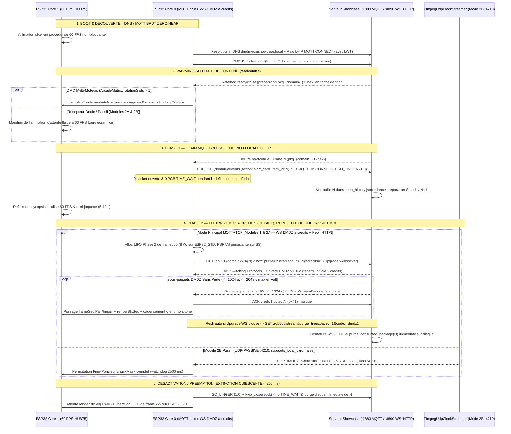
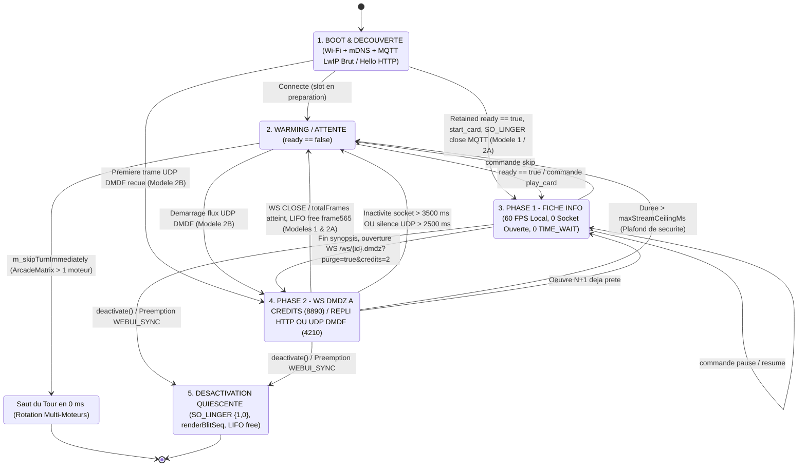

# Guide d'Intégration ESP32 & Récepteur Passif — DMD Media Showcase Server

🇬🇧 [English](ESP32_INTEGRATION.md) | 🇫🇷 Français | 🇪🇸 [Español](ESP32_INTEGRATION_ES.md)

[](https://t.me/+DrSdAO8UMUViNmE0)
[](https://ko-fi.com/red1l)

---

**DMD Media Showcase Server** prend en charge trois topologies complémentaires d'intégration pour les matrices LED HUB75 **ESP32 et ESP32-S3**. Le **Modèle 1** (DMD Multi-Moteurs piloté par le client, ex. `ArcadeMatrix` ESP32 / `ArcadeMatrix_RPi`) et le **Modèle 2A** (Récepteur Hybride piloté par le serveur, `supports_local_card: true`) associent le **plan de contrôle MQTT `:1883`** (`config`/`hello`, `ready`, `start_card`) au **Streaming WebSocket `DMDZ` v1 Sans Perte Acquitté par Crédits inspiré de ZeDMD (`WS /api/v1/{domain}/ws/{item_id}.dmdz` sur `:8890`, `MQTT+TCP` par défaut)** avec **repli automatique HTTP TCP `DMDZ`/`DMDS` cadencé** (`GET /api/v1/{domain}/stream/{item_id}.rgb565.stream?purge=true&paced=1&codec=dmdz1`), tandis que le **Modèle 2B** (`supports_local_card: false`) offre un récepteur optionnel ultra-minimal (~180 lignes C++) **100 % Passif UDP `:4210` `DMDF`** (`UDP-PASSIVE`).

> [!IMPORTANT]
> **Pourquoi `MQTT + TCP` avec WebSocket `DMDZ` v1 Acquitté par Crédits (`:8890`) est le Transport par Défaut & Recommandé pour les Modèles 1 & 2A**
> 1. **Zéro Perte NAT UDP VM Docker Desktop / Rancher Desktop & Zéro Buffering Proxy** : La connexion entrante TCP `:8890` traverse nativement tous les ponts conteneurs et NAT des VMs hôtes sans expiration de trou NAT UDP retour, tandis que le basculement `101 Switching Protocols` (`WS /api/v1/{domain}/ws/{item_id}.dmdz`, `ws_per_message_deflate=False`) désactive tout buffering intermédiaire HTTP de bout en bout.
> 2. **Plafond Strict d'Octets en Vol (`<= 2 048 o` sur `ESP32_STD`, Zéro Épuisement LwIP `pcb->ooseq`)** : Inspiré du handshake déterministe de trames ZeDMD, le serveur découpe chaque trame `DMDZ` v1 sans perte (`<H` longueur utile + opcodes) en **sous-paquets binaires WebSocket `<= 1 024 o`** et applique une **fenêtre glissante de crédits** (`?credits=2` par défaut = **`<= 2 048 o` max en vol**, ajustable `1..16`, ex. `?credits=8` sur `ESP32-S3` PSRAM). Le serveur attend l'acquittement client de 1 octet `'A'` (`0x41`) après chaque sous-paquet consommé — rendant mathématiquement impossible la saturation de la `TCP_WND` (`5 760 o`) et de la SRAM interne en segments hors-séquence (`pcb->ooseq`) lors des balises Wi-Fi.
> 3. **Codec Sans Perte Bit-Exact `DMDZ` v1 + Coexistence Multi-Plateformes Transparente** : `DMDZ` v1 (`SKIP`, `LONG SKIP`, `RUN`, `INDEX[64]`, `DIFF`, `LIT`, `SCROLL_DY`) atteint une compression sans perte de **`2,4–6x` sur vidéo** et **`23–64x` sur panoramas défilants** avec `~152 octets` d'état sur pile et `0 o` heap. Si un équipement intermédiaire bloque `Upgrade: websocket`, le client bascule automatiquement vers `GET /api/v1/{domain}/stream/{item_id}.rgb565.stream?purge=true&paced=1&codec=dmdz1` (`X-DMD-Paced: 1`), tandis qu'`ArcadeMatrix_RPi` conserve le préchargement HTTP `DMDS` brut non-cadencé (`?purge=true`, `0` impact) et le Modèle 2B conserve l'UDP `:4210` `DMDF`.
> 4. **Sockets LwIP Brutes Zéro-`TIME_WAIT` (`SO_LINGER {1, 0}`) & Allocation LIFO `frame565` Bornée à la Phase 2 sur `ESP32_STD`** : Tant le claim MQTT `:1883` (`RawMqttSocket`, zéro heap `PubSubClient`/`WiFiClientRxBuffer`) que le flux `:8890` se ferment avec `SO_LINGER {1, 0}`, recyclant immédiatement les PCB TCP LwIP sans accumuler de sockets `TIME_WAIT` de 120 s au fil des rotations. Sur `ESP32_STD` (0 PSRAM), le buffer `frame565` de `8 Ko` n'est alloué que durant la Phase 2 (LIFO) puis libéré juste après la fermeture socket sous barrière Dekker `seq_cst` `renderBlitSeq`, garantissant `0 o` de fragmentation DRAM et le maintien permanent de la **profondeur HUB75 8 bits**.
> 5. **Identifiants `item_id` Compacts sans Collision (`<= 24` caractères)** : Chaque package préparé utilise le format `pkg_<domain>_<12hex>` (ex. `pkg_games_a1b2c3d4e5f6`), tenant dans un buffer fixe sur pile `ESP32_STD` sans allocation dynamique.

---

## 1. Vue d'Ensemble & Comparaison des 3 Topologies d'Intégration ESP32

### Modèle 1 — DMD Multi-Moteurs Piloté par le Client (`config_source: "client"`, `MQTT+TCP` par défaut)

Conçu pour les firmwares riches multi-écrans où l'ESP32 orchestre sa propre rotation locale (`Clock`, `Weather`, `Scoreboard`, `AudioSpectrum`, `RetroGames`, `Movies`, `Series`, `Anime`), sa pile de préemption (`DisplayArbiter`) et son propre WebUI embarqué.

- **Autorité de Configuration** : Le WebUI de l'ESP32 interroge dynamiquement `GET /api/v1/{domain}/filters?lang={ui_lang}` pour peupler ses listes déroulantes localisées, sauvegarde les filtres en flash locale, et publie sa configuration retenue sur `dmd_showcase/clients/{dmd_id}/config` (`retain=True`).
- **Session MQTT Brute Zéro-Heap + Streaming WebSocket `DMDZ` Acquitté par Crédits** : Core 0 réclame la fiche `ready` retenue via une socket MQTT LwIP brute zéro-heap (`start_card`), **ferme immédiatement la socket TCP MQTT avec `SO_LINGER {1, 0}`** (`0` socket ouverte et `0` PCB `TIME_WAIT` pendant le défilement de la Fiche en Phase 1), puis lit la Phase 2 (`Panoramas + Captures + Vidéo`) sur `WS /api/v1/{domain}/ws/{item_id}.dmdz?purge=true&client_id={dmd_id}&credits=2` (`:8890`, avec repli automatique sur `GET /api/v1/{domain}/stream/{item_id}.rgb565.stream?purge=true&paced=1&codec=dmdz1`).
- **Comportement en Rotation** : Lorsque le tour d'un moteur Showcase arrive et que le slot MQTT retenu (`dmd_showcase/clients/{dmd_id}/{domain}/ready`) indique `{"ready": false}`, le moteur cède son tour en **`0 ms`** (`m_skipTurnImmediately = true`). Le panneau affiche instantanément le moteur local suivant (`Clock`, `Weather`, etc.) sans jamais provoquer d'écran noir ni de latence.
- **Implémentation de Référence en Production (`ArcadeMatrix` — Découpe Modulaire à Responsabilité Unique)** :
  - Orchestrateur des Moteurs Showcase & Descripteurs : [`src/engines/MediaShowcaseEngines.h`](https://github.com/red77290/ArcadeMatrix/blob/main/src/engines/MediaShowcaseEngines.h) / [`src/engines/MediaShowcaseEngines.cpp`](https://github.com/red77290/ArcadeMatrix/blob/main/src/engines/MediaShowcaseEngines.cpp)
  - Police Pixel UTF-8 Core 1, Pixel-Art d'Attente & Dispositions Card Adaptatives : [`src/engines/showcase/ShowcaseCardRenderer.h`](https://github.com/red77290/ArcadeMatrix/blob/main/src/engines/showcase/ShowcaseCardRenderer.h) / [`src/engines/showcase/ShowcaseCardRenderer.cpp`](https://github.com/red77290/ArcadeMatrix/blob/main/src/engines/showcase/ShowcaseCardRenderer.cpp)
  - Client de Flux Partagé Zéro-Heap WebSocket `DMDZ` à Crédits + Repli HTTP Cadencé (partagé par `MediaShowcaseBase` & `FrontendSyncEngine`) : [`src/core/net/DmdzStreamClient.h`](https://github.com/red77290/ArcadeMatrix/blob/main/src/core/net/DmdzStreamClient.h) / [`src/core/net/DmdzStreamClient.cpp`](https://github.com/red77290/ArcadeMatrix/blob/main/src/core/net/DmdzStreamClient.cpp)
  - Socket MQTT 3.1.1 LwIP Brute Zéro-Heap & Fermeture `SO_LINGER {1, 0}` : [`src/core/net/RawMqttSocket.h`](https://github.com/red77290/ArcadeMatrix/blob/main/src/core/net/RawMqttSocket.h) / [`src/core/net/RawMqttSocket.cpp`](https://github.com/red77290/ArcadeMatrix/blob/main/src/core/net/RawMqttSocket.cpp)
  - Décodeur Sans Perte `DMDZ` v1 & Démultiplexeur Binaire RFC 6455 : [`src/core/drawing/DmdzStreamDecoder.h`](https://github.com/red77290/ArcadeMatrix/blob/main/src/core/drawing/DmdzStreamDecoder.h) / [`src/core/drawing/DmdzStreamDecoder.cpp`](https://github.com/red77290/ArcadeMatrix/blob/main/src/core/drawing/DmdzStreamDecoder.cpp)

---

### Modèle 2A — Récepteur Hybride Piloté par le Serveur (`config_source: "server"`, `supports_local_card: true`, `MQTT+TCP` par défaut)

Conçu pour les afficheurs Showcase dédiés souhaitant conserver un rendu texte local ultra-net à 60 FPS sur l'ESP32 **sans** embarquer de WebUI, de logique de référentiels scrapers ni de schémas NVS complexes.

- **Annonce Matérielle Légère** : Au démarrage, l'ESP32 publie un court message retenu sur `dmd_showcase/clients/{dmd_id}/hello` (`retain=True`) déclarant uniquement sa géométrie et son adresse LAN (`width`, `height`, `config_source: "server"`, `supports_local_card: true` et langue par défaut `lang`).
- **Profil Centralisé Persisté (`./data/dmd_profiles.json`)** : Toutes les playlists de domaines (`games`, `movies`, `series`, `anime`), catégories (`systems`, `genres`, `decades`), préréglages de cadrage/colorimétrie IA (`video_mode`, `color_boost`) et la langue de diffusion du contenu (`lang`) sont configurés dans le **Dashboard Web Showcase** (`http://dmdmediashowcase.local:8890/`) et sauvegardés dans `./data/dmd_profiles.json`.
- **Rendu Hybride** : L'ESP32 affiche localement la **Phase 1 (Fiche Info)** à 60 FPS (mini-jaquette + badge coloré + défilement fluide du synopsis poussé via `ready` ou `dmd_showcase/clients/{dmd_id}/command` `play_card`, acquitté par `start_card`), puis bascule sur `WS /api/v1/{domain}/ws/{item_id}.dmdz?purge=true&client_id={dmd_id}&credits=2` sur `:8890` pour recevoir la **Phase 2 (Panoramas + Vidéo)** en WebSocket `DMDZ` v1 sans perte acquitté par crédits (avec repli automatique HTTP `?purge=true&paced=1&codec=dmdz1` et support `mqtt_udp` `start_stream` optionnel).

---

### Modèle 2B — Récepteur Framebuffer 100 % Passif Piloté par le Serveur (`config_source: "server"`, `supports_local_card: false`, `UDP-PASSIVE`)

Conçu pour des montages matériels ultra-légers et sans maintenance (`ESP32_STD` WROOM-32 **sans PSRAM** ou `ESP32-S3`) en **~180 lignes de C++** — **zéro WebUI, zéro police de caractères, zéro parseur JSON et zéro bibliothèque MQTT requise**.

- **Découverte Zéro-Configuration** : L'ESP32 s'annonce via un simple heartbeat HTTP périodique `POST /api/v1/clients/hello` (ou MQTT `dmd_showcase/clients/{dmd_id}/hello`), voire **sans aucun appel sortant** s'il possède une IP LAN fixe déclarée avec `always_stream_udp: true` dans `./data/dmd_profiles.json`.
- **Flux 100 % Composité par le Serveur** : Avec `supports_local_card: false`, le serveur Showcase génère **y compris la Fiche Info de Phase 1** (mini-jaquette + badge système/domaine coloré + titre + année + note + synopsis localisé défilant) directement dans le flux binaire RGB565 et cadence l'envoi des tranches UDP `DMDF` (`<= 1408 o` utiles) vers le port `:4210`.
- **Contrôle Temps Réel Instantané** : Les actions `Skip`, `Pause`, `Resume`, `Stop` et `Play Now` (`FrontendSync`) s'exécutent **100 % côté serveur** en commutant le flux `FfmpegUdpClockStreamer` vers `:4210` en `< 50 ms`.

---

### Tableau Comparatif des 3 Topologies

| Critère | Modèle 1 : Piloté Client (`ArcadeMatrix`) | Modèle 2A : Hybride Piloté Serveur | Modèle 2B : Récepteur UDP 100 % Passif |
| :--- | :--- | :--- | :--- |
| **Annonce & Transport** | `config_source: "client"` (`MQTT+TCP` par défaut) | `config_source: "server"`, `supports_local_card: true` (`MQTT+TCP` par défaut) | `config_source: "server"`, `supports_local_card: false` (`UDP-PASSIVE` `:4210`) |
| **Stockage Playlists & Filtres** | Flash ESP32 (`config.json`) | Serveur (`./data/dmd_profiles.json`) | Serveur (`./data/dmd_profiles.json`) |
| **Complexité Firmware / UI** | OS Multi-Moteurs complet + WebUI | ~350 lignes C++ (MQTT brut + WS `DMDZ` à crédits + Police) | **~120–180 lignes C++** (Zéro UI, Zéro Police, Zéro JSON) |
| **Rendu Phase 1 (Fiche Info)** | Local 60 FPS sur Core 1 ESP32 | Local 60 FPS sur Core 1 ESP32 | **Rendu par le serveur dans le flux UDP RGB565** |
| **Rendu Phase 2 (Panoramas + Vidéo)** | **WebSocket `WS /ws/{id}.dmdz` à crédits (`:8890`, `<= 2 Ko` en vol) + repli HTTP `?paced=1&codec=dmdz1`** *(option `mqtt_udp`)* | **WebSocket `WS /ws/{id}.dmdz` à crédits (`:8890`, `<= 2 Ko` en vol) + repli HTTP `?paced=1&codec=dmdz1`** *(option `mqtt_udp`)* | **UDP Passif `DMDF` (`:4210`)** |
| **Empreinte SRAM (`128x32`)** | **`2 Ko` jaquette (Phase 1) / `8 Ko` `frame565` LIFO borné Phase 2 (`ESP32_STD` ; PSRAM sur `S3`)** | `2–6 Ko` jaquette + `8 Ko` `frame565` LIFO Phase 2 | **`8 Ko` simple (`16 Ko` ping-pong) — `0 o` jaquette/JSON** |
| **Qualification `ESP32_STD` (Sans PSRAM)** | Qualifié (`128x32` en **HUB75 8 bits**, `64x64`, `128x64`) | Qualifié (`128x32` à `128x64`) | **Qualifié (`128x32` jusqu'à `256x64` simple buffer)** |
| **Charge CPU Core 0** | Faible (MQTT brut + Base64 + décodage WS `DMDZ` `<= 1024 o` + ACK `'A'`) | Faible (MQTT brut + Base64 + décodage WS `DMDZ` `<= 1024 o` + ACK `'A'`) | **Minimale (pur `memcpy` UDP non-bloquant)** |
| **Réactivité `Skip` / `Pause` / `Play Now`** | File prioritaire (`N+1`) ou MQTT `.../command` | Via MQTT `.../command` (`play_card` / `skip`) | **Instantanée (`< 50 ms`) directement dans le streamer `DMDF`** |

---

## 2. Chorégraphie FreeRTOS Dual-Core & Invariants DMA HUB75

Les dalles LED HUB75 ne possèdent pas de mémoire vidéo interne : le périphérique I2S/LCD DMA de l'ESP32 doit balayer en permanence les plans de bits PWM depuis la SRAM interne. Toute tempête d'interruptions Wi-Fi, allocation dynamique ou contention de mutex sur le cœur de rendu provoque immédiatement du scintillement ou des lignes fantômes.

Pour garantir un rafraîchissement irréprochable à **60 FPS** (`16,67 ms` par trame), l'architecture impose une séparation matérielle stricte entre les deux cœurs :

- **Core 0 (`PRO_CPU` — Worker Réseau & Protocole)** :
  - Exécute la pile Wi-Fi / LwIP et la résolution mDNS (`dmdmediashowcase.local` sur `224.0.0.251:5353`).
  - **Modèles 1 & 2A (`MQTT+TCP` par défaut)** : Exécute une **session MQTT `:1883` LwIP brute zéro-heap** (`config` ou `hello` $\to$ `ready` retenu $\to$ `start_card` $\to$ fermeture immédiate `SO_LINGER {1, 0}` afin que `0` socket et `0` PCB `TIME_WAIT` ne subsistent pendant le défilement de la Fiche). En Phase 2, Core 0 alloue `frame565` en LIFO sur `ESP32_STD` (ou réutilise la PSRAM sur `ESP32-S3`), bascule un `lwip_socket` (`TCP_NODELAY`) sur **`WS /api/v1/{domain}/ws/{item_id}.dmdz?purge=true&client_id={dmd_id}&credits=2`** (`101 Switching Protocols`, ou `credits=8` avec PSRAM), lit l'**en-tête Little-Endian `<4sBBHHHHH` `DMDZ` v1 de 16 octets**, décode sur place les **sous-paquets binaires `<= 1 024 o`** dans `frame565` (`~152 octets` sur pile, `0 o` heap) et renvoie une trame RFC 6455 masquée de 7 octets contenant `'A'` (`0x41`) par message consommé afin de limiter le flux en vol à `<= 2 048 octets` sur `ESP32_STD` (`0` épuisement `pcb->ooseq`). Si la mise à niveau WebSocket échoue, Core 0 bascule automatiquement sur `GET /api/v1/{domain}/stream/{item_id}.rgb565.stream?purge=true&paced=1&codec=dmdz1`.
  - **Modèle 2B (`UDP-PASSIVE :4210`)** : Assure le heartbeat HTTP `POST /api/v1/clients/hello` et réassemble les datagrammes **UDP `DMDF`** non-bloquants (en-tête `<4sHBBH` de `10 octets` + tranche `<= 1408 octets` RGB565LE = `<= 1418 octets` par paquet UDP, zéro fragmentation IP sous le MTU Wi-Fi de `1500 octets`).
- **Core 1 (`APP_CPU` — Boucle Temps Réel HUB75 à 60 FPS)** :
  - Pilote exclusivement `IDrawingSurface` / le DMA HUB75 à 60 FPS.
  - **Zéro Allocation Dynamique** : Aucun appel à `malloc`, `new`, `String` ni `std::vector::push_back` dans la boucle chaude de rendu.
  - **Zéro Mutex / Zéro Contention** : Aucun `std::mutex` ni sémaphore FreeRTOS partagé avec Core 0.
  - **Isolation Stricte du DMA** : Le worker réseau n'écrit jamais directement dans le buffer DMA HUB75 en cours de balayage ; les pixels sont décodés dans `frame565` puis copiés proprement via `IDrawingSurface` lors de la passe de rendu.

### Passage de Trames Lock-Free : `frameSeq` Pair/Impair + Barrière Dekker `renderBlitSeq` vs Double-Buffer Ping-Pong

Deux mécanismes sans verrou permettent de transférer les trames de Core 0 vers Core 1 :

1. **Synchronisation Sans Déchirement `frameSeq` Pair/Impair + `consumedFrameSeq` + Barrière Dekker `renderBlitSeq` (`frame565` Unique — Modèles 1 & 2A par défaut)** :
   - Éprouvée en production dans [`MediaShowcaseEngines.cpp`](https://github.com/red77290/ArcadeMatrix/blob/main/src/engines/MediaShowcaseEngines.cpp) pour éliminer tout déchirement horizontal et tout accès mémoire concurrent avec **un unique buffer `frame565`** (`8 Ko` en `128x32`) alloué exclusivement pendant la Phase 2 sur `ESP32_STD`.
   - Core 0 cadence la présentation de manière monotone (`periodMs = frameDurMs`) **pendant que `frameSeq` reste `PAIR`** et n'envoie les crédits `'A'` qu'au fur et à mesure de la lecture des sous-paquets WebSocket `<= 1 024 o`, de sorte que ni Core 1 ni `TCP_WND` ne sont jamais bloqués.
   - Avant de décoder une nouvelle trame `DMDZ`, Core 0 attend au plus `18 ms` (`1` rafraîchissement HUB75) que Core 1 ait consommé la trame précédente (`consumedFrameSeq == frameSeq`), bascule `frameSeq` en **`IMPAIR`** (`fetch_add(1, memory_order_acq_rel)`), décode la trame `DMDZ` sans perte sur place dans `frame565`, puis repasse `frameSeq` en **`PAIR`** (`fetch_add(1, memory_order_release)`).
   - Core 1 encadre son `memcpy` par un compteur `IMPAIR`/`PAIR` `renderBlitSeq` (`memory_order_seq_cst`). En fin de Phase 2 sur `ESP32_STD`, Core 0 écrit `frameSeq = 1` (`seq_cst`), attend `(renderBlitSeq & 1U) == 0U` (`~15 µs`), ferme la socket (`SO_LINGER {1, 0}`) et libère `frame565` en ordre LIFO strict (`0` fragmentation du heap).
2. **Double-Buffer Ping-Pong `frame565[2]` (`std::atomic<uint8_t> frontIdx` — Modèle 2B UDP `DMDF`)** :
   - Core 0 écrit les tranches `DMDF` dans `frame565[backIdx]` en marquant chaque bit `(1ULL << chunk_idx)` dans un masque 64 bits `chunkMask`.
   - Dès que `chunkMask == ((1ULL << total_chunks) - 1ULL)`, Core 0 permute atomiquement `frontIdx.store(backIdx, std::memory_order_release)`. Core 1 lit toujours une trame 100 % complète.

### Budgets Exacts SRAM / PSRAM par Géométrie HUB75

Un **`ESP32_STD` sans PSRAM** (WROOM-32 disposant d'environ `110–140 Ko` de heap interne libre après initialisation Wi-Fi + HUB75 DMA) exécute l'intégralité du pipeline avec une large marge de sécurité :

| Géométrie Dalle | Pixels (`L x H`) | `WS DMDZ` (`<= 1024 o` x `2` crédits) / `UDP DMDF` | `frame565` Phase 2 (Modèles 1 & 2A) | Ping-Pong `frame565[2]` (Modèle 2B) | `poster565` Carte Locale (Modèle 1 / 2A) | Compatibilité `ESP32_STD` Sans PSRAM |
| :--- | :--- | :--- | :--- | :--- | :--- | :--- |
| **`128x32`** *(DMD WPC)* | `4 096 px` | `<= 2 048 o` WS en vol / `6` tranches UDP | **`8 192 o`** (`8 Ko` LIFO) | `16 384 o` (`16 Ko`) | `2 048 o` (`32x32`) | **Fluide en profondeur HUB75 8 bits sur `ESP32_STD`** |
| **`64x64`** *(Carré)* | `4 096 px` | `<= 2 048 o` WS en vol / `6` tranches UDP | **`8 192 o`** (`8 Ko` LIFO) | `16 384 o` (`16 Ko`) | `2 048 o` (`32x32`) | **Fluide sur `ESP32_STD`** |
| **`128x64` / `64x128` TATE** | `8 192 px` | `<= 2 048 o` WS en vol / `12` tranches UDP | **`16 384 o`** (`16 Ko` LIFO) | `32 768 o` (`32 Ko`) | `6 144 o` (`48x64`) / `3 200 o` (`40x40`) | **Tient en SRAM interne `ESP32_STD` (repli auto HUB75 4 bits si requis)** |
| **`256x64`** *(Super-DMD)* | `16 384 px` | `<= 2 048 o` WS (`8 Ko` sur `S3` `credits=8`) / `24` tranches UDP | **`32 768 o`** (`32 Ko`) | `65 536 o` (`64 Ko`) | `6 144 o` (`48x64`) | **`32 Ko` Simple sur `ESP32_STD` ; `ESP32-S3` PSRAM recommandé** |

### Pipeline d'Affichage HUB75 Préconisé : `Single DMA Buffer + Offscreen RGB565 Canvas` (`canvas_single`)

Sur l'ensemble des firmwares ESP32 HUB75 (dont [`ArcadeMatrix`](https://github.com/red77290/ArcadeMatrix)), le pipeline **`Single DMA Buffer + Offscreen RGB565 Canvas` (`canvas_single`)** adossé à [`mrfaptastic/ESP32-HUB75-MatrixPanel-I2S-DMA`](https://github.com/mrfaptastic/ESP32-HUB75-MatrixPanel-I2S-DMA) constitue **l'architecture de référence préconisée** :

1. **Économie de 50 % sur la SRAM Interne Compatible DMA (`mxconfig.double_buff = false`)** :
   - Sur `ESP32_STD` (sans PSRAM), les descripteurs DMA I2S et les bitplanes BCM doivent impérativement être alloués dans la DRAM interne contiguë (`MALLOC_CAP_DMA`) — exactement la ressource sollicitée par la pile Wi-Fi + LwIP TCP/UDP.
   - Désactiver le double-buffering DMA matériel (`mxconfig.double_buff = false`) divise par deux l'empreinte des bitplanes, tandis que le canevas linéaire RGB565 hors-écran (`GFXcanvas16`) ne consomme que `2 octets/pixel` (`8 Ko` en `128x32`, `16 Ko` en `128x64`, et logeable en PSRAM sur `ESP32-S3`).
2. **Maintien de la Profondeur Couleur HUB75 8 Bits sur `ESP32_STD` (`esp32dev`) via Hystérésis & Préemption `WEBUI_SYNC`** :
   - Les firmwares multi-moteurs (`ArcadeMatrix`) conservent **la pleine profondeur couleur HUB75 BCM 8 bits** sur dalle `128x32` sur les cartes `ESP32_STD` (`esp32dev` sans PSRAM) sur un nombre illimité de rotations : `PipelineSelectionPolicy` applique une hystérésis de maintien de `3,5 Ko` une fois le DMA 8 bits alloué, et l'allocation LIFO Phase 2 de `frame565` couplée à `SO_LINGER {1, 0}` garantit zéro érosion de la DRAM interne — ne descendant à `4 bits` **que** sur des dalles plus grandes (`128x64` sans PSRAM).
   - Lors du chargement initial de la SPA WebUI embarquée (`GET /`), `ArcadeMatrix` active temporairement une source d'affichage haute priorité zéro-heap **`WEBUI_SYNC`** ([`WebUiSyncEngine`](https://github.com/red77290/ArcadeMatrix/blob/main/src/engines/WebUiSyncEngine.h)) sur `PreemptionStack`. L'éviction du moteur actif (`deactivate()`) libère immédiatement **`~48 Ko` de SRAM interne** (`m_frame565`, `m_poster565`, `m_ioScratch` et buffers TCP) pour servir la SPA compressée sans erreur mémoire, puis reprend automatiquement la diffusion Showcase 8 bits dès la synchronisation navigateur terminée.
3. **Zéro Scintillement Noir & Zéro Effet Stroboscopique (Écrasement Bitplane Sur Place)** :
   - Dessiner directement dans un unique buffer DMA (`direct_single`) en appelant `clearScreen()` efface les bitplanes en cours de balayage actif, provoquant un clignotement noir permanent.
   - Avec un **Canevas RGB565 Hors-Écran**, tous les effacements, tracés `Adafruit_GFX` (texte, HUD, score), animations d'attente et mises à jour de trames `DMDZ`/`DMDS`/`DMDF` s'effectuent à 100 % en mémoire hors-écran. `blitCanvas565()` réécrit ensuite chaque mot de bitplane HUB75 **sur place** (`(dmaRow[ax] & ~0x003F) | rgb12`) en **`~300 µs`** (`128x32`) **sans jamais passer par un `clearScreen()` noir préalable**.
4. **Gating par Compteur d'État `Dirty` (`frameSeq != lastPresentedSeq`)** :
   - Core 1 cadencé à `60 Hz` (`16,6 ms`) cohabite avec un flux vidéo WS `DMDZ` / TCP `DMDS` / UDP `DMDF` à `15–25 FPS` (`40–66 ms`).
   - En ne déclenchant le burst vers `frame_buffer[0]` **que lorsqu'une nouvelle trame a réellement modifié le canevas**, Core 1 n'effectue **aucune écriture DMA redondante** entre deux trames vidéo, supprimant toute contention sur le bus SRAM pendant le balayage I2S.
5. **Encodage Burst BCM Multiplexé + Gamma Perceptif CIE 1931 + Swap FIFO I2S ESP32 Classique** :
   - Encode simultanément la demi-ligne haute `(y)` et la demi-ligne basse `(y + H/2)` dans `R1G1B1R2G2B2` via des tables **gamma CIE 1931** calibrées à la profondeur active, applique la permutation 16 bits du FIFO I2S de l'ESP32 original (`MATRIX_TX_ADJUST(x)`) et vide les lignes de cache CPU (`Cache_WriteBack_Addr`) lorsque `SPIRAM_DMA_BUFFER` est actif sur `ESP32-S3`.

| Mode Pipeline | `mxconfig.double_buff` | Canevas RGB565 Hors-Écran | Marge DRAM DMA (`ESP32_STD`) | Scintillement / Tearing | Préconisation |
| :--- | :---: | :---: | :--- | :--- | :--- |
| **`canvas_single`** | **`false`** | **Oui (`GFXcanvas16`)** | **Optimale (-50 % DRAM DMA)** | **Zéro scintillement (burst `~300 µs` sur place + dirty gating)** | **Préconisé (`ESP32_STD` & `ESP32-S3`)** |
| `canvas_double` | `true` | Oui (`GFXcanvas16`) | Coût RAM élevé (`2x` DMA + Canvas) | Swap sans déchirement | Optionnel sur `ESP32-S3` Octal PSRAM |
| `direct_double` | `true` | Non | Forte pression DRAM (`2x` bitplanes) | `drawPixel()` unitaire lent en vidéo | Sketches GFX legacy uniquement |
| `direct_single` | `false` | Non | RAM libre maximale | Scintillement visible sur `clearScreen()` | Repli d'urgence très basse RAM uniquement |

---

## 3. Séquencement Complet des Tâches, États d'Attente & Watchdog de Récupération

### Diagramme de Séquence de Bout en Bout



### Machine à États Déterministe du Récepteur ESP32



### Analyse Détaillée des 5 États & Garanties de Résilience

1. **`BOOT & DÉCOUVERTE mDNS / MQTT BRUT ZÉRO-HEAP`** :
   - Dès la mise sous tension, Core 1 affiche une animation procédurale pixel-art à 60 FPS sans attendre la connexion Wi-Fi.
   - Core 0 résout `dmdmediashowcase.local` par mDNS (`224.0.0.251:5353`) et ouvre la session MQTT `:1883` sur un `lwip_socket` brut (`RawMqttSocket`, zéro allocation heap `PubSubClient` / `WiFiClientRxBuffer`) avec un **Last Will and Testament (`LWT`)** `{"online": false}` sur `dmd_showcase/clients/{dmd_id}/status`.
2. **`WARMING / ATTENTE DE CONTENU` (`ready: false`)** :
   - **Récepteurs Dédiés / Passifs (Modèles 2A & 2B)** : Maintiennent leur animation 60 FPS fluide pendant que le serveur télécharge et transcode la première œuvre (`pkg_<domain>_<12hex>`).
   - **DMD Multi-Moteurs (`ArcadeMatrix` — Modèle 1)** : Si `m_rotationSlotCount > 1` et que le topic retenu publie `{"ready": false}`, `MediaShowcaseBase` positionne `m_skipTurnImmediately = true` (`isFinished() == true` en **`0 ms`**). L'afficheur enchaîne immédiatement sur l'horloge ou la météo sans **aucun écran noir** pendant que le serveur prépare l'œuvre en arrière-plan.
3. **`PHASE 1 — CLAIM MQTT BRUT, ZÉRO TIME_WAIT & PIPELINING N+1`** :
   - Dès que l'œuvre `N` (`pkg_<domain>_<12hex>`) est réclamée via `start_card`, Core 0 **envoie immédiatement `DISCONNECT` et ferme la socket MQTT avec `SO_LINGER {1, 0}`**, laissant **`0` socket ouverte et `0` PCB `TIME_WAIT`** pendant les `5–12 s` du défilement local à 60 FPS (avant même que `m_frame565` ne soit alloué sur `ESP32_STD`).
   - Côté serveur, `start_card` verrouille l'œuvre `N` dans `./data/seen_history.json` (sauf si `mark_seen: false` via `FrontendSync`), bascule le topic retenu `ready` à `{"ready": false}` et déclenche **instantanément la préparation en tâche de fond du slot `N+1`**.
4. **`PHASE 2 — FLUX WEBSOCKET DMDZ ACQUITTÉ PAR CRÉDITS (DÉFAUT), REPLI HTTP OU UDP PASSIF DMDF`** :
   - **Modèles 1 & 2A (`MQTT+TCP` par défaut)** : Core 0 alloue `m_frame565` en portée LIFO stricte sur `ESP32_STD` (ou réutilise la PSRAM persistante sur `ESP32-S3`) et bascule un `lwip_socket` (`TCP_NODELAY`, `SO_RCVTIMEO` de `250 ms`) sur `WS /api/v1/{domain}/ws/{item_id}.dmdz?purge=true&client_id={dmd_id}&credits=2` (`credits=8` avec PSRAM). Le serveur transmet l'en-tête `DMDZ` v1 de 16 octets suivi de **sous-paquets binaires `<= 1 024 o`** bornés par la fenêtre de crédits (`<= 2 048 o` max en vol sur `ESP32_STD`), attendant l'acquittement client de 1 octet `'A'` (`0x41`) au fur et à mesure du décodage sur place dans `m_frame565` et du cadencement monotone sur Core 0. Si la mise à niveau WebSocket est bloquée, Core 0 bascule automatiquement sur `GET /api/v1/{domain}/stream/{item_id}.rgb565.stream?purge=true&paced=1&codec=dmdz1` (tandis qu'`ArcadeMatrix_RPi` conserve le préchargement `DMDS` brut non-cadencé via `?purge=true`). Un **watchdog d'inactivité socket de `3 500 ms`** protège chaque lecture, et à la fermeture du flux, le bloc `finally` du serveur purge immédiatement le dossier disque de `N`.
   - **Modèle 2B (`UDP-PASSIVE :4210`, `supports_local_card: false`)** : `FfmpegUdpClockStreamer` cadence les tranches UDP `DMDF` (`<= 1408 o`) vers `:4210`, protégées par un **watchdog local d'inactivité UDP de `2 500 ms`** (`millis() - lastUdpPacketMs > 2500`) et un plafond de durée maximale.
5. **`DÉSACTIVATION, PRÉEMPTION WEBUI_SYNC & REPRISE APRÈS REBOOT`** :
   - **Désactivation Propre & Quiescente (`< 250 ms`)** : Le passage de `m_wantActive = false` réveille `SO_RCVTIMEO` en `<= 250 ms`, ferme la socket avec `SO_LINGER {1, 0}` (`0` PCB `TIME_WAIT`, déclenchant la purge disque immédiate côté serveur), attend que la barrière Dekker `m_renderBlitSeq` de Core 1 soit `PAIR`, libère `m_frame565` en LIFO sur `ESP32_STD`, puis joint la tâche Core 0 (`stopWorkerTaskBounded()` sans allocation dynamique), y compris lors d'une préemption `WEBUI_SYNC`.
   - **Reboot Brutal de l'ESP32** : Le `RST`/timeout TCP `:8890` ou le `LWT` MQTT (`{"online": false}`) libère immédiatement tout flux serveur actif tout en conservant le slot `N+1` préparé en tâche de fond.

---

## 4. Implémentations C++ ESP32 de Référence (`MQTT+TCP` par défaut & UDP Passif `DMDF`)

### A. Modèles 1 & 2A — Session MQTT Brute Zéro-Heap + Streamer WebSocket `DMDZ` v1 à Crédits (`MQTT+TCP` par défaut)

Cette implémentation C++17 illustre le patron exact zéro-heap **`MQTT LwIP brut (:1883) + WebSocket DMDZ v1 sans perte acquitté par crédits (:8890) + Repli HTTP cadencé`** déployé en production sur [`ArcadeMatrix`](https://github.com/red77290/ArcadeMatrix/blob/main/src/engines/MediaShowcaseEngines.cpp) pour le **Modèle 1** (`config_source: "client"`) et le **Modèle 2A** (`config_source: "server"`, `supports_local_card: true`) :

1. **Claim MQTT LwIP Brut Zéro-Heap (`0` Socket & `0` `TIME_WAIT` Pendant la Fiche)** : Core 0 se connecte directement à `:1883` via `lwip_socket` (évitant les 4 Ko de heap de `PubSubClient` et `WiFiClientRxBuffer`), publie `config` (Modèle 1) ou `hello` (`supports_local_card: true`, Modèle 2A), extrait la fiche `ready` retenue (`pkg_<domain>_<12hex>`), publie `{"action":"start_card","item_id":"pkg_..."}`, puis ferme avec **`SO_LINGER {1, 0}`**.
2. **`g_frame565` LIFO Phase 2 + WebSocket `WS /ws/{item_id}.dmdz` à Crédits (`?credits=2` / `8`) + Repli HTTP** : Une fois le défilement local 60 FPS terminé, `StepCFrameBufferGuard` alloue `g_frame565` (`8 Ko` SRAM interne sur `ESP32_STD` ou PSRAM persistante sur `ESP32-S3`), bascule sur `WS /api/v1/{domain}/ws/{item_id}.dmdz?purge=true&client_id={dmd_id}&credits=2` (avec repli automatique vers `GET /api/v1/{domain}/stream/{item_id}.rgb565.stream?purge=true&paced=1&codec=dmdz1`), décode les sous-paquets `DMDZ` v1 `<= 1 024 o` sur place en renvoyant l'acquittement masqué `'A'` de 7 octets, et synchronise sans déchirement avec Core 1 (`canvas_single`) via **`g_frameSeq` Pair/Impair + `g_consumedFrameSeq` + `g_renderBlitSeq`**.

```cpp
#include <Arduino.h>
#include <WiFi.h>
#include <esp_heap_caps.h>
#include <lwip/sockets.h>
#include <lwip/netdb.h>
#include <atomic>
#include <cstring>

static constexpr uint16_t PANEL_W     = 128;
static constexpr uint16_t PANEL_H     = 32;
static constexpr size_t   FRAME_BYTES = static_cast<size_t>(PANEL_W) * PANEL_H * 2U; // 8,192 B

// Persistent scratch buffer (~1.46 KB); on ESP32_STD (0 PSRAM), g_frame565 (8 KB) is allocated
// strictly during Phase 2 streaming (LIFO) so Phase 1 and engine rotations never fragment heap!
static uint16_t* g_frame565       = nullptr;
static bool      g_hasPsram       = false;
static uint8_t   g_ioScratch[1472]{};
static char      g_itemId[28]{}; // Compact "pkg_<domain>_<12hex>" (<= 24 chars)

// Lock-free synchronization between Core 0 (stream decoder) and Core 1 (60 Hz HUB75)
static std::atomic<uint32_t> g_frameSeq{0};         // EVEN = coherent frame ready, ODD = Core 0 writing
static std::atomic<uint32_t> g_consumedFrameSeq{0}; // Last EVEN frameSeq blitted by Core 1
static std::atomic<uint32_t> g_renderBlitSeq{0};    // Dekker seq_cst guard (ODD while Core 1 reads g_frame565)
static std::atomic<bool>     g_wantActive{true};

// Immediately reclaim LwIP TCP PCB without accumulating 120s TIME_WAIT sockets across rotations
static void closeSocketZeroTimeWait(int& sock) {
    if (sock >= 0) {
        struct linger sl{1, 0};
        lwip_setsockopt(sock, SOL_SOCKET, SO_LINGER, &sl, sizeof(sl));
        lwip_close(sock);
        sock = -1;
    }
}

static bool sendAllBounded(int sock, const uint8_t* buf, size_t len) {
    size_t sent = 0;
    while (sent < len && g_wantActive.load(std::memory_order_relaxed)) {
        const int w = lwip_send(sock, buf + sent, len - sent, 0);
        if (w > 0) {
            sent += static_cast<size_t>(w);
        } else if (w < 0 && (errno == EAGAIN || errno == EWOULDBLOCK || errno == EINTR)) {
            vTaskDelay(pdMS_TO_TICKS(1));
        } else {
            return false;
        }
    }
    return sent == len;
}

// -----------------------------------------------------------------------------------------
// STEP 1 (CORE 0): ZERO-HEAP RAW LWIP MQTT CLAIM -> CLOSE SOCKET WITH 0 TIME_WAIT!
// -----------------------------------------------------------------------------------------
static size_t encodeMqttRemainingLen(uint8_t out[4], size_t remLen) {
    size_t i = 0;
    do {
        uint8_t b = static_cast<uint8_t>(remLen & 0x7FU);
        remLen >>= 7;
        if (remLen > 0U) b |= 0x80U;
        out[i++] = b;
    } while (remLen > 0U && i < 4U);
    return i;
}

static bool sendMqttPacket(int sock, uint8_t fixedHdr, const uint8_t* body, size_t bodyLen) {
    uint8_t hdr[5]{fixedHdr};
    const size_t hdrLen = 1U + encodeMqttRemainingLen(hdr + 1, bodyLen);
    return sendAllBounded(sock, hdr, hdrLen) && (bodyLen == 0U || sendAllBounded(sock, body, bodyLen));
}

static bool sendMqttPublish(int sock, const char* topic, const char* json, bool retain) {
    const uint16_t tLen = static_cast<uint16_t>(strlen(topic));
    const size_t   pLen = strlen(json);
    if (2U + tLen + pLen > sizeof(g_ioScratch)) return false;
    g_ioScratch[0] = static_cast<uint8_t>(tLen >> 8);
    g_ioScratch[1] = static_cast<uint8_t>(tLen & 0xFFU);
    memcpy(g_ioScratch + 2, topic, tLen);
    memcpy(g_ioScratch + 2 + tLen, json, pLen);
    return sendMqttPacket(sock, static_cast<uint8_t>(0x30U | (retain ? 0x01U : 0x00U)), g_ioScratch, 2U + tLen + pLen);
}

bool claimReadyCardZeroHeapMqtt(const char* host, const char* dmdId, const char* domain, bool isModel2A) {
    IPAddress srvIp;
    if (!WiFi.hostByName(host, srvIp)) return false;

    int sock = lwip_socket(AF_INET, SOCK_STREAM, IPPROTO_TCP);
    if (sock < 0) return false;
    int one = 1;
    lwip_setsockopt(sock, IPPROTO_TCP, TCP_NODELAY, &one, sizeof(one));
    struct timeval tv{0, 200000};
    lwip_setsockopt(sock, SOL_SOCKET, SO_RCVTIMEO, &tv, sizeof(tv));
    lwip_setsockopt(sock, SOL_SOCKET, SO_SNDTIMEO, &tv, sizeof(tv));

    struct sockaddr_in addr{};
    addr.sin_family      = AF_INET;
    addr.sin_port        = htons(1883);
    addr.sin_addr.s_addr = static_cast<uint32_t>(srvIp);
    if (lwip_connect(sock, reinterpret_cast<struct sockaddr*>(&addr), sizeof(addr)) != 0) {
        closeSocketZeroTimeWait(sock);
        return false;
    }

    // Minimal MQTT 3.1.1 CONNECT with LWT {"online":false} (zero WiFiClientRxBuffer heap!)
    char lwtTopic[96];
    snprintf(lwtTopic, sizeof(lwtTopic), "dmd_showcase/clients/%s/status", dmdId);
    static constexpr const char* kLwtMsg = "{\"online\":false}";
    const uint16_t idLen = static_cast<uint16_t>(strlen(dmdId));
    const uint16_t lwTLen = static_cast<uint16_t>(strlen(lwtTopic));
    const uint16_t lwMLen = static_cast<uint16_t>(strlen(kLwtMsg));
    size_t pos = 0;
    const uint8_t varHdr[10] = {0, 4, 'M', 'Q', 'T', 'T', 4, 0x26, 0, 30}; // CleanSession + WillFlag + WillRetain
    memcpy(g_ioScratch + pos, varHdr, sizeof(varHdr)); pos += sizeof(varHdr);
    g_ioScratch[pos++] = static_cast<uint8_t>(idLen >> 8);  g_ioScratch[pos++] = static_cast<uint8_t>(idLen & 0xFFU);
    memcpy(g_ioScratch + pos, dmdId, idLen); pos += idLen;
    g_ioScratch[pos++] = static_cast<uint8_t>(lwTLen >> 8); g_ioScratch[pos++] = static_cast<uint8_t>(lwTLen & 0xFFU);
    memcpy(g_ioScratch + pos, lwtTopic, lwTLen); pos += lwTLen;
    g_ioScratch[pos++] = static_cast<uint8_t>(lwMLen >> 8); g_ioScratch[pos++] = static_cast<uint8_t>(lwMLen & 0xFFU);
    memcpy(g_ioScratch + pos, kLwtMsg, lwMLen); pos += lwMLen;
    if (!sendMqttPacket(sock, 0x10U, g_ioScratch, pos)) {
        closeSocketZeroTimeWait(sock);
        return false;
    }

    // Publish retained hello (Model 2A) or config (Model 1), then SUBSCRIBE to {domain}/ready
    const IPAddress ip = WiFi.localIP();
    char topic[128], msg[256];
    if (isModel2A) {
        snprintf(topic, sizeof(topic), "dmd_showcase/clients/%s/hello", dmdId);
        snprintf(msg, sizeof(msg),
            "{\"dmd_id\":\"%s\",\"config_source\":\"server\",\"supports_local_card\":true,"
            "\"transport\":\"mqtt_tcp\",\"width\":%u,\"height\":%u,\"client_ip\":\"%u.%u.%u.%u\",\"lang\":\"fr\"}",
            dmdId, PANEL_W, PANEL_H, ip[0], ip[1], ip[2], ip[3]);
    } else {
        snprintf(topic, sizeof(topic), "dmd_showcase/clients/%s/config", dmdId);
        snprintf(msg, sizeof(msg),
            "{\"dmd_id\":\"%s\",\"config_source\":\"client\",\"transport\":\"mqtt_tcp\","
            "\"width\":%u,\"height\":%u,\"client_ip\":\"%u.%u.%u.%u\",\"lang\":\"fr\"}",
            dmdId, PANEL_W, PANEL_H, ip[0], ip[1], ip[2], ip[3]);
    }
    sendMqttPublish(sock, topic, msg, /*retain=*/true);

    snprintf(topic, sizeof(topic), "dmd_showcase/clients/%s/%s/ready", dmdId, domain);
    const uint16_t subTLen = static_cast<uint16_t>(strlen(topic));
    g_ioScratch[0] = 0x00; g_ioScratch[1] = 0x01; // Packet ID = 1
    g_ioScratch[2] = static_cast<uint8_t>(subTLen >> 8);
    g_ioScratch[3] = static_cast<uint8_t>(subTLen & 0xFFU);
    memcpy(g_ioScratch + 4, topic, subTLen);
    g_ioScratch[4 + subTLen] = 0x00; // QoS 0
    sendMqttPacket(sock, 0x82U, g_ioScratch, 5U + subTLen);

    // Wait up to 600 ms for retained PUBLISH containing "ready":true + compact item_id
    bool claimed = false;
    size_t rxUsed = 0;
    const uint32_t waitStart = millis();
    while (g_wantActive.load(std::memory_order_relaxed) && (millis() - waitStart) < 600U) {
        const int r = lwip_recv(sock, g_ioScratch + rxUsed, sizeof(g_ioScratch) - 1U - rxUsed, 0);
        if (r > 0) {
            rxUsed += static_cast<size_t>(r);
            g_ioScratch[rxUsed] = '\0';
            if (memmem(g_ioScratch, rxUsed, "\"ready\":true", 12) != nullptr ||
                memmem(g_ioScratch, rxUsed, "\"ready\": true", 13) != nullptr) {
                const char* idKey = static_cast<const char*>(memmem(g_ioScratch, rxUsed, "\"item_id\":\"", 11));
                if (idKey) {
                    idKey += 11;
                    const char* endQ = static_cast<const char*>(memchr(idKey, '"', 27));
                    if (endQ) {
                        const size_t n = static_cast<size_t>(endQ - idKey);
                        memcpy(g_itemId, idKey, n);
                        g_itemId[n] = '\0';
                        claimed = true;
                        break;
                    }
                }
            }
        }
    }

    if (claimed) {
        snprintf(topic, sizeof(topic), "dmd_showcase/clients/%s/%s/events", dmdId, domain);
        snprintf(msg, sizeof(msg),
            "{\"action\":\"start_card\",\"item_id\":\"%s\",\"client_ip\":\"%u.%u.%u.%u\"}",
            g_itemId, ip[0], ip[1], ip[2], ip[3]);
        sendMqttPublish(sock, topic, msg, /*retain=*/false);
    }
    const uint8_t discPkt[2] = {0xE0U, 0x00U};
    lwip_send(sock, discPkt, sizeof(discPkt), 0);
    closeSocketZeroTimeWait(sock); // <--- 0 sockets & 0 TIME_WAIT PCBs during Phase 1 Card scroll!
    return claimed;
}

// -----------------------------------------------------------------------------------------
// STEP 2 (CORE 0): ZERO-HEAP LOSSLESS `DMDZ` v1 DECODER + RFC 6455 CREDIT-ACKED WEBSOCKET
// -----------------------------------------------------------------------------------------
struct DmdzStreamDecoder {
    uint16_t cache[64]{};
    uint32_t numPx = 0, pos = 0;
    uint16_t w = 0, h = 0, rem = 0, last = 0;
    uint8_t  litRem = 0, lo = 0, state = 0;
    bool     err = false;

    static inline uint8_t hashPx(uint16_t p) {
        return static_cast<uint8_t>(((((p >> 11) & 0x1FU) * 3U) + (((p >> 5) & 0x3FU) * 5U) + ((p & 0x1FU) * 7U)) & 63U);
    }
    void init(uint16_t width, uint16_t height) {
        w = width; h = height; numPx = static_cast<uint32_t>(w) * h; err = (numPx == 0U);
    }
    bool beginFrame(uint16_t payloadLen) {
        if (numPx == 0U || payloadLen == 0U) { err = true; return false; }
        memset(cache, 0, sizeof(cache));
        pos = 0; rem = payloadLen; last = 0; litRem = 0; state = 0; err = false;
        return true;
    }
    bool feed(const uint8_t* src, size_t len, uint16_t* fb) {
        if (err || !fb || len > rem) { err = true; return false; }
        for (size_t i = 0; i < len; ++i) {
            const uint8_t b = src[i];
            --rem;
            if (state == 0) { // FrameType: 0=delta, 1=vertical scroll + delta, 2=keyframe
                if (b == 0U || b == 2U) state = 2;
                else if (b == 1U) state = 1;
                else { err = true; return false; }
            } else if (state == 1) { // ScrollDy (in-place memmove)
                const int dy = static_cast<int>(static_cast<int8_t>(b));
                const uint16_t s = static_cast<uint16_t>(dy >= 0 ? dy : -dy);
                if (s >= h) { err = true; return false; }
                if (dy > 0) memmove(fb, fb + static_cast<size_t>(s) * w, static_cast<size_t>(h - s) * w * 2U);
                else if (dy < 0) memmove(fb + static_cast<size_t>(s) * w, fb, static_cast<size_t>(h - s) * w * 2U);
                state = 2;
            } else if (state == 2) { // Op byte
                if (b < 0x40U) { // SKIP (n + 1)
                    const uint32_t n = static_cast<uint32_t>(b) + 1U;
                    if (pos + n > numPx) { err = true; return false; }
                    pos += n; last = fb[pos - 1U]; cache[hashPx(last)] = last;
                } else if (b < 0x80U) { // RUN (n + 1)
                    const uint32_t n = static_cast<uint32_t>(b & 0x3FU) + 1U;
                    if (pos + n > numPx) { err = true; return false; }
                    for (uint32_t k = 0; k < n; ++k) fb[pos++] = last;
                } else if (b < 0xC0U) { // INDEX[64]
                    if (pos >= numPx) { err = true; return false; }
                    last = cache[b & 0x3FU]; fb[pos++] = last;
                } else if (b < 0xE0U) { // DIFF (dr, dg, db in {-1, 0, +1})
                    const uint8_t x = static_cast<uint8_t>(b & 0x1FU);
                    if (x > 26U || pos >= numPx) { err = true; return false; }
                    const uint16_t r  = static_cast<uint16_t>((static_cast<int>((last >> 11) & 0x1FU) + static_cast<int>(x / 9U) - 1) & 0x1F);
                    const uint16_t g  = static_cast<uint16_t>((static_cast<int>((last >> 5) & 0x3FU) + static_cast<int>((x / 3U) % 3U) - 1) & 0x3F);
                    const uint16_t bl = static_cast<uint16_t>((static_cast<int>(last & 0x1FU) + static_cast<int>(x % 3U) - 1) & 0x1F);
                    last = static_cast<uint16_t>((r << 11) | (g << 5) | bl);
                    fb[pos++] = last; cache[hashPx(last)] = last;
                } else if (b < 0xF0U) { // LIT (n + 1) raw <H pixels
                    litRem = static_cast<uint8_t>((b & 0x0FU) + 1U);
                    if (pos + litRem > numPx) { err = true; return false; }
                    state = 3;
                } else if (b == 0xF0U) { // LONG SKIP (<H count)
                    state = 5;
                } else { err = true; return false; }
            } else if (state == 3) { lo = b; state = 4; }
            else if (state == 4) {
                last = static_cast<uint16_t>(lo | (static_cast<uint16_t>(b) << 8));
                fb[pos++] = last; cache[hashPx(last)] = last;
                state = (--litRem > 0U) ? 3 : 2;
            } else if (state == 5) { lo = b; state = 6; }
            else {
                const uint32_t n = static_cast<uint32_t>(lo) | (static_cast<uint32_t>(b) << 8);
                if (n == 0U || pos + n > numPx) { err = true; return false; }
                pos += n; last = fb[pos - 1U]; cache[hashPx(last)] = last; state = 2;
            }
        }
        return true;
    }
    bool finishFrame() const { return !err && rem == 0U && state == 2U && pos == numPx; }
};

// RFC 6455 masked 1-byte 'A' (0x41) credit ACK frame returned to Showcase after each <= 1024 B WS message
static const uint8_t kWsMaskedCreditAck[7] = {0x82U, 0x81U, 0x37U, 0xFAU, 0x21U, 0x3DU, static_cast<uint8_t>(0x41U ^ 0x37U)};

struct SimpleWsBinaryDemuxer {
    size_t  frameRem = 0;
    uint8_t state = 0, opcode = 0, lenBytes = 0;
    bool    fin = true, closed = false, err = false, pongPending = false;

    size_t decode(const uint8_t* src, size_t srcLen, size_t& consumed, uint8_t* dst, size_t dstCap, uint8_t& creditsOut) {
        consumed = 0; creditsOut = 0;
        size_t written = 0;
        while (consumed < srcLen && !closed && !err) {
            if (state == 3) { // Unmasked server-to-client binary payload
                size_t take = srcLen - consumed;
                if (take > frameRem) take = frameRem;
                if (take > dstCap - written) take = dstCap - written;
                if (take == 0U) break;
                memcpy(dst + written, src + consumed, take);
                written += take; consumed += take; frameRem -= take;
                if (frameRem == 0U) { if (fin) ++creditsOut; state = 0; }
                if (written >= dstCap) break;
                continue;
            }
            const uint8_t b = src[consumed++];
            if (state == 0) {
                fin = (b & 0x80U) != 0U; opcode = static_cast<uint8_t>(b & 0x0FU); state = 1;
            } else if (state == 1) {
                const uint8_t l7 = static_cast<uint8_t>(b & 0x7FU);
                if (l7 < 126U) {
                    frameRem = l7;
                    state = (frameRem == 0U) ? 0 : (opcode >= 0x8U ? 4 : 3);
                    if (frameRem == 0U) {
                        if (opcode == 0x8U) closed = true;
                        else if (fin && opcode <= 0x2U) ++creditsOut;
                    }
                }
                else if (l7 == 126U) { frameRem = 0; lenBytes = 2; state = 2; }
                else { err = true; }
            } else if (state == 2) {
                frameRem = (frameRem << 8) | b;
                if (--lenBytes == 0U) state = (opcode >= 0x8U) ? 4 : 3;
            } else { // Control frame payload (PING / CLOSE)
                if (--frameRem == 0U) {
                    if (opcode == 0x8U) closed = true;
                    else if (opcode == 0x9U) pongPending = true;
                    state = 0;
                }
            }
        }
        return written;
    }
};

// Step-C-only LIFO g_frame565 guard on ESP32_STD (persistent PSRAM on ESP32-S3)
struct StepCFrameBufferGuard {
    bool ok = false;
    StepCFrameBufferGuard() {
        g_hasPsram = psramFound();
        if (!g_frame565) {
            g_frame565 = static_cast<uint16_t*>(heap_caps_malloc(
                FRAME_BYTES, (g_hasPsram ? MALLOC_CAP_SPIRAM : MALLOC_CAP_INTERNAL) | MALLOC_CAP_8BIT));
        }
        if (g_frame565) { memset(g_frame565, 0, FRAME_BYTES); ok = true; }
    }
    ~StepCFrameBufferGuard() {
        if (!g_hasPsram && g_frame565) {
            g_frameSeq.store(1U, std::memory_order_seq_cst); // Block new Core 1 blits
            while ((g_renderBlitSeq.load(std::memory_order_seq_cst) & 1U) != 0U) {
                vTaskDelay(pdMS_TO_TICKS(1)); // Wait for any in-flight Core 1 memcpy (~15 us)
            }
            uint16_t* p = g_frame565;
            g_frame565 = nullptr;
            heap_caps_free(p); // LIFO release after socket closes -> 0 heap fragmentation!
            g_frameSeq.store(0U, std::memory_order_seq_cst);
        }
    }
};

static int connectAndUpgradeOrFallback(
    const IPAddress& srvIp, const char* host, uint16_t port, const char* domain,
    const char* itemId, const char* dmdId, bool tryWebSocket, bool& outIsWs, size_t& outBodyOff, size_t& outUsed
) {
    int sock = lwip_socket(AF_INET, SOCK_STREAM, IPPROTO_TCP);
    if (sock < 0) return -1;
    int one = 1;
    lwip_setsockopt(sock, IPPROTO_TCP, TCP_NODELAY, &one, sizeof(one));
    struct timeval tv{0, 250000};
    lwip_setsockopt(sock, SOL_SOCKET, SO_RCVTIMEO, &tv, sizeof(tv));
    lwip_setsockopt(sock, SOL_SOCKET, SO_SNDTIMEO, &tv, sizeof(tv));

    struct sockaddr_in addr{};
    addr.sin_family = AF_INET; addr.sin_port = htons(port); addr.sin_addr.s_addr = static_cast<uint32_t>(srvIp);
    if (lwip_connect(sock, reinterpret_cast<struct sockaddr*>(&addr), sizeof(addr)) != 0) {
        closeSocketZeroTimeWait(sock);
        return -1;
    }

    const unsigned credits = g_hasPsram ? 8U : 2U;
    const int reqLen = tryWebSocket
        ? snprintf(reinterpret_cast<char*>(g_ioScratch), sizeof(g_ioScratch),
            "GET /api/v1/%s/ws/%s.dmdz?purge=true&client_id=%s&credits=%u HTTP/1.1\r\n"
            "Host: %s:%u\r\nUpgrade: websocket\r\nConnection: Upgrade\r\n"
            "Sec-WebSocket-Key: dGhlIHNhbXBsZSBub25jZQ==\r\nSec-WebSocket-Version: 13\r\n\r\n",
            domain, itemId, dmdId, credits, host, port)
        : snprintf(reinterpret_cast<char*>(g_ioScratch), sizeof(g_ioScratch),
            "GET /api/v1/%s/stream/%s.rgb565.stream?purge=true&paced=1&codec=dmdz1 HTTP/1.1\r\n"
            "Host: %s:%u\r\nConnection: close\r\n\r\n",
            domain, itemId, host, port);
    if (!sendAllBounded(sock, g_ioScratch, static_cast<size_t>(reqLen))) {
        closeSocketZeroTimeWait(sock);
        return -1;
    }

    outUsed = 0; outBodyOff = 0;
    while (outUsed + 1U < sizeof(g_ioScratch) && g_wantActive.load(std::memory_order_relaxed)) {
        const int r = lwip_recv(sock, g_ioScratch + outUsed, sizeof(g_ioScratch) - 1U - outUsed, 0);
        if (r <= 0) {
            if (r < 0 && (errno == EAGAIN || errno == EWOULDBLOCK)) continue;
            closeSocketZeroTimeWait(sock);
            return -1;
        }
        outUsed += static_cast<size_t>(r);
        g_ioScratch[outUsed] = '\0';
        const char* hdrEnd = strstr(reinterpret_cast<const char*>(g_ioScratch), "\r\n\r\n");
        if (hdrEnd) {
            outBodyOff = static_cast<size_t>((hdrEnd + 4) - reinterpret_cast<const char*>(g_ioScratch));
            break;
        }
    }
    const bool okStatus = tryWebSocket
        ? (outBodyOff > 0U && memmem(g_ioScratch, outBodyOff, " 101 ", 5) != nullptr)
        : (outBodyOff > 0U && memmem(g_ioScratch, outBodyOff, " 200 ", 5) != nullptr);
    if (!okStatus) {
        closeSocketZeroTimeWait(sock);
        return -1;
    }
    outIsWs = tryWebSocket;
    return sock;
}

bool streamShowcasePhase2(const char* host, uint16_t port, const char* domain, const char* itemId, const char* dmdId) {
    IPAddress srvIp;
    if (!WiFi.hostByName(host, srvIp)) return false;

    StepCFrameBufferGuard fbGuard; // Allocates 8 KB g_frame565 only during Phase 2 on ESP32_STD!
    if (!fbGuard.ok) return false;

    bool isWs = false;
    size_t bodyOff = 0, rxUsed = 0;
    // Primary: ZeDMD-style credit-acked lossless DMDZ WebSocket; Fallback: paced HTTP ?paced=1&codec=dmdz1
    int sock = connectAndUpgradeOrFallback(srvIp, host, port, domain, itemId, dmdId, /*tryWebSocket=*/true, isWs, bodyOff, rxUsed);
    if (sock < 0) {
        sock = connectAndUpgradeOrFallback(srvIp, host, port, domain, itemId, dmdId, /*tryWebSocket=*/false, isWs, bodyOff, rxUsed);
        if (sock < 0) return false;
    }

    SimpleWsBinaryDemuxer wsDemux{};
    uint8_t appBuf[1024]{};
    size_t  appAvail = 0, appOff = 0;
    size_t  rawLeft = rxUsed - bodyOff, rawOff = bodyOff;

    // Drain stream bytes seamlessly across either credit-acked WebSocket or HTTP TCP fallback
    auto pullStreamBytes = [&](uint8_t* dst, size_t want) -> int {
        size_t got = 0;
        uint32_t lastProgressMs = millis();
        while (got < want && g_wantActive.load(std::memory_order_relaxed)) {
            if (appOff < appAvail) {
                size_t take = appAvail - appOff;
                if (take > want - got) take = want - got;
                memcpy(dst + got, appBuf + appOff, take);
                appOff += take; got += take;
                continue;
            }
            if (rawLeft == 0U) {
                if (isWs && wsDemux.closed) return 0;
                const int r = lwip_recv(sock, g_ioScratch, 1024U, 0);
                if (r > 0) { rawLeft = static_cast<size_t>(r); rawOff = 0; lastProgressMs = millis(); }
                else if (r == 0) return 0;
                else {
                    if (errno != EAGAIN && errno != EWOULDBLOCK && errno != EINTR) return -1;
                    if ((millis() - lastProgressMs) > 3500U) return -1;
                    continue;
                }
            }
            if (!isWs) {
                size_t take = (rawLeft < (want - got)) ? rawLeft : (want - got);
                memcpy(dst + got, g_ioScratch + rawOff, take);
                rawOff += take; rawLeft -= take; got += take;
            } else {
                size_t consumed = 0; uint8_t credits = 0;
                appAvail = wsDemux.decode(g_ioScratch + rawOff, rawLeft, consumed, appBuf, sizeof(appBuf), credits);
                appOff = 0; rawOff += consumed; rawLeft -= consumed;
                // Return 1-byte 'A' credit ACK per drained WS message (<= 2,048 B max in flight!)
                for (uint8_t c = 0; c < credits; ++c) {
                    if (!sendAllBounded(sock, kWsMaskedCreditAck, sizeof(kWsMaskedCreditAck))) return -1;
                }
                if (wsDemux.pongPending) {
                    wsDemux.pongPending = false;
                    const uint8_t pongFrame[6] = {0x8AU, 0x80U, 0x37U, 0xFAU, 0x21U, 0x3DU};
                    sendAllBounded(sock, pongFrame, sizeof(pongFrame));
                }
                if (wsDemux.err) return -1;
            }
        }
        return (got == want) ? static_cast<int>(got) : -1;
    };

    // Parse 16-byte Little-Endian <4sBBHHHHH> DMDZ v1 (or legacy DMDS) container header
    uint8_t hdr[16]{};
    if (pullStreamBytes(hdr, 16U) != 16) { closeSocketZeroTimeWait(sock); return false; }
    const bool isDmdz = (memcmp(hdr, "DMDZ", 4) == 0 && hdr[4] == 1U);
    const bool isDmds = (!isDmdz && memcmp(hdr, "DMDS", 4) == 0);
    const uint8_t  fps         = (hdr[5] > 0U) ? hdr[5] : 15U;
    const uint16_t w           = static_cast<uint16_t>(hdr[6]  | (hdr[7]  << 8));
    const uint16_t h           = static_cast<uint16_t>(hdr[8]  | (hdr[9]  << 8));
    const uint16_t totalFrames = static_cast<uint16_t>(hdr[10] | (hdr[11] << 8));
    const uint16_t frameDurMs  = static_cast<uint16_t>(hdr[12] | (hdr[13] << 8));
    if ((!isDmdz && !isDmds) || w != PANEL_W || h != PANEL_H || totalFrames == 0U) {
        closeSocketZeroTimeWait(sock);
        return false;
    }

    DmdzStreamDecoder dmdzDec{};
    dmdzDec.init(w, h);
    const uint32_t periodMs = (frameDurMs > 0U) ? frameDurMs : (1000U / fps);
    uint32_t nextPresentMs = millis();

    for (uint16_t f = 0; f < totalFrames && g_wantActive.load(std::memory_order_relaxed); ++f) {
        uint8_t lenRaw[2]{};
        uint16_t payloadLen = 0;
        if (isDmdz) {
            if (pullStreamBytes(lenRaw, 2U) != 2) break;
            payloadLen = static_cast<uint16_t>(lenRaw[0] | (lenRaw[1] << 8));
            if (!dmdzDec.beginFrame(payloadLen)) break;
        }

        // Let Core 1 finish blitting the prior EVEN frame (<= 18 ms) before modifying g_frame565
        const uint32_t curSeq = g_frameSeq.load(std::memory_order_acquire);
        if (curSeq > 0U && g_consumedFrameSeq.load(std::memory_order_acquire) != curSeq) {
            const uint32_t guardStart = millis();
            while (g_wantActive.load(std::memory_order_relaxed) &&
                   g_consumedFrameSeq.load(std::memory_order_acquire) != curSeq &&
                   (millis() - guardStart) < 18U) {
                vTaskDelay(pdMS_TO_TICKS(1));
            }
        }

        g_frameSeq.fetch_add(1U, std::memory_order_acq_rel); // ODD (write in progress)
        bool frameOk = false;
        if (isDmdz) {
            uint16_t rem = payloadLen;
            uint8_t chunk[512];
            frameOk = true;
            while (rem > 0U) {
                const size_t step = (rem < sizeof(chunk)) ? rem : sizeof(chunk);
                if (pullStreamBytes(chunk, step) != static_cast<int>(step) ||
                    !dmdzDec.feed(chunk, step, g_frame565)) {
                    frameOk = false;
                    break;
                }
                rem = static_cast<uint16_t>(rem - step);
            }
            frameOk = frameOk && dmdzDec.finishFrame();
        } else {
            frameOk = (pullStreamBytes(reinterpret_cast<uint8_t*>(g_frame565), FRAME_BYTES) == static_cast<int>(FRAME_BYTES));
        }
        g_frameSeq.fetch_add(1U, std::memory_order_release); // EVEN (coherent frame ready!)
        if (!frameOk) break;

        // Smooth client presentation cadence (re-anchoring if network jitter delayed a frame)
        nextPresentMs += periodMs;
        const int32_t waitMs = static_cast<int32_t>(nextPresentMs - millis());
        if (waitMs > 1) vTaskDelay(pdMS_TO_TICKS(static_cast<uint32_t>(waitMs)));
        else if (waitMs < -static_cast<int32_t>(periodMs)) nextPresentMs = millis();
        else taskYIELD();
    }

    closeSocketZeroTimeWait(sock); // SO_LINGER {1,0} -> 0 TIME_WAIT PCBs & triggers server purge!
    return true; // StepCFrameBufferGuard destructor frees g_frame565 cleanly after socket closes
}

// -----------------------------------------------------------------------------------------
// STEP 3 (CORE 1): ZERO-ALLOCATION 60 HZ `canvas_single` SEQLOCK-GUARDED COMMIT
// -----------------------------------------------------------------------------------------
void renderStreamFrameOnCore1(uint16_t* offscreenCanvas565, uint32_t& lastRenderedSeq) {
    g_renderBlitSeq.fetch_add(1U, std::memory_order_seq_cst); // ODD: Core 1 reading g_frame565
    const uint32_t fSeq = g_frameSeq.load(std::memory_order_seq_cst);
    const uint16_t* src = g_frame565;
    if (src && (fSeq & 1U) == 0U && fSeq != 0U && fSeq != lastRenderedSeq) {
        memcpy(offscreenCanvas565, src, FRAME_BYTES);
        if (g_frameSeq.load(std::memory_order_acquire) == fSeq) {
            lastRenderedSeq = fSeq;
            g_consumedFrameSeq.store(fSeq, std::memory_order_release);
            // Burst offscreenCanvas565 to Single HUB75 DMA Buffer via blitCanvas565()
        }
    }
    g_renderBlitSeq.fetch_add(1U, std::memory_order_seq_cst); // EVEN: Core 1 idle
}
```

> [!TIP]
> **Contrôle Temps Réel Modèle 2A (`dmd_showcase/clients/{dmd_id}/command`)** : Les afficheurs dédiés Modèle 2A qui maintiennent une écoute MQTT légère sur `command` traitent `"skip"`, `"stop"`, `"pause"`, `"resume"` et `"play_card"` (`FrontendSync` / `play_now`) en basculant `g_wantActive = false`, ce qui ferme la socket WebSocket `DMDZ` / HTTP avec `SO_LINGER {1, 0}` et enchaîne immédiatement sur la nouvelle fiche.

---

### B. Modèle 2B — Firmware Monolithique ~180 Lignes UDP Passif `:4210` `DMDF` (`platformio.ini` + `src/main.cpp`)

Pour les montages ultra-légers `supports_local_card: false` (`UDP-PASSIVE` `:4210`), ce firmware C++ monolithique et auto-suffisant implémente le pipeline **`Single DMA Buffer (`mxconfig.double_buff = false`) + Canevas Hors-Écran `GFXcanvas16` + Encodeur Bitplane Burst CIE 1931 (`blitCanvas565`) + Dirty-Frame Gating`** sur [`mrfaptastic/ESP32-HUB75-MatrixPanel-I2S-DMA`](https://github.com/mrfaptastic/ESP32-HUB75-MatrixPanel-I2S-DMA). Il compile tel quel sur **ESP32 Classique (`esp32dev`, sans PSRAM)** et **ESP32-S3 (`esp32-s3-devkitc-1` / Waveshare RGB Matrix avec PSRAM)** :

#### `platformio.ini`

```ini
[platformio]
default_envs = esp32dev

[env]
platform = espressif32
framework = arduino
monitor_speed = 115200
lib_deps =
    mrfaptastic/ESP32 HUB75 LED MATRIX PANEL DMA Display @ ^3.0.11
    adafruit/Adafruit GFX Library @ ^1.11.9

; Target 1: Standard ESP32 (WROOM-32 / DevKitC without PSRAM)
[env:esp32dev]
board = esp32dev
build_flags =
    -D CORE_DEBUG_LEVEL=1
    -O2

; Target 2: ESP32-S3 with Octal PSRAM (e.g. Waveshare ESP32-S3-RGB-Matrix / N16R8)
[env:esp32s3]
board = esp32-s3-devkitc-1
board_build.arduino.memory_type = qio_opi
build_flags =
    -D BOARD_HAS_PSRAM
    -D SPIRAM_DMA_BUFFER
    -D CORE_DEBUG_LEVEL=1
    -O2
```

#### `src/main.cpp` (Implémentation Monolithique Complète)

```cpp
/**
 * @file main.cpp
 * @brief Monolithic ESP32 / ESP32-S3 HUB75 Receiver for DMD Media Showcase (Mode 2B)
 *        using the "Single DMA Buffer + Offscreen RGB565 Canvas" (`canvas_single`) pipeline.
 *
 * Architectural Highlights (Proven in Production on ArcadeMatrix):
 *  1. Single HUB75 DMA Buffer (`mxconfig.double_buff = false`):
 *     Cuts scarce internal DMA-capable SRAM (`MALLOC_CAP_DMA`) usage by 50% compared to
 *     DMA double-buffering, leaving ample contiguous heap for Wi-Fi + LwIP + UDP on
 *     standard ESP32 boards without PSRAM (`ESP32_STD`).
 *  2. Offscreen Linear RGB565 Canvas (`Adafruit_GFX` / `GFXcanvas16`):
 *     All drawing (idle 60 FPS procedural animation, local HUD overlays, or incoming UDP
 *     frames) happens exclusively in offscreen memory (`2 bytes/pixel`). `clearScreen()` is
 *     NEVER called on the live DMA scanout buffer, eliminating black-frame strobe/flicker.
 *  3. In-Place Multiplexed BCM Bitplane Burst Encoder (`blitCanvas565`):
 *     Encodes upper `(y)` and lower `(y + H/2)` HUB75 scan halves simultaneously with
 *     perceptual CIE 1931 gamma LUTs directly into `frame_buffer[0]` (`~300 us` for 128x32),
 *     bypassing thousands of per-pixel virtual `drawPixel()` calls.
 *  4. Dirty-Frame Gating (`s_completedUdpSeq != s_lastPresentedUdpSeq`):
 *     Core 1 only bursts the offscreen canvas into DMA memory when a brand-new frame is
 *     actually ready, preventing redundant bus contention while I2S scans the panel.
 *  5. Strict Dual-Core Isolation:
 *     - Core 0 (`PRO_CPU`): Wi-Fi, mDNS, periodic HTTP `hello`, lock-free UDP `DMDF` assembly.
 *     - Core 1 (`APP_CPU`): Zero-allocation, zero-mutex 60 Hz canvas composition & DMA commit.
 */

#include <Arduino.h>
#include <WiFi.h>
#include <WiFiUdp.h>
#include <HTTPClient.h>
#include <ESPmDNS.h>
#include <esp_heap_caps.h>
#include <Adafruit_GFX.h>
#include <atomic>
#include <cstring>
#include <memory>
#include <vector>

#if defined(SPIRAM_DMA_BUFFER)
#include "rom/cache.h"
#endif

// Expose `MatrixPanel_I2S_DMA` internal `frame_buffer` row-plane pointers to our subclass
// for direct in-place BCM bitplane burst encoding (must come AFTER STL headers).
#define private protected
#include <ESP32-HUB75-MatrixPanel-I2S-DMA.h>
#undef private

// =========================================================================================
// STEP 1: PANEL GEOMETRY, NETWORK CONFIGURATION & HARDWARE PIN PROFILES
// =========================================================================================

static constexpr uint16_t MODULE_W     = 64;   // Single HUB75 panel width (typically 64)
static constexpr uint16_t MODULE_H     = 32;   // Single HUB75 panel height (32 or 64)
static constexpr uint16_t CHAIN_LEN    = 2;    // Number of chained panels (2 x 64x32 = 128x32)
static constexpr uint16_t PANEL_W      = MODULE_W * CHAIN_LEN;
static constexpr uint16_t PANEL_H      = MODULE_H;
static constexpr size_t   FRAME_PIXELS = static_cast<size_t>(PANEL_W) * PANEL_H;
static constexpr size_t   FRAME_BYTES  = FRAME_PIXELS * sizeof(uint16_t); // 8,192 B for 128x32

static constexpr uint16_t UDP_PORT          = 4210;
static constexpr uint32_t HELLO_INTERVAL_MS = 15000U;
static constexpr uint32_t UDP_WATCHDOG_MS   = 2500U;

static const char* WIFI_SSID    = "YOUR_WIFI_SSID";
static const char* WIFI_PASS    = "YOUR_WIFI_PASSWORD";
static const char* DMD_ID       = "esp32_passive_128x32";
static const char* CONTENT_LANG = "fr"; // Broadcast language ("fr", "en", "es", "de", "it", "pt", "ja")
static const char* SHOWCASE_HELLO_URL = "http://dmdmediashowcase.local:8890/api/v1/clients/hello";

// Classic ESP32 (Xtensa LX6) I2S TX FIFO transmits 16-bit words swapped within each 32-bit pair.
// ESP32-S3 LCD_CAM transmits 16-bit words in natural sequential order.
#ifndef MATRIX_TX_ADJUST
#if defined(CONFIG_IDF_TARGET_ESP32) && !defined(CONFIG_IDF_TARGET_ESP32S3)
#define MATRIX_TX_ADJUST(x) (((x) & 1U) ? ((x) - 1U) : ((x) + 1U))
#else
#define MATRIX_TX_ADJUST(x) (x)
#endif
#endif

// Default GPIO mapping per target architecture (adjust to match your shield/wiring).
// Note: On ESP32-S3 with Octal PSRAM, NEVER assign GPIO 32..37 to HUB75!
static void populateHub75Pins(HUB75_I2S_CFG::i2s_pins& pins) {
#if defined(CONFIG_IDF_TARGET_ESP32S3)
    // Waveshare ESP32-S3-RGB-Matrix / Generic ESP32-S3 PSRAM-safe pinout
    pins.r1 = 4;  pins.g1 = 5;  pins.b1 = 6;
    pins.r2 = 7;  pins.g2 = 15; pins.b2 = 16;
    pins.a  = 18; pins.b  = 8;  pins.c  = 3;
    pins.d  = 42; pins.e  = (PANEL_H >= 64) ? 9 : -1;
    pins.lat = 40; pins.oe = 2; pins.clk = 41;
#else
    // Standard ESP32 (WROOM-32 / DevKitC) HUB75 pinout
    pins.r1 = 25; pins.g1 = 26; pins.b1 = 27;
    pins.r2 = 14; pins.g2 = 12; pins.b2 = 13;
    pins.a  = 33; pins.b  = 32; pins.c  = 22;
    pins.d  = 17; pins.e  = (PANEL_H >= 64) ? 21 : -1;
    pins.lat = 4; pins.oe = 15; pins.clk = 16;
#endif
}

// =========================================================================================
// STEP 2: SINGLE-DMA-BUFFER PANEL SUBCLASS WITH IN-PLACE CIE 1931 BITPLANE BURST ENCODER
// =========================================================================================

// Preserves HUB75 control bits (LAT/OE/address in bits 6..15) while clearing R1G1B1R2G2B2 (bits 0..5).
static constexpr uint16_t HUB75_RGB12_CLEAR_MASK = 0b1111111111000000U;

// Perceptual CIE 1931 lightness curve (8-bit, gamma ~2.2) for silky dark gradients on LEDs.
static const uint8_t kCie1931Lut8[256] = {
      0,   0,   0,   0,   0,   0,   0,   0,   0,   0,   1,   1,   1,   1,   1,   1,
      1,   1,   2,   2,   2,   2,   2,   2,   3,   3,   3,   3,   4,   4,   4,   4,
      5,   5,   5,   5,   6,   6,   6,   7,   7,   7,   8,   8,   8,   9,   9,  10,
     10,  10,  11,  11,  12,  12,  13,  13,  14,  14,  15,  15,  16,  16,  17,  18,
     18,  19,  19,  20,  21,  21,  22,  23,  23,  24,  25,  25,  26,  27,  28,  28,
     29,  30,  31,  32,  32,  33,  34,  35,  36,  37,  38,  38,  39,  40,  41,  42,
     43,  44,  45,  46,  47,  48,  49,  51,  52,  53,  54,  55,  56,  57,  58,  60,
     61,  62,  63,  65,  66,  67,  68,  70,  71,  72,  74,  75,  77,  78,  79,  81,
     82,  84,  85,  87,  88,  90,  91,  93,  94,  96,  98,  99, 101, 103, 104, 106,
    108, 110, 111, 113, 115, 117, 119, 120, 122, 124, 126, 128, 130, 132, 134, 136,
    138, 140, 142, 144, 146, 148, 150, 153, 155, 157, 159, 162, 164, 166, 168, 171,
    173, 175, 178, 180, 183, 185, 188, 190, 193, 195, 198, 201, 203, 206, 208, 211,
    214, 216, 219, 222, 225, 227, 230, 233, 236, 239, 242, 245, 247, 250, 253, 255,
    255, 255, 255, 255, 255, 255, 255, 255, 255, 255, 255, 255, 255, 255, 255, 255,
    255, 255, 255, 255, 255, 255, 255, 255, 255, 255, 255, 255, 255, 255, 255, 255,
    255, 255, 255, 255, 255, 255, 255, 255, 255, 255, 255, 255, 255, 255, 255, 255
};

class SingleBufferCanvasPanel : public MatrixPanel_I2S_DMA {
public:
    using MatrixPanel_I2S_DMA::MatrixPanel_I2S_DMA;

    // Precompute channel LUTs scaled to the configured BCM bit depth (e.g. 6-bit on ESP32_STD, 8-bit on S3).
    void initGammaLuts(uint8_t depth) {
        if (depth < 2) depth = 2;
        if (depth > 8) depth = 8;
        m_depth = depth;
        const uint8_t  shift  = static_cast<uint8_t>(8U - depth);
        const uint16_t round  = (shift > 0U) ? static_cast<uint16_t>(1U << (shift - 1U)) : 0U;
        const uint16_t maxVal = static_cast<uint16_t>((1U << depth) - 1U);

        for (uint16_t r = 0; r < 32; ++r) {
            uint8_t r8 = static_cast<uint8_t>((r << 3) | (r >> 2));
            uint16_t v = static_cast<uint16_t>((kCie1931Lut8[r8] + round) >> shift);
            m_lutR[r]  = static_cast<uint8_t>((v > maxVal) ? maxVal : v);
        }
        for (uint16_t g = 0; g < 64; ++g) {
            uint8_t g8 = static_cast<uint8_t>((g << 2) | (g >> 4));
            uint16_t v = static_cast<uint16_t>((kCie1931Lut8[g8] + round) >> shift);
            m_lutG[g]  = static_cast<uint8_t>((v > maxVal) ? maxVal : v);
        }
        for (uint16_t b = 0; b < 32; ++b) {
            uint8_t b8 = static_cast<uint8_t>((b << 3) | (b >> 2));
            uint16_t v = static_cast<uint16_t>((kCie1931Lut8[b8] + round) >> shift);
            m_lutB[b]  = static_cast<uint8_t>((v > maxVal) ? maxVal : v);
        }
    }

    // Burst-encode a linear RGB565 offscreen canvas directly into the single active DMA buffer (`frame_buffer[0]`).
    // Because every bitplane word is overwritten in-place without clearing first, there is zero black strobe.
    void blitCanvas565(const uint16_t* canvas, uint16_t canvasW, uint16_t canvasH) {
        if (!canvas || !initialized) return;
        const uint16_t w   = static_cast<uint16_t>(PIXELS_PER_ROW);
        const uint16_t rpf = static_cast<uint16_t>(ROWS_PER_FRAME); // PANEL_H / 2 (1/16 or 1/32 scan)
        if (canvasW != w || canvasH != static_cast<uint16_t>(m_cfg.mx_height)) return;

        auto& dmaFb = frame_buffer[0]; // Single DMA buffer (`double_buff == false`)
        if (dmaFb.rowBits.size() < rpf) return;

        for (uint16_t y = 0; y < rpf; ++y) {
            const uint16_t* upperRow = canvas + (static_cast<size_t>(y) * w);
            const uint16_t* lowerRow = canvas + (static_cast<size_t>(y + rpf) * w);

            for (uint8_t p = 0; p < m_depth; ++p) {
                uint16_t* dmaRow = dmaFb.rowBits[y]->getDataPtr(p);
                if (!dmaRow) continue;

                for (uint16_t x = 0; x < w; ++x) {
                    const uint16_t c1 = upperRow[x];
                    const uint16_t c2 = lowerRow[x];

                    const uint16_t r1 = (m_lutR[(c1 >> 11) & 0x1FU] >> p) & 1U;
                    const uint16_t g1 = (m_lutG[(c1 >> 5)  & 0x3FU] >> p) & 1U;
                    const uint16_t b1 = (m_lutB[ c1        & 0x1FU] >> p) & 1U;

                    const uint16_t r2 = (m_lutR[(c2 >> 11) & 0x1FU] >> p) & 1U;
                    const uint16_t g2 = (m_lutG[(c2 >> 5)  & 0x3FU] >> p) & 1U;
                    const uint16_t b2 = (m_lutB[ c2        & 0x1FU] >> p) & 1U;

                    const uint16_t rgb12 = static_cast<uint16_t>(
                        r1 | (g1 << 1) | (b1 << 2) | (r2 << 3) | (g2 << 4) | (b2 << 5)
                    );
                    const uint16_t ax = MATRIX_TX_ADJUST(x);
                    dmaRow[ax] = static_cast<uint16_t>((dmaRow[ax] & HUB75_RGB12_CLEAR_MASK) | rgb12);
                }

#if defined(SPIRAM_DMA_BUFFER)
                // Flush CPU dcache line to SPIRAM so LCD_CAM DMA observes updated bitplanes immediately.
                Cache_WriteBack_Addr(reinterpret_cast<uint32_t>(dmaRow), static_cast<uint32_t>(w * sizeof(uint16_t)));
#endif
            }
        }
    }

private:
    uint8_t m_depth = 6;
    uint8_t m_lutR[32]{};
    uint8_t m_lutG[64]{};
    uint8_t m_lutB[32]{};
};

// =========================================================================================
// STEP 3: LOCK-FREE DUAL-CORE BUFFERS (UDP STAGING ON CORE 0 -> OFFSCREEN CANVAS ON CORE 1)
// =========================================================================================

static SingleBufferCanvasPanel* g_panel  = nullptr;
static GFXcanvas16*             g_canvas = nullptr; // Core 1 private offscreen canvas (full Adafruit_GFX API)

// Ping-pong RGB565 buffers for tear-free UDP `DMDF` packet reassembly on Core 0.
// Allocated in PSRAM when present, otherwise in internal SRAM (`2 x 8 KB = 16 KB` for 128x32).
static uint16_t*             g_udpSlots[2]        = {nullptr, nullptr};
static std::atomic<uint8_t>  s_frontUdpIdx{0};
static std::atomic<uint32_t> s_completedUdpSeq{0};
static std::atomic<uint32_t> s_lastUdpPacketMs{0};
static std::atomic<bool>     s_streamActive{false};

static uint16_t* allocRgb565Buffer(size_t bytes) {
    uint16_t* buf = nullptr;
    if (psramFound()) {
        buf = static_cast<uint16_t*>(heap_caps_malloc(bytes, MALLOC_CAP_SPIRAM | MALLOC_CAP_8BIT));
    }
    if (!buf) {
        buf = static_cast<uint16_t*>(heap_caps_malloc(bytes, MALLOC_CAP_INTERNAL | MALLOC_CAP_8BIT));
    }
    if (buf) {
        memset(buf, 0, bytes);
    }
    return buf;
}

// =========================================================================================
// STEP 4: CORE 0 NETWORK WORKER (WIFI + HTTP HELLO + LOCK-FREE UDP `DMDF` REASSEMBLER)
// =========================================================================================

static void netWorkerTask(void*) {
    WiFi.mode(WIFI_STA);
    // CRITICAL: Disable Wi-Fi modem power-save sleep so 100 ms DTIM intervals never stall UDP packets!
    WiFi.setSleep(false);
#if defined(CONFIG_IDF_TARGET_ESP32) && !defined(CONFIG_IDF_TARGET_ESP32S3)
    // Cap RF TX bursts on classic ESP32 to prevent transient USB 5V rail voltage dips during HUB75 scanout.
    WiFi.setTxPower(WIFI_POWER_17dBm);
#endif
    WiFi.begin(WIFI_SSID, WIFI_PASS);
    while (WiFi.status() != WL_CONNECTED) {
        vTaskDelay(pdMS_TO_TICKS(250));
    }
    MDNS.begin(DMD_ID);

    WiFiUDP udp;
    udp.begin(UDP_PORT);

    uint8_t  pkt[1440]; // 10-byte `<4sHBBH` header + up to 1408-byte RGB565LE slice (<= 1418 B < Wi-Fi MTU)
    uint8_t  backIdx      = 1;
    uint16_t curFrameSeq  = 0xFFFFU;
    uint64_t chunkMask    = 0ULL;
    uint32_t lastHelloMs  = 0U;

    for (;;) {
        const uint32_t now = millis();

        // 4.1 Periodic non-blocking HTTP Hello announcement (registers IP + geometry in `./data/dmd_profiles.json`).
        // Skip HTTP heartbeat while UDP packets are actively streaming so socket read latency stays < 1 ms.
        const bool activelyReceiving = s_streamActive.load(std::memory_order_relaxed) &&
                                       ((now - s_lastUdpPacketMs.load(std::memory_order_relaxed)) < 1200U);
        if (!activelyReceiving && WiFi.status() == WL_CONNECTED &&
            (lastHelloMs == 0U || (now - lastHelloMs) >= HELLO_INTERVAL_MS)) {
            lastHelloMs = now;
            HTTPClient http;
            http.setTimeout(1200);
            if (http.begin(SHOWCASE_HELLO_URL)) {
                http.addHeader("Content-Type", "application/json");
                char body[256];
                const IPAddress ip = WiFi.localIP();
                snprintf(
                    body, sizeof(body),
                    "{\"dmd_id\":\"%s\",\"config_source\":\"server\",\"supports_local_card\":false,"
                    "\"width\":%u,\"height\":%u,\"udp_ip\":\"%u.%u.%u.%u\",\"udp_port\":%u,\"lang\":\"%s\"}",
                    DMD_ID, PANEL_W, PANEL_H, ip[0], ip[1], ip[2], ip[3], UDP_PORT, CONTENT_LANG
                );
                http.POST(reinterpret_cast<uint8_t*>(body), strlen(body));
                http.end();
            }
        }

        // 4.2 Drain all pending UDP `DMDF` datagrams in a tight burst before yielding.
        int pktSize = udp.parsePacket();
        if (pktSize > 10 && pktSize <= static_cast<int>(sizeof(pkt))) {
            while (pktSize > 10 && pktSize <= static_cast<int>(sizeof(pkt))) {
                const int len = udp.read(pkt, sizeof(pkt));
                if (len > 10 && memcmp(pkt, "DMDF", 4) == 0) {
                    const uint16_t seq         = static_cast<uint16_t>(pkt[4] | (pkt[5] << 8));
                    const uint8_t  chunkIdx    = pkt[6];
                    const uint8_t  totalChunks = (pkt[7] > 0U) ? pkt[7] : 1U;
                    const uint16_t byteOff     = static_cast<uint16_t>(pkt[8] | (pkt[9] << 8));
                    const size_t   payloadLen  = static_cast<size_t>(len - 10);

                    if (seq != curFrameSeq) {
                        curFrameSeq = seq;
                        chunkMask   = 0ULL;
                    }

                    if (chunkIdx < totalChunks && totalChunks <= 64U && (byteOff + payloadLen) <= FRAME_BYTES) {
                        memcpy(reinterpret_cast<uint8_t*>(g_udpSlots[backIdx]) + byteOff, pkt + 10, payloadLen);
                        chunkMask |= (1ULL << chunkIdx);

                        const uint64_t expectedMask = (totalChunks == 64U) ? ~0ULL : ((1ULL << totalChunks) - 1ULL);
                        if (chunkMask == expectedMask) {
                            chunkMask = 0ULL;
                            // Publish completed frame lock-free to Core 1 and swap Core 0 staging slot.
                            const uint8_t prevFront = s_frontUdpIdx.load(std::memory_order_relaxed);
                            s_frontUdpIdx.store(backIdx, std::memory_order_release);
                            backIdx = prevFront;
                            s_completedUdpSeq.fetch_add(1U, std::memory_order_release);
                            s_streamActive.store(true, std::memory_order_release);
                            // Pre-seed next back buffer with the just-completed frame so any single lost
                            // UDP slice in a future frame preserves prior pixels instead of black tearing.
                            memcpy(g_udpSlots[backIdx], g_udpSlots[s_frontUdpIdx.load(std::memory_order_relaxed)], FRAME_BYTES);
                        }
                        s_lastUdpPacketMs.store(millis(), std::memory_order_release);
                    }
                }
                pktSize = udp.parsePacket();
            }
        } else {
            // 4.3 Local 2,500 ms UDP inactivity watchdog: smoothly return to idle animation on EOF or server reboot.
            const uint32_t lastPkt = s_lastUdpPacketMs.load(std::memory_order_acquire);
            if (s_streamActive.load(std::memory_order_relaxed) && (millis() - lastPkt) > UDP_WATCHDOG_MS) {
                s_streamActive.store(false, std::memory_order_release);
            }
            vTaskDelay(pdMS_TO_TICKS(1));
        }
    }
}

// =========================================================================================
// STEP 5: CORE 1 REAL-TIME 60 HZ RENDER LOOP (OFFSCREEN CANVAS -> DIRTY-GATED SINGLE DMA)
// =========================================================================================

// Non-blocking procedural waiting animation rendered strictly into the offscreen `GFXcanvas16`.
static void renderWaitingAnimationToCanvas(GFXcanvas16& canvas, uint32_t nowMs) {
    uint16_t* dst = canvas.getBuffer();
    const uint32_t t = nowMs >> 4;
    for (uint16_t y = 0; y < PANEL_H; ++y) {
        uint16_t* row = dst + (static_cast<size_t>(y) * PANEL_W);
        for (uint16_t x = 0; x < PANEL_W; ++x) {
            const uint8_t  v = static_cast<uint8_t>((x * 5U + y * 9U + t) & 0x3FU);
            const uint16_t r = static_cast<uint16_t>((v >> 2) & 0x1FU);
            const uint16_t g = static_cast<uint16_t>((v >> 1) & 0x3FU);
            const uint16_t b = static_cast<uint16_t>((v >> 1) & 0x1FU);
            row[x] = static_cast<uint16_t>((r << 11) | (g << 5) | b);
        }
    }
}

void setup() {
    Serial.begin(115200);

    // 5.1 Allocate offscreen `GFXcanvas16` + lock-free UDP staging buffers BEFORE Wi-Fi fragments heap.
    g_canvas      = new GFXcanvas16(PANEL_W, PANEL_H);
    g_udpSlots[0] = allocRgb565Buffer(FRAME_BYTES);
    g_udpSlots[1] = allocRgb565Buffer(FRAME_BYTES);
    if (!g_canvas || !g_canvas->getBuffer() || !g_udpSlots[0] || !g_udpSlots[1]) {
        Serial.println("[FATAL] Failed to allocate offscreen RGB565 buffers!");
        for (;;) { delay(1000); }
    }

    // 5.2 Configure HUB75 with SINGLE DMA BUFFER (`mxconfig.double_buff = false`).
    HUB75_I2S_CFG::i2s_pins pins{};
    populateHub75Pins(pins);
    HUB75_I2S_CFG mxconfig(MODULE_W, MODULE_H, CHAIN_LEN, pins);

    // 6-bit BCM depth (64 perceptual CIE levels/channel) fits comfortably in internal DMA SRAM on ESP32_STD;
    // upgrade automatically to 8-bit BCM depth when PSRAM is available (e.g. ESP32-S3).
    const uint8_t colorDepth = psramFound() ? 8U : 6U;
    mxconfig.setPixelColorDepthBits(colorDepth);
    mxconfig.double_buff      = false; // <--- CRITICAL: Single DMA Buffer saves 50% internal DMA DRAM!
    mxconfig.min_refresh_rate = 90;
    mxconfig.latch_blanking   = 4;
    mxconfig.clkphase         = false;
    mxconfig.driver           = HUB75_I2S_CFG::SHIFTREG; // Or FM6126A / ICN2038S depending on your LED panels

    g_panel = new SingleBufferCanvasPanel(mxconfig);
    if (!g_panel->begin()) {
        Serial.println("[FATAL] HUB75 Single-Buffer DMA allocation failed!");
        for (;;) { delay(1000); }
    }
    g_panel->initGammaLuts(colorDepth);
    g_panel->setBrightness8(96); // 0..255 safe cabinet brightness

    // Commit clean black Frame 0 once at boot via the offscreen canvas.
    g_canvas->fillScreen(0x0000);
    g_panel->blitCanvas565(g_canvas->getBuffer(), PANEL_W, PANEL_H);

    // 5.3 Launch network & UDP reassembly worker strictly pinned to Core 0 (`PRO_CPU`).
    xTaskCreatePinnedToCore(netWorkerTask, "ShowcaseUdpNet", 6144, nullptr, 1, nullptr, 0);
}

void loop() {
    // Runs on Core 1 (`APP_CPU`): strictly ZERO heap allocation and ZERO mutex!
    static uint32_t s_lastPresentedUdpSeq = 0U;
    static uint32_t s_lastFrameTickMs     = 0U;

    const uint32_t now = millis();
    if ((now - s_lastFrameTickMs) < 16U) { // Pace Core 1 composition loop at ~60 Hz (16.6 ms)
        vTaskDelay(pdMS_TO_TICKS(1));
        return;
    }
    s_lastFrameTickMs = now;

    bool canvasDirty = false;

    if (s_streamActive.load(std::memory_order_acquire)) {
        const uint32_t latestSeq = s_completedUdpSeq.load(std::memory_order_acquire);
        // Dirty-Frame Gating: ONLY touch the offscreen canvas & Single DMA Buffer when a new UDP frame arrived!
        if (latestSeq != s_lastPresentedUdpSeq) {
            const uint8_t frontIdx = s_frontUdpIdx.load(std::memory_order_acquire);
            memcpy(g_canvas->getBuffer(), g_udpSlots[frontIdx], FRAME_BYTES);

            // Optional hook for custom firmwares: draw local Adafruit_GFX HUD / score / clock overlays here
            // into `g_canvas` (e.g. `g_canvas->setCursor(...); g_canvas->print(...);`) before DMA burst!

            s_lastPresentedUdpSeq = latestSeq;
            canvasDirty = true;
        }
    } else {
        // Boot / Warming / Idle state: compose smooth 60 FPS animation in offscreen canvas.
        renderWaitingAnimationToCanvas(*g_canvas, now);
        canvasDirty = true;
    }

    // Commit offscreen canvas to Single HUB75 DMA Buffer ONLY when dirty (in-place burst, zero black clear).
    if (canvasDirty) {
        g_panel->blitCanvas565(g_canvas->getBuffer(), PANEL_W, PANEL_H);
    }
}
```

---

### C. Callback Optionnel de Commandes Live Modèle 2A (`dmd_showcase/clients/{dmd_id}/command`)

Lorsqu'un afficheur dédié Modèle 2A (`ESP32-S3` ou `ESP32_STD` sans WebUI locale) garde un écouteur MQTT léger ouvert pour recevoir les commandes `Skip` / `Pause` / `Play Now` en `< 50 ms` pendant un flux WebSocket `DMDZ` / repli HTTP TCP :

```cpp
void onHybridCommandMessage(const char* topic, const char* jsonPayload) {
    if (strstr(topic, "/command") == nullptr) return;
    // action: "play_card" | "skip" | "pause" | "resume" | "stop"
    if (strstr(jsonPayload, "\"skip\"") || strstr(jsonPayload, "\"stop\"")) {
        // Exits streamShowcasePhase2() -> closes WS DMDZ / TCP socket (SO_LINGER {1,0}) & purges item!
        g_wantActive.store(false, std::memory_order_release);
    } else if (strstr(jsonPayload, "\"pause\"")) {
        g_paused.store(true, std::memory_order_release);
    } else if (strstr(jsonPayload, "\"resume\"")) {
        g_paused.store(false, std::memory_order_release);
    } else if (strstr(jsonPayload, "\"play_card\"")) {
        // Immediate play_now preemption pushed by WebUI or FrontendSync
        g_wantActive.store(false, std::memory_order_release);
        parseCardIntoState(jsonPayload);
        g_preemptWithNewCard.store(true, std::memory_order_release);
    }
}
```

---

## 5. Référence API REST & MQTT : Langue (`lang`), Recherche Filtrée, File à la Demande & `FrontendSync`

Tous les profils DMD gérés par le serveur, les contrôles live, la recherche multilingue et l'intégration avec les frontends d'arcade (`FrontendSync`) sont exposés via l'API REST FastAPI (`:8890`) et synchronisés en temps réel sur MQTT (`:1883`).

### 5.1 Recherche Catalogue Filtrée, Référentiels & Chaînes de Sources Configurables (`GET /api/v1/{domain}/search`, `/filters`)

Interroge la chaîne de scrapers multi-sources configurable (`source_policies` dans `/api/v1/admin/config` : `IGDB v4`, `ScreenScraper`, `ArcadeItalia`, `Libretro/Wikidata` pour `games` ; `TMDB` + `iTunes` pour `movies` ; `TMDB` + `TheTVDB v4` + `TVMaze` pour `series` ; `Jikan/AnimeThemes` + `AniList` pour `anime`) dans la langue de diffusion souhaitée (`lang`) avec filtrage optionnel par système, genre ou décennie.

- **Enrichissement Inter-Sources (`enrich_missing`) & Provenance (`source_used`)** : Lorsque la source primaire renvoie une fiche à laquelle il manque un marquee d'arcade, une jaquette HD ou un extrait vidéo, `CandidateAggregator` enrichit automatiquement les médias manquants auprès des sources secondaires configurées sans écraser les métadonnées primaires, et remonte la provenance simple ou composite (ex. `"source_used": "igdb+arcadeitalia"`). Si la source primaire ne trouve aucun résultat ou est en refroidissement de quota, la chaîne bascule immédiatement sur la source suivante.
- **Référentiel Relationnel 66 Systèmes (`GET /api/v1/games/filters`)** : Expose **66 systèmes rétro, arcade, portables et micro-ordinateurs canoniques** (`cps1`, `cps2`, `cps3`, `neogeo`, `mame`, `megadrive`, `snes`, `pcengine`, `saturn`, `dreamcast`, `psx`, ...), chacun muni de `supported_genres` et `supported_decades` (ainsi que des alias `genres`/`decades`) pour le filtrage dynamique par tags dans les WebUI `ArcadeMatrix` (ESP32) et `ArcadeMatrix_RPi`.

```bash
curl -s "http://dmdmediashowcase.local:8890/api/v1/games/search?q=sf2x&lang=fr&systems=cps2&genres=fighting&limit=8" | jq .
```

| Paramètre | Type | Description |
| :--- | :--- | :--- |
| `q` | `string` | Titre ou nom court de ROM arcade (`sf2x`, `streets of rage`, `akira`, `blade runner`). |
| `lang` | `string` | Langue cible du titre, du synopsis et des jaquettes régionales (`fr`, `en`, `es`, `de`, `it`, `ja`). |
| `systems` | `string` | Identifiants systèmes canoniques séparés par virgule parmi les 66 plateformes (`cps2`, `neogeo`, `megadrive`, `snes`, `mame`, ...). |
| `genres` | `string` | Identifiants genres canoniques séparés par virgule (`fighting`, `shmup`, `platform`, `scifi`, ...). |
| `decades` | `string` | Filtre décennies séparé par virgule (`1970s`, `1980s`, `1990s`, `2000s`, ...). |
| `limit` | `int` | Nombre maximal de candidats retournés (`1..25`, défaut `8`). |

---

### 5.2 Clients DMD Connectés & Profils Serveur Persistés (`./data/dmd_profiles.json`)

- **`GET /api/v1/clients`** — Liste l'ensemble des panneaux DMD découverts et configurés (`client` et `server`), leur état en direct, `config_source`, `supports_local_card`, leur géométrie, `udp_ip:udp_port`, l'œuvre en cours et la file d'attente à la demande.
- **`POST /api/v1/clients/hello`** — Endpoint HTTP d'annonce / heartbeat (`ClientHelloPayload`) pour les récepteurs passifs Modèle 2B sans MQTT.
- **`GET /api/v1/clients/{dmd_id}/profile`** & **`DELETE /api/v1/clients/{dmd_id}/profile`** — Lecture ou suppression d'un profil DMD persisté.
- **`PUT /api/v1/clients/{dmd_id}/profile`** — Sauvegarde le profil serveur et la `playlist` de rotation d'un DMD dans `./data/dmd_profiles.json` et recharge immédiatement son pipeline `N+1` :

```bash
curl -X PUT "http://dmdmediashowcase.local:8890/api/v1/clients/esp32_passive_128x32/profile" \
  -H "Content-Type: application/json" \
  -d '{
    "display_name": "Topper Bartop 128x32",
    "config_source": "server",
    "supports_local_card": false,
    "always_stream_udp": true,
    "udp_ip": "192.168.1.60",
    "udp_port": 4210,
    "width": 128,
    "height": 32,
    "lang": "fr",
    "inter_item_gap_s": 1.0,
    "playlist": [
      {
        "enabled": true,
        "domain": "games",
        "count": 2,
        "systems": ["neogeo", "cps2", "megadrive", "snes"],
        "genres": ["fighting", "shmup", "beatemup"],
        "decades": ["1990s"],
        "video_mode": "auto_action",
        "color_boost": "pixel_art",
        "jacket_panorama": true,
        "include_video": true,
        "video_max_duration_s": 10.0,
        "video_fps": 20,
        "text_scroll_speed": "6"
      },
      {
        "enabled": true,
        "domain": "anime",
        "count": 1,
        "video_type": "opening",
        "video_mode": "auto_action",
        "color_boost": "anime"
      }
    ]
  }'
```

---

### 5.3 File d'Attente Prioritaire à la Demande (`GET / POST / DELETE /api/v1/clients/{dmd_id}/queue`, `POST /queue/async`, `POST /api/v1/{domain}/on-demand`)

Consulte (`GET` — incluant la provenance `source_used` de chaque élément), injecte (`POST /queue` synchrone ou `POST /queue/async` non-bloquant `< 3 ms` `202 Accepted`) ou retire (`DELETE /api/v1/clients/{dmd_id}/queue/{queue_id}`) une œuvre précise dans la file prioritaire d'un DMD cible — soit via son `candidate_id` issu de `/search`, soit directement par `{domain, query, systems, genres, decades, lang}` (également supporté sur `POST /api/v1/{domain}/on-demand`) :

- **`mode: "enqueue_next"`** *(Défaut)* : Transcode l'œuvre en priorité haute (`HIGH_ON_DEMAND`) et la diffuse juste après la fin de l'élément en cours.
- **`mode: "play_now"`** : Préempte immédiatement la diffusion actuelle (`stop`/`play_card` MQTT + arrêt du flux UDP `ffmpeg -re` actif) et lance l'œuvre dès la fin du transcodage.
- **`POST /api/v1/clients/{dmd_id}/queue/async`** *(Recommandé pour le firmware embarqué & `FrontendSync`)* : Enregistre immédiatement un placeholder `preparing` et planifie le scraping + transcodage en arrière-plan en retournant `202 Accepted` en `< 3 ms` sans bloquer les sockets HTTP clientes.
- **`mark_seen: true | false`** : Détermine si la lecture doit inscrire l'œuvre dans `./data/seen_history.json`.

```bash
# Ajout par candidate_id issu de /api/v1/{domain}/search
curl -X POST "http://dmdmediashowcase.local:8890/api/v1/clients/esp32_passive_128x32/queue" \
  -H "Content-Type: application/json" \
  -d '{
    "domain": "movies",
    "candidate_id": "tmdb:movie:78",
    "lang": "fr",
    "mode": "enqueue_next",
    "mark_seen": true
  }'
```

---

### 5.4 Contrôle de Lecture en Direct (`POST /api/v1/clients/{dmd_id}/control`)

Pilote instantanément n'importe quel DMD depuis le WebUI Showcase, Home Assistant ou un script externe (relayé sur MQTT `dmd_showcase/clients/{dmd_id}/command` et directement sur `FfmpegUdpClockStreamer` pour les récepteurs passifs) :

```bash
# Actions supportees : "skip" | "pause" | "resume" | "stop"
curl -X POST "http://dmdmediashowcase.local:8890/api/v1/clients/esp32_passive_128x32/control" \
  -H "Content-Type: application/json" \
  -d '{"action": "skip"}'
```

---

### 5.5 Intégration `FrontendSync` (Batocera / RetroBat / LaunchBox / Playnite)

Sur une borne d'arcade ou un PC de salon exécutant **Batocera**, **RetroBat**, **LaunchBox / BigBox** ou **Playnite**, **`FrontendSync`** transforme votre DMD HUB75 en topper/marquee dynamique synchronisé avec le jeu parcouru ou lancé par le joueur, tout en revenant automatiquement au mode Showcase sans répétition au repos :

1. **Sélection ou Lancement d'un Jeu (`POST /queue/async`, `mode: "play_now"`, `mark_seen: false`)** :
   - `FrontendSync` (sur `ArcadeMatrix` ESP32 comme sur `ArcadeMatrix_RPi`) appelle `POST /api/v1/clients/{dmd_id}/queue/async` avec `mode: "play_now"` et **`mark_seen: false`**, recevant `202 Accepted` en `< 3 ms` pendant que `DomainSourceChainService` résout les alias ROM d'arcade (ex. `sf2x` sur `cps2`) et transcode en arrière-plan.
   - **Pourquoi `mark_seen: false` est indispensable** : Lancer 20 fois votre jeu Neo-Geo, CPS-2 ou Mega Drive favori **ne pollue jamais `./data/seen_history.json`**, préservant intacte la découverte Consume-Once en mode attract !
2. **Transport du Flux En Jeu (`DmdzStreamClient`, `purge=false`) & Sortie du Jeu** :
   - Sur `ArcadeMatrix` ESP32, `FrontendSyncEngine` réutilise exactement les mêmes primitives zéro-heap `net::DmdzStreamClient` et `net::RawMqttSocket` que les moteurs Showcase autonomes : dès que `/queue` passe à `ready`, il lit `WS /api/v1/games/ws/{item_id}.dmdz?purge=false&client_id={sync_id}` (`credits=2` sur `ESP32_STD`, `&credits=8` sur `ESP32-S3` PSRAM, avec repli automatique HTTP `?purge=false&paced=1&codec=dmdz1`), en conservant `purge=false` pour les modes de cycle `once` / `loop` / `alternating` avant de nettoyer l'entrée via `DELETE /api/v1/clients/{sync_id}/queue/{queue_id}` sans `TIME_WAIT` (`SO_LINGER {1, 0}`).
   - Sur les récepteurs passifs (`Modèle 2B`), au retour sur le menu ou en veille, `FrontendSync` envoie `{"action": "skip"}` sur `/api/v1/clients/{dmd_id}/control` pour reprendre immédiatement la rotation Showcase `N+1` pré-chauffée.

```bash
# Exemple : Script EmulationStation Batocera (/userdata/system/configs/emulationstation/scripts/game-start/dmd_sync.sh)
#!/bin/sh
SYSTEM="$1"    # ex. "cps2", "megadrive", "neogeo", "mame"
ROM_PATH="$2"
GAME_NAME="$3" # ex. "sf2x" ou "Streets of Rage 2"

curl -fsS -m 2 -X POST "http://dmdmediashowcase.local:8890/api/v1/clients/esp32_passive_128x32/queue/async" \
  -H "Content-Type: application/json" \
  -d "{
    \"domain\": \"games\",
    \"query\": \"${GAME_NAME}\",
    \"systems\": [\"${SYSTEM}\"],
    \"lang\": \"fr\",
    \"mode\": \"play_now\",
    \"mark_seen\": false
  }" >/dev/null 2>&1 &
```

---

### 5.6 Studio Card Mode 2B, Simulateur LED HUB75 & Injection 0 ms dans la Queue

L'onglet **`4. Studio Card & Sim DMD (2B)`** du WebUI (`http://dmdmediashowcase.local:8890/`) offre un atelier interactif de personnalisation et de simulation des Cards Mode 2B et séquences complètes en orientation horizontale (**YOKO** : `64×32`, `128×32`, `64×64`, `128×64`, `256×64`) et verticale (**TATE** : `32×64`, `32×128`, `64×128`, `64×256`) :

- **5 Dispositions Pixel-Art (`card_layout`)** : `classic_split`, `poster_right`, `badge_header`, `hero_banner`, `minimal_arcade` (avec adaptation automatique en TATE).
- **5 Thèmes Visuels (`card_theme`)** : `tinted`, `pure_black`, `neon_border`, `poster_wash`, `amber_dmd` (monochrome plasma flipper `#FF7300`), ainsi que `card_font` (`arcade_pixel` 1-bit net avec repli CJK automatique, ou `clean_sans`), `text_scroll_speed` (`1..10`) et `card_hold_s`.
- **Endpoints Binaires `DMDS` à Deux Vitesses** :
  - `POST /api/v1/studio/card-preview` : Aperçu Card ultra-rapide (`< 100 ms`) hors sémaphore vidéo lourd.
  - `POST /api/v1/studio/full-preview` : Séquence complète `Card + Panoramas + 0..5 Screenshots + Vidéo` renvoyant `X-DMD-Preview-Id` et `X-DMD-Chapters`.
- **Profils Studio par Domaine (`domain_styles`) & Tags Visuels de Rotation** : Chaque profil DMD dans `./data/dmd_profiles.json` persiste 4 profils Studio dédiés (`domain_styles.games`, `domain_styles.movies`, `domain_styles.series`, `domain_styles.anime`) regroupant disposition Card, thème, panoramas, nombre de screenshots, cadrage (`video_mode`), `color_boost`, `video_max_duration_s` et `video_type`. Le tableau de rotation passive (Onglet 1) se concentre exclusivement sur l'ordre de passage et la sélection visuelle par tags multi-choix (`systems`, `genres`, `decades` issus de `/api/v1/{domain}/filters`) avec un bouton direct **`🎨 Studio [DOMAINE] →`** vers le sélecteur de profils de l'Onglet 4.
- **Promotion 0 ms dans la Queue du DMD en Cours** : Envoyer `preview_id` (`sim_...`) à `POST /api/v1/clients/{dmd_id}/queue` injecte la simulation déjà calculée dans la file du DMD actif en **`0 ms` sans aucun re-transcodage** lorsque la géométrie correspond, ou sauvegarde `domain_styles` de façon persistante via `PUT /api/v1/clients/{dmd_id}/profile`.
