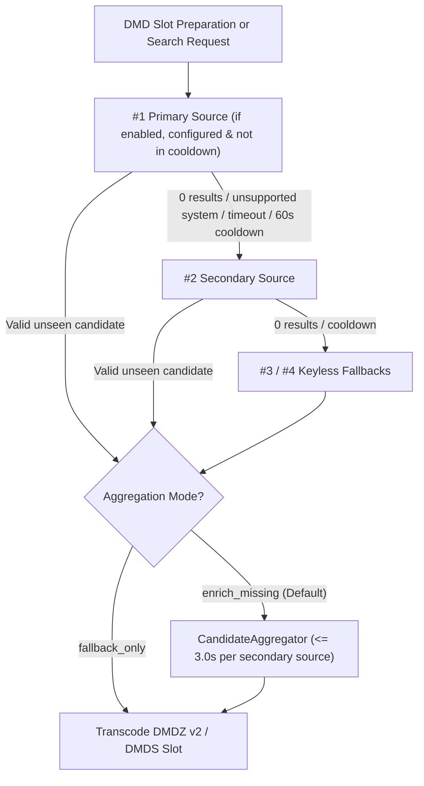
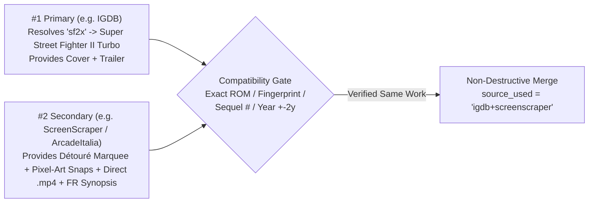

# Media Sources, Encrypted Vault & Multi-Source Aggregation — DMD Media Showcase Server

🇬🇧 English | 🇫🇷 [Français](SOURCES_AND_AGGREGATION_FR.md) | 🇪🇸 [Español](SOURCES_AND_AGGREGATION_ES.md)

[](https://t.me/+DrSdAO8UMUViNmE0)
[](https://ko-fi.com/red1l)

---

## 1. Zero-Configuration Philosophy & 3-Tier Encrypted Credential Vault

**DMD Media Showcase Server works 100% out-of-the-box with zero manual setup.** You do not need to create developer accounts, generate API keys, or edit `.env` files to start streaming Games, Movies, TV Series, and Anime to your HUB75 LED matrix.

> [!TIP]
> **Everything works immediately without touching a single setting.** Entering personal API keys, linking a ScreenScraper player account, or reordering scraper priorities in the Web Admin Dashboard is **100% optional customization** — useful if you want isolated personal rate-limit quotas or a different visual/video style on your DMD.

### How Built-in Encrypted Keys & Overrides Work (`3-Tier Vault`)

Official release builds (`ghcr.io/red77290/dmd_media_showcase:latest` Docker image, macOS `.dmg`, Windows `.zip`, and Linux `.tar.gz`) embed functional default developer/API credentials inside a compiled native C extension (`app.security._prod_vault`, derived at CI/CD build time with `PBKDF2-HMAC-SHA256`, a random 16-byte salt, and 3-share XOR splitting so plaintext secrets never exist on disk or in Git).

At runtime, `ServerConfigStore` resolves every credential dynamically across **3 tiers** (highest priority first):

| Priority | Storage Layer | When It Applies | How to Reset / Fall Back |
| :---: | :--- | :--- | :--- |
| **`#1`** | **WebUI User Override** (`./data/server_config.json`) | Whenever you enter a custom key or account in **`5. API Keys & Encrypted Vault`** and click **Save & Apply in Real Time**. Applied in `0 ms` with zero server restart. | Clear the input field in the WebUI and save — resolution automatically falls back to Tier `#2` / `#3`. |
| **`#2`** | **Environment Variables** (`.env` / `docker-compose.yml`) | Local developer runs, custom forks, or headless infrastructure automation (`IGDB_CLIENT_ID`, `SCREENSCRAPER_USER`, `TMDB_API_KEY`, etc.). | Unset or leave the variable empty in `.env`. |
| **`#3`** | **Built-in Encrypted Native Vault** (`_prod_vault`) | Automatic default in all official Docker & Desktop releases (`IGDB`, `ScreenScraper devid`, `TMDB`, `TheTVDB`). *(On unconfigured local `git clone` builds without `_prod_vault`, the **6 keyless adapters** still cover all 4 domains automatically).* | Always active as the baseline fallback in official builds. |

**Security & Anti-Pollution Safeguards:**
- **Zero Log Leakage:** `SecretRedactingLogFilter` (`httpx` / `httpcore` clamped to `WARNING`) masks query-string secrets (`devpassword`, `sspassword`, `api_key`, `client_secret`) and Bearer tokens before any line reaches container stdout.
- **Browser Autofill Protection:** `sanitize_twitch_credential()` and `sanitize_api_token_no_url()` reject accidental password-manager autofill values (such as URLs or short usernames) so an invalid browser autofill never shadows valid `.env` or Vault keys.

---

## 2. Complete Matrix of All 11 Media Sources, Obligations & Constraints

Across the 4 domains (`games`, `movies`, `series`, `anime`), **11 specialized adapters** are registered out-of-the-box (`5` backed by built-in encrypted Vault keys + `6` completely keyless public APIs):

| Domain & Default Rank | Source (`source_id`) | Default Keys & User Obligation | Optional WebUI / `.env` Override | Primary DMD Assets Provided | Upstream Quotas, Constraints & Circuit-Breaker |
| :--- | :--- | :--- | :--- | :--- | :--- |
| **🕹️ Games `#1`**<br>*(Primary)* | **IGDB API v4**<br>(`igdb`) | 🔐 **Built-in encrypted OAuth2 app keys** (`_prod_vault`).<br>**`0` obligation** in official builds. | `igdb_client_id`<br>`igdb_client_secret`<br>*(Free app via Twitch Dev Portal)* | 64 retro/arcade systems, player shorthand aliases (`sf2x`, `3s`, `kof98`, `sotn`), HD covers, artworks, stills & YouTube trailers. | ~`4 req/s` per Twitch Client ID; automatic OAuth2 token cache + `60s` cooldown circuit-breaker on `429`/`5xx`. |
| **🕹️ Games `#2`**<br>*(Secondary)* | **ScreenScraper v2**<br>(`screenscraper`) | 🔐 **Built-in encrypted `devid` / `devpassword`** (`_prod_vault`).<br>👤 **Player account (`ssid`)**: optional in protocol (*Guest* mode), **strongly recommended** *(free on `screenscraper.fr`)*. | **Player:** `screenscraper_user`, `screenscraper_pass`<br>**Dev (optional):** `screenscraper_dev_id`, `screenscraper_dev_pass` | Transparent détouré `screenmarquee` & `wheel-hd` logos, 2D/3D regional boxart, crisp 15 kHz pixel-art snaps, localized synopses & short direct `.mp4` gameplay clips. | **Guest constraint:** ScreenScraper blocks anonymous requests (`API closed for non-registered members`) when server CPU exceeds ~`60%` (evenings/weekends). Free player account unlocks ~`20,000 req/day` (`1` thread, more for contributors/donors). Auto `60s` cooldown on overload/quota. |
| **🕹️ Games `#3`**<br>*(Fallback)* | **ArcadeItalia ADB**<br>(`arcadeitalia`) | 🔓 **100% Keyless** (`0` account, `0` key, works everywhere including local `git clone`). | *None needed* | Authoritative MAME / Arcade (`CPS-1/2/3`, `Neo-Geo`, `NAOMI`, `Atomiswave`, `Model 2/3`) cabinet flyers, marquees, pixel-art snaps, attract-mode videos & shorthand aliases (`sf2x`, `garou`). | Public community archive (`adb.arcadeitalia.net`); built-in TLS resilience for legacy archive certificates; delegates home consoles to `libretro_wikidata` when standalone. |
| **🕹️ Games `#4`**<br>*(Fallback)* | **Libretro + Wikidata + Wikipedia + Archive.org**<br>(`libretro_wikidata`) | 🔓 **100% Keyless** (`0` account, `0` key, works everywhere). | *None needed* | Home Consoles, Handhelds & Classic Computers (`NES`, `SNES`, `MD`, `PSX`, `GBA`...): verified regional `(France) -> (Europe) -> (World) -> (USA)` PNG boxarts/titles/snaps, localized `{lang}.wikipedia.org` synopses & Archive.org gameplay previews. | Cached local GitHub file-tree index (`./data/referentials/libretro_tree_*.json`) guarantees `100%` verified `HTTP 200` PNG URLs and strict `wd:Q7889` video-game filtering. |
| **🎬 Movies `#1`**<br>*(Primary)* | **TMDB Movies v3/v4**<br>(`tmdb_movies`) | 🔐 **Built-in encrypted API key** (`_prod_vault`).<br>**`0` obligation** in official builds. | `tmdb_api_key`<br>*(Accepts TMDB v3 API Key or v4 Read Bearer Token)* | Official localized posters, wide `16:9` backdrops, star ratings, human-translated synopses & official HD trailers. | Generous TMDB rate limits (~`40–50 req/s`). Personal key isolates your own quota if running heavy batch testing. |
| **🎬 Movies `#2`**<br>*(Secondary)* | **Apple iTunes Movies**<br>(`itunes_movies`) | 🔓 **100% Keyless** (`0` account, `0` key, works everywhere). | *None needed* | Clean `1000×1000` HD theatrical posters, wide banners, country-localized descriptions (`FR`, `US`, `ES`, `DE`, `IT`, `BR`, `JP`) & **direct CDN `.m4v`/`.mp4` trailer streams** (`previewUrl`). | Public iTunes Search endpoint (~`20 req/min` per IP); direct `.m4v` streams transcode ultra-fast with zero YouTube extraction needed. |
| **📺 Series `#1`**<br>*(Primary)* | **TMDB Series v3/v4**<br>(`tmdb_series`) | 🔐 **Built-in encrypted API key** (`_prod_vault`).<br>**`0` obligation** in official builds. | `tmdb_api_key`<br>*(Shared with `tmdb_movies`)* | Localized TV posters, wide backdrops, ratings, translated synopses & official trailers/openings. | Same generous TMDB limits as `tmdb_movies`. |
| **📺 Series `#2`**<br>*(Secondary)* | **TheTVDB API v4**<br>(`tvdb_series`) | 🔐 **Built-in encrypted API key** (`_prod_vault`).<br>**`0` obligation** in official builds. | `tvdb_api_key` | Deep multilingual TV series translations (`fra`, `spa`, `deu`, `ita`, `eng`, `jpn`), graphical series banners/marquees & trailers. | Bearer JWT cached automatically in RAM for `23h` to minimize login calls. |
| **📺 Series `#3`**<br>*(Fallback)* | **TVMaze Public API**<br>(`tvmaze`) | 🔓 **100% Keyless** (`0` account, `0` key, works everywhere). | *None needed* | ~`70,000` scripted TV series (automatically excludes talk/reality/game shows), HD posters, wide banners, stills & synopses. | Public rate limit (~`20 req / 10s` per IP). |
| **⛩️ Anime `#1`**<br>*(Primary)* | **Jikan v4 + AnimeThemes**<br>(`jikan`) | 🔓 **100% Keyless** (`0` account, `0` key, works everywhere). | *None needed* | MyAnimeList catalog + **direct creditless `.webm` Openings (`OP`) & Endings (`ED`)** from `api.animethemes.moe` (exact MAL ID match) + HD trailers. | Jikan v4 public limit (`3 req/s`, `60 req/min`); AnimeThemes `.webm` streams decode directly with zero `yt-dlp` overhead. |
| **⛩️ Anime `#2`**<br>*(Secondary)* | **AniList + AnimeThemes**<br>(`anilist`) | 🔓 **100% Keyless** (`0` account, `0` key, works everywhere). | *None needed* | AniList GraphQL catalog, `extraLarge` covers, wide `bannerImage` marquees, trailers & creditless `.webm` `OP`/`ED` enrichment via `AnimeThemes.moe`. | AniList public GraphQL limit (~`90 req/min`). |

---

## 3. Deep Dive: ScreenScraper Developer Key vs. Player Account (`ssid`)

ScreenScraper's API v2 enforces a dual-credential model that often confuses retro-gaming users. Here is how it works and how **DMD Media Showcase** handles it automatically:

1. **Developer Credentials (`devid` + `devpassword`) — Already Built In:**
   - ScreenScraper requires every software application (Batocera, Recalbox, Skraper, DMD Media Showcase) to identify *the software itself* via `devid` and `devpassword`. Without them, `api.screenscraper.fr` rejects 100% of calls (`HTTP 403`).
   - **You never need a ScreenScraper developer account.** Official DMD Media Showcase releases already embed the project's encrypted `devid` / `devpassword` in `_prod_vault` (the optional `screenscraper_dev_id` / `screenscraper_dev_pass` fields in the WebUI exist solely for developers building custom forks).
2. **Player Account (`screenscraper_user` / `screenscraper_pass` $\to$ `ssid` / `sspassword`) — Why Adding Yours Helps:**
   - **Without a Player Account (*Guest* Mode):** Requests sent with only the built-in `devid` are accepted by ScreenScraper as an **unregistered Guest**. During quiet hours, this works out-of-the-box with zero configuration. However, whenever ScreenScraper's infrastructure exceeds ~`60%` CPU load (very common on evenings and weekends), ScreenScraper shuts down anonymous access first and returns `API closed for non-registered members` / `API fermée pour les utilisateurs non inscrits` (`HTTP 403`/`423` or plaintext inside `HTTP 200`).
   - **With a Free Player Account (*Registered Member* Mode):** Creating a free player account on [https://www.screenscraper.fr](https://www.screenscraper.fr/) takes 1 minute and entering your `SSID` + password in **`5. API Keys & Encrypted Vault`** unlocks:
     - **Uninterrupted Peak-Hour Access:** Registered member slots stay open when *Guest* slots are closed due to server load.
     - **Personal Daily Quota:** ~`20,000` requests/day dedicated to your account (`1` thread by default, or extra threads/speed if you support ScreenScraper via Tipeee/Patreon).
3. **Automatic `60s` Circuit-Breaker Protection:**
   - Whether you configure a player account or not, `detect_screenscraper_api_error()` inspects both HTTP status codes (`401`, `403`, `423`, `429`, `5xx`) and plaintext `HTTP 200` error bodies (`api closed`, `quota`, `surcharg`, `trop de connexions`). If ScreenScraper is overloaded or closed to guests, it opens a **`60s` cooldown circuit-breaker** so the server immediately uses `IGDB`, `ArcadeItalia`, and `Libretro+Wikidata` without stalling your DMD pipeline.

---

## 4. Fallback Chains, Role Inversion & Customizing Visual / Video Results

Every domain runs a hot-configurable **Chain of Responsibility** (`DomainSourceChainService`) persisted in `./data/server_config.json`:



### Why Swap `#1 Primary` and `#2 Secondary`? (Optional Customization)

While the default order (`igdb -> screenscraper -> arcadeitalia -> libretro_wikidata` for Games, `tmdb -> itunes` for Movies, `tmdb -> tvdb -> tvmaze` for Series, `jikan -> anilist` for Anime) is balanced for instant zero-config variety, **promoting a different source to `#1 Primary` changes both which titles are discovered and which primary artwork/video is selected first**:

| Customization Goal | Recommended `#1 Primary` Swap | What Changes Visually on Your HUB75 Matrix |
| :--- | :--- | :--- |
| **Pure 15 kHz Arcade & Console Gameplay Clips (`games`)** | Move **`screenscraper` $\to$ `#1`**, **`igdb` $\to$ `#2`** | Prioritizes **short direct `.mp4` in-game gameplay footage**, transparent détouré `screenmarquee`/`wheel-hd` logos, and regional pixel-art captures instead of modern promotional YouTube trailers. *(Tip: link a free ScreenScraper player `SSID` when setting it as `#1`).* |
| **Authentic MAME Cabinet Flyers & Attract-Mode (`games`)** | Move **`arcadeitalia` $\to$ `#1`** | Focuses arcade discovery directly on original MAME parent ROMs, authentic arcade cabinet flyers, marquees, and attract-mode snaps (`100%` keyless). |
| **Clean No-Intro Regional Console Boxarts (`games`)** | Move **`libretro_wikidata` $\to$ `#1`** | Prioritizes verified `(France) -> (Europe) -> (World) -> (USA)` console/handheld boxarts & title screens with localized Wikipedia synopses (`100%` keyless). |
| **Fast Direct CDN Movie Trailers (`movies`)** | Move **`itunes_movies` $\to$ `#1`**, **`tmdb_movies` $\to$ `#2`** | Selects Apple CDN direct `.m4v`/`.mp4` trailer streams and square `1000×1000` posters first (ultra-fast transcoding with zero YouTube extraction), while `tmdb_movies` (`#2`) still enriches wide `16:9` backdrops if missing. |
| **Alternative TV Translations & Series Banners (`series`)** | Move **`tvdb_series` $\to$ `#1`** or **`tvmaze` $\to$ `#1`** | Uses TheTVDB v4's community-curated graphical series banners & translations (or TVMaze's 70k-show catalog) as primary discovery. |
| **Modern Anime Popularity & Wide Banners (`anime`)** | Move **`anilist` $\to$ `#1`**, **`jikan` $\to$ `#2`** | Samples AniList's GraphQL popularity index and native wide `bannerImage` marquees first while retaining `AnimeThemes.moe` creditless `.webm` `OP`/`ED` videos. |

> [!NOTE]
> **Disabling Sources:** You can also toggle individual sources **`OFF`** in the WebUI (for example, keeping only keyless sources active or isolating a single scraper for testing). A built-in guardrail ensures at least **one** enabled source always remains per domain.

---

## 5. How Cross-Source Merging Works (`enrich_missing` vs. `fallback_only`)

Per domain, you can switch live between two strategies in **`1. Overview & DMD Matrices`** or **`5. API Keys & Encrypted Vault`**:

### Mode A: `🔗 Multi-Source Aggregation — Enrich Missing` (`enrich_missing`, Default)

When `#1 Primary` finds a candidate that lacks one or more DMD-critical assets (`marquee_url`, direct `video_url`, `backdrop_url` / `snapshot_urls`, or a localized `synopsis`), `CandidateAggregator` queries the remaining enabled sources in priority order (`#2`, `#3`...), bounded to **`<= 3.0s` per secondary source**:



**Strict Non-Destructive Merge Rules (`CandidateAggregator._merge_donor_into_primary`):**

| Candidate Field | Merge Priority Rule | Why `#1 Primary` Order Matters |
| :--- | :--- | :--- |
| **Identity (`title`, `year`, `rating`, `badge`)** | Always kept from **`#1 Primary`**. | `#1` controls catalog sampling and canonical title formatting. |
| **Poster / Boxart (`poster_url`, `jacket_url`)** | Kept from **`#1`** if present; filled from `#2`/`#3` **only if empty**. | Swapping `#1` and `#2` changes the boxart/poster shown on the Phase 1 Info Card & Panorama. |
| **DMD Marquee / Wheel (`marquee_url`)** | Kept from **`#1`** if present; filled from `#2`/`#3` **only if empty**. | `IGDB` and `TMDB` often lack transparent arcade marquees — `#2` (`ScreenScraper` / `ArcadeItalia` / `TheTVDB` / `AniList`) automatically supplies the missing marquee! |
| **In-Game Snaps / Backdrops (`snapshot_urls`, `backdrop_url`)** | `#1` snaps kept first; `#2`/`#3` top up unique stills up to **`4` snapshots** if `#1` has `< 4`. | Guarantees rich Phase 3 screenshot scans even when `#1` only has a cover. |
| **Video Stream (`video_url` vs `youtube_url`)** | Direct stream (`video_url`: `.mp4`/`.webm`/`.m4v`) and `youtube_url` are each kept from **`#1`** if present, and filled from `#2`/`#3` **only if empty**. | If `#1` only has a YouTube link (e.g. `IGDB`), `#2` (`ScreenScraper`) can inject a direct `.mp4` gameplay clip (`video_url`), avoiding `yt-dlp` latency! And if both sources have direct `.mp4`s, whichever source you place at `#1` wins. |
| **Localized Synopsis (`synopsis`)** | Ranked strictly by translation quality for non-English languages: **`"1"` (Official Human Translation) $>$ `"auto"` (Neural Auto-Translation) $>$ `"0"` (Untranslated)**. | An official human French/Spanish synopsis from `#2` (`ScreenScraper` / `Wikipedia`) automatically upgrades an English or machine-translated synopsis from `#1`, while an English `#2` synopsis **never** overwrites a localized `#1` synopsis. |

**Anti-Contamination Gate (`_is_compatible_donor`):**
Before merging a single field, `CandidateAggregator` verifies that the secondary hit is genuinely the exact same work — checking MAME ROM stems (`ssf2t`), canonical `(system, title)` fingerprints, Roman/Arabic sequel numbers (so *Street Fighter II* is **never** merged with *Street Fighter III*), and a strict `±2 years` release window on movies, series, and anime. Whenever a secondary source contributes at least one field, live telemetry badges transparently display the composite provenance (e.g. `🔗 igdb+screenscraper`, `🔗 igdb+arcadeitalia`, `🔗 tmdb_movies+itunes_movies`).

### Mode B: `↪ Strict Fallback Only` (`fallback_only`)

- Secondary sources (`#2`, `#3`...) are **never queried** as long as `#1 Primary` returns a valid unseen candidate.
- Use `fallback_only` if you want `100%` pure single-source artwork/video aesthetics or want to conserve secondary API quota (such as your daily ScreenScraper player requests) strictly for moments when `#1` returns `0` matches.

---

## 6. How to Customize Sources & Keys Live (Zero Restart)

### Option A — From the Web Admin Dashboard (Recommended)
1. Open `http://dmdmediashowcase.local:8890/` (or `http://<server-ip>:8890/`).
2. **To reorder sources, invert `#1`/`#2` roles, or switch Merge Mode:**
   - Open **`1. Overview & DMD Matrices`** (or **`5. API Keys & Encrypted Vault`**) $\to$ **Scraper Chains, Priority & Multi-Source Aggregation**.
   - Select your desired **Primary Source (`#1`)** and **Secondary Source (`#2`)**, use the **Up / Down** arrows or **Enable / Disable** toggles, and pick **`🔗 Multi-Source Aggregation (Enrich Missing)`** or **`↪ Strict Fallback Only (On Failure)`** — changes apply **instantly in real time** and persist in `./data/server_config.json`.
   - *(Optional)* If **Persistent On-Demand Conversion Cache** is enabled and you want previously cached titles to re-render with your new `#1` source's artwork/video, click **🗑 Clear On-Demand Cache** in **`2. Runtime, Workers & Video Limits`**.
3. **To add a ScreenScraper Player Account or Personal API Keys:**
   - Open **`5. API Keys & Encrypted Vault`** $\to$ **User Credentials & Optional Overrides**.
   - Fill in only the fields you wish to customize (e.g. `ScreenScraper Player Account — Username (SSID)` + `Password`) and leave all other fields empty so they continue using the built-in encrypted Vault keys. Click **Save & Apply in Real Time**.

### Option B — Via `.env` or `docker-compose.yml` (Optional Headless Setup)
All overrides can also be supplied via standard environment variables (overridden by Tier `#1` WebUI values if later edited in the UI):

```env
# Optional ScreenScraper free player account (recommended to bypass Guest peak-hour closures)
SCREENSCRAPER_USER=your_player_ssid
SCREENSCRAPER_PASS=your_player_password

# Optional personal API key overrides (leave unset in official builds to use the encrypted Vault)
# IGDB_CLIENT_ID=
# IGDB_CLIENT_SECRET=
# SCREENSCRAPER_DEV_ID=
# SCREENSCRAPER_DEV_PASS=
# TMDB_API_KEY=
# TVDB_API_KEY=
```
