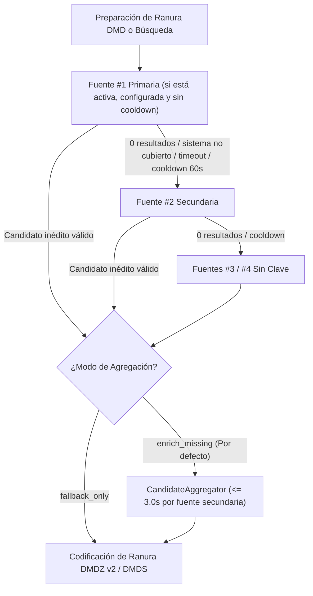
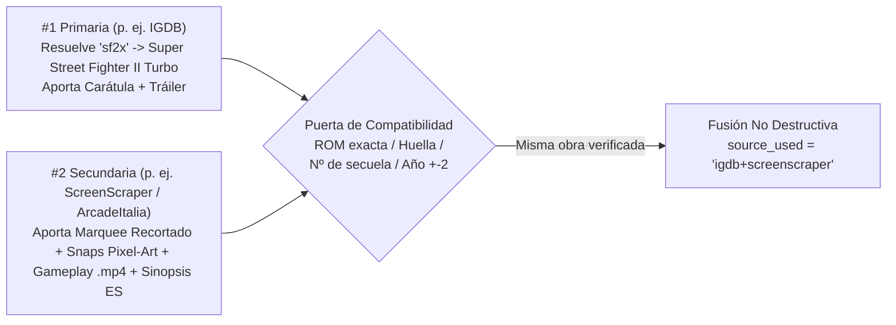

# Fuentes Multimedia, Bóveda Cifrada y Agregación Multifuente — DMD Media Showcase Server

🇬🇧 [English](SOURCES_AND_AGGREGATION.md) | 🇫🇷 [Français](SOURCES_AND_AGGREGATION_FR.md) | 🇪🇸 Español

[](https://t.me/+DrSdAO8UMUViNmE0)
[](https://ko-fi.com/red1l)

---

## 1. Filosofía Cero-Configuración y Bóveda Cifrada de 3 Niveles

**DMD Media Showcase Server funciona al 100 % listo para usar sin ninguna configuración obligatoria.** No necesita crear cuentas de desarrollador, solicitar claves API ni editar archivos `.env` para empezar a transmitir Juegos Retro, Películas, Series de TV y Anime en su matriz LED HUB75.

> [!TIP]
> **Todo funciona de inmediato sin tocar nada.** Introducir sus propias claves API, vincular una cuenta de jugador de ScreenScraper o cambiar el orden de prioridad de las fuentes desde el Panel Web es **personalización 100 % opcional** — útil únicamente si desea aislar sus propias cuotas API o conseguir resultados visuales y vídeos distintos en su DMD.

### Cómo Funcionan las Claves Cifradas por Defecto y las Anulaciones (`Bóveda de 3 Niveles`)

Las versiones oficiales publicadas (imagen Docker `ghcr.io/red77290/dmd_media_showcase:latest`, instaladores macOS `.dmg`, Windows `.zip` y Linux `.tar.gz`) incluyen credenciales de desarrollador/API funcionales cifradas dentro de una extensión nativa en C (`app.security._prod_vault`, compilada en CI/CD mediante `PBKDF2-HMAC-SHA256`, sal aleatoria de 16 bytes y partición XOR de 3 partes para que ningún secreto exista en texto plano en disco ni en Git).

En tiempo de ejecución, `ServerConfigStore` resuelve cada credencial dinámicamente en **3 niveles de prioridad**:

| Prioridad | Nivel de Almacenamiento | Cuándo se aplica | Cómo volver a la clave integrada |
| :---: | :--- | :--- | :--- |
| **`#1`** | **Anulación en WebUI** (`./data/server_config.json`) | Al introducir una clave o cuenta personal en **`5. Claves API y Bóveda Cifrada`** y pulsar **Guardar y Aplicar en Tiempo Real** (`0 ms`, sin reinicio). | Vacíe el campo en la WebUI y guarde — el servidor vuelve automáticamente al nivel `#2` / `#3`. |
| **`#2`** | **Variables de Entorno** (`.env` / `docker-compose.yml`) | Ejecuciones locales de desarrollo, forks personalizados o despliegues automatizados (`IGDB_CLIENT_ID`, `SCREENSCRAPER_USER`, `TMDB_API_KEY`, etc.). | Elimine o deje vacía la variable en `.env`. |
| **`#3`** | **Bóveda Nativa Cifrada Integrada** (`_prod_vault`) | Activa por defecto en todas las versiones oficiales Docker y Desktop (`IGDB`, `ScreenScraper devid`, `TMDB`, `TheTVDB`). *(Incluso en un `git clone` local sin `_prod_vault`, las **6 fuentes sin clave** cubren automáticamente los 4 dominios).* | Siempre activa como respaldo base en versiones oficiales. |

**Protecciones de Seguridad y Antipolución:**
- **Cero Fugas en Logs:** `SecretRedactingLogFilter` (`httpx` / `httpcore` fijados en `WARNING`) oculta contraseñas y claves en URL (`devpassword`, `sspassword`, `api_key`, `client_secret`) y tokens Bearer antes de escribir en la salida del contenedor.
- **Protección frente al Autocompletado del Navegador:** `sanitize_twitch_credential()` y `sanitize_api_token_no_url()` descartan valores accidentales inyectados por gestores de contraseñas (como URLs o nombres cortos) para no eclipsar nunca claves válidas de `.env` o de la Bóveda.

---

## 2. Tabla Completa de las 11 Fuentes Multimedia, Obligaciones y Restricciones

En los 4 dominios (`games`, `movies`, `series`, `anime`), **11 adaptadores especializados** vienen listos de serie (`5` respaldados por claves cifradas integradas + `6` APIs públicas 100 % sin clave):

| Dominio y Orden por Defecto | Fuente (`source_id`) | Claves por Defecto y Obligación del Usuario | Anulación Opcional WebUI / `.env` | Activos DMD Principales | Cuotas, Restricciones y Disyuntor |
| :--- | :--- | :--- | :--- | :--- | :--- |
| **🕹️ Juegos `#1`**<br>*(Primaria)* | **IGDB API v4**<br>(`igdb`) | 🔐 **Claves OAuth2 cifradas integradas** (`_prod_vault`).<br>**`0` obligación** en versiones oficiales. | `igdb_client_id`<br>`igdb_client_secret`<br>*(App gratuita en Twitch Dev Portal)* | 64 sistemas retro/arcade, alias cortos (`sf2x`, `3s`, `kof98`, `sotn`), carátulas HD, artworks, capturas y tráilers de YouTube. | ~`4 req/s` por Client ID; caché de token OAuth2 + disyuntor de enfriamiento de `60s` ante `429`/`5xx`. |
| **🕹️ Juegos `#2`**<br>*(Secundaria)* | **ScreenScraper v2**<br>(`screenscraper`) | 🔐 **`devid` / `devpassword` cifrados integrados** (`_prod_vault`).<br>👤 **Cuenta de jugador (`ssid`)**: opcional en el protocolo (modo *Invitado*), **muy recomendada** *(gratuita en `screenscraper.fr`)*. | **Jugador:** `screenscraper_user`, `screenscraper_pass`<br>**Dev (opcional):** `screenscraper_dev_id`, `screenscraper_dev_pass` | Logos recortados `screenmarquee` y `wheel-hd`, cajas regionales 2D/3D, capturas pixel-art 15 kHz, sinopsis localizadas y **clips cortos `.mp4` directos de gameplay**. | **Restricción Invitado (*Guest*):** ScreenScraper cierra el acceso anónimo (`API closed for non-registered members`) cuando la CPU supera ~`60 %` (tardes/fines de semana). Una cuenta gratuita de jugador desbloquea ~`20.000 req/día` (`1` hilo, más para mecenas). Cooldown automático de `60s`. |
| **🕹️ Juegos `#3`**<br>*(Fallback)* | **ArcadeItalia ADB**<br>(`arcadeitalia`) | 🔓 **100 % Sin Clave** (`0` cuenta, `0` clave, funciona siempre incluso en `git clone` local). | *No requiere ninguna* | Referencia MAME / Arcade (`CPS-1/2/3`, `Neo-Geo`, `NAOMI`, `Atomiswave`, `Model 2/3`): flyers de cabinas, marquees, snaps pixel-art, vídeos attract-mode y alias (`sf2x`, `garou`). | Archivo comunitario público (`adb.arcadeitalia.net`); resiliencia TLS integrada; delega consolas domésticas a `libretro_wikidata` en uso autónomo. |
| **🕹️ Juegos `#4`**<br>*(Fallback)* | **Libretro + Wikidata + Wikipedia + Archive.org**<br>(`libretro_wikidata`) | 🔓 **100 % Sin Clave** (`0` cuenta, `0` clave, funciona siempre). | *No requiere ninguna* | Consolas, Portátiles y Microordenadores (`NES`, `SNES`, `MD`, `PSX`, `GBA`...): carátulas/títulos/capturas PNG regionales verificadas `(France) -> (Europe) -> (World) -> (USA)`, sinopsis de `{lang}.wikipedia.org` y vídeos de Archive.org. | Índice de árbol GitHub en caché local (`./data/referentials/libretro_tree_*.json`) que garantiza URLs PNG `HTTP 200` y filtrado estricto `wd:Q7889` (videojuegos). |
| **🎬 Cine `#1`**<br>*(Primaria)* | **TMDB Movies v3/v4**<br>(`tmdb_movies`) | 🔐 **Clave API cifrada integrada** (`_prod_vault`).<br>**`0` obligación** en versiones oficiales. | `tmdb_api_key`<br>*(Clave API v3 o Token Bearer v4)* | Pósteres oficiales localizados, fondos `16:9`, puntuaciones, sinopsis traducidas y tráilers HD oficiales. | Límites amplios de TMDB (~`40–50 req/s`). Una clave propia aísla su cuota personal. |
| **🎬 Cine `#2`**<br>*(Secundaria)* | **Apple iTunes Movies**<br>(`itunes_movies`) | 🔓 **100 % Sin Clave** (`0` cuenta, `0` clave, funciona siempre). | *No requiere ninguna* | Pósteres HD `1000×1000`, banners anchos, sinopsis por país (`ES`, `FR`, `US`, `DE`, `IT`, `BR`, `JP`) y **streams directos `.m4v`/`.mp4` de tráilers** (`previewUrl`). | API pública iTunes Search (~`20 req/min` por IP); los `.m4v` directos se transcodifican al instante sin depender de YouTube. |
| **📺 Series `#1`**<br>*(Primaria)* | **TMDB Series v3/v4**<br>(`tmdb_series`) | 🔐 **Clave API cifrada integrada** (`_prod_vault`).<br>**`0` obligación** en versiones oficiales. | `tmdb_api_key`<br>*(Compartida con `tmdb_movies`)* | Pósteres de TV localizados, fondos panorámicos, notas, sinopsis traducidas y tráilers/openings. | Mismos límites generosos que `tmdb_movies`. |
| **📺 Series `#2`**<br>*(Secundaria)* | **TheTVDB API v4**<br>(`tvdb_series`) | 🔐 **Clave API cifrada integrada** (`_prod_vault`).<br>**`0` obligación** en versiones oficiales. | `tvdb_api_key` | Traducciones comunitarias multilingües (`spa`, `fra`, `deu`, `ita`, `eng`, `jpn`), banners/marquees de series y tráilers. | Token Bearer almacenado en caché RAM durante `23h`. |
| **📺 Series `#3`**<br>*(Fallback)* | **TVMaze Public API**<br>(`tvmaze`) | 🔓 **100 % Sin Clave** (`0` cuenta, `0` clave, funciona siempre). | *No requiere ninguna* | ~`70.000` series de ficción (excluye talk-shows, realities y concursos), pósteres HD, banners, fotos y sinopsis. | Límite público ~`20 req / 10s` por IP. |
| **⛩️ Anime `#1`**<br>*(Primaria)* | **Jikan v4 + AnimeThemes**<br>(`jikan`) | 🔓 **100 % Sin Clave** (`0` cuenta, `0` clave, funciona siempre). | *No requiere ninguna* | Catálogo MyAnimeList + **streams directos `.webm` de Openings (`OP`) y Endings (`ED`) sin créditos** desde `api.animethemes.moe` (por ID exacto MAL) + tráilers HD. | Límite público Jikan v4 (`3 req/s`, `60 req/min`); los `.webm` de AnimeThemes se decodifican directamente sin `yt-dlp`. |
| **⛩️ Anime `#2`**<br>*(Secundaria)* | **AniList + AnimeThemes**<br>(`anilist`) | 🔓 **100 % Sin Clave** (`0` cuenta, `0` clave, funciona siempre). | *No requiere ninguna* | Catálogo GraphQL AniList, portadas `extraLarge`, marquees anchos `bannerImage`, tráilers y `.webm` `OP`/`ED` vía `AnimeThemes.moe`. | Límite público GraphQL AniList (~`90 req/min`). |

---

## 3. En Detalle: Clave Dev (`devid`) vs. Cuenta de Jugador (`ssid`) en ScreenScraper

La API v2 de ScreenScraper separa dos tipos de credenciales distintas:

1. **Credenciales de Desarrollador (`devid` + `devpassword`) — Ya Integradas para Todos:**
   - ScreenScraper exige que cada aplicación cliente (Batocera, Recalbox, Skraper, DMD Media Showcase) identifique *al propio software* mediante `devid` y `devpassword`. Sin ellos, `api.screenscraper.fr` rechaza el 100 % de las peticiones (`HTTP 403`).
   - **Nunca necesita una cuenta de desarrollador.** Las versiones oficiales de DMD Media Showcase ya incorporan el par `devid` / `devpassword` cifrado en `_prod_vault` (los campos opcionales `screenscraper_dev_id` / `screenscraper_dev_pass` de la WebUI solo existen para desarrolladores que compilen su propio fork).
2. **Cuenta de Jugador (`screenscraper_user` / `screenscraper_pass` $\to$ `ssid` / `sspassword`) — Por qué conviene añadirla:**
   - **Sin cuenta de jugador (Modo Invitado / *Guest*):** Las llamadas realizadas únicamente con el `devid` integrado se tratan como **invitado no registrado**. En horas tranquilas funciona sin configurar nada, pero en cuanto la carga de CPU de ScreenScraper supera ~`60 %` (habitual por las tardes y fines de semana), ScreenScraper cierra primero el acceso anónimo con `API closed for non-registered members` (`HTTP 403`/`423` o texto plano en `HTTP 200`).
   - **Con una cuenta gratuita de jugador (Modo *Miembro registrado*):** Crear una cuenta gratuita en 1 minuto en [https://www.screenscraper.fr](https://www.screenscraper.fr/) e introducir su usuario (`SSID`) y contraseña en **`5. Claves API y Bóveda Cifrada`** le aporta:
     - **Acceso continuo en horas punta:** Las ranuras de miembros registrados siguen abiertas cuando el acceso *Guest* se bloquea por carga del servidor.
     - **Cuota diaria individual:** ~`20.000` peticiones/día propias (`1` hilo de base, o más hilos si apoya a ScreenScraper en Tipeee/Patreon).
3. **Disyuntor Automático (`60s` Cooldown):**
   - Con o sin cuenta de jugador, `detect_screenscraper_api_error()` detecta errores tanto por código HTTP (`401`, `403`, `423`, `429`, `5xx`) como en cuerpo de texto `HTTP 200`. Si ScreenScraper cierra invitados o agota cuota, abre un **enfriamiento de `60s`** para que `IGDB`, `ArcadeItalia` y `Libretro+Wikidata` respondan al instante sin bloquear su DMD.

---

## 4. Cadena de Respaldo, Inversión de Roles y Variación de Resultados / Vídeos

Cada dominio ejecuta una **Cadena de Responsabilidad** editable en caliente (`DomainSourceChainService`), guardada en `./data/server_config.json`:



### ¿Por qué invertir `#1 Primaria` y `#2 Secundaria`? (Personalización Opcional)

El orden predeterminado está equilibrado para funcionar sin tocar nada, pero **cambiar qué fuente ocupa `#1 Primaria` modifica tanto qué obras se descubren como qué carátula y tipo de vídeo tienen prioridad**:

| Objetivo de Personalización | Cambio Recomendado en `#1 Primaria` | Qué cambia visualmente en su panel LED HUB75 |
| :--- | :--- | :--- |
| **Clips de Gameplay `.mp4` Directos y Logos Recortados (`games`)** | Subir **`screenscraper` a `#1`**, **`igdb` a `#2`** | Prioriza **vídeos cortos `.mp4` directos de gameplay real**, logos transparentes `screenmarquee`/`wheel-hd` y capturas pixel-art 15 kHz en lugar de tráilers promocionales de YouTube. *(Consejo: añada su cuenta gratuita `SSID` si fija ScreenScraper como `#1`).* |
| **Flyers Originales de Cabinas MAME y Attract-Mode (`games`)** | Subir **`arcadeitalia` a `#1`** | Centra el descubrimiento arcade en ROMs principales de MAME, flyers originales de recreativas, marquees y vídeos attract-mode (`100 %` sin clave). |
| **Cajas Regionales No-Intro de Consolas (`games`)** | Subir **`libretro_wikidata` a `#1`** | Prioriza cajas y pantallas de título verificadas `(France) -> (Europe) -> (World) -> (USA)` con sinopsis localizadas de Wikipedia (`100 %` sin clave). |
| **Tráilers de Cine Directos Ultrarrápidos (`movies`)** | Subir **`itunes_movies` a `#1`**, **`tmdb_movies` a `#2`** | Selecciona primero los streams `.m4v`/`.mp4` directos del CDN de Apple y pósteres `1000×1000` (transcodificación instantánea sin extracción de YouTube), mientras `tmdb_movies` (`#2`) aporta fondos `16:9` faltantes. |
| **Banners Gráficos y Traducciones de TV (`series`)** | Subir **`tvdb_series` a `#1`** o **`tvmaze` a `#1`** | Usa los banners gráficos y traducciones comunitarias de TheTVDB v4 (o las 70.000 series de TVMaze) como motor principal. |
| **Popularidad Moderna de Anime y Banners Anchos (`anime`)** | Subir **`anilist` a `#1`**, **`jikan` a `#2`** | Muestrea el índice GraphQL de AniList y sus banners panorámicos `bannerImage`, manteniendo los `OP`/`ED` `.webm` sin créditos de `AnimeThemes.moe`. |

> [!NOTE]
> **Desactivar fuentes:** También puede poner cualquier fuente en **`OFF`** desde la WebUI. Una validación integrada garantiza que siempre quede al menos **una** fuente activa por dominio.

---

## 5. Cómo Funciona la Fusión entre Fuentes (`enrich_missing` vs. `fallback_only`)

En **`1. Vista General y Matrices DMD`** o **`5. Claves API y Bóveda Cifrada`** puede elegir en vivo entre dos modos por dominio:

### Modo A: `🔗 Agregación Multifuente — Enriquecer faltantes` (`enrich_missing`, por defecto)

Cuando `#1 Primaria` devuelve un candidato al que le falta algún activo clave para el DMD (`marquee_url`, `video_url` directo, `backdrop_url` / `snapshot_urls`, o `synopsis` localizada), `CandidateAggregator` consulta las fuentes secundarias activas (`#2`, `#3`...) con un límite estricto de **`<= 3.0s` por fuente secundaria**:



**Reglas de Fusión Campo por Campo (`CandidateAggregator._merge_donor_into_primary`):**

| Campo del Candidato | Regla de Prioridad en el Merge | Por qué influye el orden `#1` / `#2` |
| :--- | :--- | :--- |
| **Identidad (`title`, `year`, `rating`, `badge`)** | Siempre se conserva de **`#1 Primaria`**. | `#1` define el muestreo del catálogo y el título canónico. |
| **Carátula / Póster (`poster_url`, `jacket_url`)** | Se conserva de **`#1`** si existe; `#2`/`#3` solo rellenan **si está vacío**. | Invertir `#1` y `#2` cambia el póster mostrado en la Ficha Informativa (Fase 1) y el Panorama. |
| **Marquee / Logo DMD (`marquee_url`)** | Se conserva de **`#1`** si existe; `#2`/`#3` solo rellenan **si está vacío**. | `IGDB` y `TMDB` rara vez incluyen marquees recortados — `#2` (`ScreenScraper`, `ArcadeItalia`, `TheTVDB`, `AniList`) completa automáticamente el marquee. |
| **Capturas / Fondos (`snapshot_urls`, `backdrop_url`)** | Se mantienen primero las de `#1`; `#2`/`#3` añaden capturas únicas hasta **`4` imágenes** si `#1` tiene `< 4`. | Garantiza barridos ricos en la Fase 3 aunque `#1` solo tenga carátula. |
| **Vídeo (`video_url` vs `youtube_url`)** | Tanto el stream directo (`video_url`: `.mp4`/`.webm`/`.m4v`) como `youtube_url` de **`#1`** se respetan si existen, y se rellenan desde `#2`/`#3` **solo si faltan**. | Si `#1` solo tiene enlace de YouTube (`IGDB`), `#2` (`ScreenScraper`) inyecta un `.mp4` directo de gameplay (`video_url`), evitando `yt-dlp`. Si ambas tienen `.mp4` directo, gana la fuente situada en `#1`. |
| **Sinopsis Localizada (`synopsis`)** | Jerarquía estricta para idiomas distintos del inglés: **`"1"` (Traducción Humana Oficial) $>$ `"auto"` (Traducción Automática) $>$ `"0"` (Sin traducir)**. | Una sinopsis humana en español/francés de `#2` (`ScreenScraper` / `Wikipedia`) mejora una sinopsis en inglés o autotraducida de `#1`, pero una sinopsis en inglés de `#2` **jamás** sobrescribe una sinopsis localizada de `#1`. |

**Puerta Anticontaminación (`_is_compatible_donor`):**
Antes de fusionar ningún dato, `CandidateAggregator` comprueba que el resultado secundario corresponde exactamente a la misma obra: coincidencia de ROM MAME (`ssf2t`), huella canónica `(sistema, título)`, números romanos/arábigos de secuelas (*Street Fighter II* **nunca** se mezcla con *Street Fighter III*) y margen máximo de `±2 años` en cine, series y anime. Las insignias en vivo muestran la atribución combinada (`🔗 igdb+screenscraper`, `🔗 igdb+arcadeitalia`, `🔗 tmdb_movies+itunes_movies`).

### Modo B: `↪ Solo Fallback Estricto` (`fallback_only`)

- Las fuentes secundarias (`#2`, `#3`...) **no se consultan** mientras `#1 Primaria` devuelva un candidato válido.
- Ideal si busca una estética `100 %` homogénea de una única fuente o desea reservar cuotas secundarias exclusivamente para fallos de `#1`.

---

## 6. Cómo Personalizar Fuentes y Claves en Vivo (Sin Reiniciar)

### Opción A — Desde el Panel Web de Administración (Recomendado)
1. Abra `http://dmdmediashowcase.local:8890/` (o `http://<ip-servidor>:8890/`).
2. **Para invertir `#1` / `#2`, reordenar fuentes o cambiar el modo de fusión:**
   - Entre en **`1. Vista General y Matrices DMD`** (o **`5. Claves API y Bóveda Cifrada`**) $\to$ **Cadenas de Fuentes, Prioridad y Agregación Multifuente**.
   - Elija **Fuente Principal (`#1`)** y **Fuente Secundaria (`#2`)**, use las flechas **Subir / Bajar** o **Activar / Desactivar**, y seleccione **`🔗 Agregación Multifuente (Enriquecer faltantes)`** o **`↪ Solo Fallback Estricto (En fallo)`** — se aplica **al instante** en `./data/server_config.json`.
   - *(Opcional)* Si tiene activa la **Caché Persistente de Conversiones On-Demand** y desea regenerar juegos ya cacheados con el vídeo/arte de su nueva fuente `#1`, pulse **🗑 Vaciar Caché On-Demand** en **`2. Runtime, Workers y Límites de Vídeo`**.
3. **Para añadir una cuenta de jugador ScreenScraper o claves API propias:**
   - Abra **`5. Claves API y Bóveda Cifrada`** $\to$ **Credenciales de Usuario y Anulaciones Opcionales**.
   - Rellene únicamente los campos que desee personalizar (p. ej. `Cuenta de Jugador ScreenScraper — Usuario (SSID)` + `Contraseña`) y deje el resto vacío para seguir usando las claves cifradas integradas de la Bóveda. Pulse **Guardar y Aplicar en Tiempo Real**.

### Opción B — Mediante `.env` o `docker-compose.yml` (Opcional)
También puede definir anulaciones mediante variables de entorno (las anulaciones guardadas en la WebUI mantienen la prioridad `#1`):

```env
# Cuenta gratuita opcional de jugador en ScreenScraper (recomendada para evitar cierres Guest en horas punta)
SCREENSCRAPER_USER=tu_usuario_ssid
SCREENSCRAPER_PASS=tu_contrasena_jugador

# Anulaciones opcionales de claves API propias (dejar sin definir en versiones oficiales para usar la Bóveda cifrada)
# IGDB_CLIENT_ID=
# IGDB_CLIENT_SECRET=
# SCREENSCRAPER_DEV_ID=
# SCREENSCRAPER_DEV_PASS=
# TMDB_API_KEY=
# TVDB_API_KEY=
```
