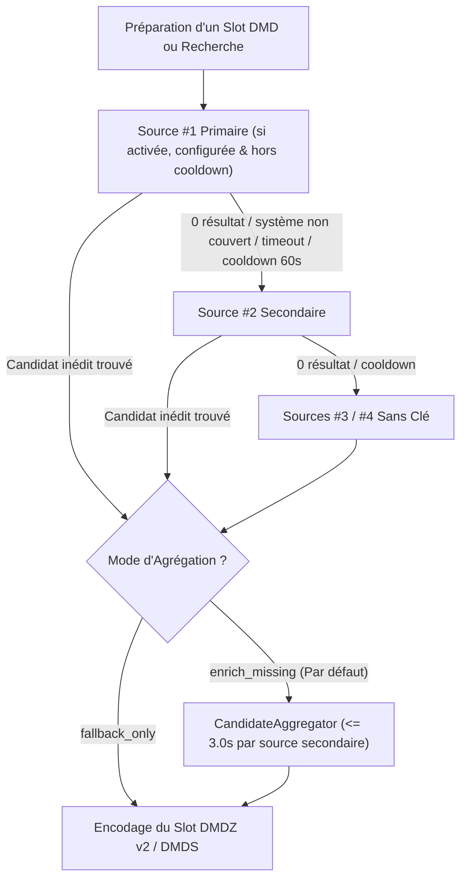
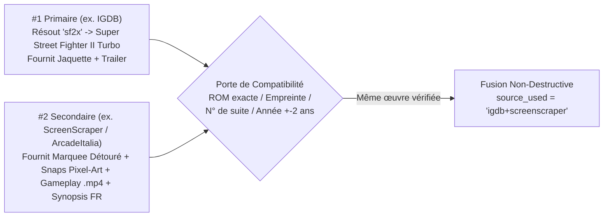

# Sources Média, Coffre Chiffré & Agrégation Multi-Sources — DMD Media Showcase Server

🇬🇧 [English](SOURCES_AND_AGGREGATION.md) | 🇫🇷 Français | 🇪🇸 [Español](SOURCES_AND_AGGREGATION_ES.md)

[](https://t.me/+DrSdAO8UMUViNmE0)
[](https://ko-fi.com/red1l)

---

## 1. Philosophie Zéro-Configuration & Coffre d'Identifiants Chiffré à 3 Niveaux

**DMD Media Showcase Server fonctionne à 100 % clé en main sans aucune configuration obligatoire.** Vous n'avez besoin de créer aucun compte développeur, de générer aucune clé API ni d'éditer le moindre fichier `.env` pour diffuser immédiatement des Jeux Rétro, Films, Séries TV et Anime sur votre matrice LED HUB75.

> [!TIP]
> **Tout fonctionne immédiatement sans toucher à quoi que ce soit.** La saisie de vos propres clés API, l'ajout d'un compte joueur ScreenScraper ou la modification de l'ordre des sources dans le Dashboard Web relèvent **100 % de la personnalisation optionnelle** — utile uniquement si vous souhaitez isoler vos propres quotas API ou varier le style visuel et les vidéos diffusées sur votre DMD.

### Fonctionnement des Clés Chiffrées par Défaut & des Surcharges (`Coffre à 3 Niveaux`)

Les versions officielles publiées (image Docker `ghcr.io/red77290/dmd_media_showcase:latest`, installeurs macOS `.dmg`, Windows `.zip` et Linux `.tar.gz`) embarquent déjà des clés développeur/API fonctionnelles chiffrées dans une extension native C compilée (`app.security._prod_vault`, dérivée en CI/CD via `PBKDF2-HMAC-SHA256`, un sel aléatoire de 16 octets et un découpage XOR en 3 parts afin qu'aucun secret n'existe en clair sur disque ni dans Git).

À l'exécution, `ServerConfigStore` résout dynamiquement chaque identifiant selon **3 niveaux de priorité** :

| Priorité | Niveau de Stockage | Quand il s'applique | Comment revenir à la clé par défaut |
| :---: | :--- | :--- | :--- |
| **`#1`** | **Surcharge Utilisateur WebUI** (`./data/server_config.json`) | Dès que vous renseignez une clé ou un compte personnel dans **`5. Clés API & Coffre Chiffré`** et cliquez sur **Enregistrer & Appliquer en Temps Réel** (`0 ms`, sans redémarrage). | Videz simplement le champ dans la WebUI et enregistrez — le serveur reprend automatiquement le niveau `#2` / `#3`. |
| **`#2`** | **Variables d'Environnement** (`.env` / `docker-compose.yml`) | Exécutions locales développeur, forks personnalisés ou déploiements automatisés (`IGDB_CLIENT_ID`, `SCREENSCRAPER_USER`, `TMDB_API_KEY`, etc.). | Supprimez ou laissez la variable vide dans `.env`. |
| **`#3`** | **Coffre Natif Chiffré Embarqué** (`_prod_vault`) | Actif par défaut dans toutes les releases officielles Docker & Desktop (`IGDB`, `ScreenScraper devid`, `TMDB`, `TheTVDB`). *(Et même sur un `git clone` local compilé sans `_prod_vault`, les **6 sources sans clé** couvrent automatiquement les 4 domaines).* | Toujours actif en repli de base dans les releases officielles. |

**Garde-Fous de Sécurité & Anti-Pollution :**
- **Zéro Fuite dans les Logs :** `SecretRedactingLogFilter` (`httpx` / `httpcore` bridés à `WARNING`) caviarde automatiquement les mots de passe et clés d'URL (`devpassword`, `sspassword`, `api_key`, `client_secret`) ainsi que les jetons Bearer avant toute écriture dans les logs conteneur.
- **Protection contre l'Auto-Remplissage Navigateur :** `sanitize_twitch_credential()` et `sanitize_api_token_no_url()` ignorent les valeurs parasites injectées par les gestionnaires de mots de passe du navigateur (URLs du dashboard, pseudos courts) afin de ne jamais masquer une clé `.env` ou Vault valide.

---

## 2. Tableau Complet des 11 Sources Média, Obligations & Contraintes

Sur les 4 domaines (`games`, `movies`, `series`, `anime`), **11 adaptateurs spécialisés** sont préconfigurés de série (`5` équipés de clés chiffrées par défaut dans le Vault + `6` APIs publiques 100 % sans clé) :

| Domaine & Rang par Défaut | Source (`source_id`) | Clés par Défaut & Obligation Utilisateur | Surcharge Optionnelle WebUI / `.env` | Principaux Assets DMD Fournis | Quotas Distants, Contraintes & Disjoncteur |
| :--- | :--- | :--- | :--- | :--- | :--- |
| **🕹️ Jeux `#1`**<br>*(Primaire)* | **IGDB API v4**<br>(`igdb`) | 🔐 **Clés OAuth2 app chiffrées embarquées** (`_prod_vault`).<br>**`0` obligation** sur les builds officiels. | `igdb_client_id`<br>`igdb_client_secret`<br>*(App gratuite sur portail Twitch Dev)* | 64 systèmes rétro/arcade, alias joueurs (`sf2x`, `3s`, `kof98`, `sotn`), jaquettes HD, artworks, captures & trailers YouTube. | ~`4 req/s` par Client ID ; cache jeton OAuth2 en RAM + disjoncteur de cooldown de `60s` sur `429`/`5xx`. |
| **🕹️ Jeux `#2`**<br>*(Secondaire)* | **ScreenScraper v2**<br>(`screenscraper`) | 🔐 **Clés `devid` / `devpassword` chiffrées embarquées** (`_prod_vault`).<br>👤 **Compte joueur (`ssid`)** : optionnel dans le protocole (mode *Invité*), **fortement recommandé** *(gratuit sur `screenscraper.fr`)*. | **Joueur :** `screenscraper_user`, `screenscraper_pass`<br>**Dev (optionnel) :** `screenscraper_dev_id`, `screenscraper_dev_pass` | Logos détourés `screenmarquee` & `wheel-hd`, boîtes régionales 2D/3D, captures pixel-art 15 kHz, synopsis localisés & **extraits gameplay directs `.mp4`**. | **Contrainte Invité (*Guest*) :** ScreenScraper coupe l'accès sans compte joueur (`API closed for non-registered members`) dès que le CPU serveur dépasse ~`60 %` (soirs/week-ends). Un compte joueur gratuit débloque ~`20 000 req/jour` (`1` thread, plus pour les donateurs Tipeee/Patreon). Cooldown auto de `60s` sur surcharge/quota. |
| **🕹️ Jeux `#3`**<br>*(Fallback)* | **ArcadeItalia ADB**<br>(`arcadeitalia`) | 🔓 **100 % Sans Clé** (`0` compte, `0` clé, fonctionne partout même en `git clone` local). | *Aucune requise* | Référence MAME / Arcade (`CPS-1/2/3`, `Neo-Geo`, `NAOMI`, `Atomiswave`, `Model 2/3`) : flyers de bornes, marquees, snaps pixel-art, vidéos attract-mode & alias (`sf2x`, `garou`). | Archive communautaire publique (`adb.arcadeitalia.net`) ; résilience TLS automatique ; délègue les consoles de salon à `libretro_wikidata` en mode autonome. |
| **🕹️ Jeux `#4`**<br>*(Fallback)* | **Libretro + Wikidata + Wikipédia + Archive.org**<br>(`libretro_wikidata`) | 🔓 **100 % Sans Clé** (`0` compte, `0` clé, fonctionne partout). | *Aucune requise* | Consoles, Portables & Micros (`NES`, `SNES`, `MD`, `PSX`, `GBA`...) : jaquettes/écrans-titres/snaps PNG régionaux vérifiés `(France) -> (Europe) -> (World) -> (USA)`, synopsis `{lang}.wikipedia.org` & extraits Archive.org. | Arbre GitHub mis en cache localement (`./data/referentials/libretro_tree_*.json`) garantissant `100 %` d'URLs PNG `HTTP 200` et filtrage strict `wd:Q7889` (jeux vidéo). |
| **🎬 Films `#1`**<br>*(Primaire)* | **TMDB Movies v3/v4**<br>(`tmdb_movies`) | 🔐 **Clé API chiffrée embarquée** (`_prod_vault`).<br>**`0` obligation** sur les builds officiels. | `tmdb_api_key`<br>*(Clé API v3 ou Jeton Bearer v4)* | Affiches officielles localisées, backdrops `16:9`, notes, synopsis traduits humainement & bandes-annonces HD. | Quotas TMDB très larges (~`40–50 req/s`). Une clé personnelle permet d'isoler son propre quota. |
| **🎬 Films `#2`**<br>*(Secondaire)* | **Apple iTunes Movies**<br>(`itunes_movies`) | 🔓 **100 % Sans Clé** (`0` compte, `0` clé, fonctionne partout). | *Aucune requise* | Affiches cinéma HD `1000×1000`, bannières larges, synopsis localisés par pays (`FR`, `US`, `ES`, `DE`, `IT`, `BR`, `JP`) & **flux trailers directs `.m4v`/`.mp4`** (`previewUrl`). | API publique iTunes Search (~`20 req/min` par IP) ; les flux `.m4v` directs se transcodent instantanément sans extraction YouTube. |
| **📺 Séries `#1`**<br>*(Primaire)* | **TMDB Series v3/v4**<br>(`tmdb_series`) | 🔐 **Clé API chiffrée embarquée** (`_prod_vault`).<br>**`0` obligation** sur les builds officiels. | `tmdb_api_key`<br>*(Partagée avec `tmdb_movies`)* | Affiches TV localisées, backdrops larges, notes, synopsis traduits & bandes-annonces/génériques. | Mêmes quotas confortables que `tmdb_movies`. |
| **📺 Séries `#2`**<br>*(Secondaire)* | **TheTVDB API v4**<br>(`tvdb_series`) | 🔐 **Clé API chiffrée embarquée** (`_prod_vault`).<br>**`0` obligation** sur les builds officiels. | `tvdb_api_key` | Traductions communautaires multilingues (`fra`, `spa`, `deu`, `ita`, `eng`, `jpn`), bannières/marquees séries & trailers. | Jeton Bearer mis en cache automatiquement en RAM pendant `23h`. |
| **📺 Séries `#3`**<br>*(Fallback)* | **TVMaze Public API**<br>(`tvmaze`) | 🔓 **100 % Sans Clé** (`0` compte, `0` clé, fonctionne partout). | *Aucune requise* | ~`70 000` séries scénarisées (exclut automatiquement talk-shows, télé-réalité et jeux TV), posters HD, bannières larges, photos & synopsis. | Limite publique ~`20 req / 10s` par IP. |
| **⛩️ Anime `#1`**<br>*(Primaire)* | **Jikan v4 + AnimeThemes**<br>(`jikan`) | 🔓 **100 % Sans Clé** (`0` compte, `0` clé, fonctionne partout). | *Aucune requise* | Catalogue MyAnimeList + **flux directs `.webm` d'Openings (`OP`) & Endings (`ED`) sans crédits** via `api.animethemes.moe` (liaison exacte par ID MAL) + trailers HD. | Limite publique Jikan v4 (`3 req/s`, `60 req/min`) ; les `.webm` AnimeThemes sont décodés directement sans `yt-dlp`. |
| **⛩️ Anime `#2`**<br>*(Secondaire)* | **AniList + AnimeThemes**<br>(`anilist`) | 🔓 **100 % Sans Clé** (`0` compte, `0` clé, fonctionne partout). | *Aucune requise* | Catalogue GraphQL AniList, couvertures `extraLarge`, larges marquees `bannerImage`, trailers & enrichissement `.webm` `OP`/`ED` via `AnimeThemes.moe`. | Limite publique GraphQL AniList (~`90 req/min`). |

---

## 3. Zoom sur ScreenScraper : Clé Développeur (`devid`) vs Compte Joueur (`ssid`)

L'API v2 de ScreenScraper distingue deux niveaux d'identifiants qu'il est important de ne pas confondre :

1. **Le Compte Développeur (`devid` + `devpassword`) — Déjà Inclus pour Tout le Monde :**
   - ScreenScraper impose à chaque logiciel client (Batocera, Recalbox, Skraper, DMD Media Showcase) d'identifier *l'application elle-même* via `devid` et `devpassword`. Sans eux, `api.screenscraper.fr` rejette 100 % des requêtes (`HTTP 403`).
   - **Vous n'avez jamais besoin d'un compte développeur ScreenScraper.** Les versions officielles de DMD Media Showcase intègrent déjà le couple `devid` / `devpassword` chiffré dans `_prod_vault` (les champs optionnels `screenscraper_dev_id` / `screenscraper_dev_pass` de la WebUI ne servent qu'aux développeurs compilant leur propre fork).
2. **Le Compte Joueur (`screenscraper_user` / `screenscraper_pass` $\to$ `ssid` / `sspassword`) — Pourquoi le renseigner :**
   - **Sans compte joueur (Mode Invité / *Guest*) :** Les requêtes envoyées uniquement avec le `devid` embarqué sont acceptées en tant qu'**invité non inscrit**. Aux heures creuses, cela fonctionne tout seul sans rien configurer. En revanche, dès que les serveurs ScreenScraper dépassent ~`60 %` de charge CPU (fréquent en soirée et le week-end), ScreenScraper ferme en priorité les accès invités avec le message `API closed for non-registered members` / `API fermée pour les utilisateurs non inscrits` (`HTTP 403`/`423` ou texte brut dans un `HTTP 200`).
   - **Avec un compte joueur gratuit (Mode *Membre inscrit*) :** Créer un compte gratuit en 1 minute sur [https://www.screenscraper.fr](https://www.screenscraper.fr/) et renseigner votre pseudo (`SSID`) + mot de passe dans **`5. Clés API & Coffre Chiffré`** permet de :
     - **Passer sur le pool Membres inscrits**, qui reste ouvert quand l'accès *Guest* est coupé aux heures de pointe.
     - **Bénéficier de votre propre quota individuel** (~`20 000` requêtes/jour gratuites sur `1` thread — ou davantage si vous soutenez ScreenScraper sur Tipeee/Patreon).
3. **Disjoncteur Automatique (`60s` Cooldown) :**
   - Avec ou sans compte joueur, `detect_screenscraper_api_error()` inspecte aussi bien les codes HTTP (`401`, `403`, `423`, `429`, `5xx`) que les messages d'erreur renvoyés en texte brut dans un `HTTP 200`. En cas de fermeture *Guest* ou de quota atteint, un **disjoncteur de `60s`** s'ouvre immédiatement afin que `IGDB`, `ArcadeItalia` et `Libretro+Wikidata` prennent le relais sans aucune latence sur le DMD.

---

## 4. Fallback Multi-Sources, Inversion des Rôles & Variation des Résultats / Vidéos

Chaque domaine exécute une **Chaîne de Responsabilité** configurable à chaud (`DomainSourceChainService`), persistée dans `./data/server_config.json` :



### Pourquoi inverser les rôles `#1 Primaire` et `#2 Secondaire` ? (Personnalisation Optionnelle)

L'ordre par défaut (`igdb -> screenscraper -> arcadeitalia -> libretro_wikidata` sur Jeux, `tmdb -> itunes` sur Films, `tmdb -> tvdb -> tvmaze` sur Séries, `jikan -> anilist` sur Anime) est calibré pour fonctionner immédiatement. Mais **changer la source `#1 Primaire` dans la WebUI modifie à la fois le tirage des titres et la nature des visuels / vidéos choisis en priorité** :

| Objectif de Personnalisation | Inversion `#1 Primaire` Recommandée | Ce qui change visuellement sur votre matrice LED HUB75 |
| :--- | :--- | :--- |
| **Vrais extraits Gameplay `.mp4` & Logos Détourés (`games`)** | Passer **`screenscraper` en `#1`**, **`igdb` en `#2`** | Privilégie les **courtes vidéos de gameplay in-game directes (`.mp4`)**, les marquees/wheels détourés (`screenmarquee` / `wheel-hd`) et les snaps pixel-art 15 kHz plutôt que les bandes-annonces promotionnelles YouTube d'IGDB. *(Astuce : renseignez un compte joueur gratuit `SSID` si vous mettez ScreenScraper en `#1`).* |
| **Flyers de Bornes d'Arcade MAME & Attract-Mode (`games`)** | Passer **`arcadeitalia` en `#1`** | Cible directement les ROMs parentes MAME authentiques, les flyers de bornes d'arcade d'époque, marquees et vidéos d'attract-mode (`100 %` sans clé). |
| **Boîtes Consoles Régionales No-Intro (`games`)** | Passer **`libretro_wikidata` en `#1`** | Privilégie les boîtes et écrans-titres consoles/portables vérifiés `(France) -> (Europe) -> (World) -> (USA)` avec synopsis Wikipédia localisés (`100 %` sans clé). |
| **Trailers Cinéma Directs Ultra-Rapides (`movies`)** | Passer **`itunes_movies` en `#1`**, **`tmdb_movies` en `#2`** | Sélectionne d'abord les flux vidéo `.m4v`/`.mp4` directs du CDN Apple et les affiches `1000×1000` (transcodage quasi instantané sans extraction YouTube), tout en laissant `tmdb_movies` (`#2`) compléter le backdrop `16:9` si besoin. |
| **Bannières Graphiques & Traductions TV (`series`)** | Passer **`tvdb_series` en `#1`** ou **`tvmaze` en `#1`** | Utilise le catalogue communautaire TheTVDB v4 (bannières séries et traductions dédiées) ou les 70 000 séries TVMaze en découverte principale. |
| **Tendances Anime Modernes & Bannières Larges (`anime`)** | Passer **`anilist` en `#1`**, **`jikan` en `#2`** | Tire les œuvres selon la popularité GraphQL AniList avec ses larges bannières `bannerImage`, tout en conservant les `OP`/`ED` `.webm` sans crédits d'`AnimeThemes.moe`. |

> [!NOTE]
> **Désactiver une source :** Vous pouvez également basculer n'importe quelle source sur **`OFF`** dans la WebUI (par exemple pour n'utiliser que des sources sans clé ou tester un scraper précis). Un garde-fou empêche de désactiver la dernière source active d'un domaine.

---

## 5. Fonctionnement de la Fusion Inter-Sources (`enrich_missing` vs `fallback_only`)

Pour chaque domaine, vous pouvez basculer en direct entre deux stratégies dans **`1. Vue d'ensemble & Matrices DMD`** ou **`5. Clés API & Coffre Chiffré`** :

### Mode A : `🔗 Agrégation Multi-Sources — Enrichir les manques` (`enrich_missing`, par défaut)

Lorsque la source `#1 Primaire` trouve une œuvre à laquelle il manque un ou plusieurs éléments essentiels pour le DMD (`marquee_url`, flux vidéo direct `video_url`, `backdrop_url` / `snapshot_urls`, ou `synopsis` traduit dans la langue demandée), `CandidateAggregator` interroge les sources actives suivantes (`#2`, `#3`...) avec un plafond strict de **`<= 3.0s` par source secondaire** :



**Règles Exactes de Fusion Champ par Champ (`CandidateAggregator._merge_donor_into_primary`) :**

| Champ du Candidat | Règle de Priorité lors du Merge | Pourquoi l'ordre `#1` / `#2` change le résultat |
| :--- | :--- | :--- |
| **Identité (`title`, `year`, `rating`, `badge`)** | Toujours conservée depuis **`#1 Primaire`**. | La source `#1` dicte le catalogue exploré et le nommage canonique. |
| **Jaquette / Affiche (`poster_url`, `jacket_url`)** | Conservée depuis **`#1`** si présente ; complétée par `#2`/`#3` **uniquement si vide**. | Inverser `#1` et `#2` change directement la jaquette/affiche de la Fiche Info (Phase 1) et du Panorama. |
| **Marquee / Logo DMD (`marquee_url`)** | Conservé depuis **`#1`** si présent ; complété par `#2`/`#3` **uniquement si vide**. | `IGDB` et `TMDB` fournissent rarement un marquee arcade détouré — `#2` (`ScreenScraper`, `ArcadeItalia`, `TheTVDB`, `AniList`) vient automatiquement combler ce manque ! |
| **Captures In-Game / Backdrops (`snapshot_urls`, `backdrop_url`)** | Les captures de `#1` passent d'abord ; `#2`/`#3` complètent les captures uniques jusqu'à **`4` images** si `#1` en a `< 4`. | Garantit un balayage Phase 3 riche même quand `#1` ne possède qu'une jaquette. |
| **Flux Vidéo (`video_url` vs `youtube_url`)** | Le flux direct (`video_url` : `.mp4`/`.webm`/`.m4v`) et `youtube_url` de **`#1`** sont conservés s'ils existent, et complétés par `#2`/`#3` **uniquement s'ils sont vides**. | Si `#1` n'a qu'un lien YouTube (ex. `IGDB`), `#2` (`ScreenScraper`) injecte son gameplay direct `.mp4` (`video_url`), évitant `yt-dlp` ! Et si deux sources ont un `.mp4` direct, c'est celle placée en `#1` qui gagne. |
| **Synopsis Localisé (`synopsis`)** | Hiérarchie stricte de qualité linguistique hors anglais : **`"1"` (Traduction Humaine Officielle) $>$ `"auto"` (Traduction Automatique) $>$ `"0"` (Non traduit)**. | Un vrai synopsis français/espagnol humain issu de `#2` (`ScreenScraper` / `Wikipédia`) remplace un synopsis anglais ou auto-traduit de `#1`, tandis qu'un synopsis anglais de `#2` **n'écrase jamais** un synopsis déjà localisé de `#1`. |

**Porte Anti-Contamination entre Suites (`_is_compatible_donor`) :**
Avant de fusionner le moindre champ, `CandidateAggregator` vérifie qu'il s'agit bien exactement de la même œuvre : correspondance de la ROM MAME (`ssf2t`), empreinte canonique `(système, titre)`, vérification stricte des numéros de suites en chiffres romains/arabes (*Street Fighter II* ne fusionnera **jamais** avec *Street Fighter III*), et tolérance maximale de `±2 ans` sur les films, séries et animes. Dès qu'une source secondaire enrichit l'œuvre, les badges de télémétrie en direct affichent la provenance combinée (`🔗 igdb+screenscraper`, `🔗 igdb+arcadeitalia`, `🔗 tmdb_movies+itunes_movies`).

### Mode B : `↪ Fallback Strict Uniquement` (`fallback_only`)

- Les sources secondaires (`#2`, `#3`...) ne sont **jamais interrogées** tant que `#1 Primaire` renvoie un candidat inédit valide.
- Choisissez `fallback_only` si vous souhaitez un rendu esthétique provenant à `100 %` d'une seule source, ou pour économiser le quota journalier d'une source secondaire (comme ScreenScraper) uniquement pour les cas où `#1` ne trouve rien.

---

## 6. Personnaliser les Sources & les Clés en Direct (Zéro Redémarrage)

### Option A — Depuis le Dashboard Web d'Administration (Recommandé)
1. Ouvrez `http://dmdmediashowcase.local:8890/` (ou `http://<ip-serveur>:8890/`).
2. **Pour inverser `#1` / `#2`, réordonner les sources ou changer le mode de fusion :**
   - Rendez-vous dans **`1. Vue d'ensemble & Matrices DMD`** (ou **`5. Clés API & Coffre Chiffré`**) $\to$ **Chaînes de Sources, Priorité & Agrégation Multi-Sources**.
   - Sélectionnez la **Source Principale (`#1`)** et la **Source Secondaire (`#2`)**, utilisez les flèches **Monter / Descendre** ou les boutons **Activer / Désactiver**, et choisissez **`🔗 Agrégation Multi-Sources (Enrichir les manques)`** ou **`↪ Fallback Strict Uniquement (Sur échec)`** — le changement est **immédiat** et sauvegardé dans `./data/server_config.json`.
   - *(Optionnel)* Si le **Cache Persistant des Conversions On-Demand** est activé et que vous souhaitez regénérer des jeux déjà mis en cache avec les vidéos/jaquettes de votre nouvelle source `#1`, cliquez sur **🗑 Vider le Cache On-Demand** dans **`2. Runtime, Workers & Limites Vidéo`**.
3. **Pour ajouter un compte joueur ScreenScraper ou vos propres clés API :**
   - Ouvrez **`5. Clés API & Coffre Chiffré`** $\to$ **Identifiants Utilisateur & Surcharges Optionnelles**.
   - Remplissez uniquement ce que vous souhaitez personnaliser (ex. `Compte Joueur ScreenScraper — Identifiant (SSID)` + `Mot de passe`) en laissant tous les autres champs vides pour continuer à bénéficier des clés chiffrées embarquées du Vault, puis cliquez sur **Enregistrer & Appliquer en Temps Réel**.

### Option B — Via `.env` ou `docker-compose.yml` (Optionnel)
Toutes les surcharges peuvent aussi être passées par variables d'environnement (les surcharges saisies dans la WebUI gardent la priorité `#1`) :

```env
# Compte joueur gratuit ScreenScraper optionnel (recommandé pour éviter les coupures Invité aux heures de pointe)
SCREENSCRAPER_USER=votre_pseudo_ssid
SCREENSCRAPER_PASS=votre_mot_de_passe_joueur

# Surcharges optionnelles de clés API personnelles (laisser commenté sur les releases officielles pour utiliser le Vault chiffré)
# IGDB_CLIENT_ID=
# IGDB_CLIENT_SECRET=
# SCREENSCRAPER_DEV_ID=
# SCREENSCRAPER_DEV_PASS=
# TMDB_API_KEY=
# TVDB_API_KEY=
```
