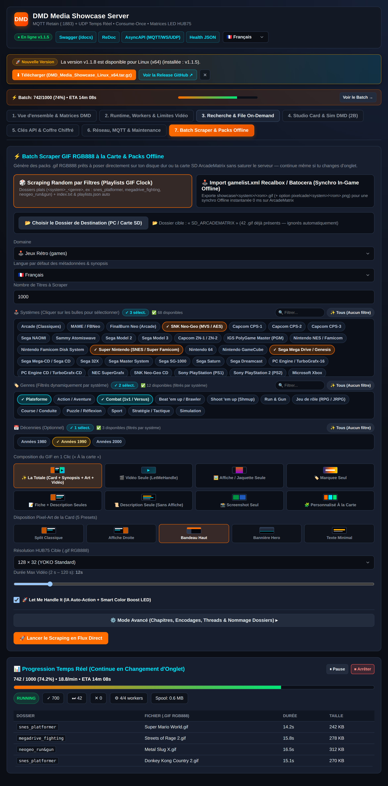

# Complete Beginner Tutorial (Zero Jargon): Online Mode, Offline Mode & Batch Scraper

🇬🇧 English | 🇫🇷 [Français](TUTORIAL_ONLINE_OFFLINE_SCRAPING_FR.md) | 🇪🇸 [Español](TUTORIAL_ONLINE_OFFLINE_SCRAPING_ES.md)

This guide is written **for everyday users with zero technical or computer background required**. It explains in plain language the **difference between Online and Offline modes**, **what to do for each setup**, and **how to build ready-to-use GIF packs** from a PC, Mac, NAS/Docker server, or even your smartphone.

---

## 1. Online vs Offline vs Hybrid in 30 Seconds

Think of your **ArcadeMatrix** LED display (ESP32, ESP32-S3, or Raspberry Pi) like a TV:
- **ONLINE Mode (Live Streaming)** works like **Netflix / YouTube**: the **DMD Media Showcase** app runs on a computer, mini-PC, or NAS on your Wi-Fi and streams thousands of retro games, movies, TV series, and anime live to your LED display — **zero files to copy onto the SD card** and **zero repeats**.
- **OFFLINE Mode (Standalone SD Card Packs)** works like a **pre-loaded USB drive**: you use **Tab #7 (`Batch Scraper & Offline Packs`)** once to automatically generate true-color `RGB888` `.gif` files neatly sorted into folders ready to drop onto your display's MicroSD card. **Afterwards, you can turn off your PC and unplug the Internet: your display and Recalbox arcade cabinet run 100% on their own!**
- **HYBRID Mode (Both Combined — Automatic!)**: you place an Offline pack of your favorite Recalbox games on the SD card **AND** leave Showcase enabled when your PC/NAS is on. Your display **always plays local SD card GIFs first with instant `0 ms` startup**, and automatically falls back to the Online server only for games that are not on the SD card!

| Feature | 🌐 **100% ONLINE Mode** *(Live Stream)* | 💾 **100% OFFLINE Mode** *(SD Card Packs)* | ⚡ **HYBRID Mode** *(SD Card + Online Server)* |
| :--- | :--- | :--- | :--- |
| **Does a PC / NAS / Docker server need to stay on?** | **Yes**, while watching Showcase | **No!** Turn off your PC once the pack is copied | **Optional** (works both with PC off and PC on) |
| **Is an Internet connection needed?** | **Yes** (fetches fresh titles live) | **No!** Ideal for arcade rooms, garages, events, gifts | Only for games not stored on the SD card |
| **Do I need to copy files to the MicroSD card?** | **Zero files to copy** | **Yes, just once** (drag & drop folders) | Yes for your core collection, live stream for the rest |
| **Startup speed when launching a Recalbox / Batocera game** | A few seconds on 1st launch *(then `0 ms` with cache)* | **Instantaneous (`0 ms` right after marquee)** | **Instantaneous (`0 ms`)** on local packs + Online backup |
| **Catalog variety (Movies, Series, Anime, Games)** | **Virtually unlimited** (never repeats) | As large as the pack you scrape (`50`, `500`, `2,000+` GIFs) | **Maximum** |

---

## 2. What Should I Do for My Setup? (4 Step-by-Step Recipes)

### 🟢 Case #1 — "I have Wi-Fi at home and a PC / Mac / NAS: I don't want to touch the SD card" *(Online Mode)*
1. Launch **DMD Media Showcase** on your PC, Mac, or Docker NAS (`http://localhost:8890/`). **Nothing to configure**: encrypted keys and keyless sources are already built in.
2. Open your ArcadeMatrix Web page (`http://arcadematrix.local` or its IP) $\to$ **`Settings -> Showcase Server`**.
3. Turn on **Enable DMD Media Showcase Server** and click **Save**: the status badge turns green (**`🟢 Communication OK`**).
4. In **Screens / Rotation**, add **Retro Games**, **Movies**, **TV Series**, or **Anime**. Done — it streams automatically!

---

### 🟣 Case #2 — "I want 500 or 1,000 GIFs sorted by console & genre for my Clock / Wall Display with no PC running" *(Offline Mode — Clock Playlists)*
Want hundreds of animations sorted into flat folders like `snes_platformer`, `megadrive_fighting`, `neogeo_run&gun`, or `movies_scifi` so your ArcadeMatrix Clock rotates through rich animations completely offline?

1. Open Showcase (`http://localhost:8890/`) and click the last tab: **`7. Batch Scraper & Offline Packs`**.
2. Click **🎲 Random Filter Batch (Clock GIF Playlists)**.
3. **In 3 simple clicks**:
   - Pick your **Domain** (*Retro Games*, *Movies*, *TV Series*, or *Anime*), **Language**, **Number of Titles** (e.g., `200` or `1000`), and simply **click/tap the rounded bubbles** for **Systems**, **Genres**, or **Decades** (no keyboard shortcuts needed!).
   - Pick your **1-Click Composition ('À la carte')** and **Pixel-Art Card Layout** using the **visual DMD Studio rendering icons**:
     - **✨ Full Showcase**: Animated Info Card + scrolling synopsis + poster scan + screenshot + gameplay/trailer video.
     - **🎬 Video Only**: Pure AI-framed gameplay/trailer clip (`Let Me Handle It`).
     - **🖼️ Poster Only** / **🏷️ Marquee Only** / **📸 Screenshot Only** / **📝 Card + Description** / **📜 Description Only**.
   - Select your **Target HUB75 Resolution** (e.g., `128 × 32` standard DMD, `256 × 64` HD, or `64 × 128` vertical **TATE**) and **Max Video Duration** (`2s` up to `120s`, default `8s`).
4. Click **🚀 Start Streaming Batch Scrape** (you can freely switch browser tabs while it runs!).
5. **Copy to your MicroSD card**: drag the generated folders (`snes_platformer`, `neogeo_run&gun`, etc. + `playlists.json`) into **`/gifs/`** on your SD card (or **`/gifs_tate/`** for vertical TATE panels).

---

### 🕹️ Case #3 — "I have a Recalbox / Batocera cabinet: I want instant In-Game Showcase when launching a game, 100% offline!" *(Offline Mode — In-Game Sync)*
When you launch *Metal Slug X* or *Street Fighter II* on your cabinet, you want the **official Marquee immediately**, followed **3.5 seconds later** by the **Info Card + Gameplay Video**, with no Internet and no PC server turned on:

1. Grab your **`gamelist.xml`** file(s) from Recalbox / Batocera:
   - From your computer on the network, open `\\RECALBOX\share\roms\` (Windows) or `smb://recalbox.local/share/roms/` (Mac). Inside each console folder (`neogeo`, `snes`, `megadrive`, `mame`...), there is a `gamelist.xml` file listing the exact games installed on your cabinet.
2. Open Showcase $\to$ **`7. Batch Scraper & Offline Packs`** $\to$ click **🕹️ Recalbox / Batocera `gamelist.xml` (Offline In-Game Sync)**.
3. Select one or multiple **`gamelist.xml`** files at once: Showcase immediately displays the detected game count and systems (automatically skipping BIOS and hidden entries).
4. Pick your panel **Resolution**, keep **Also export `pixelcade/<system>/<rom>.png` marquees** checked, and click **🚀 Start Streaming Batch Scrape**.
5. **Copy to the root of your ArcadeMatrix MicroSD card** (or `DATA` partition on Raspberry Pi) the two generated folders:
   - **`showcase/`** *(or `showcase_tate/` on vertical screens)* $\to$ holds one `RGB888` `.gif` per ROM (`showcase/neogeo/mslugx.gif`).
   - **`pixelcade/`** $\to$ holds the matching static marquees (`pixelcade/neogeo/mslugx.png`).
6. In your ArcadeMatrix Web UI (`System -> MQTT & API -> 🎮 FrontendSync`), simply ensure **In-Game Showcase** is checked (`Once`, `Alternating`, or `Loop`). **Even with Showcase Server turned OFF (`⚪ Disabled`), your DMD automatically finds the SD card `.gif` and plays it in `0 ms`!**

---

### ⚡ Case #4 — "I want Hybrid Mode (SD Card Packs + Live Online Server when my PC is on)"
There is **no extra setting to toggle**:
1. Copy your Offline Recalbox packs into `/showcase/` on the SD card (Case #3) **and** leave **Showcase Server** enabled on the display (Case #1).
2. Whenever you launch a game:
   - **Is the `.gif` on the SD card?** $\to$ Plays locally right away (`0` network traffic).
   - **Launching a brand-new game not yet on your SD card?** $\to$ If your Showcase server is running, it seamlessly streams it live!

---

## 3. Local PC, Docker/NAS Server, or Smartphone: How Files Reach Your Device



Showcase **automatically adapts** to your device and browser **without ever filling up server RAM or Docker volumes**:

### 💻 A. Local PC or Mac on Chrome / Edge / Brave (`http://localhost:8890`) — *Direct-to-Folder Streaming!*
- Click **📂 Select Target Folder** and pick a folder on your hard drive or your **USB-mounted MicroSD card**.
- Showcase creates the folder tree upfront and **writes each `.gif` straight onto your drive as soon as it finishes**, immediately deleting the temporary server copy.
- **Smart Resume**: running another scrape later into the same folder automatically scans existing `.gif` files and **skips everything you already have**!
- **Background-Tab Safe**: switch tabs freely — a live header banner tracks progress at full speed.

### 🐳 B. Remote Docker / NAS Server (`http://192.168.x.x:8890`) or Firefox / macOS Safari — *Zero-RAM Live `.zip` Stream!*
- When Showcase runs on another machine (Synology NAS, Raspberry Pi, Unraid, Home-Lab) or on Firefox/Safari, browsers require downloads rather than raw folder access.
- **Zero extra Docker volumes needed**: Showcase streams your folders and `.gif` files into **`dmd_pack_<id>.zip`** in your **Downloads** folder and **automatically deletes all temporary server files upon completion** (`0 MB` kept on your NAS/Docker!). If Wi-Fi hiccups, click **`📥 Download Stream (.zip)`** to resume with zero lost files.

### 📱 C. Smartphone or Tablet (iPhone, iPad, Android) — *Non-Blocking Mobile Mode!*
On phones and tablets, **iOS (Safari)** and **Android (Chrome)** block websites from writing hundreds of loose files directly into phone folders, and cut off long trickle downloads if the screen locks.

**DMD Media Showcase includes a dedicated Mobile Mode so nothing ever blocks:**
1. Opening **Tab #7 (`Batch Scraper`)** on an iPhone, iPad, or Android phone automatically activates **`📱 Smartphone / Tablet Mode`**.
2. Tap Start: **Screen Wake Lock** keeps your screen awake while viewing progress, and **even if you lock your phone or switch to another app**, the server keeps building all your `.gif` files in the background without stalling!
3. At **100%**, a bright green **`✅ Download Ready Pack (.zip)`** button lights up: **one finger tap** downloads the complete `.zip` at full Wi-Fi speed straight into **Files** (iPhone/iPad) or **Downloads** (Android) and immediately cleans up the server!

---

## 4. Quick Reference: Where to Drop Folders on Your MicroSD Card

```text
📁 Root of your ArcadeMatrix MicroSD Card (or DATA drive on Raspberry Pi)
├── 📂 gifs/                     👈 Clock Playlist Mode (Horizontal YOKO: 128×32, 256×64...)
│   ├── playlists.json           (Auto-generated — recognized immediately by Clock)
│   ├── 📂 snes_platformer/      (Contains your RGB888 .gif files + auto index.txt)
│   ├── 📂 megadrive_fighting/
│   └── 📂 neogeo_run&gun/
│
├── 📂 gifs_tate/                👈 Clock Playlist Mode (Vertical TATE: 64×128, 32×128...)
│   └── ...
│
├── 📂 showcase/                 👈 Recalbox / Batocera Offline Mode (Horizontal YOKO)
│   ├── 📂 neogeo/               (e.g. mslugx.gif, garou.gif — exact ROM stem)
│   ├── 📂 snes/
│   └── 📂 cps2/
│
├── 📂 showcase_tate/            👈 Recalbox / Batocera Offline Mode (Vertical TATE)
│   └── 📂 neogeo/
│
└── 📂 pixelcade/                👈 Companion static marquees (Exported automatically in Recalbox mode)
    └── 📂 neogeo/               (e.g. mslugx.png — displayed in 0 ms in menus & before video)
```

---

## 5. Frequently Asked Questions

- **"What video duration should I pick?"**
  **`8s` to `15s`** keeps GIFs punchy and compact (`~150 KB – 350 KB` at `128×32`). You can slide all the way up to **`120 seconds` max** for full anime openings or long gameplay clips!
- **"Do I need to touch Advanced Options?"**
  **No!** **🚀 Let Me Handle It** (enabled by default) automatically applies AI action-framing and smart HUB75 LED color boost in full **24-bit `RGB888`**. Open **Advanced Options** only if you want to tweak parallel CPU workers, card themes (*Neon Border*, *Amber Pinball*...), screenshot counts, or FPS.
- **"Will a large batch scrape disturb my live LED display?"**
  **Never.** Batch Scraper runs in an isolated queue: it never alters your live Consume-Once history (`seen_history.json`) and never interrupts connected displays.
