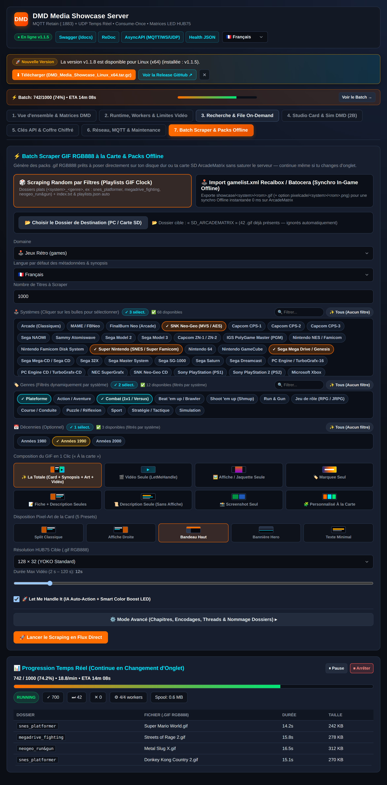

# Tutorial Completo (Sin Tecnicismos): Modo Online, Modo Offline y Batch Scraper

🇬🇧 [English](TUTORIAL_ONLINE_OFFLINE_SCRAPING.md) | 🇫🇷 [Français](TUTORIAL_ONLINE_OFFLINE_SCRAPING_FR.md) | 🇪🇸 Español

Esta guía está pensada **para cualquier usuario, sin necesidad de conocimientos técnicos ni informáticos**. Explica de forma sencilla la **diferencia entre los modos Online y Offline**, **qué hacer en cada caso**, y **cómo crear tus propios packs de GIFs listos para usar** desde un PC, Mac, servidor NAS/Docker o incluso desde tu móvil.

---

## 1. Diferencia en 30 segundos: Online vs Offline vs Híbrido

Imagina tu pantalla LED **ArcadeMatrix** (ESP32, ESP32-S3 o Raspberry Pi) como un televisor:
- **El Modo ONLINE (Streaming en directo)** funciona como **Netflix / YouTube**: la aplicación **DMD Media Showcase** se ejecuta en un ordenador, mini-PC o NAS en tu Wi-Fi y envía en directo miles de juegos retro, películas, series y animes a tu pantalla LED, **sin copiar ningún archivo en la tarjeta SD** y **sin repetir nunca el mismo título**.
- **El Modo OFFLINE (Autónomo en Tarjeta SD)** funciona como un **pendrive preparado de antemano**: usas una sola vez la pestaña **`7. Batch Scraper & Packs Offline`** para generar automáticamente archivos `.gif` a todo color `RGB888` ordenados en carpetas listas para copiar en la tarjeta MicroSD de tu pantalla. **¡Después puedes apagar tu PC y desconectar Internet: tu pantalla y tu recreativa Recalbox funcionan 100 % solas!**
- **El Modo HÍBRIDO (Ambos a la vez — ¡Automático!)**: copias un pack Offline de tus juegos Recalbox en la tarjeta SD **Y** dejas Showcase activado cuando tu PC/NAS está encendido. ¡La pantalla **usa siempre primero tus GIFs locales de la SD al instante (`0 ms`)**, y recurre automáticamente al servidor Online solo para los juegos que no estén en la tarjeta SD!

| Criterio | 🌐 **Modo 100 % ONLINE** *(Streaming Directo)* | 💾 **Modo 100 % OFFLINE** *(Packs en Tarjeta SD)* | ⚡ **Modo HÍBRIDO** *(Tarjeta SD + Servidor Online)* |
| :--- | :--- | :--- | :--- |
| **¿Hay que dejar un PC / NAS / Docker encendido?** | **Sí**, mientras quieras ver Showcase | **¡No!** Apagas el PC tras copiar el pack | **Opcional** (funciona con el PC apagado o encendido) |
| **¿Hace falta conexión a Internet?** | **Sí** (descubre títulos nuevos en vivo) | **¡No!** Ideal para recreativas, garajes, eventos, regalos | Solo para los juegos que no estén en la SD |
| **¿Hay que copiar archivos en la tarjeta MicroSD?** | **Cero archivos que copiar** | **Sí, una sola vez** (arrastrar y soltar carpetas) | Sí para tus favoritos; el resto llega en directo |
| **Velocidad al iniciar un juego en Recalbox / Batocera** | Unos segundos la 1ª vez *(luego `0 ms` con caché)* | **Instantáneo (`0 ms` justo tras el marquee)** | **Instantáneo (`0 ms`)** en packs locales + respaldo Online |
| **Variedad de catálogo (Cine, Series, Anime, Juegos)** | **Casi infinita** (sin repeticiones) | Según el pack que crees (`50`, `500`, `2 000+` GIFs) | **Máxima** |

---

## 2. ¿Qué hacer exactamente según tu instalación? (4 Recetas Paso a Paso)

### 🟢 Caso n.º 1 — « Tengo Wi-Fi en casa y un PC / Mac / NAS: no quiero tocar la tarjeta SD » *(Modo Online)*
1. Inicia simplemente **DMD Media Showcase** en tu PC (`Start_Showcase_Windows.bat` / `.exe`), Mac o NAS Docker. **No hay nada más que configurar en el servidor**: la interfaz Web en `http://localhost:8890/` sirve únicamente para **monitorización en vivo** (tu DMD se registrará y aparecerá allí solo, sin necesidad de crear una matriz a mano) y personalización opcional.
2. Abre la web de tu pantalla ArcadeMatrix (`http://arcadematrix.local` o su IP) $\to$ **`Sistema -> 🔄 MQTT & API -> 🎬 DMD Media Showcase`** *(ubicado ahí por tratarse de una función complementaria opcional)*.
3. Pasa **Activar DMD Media Showcase** a **Activado**, pulsa **🔄 Test** (si `http://dmdmediashowcase.local:8890` indica `🔴 Inalcanzable` por Wi-Fi en tu router, introduce directamente la IP local de tu PC `http://192.168.1.XX:8890` mostrada en la consola), verifica **`🟢 Comunicación OK`** y pulsa abajo en **Guardar ajustes Showcase**.
4. Entra en la pestaña **`Pantalla`**, pulsa **➕ Añadir al bucle** en **Vitrina Juegos Retro**, **Movie Showcase**, **Series Showcase** o **Anime Showcase** (usa **⚙️ Configurar -> 🔄 Sync** si quieres filtrar por consola/género) y pulsa **Guardar lista de rotación**. Espera de 10 a 20 s en el primer medio: ¡transmite solo!

---

### 🟣 Caso n.º 2 — « Quiero llenar mi tarjeta SD con listas de GIFs para el Reloj sin dejar el PC encendido » *(Modo Offline — Playlists Clock)*
¿Quieres por ejemplo **500 o 1 000 GIFs** ordenados en carpetas planas como `snes_platformer`, `megadrive_fighting`, `neogeo_run&gun` o `movies_scifi` para que el reloj de tu ArcadeMatrix muestre animaciones variadas todo el año?

1. Abre Showcase (`http://localhost:8890/`) y entra en la pestaña **`7. Batch Scraper & Packs Offline`**.
2. Pulsa en **🎲 Scraping Aleatorio por Filtros (Playlists GIF Clock)**.
3. **En 3 clics sencillos**:
   - Elige el **Dominio** (*Juegos Retro*, *Películas*, *Series* o *Anime*), el **Idioma** (`Español`), el **Número de títulos** (ej. `200` o `1000`), y **pulsa directamente en las burbujas** de **Sistemas**, **Géneros** o **Décadas** (¡sin `Ctrl+Clic`!).
   - Elige la composición **« A la carta »** y el **Diseño de la Card** mediante los **iconos visuales de renderizado del Studio**:
     - **✨ Completo**: Ficha con carátula + sinopsis deslizante + barrido de póster + captura + vídeo.
     - **🎬 Solo Vídeo**: Únicamente el clip de gameplay/tráiler reencuadrado por IA (`Let Me Handle It`).
     - **🖼️ Solo Póster** / **🏷️ Solo Marquee** / **📸 Solo Captura** / **📝 Ficha + Descripción** / **📜 Solo Descripción**.
   - Comprueba la **Resolución** de tu panel (ej. `128 × 32` DMD estándar, `256 × 64` HD, o `64 × 128` vertical **TATE**) y la **Duración máx. de vídeo** (`2 s` a `120 s`, `8 s` por defecto).
4. Pulsa **🚀 Iniciar Scraping en Flujo Directo** (¡puedes cambiar de pestaña mientras trabaja!).
5. **Copia en tu tarjeta MicroSD**: arrastra las carpetas generadas (`snes_platformer`, `neogeo_run&gun`, etc. + `playlists.json`) dentro de **`/gifs/`** en tu tarjeta SD (o **`/gifs_tate/`** en pantallas verticales).

---

### 🕹️ Caso n.º 3 — « Tengo una recreativa Recalbox / Batocera: ¡quiero Showcase instantáneo al lanzar un juego, 100 % sin Internet! » *(Modo Offline — Sincro In-Game)*
Cuando inicias *Metal Slug X* o *Street Fighter II* en tu recreativa, quieres ver el **Marquee oficial al instante**, seguido **3,5 segundos después** de la **Ficha + Vídeo de gameplay**, sin Internet ni servidor PC encendido:

1. Toma el archivo o archivos **`gamelist.xml`** de tu Recalbox / Batocera:
   - Desde tu ordenador en la red, abre `\\RECALBOX\share\roms\` (Windows) o `smb://recalbox.local/share/roms/` (Mac). En cada carpeta de consola (`neogeo`, `snes`, `megadrive`, `mame`...) verás un archivo **`gamelist.xml`** con la lista exacta de tus juegos.
2. Abre Showcase $\to$ **`7. Batch Scraper & Packs Offline`** $\to$ pulsa **🕹️ Importar `gamelist.xml` Recalbox / Batocera (Sincro In-Game Offline)**.
3. Selecciona uno o varios **`gamelist.xml`** a la vez: Showcase muestra al instante cuántos juegos y sistemas ha detectado (omitiendo BIOS y ocultos).
4. Elige la **Resolución** de tu DMD, deja marcada la opción **Exportar también marquees `pixelcade/<system>/<rom>.png`** y pulsa **🚀 Iniciar Scraping**.
5. **Copia en la raíz de la tarjeta MicroSD de tu ArcadeMatrix** (o unidad `DATA` en Raspberry Pi) las dos carpetas generadas:
   - **`showcase/`** *(o `showcase_tate/` en vertical)* $\to$ contiene un `.gif` `RGB888` con el nombre exacto de cada ROM (`showcase/neogeo/mslugx.gif`).
   - **`pixelcade/`** $\to$ contiene los marquees fijos correspondientes (`pixelcade/neogeo/mslugx.png`).
6. En la web de tu ArcadeMatrix (`Sistema -> MQTT & API -> 🎮 FrontendSync`), asegúrate de tener marcado **Showcase en Juego** (`Una vez`, `Alternar` o `Bucle`). **¡Incluso con Showcase Server desactivado (`⚪ Desactivado`), tu DMD detecta automáticamente los `.gif` de la tarjeta SD y los reproduce en `0 ms`!**

---

### ⚡ Caso n.º 4 — « Quiero el Modo Híbrido (Tarjeta SD + Servidor Online cuando mi PC está encendido) »
No tienes que configurar **ningún ajuste extra**:
1. Copia tus packs Offline Recalbox en `/showcase/` de la tarjeta SD (Caso n.º 3) **y** deja **Showcase Server** activado en la pantalla (Caso n.º 1).
2. Al iniciar cualquier juego:
   - **¿Está el `.gif` en la tarjeta SD?** $\to$ Reproducción local inmediata en `0 ms` (**cero tráfico de red**).
   - **¿Lanzas un juego nuevo que aún no está en la SD?** $\to$ ¡Si tu servidor Showcase está encendido, toma el relevo en directo automáticamente!

---

## 3. PC Local, Servidor Docker/NAS o Móvil: ¿cómo se guardan tus archivos?



La aplicación se adapta **automáticamente** a tu dispositivo y navegador, **sin saturar nunca la memoria ni el disco del servidor**:

### 💻 A. Desde PC o Mac con Chrome / Edge / Brave (`http://localhost:8890`) — *¡Escritura directa en tu carpeta!*
- Pulsa **📂 Elegir Carpeta de Destino** y selecciona directamente una carpeta de tu disco duro o tu **tarjeta MicroSD conectada por USB**.
- Showcase crea la estructura de carpetas y **escribe cada `.gif` directamente en tu disco a medida que termina**, borrando al instante el archivo temporal del servidor.
- **Reanudación inteligente**: si vuelves a lanzar otro scraping en la misma carpeta más adelante, Showcase detecta los `.gif` existentes y **solo descarga los nuevos**.
- **Continúa al cambiar de pestaña**: puedes cambiar de pestaña sin que se detenga; una barra superior muestra el progreso en vivo.

### 🐳 B. Desde un Servidor Docker / NAS remoto (`http://192.168.x.x:8890`) o Firefox / Safari Mac — *¡Flujo `.zip` directo cero RAM!*
- Cuando Showcase corre en otra máquina (NAS Synology, Raspberry Pi, Unraid) o en Firefox/Safari, el navegador descarga un paquete en lugar de escribir directamente en carpetas del sistema.
- **Sin volúmenes Docker adicionales**: Showcase empaqueta al vuelo tus carpetas y `.gif` en **`dmd_pack_<id>.zip`** en tu carpeta **Descargas** y **elimina automáticamente todos los archivos temporales del servidor al terminar** (`0 MB` ocupados en el NAS/Docker). Si se corta el Wi-Fi, el botón **`📥 Descargar Flujo (.zip)`** reanuda la descarga sin perder ningún archivo.

### 📱 C. Desde un Móvil o Tablet (iPhone, iPad, Android) — *¡Modo Móvil Sin Bloqueos!*
En teléfonos y tablets, **iOS (Safari)** y **Android (Chrome)** impiden por seguridad que una web escriba cientos de archivos sueltos en carpetas internas del teléfono, y cortan las descargas largas si se apaga la pantalla.

**DMD Media Showcase incluye por ello un Modo Móvil específico sin bloqueos:**
1. Al abrir la pestaña **`7. Batch Scraper`** en tu iPhone, iPad o Android, se activa automáticamente el aviso **`📱 Modo Móvil / Tablet`**.
2. Inicia el scraping: la pantalla se mantiene encendida automáticamente (`Wake Lock`) mientras miras el progreso, e **incluso si bloqueas el móvil o cambias de app**, ¡el servidor sigue preparando todos tus `.gif` en segundo plano sin bloquearse jamás!
3. Al llegar al **100 %**, se ilumina un botón verde **`✅ Descargar Pack Listo (.zip)`**: **con un solo toque** descargas el archivo `.zip` completo en segundos a máxima velocidad Wi-Fi directamente en **Archivos** (iPhone/iPad) o **Descargas** (Android), limpiando al instante el servidor.

---

## 4. Guía Rápida: Dónde copiar las carpetas en la tarjeta MicroSD

```text
📁 Raíz de la tarjeta MicroSD ArcadeMatrix (o unidad DATA en Raspberry Pi)
├── 📂 gifs/                     👈 Modo Playlists Reloj (Pantalla Horizontal YOKO: 128×32, 256×64...)
│   ├── playlists.json           (Autogenerado — reconocido al instante por el Reloj)
│   ├── 📂 snes_platformer/      (Contiene tus .gif RGB888 + index.txt automático)
│   ├── 📂 megadrive_fighting/
│   └── 📂 neogeo_run&gun/
│
├── 📂 gifs_tate/                👈 Modo Playlists Reloj (Pantalla Vertical TATE: 64×128, 32×128...)
│   └── ...
│
├── 📂 showcase/                 👈 Modo Recalbox / Batocera Offline (Pantalla Horizontal YOKO)
│   ├── 📂 neogeo/               (ej: mslugx.gif, garou.gif — nombre exacto de la ROM)
│   ├── 📂 snes/
│   └── 📂 cps2/
│
├── 📂 showcase_tate/            👈 Modo Recalbox / Batocera Offline (Pantalla Vertical TATE)
│   └── 📂 neogeo/
│
└── 📂 pixelcade/                👈 Marquees fijos compañeros (Activado por defecto en modo Recalbox)
    └── 📂 neogeo/               (ej: mslugx.png — mostrado en 0 ms en menús y antes del vídeo)
```

---

## 5. Preguntas Frecuentes

- **« ¿Qué duración de vídeo debo elegir? »**
  Entre **`8 s` y `15 s`** ofrece archivos ligeros (`~150 KB – 350 KB` en `128×32`) y dinámicos. ¡Puedes subir hasta **`120 segundos` máximo** si quieres openings de anime completos o gameplays largos!
- **« ¿Necesito tocar el Modo Avanzado? »**
  **¡No!** La casilla **🚀 Let Me Handle It** (activada por defecto) aplica automáticamente el encuadre inteligente por IA y el realce de color LED HUB75 en **24 bits `RGB888`**. Abre **Modo Avanzado** solo si deseas ajustar los hilos paralelos (`Workers`), temas de tarjeta (*Neon Border*, *Amber Pinball*...), número de capturas o FPS.
- **« ¿Un scraping grande afectará a mi pantalla LED en directo? »**
  **Nunca.** El Batch Scraper trabaja en una cola totalmente aislada: no altera tu historial `seen_history.json` ni interrumpe ninguna matriz conectada.
- **« ¿Qué ocurre si cierro la ventana del navegador por error o pierdo el Wi-Fi? »**
  **¡Nada se detiene!** Cada ejecución es una **tarea persistente en el servidor** (`batch_jobs.json`): el scraping y la conversión continúan en segundo plano aunque cierres el navegador. Al volver a abrir `:8890` (incluso desde otro dispositivo o tu móvil), el aviso superior y la consola de progreso reaparecen automáticamente para reconectar tu carpeta en 1 clic o descargar el paquete `.zip` listo.
