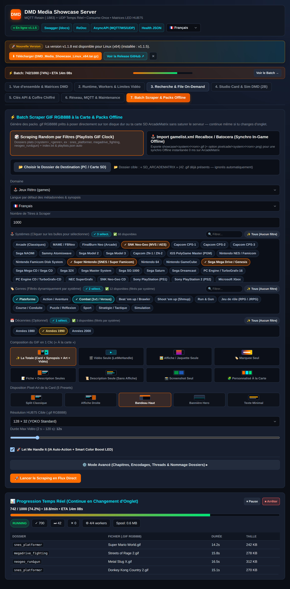

# Tutoriel Complet (Sans Jargon) : Mode Online, Mode Offline & Batch Scraper

🇬🇧 [English](TUTORIAL_ONLINE_OFFLINE_SCRAPING.md) | 🇫🇷 Français | 🇪🇸 [Español](TUTORIAL_ONLINE_OFFLINE_SCRAPING_ES.md)

Ce guide est conçu **pour tout le monde, sans aucune connaissance informatique requise**. Il explique simplement les **différences entre les modes Online et Offline**, **quoi choisir selon votre usage**, et **comment générer vos propres packs de GIFs clé en main** depuis un PC, un Mac, un serveur NAS/Docker ou même votre smartphone.

---

## 1. Comprendre la différence en 30 secondes : Online vs Offline vs Hybride

Imaginez votre écran LED **ArcadeMatrix** (ESP32, ESP32-S3 ou Raspberry Pi) comme un téléviseur :
- **Le Mode ONLINE (Streaming en direct)** fonctionne comme **Netflix / YouTube** : l'application **DMD Media Showcase** tourne sur un ordinateur, un mini-PC ou un NAS sur votre Wi-Fi et envoie en direct des milliers de jeux, films, séries et animes différents à votre écran LED, **sans jamais copier un seul fichier sur la carte SD** et **sans jamais répéter deux fois la même œuvre**.
- **Le Mode OFFLINE (Autonome sur Carte SD)** fonctionne comme une **clé USB remplie à l'avance** : vous utilisez l'onglet **7. Batch Scraper & Packs Offline** une seule fois pour fabriquer automatiquement vos `.gif` couleur `RGB888` triés dans des dossiers prêts à poser sur la carte MicroSD de l'écran. **Ensuite, vous pouvez éteindre votre PC et couper Internet : l'écran et votre borne Recalbox fonctionnent 100 % tout seuls !**
- **Le Mode HYBRIDE (Les deux combinés — Automatique !)** : vous mettez un pack Offline de vos jeux Recalbox sur la carte SD **ET** vous laissez Showcase activé quand votre PC/NAS est allumé. L'écran utilise **toujours vos GIFs locaux de la carte SD en priorité instantanée (`0 ms`, zéro attente)**, et bascule tout seul sur le serveur Online uniquement pour les jeux qui ne sont pas sur la carte SD !

| Critère | 🌐 **Mode 100 % ONLINE** *(Streaming Direct)* | 💾 **Mode 100 % OFFLINE** *(Packs sur Carte SD)* | ⚡ **Mode HYBRIDE** *(Carte SD + Serveur Online)* |
| :--- | :--- | :--- | :--- |
| **Faut-il laisser un PC / NAS / Docker allumé ?** | **Oui**, pendant que vous voulez du Showcase | **Non !** PC éteint après la création du pack | **Optionnel** (marche PC éteint comme PC allumé) |
| **Faut-il une connexion Internet ?** | **Oui** (pour chercher les nouveautés en direct) | **Non !** Idéal garage, salon d'arcade, expo, cadeau | Seulement pour les jeux absents de la carte SD |
| **Faut-il copier des fichiers sur la carte SD ?** | **Zéro fichier à copier** | **Oui, une seule fois** (glisser-déposer des dossiers) | Oui pour vos favoris, le reste vient en direct |
| **Vitesse au lancement d'un jeu Recalbox / Batocera** | Quelques secondes au 1er lancement *(puis `0 ms` si cache activé)* | **Instantané (`0 ms` immédiat après le marquee)** | **Instantané (`0 ms`)** sur vos packs + secours Online |
| **Variété du catalogue (Films, Séries, Anime, Jeux)** | **Quasi infinie** (zéro répétition) | Selon la taille du pack créé (`50`, `500`, `2 000+` GIFs) | **Maximale** |

---

## 2. Quoi faire exactement selon votre cas ? (4 Recettes Pas-à-Pas)

### 🟢 Cas n°1 — « J'ai le Wi-Fi chez moi et un PC / Mac / NAS : je veux zéro manipulation de carte SD » *(Mode Online)*
1. Lancez simplement **DMD Media Showcase** sur votre PC (`Start_Showcase_Windows.bat` / `.exe`), Mac ou NAS Docker. **Il n'y a rien d'autre à faire côté serveur** : l'interface Web sur `http://localhost:8890/` sert uniquement au **monitoring** (votre matrice s'y affichera toute seule, n'y créez pas de matrice manuellement) et à la personnalisation optionnelle.
2. Ouvrez la page Web de votre écran ArcadeMatrix (`http://arcadematrix.local` ou son IP) $\to$ **`Système -> 🔄 MQTT & API -> 🎬 DMD Media Showcase`** *(rangé ici car il s'agit d'une option compagnon annexe)*.
3. Passez **Activer DMD Media Showcase** sur **Activé**, cliquez sur **🔄 Tester** (si `http://dmdmediashowcase.local:8890` affiche `🔴 Injoignable` en Wi-Fi sur votre box, mettez directement l'IP locale de votre PC `http://192.168.1.XX:8890` visible dans la console du `.bat`), vérifiez **`🟢 Communication OK`**, puis cliquez tout en bas sur **Enregistrer les paramètres Showcase**.
4. Allez dans l'onglet **`Affichage`**, cliquez sur **➕ Ajouter à la boucle** sur **Vitrine Jeux Rétro**, **Vitrine Cinéma & Films**, **Vitrine Séries TV** ou **Vitrine Anime & OAV** (bouton **⚙️ Configurer -> 🔄 Sync** si vous souhaitez filtrer par console/genre), puis cliquez sur **Enregistrer la playlist** (ou **👁️ Afficher en direct (Live)**). Laissez 10 à 20 s au 1er média : ça diffuse tout seul !

---

### 🟣 Cas n°2 — « Je veux remplir ma carte SD de playlists de GIFs pour l'Horloge / Déco murale sans laisser de PC allumé » *(Mode Offline — Playlists Clock)*
Vous voulez par exemple **500 ou 1 000 GIFs** déjà triés proprement dans des dossiers `snes_platformer`, `megadrive_fighting`, `neogeo_run&gun`, `movies_scifi`... pour que votre horloge ArcadeMatrix affiche des animations variées toute l'année :

1. Ouvrez Showcase (`http://localhost:8890/`) et cliquez sur le dernier onglet **`7. Batch Scraper & Packs Offline`**.
2. Cliquez sur la carte **🎲 Scraping Random par Filtres (Playlists GIF Clock)**.
3. **En 3 clics simples** :
   - Choisissez le **Domaine** (*Jeux Rétro*, *Films*, *Séries* ou *Anime*), la **Langue** (`Français`), le **Nombre de titres** (ex. `200` ou `1000`), et **cliquez simplement sur les bulles** de **Systèmes**, **Genres** ou **Décennies** qui vous plaisent (aucun `Ctrl+Clic` nécessaire !).
   - Choisissez le style **« À la carte »** et la **Disposition de la Card** grâce aux **icônes visuelles de rendu du Studio** :
     - **✨ La Totale** : Fiche avec jaquette + synopsis défilant + panorama affiche + capture + extrait vidéo.
     - **🎬 Vidéo Seule** : Uniquement l'extrait gameplay/bande-annonce recadré par IA (`Let Me Handle It`).
     - **🖼️ Affiche Seule** / **🏷️ Marquee Seul** / **📸 Screenshot Seul** / **📝 Fiche + Description** / **📜 Description Seule**.
   - Vérifiez la **Résolution de votre écran** (ex. `128 × 32` pour un DMD classique, `256 × 64` HD, ou `64 × 128` pour un écran vertical **TATE**) et la **Durée max de la vidéo** (`2 s` à `120 s`, `8 s` par défaut).
4. Cliquez sur **🚀 Lancer le Scraping en Flux Direct** (vous pouvez continuer à naviguer sur d'autres onglets pendant que ça tourne !).
5. **Copiez sur la carte MicroSD** : glissez les dossiers générés (`snes_platformer`, `neogeo_run&gun`, etc. + le fichier `playlists.json`) dans le dossier **`/gifs/`** de votre carte SD (ou **`/gifs_tate/`** si votre écran est vertical).

---

### 🕹️ Cas n°3 — « J'ai une borne ou console Recalbox / Batocera : je veux le Showcase instantané en lançant un jeu, 100 % hors-ligne ! » *(Mode Offline — Synchro In-Game)*
Quand vous lancez *Metal Slug X* ou *Street Fighter II* sur votre borne, vous voulez voir le **Marquee officiel tout de suite**, suivi **3,5 secondes plus tard** de la **Fiche du jeu + Vidéo de gameplay**, même si votre borne n'a pas Internet et qu'aucun serveur PC ne tourne :

1. Récupérez le ou les fichiers **`gamelist.xml`** de votre Recalbox / Batocera :
   - Depuis votre PC sur le réseau : ouvrez `\\RECALBOX\share\roms\` (Windows) ou `smb://recalbox.local/share/roms/` (Mac). Dans chaque dossier de console (`neogeo`, `snes`, `megadrive`, `mame`...), il y a un petit fichier **`gamelist.xml`** qui liste exactement les jeux présents sur votre borne.
2. Ouvrez Showcase $\to$ onglet **`7. Batch Scraper & Packs Offline`** $\to$ cliquez sur **🕹️ Import `gamelist.xml` Recalbox / Batocera (Synchro In-Game Offline)**.
3. Sélectionnez un ou plusieurs fichiers **`gamelist.xml`** d'un coup : Showcase affiche aussitôt le nombre exact de vos jeux détectés (en ignorant automatiquement les fichiers BIOS et jeux cachés).
4. Choisissez la **Résolution** de votre DMD, laissez cochée l'option **Exporter aussi les marquees `pixelcade/<system>/<rom>.png`**, puis cliquez sur **🚀 Lancer le Scraping**.
5. **Copiez à la racine de la carte MicroSD de votre ArcadeMatrix** (ou dans le dossier `DATA` sur Raspberry Pi) les deux dossiers générés :
   - **`showcase/`** *(ou `showcase_tate/` en écran vertical)* $\to$ contient un `.gif` `RGB888` nommé exactement comme chacune de vos ROMs (`showcase/neogeo/mslugx.gif`).
   - **`pixelcade/`** $\to$ contient les marquees fixes assortis (`pixelcade/neogeo/mslugx.png`).
6. Sur la page Web de votre ArcadeMatrix (`Système -> MQTT & API -> 🎮 FrontendSync`), vérifiez simplement que **Showcase en Jeu** est coché (et choisissez `Une fois`, `Alterner` ou `Boucle`). **Même avec Showcase Server coupé (`⚪ Désactivé`), votre DMD détecte automatiquement les `.gif` de la carte SD et les lance en `0 ms` !**

---

### ⚡ Cas n°4 — « Je veux le Mode Hybride (Carte SD + Serveur Online quand mon PC est allumé) »
Vous n'avez **aucun bouton spécial à activer** :
1. Déposez vos packs Offline Recalbox dans `/showcase/` sur la carte SD (Cas n°3) **et** laissez **Showcase Server** activé sur l'écran (Cas n°1).
2. Lorsque vous lancez un jeu :
   - **Le `.gif` existe sur la carte SD ?** $\to$ Lecture locale immédiate en `0 ms` (**zéro requête réseau**, zéro sollicitation du serveur).
   - **Vous lancez un nouveau jeu que vous n'aviez pas encore mis sur la carte SD ?** $\to$ Si le serveur Showcase est allumé, il prend automatiquement le relais en direct !

---

## 3. PC Local, Serveur Docker/NAS ou Smartphone : comment sont enregistrés les fichiers ?



L'application s'adapte **automatiquement** à l'appareil et au navigateur que vous utilisez, **sans jamais saturer la mémoire ni le disque du serveur** :

### 💻 A. Depuis un PC ou Mac avec Chrome / Edge / Brave (`http://localhost:8890`) — *Écriture directe dans votre dossier !*
- Cliquez sur **📂 Choisir le Dossier de Destination** et sélectionnez directement un dossier de votre disque dur ou votre **carte MicroSD branchée en USB**.
- Showcase crée tout seul les dossiers et **écrit chaque `.gif` directement sur votre disque au fur et à mesure** qu'il est converti, en l'effaçant aussitôt côté serveur.
- **Reprise intelligente** : si vous relancez un scraping la semaine suivante dans le même dossier, Showcase scanne d'abord vos `.gif` déjà présents et **ne télécharge que les nouveaux** !
- **Changement d'onglet autorisé** : vous pouvez aller sur un autre onglet (ou réduire la fenêtre), une mini-barre en haut de l'écran affiche l'avancement et l'écriture continue à 100 % de sa vitesse.

### 🐳 B. Depuis un Serveur Docker / NAS distant (`http://192.168.x.x:8890`) ou Firefox / Safari Mac — *Flux `.zip` direct zéro mémoire !*
- Lorsque Showcase tourne sur une autre machine (NAS Synology, Raspberry Pi, Unraid, Proxmox) ou sur Firefox/Safari, le navigateur n'a pas le droit d'écrire directement dans un dossier système sans passer par un téléchargement.
- **Aucun volume Docker supplémentaire à configurer** : Showcase regroupe vos dossiers et vos `.gif` à la volée dans une archive **`dmd_pack_<id>.zip`** dans votre dossier **Téléchargements**, puis **supprime automatiquement tous les fichiers temporaires du serveur** dès la fin du téléchargement (`0 Mo` conservé sur le NAS/Docker !). En cas de micro-coupure Wi-Fi, le bouton **`📥 Télécharger Flux (.zip)`** permet de relancer le téléchargement sans perdre un seul fichier.

### 📱 C. Depuis un Smartphone ou une Tablette (iPhone, iPad, Android) — *Mode Mobile Sans Blocage !*
Sur téléphone et tablette, les systèmes **iOS (Safari)** et **Android (Chrome)** interdisent par sécurité à un site Web d'écrire des centaines de fichiers séparés directement dans les dossiers internes du téléphone, et coupent les téléchargements continus si l'écran se verrouille.

**DMD Media Showcase intègre donc un Mode Mobile dédié qui évite tout blocage :**
1. Dès que vous ouvrez l'onglet **7. Batch Scraper** sur votre iPhone, iPad ou Android, le bandeau **`📱 Mode Smartphone / Tablette`** s'active automatiquement.
2. Lancez votre scraping : **l'écran du téléphone est maintenu éveillé automatiquement** (`Wake Lock`), et **même si vous verrouillez le téléphone ou répondez à un message**, le serveur continue de préparer tranquillement tous vos `.gif` en arrière-plan sans jamais bloquer !
3. Dès que la barre atteint **100 %**, un gros bouton vert **`✅ Télécharger le Pack Prêt (.zip)`** s'allume : **un seul appui du doigt** télécharge l'archive complète en quelques secondes à pleine vitesse Wi-Fi dans l'application **Fichiers** (iPhone/iPad) ou **Téléchargements** (Android), puis vide aussitôt l'espace temporaire du serveur !

---

## 4. Aide-Mémoire : Où copier les dossiers sur la carte MicroSD ?

```text
📁 Racine de la carte MicroSD ArcadeMatrix (ou lecteur DATA sur Raspberry Pi)
├── 📂 gifs/                     👈 Mode Playlists Horloge (Écran Horizontal YOKO : 128×32, 256×64...)
│   ├── playlists.json           (Généré automatiquement — reconnu tout de suite par l'Horloge)
│   ├── 📂 snes_platformer/      (Contient vos .gif RGB888 + index.txt auto-généré)
│   ├── 📂 megadrive_fighting/
│   └── 📂 neogeo_run&gun/
│
├── 📂 gifs_tate/                👈 Mode Playlists Horloge (Écran Vertical TATE : 64×128, 32×128...)
│   └── ...
│
├── 📂 showcase/                 👈 Mode Recalbox / Batocera Offline (Écran Horizontal YOKO)
│   ├── 📂 neogeo/               (ex: mslugx.gif, garou.gif — nom exact de la ROM)
│   ├── 📂 snes/
│   └── 📂 cps2/
│
├── 📂 showcase_tate/            👈 Mode Recalbox / Batocera Offline (Écran Vertical TATE)
│   └── 📂 neogeo/
│
└── 📂 pixelcade/                👈 Marquees fixes compagnons (Option cochée par défaut en mode Recalbox)
    └── 📂 neogeo/               (ex: mslugx.png — affiché en 0 ms dans les menus et avant la vidéo)
```

---

## 5. Questions Fréquentes des Utilisateurs

- **« Quelle durée vidéo choisir ? »**
  Entre **`8 s` et `15 s`** est idéal pour garder des fichiers légers (`~150 Ko à 350 Ko` par GIF en `128×32`) et dynamiques. Vous pouvez monter jusqu'à **`120 secondes` maximum** si vous voulez de longs extraits de gameplay ou génériques complets d'anime !
- **« Dois-je toucher aux réglages avancés ? »**
  **Non !** Le bouton **🚀 Let Me Handle It** (coché par défaut) active automatiquement l'intelligence artificielle de cadrage d'action et le boost de couleurs spécial LED HUB75 en vraies couleurs **24 bits `RGB888`**. Le **Mode Avancé** est là uniquement si vous voulez régler finement le nombre de threads CPU (`Workers`), le style de carte (*Neon Border*, *Amber Pinball*...), le nombre de captures d'écran ou les FPS.
- **« Est-ce qu'un gros scraping va dérégler la diffusion en direct de mon écran LED ? »**
  **Jamais.** Le Batch Scraper travaille dans une file totalement séparée : il ne modifie pas votre historique d'œuvres déjà vues (`seen_history.json`) et n'interrompt aucun écran connecté.
- **« Que se passe-t-il si je ferme la fenêtre du navigateur par erreur ou si je perds la connexion ? »**
  **Rien ne s'arrête !** Chaque lancement est une **tâche persistante côté serveur** (`batch_jobs.json`) : le scraping et l'encodage continuent jusqu'au bout en tâche de fond même navigateur fermé. Dès que vous rouvrez la page `:8890` (même depuis un autre onglet ou votre téléphone), le bandeau en haut et la console de progression réapparaissent automatiquement pour reconnecter votre dossier en 1 clic ou télécharger le pack `.zip` prêt !
